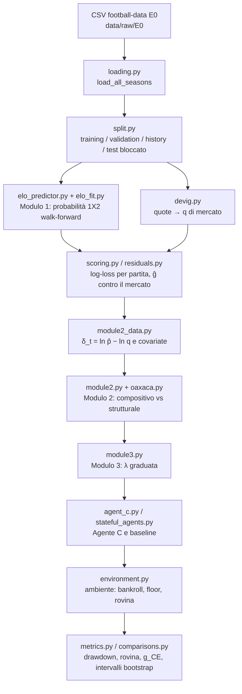

# Guida completa alla tesi *Structural-Hybrid Kelly*

**Teoria delle note in `docs/note/`, prerequisiti e spiegazione di tutto il codice in `src/`, `scripts/` e `tests/`**

> Questa guida è pensata per chi ha lacune sulle basi (algebra, probabilità, statistica, programmazione a oggetti). Ogni concetto viene introdotto da zero prima di essere usato. Le formule sono scritte in LaTeX (`$...$`), come nelle note: si leggono bene in Obsidian, in VS Code con l'anteprima Markdown e su GitHub.
>
> **Come è organizzata**
> - **Parte 0**: di cosa parla la tesi, in una pagina, e come è fatto il repository.
> - **Parte 1**: prerequisiti (notazione, logaritmi, derivate, probabilità, statistica, regressione, serie temporali, bootstrap, teoria dell'informazione, Python, NumPy, pandas, programmazione a oggetti, pytest).
> - **Parti 2–4**: le 23 note teoriche (1.1–1.9, 2.1–2.9, 3.1–3.5), una sezione per nota. Ogni sezione finisce con un riquadro **🔗 Nel codice** che dice dove quella teoria vive nel repository.
> - **Parte 5**: i quattro PDF (KellyBench e i tre paper del relatore).
> - **Parte 6**: il codice modulo per modulo (tutti i file di `src/shk/`).
> - **Parte 7**: gli esperimenti C1–C9 (gli script), con i risultati numerici e cosa significano.
> - **Parte 8**: i test, la configurazione, i prototipi, come rieseguire tutto.
> - **Appendici**: formulario e glossario.
>
> Riferimenti a file e righe sono scritti come `percorso/file.py` e sono cliccabili nell'editor.

---

## Indice

- [Parte 0 — Orientamento](#parte-0--orientamento)
- [Parte 1 — Prerequisiti](#parte-1--prerequisiti)
- [Parte 2 — Fondamenti statistici (note 1.1–1.9)](#parte-2--fondamenti-statistici-note-1119)
- [Parte 3 — Dominio scommesse (note 2.1–2.9)](#parte-3--dominio-scommesse-note-2129)
- [Parte 4 — Agenti e LLM (note 3.1–3.5)](#parte-4--agenti-e-llm-note-3135)
- [Parte 5 — I paper in PDF](#parte-5--i-paper-in-pdf)
- [Parte 6 — Il codice modulo per modulo](#parte-6--il-codice-modulo-per-modulo)
- [Parte 7 — Gli esperimenti C1–C9 e i risultati](#parte-7--gli-esperimenti-c1c9-e-i-risultati)
- [Parte 8 — Test, configurazione, prototipi, riproducibilità](#parte-8--test-configurazione-prototipi-riproducibilità)
- [Appendice A — Formulario](#appendice-a--formulario)
- [Appendice B — Glossario](#appendice-b--glossario)

---

# Parte 0 — Orientamento

## 0.1 La tesi in una pagina

**Il punto di partenza.** Un paper del 2026, *KellyBench* (Grady et al., file `docs/note/KellyBenchPaper.pdf`), ha messo dei modelli linguistici di frontiera (LLM, tipo GPT o Claude) dentro un ambiente simulato in cui devono **scommettere su un'intera stagione di Premier League** (il 2023-24), partita dopo partita, partendo da un capitale (*bankroll*) di £220. Gli agenti possono scrivere codice, costruire modelli, decidere quanto puntare. Risultato: quasi tutti **perdono soldi**, e il paper cataloga i loro *modi di fallimento* (puntate troppo grandi, leakage nei dati, strategie incoerenti nel tempo...).

**L'idea della tesi.** Invece di un LLM costoso (circa 2.000 $ per una sola esecuzione), si costruisce un agente **deterministico e interpretabile**, chiamato **Agente C** (*Structural-Hybrid*), fatto di tre moduli, secondo lo schema *worker/supervisor*:

| Modulo | Ruolo | Cosa fa | Dove nel codice |
|---|---|---|---|
| **Modulo 1** | *worker* (lavoratore) | prevede le probabilità di vittoria casa / pareggio / vittoria trasferta (1X2) di ogni partita | modello **Elo** (`src/shk/model/elo*.py`), poi **Dixon-Coles** (`src/shk/model/dixon_coles*.py`) |
| **Modulo 2** | *supervisor* (supervisore) | controlla se il Modulo 1 sta peggiorando, e **di che tipo** è il peggioramento: *compositivo* (sono cambiate le partite) o *strutturale* (è cambiato il rapporto fra informazioni e risultati) | decomposizione di **Oaxaca-Blinder** su finestre mobili (`src/shk/stats/oaxaca.py`, `src/shk/model/module2*.py`) |
| **Modulo 3** | *ricalibratore* | trasforma il giudizio del Modulo 2 in **quanto puntare**: una frazione $\lambda$ del Kelly | $\lambda^* = \mathbb{E}[c]/\mathbb{E}[c^2]$ (`src/shk/model/module3*.py`, `src/shk/model/agent_c.py`) |

L'Agente C viene confrontato **in modo appaiato** (stesse partite, stesse quote, stessi esiti) con agenti di riferimento, le *baseline*:

- **A** — Kelly pieno ($\lambda = 1$);
- **B** — Kelly frazionario fisso ($\lambda = 0.25$ e $\lambda = 0.10$);
- **D** — Kelly frazionario con un *drift detector* standard (ADWIN o Page-Hinkley) che riduce la puntata quando suona un allarme;
- **E** — puntata minima permanente (non scommette mai volontariamente, paga solo la puntata obbligatoria);
- **C0, C1, C2_global, C2** — i "bracci" dell'*ablazione* dell'Agente C (supervisore spento, supervisore che rileva ma non gradua, supervisore che gradua, supervisore che gradua e si astiene sulle partite "fuori supporto").

**La domanda della tesi.** I detector standard dicono **quando** un modello smette di funzionare. Il framework proposto vuole dire **quanto** e **di che tipo**, e solo questa seconda informazione si traduce in una regola di puntata *graduata*. Se C non batte D, il contributo originale non esiste; se C non batte E, il framework non serve (todo §5.3).

**Il vincolo che definisce tutto.** Dalla teoria di Kelly (nota 1.1 §4.4):

$$
g = D_{KL}(p^*\,\|\,q) - D_{KL}(p^*\,\|\,p)
$$

La crescita del capitale è positiva **solo se il modello è più vicino alla verità del mercato**. Nessuna regola di puntata può creare un vantaggio che il modello non ha. Nel codice questo si misura con lo stimatore $\hat g$ (esperimento C4.2) ed **è risultato negativo in tutti i casi** ($\hat g \approx -0.021$ contro le quote Bet365, $\approx -0.031$ contro le quote di chiusura Pinnacle). Quindi la tesi **non** dimostra come guadagnare: studia come **perdere più lentamente e con meno rischio** quando il modello non batte il mercato. Questo va detto in apertura della tesi, non nei limiti.

## 0.2 Il vocabolario del progetto (sigle che trovi ovunque)

| Sigla | Significato | Esempio |
|---|---|---|
| **C1…C9** | *checkpoint* di programmazione definiti nel TODO (`docs/note/todo_prerequisiti_tesi_v4.md` §12). Uno per "grappolo" di teoria | C4 = Elo e go/no-go |
| **US-Cx.y** | *user story*: un requisito dentro un checkpoint | US-C6.3 = test del floor |
| **S1…S12** | *story* del backlog (`.agent/BACKLOG.md`), cioè blocchi di lavoro | S8 = Oaxaca-Blinder (C7) |
| **T1…T66** | *task*: i singoli lavori di programmazione, con un report in `.agent/report/T<n>.md` | T51 = Modulo 3 |
| **E0** | codice della Premier League nei file di football-data.co.uk | `data/raw/E0/2010-11.csv` |
| **B365H/D/A** | quote Bet365 pre-partita per casa / pareggio / trasferta | colonne dei CSV |
| **PSCH/D/A** | quote Pinnacle di chiusura | dal 2012-13 |
| **FTR** | *Full Time Result*: `H`, `D` o `A` | esito della partita |
| **FTHG / FTAG** | gol della squadra di casa / trasferta a fine partita | usati da Dixon-Coles |

Gli script seguono una convenzione fissa: `scripts/us_c<X>_<Y>_<nome>.py` scrive `results/us_c<X>_<Y>_<nome>.csv` e `thesis/figures/us_c<X>_<Y>_<nome>.png`. Quindi da un nome di file si risale sempre al checkpoint.

## 0.3 Com'è fatto il repository

```
structural_hybrid_kelly/
├── docs/note/            ← le note teoriche (questa guida le spiega) + 4 PDF + prototipi/
├── src/shk/              ← la libreria Python "shk" (Structural Hybrid Kelly)
│   ├── kelly/            ← formule di Kelly, simulatore, staking, agenti, ambiente, floor
│   ├── stats/            ← statistica pura: ANOVA, bootstrap, drift, eteroschedasticità, Oaxaca, Ñopo
│   ├── data/             ← caricamento CSV, split congelato, anti-leakage
│   ├── market/           ← quote → probabilità (de-vigging), divergenza fra metodi
│   └── model/            ← Modulo 1/2/3, agenti con stato, pipeline sui dati reali
├── scripts/              ← un esperimento per file (us_c1_1 … us_c9_1)
├── results/              ← CSV prodotti dagli script (versionati)
├── thesis/figures/       ← PNG prodotti dagli script (versionati)
├── tests/                ← test automatici (pytest)
├── config/               ← split.toml (split congelato) e frozen_params.toml (parametri congelati)
├── data/raw/E0/          ← i CSV di football-data.co.uk (NON versionati)
└── .agent/               ← file di lavoro del protocollo (mappa, scheda, backlog, report)
```

**Regola di dipendenza fra sottopacchetti** (decisione S5): `kelly/`, `stats/`, `data/` e `market/` **non** importano da `model/`. È `model/` che mette insieme tutto. Così le parti matematiche restano pure (lavorano su array) e testabili da sole.

## 0.4 Il flusso dei dati, dall'inizio alla fine



## 0.5 Lo stato dei lavori (al 2026-10-12)

- **C1–C6** chiusi: simulatore, ANOVA, dati, Elo, drift detector, backtest e floor.
- **C7** (Modulo 2) e **C8** (Modulo 3, Agente C, congelamento dei parametri, esecuzione su validazione, intervalli, confronti) eseguiti nei task T40–T58; i parametri sono stati congelati in `config/frozen_params.toml` il 2026-10-11 e il test set 2023-24 è stato sbloccato il 2026-10-12 (`config/split.toml`).
- **C9** (Dixon-Coles) in corso: `src/shk/model/dixon_coles.py`, `dixon_coles_calibration.py`, `module1.py` e lo script `us_c9_1_dixon_coles.py` esistono ma non sono ancora committati.

---

# Parte 1 — Prerequisiti

Questa parte si può saltare e consultare quando serve. Le Parti 2–8 rimandano qui con riferimenti tipo "(→ P1.4)".

## P1.1 Notazione matematica di base

| Simbolo | Si legge | Significato | Esempio |
|---|---|---|---|
| $\sum_{i=1}^{n} x_i$ | "sommatoria per i da 1 a n di x con i" | $x_1 + x_2 + \dots + x_n$ | $\sum_{i=1}^{3} i = 1+2+3 = 6$ |
| $\prod_{i=1}^{n} x_i$ | "produttoria" | $x_1 \cdot x_2 \cdots x_n$ | $\prod_{i=1}^{3} i = 6$ |
| $\bar x$ | "x segnato" | media aritmetica $\frac{1}{n}\sum x_i$ | |
| $\hat\theta$ | "theta cappello" | **stima** di una quantità vera $\theta$ | $\hat p$ = probabilità stimata dal modello |
| $\theta^*$ | "theta star" | valore **ottimo** o **vero** (dipende dal contesto) | $f^*$ = frazione ottima di Kelly; $p^*$ = probabilità vera |
| $x \in [a, b)$ | "x appartiene all'intervallo da a incluso a b escluso" | $a \le x < b$ | $f \in [0,1)$ |
| $\max(a,b)$ | massimo | il più grande dei due | $\max(0, -3) = 0$ |
| $\arg\max_x f(x)$ | "argomento del massimo" | **il valore di x** in cui f è massima (non il massimo stesso) | $\arg\max$ di $[0.1, 0.5, 0.2]$ è l'indice 1 |
| $\approx$ | circa uguale | | |
| $\propto$ | proporzionale a | uguale a meno di una costante moltiplicativa | $q_i \propto \tilde p_i^k$ |
| $\Rightarrow$, $\iff$ | implica, se e solo se | | |
| $\lvert x \rvert$ | valore assoluto | | $\lvert -2 \rvert = 2$ |
| $\lceil x \rceil$, $\lfloor x \rfloor$ | parte intera superiore / inferiore | arrotonda per eccesso / difetto | $\lceil 2.1 \rceil = 3$ |
| $x \to \infty$ | x tende all'infinito | limite | |
| $\mathbb{1}(A)$ o $I(A)$ | indicatrice | vale 1 se A è vera, 0 altrimenti | |

**Vettori e matrici in una riga.** Un *vettore* è una lista ordinata di numeri, $\mathbf{x} = (x_1, \dots, x_k)$. Una *matrice* è una tabella di numeri con $n$ righe e $k$ colonne; si dice "di forma $(n, k)$". In NumPy questa "forma" si chiama proprio `shape` (→ P1.11). Il prodotto scalare di due vettori è $\mathbf{x}^\top \boldsymbol\beta = \sum_j x_j \beta_j$ (il simbolo $^\top$ è la *trasposta*: scambia righe e colonne).

## P1.2 Potenze, esponenziale e logaritmo

Questa è la sezione più importante dei prerequisiti: **tutta la tesi gira intorno al logaritmo**.

**Esponenziale.** $e \approx 2.71828$ è il numero di Nepero. $e^x$ (scritto anche $\exp(x)$) è sempre positivo, vale 1 in $x = 0$, cresce molto in fretta.

**Logaritmo naturale.** $\ln x$ è l'inverso dell'esponenziale: $\ln x = y \iff e^y = x$. È definito solo per $x > 0$.

Proprietà da sapere a memoria:

| Proprietà | Formula | Perché conta nella tesi |
|---|---|---|
| prodotto → somma | $\ln(ab) = \ln a + \ln b$ | il capitale **si moltiplica** a ogni scommessa; il suo logaritmo **si somma**. Le somme sono facili da studiare (medie, varianze, legge dei grandi numeri) |
| potenza → prodotto | $\ln(a^k) = k \ln a$ | |
| rapporto → differenza | $\ln(a/b) = \ln a - \ln b$ | $\delta_t = \ln \hat p_t - \ln q_t = \ln(\hat p_t / q_t)$ |
| valore in 1 | $\ln 1 = 0$ | capitale invariato ↔ log-capitale nullo |
| segno | $\ln x < 0$ se $0 < x < 1$ | log-loss $-\ln p$ è sempre $\ge 0$ |
| verso $0$ | $\ln x \to -\infty$ se $x \to 0^+$ | se il capitale va a zero il log-capitale va a $-\infty$: è il motivo per cui Kelly evita a ogni costo la rovina |

**Esempio che spiega tutta la nota 1.1.** Parti con 100 €. Vinci il 50% (×1.5), poi perdi il 50% (×0.5). Capitale finale: $100 \cdot 1.5 \cdot 0.5 = 75$ €. La media aritmetica dei rendimenti era $(+50\% - 50\%)/2 = 0\%$, eppure hai perso! Col logaritmo: $\ln 1.5 + \ln 0.5 = 0.405 - 0.693 = -0.288$, e $e^{-0.288} = 0.75$. **La somma dei logaritmi racconta la verità, la media dei rendimenti no.**

**Altre basi.** $\log_{10}$ e $\log_2$ sono logaritmi in base 10 e 2: $\log_b x = \ln x / \ln b$. Il modello Elo usa $10^{x/400}$; la teoria dell'informazione usa $\log_2$ (bit) o $\ln$ (nat).

**Approssimazione di Taylor** (serve per capire Kelly "diffusivo" e $\lambda^*$): per $x$ piccolo,

$$
\ln(1+x) \approx x - \frac{x^2}{2}.
$$

Ad esempio $\ln(1.02) = 0.0198$ e $0.02 - 0.0002 = 0.0198$.

## P1.3 Derivate, massimi e ottimizzazione numerica

**Derivata.** La derivata $f'(x)$ (o $\frac{df}{dx}$) è la pendenza della curva $f$ nel punto $x$. Regole minime:

- $(x^n)' = n x^{n-1}$; $(\ln x)' = 1/x$; $(e^x)' = e^x$;
- $(\ln(1 + bx))' = \frac{b}{1 + bx}$ (regola della catena: derivata della funzione esterna per derivata dell'interna).

**Trovare un massimo.** In un punto di massimo (o minimo) interno la pendenza è nulla: $f'(x) = 0$ (*condizione del primo ordine*). Per sapere se è un massimo si guarda la derivata seconda: se $f''(x) < 0$ la funzione è *concava* (a forma di "cupola") e il punto è un massimo (*condizione del secondo ordine*). La derivazione di Kelly (nota 1.1 §2) è esattamente questo.

**Funzione concava.** Una funzione è concava se il segmento fra due punti del grafico sta sempre sotto il grafico. Il logaritmo è concavo. Una funzione concava ha al più un massimo, e se lo trova lo trova globale: è il motivo per cui il problema di Kelly ha sempre una soluzione unica.

**Ottimizzazione numerica.** Quando l'equazione $f'(x)=0$ non si risolve a mano, si usa un algoritmo. Nel codice ne compaiono quattro:

| Algoritmo | Idea | Dove |
|---|---|---|
| **Newton** | parti da un punto, approssima la funzione con la sua tangente, salta dove la tangente si annulla, ripeti. Velocissimo vicino alla soluzione | `devig_power` (trova l'esponente $k$) |
| **Bisezione / Brent** (metodi *a intervallo garantito*) | se $f(a) < 0 < f(b)$, la radice sta in $[a, b]$: dimezza l'intervallo finché è piccolissimo. Lento ma sicuro | `devig_shin`, `devig_odds_ratio` |
| **Nelder-Mead** | ottimizzazione senza derivate: un "triangolo" di punti che rotola, si allunga e si restringe verso il minimo | calibrazione di K, h, ν dell'Elo (`elo_fit.py`) |
| **L-BFGS-B** | metodo *quasi-Newton* con vincoli sui parametri (B = *bounds*) | Platt (`recalibration.py`), Dixon-Coles |

**Massima verosimiglianza (MLE).** Hai un modello che, dati dei parametri $\theta$, assegna una probabilità $P(\text{dati} \mid \theta)$ ai dati osservati. La *verosimiglianza* è questa probabilità vista come funzione di $\theta$. La stima di massima verosimiglianza è il $\theta$ che la rende massima. Per comodità si massimizza il **logaritmo** della verosimiglianza (la *log-verosimiglianza*), che trasforma il prodotto sulle osservazioni indipendenti in una somma. **Minimizzare la log-loss media è la stessa cosa che massimizzare la log-verosimiglianza**: è ciò che fanno sia la calibrazione Elo sia Dixon-Coles.

## P1.4 Probabilità

**Esperimento, evento, probabilità.** Una partita è un esperimento con tre esiti possibili: H (vince la casa), D (pareggio), A (vince la trasferta). Un *evento* è un insieme di esiti. La probabilità $P$ assegna a ogni evento un numero in $[0, 1]$, con $P(\text{tutto}) = 1$. Per esiti mutuamente esclusivi le probabilità si sommano: $p_H + p_D + p_A = 1$.

**Probabilità condizionata e indipendenza.** $P(A \mid B) = P(A \cap B)/P(B)$ è la probabilità di A sapendo che B è successo. A e B sono *indipendenti* se $P(A \cap B) = P(A)P(B)$. Molti strumenti statistici assumono osservazioni indipendenti: **le traiettorie di un bankroll non lo sono**, ed è un tema ricorrente della tesi.

**Variabile aleatoria.** Un numero che dipende dal caso: il guadagno di una scommessa, i gol segnati, la log-loss di una partita.

**Valore atteso (media teorica).** $\mathbb{E}[X] = \sum_x x \cdot P(X = x)$. È la media che otterresti ripetendo l'esperimento infinite volte. Proprietà: è *lineare*, $\mathbb{E}[aX + bY] = a\mathbb{E}[X] + b\mathbb{E}[Y]$. **Attenzione**: $\mathbb{E}[\ln X] \ne \ln \mathbb{E}[X]$ (per la concavità, $\mathbb{E}[\ln X] \le \ln \mathbb{E}[X]$: *disuguaglianza di Jensen*). È la differenza fra la crescita "tipica" e quella "media" di Kelly.

**Varianza e deviazione standard.** $\mathrm{Var}(X) = \mathbb{E}[(X - \mathbb{E}X)^2] = \mathbb{E}[X^2] - (\mathbb{E}X)^2$. Misura la dispersione. La deviazione standard (SD) è $\sigma = \sqrt{\mathrm{Var}}$, nella stessa unità di $X$. Proprietà: $\mathrm{Var}(aX) = a^2 \mathrm{Var}(X)$; per variabili indipendenti $\mathrm{Var}(X+Y) = \mathrm{Var}X + \mathrm{Var}Y$.

> **Formula che ritorna nel Modulo 3.** Da $\mathrm{Var}(c) = \mathbb{E}[c^2] - (\mathbb{E}c)^2$ si ricava $\mathbb{E}[c^2] = \mathrm{Var}(c) + (\mathbb{E}c)^2$. Se $\mathbb{E}[c] = 1$, allora $\lambda^* = \mathbb{E}[c]/\mathbb{E}[c^2] = 1/(1 + \mathrm{Var}(c))$.

**Covarianza e correlazione.** $\mathrm{Cov}(X,Y) = \mathbb{E}[(X - \mathbb{E}X)(Y - \mathbb{E}Y)]$: positiva se X e Y tendono a salire insieme. La correlazione $\rho = \mathrm{Cov}/(\sigma_X \sigma_Y)$ è la covarianza normalizzata in $[-1, 1]$.

**Mediana e quantili.** La mediana è il valore che lascia metà dei casi sotto e metà sopra. Il quantile al 95% lascia sotto il 95% dei casi. Per distribuzioni *asimmetriche* (come quella del capitale finale) media e mediana possono essere lontanissime: un solo giocatore fortunatissimo alza la media, non la mediana. Per questo la tesi riporta la **mediana** del capitale.

**Due teoremi fondamentali.**

1. **Legge dei grandi numeri**: la media di $n$ osservazioni indipendenti con la stessa distribuzione tende al valore atteso quando $n \to \infty$. È ciò che rende il tasso di crescita $\frac{1}{n}\ln(X_n/X_0)$ convergente a $g(f)$ (nota 1.1 §4.1).
2. **Teorema del limite centrale (TLC)**: la media di molte osservazioni indipendenti è circa *normale* (gaussiana), qualunque sia la distribuzione di partenza, con deviazione standard $\sigma/\sqrt{n}$ (*errore standard*). È la base di quasi tutti i test (z-test, intervalli $\pm 1.96$ SE).

### Le distribuzioni che compaiono

| Distribuzione | Descrive | Parametri | Media / Varianza | Dove |
|---|---|---|---|---|
| **Bernoulli** | un singolo sì/no | $p$ | $p$ / $p(1-p)$ | esito di una scommessa (`draw_outcomes`) |
| **Binomiale** | numero di successi in $n$ prove | $n, p$ | $np$ / $np(1-p)$ | "quante stagioni su 19 rigettano" (`binomial_exceedance_p_value`) |
| **Categorica** | un esito fra $k$ | $p_1..p_k$ | | esito 1X2 (`sample_match_outcomes`) |
| **Poisson** | conteggi (es. gol) | $\lambda$ | $\lambda$ / $\lambda$ | gol in Dixon-Coles |
| **Geometrica** | numero di prove fino al primo successo | $p$ | $1/p$ | lunghezza dei blocchi dello *stationary bootstrap* |
| **Normale** $N(\mu, \sigma^2)$ | la "campana" | $\mu, \sigma$ | $\mu$ / $\sigma^2$ | rumore di stima, z-test |
| **Log-normale** | $e^Y$ con $Y$ normale | | media > mediana | capitale finale sotto Kelly |
| **Chi-quadro** $\chi^2_k$ | somma di $k$ normali standard al quadrato | $k$ (gradi di libertà) | $k$ / $2k$ | test di Breusch-Pagan e White |
| **F di Fisher** $F(d_1, d_2)$ | rapporto di due chi-quadro normalizzati | $d_1, d_2$ | | ANOVA |

**La normale standard** $Z \sim N(0,1)$ ha funzione di ripartizione $\Phi(z) = P(Z \le z)$. Valori da ricordare: $\Phi(1.96) = 0.975$ (quindi $P(|Z| > 1.96) = 5\%$), $\Phi(2.576) = 0.995$ ($P(|Z|>2.576) = 1\%$), $\Phi(0.8416) = 0.80$. In Python: `scipy.stats.norm.cdf` è $\Phi$, `norm.ppf` è la sua inversa (il quantile).

## P1.5 Statistica inferenziale

**Popolazione, campione, stimatore.** La "popolazione" è il fenomeno vero (es. tutte le partite possibili); il campione sono i dati che hai. Uno *stimatore* è una formula che dal campione dà un numero che approssima una quantità vera. È *non distorto* se in media dà il valore vero.

**Errore standard (SE).** La deviazione standard di uno stimatore: quanto varierebbe se ripetessi l'esperimento. Per la media di $n$ osservazioni indipendenti: $\mathrm{SE} = \sigma/\sqrt{n}$. **Se le osservazioni sono autocorrelate questa formula sottostima l'incertezza** (→ P1.7).

**Intervallo di confidenza (IC) al 95%.** Un intervallo costruito con una procedura che, ripetuta tante volte, contiene il valore vero il 95% delle volte. Forma tipica: stima $\pm 1.96 \cdot \mathrm{SE}$. La *copertura* è la frequenza con cui l'intervallo contiene davvero il valore vero: molti test della tesi controllano che sia fra 0.93 e 0.97.

**Test d'ipotesi.**

1. **Ipotesi nulla $H_0$**: "non succede niente" (nessuna differenza, nessun drift, varianza costante).
2. **Statistica test**: un numero calcolato dai dati che è "grande" quando $H_0$ è falsa (F, Z, LM...).
3. **Distribuzione sotto $H_0$**: come si distribuirebbe la statistica se $H_0$ fosse vera.
4. **Soglia (valore critico)**: si rifiuta $H_0$ se la statistica supera il quantile $1 - \alpha$ della sua distribuzione sotto $H_0$. $\alpha$ (di solito 0.05) è il *livello* del test.
5. **p-value**: la probabilità, sotto $H_0$, di osservare una statistica estrema almeno quanto quella osservata. Si rifiuta se p < α.

**Errori.**

| | $H_0$ vera | $H_0$ falsa |
|---|---|---|
| **rifiuto** | errore di I tipo (*falso allarme*), probabilità $\alpha$ | corretto (*potenza* $1-\beta$) |
| **non rifiuto** | corretto | errore di II tipo, probabilità $\beta$ |

**Tasso di falso rigetto.** Se un test ha livello nominale 5% ma, su dati dove $H_0$ è vera, rifiuta il 40% delle volte, è un test *rotto*. Il checkpoint C2 mostra proprio questo: l'ANOVA su serie autocorrelate rifiuta fino al 40% invece del 5%.

**Test multipli.** Se fai 38 test indipendenti a $\alpha = 0.05$, ti aspetti $38 \cdot 0.05 = 1.9$ falsi allarmi anche se non succede niente. La probabilità di almeno un falso allarme (*FWER*, family-wise error rate) è $1 - 0.95^{38} \approx 86\%$. Correzione di **Bonferroni**: usa $\alpha/m$ per ciascuno degli $m$ test. Il numero 1.9 compare nel codice (`TARGET_ALARMS_PER_SEASON = 1.9`).

**Monte Carlo.** Quando non sai calcolare una probabilità a mano, la *simuli*: generi migliaia di dati finti con il computer e conti. Un tasso stimato su $R$ repliche ha errore standard $\sqrt{p(1-p)/R}$. Esempio del codice: con $p = 0.05$ e $R = 1000$, l'intervallo al 99% è $0.05 \pm 2.576\sqrt{0.05 \cdot 0.95/1000} = [0.0322, 0.0678]$ (lo trovi in `false_rejection.py`).

**Effect size.** Un p-value piccolissimo dice che un effetto c'è, non che è grande. Con tanti dati anche un effetto minuscolo diventa "significativo". Le misure di *effect size* (d di Cohen, R², OVL) dicono **quanto** è grande l'effetto. Sono il tema della nota 1.3.

## P1.6 Regressione lineare (OLS), in forma matriciale

La regressione lineare è lo strumento alla base di Oaxaca-Blinder (Modulo 2), di Breusch-Pagan e White (eteroschedasticità), del VIF.

**Il modello.** Per ogni osservazione $i$:

$$
y_i = \beta_0 + \beta_1 x_{i1} + \dots + \beta_k x_{ik} + \varepsilon_i
$$

- $y_i$: la *risposta* (es. $\delta_t$, il log-score differenziale di una partita);
- $x_{ij}$: le *covariate* o *regressori* (es. log-quota relativa, entropia del mercato, flag neopromossa);
- $\beta_j$: i *coefficienti*, cioè di quanto cambia in media $y$ quando $x_j$ aumenta di 1 a parità del resto;
- $\varepsilon_i$: l'*errore*, ciò che le covariate non spiegano.

**In forma matriciale.** Mettiamo le $n$ osservazioni una sotto l'altra. $\mathbf{y}$ è un vettore $(n)$, $X$ una matrice $(n, k+1)$ con una prima colonna di 1 (la *costante*, per $\beta_0$), $\boldsymbol\beta$ un vettore $(k+1)$:

$$
\mathbf{y} = X\boldsymbol\beta + \boldsymbol\varepsilon.
$$

**OLS (minimi quadrati ordinari).** Si sceglie $\hat{\boldsymbol\beta}$ che minimizza la somma dei residui al quadrato $\sum_i (y_i - \mathbf{x}_i^\top \boldsymbol\beta)^2$. La soluzione è

$$
\hat{\boldsymbol\beta} = (X^\top X)^{-1} X^\top \mathbf{y}.
$$

**Perché il codice non usa questa formula.** Calcolare l'inversa $(X^\top X)^{-1}$ è numericamente instabile quando le colonne sono quasi collineari. Il codice usa la **decomposizione QR**: si scrive $X = QR$, con $Q$ a colonne ortonormali ($Q^\top Q = I$) e $R$ triangolare superiore; allora $\hat{\boldsymbol\beta}$ si ottiene risolvendo $R\hat{\boldsymbol\beta} = Q^\top \mathbf{y}$ per sostituzione all'indietro, senza mai invertire nulla (decisione S6, `src/shk/stats/heteroskedasticity.py`, `src/shk/stats/oaxaca.py`).

**Residui e valori predetti.** $\hat{\mathbf{y}} = X\hat{\boldsymbol\beta}$, $\hat{\boldsymbol\varepsilon} = \mathbf{y} - \hat{\mathbf{y}}$. Proprietà utilissima per Oaxaca-Blinder: **con la costante nel modello, la retta passa per le medie**: $\bar y = \bar{\mathbf{x}}^\top \hat{\boldsymbol\beta}$.

**R².** Frazione di varianza di $y$ spiegata dal modello: $R^2 = 1 - \frac{\sum \hat\varepsilon_i^2}{\sum (y_i - \bar y)^2}$. Il test di Breusch-Pagan usa $LM = n R^2$ di una regressione *ausiliaria*.

**Variabili dummy.** Una covariata categoriale (es. "neopromossa sì/no") si codifica con 0/1. Con $m$ categorie si usano $m-1$ dummy, perché una categoria deve fare da *riferimento* (altrimenti le dummy sommerebbero alla colonna della costante: collinearità perfetta). Il fatto che il risultato dipenda da quale categoria fa da riferimento è un problema noto di Oaxaca-Blinder, risolto con la **normalizzazione di Yun** (→ nota 1.5).

**Collinearità e VIF.** Se due covariate sono molto correlate, i loro coefficienti diventano instabili. Il *Variance Inflation Factor* di $x_j$ è $\mathrm{VIF}_j = 1/(1 - R_j^2)$, dove $R_j^2$ è l'R² della regressione di $x_j$ sulle altre covariate. Regola usata nel codice (T46): si toglie la covariata con VIF massimo finché tutti i VIF sono ≤ 5.

**Errori standard robusti.** Le formule classiche degli SE assumono errori con varianza costante e indipendenti. Se non è così servono SE robusti (HC per l'eteroschedasticità, HAC di Newey-West per eteroschedasticità + autocorrelazione) (→ nota 1.8).

## P1.7 Serie temporali e autocorrelazione

Una *serie temporale* è una sequenza di osservazioni ordinate nel tempo: la log-loss partita dopo partita, il capitale data dopo data.

**Autocorrelazione.** È la correlazione di una serie con sé stessa spostata di $h$ passi (*lag*): $\rho(h) = \mathrm{Corr}(X_t, X_{t-h})$. Se $\rho(1) > 0$, un valore alto tende a essere seguito da un valore alto.

**Processo AR(1).** Il modello più semplice di autocorrelazione:

$$
X_t = \phi X_{t-1} + \varepsilon_t, \qquad \varepsilon_t \sim N(0, 1)\text{ indipendenti}, \quad |\phi| < 1.
$$

$\phi$ è la "memoria": con $\phi = 0$ le osservazioni sono indipendenti, con $\phi = 0.7$ sono molto legate. La varianza stazionaria è $1/(1 - \phi^2)$ (per questo `generate_ar1_series` estrae $x_0 \sim N(0, 1/(1-\phi^2))$). L'autocorrelazione al lag $h$ è $\phi^h$.

**Stazionarietà.** Una serie è stazionaria se le sue proprietà statistiche (media, varianza, autocorrelazione) non cambiano nel tempo. Il *concept drift* è proprio la perdita di stazionarietà.

**Perché l'autocorrelazione rompe i test.** I test classici (ANOVA, t-test, z-test) assumono osservazioni indipendenti, quindi $\mathrm{SE} = \sigma/\sqrt{n}$. Con autocorrelazione positiva, $n$ osservazioni contengono meno informazione di $n$ osservazioni indipendenti (la *dimensione campionaria effettiva* è minore). Per un AR(1), la varianza della media è circa $\frac{\sigma^2}{n}\cdot\frac{1+\phi}{1-\phi}$: con $\phi = 0.7$ è **5.7 volte** più grande di quanto il test crede. Il test vede differenze "significative" dove c'è solo rumore → troppi falsi allarmi. È l'esperimento C2.

## P1.8 Il bootstrap

**Idea.** Non conosci la distribuzione di una statistica? Approssimala *ricampionando* i tuoi dati: estrai con reinserimento $n$ osservazioni dal campione, ricalcola la statistica, ripeti $B$ volte. La distribuzione delle $B$ statistiche approssima quella vera.

**Bootstrap iid** (classico): ricampiona le singole osservazioni. **Sbagliato per le serie autocorrelate**, perché rimescolando distrugge la dipendenza temporale.

**Block bootstrap** (Künsch 1989): ricampiona **blocchi** di $L$ osservazioni consecutive, così la dipendenza dentro il blocco si conserva.

- **Moving block bootstrap**: blocchi di lunghezza fissa $L$ con inizio casuale (`moving_block_indices` in `src/shk/stats/calibration.py`).
- **Circular**: come sopra ma la serie è "arrotolata", così anche le ultime osservazioni possono iniziare un blocco.
- **Stationary bootstrap** (Politis-Romano 1994): blocchi di lunghezza **casuale geometrica** con media $L$ (`stationary_bootstrap_indices` in `src/shk/stats/bootstrap.py`).

**Scelta di $L$.** Troppo corto = dipendenza persa; troppo lungo = pochi blocchi diversi. La regola automatica di **Politis-White (2004)**, corretta da **Patton-Politis-White (2009)**, stima la $L$ ottima dai dati (`optimal_block_length` in `src/shk/stats/bootstrap.py`, decisione S7).

**Soglia calibrata per bootstrap.** Due usi diversi nel codice:

1. **Soglia di un test**: generi $B = 999$ ricampionamenti *in cui $H_0$ è vera*, calcoli la statistica su ognuno, e prendi come soglia la statistica d'ordine $\lceil (1-\alpha)(B+1)\rceil$ = la 950-esima su 999. Rifiuti se la statistica osservata la supera strettamente. Questo sostituisce la soglia teorica (F, χ², normale) che vale solo per dati indipendenti. È il **"rimedio unificato"** della tesi (todo §8).
2. **Intervallo di confidenza**: ricampioni, ricalcoli la stima, prendi i quantili 2.5% e 97.5%.

## P1.9 Teoria dell'informazione: entropia, log-loss, divergenza KL

**Entropia.** Misura l'incertezza di una distribuzione $p = (p_1, \dots, p_k)$:

$$
H(p) = -\sum_i p_i \ln p_i.
$$

È 0 se un esito è certo; è massima ($\ln 3 \approx 1.0986$ per tre esiti) se gli esiti sono equiprobabili. Nel codice: `compute_shannon_entropy` (covariata "entropia del modello" $H(\hat p)$ e "entropia del mercato" $H(q)$).

**Log-loss (log-score, cross-entropy).** Se il modello dava probabilità $\hat p$ e si è verificato l'esito $x$, la log-loss è $-\ln \hat p(x)$. Più il modello era sicuro dell'esito giusto, più è piccola. Mediata su molte partite:

$$
LL(\hat p) = -\frac{1}{T}\sum_{t=1}^T \ln \hat p_t(x_t).
$$

Un modello che dà sempre 1/3 a tutto ha log-loss $\ln 3 = 1.0986$. Il Modulo 1 Elo ha circa 0.98; il mercato circa 0.957. **Più bassa è meglio.** È una *regola di punteggio propria*: un modello minimizza la log-loss attesa solo dichiarando le sue vere convinzioni.

**Divergenza di Kullback-Leibler.** Misura quanto una distribuzione $q$ è "lontana" da quella vera $p^*$:

$$
D_{KL}(p^*\|q) = \sum_x p^*(x)\ln\frac{p^*(x)}{q(x)} \ge 0,
$$

nulla solo se $q = p^*$. Non è simmetrica. Il legame con la log-loss: $\mathbb{E}_{p^*}[-\ln q(x)] = H(p^*) + D_{KL}(p^*\|q)$. Quindi **la differenza fra due log-loss attese è la differenza fra due divergenze KL** (l'entropia vera si cancella). È esattamente il motivo per cui $\hat g$ si stima come differenza di log-loss (→ nota 1.1 §4.4 e nota 2.4).

**Varentropia.** La varianza di $-\ln \hat p(X)$ quando $X \sim \hat p$: $V = \sum p_i (\ln p_i)^2 - H^2$. Serve in C6.4: per un modello ben calibrato la varianza della log-loss **dipende** dalle probabilità, quindi un po' di "eteroschedasticità" c'è per costruzione.

**Brier score.** Alternativa alla log-loss: $\sum_i (\hat p_i - \mathbb{1}[x = i])^2$. Meno severo con gli errori estremi.

## P1.10 Python: le basi che servono per leggere il codice

### Moduli, pacchetti, import

- Un **modulo** è un file `.py`. Un **pacchetto** è una cartella con un file `__init__.py`. `shk` è il pacchetto, `shk.kelly` un sotto-pacchetto, `shk.kelly.core` un modulo.
- `from shk.kelly.core import kelly_fraction` importa una funzione. Il pacchetto è installato in modalità *editable* (`pip install -e .`), quindi gli script possono fare `from shk...` ovunque.
- `src/shk/kelly/__init__.py` contiene `__all__ = ["kelly_fraction", "log_growth_rate"]`: la lista dei nomi "pubblici" esportati dal sotto-pacchetto.

### Type hints (annotazioni di tipo)

```python
def kelly_fraction(p: float, b: float) -> float:
```

`p: float` dice che `p` dovrebbe essere un float; `-> float` che la funzione restituisce un float. **Python non li controlla a runtime**: sono documentazione (e servono a strumenti come mypy). Per questo il codice controlla i tipi a mano con `isinstance`. Altre forme che trovi: `float | np.ndarray` (uno o l'altro), `tuple[float, ...]` (tupla di float di lunghezza qualsiasi), `dict[str, list[str]]`, `Final[int]` (costante da non riassegnare), `Sequence[str]`, `Callable[[np.ndarray], float]` (una funzione che prende un array e restituisce un float).

### Docstring

Il testo fra `"""..."""` subito dopo `def` o `class`. Nel progetto seguono lo **stile NumPy** in italiano, con le sezioni `Parametri`, `Restituisce`, `Solleva`. Leggere la docstring è il modo più rapido per capire cosa fa una funzione.

### Eccezioni

```python
if not (0.0 <= p <= 1.0):
    raise ValueError(f"Probability 'p' must be in [0, 1], got {p}")
```

`raise` interrompe la funzione segnalando un errore. Convenzione del progetto: **`TypeError`** se il *tipo* è sbagliato (es. una lista invece di un array, un `bool` invece di un `int`), **`ValueError`** se il tipo è giusto ma il *valore* no (es. probabilità 1.3), **`RuntimeError`** se un algoritmo numerico non converge. Ci sono due eccezioni personalizzate: `TestSetLockedError` (tentativo di leggere il test set bloccato) e `LeakageError` (informazione dal futuro). Il codice non usa mai `try/except`: un errore deve fermare il calcolo, non essere nascosto.

Nota: le stringhe `f"..."` sono *f-string*: `{p}` viene sostituito col valore di `p`.

**Perché `bool` viene rifiutato dove serve un intero.** In Python `True` è un intero (vale 1): `isinstance(True, int)` è `True`! Il codice quindi scrive `isinstance(x, bool) or not isinstance(x, int)` per escludere i booleani.

### Costanti e `Final`

```python
NO_BET: Final[int] = -1
AGENT_B_LAMBDAS: Final[tuple[float, ...]] = (0.25, 0.10)
```

Nomi in MAIUSCOLO = costanti di modulo. `Final` segnala che non vanno riassegnate.

### Generatori (`yield`)

Una funzione che contiene `yield` non restituisce un valore unico: produce una sequenza di valori, uno per volta, quando ci si itera sopra con `for`. `walkforward_split` in `src/shk/data/walkforward.py` è un generatore: restituisce una coppia (storia, partita) alla volta. Attenzione: il corpo di un generatore non viene eseguito finché non si inizia a iterare.

### `functools.lru_cache`

Decoratore che memorizza il risultato di una funzione per ogni combinazione di argomenti: la seconda chiamata con gli stessi argomenti è istantanea. Usato in `get_prematch_whitelist`.

### File e configurazione

- `pathlib.Path`: percorsi come oggetti. `Path(__file__).resolve().parents[1]` = la cartella due livelli sopra il file corrente (la radice del repository, se il file è in `scripts/`).
- `tomllib` (libreria standard da Python 3.11): legge i file `.toml` (`config/split.toml`, `config/frozen_params.toml`).
- `csv.DictWriter`: scrive un CSV a partire da una lista di dizionari.
- `hashlib.sha256`: calcola l'impronta SHA256 di un file; se cambia un solo byte, l'impronta cambia. Usata per dimostrare che i CSV da cui dipendono i parametri congelati non sono cambiati.
- `matplotlib.use("Agg")`: dice a matplotlib di disegnare su file senza aprire finestre (serve su server senza schermo).

## P1.11 NumPy: array, forme, broadcasting, vettorizzazione

NumPy è la libreria per il calcolo numerico. L'oggetto centrale è l'**`ndarray`**: una tabella di numeri tutti dello stesso tipo.

```python
import numpy as np
a = np.array([[0.5, 0.3, 0.2],
              [0.4, 0.3, 0.3]])
a.shape   # (2, 3): 2 righe (partite), 3 colonne (H, D, A)
a.dtype   # float64
a.ndim    # 2
```

**Convenzioni di forma del progetto** (le trovi ovunque nelle docstring):

| Forma | Significato |
|---|---|
| `(N, 3)` | N partite × 3 esiti (H, D, A): probabilità o quote |
| `(M, T)` | M traiettorie (repliche Monte Carlo) × T scommesse |
| `(M, T+1)` | come sopra con la colonna 0 = istante iniziale |
| `(M, D+1)` | M repliche × D date (+ istante iniziale) |
| `(B, n)` | B ricampionamenti bootstrap × n osservazioni |

**Indicizzazione.** `a[0]` prima riga; `a[:, 1]` seconda colonna; `a[0, 2]` elemento; `a[:, 1:]` tutte le colonne tranne la prima. **Indicizzazione booleana**: `a[a > 0.3]` tiene solo gli elementi che soddisfano la condizione. **Indicizzazione "fancy"**: `ev[np.arange(n), best]` prende, per ogni riga `i`, l'elemento della colonna `best[i]` (usata in `Agent.decide`).

**Vettorizzazione.** Le operazioni si applicano elemento per elemento a tutto l'array, senza cicli `for` Python (che sono lenti):

```python
p_hat * o - 1.0          # EV di tutte le partite e di tutti gli esiti in un colpo
np.log(1 + b * f)        # logaritmo elemento per elemento
```

**Broadcasting.** NumPy "allarga" automaticamente gli array di forme compatibili. Regola: confrontando le forme da destra, ogni dimensione deve essere uguale oppure 1. Un array `(M, 1)` e uno `(1, T)` si combinano in `(M, T)`. È per questo che `simulate_growth` accetta frazioni di forma `()`, `(T,)`, `(1, T)`, `(M, 1)` o `(M, T)`.

**Funzioni che ricorrono nel codice.**

| Funzione | Cosa fa | Esempio d'uso nel progetto |
|---|---|---|
| `np.where(cond, a, b)` | sceglie elemento per elemento | log-fattore di vincita o perdita in `simulate_growth` |
| `np.cumsum(x, axis=1)` | somma cumulata lungo le colonne | log-capitale come somma dei log-fattori |
| `np.maximum.accumulate(x, axis=1)` | massimo cumulato ("picco finora") | drawdown in `max_drawdown` |
| `np.argmax(x, axis=1)` | indice del massimo per riga (a parità, il primo) | esito con EV massimo (ordine H, D, A) |
| `np.clip(x, lo, hi)` | satura fra due valori | stime $\hat p$ in [0, 1] |
| `np.median`, `np.percentile`, `np.quantile` | mediana e quantili | metriche |
| `np.var(x)`, `np.std(x, ddof=1)` | varianza (ddof=0 per default) / SD campionaria | `ddof=1` divide per $n-1$ invece che per $n$ |
| `np.isfinite` | vero se non è NaN o ±inf | validazioni |
| `np.flatnonzero(cond)` | indici dove la condizione è vera | partite selezionate |
| `x.reshape(-1)` | appiattisce in 1D | ripiego sulla matrice (n, 3) appiattita |
| `np.linalg.qr`, `scipy.linalg.solve_triangular` | decomposizione QR e sostituzione all'indietro | OLS senza inversa |

**Viste e copie, scrivibilità.** Uno slicing (`a[:, 1:]`) restituisce una *vista*: condivide la memoria con l'originale, modificarla modifica l'originale. `np.array(a, copy=True)` crea una copia indipendente. `a.setflags(write=False)` rende l'array non scrivibile: ogni tentativo di modificarlo solleva `ValueError`. Il progetto usa questo trucco (`_read_only_view` in `src/shk/kelly/agents.py`) per garantire che **un agente non possa modificare le previsioni o le quote** che riceve.

**Valori speciali.** `np.nan` (*not a number*, risultato indefinito), `np.inf`. `NaT` è il "NaN" delle date.

### Numeri casuali riproducibili: `Generator` e `SeedSequence`

```python
rng = np.random.default_rng(20260905)   # generatore con seed fisso
rng.random((M, T))                      # uniformi in [0, 1)
rng.normal(0.0, sigma, size=(M, T))     # normali
rng.integers(0, n, size=k)              # interi
```

Lo stesso seed produce sempre la stessa sequenza: **riproducibilità**. Per avere più flussi indipendenti da un solo seed si usa `SeedSequence.spawn`:

```python
ss = np.random.SeedSequence(20260927)
child_outcomes, child_noise = ss.spawn(2)
rng_outcomes = np.random.default_rng(child_outcomes)
rng_noise = np.random.default_rng(child_noise)
```

I figli sono statisticamente indipendenti fra loro. Il progetto ha un seed per story (`SEED_C2 = 20260928`, `SEED_C5 = 20260929`, `SEED_C6 = 20261009`, `SEED_S7 = 20261011` … `SEED_S11 = 20261015`) e regole precise su quale figlio usa quale task (es. `SeedSequence(SEED_S9).spawn(5)[4]` per la calibrazione di T54). Così **ogni numero dei CSV è ricalcolabile esattamente**, e i test lo verificano con tolleranze di $10^{-12}$.

**Confronto appaiato.** Usare gli stessi esiti casuali per tutte le strategie messe a confronto (common random numbers). La differenza fra due strategie allora dipende solo dalla strategia, non dalla fortuna: la varianza della differenza crolla.

## P1.12 pandas: tabelle di dati

pandas gestisce tabelle con colonne di tipi diversi: il **`DataFrame`**. Ogni colonna è una **`Series`**.

```python
import pandas as pd
df = pd.read_csv("data/raw/E0/2010-11.csv")
df["HomeTeam"]                      # una colonna (Series)
df[["B365H", "B365D", "B365A"]]     # più colonne (DataFrame)
df[df["FTR"] == "H"]                # filtro sulle righe
df.sort_values("Date", kind="stable")  # ordinamento stabile: a parità di data conserva l'ordine originale
df.groupby("season")["log_loss"].mean()  # media per stagione
pd.concat([df1, df2])               # unione verticale
df_preds.merge(df_raw, on=["season", "Date", "HomeTeam", "AwayTeam"], how="inner")  # join
df.to_numpy()                       # converte in ndarray
```

- **`merge`** è il *join* dei database: unisce due tabelle sulle colonne chiave. Nel progetto le chiavi di una partita sono `MATCH_KEYS = (season, Date, HomeTeam, AwayTeam)`.
- **Ordinamento stabile**: importante perché più partite hanno la stessa data, e l'ordine fra di loro deve essere sempre lo stesso per avere risultati riproducibili.
- `pd.to_datetime(..., format="%d/%m/%y")` converte stringhe in date; le date diventano `datetime64`.

## P1.13 Programmazione a oggetti (OOP)

Il TODO (§5.1) dichiara l'OOP come lacuna, da imparare "al checkpoint C6, quando gli agenti condividono comportamento". Qui la spieghiamo da zero, usando il codice vero del progetto.

### Classe e oggetto

Una **classe** è uno stampo che descrive dati (*attributi*) e comportamenti (*metodi*). Un **oggetto** (o *istanza*) è un esemplare concreto costruito dallo stampo.

```python
class Contatore:
    def __init__(self, partenza):     # il "costruttore": chiamato quando crei l'oggetto
        self.valore = partenza        # attributo dell'istanza

    def incrementa(self):             # metodo
        self.valore += 1

c = Contatore(10)    # crea un oggetto: Python chiama __init__(c, 10)
c.incrementa()       # Python chiama Contatore.incrementa(c)
c.valore             # 11
```

`self` è l'oggetto su cui si sta lavorando: ogni metodo lo riceve come primo argomento.

### Incapsulamento e proprietà

Per convenzione, un attributo che inizia con `_` è "privato": non andrebbe toccato da fuori. Per esporlo in sola lettura si usa `@property`:

```python
class Agent(abc.ABC):
    def __init__(self, name: str) -> None:
        ...
        self._name = name

    @property
    def name(self) -> str:
        """Nome dell'agente, in sola lettura."""
        return self._name
```

`agente.name` funziona come un attributo, ma `agente.name = "altro"` dà errore perché non c'è un *setter*.

### Ereditarietà

Una classe può **ereditare** da un'altra: prende tutti i suoi attributi e metodi e può aggiungerne o *ridefinirne* (override) alcuni.

```python
class FractionalKellyAgent(Agent):          # FractionalKellyAgent "è un" Agent
    def __init__(self, name: str, lam: float) -> None:
        super().__init__(name)              # chiama il costruttore della classe madre
        self._lam = float(lam)

    def stake_fractions(self, view, p_hat, b):
        ...                                 # la sua regola di puntata
```

`super().__init__(name)` esegue il costruttore di `Agent` (che valida e salva il nome), poi si aggiunge ciò che serve solo all'agente frazionario.

### Classi astratte e metodi astratti

Una **classe astratta** non si può istanziare: serve solo da base comune. Si dichiara ereditando da `abc.ABC`; un metodo marcato `@abc.abstractmethod` **deve** essere implementato dalle sottoclassi, altrimenti anche la sottoclasse resta astratta.

```python
class Agent(abc.ABC):
    def decide(self, view):        # comportamento COMUNE, scritto una volta sola
        ev = estimated_expected_values(view.probs, view.odds)
        ...
        raw_fractions = self.stake_fractions(view, p_hat, b)   # ← chiama il metodo della sottoclasse
        ...

    @abc.abstractmethod
    def stake_fractions(self, view, p_hat, b):   # ogni agente DEVE dire come punta
        ...
```

Questo è il pattern **Template Method**: la classe base scrive l'algoritmo generale (`decide`: scegli l'esito con EV massimo, chiama la regola di staking, valida, calcola il ripiego) e lascia "un buco" (`stake_fractions`) che ogni sottoclasse riempie a modo suo.

### Polimorfismo

L'ambiente di backtest riceve una lista di agenti e chiama `agente.decide(view)` su ciascuno **senza sapere di che tipo sono**. Python esegue il metodo giusto per ogni oggetto. Aggiungere un agente nuovo non richiede di toccare l'ambiente: basta una nuova sottoclasse.

> **Perché una classe base invece di sei funzioni separate** (Definition of Done di US-C6.1). Il controesempio è nel repository: in `src/shk/model/monitoring.py` i tre agenti della Baseline D sono scritti "a mano" dentro `evaluate_baseline_d_agents` e i loro nomi sono ripetuti in `generate_baseline_d_records`. Aggiungere un agente significa modificare due funzioni e duplicare la logica di selezione. Con la classe base `Agent`, la logica comune è scritta una volta, ogni agente differisce solo per `stake_fractions`, e l'ambiente funziona con qualunque agente.

### `__init_subclass__`: impedire override pericolosi

`Agent` ha un metodo speciale che Python chiama **ogni volta che qualcuno definisce una sottoclasse**:

```python
def __init_subclass__(cls, **kwargs):
    super().__init_subclass__(**kwargs)
    for member_name, member in vars(Agent).items():
        if member_name in _OVERRIDABLE_MEMBERS or not isinstance(member, protected_kinds):
            continue
        if inspect.getattr_static(cls, member_name) is not member:
            raise TypeError(...)
```

Scorre tutti i membri di `Agent`; se la sottoclasse ridefinisce qualcosa che non è in `{"__init__", "stake_fractions", "observe_results"}` (per esempio `decide`), solleva `TypeError` **già alla definizione della classe**. Serve a garantire la *separazione delle responsabilità* richiesta dalla nota 3.2: un agente può cambiare solo **quanto** punta, mai **su cosa** punta o le previsioni. Così il confronto appaiato fra agenti resta valido.

### Dataclass (frozen) e NamedTuple: oggetti "contenitore"

Molte classi del progetto servono solo a contenere dati. Due strumenti:

```python
from dataclasses import dataclass

@dataclass(frozen=True, eq=False)
class DateView:
    date: np.datetime64
    probs: np.ndarray
    odds: np.ndarray

    def __post_init__(self):
        ...   # validazione, chiamata subito dopo il costruttore automatico
```

`@dataclass` genera automaticamente `__init__` dai campi dichiarati. `frozen=True` rende l'oggetto **immutabile**: dopo la creazione i campi non si possono riassegnare. Dentro `__post_init__` il codice usa `object.__setattr__(self, "probs", ...)` proprio per aggirare il blocco *una sola volta*, durante la costruzione, sostituendo gli array con viste non scrivibili.

```python
from typing import NamedTuple

class StakingMoments(NamedTuple):
    mean_c: float
    mean_c2: float
    var_c: float
    fraction_zero: float
```

Una `NamedTuple` è una tupla con campi nominati: `m.var_c` invece di `m[2]`. È immutabile per natura. Il progetto ne ha decine (`SplitConfig`, `EloFitParams`, `OneWayAnovaResult`...): sono il modo standard di restituire più valori da una funzione.

### Stato e agenti "con stato"

Un oggetto può **ricordare** cose fra una chiamata e l'altra. Gli agenti di C6 non hanno stato (decidono solo in base alla data corrente). Da T50 la classe base ha il metodo `observe_results(results)`, che l'ambiente chiama **dopo** aver regolato ogni data: un agente con stato (Baseline D, Agente C) lo ridefinisce per aggiornare la sua memoria (la serie da monitorare, il detector, il Modulo 2). È l'unico canale da cui un agente riceve esiti, e arriva sempre dopo che la data è chiusa: così l'agente non può vedere il futuro.

## P1.14 pytest: i test automatici

Un test è una funzione il cui nome inizia con `test_` e che contiene `assert`: se l'asserzione è falsa, il test fallisce.

```python
def test_kelly_fraction_base():
    assert kelly_fraction(0.6, 1.0) == pytest.approx(0.2)
```

Strumenti usati nel progetto:

| Strumento | A cosa serve |
|---|---|
| `pytest.approx(x, abs=1e-6)` / `math.isclose(a, b, rel_tol=1e-12)` | confronto fra float con tolleranza (i float non sono mai esatti) |
| `with pytest.raises(ValueError):` | verifica che una chiamata sollevi l'eccezione attesa (646 occorrenze!) |
| `@pytest.mark.parametrize("phi", [0.0, 0.3])` | lo stesso test ripetuto con valori diversi |
| `@pytest.fixture` | prepara dati riusabili fra test |
| `tmp_path` | cartella temporanea per scrivere file di prova |
| `monkeypatch` | sostituisce temporaneamente una funzione (es. per registrare quali file vengono aperti) |
| `@pytest.mark.slow` | test lenti, esclusi di default (`addopts = "-m 'not slow'"` in `pyproject.toml`) |
| `@pytest.mark.skipif(not _has_real_data(), reason=...)` | salta il test se mancano i dati grezzi (in CI non ci sono) |
| `@pytest.mark.xfail(strict=True)` | "fallimento atteso dichiarato": il test deve fallire; se passa, è un errore |

Due famiglie di test nel progetto: **unitari** (`tests/test_<modulo>.py`, verificano una funzione alla volta, spesso su dati sintetici) e **di accettazione** (`tests/test_us_c<X>_<Y>_acceptance.py`, verificano i criteri statistici di una user story e che i CSV versionati coincidano con quelli ricalcolati). Un **test con mutante** introduce di proposito un errore (es. anteriorità non stretta) e verifica che il controllo lo rilevi.

---

# Parte 2 — Fondamenti statistici (note 1.1–1.9)

> Le note 1.x sono gli strumenti statistici "classici" che Modulo 2 e Modulo 3 orchestrano. Il TODO dice: *"se questi non sono saldi, formalizzazione, esperimenti e discussione crollano"*. Ogni sezione qui sotto riassume la nota, spiega i passaggi che la nota dà per scontati, e chiude con il collegamento al codice.

## 2.1 Nota 1.1 — Il criterio di Kelly

**File:** `docs/note/1_1-Criterio-di-Kelly-v2.md` · **Checkpoint:** C1 · **Codice:** `src/shk/kelly/core.py`, `simulate.py`, `staking.py`, `metrics.py`, `scripts/us_c1_1_growth_vs_lambda.py`, `scripts/us_c1_2_estimation_error.py`

### 2.1.1 Da dove nasce

Kelly (1956) lavorava ai Bell Labs sulla teoria dell'informazione di Shannon. Voleva dare un significato concreto al "tasso di informazione" di un canale rumoroso e immaginò un giocatore che riceve soffiate (con errori) sull'esito delle corse dei cavalli. Scoprì che **il miglior tasso di crescita esponenziale del capitale coincide con il tasso di informazione del canale**. Il criterio quindi nasce come teorema di teoria dell'informazione, solo dopo è diventato uno strumento di gestione del capitale (Thorp, anni '60).

### 2.1.2 Il modello: scommessa binaria ripetuta

- Hai un capitale $X_0$.
- Ogni turno scommetti su un evento che vinci con probabilità $p$ e perdi con probabilità $q = 1 - p$.
- Le quote sono "$b$ a 1": se vinci ricevi $b$ volte la posta più la posta stessa; se perdi perdi la posta.
- **Punti sempre una frazione $f$ del capitale corrente** (non una cifra fissa).

Allora dopo un turno:

$$
X_n = \begin{cases} X_{n-1}(1 + fb) & \text{se vinci (prob. } p) \\ X_{n-1}(1 - f) & \text{se perdi (prob. } q)\end{cases}
$$

**Collegamento con le quote decimali** (quelle dei dati, → nota 2.1): una quota decimale $o$ è il *payoff lordo* per 1 € puntato, quindi la vincita netta è $b = o - 1$. Quota 2.00 → $b = 1$ ("alla pari").

**Perché è moltiplicativo.** Dopo $n$ turni il capitale è un *prodotto* di fattori casuali:

$$
X_n = X_0 \prod_{i=1}^n R_i, \qquad R_i \in \{1 + fb,\ 1 - f\}.
$$

Un prodotto si studia male; il suo logaritmo è una somma (→ P1.2):

$$
\ln\frac{X_n}{X_0} = \sum_{i=1}^n \ln R_i.
$$

La somma di variabili indipendenti ha proprietà note (legge dei grandi numeri, TLC). Questo è il "filo conduttore metodologico" di tutta la tesi: **lavorare sul logaritmo del capitale**.

**La media geometrica.** La media "giusta" per i tassi di crescita è quella geometrica, $G = (\prod x_i)^{1/n} = \exp(\frac{1}{n}\sum \ln x_i)$. È sempre $\le$ della media aritmetica (disuguaglianza AM-GM). Esempio della nota: +10% e +20% danno una crescita media annua del 14.89%, non del 15%.

### 2.1.3 Derivazione della formula di Kelly (passo per passo)

Si definisce il **tasso di crescita atteso per turno** come il valore atteso del logaritmo del fattore di crescita:

$$
g(f) = \mathbb{E}\left[\ln\frac{X_n}{X_{n-1}}\right] = p\ln(1 + fb) + q\ln(1 - f).
$$

*Perché il logaritmo?* Due giustificazioni indipendenti:
1. **Utilità logaritmica** (Bernoulli 1738): un decisore con utilità $U(X) = \ln X$ sceglie la $f$ che massimizza $\mathbb{E}[\ln X]$.
2. **Asintotica** (Kelly, Breiman 1961): per la legge dei grandi numeri $\frac{1}{n}\ln(X_n/X_0) \to g(f)$ con probabilità 1, quindi $X_n \approx X_0 e^{n g(f)}$. Massimizzare $g$ significa massimizzare la velocità di crescita **quasi certa** nel lungo periodo, senza ipotesi sulle preferenze.

**Primo ordine.** Derivo e pongo uguale a zero (→ P1.3):

$$
g'(f) = \frac{pb}{1 + fb} - \frac{q}{1 - f} = 0
\;\Rightarrow\; pb(1 - f) = q(1 + fb)
\;\Rightarrow\; pb - q = fb(p + q) = fb.
$$

$$
\boxed{f^* = \frac{bp - q}{b} = p - \frac{q}{b}}
$$

**Secondo ordine.** $g''(f) = -\frac{pb^2}{(1+fb)^2} - \frac{q}{(1-f)^2} < 0$ sempre: $g$ è concava, quindi $f^*$ è un massimo globale. La concavità viene dal logaritmo, non dai valori di $p, q, b$.

**Lettura della formula.**
- $bp - q = p\cdot b + q\cdot(-1)$ è il **guadagno atteso per 1 € puntato** (l'*edge*). In termini di quota decimale: $bp - q = po - 1 = EV$. Quindi $f^* = EV/b$.
- Se $bp \le q$ (edge nullo o negativo) la formula dà $f^* \le 0$: **non si scommette**. Kelly non "aggiusta" mai una scommessa sfavorevole.
- Con $b = 1$: $f^* = 2p - 1$.

**Esempio numerico che userai sempre (scenario base di C1).** $p = 0.6$, $b = 1$:
- $f^* = 0.6 - 0.4 = 0.2$: si punta il 20% del capitale;
- $g(0.2) = 0.6\ln 1.2 + 0.4\ln 0.8 = 0.6 \cdot 0.18232 - 0.4 \cdot 0.22314 = 0.020136$ per scommessa.
- Su 1000 scommesse il log-capitale cresce di circa $20.1$, cioè il capitale si moltiplica per circa $e^{20.1} \approx 5.6 \times 10^8$.

### 2.1.4 Il tranello: crescita tipica ≠ ricchezza media

La ricchezza *attesa* dopo un turno è

$$
\mathbb{E}[X_n/X_{n-1}] = p(1+fb) + q(1-f) = 1 + f(bp - q),
$$

che è **lineare** in $f$: se l'edge è positivo, è massima per $f = 1$ (puntare tutto). Ma con $f = 1$ basta una sconfitta per azzerare tutto: **rovina certa** nel lungo periodo. La media aritmetica è dominata da pochissime traiettorie fortunatissime; la mediana (la traiettoria "tipica") va a zero.

**Lo vedi nei numeri di C1.1** (`results/us_c1_1_growth_vs_lambda.csv`, $p=0.6$, $b=1$, $T=1000$, $M=10\,000$ traiettorie, $f = \lambda f^*$):

| $\lambda$ | $f$ | crescita mediana per scommessa | capitale finale **mediano** | capitale finale **medio** (analitico) | drawdown mediano | quota sotto il capitale iniziale |
|---|---|---|---|---|---|---|
| 0.25 | 0.05 | 0.00876 | 6 354 | 20 959 | 0.448 | 0 |
| 0.5 | 0.10 | 0.01504 | 3.4 milioni | 398 milioni | 0.731 | 0 |
| **1.0** | **0.20** | **0.02014** (massimo) | 5.6·10⁸ | 1.1·10¹⁷ | 0.964 | 0.08% |
| 1.5 | 0.30 | 0.01475 | 2.5 milioni | 2.0·10²⁵ | 0.999 | 6.9% |
| 2.0 | 0.40 | **−0.00245** | 0.087 | 2.7·10³³ | ≈1 | 56.7% |
| 2.5 | 0.50 | −0.0340 | ≈0 | 2.5·10⁴¹ | 1 | 97.6% |

Leggi la riga $\lambda = 2$: la **media** del capitale finale è $2.7 \times 10^{33}$ (astronomica!) ma la **mediana** è 0.087, e il 57% delle traiettorie finisce sotto il capitale iniziale. *Massimizzare la ricchezza media e massimizzare la crescita tipica sono obiettivi diversi*: Kelly sceglie il secondo.

> **Curiosità che vale la pena capire.** Nel CSV la crescita mediana simulata coincide con quella analitica fino alla 12ª cifra. Perché? Con $p = 0.6$ e $T = 1000$ il numero di vittorie ha mediana esattamente 600, e la traiettoria mediana ha log-capitale $600\ln(1+f) + 400\ln(1-f) = T\,g(f)$. La mediana del log-capitale è quindi esattamente $T g(f)$.

**La critica di Samuelson** (§9 della nota). Il risultato di Breiman è *asintotico*. Per un investitore con utilità diversa dal logaritmo, la strategia ottima resta diversa da Kelly anche su orizzonti lunghissimi. Non è una contraddizione: Breiman parla di ricchezza quasi certa, Samuelson di utilità attesa. Il Kelly frazionario è il compromesso pratico ("growth versus security").

### 2.1.5 Kelly e la divergenza KL: il risultato più importante per la tesi (§4.4)

Ora tre distribuzioni sugli esiti:
- $p^*$: la distribuzione **vera** (che nessuno conosce);
- $q$: quella **implicita nelle quote del mercato** (normalizzata, → nota 2.1);
- $p$: quella **stimata dal mio modello**.

Se dimensiono le puntate con Kelly secondo le mie credenze $p$, il tasso di crescita atteso è

$$
g(p; p^*, q) = \sum_x p^*(x)\ln\frac{p(x)}{q(x)} = \underbrace{D_{KL}(p^*\|q)}_{\text{errore del mercato}} - \underbrace{D_{KL}(p^*\|p)}_{\text{errore mio}}.
$$

*Da dove viene la seconda uguaglianza?* Scrivi $\ln\frac{p}{q} = \ln\frac{p^*}{q} - \ln\frac{p^*}{p}$ e prendi il valore atteso sotto $p^*$: ottieni proprio le due divergenze KL (→ P1.9).

**Tre conseguenze "non negoziabili":**

1. **Nessuna regola di staking crea edge.** La frazione $f$ non compare nella formula. Una regola di puntata può cambiare la *varianza* del percorso, il drawdown, il rischio di rovina; **mai il segno** della crescita attesa. Se il mio modello è peggiore del mercato, l'unica scelta che porta $g$ a zero (invece che negativo) è **non scommettere**.
2. **Si misura con una differenza di log-loss.** $\mathbb{E}[-\ln q(x)] - \mathbb{E}[-\ln p(x)]$ (log-loss del mercato meno log-loss del modello) stima $g$, perché l'entropia di $p^*$ si cancella. Lo stimatore empirico è
   $$\hat g = \frac{1}{T}\sum_{t=1}^T\left[\ln p_t(x_t) - \ln q_t(x_t)\right].$$
   Uno dei modelli di KellyBench (GPT-5.4) ha misurato log-loss 0.974 (suo) contro 0.971 (mercato), ha concluso $g < 0$ e ha ridotto le puntate al minimo: comportamento corretto.
3. **L'overround entra qui.** Le probabilità grezze del bookmaker sommano a circa 1.053: il mercato è "sbagliato" apposta contro lo scommettitore (→ nota 2.2).

### 2.1.6 Perché il Kelly pieno è così volatile

La varianza del log-rendimento per turno è $\sigma^2(f) = pq[\ln(1+fb) - \ln(1-f)]^2$. Kelly massimizza la media $g$, non minimizza la varianza: all'ottimo la varianza resta alta.

**Approssimazione diffusiva** (tempo continuo). Se il rendimento dell'attività ha media $\mu$ e volatilità $\sigma$ per unità di tempo, il tasso di crescita del log-capitale è (lemma di Itô)

$$
g(f) = f\mu - \frac{f^2\sigma^2}{2}, \qquad f^* = \frac{\mu}{\sigma^2}.
$$

*Non serve conoscere il lemma di Itô*: basta l'approssimazione $\ln(1+x) \approx x - x^2/2$ (→ P1.2) applicata al rendimento $x = f \cdot r$ e poi il valore atteso: $\mathbb{E}[fr] - \frac{1}{2}\mathbb{E}[f^2 r^2] \approx f\mu - \frac{f^2\sigma^2}{2}$.

Sostituendo $f^*$: $g(f^*) = \frac{\mu^2}{2\sigma^2}$ e la varianza del portafoglio $\sigma^2_{port}(f^*) = (f^*)^2\sigma^2 = \frac{\mu^2}{\sigma^2}$, quindi

$$
\boxed{\sigma^2_{port}(f^*) = 2\,g(f^*)}
$$

**Alla frazione di Kelly la varianza è il doppio della crescita**, per costruzione.

> **Attenzione alle tre "sigma quadro"** (la nota insiste): (1) la varianza del log-rendimento nel modello discreto; (2) la volatilità $\sigma^2$ dell'attività nel modello diffusivo; (3) la varianza del portafoglio $f^2\sigma^2$. Le formule sul drawdown usano la terza.

**Probabilità di drawdown.** Per un moto browniano con deriva $g > 0$ e varianza $\sigma^2$, la probabilità di scendere *prima o poi* a una frazione $a$ del capitale è $a^{2g/\sigma^2}$. Al Kelly pieno $2g/\sigma^2 = 1$:

$$
P(\text{Full Kelly scende mai a una frazione } a) = a.
$$

**Il 50% di probabilità di dimezzare il capitale prima o poi**, qualunque sia l'edge. Nei dati di C1.1 il drawdown massimo mediano a $\lambda = 1$ è 0.964: la traiettoria tipica perde a un certo punto il 96% del picco.

**Oltre il doppio di Kelly la crescita è negativa.** $g(f) = 0$ per $f = 0$ e $f = 2f^*$. Nel caso discreto di C1.1 lo zero cade a $\lambda = 1.947$ (non esattamente 2: l'approssimazione diffusiva è solo approssimata), linea arancione nella figura `thesis/figures/us_c1_1_growth_vs_lambda.png`. Conseguenza: **sovrastimare l'edge è molto più pericoloso che sottostimarlo**.

### 2.1.7 Kelly frazionario

Si punta $f_c = c \cdot f^*$ con $0 < c < 1$ (nel codice la frazione si chiama $\lambda$). Nel modello diffusivo:

$$
g(cf^*) = g(f^*)\,c(2-c), \qquad \sigma_{port}(cf^*) = c\,\sigma_{port}(f^*).
$$

| $c$ | crescita mantenuta $c(2-c)$ | volatilità relativa | $P$(dimezzamento) $=0.5^{2/c-1}$ |
|---|---|---|---|
| 1.00 | 100% | 100% | 50.0% |
| 0.50 | 75% | 50% | 12.5% |
| 0.25 | 43.75% | 25% | 0.78% |

Con metà della puntata conservi il 75% della crescita e dimezzi la volatilità. La formula generale del drawdown è $P_c = a^{2/c - 1}$ (§8.2).

**Tre ragioni per il frazionario:** (1) i parametri sono stimati con errore (→ nota 2.3); (2) un investitore più avverso al rischio del logaritmo (utilità CRRA con $\gamma > 1$) ha come ottimo esatto $c = 1/\gamma$; (3) il rischio di drawdown crolla in modo fortemente non lineare.

**Tasso di crescita certo-equivalente** (§6.5). Per confrontare strategie con crescita e rischio diversi serve un numero solo:

$$
g_{CE}(f) = f\mu - \frac{\gamma f^2\sigma^2}{2}, \qquad g_{CE}(cf^*) = g(f^*)\,c(2 - \gamma c).
$$

Per $\gamma = 1$ è la crescita di Kelly. Per $\gamma = 2$ il Kelly pieno vale **zero** (un decisore moderatamente avverso al rischio è indifferente fra Kelly pieno e non giocare); per $\gamma = 4$ è negativo. La tesi lo usa come metrica primaria per $\gamma \in \{1, 2, 5\}$ (decisione S10); nel codice la versione empirica è

$$
g_{CE}(\gamma) = \frac{1}{D}\cdot\frac{1}{1-\gamma}\ln\left(\frac{1}{M}\sum_m W_{T,m}^{1-\gamma}\right) \quad (\gamma \ne 1), \qquad g_{CE}(1) = \frac{1}{D}\,\overline{\ln W_T},
$$

con $D$ = numero di date della stagione (→ Parte 6, `validation_run.py`).

### 2.1.8 Kelly con più esiti e scommesse simultanee (§7)

Nel mercato 1X2 ci sono **tre esiti** mutuamente esclusivi, e ogni giornata ha ~10 partite contemporanee. Il problema esatto è

$$
\max_{f_1..f_m}\sum_j p_j\ln\Big(1 - \sum_i f_i + f_j d_j\Big), \quad f_i \ge 0,\ \sum f_i \le 1,
$$

concavo, con soluzione unica ma **senza formula chiusa**. Con quote eque la soluzione è $f_i = p_i$; con vig positivo serve una selezione degli esiti. Per scommesse simultanee correlate l'approssimazione media-varianza dà $\mathbf{f}^* = \Sigma^{-1}\boldsymbol\mu$, che dipende dall'inversa della matrice di covarianza (l'oggetto peggio stimato). **Dieci puntate "prudenti" correlate possono equivalere a una puntata oltre $2f^*$.**

> **Cosa fa davvero il codice.** Gli agenti del progetto **non** risolvono il Kelly multi-esito congiunto: per ogni partita scelgono l'esito con EV stimato massimo e applicano la formula binaria a quello (`Agent.decide` in `src/shk/kelly/agents.py`). Le puntate della stessa data si piazzano in ordine di EV decrescente finché la somma resta ≤ capitale (`place_date_stakes` in `src/shk/kelly/environment.py`). Il Kelly congiunto sui tre esiti e fra partite della stessa data è dichiarato **fuori scope** (S5, S6, S9). È un limite da dichiarare in tesi.

### 2.1.9 Rischio di rovina e il floor (§8, §10.1)

Con $f < 1$ ogni fattore è positivo: il capitale **non può mai arrivare esattamente a zero**. Ma può avvicinarsi arbitrariamente ("rovina pratica"). Il punto teoricamente più interessante della tesi è che un **floor** (puntata minima assoluta $s_{min}$) cambia la natura del processo:

$$
\text{stake}_t = \max(s_{min},\ c f^*_t X_t).
$$

Sotto la soglia $X_t < s_{min}/(cf^*_t)$ la puntata non è più una frazione: il processo diventa **additivo verso il basso** e la rovina diventa possibile in un numero finito di passi. Il floor scatta **proprio quando l'agente è già in difficoltà** (vincolo *pro-ciclico*). Insieme all'obbligo di almeno una scommessa per giornata, impedisce di astenersi. → nota 2.9 ed esperimento C6.3.

### 🔗 Nel codice (nota 1.1)

| Concetto | Dove | Note |
|---|---|---|
| $f^* = (bp-q)/b$, troncata a 0 | `kelly_fraction(p, b)` in `src/shk/kelly/core.py` | solo scalari |
| $g(f) = p\ln(1+bf) + q\ln(1-f)$ | `log_growth_rate(f, p, b)` in `src/shk/kelly/core.py` | |
| $\mathbb{E}[B_T] = b_0(1 + f(bp-q))^T$ | `expected_final_wealth` in `src/shk/kelly/core.py` | per mostrare media ≠ mediana |
| esiti bernoulliani $(M, T)$ | `draw_outcomes(p, T, M, rng)` in `src/shk/kelly/simulate.py` | `rng.random((M,T)) < p` |
| log-capitale come somma cumulata dei log-fattori | `simulate_growth(outcomes, fractions, b)` in `src/shk/kelly/simulate.py` | vettorizzato, niente cicli sulle traiettorie |
| regola $\lambda \cdot \max(0, f^*(\hat p))$ | `kelly_staking(p_hat, b, lam)` in `src/shk/kelly/staking.py` | è la regola usata da **tutti** gli agenti |
| mediana, media, drawdown, quota sotto lo start | `src/shk/kelly/metrics.py` | `max_drawdown` usa `np.maximum.accumulate` |
| crescita certo-equivalente $g_{CE}(\gamma)$ | `src/shk/model/validation_run.py` | metrica di S10 |
| esperimento "crescita vs $\lambda$" | `scripts/us_c1_1_growth_vs_lambda.py` → `results/us_c1_1_growth_vs_lambda.csv` | 51 valori di $\lambda$ in $[0, 2.5]$ |
| floor che rompe la moltiplicatività | `src/shk/kelly/environment.py`, `src/shk/kelly/floor.py` | C6.3 |

Il dettaglio riga per riga di questi file è nella Parte 6 (§6.1).

---

## 2.2 Nota 1.2 — ANOVA di Fisher e partizione della varianza

**File:** `docs/note/1.2_ANOVA_Fisher_partizione_varianza.md` · **Fonte:** Paper 1 del relatore (Roccetti, *Reproductive History*, → Parte 5) · **Checkpoint:** C2 · **Codice:** `src/shk/stats/anova.py`, `timeseries.py`, `calibration.py`, `false_rejection.py`, `scripts/us_c2_anova_autocorrelation.py`

### 2.2.1 Perché serve

Lo strumento è uno solo, usato in due modi:
1. **a posteriori**, per misurare quanto è *grande* una differenza fra agenti (non solo se è "significativa");
2. **online**, nel Modulo 2, per misurare quanta variabilità degli errori del Modulo 1 è spiegata da un fattore osservabile (neopromossa, fascia di quota...).

In entrambi i casi l'idea è **spezzare una variabilità totale in una parte attribuibile a un fattore e una parte residua**.

### 2.2.2 L'idea di Fisher: la varianza è additiva

Fisher (1918, 1925) osservò che se due fonti di variabilità sono indipendenti, $\mathrm{Var}(X + Y) = \mathrm{Var}X + \mathrm{Var}Y$, mentre le deviazioni standard *non* si sommano. È **solo** grazie a questa proprietà che si può dire "il 30% della variabilità è dovuto a questo, il 70% a quello". Ogni volta che l'additività si rompe (dipendenza, processi moltiplicativi) la partizione perde senso.

**Terminologia italiana:** *devianza* = somma dei quadrati degli scarti $\sum(y_i - \bar y)^2$ (in inglese *Sum of Squares*, SS); *varianza* = devianza diviso $n$ (o $n-1$); *quadrato medio* (MS) = devianza diviso i gradi di libertà.

### 2.2.3 Il modello e la scomposizione

Hai $k$ gruppi; il gruppo $j$ ha $n_j$ osservazioni $y_{ij}$; $N = \sum n_j$. Modello:

$$
y_{ij} = \mu + \alpha_j + \varepsilon_{ij}
$$

("livello di base + effetto del gruppo + rumore"). Ipotesi nulla: tutti gli $\alpha_j = 0$ (tutte le medie uguali).

**Il trucco.** Aggiungi e togli la media del gruppo $\bar y_j$:

$$
y_{ij} - \bar y = (y_{ij} - \bar y_j) + (\bar y_j - \bar y).
$$

Elevando al quadrato e sommando su tutto, il doppio prodotto vale $2\sum_j(\bar y_j - \bar y)\sum_i(y_{ij} - \bar y_j)$, e la somma interna è **zero per definizione di media** (gli scarti dalla propria media sommano a zero). Risultato:

$$
\boxed{SS_{tot} = SS_{between} + SS_{within}}
$$

$$
SS_{tot} = \sum_j\sum_i(y_{ij} - \bar y)^2,\quad SS_{between} = \sum_j n_j(\bar y_j - \bar y)^2,\quad SS_{within} = \sum_j\sum_i (y_{ij} - \bar y_j)^2.
$$

> **Il punto chiave da saper dire all'orale.** Questa identità è **algebra**: vale sempre, anche con dati dipendenti o non normali. Ciò che crolla con dati dipendenti è l'**inferenza** (la distribuzione di F e il p-value), non la scomposizione.

**Gradi di libertà:** $N - 1 = (k - 1) + (N - k)$. La media generale "consuma" 1 grado; le $k$ medie di gruppo ne consumano $k-1$ in più; restano $N - k$ per stimare il rumore.

**Esempio minimo (toy dataset del TODO, checkpoint C2):** A = {4, 7}, B = {2, 9, 3}.
- Medie: $\bar y_A = 5.5$, $\bar y_B = 4.667$, $\bar y = 25/5 = 5$.
- $SS_{between} = 2(5.5-5)^2 + 3(4.667-5)^2 = 0.5 + 0.333 = 0.833$.
- $SS_{within} = (4-5.5)^2 + (7-5.5)^2 + (2-4.667)^2 + (9-4.667)^2 + (3-4.667)^2 = 2.25 + 2.25 + 7.11 + 18.78 + 2.78 = 33.17$.
- $SS_{tot} = 1 + 4 + 9 + 16 + 4 = 34$ ✓ ($0.833 + 33.17 = 34$).

### 2.2.4 La statistica F

$$
MS_b = \frac{SS_b}{k-1}, \quad MS_w = \frac{SS_w}{N-k}, \quad F = \frac{MS_b}{MS_w} \sim F_{(k-1,\,N-k)}\ \text{sotto } H_0.
$$

Perché funziona: $\mathbb{E}[MS_w] = \sigma^2$ sempre; $\mathbb{E}[MS_b] = \sigma^2 + \frac{1}{k-1}\sum n_j\alpha_j^2$, cioè rumore **più** un termine che c'è solo se i gruppi differiscono. Sotto $H_0$, $F \approx 1$; se i gruppi differiscono, $F$ cresce. Si rifiuta quando $F$ supera il quantile 0.95 della distribuzione F. Con $k = 2$, $F = t^2$: **ANOVA a due gruppi e t-test sono lo stesso test**. Nell'esempio sopra: $F = (0.833/1)/(33.17/3) = 0.075$, nessuna evidenza di differenza.

**ANOVA = regressione con dummy.** Con $k$ gruppi e $k-1$ dummy, la F globale della regressione coincide con quella dell'ANOVA. Quindi tutto l'arsenale della regressione (errori standard robusti HC/HAC, covariate) è disponibile.

### 2.2.5 R² ed effect size

$$
R^2 = \eta^2 = \frac{SS_b}{SS_{tot}}, \qquad R^2 = \frac{(k-1)F}{(k-1)F + (N - k)} \iff F = \frac{R^2/(k-1)}{(1-R^2)/(N-k)}.
$$

**Il messaggio metodologico centrale:** dalla seconda formula, **a parità di $R^2$ la F cresce senza limiti al crescere di $N$**. Con abbastanza dati anche un $R^2$ dell'1% dà un p-value minuscolo. La F (e il p-value) dicono *quanto sei sicuro che l'effetto non sia zero*; $R^2$ dice *quanto è grande*. Nella tesi, dove i seed Monte Carlo permettono di gonfiare $N$ a piacere, il p-value non è informativo: si riportano effect size e intervalli.

$\eta^2$ è distorto verso l'alto (sotto $H_0$ vale in media circa $(k-1)/(N-1)$). Alternative: $\omega^2$, $R^2_{adj}$. Con più fattori, gli $\eta^2$ *parziali* non sommano a 1. Soglie di Cohen per $\eta^2$: 0.01 piccolo, 0.06 medio, 0.14 grande (convenzioni, non leggi).

### 2.2.6 Le due formule di R² del Paper 1 (domanda "letale" all'orale)

Con due gruppi bilanciati e $d = \Delta/\sigma_w$ (d di Cohen, → nota 1.3):

$$
R^2_{\text{canonico}} = \frac{d^2}{d^2 + 4}, \qquad R^2_{\text{Paper 1}} = \frac{\Delta^2}{\sigma^2} = d^2.
$$

*Da dove viene il 4?* Con un indicatore di gruppo $G \in \{0,1\}$ e $P(G=1) = 1/2$, $\mathrm{Var}(G) = 1/4$; la varianza spiegata è $\Delta^2/4$ e quella totale $\Delta^2/4 + \sigma_w^2$. Dividendo per $\sigma_w^2$ esce $d^2/(d^2+4)$.

Coi numeri del Paper 1 ($\Delta = 1$ anno, $\sigma = 9.1$ anni): $d = 0.1099$; $d^2 = 1.2\%$; $d^2/(d^2+4) = 0.30\%$. **Sono quantità diverse**: $d^2$ è un rapporto segnale/rumore al quadrato, usato dal paper come *limite superiore dichiarato* in un argomento *a fortiori* ("anche nel caso più generoso l'effetto è trascurabile"). Per un argomento **affermativo** (come "l'Agente C è migliore") va usata la stima canonica, altrimenti si gonfia il proprio risultato di un fattore ~4. Nel codice di S10 si riportano **entrambe** (`r2_upper = d²` e `r2_canonical = d²/(d²+4)` nella funzione `effect_sizes` di `src/shk/model/comparisons.py`), in attesa della risposta del relatore.

**La costante 3.89 dell'Eq. 6** del Paper 1 ($n = (3.89\sigma/\Delta)^2$): $z_{0.975} + z_{0.80} = 1.96 + 0.8416 = 2.80$, non 3.89. La formula standard per due gruppi è $n = (\sqrt2(z_{\alpha/2} + z_\beta)\sigma/\Delta)^2$ con costante $\approx 3.96$. Discrepanza da portare al relatore (todo §4.1).

### 2.2.7 Dove lo schema si rompe su un bankroll (le sei rotture)

Da sapere **a voce, in ordine**:

1. **Autocorrelazione dei residui.** Gli errori di un modello calcistico sono correlati nel tempo. Con autocorrelazione positiva l'informazione effettiva è minore: per un AR(1) con coefficiente $\rho$, $n_{eff} \approx n\frac{1-\rho}{1+\rho}$. Su una stagione ($n = 380$) con $\rho = 0.5$, $n_{eff} \approx 127$. La F usa 380 → $MS_w$ sottostima il rumore → **F gonfiata → falsi allarmi**. Nel Modulo 2, un falso allarme significa ridurre le puntate per niente.
2. **Compounding.** $W_T = W_0\prod(1+r_t)$: la varianza dei livelli non è somma di varianze. ANOVA sui livelli del bankroll è priva di senso. Rimedio: passare ai log-rendimenti $r_t = \ln(W_t/W_{t-1})$, **la stessa ragione per cui Kelly usa il logaritmo**. Però $\ln W_t$ è una passeggiata aleatoria (varianza che cresce col tempo): l'analisi va fatta sugli **incrementi**, non sui livelli.
3. **Dipendenza dal percorso.** ANOVA dipende solo dall'insieme dei valori, non dal loro ordine. Drawdown, rovina e tempo di recupero **dipendono dall'ordine**. Quindi la partizione della varianza **non può** testare l'ipotesi principale (riduzione di rovina e drawdown): serve come diagnosi, non come test.
4. **Eteroschedasticità per costruzione.** La varianza di una scommessa è $f^2 b^2 p(1-p)$, cresce col quadrato della quota: gruppi per "fascia di quota" hanno varianze diverse per definizione.
5. **Endogeneità.** Il "trattamento" non è assegnato a caso: la puntata dipende dal bankroll, $\lambda_t$ dipende dai residui passati (retroazione), l'agente sceglie su cosa scommettere. Niente interpretazione causale.
6. **N arbitrario da simulazione.** Con 10 000 seed ogni p-value diventa minuscolo: è proprio l'errore che il Paper 1 denuncia negli altri. L'unità di informazione indipendente è la *run*, non la scommessa.

**Tabella rottura → rimedio:**

| Rottura | Rimedio | Dove nel codice |
|---|---|---|
| compounding | log-rendimenti | ovunque si lavora sul log-capitale (`simulate_growth`, `backtest_log_wealth`) |
| autocorrelazione | **soglia calibrata per block bootstrap**; HAC | `calibrate_threshold` (`src/shk/stats/calibration.py`) |
| N gonfiato | unità = stagione/seed; bootstrap a due livelli | `src/shk/model/comparisons.py` (S10) |
| path dependence | metriche di percorso su distribuzione Monte Carlo | `wealth_max_drawdown`, `wealth_recovery_time`, tasso di rovina, $g_{CE}$ |
| eteroschedasticità | Welch / Brown-Forsythe, o modellare la varianza | `src/shk/stats/variance_change.py` (Brown-Forsythe, T44) |
| non stazionarietà | drift detector come baseline | `src/shk/stats/drift.py` (Baseline D) |

### 2.2.8 Cosa ha mostrato l'esperimento C2

Lo script `scripts/us_c2_anova_autocorrelation.py` fa esattamente l'esercizio suggerito dalla nota (§13): genera **1000 serie AR(1) di 380 osservazioni senza alcun effetto reale**, applica l'ANOVA e conta quante volte rifiuta a $\alpha = 0.05$. Tre "disegni" di gruppi:

- `contiguous_2`: prima metà contro seconda metà (190 + 190) — il disegno principale;
- `contiguous_38`: 38 blocchi da 10 (le "giornate", che torneranno nello z-test di C5.2);
- `random_2`: le stesse etichette, ma applicate alla serie **mescolata a caso** (controllo).

Risultati (`results/us_c2_anova_autocorrelation.csv`, rigetti su 1000; atteso 50, intervallo Monte Carlo al 99% = [32, 68]):

| $\phi$ | contiguous_2 nominale | contiguous_38 nominale | random_2 nominale |
|---|---|---|---|
| 0.0 | 37 | 44 | 58 |
| 0.3 | **149** | **843** | 35 |
| 0.5 | **253** | **999** | 48 |
| 0.7 | **399** | **1000** | 45 |

Lettura:
- con $\phi = 0$ (indipendenza) il test funziona (37 ≈ 50);
- con autocorrelazione e **gruppi allineati col tempo** il tasso di falso rigetto esplode (fino al 40% con due metà, al 100% con 38 blocchi);
- con le etichette **assegnate a caso** il test resta corretto anche con $\phi = 0.7$. **Il problema nasce dalla combinazione autocorrelazione + fattore allineato col tempo.** (Correzione all'esercizio di §13 della nota: con il fattore "assegnato a caso" la F *non* si gonfia; serve un fattore allineato col tempo.)

**Il rimedio: soglia calibrata per moving block bootstrap** (righe `block_bootstrap`). Per ogni serie si generano 999 ricampionamenti a blocchi, si calcola F su ciascuno, la soglia è la 950-esima F ordinata.

| $\phi$ | $L=7$ | $L=20$ | $L=40$ |
|---|---|---|---|
| 0.0 | 35 | **29** | **32** |
| 0.3 | 61 | 57 | 49 |
| 0.5 | 73 | 52 | 42 |
| 0.7 | 108 | 65 | 56 |

Il tasso scende da 399 a 56 con $\phi = 0.7$ e $L = 40$. Ma a $\phi = 0$ con $L = 20$ e $L = 40$ i rigetti (29 e 32) cadono **sotto** l'intervallo (troppo conservativo). È il task **T12 "da rivedere"**: la soglia era calibrata sulla serie **grezza**, senza imporre $H_0$, e quindi la distribuzione bootstrap conteneva ancora la differenza osservata fra le metà (la soglia cresceva quando la F osservata cresceva).

**Il seguito: metodo centrato (T40).** Si sottrae a ogni osservazione la media del suo gruppo (`center_by_group`), così $H_0$ "medie uguali" vale per costruzione, poi si ricampiona la serie centrata. Righe `block_bootstrap_centered`:

| $\phi$ | $L=7$ | $L=20$ | $L=40$ |
|---|---|---|---|
| 0.0 | 39 | 56 | **81** |
| 0.3 | 70 | 76 | 99 |
| 0.5 | 81 | 76 | 88 |
| 0.7 | 117 | 84 | 106 |

Ora a $\phi = 0$ la correlazione fra F osservata e soglia è sparita (−0.03, −0.02, 0.01 contro 0.06, 0.19, 0.28), ma con $L = 40$ il tasso (8.1%) supera l'intervallo. La diagnosi del report T40: con blocchi lunghi rispetto a $n = 380$ la varianza bootstrap della differenza fra le metà è **sottostimata** (rapporto 0.995, 0.972, 0.917, 0.822 per $L$ = 1, 7, 20, 40), quindi la soglia è troppo bassa. È il limite noto del block bootstrap (distorsione di ordine $L/n$). Anche T40 è rimasto "da rivedere" senza cambiare parametri, e il limite va scritto in tesi. Da questa esperienza nasce la decisione S7: **la lunghezza dei blocchi si sceglie con la regola automatica di Politis-White** invece che a mano.

> **Esito dei test.** `test_acceptance_calibrated_phi_zero_within_mc_interval` (metodo grezzo) è marcato `xfail(strict=True)`: fallimento atteso dichiarato. `test_acceptance_centered_calibrated_phi_zero_within_mc_interval` (metodo centrato) è rosso per $L = 40$. Entrambi sono test `slow`.

### 🔗 Nel codice (nota 1.2)

| Concetto | Dove |
|---|---|
| ANOVA a una via dalle definizioni ($SS$, $df$, $MS$, $F$, p-value con `scipy.stats.f.sf`) | `oneway_anova(groups)` in `src/shk/stats/anova.py` |
| F vettorizzata su 1000 serie insieme, tramite una matrice di incidenza normalizzata $W$ $(N, k)$ e un prodotto matriciale `values @ W` per le medie di gruppo | `oneway_anova_vectorized(values, labels)` in `src/shk/stats/anova.py` |
| serie AR(1) stazionarie, $x_0 \sim N(0, 1/(1-\phi^2))$ | `generate_ar1_series(phi, n, m, rng)` in `src/shk/stats/timeseries.py` |
| indici del moving block bootstrap (broadcasting `(B,K,1)+(1,1,L)`) | `moving_block_indices` in `src/shk/stats/calibration.py` |
| indice della statistica d'ordine $\lceil(1-\alpha)(B+1)\rceil$ (= 950 con $B=999$) | `compute_order_statistic_index` |
| soglia calibrata generica (riceve qualunque statistica come funzione) | `calibrate_threshold(data, statistic, ...)` |
| esperimento completo: nominale, grezzo, centrato | `src/shk/stats/false_rejection.py` |
| imposizione di $H_0$ per centramento | `center_by_group`, `calibrate_centered_threshold` |
| CSV e figura | `results/us_c2_anova_autocorrelation.csv`, `thesis/figures/us_c2_anova_autocorrelation.png` |

Nota di progettazione: `calibrate_threshold` è **generica**: riceve la statistica come parametro (una *funzione passata come argomento*, tipo `Callable`). Così la stessa funzione serve per l'F dell'ANOVA (C2), per lo z-test (C5.2), per Breusch-Pagan e White (C6.4), per la soglia dell'allarme del Modulo 2 (C8). È il "rimedio unificato" del TODO §8 tradotto in codice.

---

## 2.3 Nota 1.3 — Effect size: R², d di Cohen, OVL

**File:** `docs/note/1.3_Effect_size_R2_Cohen_d_OVL.md` · **Fonte:** Paper 1 · **Codice:** `effect_sizes` in `src/shk/model/comparisons.py` (S10), `cohen_d_and_ovl` in `src/shk/model/covariate_inspection.py` (T46), `src/shk/model/power.py` (analisi di potenza, T53)

### 2.3.1 Il problema

Il p-value dipende da tre cose: grandezza dell'effetto, variabilità, **numerosità**. Siccome in una tesi simulativa la numerosità si sceglie digitando un numero, il p-value è manipolabile per costruzione. Un **effect size** è una misura di grandezza che **non dipende da $N$**: l'unica che risponde alla domanda "quanto?".

Il Paper 1 ne usa **uno per famiglia**, in una scala di "traducibilità" crescente:

| Famiglia | Misura | Domanda a cui risponde |
|---|---|---|
| varianza spiegata | $R^2$ | che frazione della variabilità è dovuta al fattore? |
| differenza standardizzata | $d$ di Cohen | di quante deviazioni standard si spostano le medie? |
| linguaggio comune | $P$ (probabilità di superiorità) | se prendo un individuo a caso per gruppo, che probabilità ha il primo di stare sopra? |
| sovrapposizione | OVL | che frazione delle due distribuzioni coincide? |

### 2.3.2 Il d di Cohen

$$
d = \frac{\bar y_1 - \bar y_2}{\sigma}
$$

È un rapporto segnale/rumore, senza unità di misura. **Il punto delicato è quale $\sigma$ usare**:
- **$d$ con SD *pooled*** (versione standard): $s_p = \sqrt{\frac{(n_1-1)s_1^2 + (n_2-1)s_2^2}{n_1+n_2-2}}$, cioè la variabilità **entro** i gruppi;
- **$\Delta$ di Glass**: SD del solo gruppo di controllo (meglio quando il trattamento cambia anche la varianza: proprio il caso di una regola di staking);
- **$g$ di Hedges**: $d$ corretto per campioni piccoli (irrilevante con molti dati).

Soglie convenzionali: 0.2 piccolo, 0.5 medio, 0.8 grande. Nel Paper 1, $d = 1/9.1 = 0.11$: metà della soglia "piccolo".

> **La mossa argomentativa del Paper 1** sta nel denominatore: lo spostamento di 1 anno dell'orologio epigenetico è confrontato con la variabilità **della durata della vita** (σ = 9.1 anni, ISTAT), non con quella del biomarcatore. La domanda rilevante è "la vita di questa donna cambia?". **Trasposizione alla tesi**: se l'Agente C riduce il drawdown del 3%, quel 3% va confrontato con la variabilità del drawdown **fra seed**, che nelle scommesse è enorme. Nel codice: `effect_size_sigma` in `src/shk/model/comparisons.py` usa proprio la SD **entro agente, fra seed** (per le metriche per seed) o **fra stagioni** (per le metriche per stagione).

### 2.3.3 Probabilità di superiorità: $P = \Phi(d/\sqrt 2)$

Prendi $X_1 \sim N(\mu_1, \sigma^2)$ e $X_2 \sim N(\mu_2, \sigma^2)$ indipendenti. La differenza $D = X_1 - X_2$ è normale con media $\Delta$ e varianza $2\sigma^2$ (**le varianze si sommano**, → P1.4), quindi SD $\sigma\sqrt2$:

$$
P(X_1 > X_2) = P(D > 0) = \Phi\left(\frac{\Delta}{\sigma\sqrt2}\right) = \Phi\left(\frac{d}{\sqrt2}\right).
$$

Nel Paper 1: $z = 0.0777$, $P = 53.1\%$: praticamente un lancio di moneta.

> **$P$ non è un p-value.** $P$ descrive due individui estratti a caso, non dipende da $N$, vale 50% se l'effetto è nullo. Il p-value è condizionato a $H_0$ e tende a 0 al crescere di $N$ se l'effetto non è esattamente zero. Nello stesso studio puoi avere p < 0.0001 e P = 53%: rispondono a domande diverse.

Varianti da non confondere: $U_3 = \Phi(d)$ (un individuo contro la media dell'altro gruppo), $U_2 = \Phi(d/2)$.

### 2.3.4 OVL: coefficiente di sovrapposizione

$$
OVL = \int \min(f_1(x), f_2(x))\,dx \in [0,1].
$$

Per due normali con la stessa varianza le densità si incrociano nel **punto medio** $x^* = (\mu_1 + \mu_2)/2$ (uguaglia gli esponenti delle due gaussiane). A sinistra il minimo è $f_1$, a destra $f_2$; ciascuna coda vale $\Phi(-d/2)$:

$$
OVL = 2\Phi\left(-\frac{|d|}{2}\right).
$$

Nel Paper 1: 95.6%. Attenzione: nel caso normale **OVL è solo una riparametrizzazione di $d$**, non evidenza in più. E la formula chiusa **non vale** per distribuzioni non normali (il capitale finale è log-normale con massa alla rovina): lì andrebbe stimata numericamente. Nel codice si usa la formula chiusa (`effect_sizes`), come "lingua franca" col Paper 1: è una semplificazione da dichiarare.

### 2.3.5 Le due formule di R² (di nuovo, perché è la domanda "letale")

$$
R^2_{\text{canonico}} = \frac{d^2}{d^2 + \frac{1}{\pi(1-\pi)}} \xrightarrow{\pi = 1/2} \frac{d^2}{d^2+4}, \qquad R^2_{\text{Paper 1}} = d^2.
$$

Tre argomenti, in ordine di forza: (1) denominatori diversi (entro gruppo vs totale); (2) manca il fattore $\pi(1-\pi) = 1/4$, cioè la varianza massima di una dicotomia; (3) **$d^2$ non può essere una proporzione di varianza perché per $d > 1$ supera 1**. Regola: $d^2$ come limite superiore quando si vuole **negare** rilevanza, $d^2/(d^2+4)$ quando si vuole **affermarla**, e riportare sempre anche $d$. Nota: con gruppi sbilanciati (es. partite con neopromosse, $\pi \approx 0.2$) il denominatore diventa $d^2 + 6.25$.

### 2.3.6 Perché un p-value microscopico non significa effetto rilevante

Per il t-test a due campioni: $t = d\sqrt{n/2}$. **$d$ è fissato dal fenomeno, $\sqrt n$ lo scegli tu.** Invertendo, la numerosità per gruppo per rilevare $d$ con livello $\alpha$ e potenza $1-\beta$:

$$
n = \frac{2(z_{\alpha/2} + z_\beta)^2}{d^2}.
$$

**Minimum Detectable Effect** (la lettura più utile): fissato $n$, il più piccolo $d$ rilevabile è $d_{MDE} = (z_{\alpha/2} + z_\beta)\sqrt{2/n}$. Con **una stagione** ($n = 380$): $d_{MDE} = 2.80 \cdot \sqrt{2/380} = 0.203$, cioè la soglia "piccolo". Con una stagione sola sei sottodimensionato; con migliaia di seed vai all'estremo opposto (tutto significativo). La sintesi: molti seed per stimare bene le **distribuzioni**, e si riportano **effect size con intervalli bootstrap**, non p-value.

**SESOI e TOST.** Per affermare positivamente che un effetto è trascurabile (non solo "non l'ho trovato") si dichiara prima dei dati la soglia minima di interesse (SESOI) e si fanno due test unilaterali (TOST). Distinzione fra *assenza di evidenza* ed *evidenza di assenza*.

### 2.3.7 Avvertenze per la tesi

Le formule chiuse ($P = \Phi(d/\sqrt2)$, $OVL = 2\Phi(-|d|/2)$) assumono **normalità, stessa varianza, indipendenza**. Nelle scommesse saltano tutte e tre. In più, la regola del supervisore agisce **soprattutto sulla varianza**, mentre $d$ misura differenze di **medie**: per questo $d$ affianca, non sostituisce, le metriche di dispersione e coda (drawdown, rovina) e la crescita certo-equivalente.

### 🔗 Nel codice (nota 1.3)

| Concetto | Dove | Come |
|---|---|---|
| $d$, OVL, $R^2 = d^2$, $R^2 = d^2/(d^2+4)$ per i confronti fra agenti | `effect_sizes(delta, sigma)` in `src/shk/model/comparisons.py` | colonne `d`, `ovl`, `r2_upper`, `r2_canonical` di `results/us_c8_4_comparisons.csv` |
| $\sigma$ "entro gruppo" | `effect_size_sigma` in `src/shk/model/comparisons.py` | SD fra seed (media sulle stagioni e sui due agenti) |
| $d$ e OVL di $\delta$ fra partite con e senza flag neopromossa | `cohen_d_and_ovl(y, flag)` in `src/shk/model/covariate_inspection.py` | SD pooled con `ddof=1` |
| $\eta^2 = SS_b/SS_{tot}$ di $\delta$ per covariata | `anova_records` in `src/shk/model/covariate_inspection.py` | usa `oneway_anova` di C2 |
| numero di seed da un criterio di potenza | `src/shk/model/power.py`, `scripts/us_c8_3b_power.py` | regola di T53 (→ Parte 6) |

---

## 2.4 Nota 1.4 — Z-test di divergenza da una baseline nota

**File:** `docs/note/1.4_Z_test_divergenza_baseline.md` · **Fonte:** Paper 3 del relatore (CMES 2026, → Parte 5) · **Checkpoint:** C5.2 · **Codice:** `compute_matchday_z_scores`, `calibrate_matchday_z_threshold`, `verify_matchday_z_thresholds` in `src/shk/stats/drift.py`; `generate_daily_z_test_records` in `src/shk/model/monitoring.py`; `scripts/us_c5_2_daily_z_test.py`

### 2.4.1 Dove si colloca

Nel Paper 3 il test Z è la **Fase 1** di una pipeline a quattro fasi (Z → DiD → Oaxaca-Blinder → proiezione RIF). È un **cancello**: controlla se il gruppo di controllo è rappresentativo prima di andare avanti. Nella tesi ha lo stesso ruolo: è il primo segnale del Modulo 2, quello che **apre l'indagine**, non quello che la chiude.

### 2.4.2 Un campione contro un riferimento noto

| | due campioni | un campione contro riferimento noto |
|---|---|---|
| domanda | A e B differiscono? | il gruppo differisce da un valore fissato $p_0$? |
| errore standard | $\sqrt{p_1(1-p_1)/n_1 + p_2(1-p_2)/n_2}$ | $\sqrt{p_0(1-p_0)/N}$ |
| potenza | minore (due fonti di rumore) | maggiore (una sola) |

È legittimo solo se il riferimento è **autorevole**, ha **varianza trascurabile** (stimato su almeno ~20 volte più dati) ed è **indipendente** dal gruppo testato. Se il riferimento è stimato su $k$ volte i dati locali, ignorarne la varianza gonfia $|Z|$ di un fattore $\sqrt{1 + 1/k}$ (41% con $k = 1$, 2.5% con $k = 20$).

### 2.4.3 La formula (Eq. 2 del Paper 3)

Sotto $H_0$ il numero di eventi locali è binomiale, $X \sim \mathrm{Bin}(N, I_C)$; la proporzione osservata $\mathrm{OBS} = X/N$ ha media $I_C$ e varianza $I_C(1-I_C)/N$. Standardizzando (TLC):

$$
Z = \frac{\mathrm{OBS} - I_C}{\sqrt{I_C(1-I_C)/N}} \sim N(0,1).
$$

**Perché $I_C$ e non $\mathrm{OBS}$ al denominatore?** Il p-value si calcola *sotto $H_0$*, dove la varianza è completamente determinata da $I_C$. È il **test score** (di Rao); la variante con $\mathrm{OBS}$ si chiama test di **Wald** ed è peggiore in campioni piccoli. Condizione di validità della normale: $N I_C \ge 5$ e $N(1-I_C) \ge 5$, altrimenti test binomiale esatto.

**Ricalcolo del Paper 3 (discrepanza da portare al relatore).** Con $\mathrm{OBS} = 0.003343$, $I_C = 0.005502$, $N = 595\,007$: $SE = 9.59 \times 10^{-5}$, $Z = -22.51$, non $-225.1$ come pubblicato (probabile virgola spostata in una *uncorrected proof*). La conclusione non cambia.

**Soglia 1.96** = quantile 0.975 della normale: test bilaterale al 5%. "Outlier strutturale" significa solo che il tasso **differisce** dal riferimento; non dice perché. Per questo servono le fasi successive (DiD, decomposizione).

### 2.4.4 La domanda-trappola: Paper 1 e Paper 3 si contraddicono?

Il Paper 1 dice "p-value su N grande non valgono nulla", il Paper 3 usa $p < 0.0001$ su $N = 595\,007$. Risposta in quattro punti:
1. Il Paper 1 testa un **effetto sostantivo**; il Paper 3 testa **un'assunzione del disegno** (rappresentatività del controllo). Per un controllo di assunzione l'alta potenza è un pregio.
2. Il Paper 3 riporta anche l'effect size: $\mathrm{Diff}_L = (\mathrm{OBS}_L - I_C)/I_C = -39\%$ (deficit relativo, Eq. 3).
3. L'effetto è grande anche in senso decisionale: il rischio passa da 1.27 a 0.77 (inversione di segno).
4. L'$h$ di Cohen ($2\arcsin\sqrt{p_1} - 2\arcsin\sqrt{p_2} = -0.033$) sembra "trascurabile", ma comprime le differenze vicino a 0: per eventi rari la scala giusta è **moltiplicativa** (rapporti). **L'effect size va scelto sulla scala su cui il fenomeno è rilevante.**

Bastavano $N_{min} = z^2 I_C(1-I_C)/(\mathrm{OBS}-I_C)^2 \approx 4\,510$ soggetti: il risultato non è un artefatto della numerosità.

### 2.4.5 Test ripetuti: il cuore del problema nella tesi

Nella tesi lo Z si applica **a ogni giornata**: 38 test per stagione.

$$
\mathbb{E}[\text{falsi allarmi}] = 38 \times 0.05 = 1.9, \qquad \mathrm{FWER} = 1 - 0.95^{38} = 85.8\%.
$$

In quasi 6 stagioni su 7 senza alcun drift suonerebbe almeno un allarme. Correzioni classiche: **Bonferroni** ($\alpha/38 \Rightarrow |Z| > 3.21$), Šidák, Holm (FWER), Benjamini-Hochberg (FDR).

**Il quadro giusto è il controllo statistico di processo.** Uno z-test ripetuto su finestre successive è una **carta di controllo di Shewhart**. La grandezza da guardare è l'**ARL₀** (*Average Run Length*), il numero medio di test prima di un falso allarme: $\mathrm{ARL}_0 = 1/\alpha$. Con 1.96 → un falso allarme ogni 20 giornate (mezza stagione); con 3σ → ogni 370 (≈10 stagioni). Per derive lente servono carte **con memoria** (CUSUM, EWMA), cioè proprio i drift detector della nota 1.9.

**La risposta "forte" all'orale:** calibrare la soglia **via Monte Carlo** sulla distribuzione sotto $H_0$ ottenuta per **block bootstrap**, che conserva l'autocorrelazione; riportare quanto differisce da Bonferroni; congelarla prima del test set.

### 2.4.6 Il problema della baseline non esterna (i quattro problemi)

Nel Paper 3 il riferimento è un registro nazionale: indipendente, con varianza trascurabile, esogeno. Nella tesi la baseline è il tasso di errore **sulla finestra di calibrazione**, cioè la stessa storia su cui il Modulo 1 è stimato. Quattro conseguenze:

1. **$I_C$ è stimato, non noto** → la formula a un campione sottostima l'SE.
2. **Ottimismo in-sample**: il modello è stato adattato su quei dati, quindi il suo errore lì è ottimisticamente basso → lo Z ha media positiva anche senza drift. È un errore di *specificazione*, non si cura alzando la soglia. Rimedi: stima **prequenziale** (prevedi prima, aggiorna dopo), walk-forward, blocco held-out.
3. **Il nulla cambia significato**: non "il modello è corretto" ma "la finestra recente somiglia alla calibrazione". **L'operatore rileva non stazionarietà, non scorrettezza**: un modello sbagliato in modo costante non fa mai scattare l'allarme. Nome onesto: *test di stazionarietà interna*.
4. **Baseline mobile e "rana bollita"**: se la baseline si aggiorna su una finestra scorrevole, un drift lento viene assorbito e non viene mai rilevato.

**La soluzione strutturale: una baseline davvero esterna esiste, ed è il mercato.** La quota di chiusura de-viggata è indipendente dal modello, aggrega moltissima informazione ed è esogena. La statistica di confronto è proprio $\hat g = \frac1T\sum[\ln p_t(x_t) - \ln q_t(x_t)]$. Architettura a due livelli: **la baseline interna modula $\lambda_t$, la baseline esterna decide se scommettere affatto.** Nel codice questa regola esiste davvero: nell'Agente C, **$\lambda = 0$ quando $\hat g$ della finestra è ≤ 0** (`stop_rule = "lambda = 0 if window g_hat <= 0"` in `config/frozen_params.toml`).

### 2.4.7 Il problema della potenza

Con 10 partite per giornata lo Z è quasi cieco: per una proporzione attesa 0.45 servirebbe un tasso osservato fuori da [14%, 76%] per far scattare l'allarme. Finestre più ampie danno potenza ma tolgono tempestività. La risposta corretta non è la finestra ottima ma **statistiche cumulative** (CUSUM, EWMA, ADWIN).

### 2.4.8 Come è stato implementato (C5.2)

**Scelta operativa (decisione S5):** invece di una proporzione, lo Z usa la **log-loss media** delle partite di un *matchday*:

- *matchday* = blocco contiguo di **10 partite** nell'ordine cronologico della stagione (38 per stagione), costante `MATCHDAY_SIZE = 10`;
- $\mu_f$ e $\sigma_f$ (con `ddof=1`) = media e SD della log-loss su **tutte le partite di training del fit** $f$ che prevede quella stagione;
- $Z_g = \dfrac{\overline{LL}_g - \mu_f}{\sigma_f/\sqrt{10}}$ (`compute_matchday_z_scores` fa `series.reshape(-1, 10).mean(axis=1)`);
- allarme nominale se $|Z| > 1.96$.

**Soglia calibrata** (`calibrate_matchday_z_threshold`): moving block bootstrap della **serie di training** del fit (dove $H_0$ vale per costruzione, perché è la stessa serie che definisce $\mu_f$ e $\sigma_f$), statistica = $|Z|$ delle **prime 10 posizioni** di ogni ricampionamento, $B = 999$, $L \in \{7, 20, 40\}$. Poi `verify_matchday_z_thresholds` controlla su 1000 ricampionamenti **indipendenti** che la soglia calibrata dia davvero un tasso di superamento vicino al 5%.

**Risultati** (BACKLOG S5, `results/us_c5_2_daily_z_test.csv`, 19 stagioni di validazione):

| | valore |
|---|---|
| baseline $\mu_f$ (fit 2000-01 / 2010-11 / 2020-21) | 1.008 / 1.009 / 1.021 |
| baseline $\sigma_f$ | 0.410 / 0.421 / 0.384 |
| allarmi con soglia nominale 1.96 | **53** (2.79 per stagione contro 1.9 attesi; 20 con Z > 0, 33 con Z < 0) |
| soglie calibrate | da 1.773 a 2.131 |
| tassi di verifica con soglia calibrata | fra 0.038 e 0.065 (tutti nell'intervallo al 99%) |
| allarmi con soglia calibrata ($L$ = 7, 20, 40) | 61, 43, 43 |
| allarmi ADWIN / Page-Hinkley sulle stesse stagioni | 0 / 20 |

**Come leggerlo.** Con la soglia calibrata il numero di allarmi resta dello stesso ordine di quello atteso sotto $H_0$ (19 stagioni × 38 × 0.05 ≈ 36): nessuna evidenza forte di drift *sulla log-loss*. Curiosità utile all'orale: la maggioranza degli allarmi nominali ha **Z < 0**, cioè giornate *migliori* della baseline. Il motivo: la log-loss di training dei fit (≈1.01) è più alta di quella di validazione (≈0.98), quindi qui il Problema 2 della nota (ottimismo in-sample) non si manifesta; si manifesta invece il fatto che la baseline interna dipende da *quali* stagioni ha visto. È un esempio concreto del Problema 3: lo Z misura la distanza dalla calibrazione, non la correttezza.

### 🔗 Nel codice (nota 1.4)

| Concetto | Dove |
|---|---|
| Z per blocchi di 10 partite | `compute_matchday_z_scores(series, mu, sigma)` in `src/shk/stats/drift.py` |
| $\lvert Z\rvert$ delle prime 10 posizioni di un ricampionamento (anche in batch `(B, n)`) | `compute_resampled_matchday_abs_z` |
| soglia calibrata (riusa `calibrate_threshold` di C2, con una `lambda` come statistica) | `calibrate_matchday_z_threshold` |
| verifica del tasso su ricampionamenti indipendenti | `verify_matchday_z_thresholds` |
| albero dei seed `SEED_C5` → fit → $L$ → (calibrazione, verifica) | `spawn_c5_generators` |
| costruzione delle 860 righe del CSV | `generate_daily_z_test_records` in `src/shk/model/monitoring.py` |
| baseline esterna come criterio di arresto | $\hat g$ della finestra nel Modulo 3 / Agente C (`src/shk/model/module3.py`, `agent_c.py`) |

---

## 2.5 Nota 1.5 — Decomposizione di Oaxaca-Blinder (il cuore del Modulo 2)

**File:** `docs/note/1.5_Decomposizione_Oaxaca_Blinder.md` · **Fonti:** Paper 2 (vitiligine, *Frontiers in Pharmacology*) e Paper 3 (CMES) · **Checkpoint:** C7 · **Codice:** `src/shk/stats/oaxaca.py`, `src/shk/stats/oaxaca_synthetic.py`, `src/shk/stats/nopo.py`, `src/shk/model/module2_data.py`, `src/shk/model/module2.py`, `scripts/us_c7_1_ob_synthetic.py`, `scripts/us_c7_3_module2.py`

> **Perché è la nota più importante.** ADWIN e Page-Hinkley rispondono a "c'è un cambiamento?". Oaxaca-Blinder risponde a "il cambiamento è dovuto a **chi** c'è (le partite sono diverse) o a **come** funziona (il modello si comporta diversamente sulle stesse partite)?". È qui che si gioca l'esistenza del contributo della tesi.

### 2.5.1 L'origine: i salari di uomini e donne (1973)

Oaxaca e Blinder, indipendentemente, nel 1973: il salario medio maschile supera quello femminile. Quanto del divario è dovuto a **caratteristiche diverse** (istruzione, esperienza: *endowments*, "dotazioni") e quanto al fatto che **le stesse caratteristiche sono pagate in modo diverso** (*coefficients*, "rendimenti")? Il metodo formalizza una domanda **contro-fattuale**: "quanto guadagnerebbero le donne se le loro caratteristiche fossero pagate come quelle degli uomini?". Siccome anche la domanda simmetrica è legittima e dà un'altra risposta, nasce il problema dell'*index number* (§2.5.4).

### 2.5.2 La derivazione, passo per passo

**Ingredienti.** Due gruppi A e B. In **ciascuno** si stima una regressione separata sulle stesse covariate (→ P1.6):

$$
y_i^A = \mathbf{x}_i^{A\top}\boldsymbol\beta^A + \varepsilon_i^A, \qquad y_i^B = \mathbf{x}_i^{B\top}\boldsymbol\beta^B + \varepsilon_i^B.
$$

Attenzione: **due regressioni distinte**, non una regressione con una dummy di gruppo (che permetterebbe solo intercette diverse, non pendenze diverse).

**Proprietà chiave.** Con l'intercetta, l'OLS passa per le medie: $\bar y^A = \bar{\mathbf x}^{A\top}\hat{\boldsymbol\beta}^A$ (dove $\bar{\mathbf x}$ include l'1 dell'intercetta). Quindi il divario medio è

$$
\Delta = \bar y^B - \bar y^A = \bar{\mathbf x}^{B\top}\hat{\boldsymbol\beta}^B - \bar{\mathbf x}^{A\top}\hat{\boldsymbol\beta}^A.
$$

**Il trucco** (aggiungere e togliere un contro-fattuale, come nell'ANOVA). Definisci $\Delta\mathbf x = \bar{\mathbf x}^B - \bar{\mathbf x}^A$ e $\Delta\boldsymbol\beta = \hat{\boldsymbol\beta}^B - \hat{\boldsymbol\beta}^A$. Sostituendo $\bar{\mathbf x}^B = \bar{\mathbf x}^A + \Delta\mathbf x$ e $\hat{\boldsymbol\beta}^B = \hat{\boldsymbol\beta}^A + \Delta\boldsymbol\beta$:

$$
\bar{\mathbf x}^{B\top}\hat{\boldsymbol\beta}^B = (\bar{\mathbf x}^A + \Delta\mathbf x)^\top(\hat{\boldsymbol\beta}^A + \Delta\boldsymbol\beta) = \bar{\mathbf x}^{A\top}\hat{\boldsymbol\beta}^A + \hat{\boldsymbol\beta}^{A\top}\Delta\mathbf x + \bar{\mathbf x}^{A\top}\Delta\boldsymbol\beta + \Delta\mathbf x^\top\Delta\boldsymbol\beta.
$$

Togliendo $\bar{\mathbf x}^{A\top}\hat{\boldsymbol\beta}^A$ si ottiene la **decomposizione three-fold** nella convenzione del codice (A = finestra vecchia di riferimento, B = finestra recente):

$$
\boxed{\Delta = \underbrace{\hat{\boldsymbol\beta}^{A\top}(\bar{\mathbf x}^B - \bar{\mathbf x}^A)}_{\text{COMPOSITIVA (C)}} + \underbrace{\bar{\mathbf x}^{A\top}(\hat{\boldsymbol\beta}^B - \hat{\boldsymbol\beta}^A)}_{\text{STRUTTURALE (S)}} + \underbrace{(\bar{\mathbf x}^B - \bar{\mathbf x}^A)^\top(\hat{\boldsymbol\beta}^B - \hat{\boldsymbol\beta}^A)}_{\text{INTERAZIONE (I)}}}
$$

- **C**: quanto cambierebbe la risposta se cambiassero solo **le covariate**, con la "vecchia" relazione $\hat{\boldsymbol\beta}^A$;
- **S**: quanto cambierebbe se cambiasse solo **la relazione**, con le "vecchie" covariate;
- **I**: la parte in cui le due cose si rinforzano (partite più difficili **e** il modello peggiorato proprio su quelle).

C + S + I = Δ **per costruzione** (è algebra): in `oaxaca.py` i test verificano che sommino entro $10^{-12}$, e nel CSV di C7.1 lo scarto massimo è $3 \times 10^{-16}$.

**Esempio a mano.** Una sola covariata $x$. Gruppo A: $\bar x^A = 1$, $\hat\beta^A = (0.0, 0.10)$ (intercetta, pendenza). Gruppo B: $\bar x^B = 2$, $\hat\beta^B = (0.0, 0.15)$. Allora $\bar y^A = 0.10$, $\bar y^B = 0.30$, $\Delta = 0.20$.
- C $= (0, 0.10)\cdot(0, 1) = 0.10$
- S $= (1, 1)\cdot(0, 0.05) = 0.05$
- I $= (0, 1)\cdot(0, 0.05) = 0.05$
- Totale $0.10 + 0.05 + 0.05 = 0.20$ ✓.

**Decomposizione dettagliata.** C, S e I sono somme di prodotti covariata per covariata, quindi si possono attribuire a ogni covariata: $C = \sum_k \hat\beta_k^A(\bar x_k^B - \bar x_k^A)$ e così via. Questo permette di dire "il degrado strutturale è concentrato su questa covariata", l'informazione che serve per una regola di puntata **stratificata**.

### 2.5.3 Cosa NON è la componente strutturale ("non spiegata")

È un **residuo**: tutto ciò che le covariate incluse non catturano. Contiene il vero cambiamento della relazione, **ma anche** variabili omesse, errore di misura, forma funzionale sbagliata. **Non è causale.** Va sempre riportata insieme all'elenco delle covariate. Il caso sintetico (d) qui sotto lo dimostra numericamente.

### 2.5.4 Il problema dell'index number e le soluzioni

La versione *two-fold* raggruppa l'interazione con una delle altre due, e il risultato dipende da quale coefficiente si prende come "riferimento" $\boldsymbol\beta^*$:

$$
\Delta = \underbrace{\boldsymbol\beta^{*\top}(\bar{\mathbf x}^B - \bar{\mathbf x}^A)}_{\text{spiegata}} + \underbrace{\bar{\mathbf x}^{B\top}(\hat{\boldsymbol\beta}^B - \boldsymbol\beta^*) + \bar{\mathbf x}^{A\top}(\boldsymbol\beta^* - \hat{\boldsymbol\beta}^A)}_{\text{non spiegata}}.
$$

| Nome nel codice (`TWOFOLD_REFERENCES`) | $\boldsymbol\beta^*$ | Autore |
|---|---|---|
| `beta_a` | $\hat{\boldsymbol\beta}^A$ | Oaxaca 1973 |
| `beta_b` | $\hat{\boldsymbol\beta}^B$ | Oaxaca 1973 |
| `reimers` | $\frac12(\hat{\boldsymbol\beta}^A + \hat{\boldsymbol\beta}^B)$ | Reimers 1983 |
| `cotton` | media pesata per numerosità | Cotton 1988 |
| `neumark` | OLS sui due gruppi uniti | Neumark 1988 |
| `pooled_group` | OLS unito **con** dummy di gruppo (si prende tutto tranne il coefficiente della dummy) | Fortin 2008, Jann 2008 |

Raccomandazione della nota, seguita dal codice: **three-fold come risultato principale** (rende esplicita l'interazione invece di nasconderla), two-fold per tutti i riferimenti come **analisi di sensibilità**. L'"indeterminatezza" misurata in T47 è la massima differenza fra le two-fold con riferimenti diversi, divisa per $|\Delta|$.

**Variabili dummy e normalizzazione di Yun.** Con una variabile categoriale a $m$ livelli si usano $m - 1$ dummy. La decomposizione *aggregata* non dipende da quale livello si omette, ma quella *dettagliata* sì: si può far apparire importante o irrilevante un livello cambiando il riferimento. **Yun (2005)** impone che i coefficienti delle dummy di una stessa variabile sommino a zero su tutti i livelli (compreso l'omesso). Nel codice (`_yun_normalize`): si calcola lo "spostamento" $s = \frac{\sum_{c} \beta_c}{m}$ (somma dei coefficienti delle dummy diviso il numero di livelli), lo si toglie da ogni coefficiente di dummy e lo si aggiunge all'intercetta, e si aggiunge in coda il livello omesso con coefficiente $-s$ e media $1 - \sum \bar x_c$.

**Supporto comune e Ñopo.** Se B contiene partite con covariate che in A non esistono (squadre neopromosse!), il contro-fattuale estrapola la regressione fuori da dove è stata stimata. **Ñopo (2008)** scompone il divario in **quattro** parti: fuori supporto in A, fuori supporto in B, composizione *nel* supporto, struttura *nel* supporto. La parte fuori supporto ha una lettura operativa: *le partite su cui il modello non ha base storica*, quelle su cui astenersi (→ braccio C2 dell'Agente C).

### 2.5.5 La versione epidemiologica nei paper del relatore

| | Paper 2 (vitiligine) | Paper 3 (CMES) | Tesi |
|---|---|---|---|
| scala | **moltiplicativa** ($HR = HR_{str} \times HR_{res}$) | **additiva** | additiva |
| metodo | standardizzazione diretta per età | forma algebrica OB con tassi osservati | OB con **regressione** |
| è OB in senso stretto? | no | solo nella forma | sì |
| covariate continue/multiple | no | no | sì |

**Paper 2, ricalcolo** (Tabella 2): tasso atteso nella coorte non vaccinata $= \sum_i IR(i)P(i) = 2.2146$ per 10 000; vaccinata $= 2.6804$. $HR_{str} = 2.6804/2.2146 = 1.2104$ (la parte del rischio dovuta solo all'età); $HR_{res} = 2.714/1.2104 = 2.2423$; l'età spiega $(1.2104 - 1)/(2.714 - 1) = 12.3\%$ dell'eccesso. Due rilievi della nota: (1) $HR_{str} \times HR_{res} = HR_{obs}$ è un'**identità** (per costruzione), non una verifica; (2) le percentuali della coorte vaccinata sommano a 98.99%, non 100%.

**Paper 3, ricalcolo** (Tabella 5): componente compositiva $85.2 \times (0.1215 - 0.1215) = 0$; strutturale $0.1215 \times (113.5 - 85.2) = 3.44$. Rilievo: l'Eq. 5 dichiara a sinistra $\ln(RF) = \ln 1.27 = 0.239$, ma il lato destro somma 3.44: si sta decomponendo il **divario assoluto** $w_E b_E - w_{NE}b_{NE}$, non il logaritmo. La versione coerente su scala log è $\ln(113.5/85.2) = 0.287$, 100% strutturale. **Morale del Paper 3**: il *propensity score matching* ha annullato la componente compositiva (ciò che misurava) e lasciato intatta quella strutturale (ciò che non misurava). Analogo nella tesi: **ridurre $\lambda$ agisce sulla varianza dell'esposizione, non sulla qualità del modello**.

**Lo stesso principio tre volte:** il logaritmo rende additivo ciò che è moltiplicativo (Kelly, ANOVA sui log-rendimenti, HR del Paper 2).

### 2.5.6 La definizione operativa dei gruppi in una serie temporale

OB vuole due gruppi; una serie di partite non ne ha. Tre opzioni:
- **(a) rottura esogena** (data nota): inferenza pulita, ma solo offline;
- **(b) rottura endogena** (dove ha suonato un detector): realistico, ma **inferenza post-selezione**: il punto è stato scelto *perché* massimizza la differenza → gap distorto verso l'alto;
- **(c) finestre scorrevoli fisse**: $A = [t-2W, t-W)$, $B = [t-W, t)$. Nessuna selezione, e soprattutto produce una **serie continua** di quote strutturali che si mappa su una $\lambda_t$ continua. Un rilevatore a soglia produrrebbe un interruttore, cioè ciò che fa già ADWIN.

**Scelta del progetto (decisione S8): opzione (c)**, con $W \in \{40, 80, 120, 190\}$ calibrato in T54 (vincitore: `c2_window = 80`, `c1_window = 40`; → `config/frozen_params.toml`).

**Variabile risposta.** La nota propone il log-loss $\ell_t$ ma consiglia, "se possibile", il **log-score differenziale**

$$
\delta_t = \ln\hat p_t(x_t) - \ln q_t(x_t),
$$

perché $\bar\delta$ **è** $\hat g$ della finestra (la decomposizione risponde a "perché il mio edge sul mercato è cambiato?") e perché il mercato assorbe la difficoltà comune delle partite. **Il progetto usa $\delta_t$** con $q$ de-viggato col metodo **Shin** (decisione S8); il log-loss resta un'analisi di sensibilità.

> ⚠️ **Attenzione al segno.** La nota (§9.5) scrive il degrado come $\Delta = \bar\ell^B - \bar\ell^A$ sul log-loss (positivo = peggiora). Con $\delta$ il segno è opposto: $\delta$ alto è **buono** (edge alto), quindi un $\Delta = \bar\delta^B - \bar\delta^A$ **negativo** è un peggioramento. Tienilo presente leggendo i CSV di C7.

**Covariate** (specificazione finale di T46, `covariates` in `config/frozen_params.toml`):

| Covariata | Cosa cattura |
|---|---|
| `log_odds_ratio` = $\ln(o_H/o_A)$ con quote B365 | squilibrio della partita secondo il mercato (include il vantaggio del campo) |
| `market_entropy` = $H(q)$ | incertezza del mercato |
| `flag_promoted` | partita con almeno una neopromossa (i due flag "mai vista" e "tornante" accorpati per la regola dei 30 casi) |
| `position` | posizione della partita nella stagione |
| `model_entropy` = $H(\hat p)$ | quanto il modello si è sbilanciato |

Il differenziale Elo era candidato ma è stato eliminato dalla regola dei VIF (troppo collineare con la log-quota relativa). Casa/trasferta non è una covariata perché ogni partita le ha entrambe. Tutte le covariate sono osservabili **prima** della partita (test anti-leakage con mutante).

**Quota strutturale** (scelta dichiarata, non l'unica possibile):

$$
\pi = \frac{|S|}{|C| + |S| + |I|} \in [0, 1].
$$

I valori assoluti evitano che componenti di segno opposto rendano la quota instabile.

**Mappatura sull'azione** (§9.6, da sapere in un minuto):

| componente dominante | significato | risposta corretta |
|---|---|---|
| compositiva | partite diverse (più quote alte, più neopromosse); il modello non è rotto | non ridurre $\lambda$ globalmente; astenersi solo sugli strati fuori distribuzione |
| strutturale | lo stesso tipo di partita produce un errore maggiore | drift genuino → ridurre $\lambda$ globalmente |
| interazione | entrambe | entrambe le risposte |

### 2.5.7 Validazione su verità nota (C7.1)

Prima di fidarsi dei dati reali, la decomposizione è stata provata su dati **sintetici** con componenti vere note (`src/shk/stats/oaxaca_synthetic.py`, `scripts/us_c7_1_ob_synthetic.py`). In ogni gruppo 190 osservazioni con due covariate normali e una dummy; 1000 repliche per caso. Le componenti vere si calcolano dai parametri del generatore.

Risultati (`results/us_c7_1_ob_synthetic.csv`):

| caso | totale vero | C vera / stimata | S vera / stimata | I vera / stimata | copertura IC iid 95% di S | $\bar\pi$ |
|---|---|---|---|---|---|---|
| (a) misto | 0.175 | 0.075 / 0.074 | 0.070 / 0.068 | 0.030 / 0.031 | 0.945 | 0.37 |
| (b) solo composizione | 0.075 | 0.075 / 0.075 | **0 / 0.0003** | 0 / −0.001 | 0.952 | 0.28 |
| (c) solo struttura | 0.070 | **0 / −0.0005** | 0.070 / 0.071 | 0 / −0.0005 | 0.94 | 0.71 |
| (d) covariata omessa, drift solo "virtuale" | 0.300 | 0 / 0.0006 | **0 / 0.299** | 0 / 0.000 | 0.002 | 0.94 |
| (e) come (a) con errori AR(1) $\phi=0.5$ | 0.175 | 0.075 / 0.075 | 0.070 / 0.070 | 0.030 / 0.029 | **0.77** | 0.40 |

Cosa insegnano:
1. **(a), (b), (c)**: le stime medie coincidono con la verità entro 3 errori standard Monte Carlo. La decomposizione funziona.
2. **(d)**: se una covariata rilevante è **omessa** e cambia la sua distribuzione (un drift *compositivo* sulla variabile mancante), la decomposizione lo attribuisce **interamente alla componente strutturale** (0.299 su 0.300). È il comportamento atteso (nota 2.7 §9.2), documentato e non corretto: **la "struttura" è un residuo**.
3. **(e)**: con errori autocorrelati le stime restano corrette, ma gli **intervalli iid coprono solo il 77%** invece del 95%. Per questo nel Modulo 2 gli intervalli si fanno per **stationary bootstrap**.
4. $\bar\pi$ non vale 0 nel caso (b) né 1 nel caso (c): con stime rumorose i valori assoluti al denominatore spingono la quota verso valori intermedi. È un limite della definizione di $\pi$ da tenere presente quando la si usa per decidere.

### 🔗 Nel codice (nota 1.5)

| Concetto | Dove | Dettaglio |
|---|---|---|
| OLS via QR con controllo del rango | `ols_qr(design, y)` in `src/shk/stats/oaxaca.py` | rango non pieno se $\lvert R_{ii}\rvert \le 10^{-10}\max\lvert R_{ii}\rvert$ |
| three-fold, two-fold per 6 riferimenti, dettagliata con Yun, quota $\pi$ | `oaxaca_blinder(x_a, y_a, x_b, y_b, names, dummy_blocks)` | restituisce un `OaxacaResult` (NamedTuple) |
| three-fold vettorizzata su $B$ coppie di gruppi (per il bootstrap) | `three_fold_batch`, `ols_qr_batch` | usa `np.einsum` e QR "in lotto" |
| errori standard iid col metodo delta (Jann 2008) | `oaxaca_iid_standard_errors` | validi solo con osservazioni indipendenti |
| generatore con verità nota, casi (a)–(e) | `src/shk/stats/oaxaca_synthetic.py` | `SEED_S8 = 20261012` |
| celle di covariate, Ñopo a 4 parti, regola "fuori supporto" (< 5 partite nella cella della finestra A) | `src/shk/stats/nopo.py` | `MIN_CELL_COUNT = 5` |
| serie $\delta_t$ e covariate per partita | `src/shk/model/module2_data.py` | (→ Parte 6) |
| Modulo 2 online su finestre scorrevoli | `src/shk/model/module2.py` | (→ Parte 6) |

---

## 2.6 Nota 1.6 — Difference-in-Differences (DiD)

**File:** `docs/note/1.6_Difference_in_Differences.md` · **Fonte:** Paper 3 (Eq. 3–4, Tabella 4) · **Checkpoint:** C7.4 (T49) · **Codice:** `did_2x2` in `src/shk/stats/nopo.py`, `src/shk/model/did_support.py`, `scripts/us_c7_4_did_support.py`

### 2.6.1 L'idea in una frase

> **La prima differenza (prima/dopo) elimina ciò che è costante nel tempo; la seconda (trattati/controlli) elimina ciò che è comune ai due gruppi.**

Esempi storici: John Snow e il colera (1855), Card e Krueger sul salario minimo (1994).

### 2.6.2 La tabella 2×2

| | prima | dopo | prima differenza |
|---|---|---|---|
| trattati T | $\bar y_{T,0}$ | $\bar y_{T,1}$ | $\Delta_T$ |
| controlli C | $\bar y_{C,0}$ | $\bar y_{C,1}$ | $\Delta_C$ |

$$
\widehat{DiD} = (\bar y_{T,1} - \bar y_{T,0}) - (\bar y_{C,1} - \bar y_{C,0}) = (\bar y_{T,1} - \bar y_{C,1}) - (\bar y_{T,0} - \bar y_{C,0}).
$$

L'ordine delle differenze è indifferente. Il DiD "prende in prestito" il trend dei controlli per costruire il contro-fattuale dei trattati: $\bar y^{cf}_{T,1} = \bar y_{T,0} + (\bar y_{C,1} - \bar y_{C,0})$.

**Esempio.** Log-loss media: partite con neopromossa 1.02 (presto) → 1.06 (tardi); partite fra squadre note 0.98 → 0.99. $DiD = 0.04 - 0.01 = 0.03$: l'eccesso di peggioramento sulle partite con neopromossa, al netto del peggioramento comune.

**Forma a regressione (TWFE).** $y_{it} = \alpha + \beta\,\mathrm{Treat}_i + \gamma\,\mathrm{Post}_t + \delta(\mathrm{Treat}_i \times \mathrm{Post}_t) + \varepsilon_{it}$: il coefficiente dell'interazione $\delta$ **è** il DiD (sostituisci le quattro celle e verifica). È anche il termine di interazione di un'ANOVA a due vie (→ nota 1.2).

### 2.6.3 L'assunzione di *parallel trends*

$$
\mathbb{E}[Y^0_{T,1} - Y^0_{T,0}] = \mathbb{E}[Y^0_{C,1} - Y^0_{C,0}]
$$

"In assenza del trattamento i due gruppi si sarebbero mossi in parallelo." **Non** richiede livelli uguali, gruppi simili o assegnazione casuale; richiede che **nessun altro shock abbia colpito i gruppi in modo diverso**. Non è verificabile (riguarda un contro-fattuale) ma si **corrobora**: pre-trend piatti (event study), placebo temporali, placebo sugli esiti, controlli alternativi, sensibilità di Rambachan-Roth.

**Minacce** rilevanti per la tesi: *Ashenfelter's dip* (il periodo "prima" scelto proprio dove l'errore era anomalo), composizione variabile (una neopromossa smette di esserlo), regressione verso la media, pochi cluster.

### 2.6.4 Autocorrelazione: Bertrand, Duflo e Mullainathan (2004)

Con trattamenti **placebo** (effetto vero nullo) su serie lunghe e autocorrelate, il DiD con errori standard classici rifiuta circa il **45%** delle volte invece del 5%. È lo stesso meccanismo dell'ANOVA (C2) e dello Z ripetuto (C5.2): **tre strumenti, una causa, un rimedio** (block bootstrap / calibrazione Monte Carlo).

### 2.6.5 Scala additiva o moltiplicativa

La parallel trends non può valere insieme in livelli e in logaritmi: la scala va dichiarata. Nella tesi la risposta ($\delta_t$ o log-loss) è già logaritmica: quarto contesto in cui il log è imposto dalla struttura moltiplicativa.

### 2.6.6 DiD moderno e adozione scaglionata

Quando le unità vengono "trattate" in momenti diversi, il TWFE con una sola dummy fa una media di confronti 2×2 con **pesi anche negativi** (Goodman-Bacon 2021, de Chaisemartin-D'Haultfœuille 2020); rimedi: Callaway-Sant'Anna, Sun-Abraham, analisi separata per scenario. Nella tesi il DiD è fatto **per stagione** e poi pooled, quindi il problema non si presenta.

### 2.6.7 Il DiD "spaziale" del Paper 3 e perché la sua seconda differenza non rimuove nulla

$$
\mathrm{Diff}_L = \frac{\mathrm{OBS}_L - I_C}{I_C}, \qquad DiD = \mathrm{Diff}_{L,E} - \mathrm{Diff}_{L,NE}.
$$

Il tempo è sostituito dalla scala (locale vs nazionale). Ricalcolo: $\mathrm{Diff}_{E} = (113.5 - 155.2)/155.2 = -26.9\%$, $\mathrm{Diff}_{NE} = -45.1\%$, $DiD = +18.2\%$. Ma siccome **il benchmark $I_C$ è lo stesso per i due bracci**,

$$
DiD = \frac{\mathrm{OBS}_E - \mathrm{OBS}_{NE}}{I_C} = \frac{28.3}{155.2} = 18.23\%:
$$

$I_C$ si cancella e fa solo da normalizzatore. Nel Paper 3 è legittimo perché la composizione era già stata bilanciata (PSM; componente compositiva = 0). **Nella tesi le finestre non sono bilanciate**, quindi la tesi è nella situazione del Paper 2 e serve un benchmark specifico per gruppo. Copiare le Eq. 3–4 alla lettera produrrebbe un operatore che non corregge la composizione.

### 2.6.8 La versione sequenziale della tesi (dove il tempo torna davvero)

Nella tesi entrambe le dimensioni esistono: gruppo "trattato" = partite fuori distribuzione (neopromosse), controllo = partite fra squadre note; prima/dopo = inizio/resto della stagione. Qui la seconda differenza **rimuove davvero** gli shock comuni (mercato che cambia, deriva generica del modello). E la tesi può **testare** la parallel trends (event study, placebo), cosa che i paper non possono fare.

**DiD e Oaxaca-Blinder non sono ridondanti**: il DiD dice *dove* (su quale gruppo) il degrado è concentrato al netto degli shock comuni; OB dice *perché* (composizione o struttura).

### 2.6.9 Come è stato implementato e cosa è uscito (T49)

**Definizione** (`src/shk/model/did_support.py`):
- gruppo E = partite con almeno una squadra alla **prima stagione dopo l'ingresso** (`flag_promoted`); NE = le altre;
- presto = matchday 1–10 (posizioni 1–100), tardi = matchday 11–38;
- $DiD = (\bar\delta_{E,tardi} - \bar\delta_{E,presto}) - (\bar\delta_{NE,tardi} - \bar\delta_{NE,presto})$, con $\delta$ = log-score differenziale contro il mercato;
- intervallo al 95% per **stationary bootstrap delle date** (ogni data porta con sé tutte le sue partite), con lunghezza media dei blocchi di Politis-White; il pooled ricampiona ogni stagione indipendentemente (stagioni come *cluster*);
- **placebo** per la parallel trends: si sostituisce E con partite di $k$ squadre note estratte a caso ($k$ = numero di neopromosse), 200 volte per stagione.

**Risultati** (report T49, `results/us_c7_4_did_support.csv`):
- DiD pooled sulle 22 stagioni: **−0.019 [−0.040, +0.003]**: l'intervallo contiene lo zero. Per stagione gli intervalli escludono lo zero solo in 3 casi su 22 (2005-06, 2011-12, 2012-13), poco più di quanto ci si aspetterebbe per caso.
- Placebo: il DiD osservato cade fuori dal 95% centrale dei placebo in 2 stagioni (2007-08, 2012-13).
- **Lettura**: non c'è evidenza robusta che il vantaggio (o svantaggio) del modello rispetto al mercato peggiori in modo particolare sulle partite con neopromosse durante la stagione. Il DiD è **diagnostico**: per decisione del task non entra nella regola di puntata.

**Supporto comune e Ñopo: un risultato che pesa sull'Agente C.** La regola "fuori supporto" (cella di covariate con meno di 5 partite nella finestra A; celle = quintili delle continue × livelli delle dummy) giudica fuori supporto **quasi tutte** le partite: nei primi 10 matchday il 100% con $W = 40$, il 99.95% con $W = 80$, il 97% con $W = 190$; nello scenario di transizione di stagione la quota fuori supporto è fra 0.89 e 0.96. Il motivo è aritmetico: con 4 covariate continue in quintili e una dummy ci sono $5^4 \times 2 = 1250$ celle possibili, e una finestra di 80 partite non può averne molte con almeno 5 casi (le celle comuni medie sono fra 1.4 e 10.7). Conseguenza: il braccio **C2** (che si astiene sulle partite fuori supporto) **si astiene quasi sempre**, e nei confronti va letto tenendo conto di questo (→ Parte 7, C8). È un esempio da manuale di "maledizione della dimensionalità".

### 🔗 Nel codice (nota 1.6)

| Concetto | Dove |
|---|---|
| DiD 2×2 su quattro celle (errore se una cella è vuota) | `did_2x2(y, treated, late)` in `src/shk/stats/nopo.py` |
| DiD per stagione e pooled con stationary bootstrap delle date | `did_records` in `src/shk/model/did_support.py` |
| placebo con squadre note | dentro `did_records` (`N_PLACEBO = 200`) |
| Ñopo sui gruppi degli scenari di T48 | `nopo_records` |
| quota di partite fuori supporto a inizio stagione | `support_records`, `out_of_support_at_date` |
| seed | `SeedSequence(SEED_S8).spawn(5)[4]` |

---

## 2.7 Nota 1.7 — RIF regression (Recentered Influence Function)

**File:** `docs/note/1.7_RIF_regression.md` · **Fonti:** Firpo, Fortin e Lemieux (2009); Paper 3, Fase 4 · **Priorità:** 🟡 · **Codice:** **non implementata** (S8: "RIF regression, in attesa della risposta del relatore"; nessuna occorrenza in `src/`)

### 2.7.1 Il problema che risolve

OLS e Oaxaca-Blinder decompongono **medie** (si reggono su $\bar y = \bar{\mathbf x}^\top\hat{\boldsymbol\beta}$). Ma alla tesi interessano grandezze di **coda**: rovina, drawdown, perdite estreme. Come si decompone "il 5° percentile dei rendimenti è peggiorato"?

La regressione quantilica classica (Koenker-Bassett 1978) stima effetti sui quantili **condizionali**, che **non si aggregano**: il 90° percentile del salario fra i laureati non è il 90° percentile della popolazione. Per la media vale la *legge delle aspettative iterate* $\mathbb{E}[Y] = \mathbb{E}_X[\mathbb{E}[Y|X]]$; per i quantili no.

| | media | quantili |
|---|---|---|
| condizionale | OLS | Koenker-Bassett |
| incondizionale | OLS (coincide!) | **RIF regression** (FFL 2009) |

### 2.7.2 L'influence function, spiegata semplice

Prendi una statistica $\nu$ della distribuzione $F$ (media, quantile, varianza...). L'**influence function** misura di quanto cambia $\nu$ se aggiungi una "goccia" di probabilità $\varepsilon$ nel punto $y$:

$$
\mathrm{IF}(y; \nu, F) = \lim_{\varepsilon\to 0}\frac{\nu((1-\varepsilon)F + \varepsilon\delta_y) - \nu(F)}{\varepsilon}, \qquad \int \mathrm{IF}\,dF = 0.
$$

La versione **ricentrata** è $\mathrm{RIF} = \nu(F) + \mathrm{IF}$, e ha la proprietà che è *tutto il metodo*:

$$
\mathbb{E}[\mathrm{RIF}(Y;\nu)] = \nu(F).
$$

La RIF è una variabile aleatoria **la cui media è la statistica che ti interessa**. E le medie si sanno decomporre: basta regredire la RIF sulle covariate con OLS, e tutto l'apparato (OLS, Oaxaca-Blinder, DiD) torna disponibile per quantili, varianze, probabilità di superare una soglia.

**I casi principali:**

| statistica $\nu$ | RIF | commento |
|---|---|---|
| media $\mu$ | $y$ | **la RIF regression sulla media È l'OLS** (OB è un caso particolare) |
| varianza $\sigma^2$ | $(y - \mu)^2$ | nessuna stima di densità; utile perché il supervisore agisce sulla varianza |
| $P(Y \le c)$ | $\mathbb{1}\{y \le c\}$ | modello di probabilità lineare (OLS su una dummy) |
| quantile $q_\tau$ | $q_\tau + \dfrac{\tau - \mathbb{1}\{y \le q_\tau\}}{f_Y(q_\tau)}$ | serve la densità $f_Y$ (stima kernel), assume solo due valori |

Controllo di sanità obbligatorio in implementazione: la media delle RIF deve essere uguale alla statistica ($\overline{\mathrm{RIF}} = \hat\nu$).

**Limiti:** è un'approssimazione **locale** (del primo ordine); la specificazione lineare è un'approssimazione; per i quantili la scelta della *bandwidth* conta; non è causale; e soprattutto **non risolve la dipendenza dal percorso**: il drawdown massimo non è una statistica della distribuzione dei rendimenti ma del loro **ordine**, quindi nessuna decomposizione "trasversale" lo può decomporre.

**Procedura completa a due stadi** (FFL): (1) riponderazione di DiNardo-Fortin-Lemieux con un rapporto di *propensity score* per l'effetto di composizione aggregato; (2) RIF regression per il dettaglio per covariata.

### 2.7.3 La Fase 4 del Paper 3 (e perché non è una RIF regression)

- **Eq. 6, stability check**: $\mathrm{OBS}_L/I_C$. Con il denominatore nazionale il rischio passa da $42.62/33.43 = 1.27$ a $42.62/55.02 = 0.77$: *structural flip* (inversione di segno).
- **Eq. 7, RRF**: la Tabella 7 calcola $31.2 \times 1.182 = 36.88$, dove 1.182 viene dal **DiD** (+18.2%), non da $w_C = 0.18$ come suggerirebbe l'equazione scritta ($31.2 \times 0.18 = 5.62$). Attenzione alla coincidenza 18.0% / 18.2%: sono quantità diverse. Rilievo da portare al relatore.
- **Le Eq. 6–7 non sono una RIF regression**: non c'è influence function né regressione; è una riponderazione con pesi esterni e una sola covariata discreta (concettualmente lo stadio 1 di FFL). Stesso schema già visto per Oaxaca-Blinder: il paper adotta la **logica** di una tecnica basata su regressione e ne implementa una versione semplificata.

**L'idea più utile per la tesi**: la distinzione fra degrado **riparabile** (riponderando la finestra recente sui pesi di quella vecchia la performance torna: era composizione → stratificare l'esposizione) e degrado **terminale** (non torna: il modello è rotto → smettere di puntare).

### 2.7.4 Stato nel progetto e cosa dire all'orale

La nota raccomanda l'opzione **C** ("RIF leggera" su varianza e probabilità di superamento soglia, che sono OLS su una trasformazione della risposta e riusano il codice di Oaxaca-Blinder), con la quantilica completa come estensione. Nel codice **non c'è** nessuna delle due: è rimasta fuori scope in S8 in attesa del relatore. All'orale la risposta da evitare è "mancanza di tempo"; la formulazione suggerita dalla nota è che l'inferenza su funzionali quantilici con dipendenza seriale richiede un budget di simulazione molto superiore, allocato invece al protocollo anti-overfitting. Gerarchia da ricordare: **OLS ⊂ RIF regression, Oaxaca-Blinder ⊂ decomposizione RIF**.

**Collegamento con quello che c'è nel codice.** Una parte dell'esigenza ("decomporre la varianza, non solo la media") è stata affrontata con altri strumenti: i test di eteroschedasticità di C6.4 e le diagnostiche della varianza nel tempo di T44 (→ nota 1.8).

---

## 2.8 Nota 1.8 — Eteroschedasticità

**File:** `docs/note/1.8_Eteroschedasticita.md` · **Checkpoint:** C6.4 (T38, T39) e C6.4b (T44) · **Codice:** `src/shk/stats/heteroskedasticity.py`, `src/shk/model/residual_heteroskedasticity.py`, `src/shk/stats/variance_change.py`, `src/shk/model/variance_change.py`, `tests/test_hac_anova_lm.py`, `scripts/us_c6_4_heteroskedasticity.py`, `scripts/us_c6_4b_variance_change.py`

### 2.8.1 Il ribaltamento concettuale

In econometria l'eteroschedasticità è un **fastidio** da neutralizzare (con errori standard robusti). Nella tesi la varianza è la **grandezza di interesse**: Kelly ottimizza un compromesso media-varianza e la rovina dipende dalla dispersione. Correggerla significherebbe buttare via il segnale.

### 2.8.2 Definizione

Le assunzioni di Gauss-Markov vogliono errori "sferici": $\mathrm{Var}(\boldsymbol\varepsilon|X) = \sigma^2 I$ (stessa varianza per tutti, nessuna correlazione). Due violazioni:
- **eteroschedasticità**: varianze diverse sulla diagonale, $\mathrm{Var}(\varepsilon_i|\mathbf x_i) = \sigma_i^2 = \sigma^2 h(\mathbf x_i)$ (grafico dei residui a "imbuto");
- **autocorrelazione**: covarianze fuori diagonale (→ P1.7).

Nella tesi ci sono entrambe. Dal greco *hetero* (diverso) + *skedasis* (dispersione).

### 2.8.3 Cosa si rompe e cosa no

| proprietà | con eteroschedasticità |
|---|---|
| stime $\hat{\boldsymbol\beta}$ non distorte e consistenti | ✅ restano (dipendono solo da $\mathbb{E}[\varepsilon|X] = 0$) |
| OLS "migliore" (BLUE) | ❌ esistono stimatori più efficienti (WLS/GLS) |
| errori standard classici $\hat\sigma^2(X^\top X)^{-1}$ | ❌ **sbagliati**: la varianza vera è il "sandwich" $(X^\top X)^{-1}X^\top\Omega X(X^\top X)^{-1}$ |

**La stima puntuale resta valida, l'inferenza intorno a essa crolla**: lo stesso schema di ANOVA e Z-test.

**Da dove viene**: legame media-varianza (binomiale: $\mathrm{Var} = p(1-p)$), processi moltiplicativi, sottopopolazioni diverse, e **errata specificazione** (un termine quadratico omesso finisce nel residuo e lo rende più grande dove $x$ è grande: eteroschedasticità "apparente"). Il test di White rileva entrambe le cose senza distinguerle.

### 2.8.4 I test

Schema comune: OLS → residui $e_i$ → regressione **ausiliaria** di $e_i^2$ su qualcosa → $LM = n R^2_{aux} \sim \chi^2_q$ sotto $H_0$.

| test | regressione ausiliaria di $e_i^2$ su | note |
|---|---|---|
| **Breusch-Pagan, versione Koenker** | le variabili sospette $\mathbf z$ | la versione originale assume normalità; Koenker no (**da usare con code pesanti**) |
| **White** | regressori, loro quadrati e prodotti incrociati | nessuna forma assunta; molti gradi di libertà ($k + k(k+1)/2$); è anche un test di errata specificazione |
| **Goldfeld-Quandt** | — : ordina le osservazioni, scarta il centro, $F = $ varianza del gruppo finale / varianza del gruppo iniziale | ideale quando c'è un **ordine naturale**: nella tesi il **tempo**; l'output è un rapporto di varianze, cioè un effect size |
| **ARCH-LM** (Engle 1982) | i **propri ritardi** $e_{t-1}^2, \dots, e_{t-q}^2$ | rileva il *volatility clustering* |
| **Brown-Forsythe** | — : ANOVA sulle deviazioni assolute dalla mediana di gruppo | per gruppi discreti, robusto |

**Tutti assumono indipendenza.** Esperimento della nota: errori omoschedastici ma AR(1), $n = 380$: BP rifiuta il 4.8% con $\rho = 0$, l'11% con $\rho = 0.6$, il **37.9%** con $\rho = 0.9$. Quarta manifestazione dello stesso problema (ANOVA, Z, DiD, BP) → **quattro strumenti, una causa, un rimedio**: soglia calibrata per block bootstrap sotto $H_0$.

### 2.8.5 Rimedi (e perché il WLS è sbagliato qui)

Errori standard robusti HC0–HC3 (solo eteroschedasticità), **HAC/Newey-West** (eteroschedasticità + autocorrelazione), cluster-robust, WLS/FGLS, trasformazioni, wild bootstrap, e **modellare la varianza** (regressione eteroschedastica, ARCH/GARCH: $\sigma_t^2 = \omega + \alpha\varepsilon_{t-1}^2 + \beta\sigma_{t-1}^2$). Il WLS **pesa meno** le osservazioni a varianza alta, che nella tesi sono proprio quelle operativamente più importanti: attenuerebbe il segnale.

> **Errore silenzioso noto: HAC e `anova_lm` (T38).** Il TODO sospettava che in statsmodels gli errori HAC "non correggano `anova_lm`". Il test `tests/test_hac_anova_lm.py` (AR(1) con $\phi = 0.7$, $n = 380$, due metà, `maxlags = 5`) ha misurato: F dell'OLS ordinario 9.23 (un falso rigetto), F di Wald con HAC 2.60. Con `anova_lm(typ=1)` esce 9.23: **l'HAC è ignorato in silenzio**. Con `typ=2` o `typ=3` esce 2.60 (il Wald HAC), ma la colonna `sum_sq` non è più una somma di quadrati: è ricavata all'indietro dall'F. Quindi l'affermazione del TODO vale **solo con `typ=1`** (correzione da riportare nelle note).

### 2.8.6 L'eteroschedasticità come allarme del Modulo 2

Tre ragioni per cui la varianza conta: (1) $f^* \approx \mu/\sigma^2$, quindi più varianza = puntata ottima più bassa; (2) la rovina dipende dalla dispersione più che dalla deriva; (3) **la varianza si muove prima della media**.

**Il numero da ricordare** (§6.3 della nota). Esito vero $p^* = 0.5$, modello $p = 0.5 + \delta$. Con $\delta = 0.05$ (5 punti di miscalibrazione) la log-loss **media** sale dello 0.72% (invisibile), mentre la **deviazione standard** passa da 0 a 0.10. Motivo: la log-loss è convessa, la miscalibrazione produce poche perdite grandi compensate da molte un po' più piccole; la compensazione lascia ferma la media e sposta la varianza.

**Tre tipi di eteroschedasticità** (è la decomposizione OB applicata alla varianza):

| tipo | origine | allarme? |
|---|---|---|
| (a) di disegno | la varianza dipende dalla quota o dalle probabilità **per costruzione** | no |
| (b) compositiva | il mix di partite è cambiato | parziale |
| (c) strutturale | a parità di covariate la varianza è cresciuta | **sì** |

Il ponte con la nota 1.7: la regressione ausiliaria di BP ($e^2$ su $\mathbf x$) e la RIF regression sulla varianza ($(y - \bar y)^2$ su $\mathbf x$) sono **la stessa regressione**. BP la usa per *testare*, la decomposizione per *scomporre*.

**Kelly come equalizzatore di rischio** (§7). Con puntata fissa la SD del rendimento cresce con la quota; con puntata di Kelly **decresce** (perché $f^*$ si contrae più in fretta di quanto $b$ cresca). Quindi la direzione dell'eteroschedasticità dei rendimenti dipende dalla **regola di puntata**: per questo l'analisi va fatta sui **residui del Modulo 1** (indipendenti da $\lambda$), non sui rendimenti degli agenti. Il codice segue questa regola.

### 2.8.7 Cosa è stato fatto e cosa è uscito

**C6.4 (T39): Breusch-Pagan e White sui residui del Modulo 1.**
- $y$ = log-loss per partita del Modulo 1; residui OLS di $y \sim 1 + H + t$, con $H$ = entropia di $\hat p$ e $t$ = posizione nella stagione.
- Tre statistiche: `bp_joint` ($z = (H, t)$, 2 gradi di libertà), `bp_time` ($z = t$, 1 g.d.l.), `white` (su $(H, t)$ con quadrati e prodotto, 5 g.d.l.).
- Soglia nominale = quantile 0.95 del $\chi^2$; soglia calibrata = moving block bootstrap della **serie di training** del fit (righe $(y, H)$ ricampionate insieme), $B = 999$, $L \in \{7, 20, 40\}$.

Rigetti sulle 19 stagioni di validazione:

| statistica | nominale | calibrata $L = 7 / 20 / 40$ |
|---|---|---|
| `bp_joint` | **19** su 19 | 1 / 0 / 1 |
| `white` | **19** su 19 | 0 / 0 / 0 |
| `bp_time` | 2 | 2 / 2 / 2 ($P(X \ge 2) = 0.245$ sotto Binomiale(19, 0.05)) |

Lettura (BACKLOG S6): la dipendenza della varianza da $H$ è **di disegno**: per un modello calibrato la varianza della log-loss è la **varentropia** $V = \sum\hat p(\ln\hat p)^2 - H^2$, funzione di $\hat p$. Per questo con la soglia $\chi^2$ rifiutano tutte le stagioni (e il 100% dei ricampionamenti del training, cioè sotto $H_0$!). Con la soglia calibrata, la dipendenza nella validazione **non supera** quella del training. E il BP sul tempo non vede una tendenza della varianza lungo la stagione. **Il segnale "varianza che cambia nel tempo" su cui poggiava l'idea del Modulo 2 non è dimostrato in questa forma.** Le soglie calibrate sono enormi rispetto alle nominali (White 129–194 contro 11.07): è la misura numerica di quanto l'eteroschedasticità di disegno renda inutilizzabile la soglia teorica.

**C6.4b (T44): diagnostiche della varianza nel tempo.** Prima si **tolgono** gli effetti di disegno con i residui standardizzati per varentropia

$$
z_t = \frac{\ell_t - H_t}{\sqrt{V_t}},
$$

che sotto calibrazione perfetta hanno media 0 e varianza 1 (perché $\mathbb{E}[\ell] = H$ e $\mathrm{Var}(\ell) = V$ quando gli esiti seguono $\hat p$). Su $z_t$:
- **Goldfeld-Quandt per terzi**: varianza dell'ultimo terzo della stagione / varianza del primo terzo;
- **ARCH-LM** con 10 ritardi (un matchday);
- **massimo su finestre mobili** di 80 partite (passo 10) di $|\ln(\text{varianza finestra}/\text{varianza stagione})|$;
- **Brown-Forsythe** fra le 19 stagioni di validazione.

Rigetti sulle 19 stagioni di validazione (report T44):

| statistica | nominale | $L$ = 7 | 20 | 40 | $L_{PW}$ (= 1) |
|---|---|---|---|---|---|
| Goldfeld-Quandt | 0 | 2 | 3 | 3 | 1 |
| ARCH-LM | 0 | 0 | 0 | 0 | 0 |
| rolling log-varianza | — | 2 | 3 | 3 | 2 |

Brown-Forsythe: statistica 1.32, soglia nominale 1.61 (non rigetta), calibrate 1.30 / 1.31 / 1.19 (rigetta) e 1.46 con $L_{PW}$ (non rigetta). Media di $z_t$ per stagione fra −0.09 e +0.05, varianza fra 0.90 e 1.03. **Lettura**: i rigetti sono dello stesso ordine di quanto il caso produrrebbe (19 × 0.05 ≈ 1); nessun *volatility clustering*. La lunghezza di Politis-White stimata sulle serie di training è **1**: le log-loss partita per partita sono praticamente **non autocorrelate**, il che spiega anche perché ADWIN non scatta mai. Conclusione onesta da scrivere in tesi: **sui residui del Modulo 1 Elo non c'è evidenza di varianza che cambia nel tempo**, e il Modulo 2 è stato quindi costruito su $\delta_t$ e Oaxaca-Blinder della media (decisione S8: il segnale di varianza è diagnostico e non attiva il Modulo 2).

### 🔗 Nel codice (nota 1.8)

| Concetto | Dove |
|---|---|
| residui OLS via QR (con controllo del rango) | `ols_residuals(y, x)` in `src/shk/stats/heteroskedasticity.py` |
| BP di Koenker: $LM = nR^2$ di $e^2$ su $[1, z]$ | `breusch_pagan_lm(resid, z)` |
| White con regressori standardizzati (lo spazio generato non cambia, il condizionamento migliora) | `white_lm`, `_build_white_auxiliary_matrix` |
| versioni in lotto per il bootstrap | `bp_statistic_batch`, `white_statistic_batch` |
| soglia $\chi^2$ | `nominal_threshold(df, alpha)` |
| pipeline C6.4 (22 scenari, soglie calibrate, verifica, binomiale) | `src/shk/model/residual_heteroskedasticity.py` |
| $P(X \ge k)$ sotto Binomiale(19, 0.05) | `binomial_exceedance_p_value` |
| residui standardizzati per varentropia, GQ, ARCH-LM, rolling, Brown-Forsythe | `src/shk/stats/variance_change.py` |
| pipeline T44 | `src/shk/model/variance_change.py`, `scripts/us_c6_4b_variance_change.py` |
| controllo HAC su `anova_lm` | `tests/test_hac_anova_lm.py` (statsmodels solo nei test) |

---

## 2.9 Nota 1.9 — Concept drift detection (la Baseline D)

**File:** `docs/note/1.9_Concept_drift_detection.md` · **Checkpoint:** C5 (T26–T32) e S9 (T50, T54) · **Codice:** `src/shk/stats/drift.py`, `src/shk/model/monitoring.py`, `src/shk/model/stateful_agents.py`, `scripts/us_c5_1_drift_detectors.py`, `scripts/us_c5_3_baseline_d.py`

### 2.9.1 Perché questa nota difende l'esistenza del contributo

ADWIN, Page-Hinkley, CUSUM, DDM fanno già ciò che fa il Modulo 2: accorgersi che un modello smette di funzionare. La prima domanda della commissione sarà *"perché non ADWIN?"*. Risposta: **i detector standard dicono *quando*; il framework dice *quanto* e *di che tipo*, e solo questa seconda informazione si mappa su una puntata graduata.** Ma va dimostrato empiricamente, e con baseline tarate onestamente (non un "fantoccio" con i parametri di default).

### 2.9.2 Che cos'è il concept drift

Un modello impara $P(X, y)$. C'è *drift* se questa distribuzione cambia nel tempo. Siccome $P(X, y) = P(y|X)\,P(X)$:

| tipo | cosa cambia | effetto | corrisponde in OB a |
|---|---|---|---|
| **virtual drift** (*covariate shift*) | $P(X)$ (quali partite arrivano) | il modello è ancora giusto, ma viene interrogato altrove | componente **compositiva** |
| **real concept drift** | $P(y|X)$ (come le informazioni si traducono in risultati) | il modello è sbagliato | componente **strutturale** |
| prior shift | $P(y)$ | ricalibrare le probabilità marginali | — |

> **L'argomento più forte della tesi.** La distinzione virtual/real è nelle prime pagine della survey di Gama et al. (2014), ma **nessun detector standard la usa**, perché tutti osservano una serie univariata di errore in cui le due cose producono lo stesso segnale. La decomposizione di Oaxaca-Blinder la rende misurabile online e la collega a una regola di puntata. (Cautela della nota: verificare in letteratura il filone *drift understanding*; la rivendicazione sicura è "nessuno l'ha mappata su una regola di dimensionamento della puntata".)

Tassonomia temporale: drift **improvviso**, **incrementale**, **graduale**, **ricorrente**, e il **blip** (anomalia isolata, da *non* rilevare: è il falso allarme per eccellenza).

### 2.9.3 I detector, uno per uno

**CUSUM (Page 1954).** Accumula le deviazioni standardizzate $z_t$, con una tolleranza $k$, e riparte da zero quando l'evidenza è contraria:

$$
S_t^+ = \max(0,\ S_{t-1}^+ + z_t - k), \qquad \text{allarme se } S_t^+ > h.
$$

Il $\max(0, \cdot)$ impedisce che il rumore si accumuli all'infinito. È **ottimo** in senso minimax (Lorden 1971). Calibrazione via ARL: con $h = 4$, $k = 0.5$, $\mathrm{ARL}_0 = 338$ e per uno shift di $1\sigma$ $\mathrm{ARL}_1 = 8.3$, contro **44** della carta di Shewhart a 3σ (che non ha memoria). **La memoria compra sensibilità sulle derive piccole.**

**Page-Hinkley (Hinkley 1971).** Variante di CUSUM con la media corrente al posto di una media nota:

$$
m_T = \sum_{t=1}^T (x_t - \bar x_T - \delta), \quad M_T = \min_{t \le T} m_t, \quad \text{allarme se } m_T - M_T > \lambda.
$$

$\delta$ = deriva tollerata, $\lambda$ = soglia (in `river` si chiama `threshold`). Rischio "rana bollita": una deriva lenta viene assorbita da $\bar x_T$.

**DDM / EDDM.** DDM monitora il tasso d'errore binario $p_i$ con $s_i = \sqrt{p_i(1-p_i)/i}$: *warning* se $p_i + s_i \ge p_{min} + 2s_{min}$, *drift* se $\ge p_{min} + 3s_{min}$ (tre stati: normale / sospetto / drift). EDDM monitora la **distanza fra errori consecutivi** (statistica del secondo ordine, che si muove prima: stessa idea della nota 1.8).

**ADWIN (Bifet e Gavaldà 2007).** Finestra adattiva: la finestra cresce finché i dati sono coerenti e si taglia quando due sotto-finestre hanno medie troppo diverse, con soglia di Hoeffding

$$
\varepsilon_{cut} = \sqrt{\frac{1}{2m}\ln\frac{4}{\delta'}}, \quad \frac1m = \frac1{n_0} + \frac1{n_1}, \quad \delta' = \delta/n.
$$

Ha **garanzie dimostrate** sui falsi positivi ($\le\delta$). **Limite pratico**: con una stagione (380 partite) tagliata a metà serve una differenza di **0.233** fra le medie delle due metà. Su stream piccoli ADWIN è strutturalmente poco sensibile; battere ADWIN su 380 osservazioni "non dimostra nulla", e CUSUM e Page-Hinkley sono baseline più severe.

### 2.9.4 Posizionamento: cosa il framework aggiunge e cosa no

Aggiunge: separazione virtual/real, localizzazione per covariata, misura continua $\pi_t \in [0,1]$, risposta graduata e stratificata.

**Non aggiunge** (da dire spontaneamente): non rileva prima (anzi, servono due regressioni); non ha garanzie teoriche; costa di più; **dipende dalle covariate** (con covariate povere il drift compositivo appare strutturale: è il caso (d) di C7.1); non risolve la circolarità della baseline interna; non è *path-aware*. Concessione da fare: anche CUSUM produce una statistica continua $S_t$ che si potrebbe graduare (baseline "D5"); il contributo non è la gradazione in sé ma la **distinzione** che $S_t$ non può fare.

**Protocollo anti-fantoccio**: parametri di ogni baseline ottimizzati sul training con la stessa griglia, lo stesso criterio e lo stesso budget del metodo proposto; congelati prima del test; stesso Modulo 1 per tutti; ARL₀ empirici confrontabili.

### 2.9.5 Cosa è stato implementato e cosa è uscito

**Quali detector.** Solo **ADWIN** e **Page-Hinkley**, importati dalla libreria `river` (non reimplementati). CUSUM, DDM, EDDM, la baseline graduata D5 e il doppio detector D′ suggeriti dalla nota **non** sono nel codice (fuori scope in S5). È un limite da dichiarare.

**Taratura su griglia, prima dei risultati (C5, decisione S5).** Serie = log-loss per partita del Modulo 1; un'istanza nuova del detector per stagione. Griglia ADWIN $\delta \in \{0.002, \dots, 0.8\}$ (9 valori); Page-Hinkley $\delta \in \{0.005, 0.01, 0.05\} \times$ soglia $\in \{1, 2, 5, 10, 20, 50\}$. Vince la combinazione con media di allarmi su 2000-01 e 2010-11 più vicina a **1.9 per stagione** (il numero di falsi allarmi atteso di uno Z ripetuto 38 volte), a parità meno allarmi, poi ordine della griglia (`select_best_candidate`). Valori congelati in `src/shk/stats/drift.py`: `ADWIN_DELTA = 0.002`, `PAGE_HINKLEY_DELTA = 0.05`, `PAGE_HINKLEY_THRESHOLD = 5.0`.

**Risultati C5.1 (22 stagioni).** **ADWIN: zero allarmi ovunque**, per tutti i 9 valori di $\delta$ (la scelta di 0.002 è caduta per ordine di griglia). Page-Hinkley: 22 allarmi (2 nel training, 20 in 12 stagioni di validazione). È esattamente la previsione della nota sul $\varepsilon_{cut}$ di ADWIN, resa più netta dal fatto che le log-loss partita per partita sono quasi non autocorrelate (lunghezza di Politis-White = 1, T44).

**La Baseline D di C5.3.** Regola: puntata di quarto-Kelly che si riduce di un fattore $\kappa$ a ogni allarme,

$$
\lambda_j = 0.25 \cdot \kappa^{\#\{\text{allarmi con data} < D_j\}},
$$

con $\kappa \in \{0, 0.25, 0.5, 0.75, 1\}$ scelto massimizzando la log-ricchezza finale su 2010-11 e 2020-21. **Esito: $\kappa = 1$ per entrambi i detector**, cioè **nessuna riduzione**: la Baseline D coincide col quarto-Kelly senza detector (log-ricchezza totale −10.580 su 6 234 puntate nelle 19 stagioni, identica in 19 stagioni su 19). Il detector "dice quando", ma sul training ridurre la puntata dopo un allarme non conveniva.

**La Baseline D ricalibrata in S9 (T54, `config/frozen_params.toml`).** Per il confronto finale con l'Agente C la Baseline D è stata rifatta come **agente con stato** (`src/shk/model/stateful_agents.py`) e alimentata con la stessa serie dell'Agente C, cioè $\delta_t$ (non la log-loss), con parametri e $\kappa$ ricalibrati sull'obiettivo unico (log-ricchezza finale media sul training nella configurazione principale):
- D-Page-Hinkley: `delta = 0.005`, `threshold = 1.0`, $\kappa = 0.75$;
- D-ADWIN: nessun allarme con $\delta \le 0.5$ sul training, 41 combinazioni su 45 in parità esatta → valori dalla regola di parità: $\delta = 0.002$ (dalla decisione S5), $\kappa = 0.75$ preso dal braccio Page-Hinkley. In pratica **D-ADWIN si comporta come un quarto-Kelly fisso** finché ADWIN non scatta.

### 🔗 Nel codice (nota 1.9)

| Concetto | Dove |
|---|---|
| costruzione di un detector `river` con parametri espliciti | `make_drift_detector(detector, params)` in `src/shk/stats/drift.py` |
| esecuzione su una serie: indici con `drift_detected` | `run_drift_detector(series, detector, params)` |
| parametri congelati | `detector_params(detector)`, costanti `ADWIN_*`, `PAGE_HINKLEY_*` |
| regola di scelta sulla griglia | `select_best_candidate`, `calibrate_adwin`, `calibrate_page_hinkley` |
| $\lambda_j = 0.25\,\kappa^{\#allarmi}$ | `compute_adaptive_lambda` in `src/shk/kelly/staking.py` |
| Baseline D di C5 (cablata a mano, il "controesempio" OOP) | `evaluate_baseline_d_agents` in `src/shk/model/monitoring.py` |
| Baseline D come agente con stato (T50) | `src/shk/model/stateful_agents.py` |
| parametri congelati per il confronto finale | sezione `[calibrated]` di `config/frozen_params.toml` |

---

# Parte 3 — Dominio scommesse (note 2.1–2.9)

> Le note 2.x traducono la teoria nel mondo concreto: quote, margini dei bookmaker, edge, mercato efficiente, varianza del capitale, struttura dei mercati, drift calcistico, modelli predittivi, vincoli dell'ambiente KellyBench.

## 3.1 Nota 2.1 — Quote, probabilità implicite e de-vigging

**File:** `docs/note/2.1_Quote_probabilita_implicite_devigging.md` · **Checkpoint:** C3 (T17, T18) e S7 (T43) · **Codice:** `src/shk/market/devig.py`, `src/shk/market/divergence.py`, `scripts/us_c3_2_devig_divergence.py`

### 3.1.1 Formati di quota

| formato | esempio | significato | in decimale |
|---|---|---|---|
| **decimale** | 2.50 | ritorno **lordo** per 1 € (posta inclusa) | — |
| frazionario (UK) | 3/2 | vincita **netta** | $3/2 + 1 = 2.50$ |
| americano positivo | +150 | vincita netta su 100 | $150/100 + 1 = 2.50$ |
| americano negativo | −200 | quanto puntare per vincere 100 | $100/200 + 1 = 1.50$ |

Nella tesi (e nei CSV di football-data, colonne `B365H`, `B365D`, `B365A`) si usa **sempre il decimale**. Con quota decimale $o$ la vincita netta è $b = o - 1$ e Kelly si scrive

$$
f^* = \frac{p\,o - 1}{o - 1}.
$$

### 3.1.2 Probabilità implicita, booksum, overround e margine

$$
\pi_i = \frac{1}{o_i}, \qquad S = \sum_i \pi_i.
$$

Se le quote fossero eque, $S = 1$ (e $p = 1/o$ darebbe valore atteso nullo: $p\,o - 1 = 0$). In realtà $S > 1$:

| nome | formula | con $S = 1.053$ |
|---|---|---|
| **overround** | $S - 1$ | 5.30% |
| **margine** (vig, juice, hold) | $1 - 1/S$ | 5.03% |
| rendimento atteso del puntatore (se le $q$ fossero proporzionali) | $1/S$ | 0.9497 |

**Esempio del paper KellyBench** (Burnley–Man City, quote 8.0 / 5.5 / 1.33): $\pi = (0.125, 0.182, 0.752)$, $S = 1.0587$ → overround 5.87%. Il mercato Over/Under 2.5 (1.67 / 2.2) ha overround 5.33%: i mercati a due esiti sono più "stretti".

> ⚠️ Attenzione alla notazione: la nota 2.2 chiama $\pi$ la booksum e $\tilde p_i$ le probabilità grezze; la nota 2.1 chiama $\pi_i$ le grezze e $S$ la somma. Qui uso la convenzione della 2.1 e del codice (`implied_probabilities`, `overround`).

### 3.1.3 Perché esiste l'overround (tre ragioni)

1. **Margine commerciale** ("libro bilanciato"): se il volume si distribuisce in proporzione a $\pi_i$, il bookmaker guadagna $1 - 1/S$ qualunque sia l'esito.
2. **I libri reali non sono bilanciati**: il pubblico ha preferenze; il bookmaker o muove le quote o prende posizione. La quota non è la sua stima di probabilità, è un **prezzo**.
3. **Selezione avversa**: una parte degli scommettitori è informata (formazioni, infortuni). Il margine è anche un premio contro chi sa più di te, e si concentra dove una soffiata vale di più: **sugli esiti improbabili**. Da qui il *favourite-longshot bias* e il metodo di **Shin**.

**Favourite-longshot bias**: gli esiti a bassa probabilità (outsider, quote alte) sono sistematicamente **sovraprezzati**: scommettere sugli outsider perde più che scommettere sui favoriti. Quindi il margine **non è uniforme**.

### 3.1.4 Il de-vigging: un problema sottodeterminato

Vogliamo $q_i > 0$ con $\sum q_i = 1$. Ma c'è **una** equazione e $n$ incognite: ogni metodo è un'**ipotesi** su come è distribuito il margine. Il vero $q$ non è osservabile.

| metodo | ipotesi sul margine | formula | parametro |
|---|---|---|---|
| **proporzionale** | margine proporzionale alla probabilità (stesso taglio *relativo*) | $q_i = \pi_i/S$ | nessuno (chiuso) |
| **additivo** | stesso taglio *assoluto* per ogni esito | $q_i = \pi_i - (S-1)/n$ | nessuno (chiuso) |
| **power** | potenza costante | $q_i = \pi_i^{\,k}$, $k > 1$ | $k$ (numerico) |
| **odds ratio** (Cheung 2015) | rapporto di *odds* costante | $q_i = \dfrac{c\,\pi_i}{1 - \pi_i + c\,\pi_i}$ | $c$ (numerico; $c < 1$ se $S > 1$) |
| **Shin** (1992-93) | frazione $z$ di volume da *insider* | $q_i = \dfrac{\sqrt{z^2 + 4(1-z)\pi_i^2/S} - z}{2(1-z)}$ | $z$ (numerico) |

Proprietà da sapere:
- il **proporzionale** dà a ogni scommessa lo stesso rendimento atteso $1/S$ e **non corregge** il favourite-longshot bias: sovrastima gli outsider;
- l'**additivo** può dare $q_i \le 0$ se $o_i \ge n/(S-1)$ (con 5.3% su 1X2: quota oltre 56, praticamente mai in Premier League);
- **additivo ≡ Shin per $n = 2$** e additivo ≡ "WPO" (weights proportional to odds): stesso metodo, nomi diversi (nota 2.2);
- **Shin con $z = 0$** degenera nel proporzionale; nel modello tutto l'overround è attribuito agli insider, quindi $z = 0 \iff S = 1$ (critica della nota 2.2: $z$ è in parte una riparametrizzazione dell'overround);
- valori tipici di $z$ in letteratura: 2–6%.

> **Convenzione dell'odds ratio.** La nota 2.2 usa $\mathrm{OR} = 1/c > 1$; la nota 2.1 e il codice usano $c < 1$. È la stessa cosa.

**Esempio Burnley–Man City** (nota 2.1 §7.1, riprodotto dai test di T43):

| metodo | casa | pareggio | trasferta |
|---|---|---|---|
| proporzionale | 11.81% | 17.17% | 71.02% |
| additivo | 10.54% | 16.23% | 73.23% |
| power ($k = 1.079$) | 10.60% | 15.89% | 73.51% |
| odds ratio ($c = 0.875$) | 11.11% | 16.28% | 72.61% |
| Shin ($z = 0.030$) | 10.88% | 16.46% | 72.66% |

Tre regolarità: la dispersione fra metodi **cresce con lo squilibrio** del mercato (0.56 punti su un Over/Under equilibrato, fino a 2.79 su un mercato con forte favorito); il proporzionale sta sempre da una parte (più probabilità agli outsider); **odds ratio e Shin sono vicini fra loro** pur avendo motivazioni indipendenti.

### 3.1.5 Dove il de-vigging conta e dove no (punto da sapere a memoria)

**Non conta per la puntata.** $f^* = (\hat p\,o - 1)/(o - 1)$ e il ROI atteso $\hat p\,o - 1$ usano solo $\hat p$ e la **quota quotata**: $q$ non compare. Dato $\hat p$, il de-vigging non cambia né la decisione né l'importo.

**Conta per:**
1. **filtri** del tipo $\hat p - q > \delta$ (edge "di probabilità"): con un outsider a quota 11 e $\hat p = 8\%$ l'edge va da −0.60 punti (proporzionale) a +0.83 (additivo): **cambia segno**;
2. **blending** fra modello e mercato;
3. **la stima di $\hat g$**: se si usano le probabilità grezze invece di $q$, poiché $\pi = qS$, si ottiene $\hat g_{grezzo} = \hat g - \ln S$: con $S = 1.053$, un errore di **0.0516 nat per scommessa**, sempre dello stesso segno;
4. **ogni valutazione di calibrazione contro il mercato**.

**Due definizioni di "edge"** da non confondere: edge di ROI $\hat p\,o - 1$ (non dipende da $q$) ed edge di probabilità $\hat p - q$ (dipende da $q$). Il paper KellyBench nella traiettoria d'esempio usa il primo; e l'agente dell'esempio confronta la sua probabilità con implicite **non normalizzate** (sommano a 105.87%): un secondo errore silenzioso oltre al modello assurdo (40% al Burnley).

### 3.1.6 La soglia informativa imposta dal vig

Con copertura completa del mercato:

$$
g = D_{KL}(p^*\|q) - D_{KL}(p^*\|p) - \ln S.
$$

Per andare in pari serve un vantaggio informativo di almeno $\ln S$: con overround 5.3%, **0.0516 nat per scommessa**. Nessuna scelta di $\lambda$ cambia questa soglia. Potendo **astenersi** il quadro è più favorevole (si scommette solo dove $\hat p\,o > 1$), ma KellyBench obbliga ad almeno una puntata per giornata: per questo la Baseline E (puntata minima) è così competitiva.

### 3.1.7 Protocollo (e cosa ha deciso il progetto)

La nota raccomanda: **Shin come metodo principale** (unico con un modello economico; $z$ coerente con la letteratura; vicino all'odds ratio), **proporzionale come controllo** (è il default universale), **sensibilità sui cinque metodi**, scelta **congelata** prima del test, normalizzazione **per mercato**, mai probabilità grezze in $\hat g$.

**Il progetto ha seguito esattamente questa linea** (decisione S7): `devig_method = "shin"` in `config/frozen_params.toml`; la sensibilità sui cinque metodi è prevista in US-C9.3 (T63).

**Valori misurati sui dati reali** (report T43, quote Bet365 pre-partita delle 19 stagioni di validazione):
- $z$ medio di Shin 0.0275 (in calo nel tempo: 0.059 nel 2002-03, 0.013–0.016 nel 2013-2019, 0.027 dopo il 2019); sulle chiusure Pinnacle 0.0114 (mercato più "sharp");
- $c$ medio dell'odds ratio 0.909 (Bet365), 0.958 (Pinnacle);
- nessun mercato escluso (né per l'additivo né per Shin).

### 🔗 Nel codice (nota 2.1)

| Concetto | Dove | Dettaglio implementativo |
|---|---|---|
| $\pi_i = 1/o_i$, overround $S - 1$ | `implied_probabilities`, `overround` in `src/shk/market/devig.py` | input validato: ndarray $(N, n)$, $n \ge 2$, quote finite > 1 |
| proporzionale | `devig_proportional` | `pi / pi.sum(axis=1, keepdims=True)` |
| additivo (riga NaN se un $q \le 0$) | `devig_additive` | il mercato si esclude per **tutti** i metodi nel confronto |
| power | `devig_power` → `(q, k)` | **Newton** vettorizzato da $k = 1$; salvaguardia $\max(k - step, k/2)$; `RuntimeError` se $\lvert\sum q - 1\rvert > 10^{-12}$ |
| Shin | `devig_shin` → `(q, z)` | **bisezione** vettorizzata su $z \in [0, 1)$ (f(0) = √S − 1 ≥ 0, f(1⁻) < 0); NaN se $S < 1$ |
| odds ratio | `devig_odds_ratio` → `(q, c)` | bisezione su $c$; per $S < 1$ cerca l'estremo superiore raddoppiando |
| divergenza fra metodi per fascia di quota | `src/shk/market/divergence.py` | fasce [1, 1.5), [1.5, 2), [2, 3), [3, 5), [5, 10), [10, ∞) |

**Perché Newton per il power e bisezione per Shin?** La funzione $f(k) = \sum\pi_i^k - 1$ è strettamente decrescente e convessa: Newton converge in poche iterazioni. Per Shin e odds ratio si è preferito un metodo **a intervallo garantito** (la radice sta sicuramente nell'intervallo, e dimezzarlo 200 volte basta per arrivare alla precisione dei float), più robusto su mercati strani.

---

## 3.2 Nota 2.2 — Overround, vig e metodi di de-vigging (approfondimento)

**File:** `docs/note/2.2_overround_vig_devigging.md` · **Checkpoint:** C3 · **Codice:** come 2.1, più `scripts/us_c3_2_devig_divergence.py`, `results/us_c3_2_devig_divergence.csv`

La nota 2.2 riprende la 2.1 con più profondità. I punti nuovi:

### 3.2.1 Il de-vigging come problema di identificazione

$n$ prezzi osservati, $n$ probabilità incognite **più** la struttura del margine: il sistema è sottodeterminato. Ogni metodo sceglie una famiglia $\tilde p_i = g(q_i; \theta)$ con un parametro scalare $\theta$ fissato dal vincolo $\sum q_i = 1$; **la forma di $g$ non è identificata dai prezzi**. Si può valutare solo *ex post*, contro gli esiti. Le cinque famiglie per operazione algebrica: **dividi** (proporzionale), **sottrai** (additivo), **eleva** (power), **radice di una quadratica** (Shin), **costante sui log-odds** (odds ratio).

### 3.2.2 Il vig implicito per esito: la tabella che "è l'argomento"

Con $o = (1.54, 4.00, 6.50)$ (overround 5.32%), il margine implicito $1 - q_i/\tilde p_i$:

| metodo | casa | pareggio | outsider | outsider/casa |
|---|---|---|---|---|
| proporzionale | 5.05% | 5.05% | 5.05% | 1.0× |
| additivo | 2.73% | 7.09% | 11.53% | 4.2× |
| power | 2.57% | 8.03% | 10.68% | 4.2× |
| Shin | 3.33% | 6.60% | 9.81% | 2.9× |
| odds ratio | 3.51% | 7.21% | 8.06% | 2.3× |

Il proporzionale dice "margine ovunque uguale"; tutti gli altri "di più sugli outsider", e differiscono solo su **quanto**.

**Divergenza in punti contro divergenza relativa.** In punti percentuali la divergenza fra metodi è massima sul **favorito**; in termini **relativi** (la scala che conta, perché l'edge si misura rispetto a $q$) è massima sull'**outsider**. Le strategie di *value betting* si concentrano proprio sugli outsider.

### 3.2.3 La simulazione della nota (statuto: illustrativa, non empirica)

Su 20 000 partite simulate con bias noto: il metodo che recupera meglio le probabilità vere è quello la cui deformazione somiglia di più al processo generatore (lì vinceva l'odds ratio): **nessun vincitore universale**. La log-loss aggregata discrimina pochissimo fra metodi (spread $9 \times 10^{-5}$), l'RMSE molto. Effetto vero: con una regola $\hat p - q > 0.02$ il **numero** di scommesse è quasi identico, ma **un terzo del portafoglio cambia identità** e la quota media sale da 3.09 a 3.74. Asimmetria da riportare: **$\hat g$ è robusto** al metodo, **la composizione del portafoglio no**.

**Letteratura empirica:** Štrumbelj (2014) trova Shin migliore sul calcio (Ranked Probability Score); Clarke, Kovalchik e Ingram (2017) trovano il power migliore o pari. La risposta dipende da sport, mercato, periodo.

### 3.2.4 Collegamento con Oaxaca-Blinder

Le covariate di mercato del Modulo 2 dipendono dalle quote e, nel caso di `market_entropy`, da $q$. Se il metodo di de-vigging cambiasse fra periodi, genererebbe **drift compositivo spurio**. Requisito vincolante: **stesso metodo su tutti i periodi, congelato** (nel codice: Shin ovunque, anche nell'agente D alimentato con $\delta$).

### 3.2.5 Cosa è stato misurato sui dati reali (C3.2, T18)

`scripts/us_c3_2_devig_divergence.py` confronta proporzionale, additivo e power sulle quote Bet365 di training e validazione (7 980 partite B365; il 2000-01 è escluso per intero perché non ha Bet365):

| quantità | valore |
|---|---|
| overround medio | **5.44%**, ma fuori dall'intervallo 2–7% dal 2002-03 al 2006-07 (11.6% nel 2002-03!) |
| spread medio fra metodi (punti) per fascia | massimo nella fascia [1, 1.5) (2.33 punti), minimo in [2, 3) (0.35 punti) |
| spread **relativo** medio | massimo nella fascia [10, ∞) (0.22), minimo in [2, 3) |
| spread massimo | 6.29 punti = **3.14 volte** un edge di riferimento di 2 punti |
| 99° percentile dello spread | 3.45 punti = 1.73 volte l'edge di riferimento |

Conferma empirica della nota: in punti la divergenza è massima sul favorito, in termini relativi sull'outsider (BACKLOG S3 chiede di correggere l'enunciato di US-C3.2 di conseguenza). E la divergenza fra metodi è **dello stesso ordine degli edge** che si sperano di trovare.

**E su $\hat g$?** (C4.2 + T43, 7 220 partite di validazione, log-loss del modello Elo 0.9795):

| metodo | log-loss mercato (B365) | $\hat g$ (B365) | $\hat g$ (Pinnacle chiusura) |
|---|---|---|---|
| proporzionale | 0.9581 | −0.0214 | −0.0315 |
| additivo | 0.9571 | −0.0224 | −0.0316 |
| power | 0.9571 | −0.0224 | −0.0317 |
| odds ratio | 0.9574 | −0.0221 | −0.0317 |
| **Shin** | 0.9573 | **−0.0222** | −0.0316 |

Come previsto dalla nota: **$\hat g$ cambia pochissimo col metodo e il segno è sempre negativo**. Il go/no-go della tesi (il modello non batte il mercato) è robusto al de-vigging.

### 🔗 Nel codice (nota 2.2)

| Concetto | Dove |
|---|---|
| tabella di divergenza per fascia di quota e per stagione | `compute_divergence_table` in `src/shk/market/divergence.py` |
| assegnazione alla fascia (chiusa a sinistra) | `assign_odds_bin` |
| edge di riferimento 2 punti | `REFERENCE_EDGE = 0.02` |
| test delle identità (somma a 1 su 10 000 mercati casuali, esempi delle note, monotonia di Shin) | `tests/test_devig.py` |
| $\hat g$ per metodo | `src/shk/model/scoring.py`, `scripts/us_c4_2_g_hat.py` |

---

## 3.3 Nota 2.3 — Edge, stima ed errore di stima (la derivazione di λ*)

**File:** `docs/note/2.3_edge_stima_errore.md` · **Checkpoint:** C1 (US-C1.2) e C8 (Modulo 3) · **Codice:** `src/shk/kelly/estimation.py`, `staking_moments` e `plugin_staking` in `src/shk/kelly/staking.py`, `scripts/us_c1_2_estimation_error.py`, `src/shk/model/module3.py`, `src/shk/model/module3_synthetic.py`

> **Da leggere prima di rivendicare originalità** (la nota lo mette in testa): Baker e McHale (2013), *Optimal Betting Under Parameter Uncertainty*, derivano già un fattore di riduzione frequentista del Kelly sotto incertezza sul parametro. Il contributo difendibile della tesi non è "il fattore", ma (a) la forma esplicita $\lambda^* = \mathbb{E}[c]/\mathbb{E}[c^2]$ con la dimostrazione di dove si rompe la versione semplice sotto troncamento, (b) la **catena** che alimenta $\mathrm{Var}(c)$ dal Modulo 2, (c) il comportamento sotto concept drift.

### 3.3.1 Tre scritture dell'edge

1. **Edge additivo** $\hat p - q$: intuitivo, ma **non è ciò che entra in Kelly**. Due scommesse con lo stesso edge di 2 punti: favorito a quota 1.54 → $f = 0.057$; outsider a quota 6.50 → $f = 0.014$ (4 volte meno).
2. **Valore atteso** $EV = \hat p\,o - 1$ (profitto atteso per 1 € puntato).
3. **Frazione di Kelly** $f^* = EV/b = (\hat p\,o - 1)/(o - 1)$. Dimostrazione: $f^* = \frac{\hat p b - (1-\hat p)}{b} = \frac{\hat p(b+1) - 1}{b} = \frac{\hat p o - 1}{b}$.

Attenzione: $\hat p - q > 0$ non implica $EV > 0$. Con de-vigging proporzionale $\tilde p = qS$, e $EV > 0$ richiede $\hat p - q > q(S - 1)$: per un favorito con $q = 0.62$ servono 3.3 punti di edge additivo solo per andare in pari.

### 3.3.2 Quanto è grave sbagliare $\hat p$

$f^*$ è lineare in $p$, ma la sensibilità **relativa** (elasticità) esplode quando l'edge è piccolo:

$$
\varepsilon_{f,p} = \frac{\partial f^*}{\partial p}\cdot\frac{p}{f^*} = \frac{1 + EV}{EV}.
$$

Con $EV = 2\%$ vale 51. Se $\hat p = (1+\epsilon)p$ (errore relativo $\epsilon$), il rapporto fra frazione stimata e frazione giusta è

$$
c = \frac{\hat f}{f^*} = (1+\epsilon) + \frac{\epsilon}{EV}.
$$

Con $\epsilon = +10\%$ e $EV = 2\%$: $c = 6.1$ (si punta 6 volte il giusto). **Soglia esatta del raddoppio**: $c > 2 \iff EV < 1/9 = 11.1\%$; con overround del 5.3% edge sopra l'11% non esistono, quindi **la frazione raddoppia sempre** per un errore del 10% al rialzo.

**Troncamento e asimmetria.** Si punta $\hat f = \max(0, \cdot)$: sottostimando, la perdita si ferma al costo-opportunità di non puntare (limitata); sovrastimando, $\hat f$ cresce senza limite verso la zona dove $g \to -\infty$. Risultato numerico della nota: **sovrastimare costa da 4 a 17 volte più che sottostimare** della stessa quantità. Firma del troncamento: la perdita da sottostima è identica per $\epsilon = 10\%$ e $20\%$. (Senza troncamento l'asimmetria dovuta alla curvatura si inverte a $p = 1/2$; nel calcio quasi tutte le scommesse hanno $p < 1/2$.)

**Lo vedi in C1.2** (`results/us_c1_2_estimation_error.csv`, scenario "sottile" $p = 0.52$, quota 2.00, $EV = 4\%$, 380 scommesse): sovrastimare $p$ del 10% dà crescita mediana **−0.0044** per scommessa e il 72% delle traiettorie in perdita; sottostimare del 10% dà crescita 0 (non si punta mai) e nessuna perdita.

### 3.3.3 La catena di propagazione dell'incertezza

Con $\sigma_p$ = deviazione standard dell'errore di $\hat p$:

$$
\mathrm{Var}(\hat f) = \left(\frac{o}{b}\right)^2 \mathrm{Var}(\hat p) \quad\text{(esatta: } \hat f \text{ è lineare in } \hat p\text{)}, \qquad \mathrm{Var}(c) = \frac{\mathrm{Var}(\hat f)}{(f^*)^2} = \left(\frac{o\,\sigma_p}{EV}\right)^2.
$$

Tre letture: $b$ si cancella; $\mathrm{sd}(c) = o\sigma_p/EV$ è un rapporto rumore/segnale (con il fattore $o$: le quote alte sono più pericolose); l'edge sta **al quadrato al denominatore** (dimezzare l'edge quadruplica $\mathrm{Var}(c)$).

### 3.3.4 La derivazione di λ* (da saper fare alla lavagna)

Si punta $f = \lambda\hat f = \lambda c f^*$ e si sceglie $\lambda$ per massimizzare $\mathbb{E}_c[G(\lambda c f^*)]$, con $G$ la crescita logaritmica valutata con la $p$ vera.

1. Sviluppo al secondo ordine attorno a $f^*$ (dove $G'(f^*) = 0$): $G(f) \approx G(f^*) + \frac12 G''(f^*)(f - f^*)^2$.
2. Sostituendo $f = \lambda c f^*$: $\mathbb{E}[G] \approx G(f^*) + \frac12 G''(f^*)(f^*)^2\,\mathbb{E}[(\lambda c - 1)^2]$.
3. Siccome $G''(f^*) < 0$, massimizzare equivale a **minimizzare** $\Psi(\lambda) = \mathbb{E}[(\lambda c - 1)^2] = \lambda^2\mathbb{E}[c^2] - 2\lambda\mathbb{E}[c] + 1$, una parabola.
4. $\Psi'(\lambda) = 0$:

$$
\boxed{\lambda^* = \frac{\mathbb{E}[c]}{\mathbb{E}[c^2]}}
$$

5. Se lo stimatore è non distorto, $\mathbb{E}[c] = 1$ e $\mathbb{E}[c^2] = 1 + \mathrm{Var}(c)$ (→ P1.4), quindi

$$
\lambda^* = \frac{1}{1 + \mathrm{Var}(c)} = \frac{1}{1 + (o\sigma_p/EV)^2}.
$$

È un **fattore di attenuazione di Wiener** ($1/(1 + \text{rumore}/\text{segnale})$), lo stesso della regressione con errori nelle variabili. Non è "prudenza", è la soluzione di un problema di minimo.

**Ordini di grandezza.** Con $o \approx 2.5$–4, $EV \approx 3$–5%, $\sigma_p \approx 0.015$–0.02: $\lambda^*$ fra 0.13 e 0.50, quasi sempre 0.25–0.30. **Il quarto-Kelly della pratica è approssimativamente ottimo nel regime tipico**; il valore di $\lambda^*$ è adattarsi quando $\sigma_p$ o l'edge cambiano.

### 3.3.5 Dove la formula semplice si rompe: il troncamento

Con $\hat f = \max(0, \cdot)$ la coda sinistra di $c$ viene schiacciata su zero: $\mathbb{E}[c] > 1$ (fino a 1.38 nei casi di edge sottile e quota alta) e $\mathrm{Var}(c)$ diminuisce. Entrambe le ipotesi della formula $1/(1 + \mathrm{Var}(c))$ saltano. **La formula generale $\mathbb{E}[c]/\mathbb{E}[c^2]$ riproduce l'ottimo numerico entro lo 0.3% in tutti i casi**: è *quella* da mettere in tesi.

La probabilità di troncamento con $\hat p$ gaussiano è $\Phi(-EV/(o\sigma_p)) = \Phi(-1/\mathrm{sd}(c))$: con $\mathrm{Var}(c) = 1$ è il 15.9%.

**Condizione critica.** A Kelly pieno $\mathbb{E}[G] = G(f^*)(1 - \mathrm{Var}(c))$: la crescita attesa diventa **negativa** quando $\mathrm{Var}(c) > 1$, cioè quando $\sigma_p\,o > EV$, **anche con edge vero positivo**. Predizione falsificabile sull'agente A. Soglia minima di edge giustificata: $\delta = \kappa\,o\,\sigma_p$ (dipende dalla quota: una soglia costante è sbagliata per costruzione).

### 3.3.6 Stimare Var(c) in pratica: la trappola del plug-in

$c$ non è osservabile ($f^*$ dipende dalla $p$ vera). Lo stimatore **plug-in per singola scommessa** (sostituire $EV$ con $\widehat{EV}$ della scommessa) è inutilizzabile: $\widehat{\mathrm{Var}}(c)$ varia da 0.11 a 18.1 fra il 5° e il 95° percentile quando il vero è 0.56, e la correlazione va **nella direzione sbagliata** (quando $\hat p$ è alto per caso, $\widehat{EV}$ è alto, $\hat\lambda$ è alto: si punta di più proprio quando si sovrastima). Rimedio: **stima pooled** dell'EV su una finestra di scommesse, su tutte le candidate (non solo le selezionate, per evitare il bias di selezione).

### 3.3.7 Kelly bayesiano: perché non risolve il problema

Con un posteriore su $p$ e utilità logaritmica, $G$ è **lineare in $p$**, quindi $\mathbb{E}_{p}[G(f, p)] = G(f, \mathbb{E}[p])$: **il Kelly bayesiano coincide con il plug-in nella media a posteriori** e non riduce la puntata, qualunque sia l'incertezza. $\lambda^*$ ottimizza un criterio diverso (crescita contro la $p$ vera, mediata sulla distribuzione campionaria di $\hat p$). Il Kelly robusto (caso peggiore) invece riduce troppo: con edge sottili non punta mai. È la Baseline F, **non implementata** nel codice (fuori scope in S9).

### 3.3.8 Collegamento al Modulo 2: dove sta il contributo

$$
\text{Oaxaca-Blinder} \longrightarrow \hat\sigma_p \text{ aggiornata} \longrightarrow \mathrm{Var}(c) \longrightarrow \lambda^*.
$$

Componente compositiva → $\sigma_p$ invariata, riduzione modesta; componente strutturale → $\sigma_p$ cresce → $\lambda^*$ crolla fino allo stop. Un detector binario non può alimentare questa catena perché non dice **quanto** è cambiata la precisione del modello.

### 3.3.9 Come è stato implementato

**In C1.2 (scenari sintetici)** `scripts/us_c1_2_estimation_error.py` confronta, con $\hat p = p + $ rumore gaussiano $\sigma_p \in \{0.015, 0.0283, 0.045\}$ diverso per ogni scommessa: $\lambda^* = 1/(1 + \mathrm{Var}(c))$, $\lambda = \mathbb{E}[c]/\mathbb{E}[c^2]$ ("ratio_moments"), $\lambda$ con la formula lineare $(o\sigma_p/EV)^2$, quarto-, mezzo- e Kelly pieno, e il plug-in per scommessa. Due righe chiave del CSV (scenario sottile, $\sigma_p = 0.0283$):
- $\mathrm{Var}(c)$ empirica 1.28 (> 1: "l'errore di stima domina il segnale"), $\mathbb{E}[c] = 1.20$ (troncamento attivo), $\lambda^* = 0.44$, quota di $\hat f = 0$: 24%;
- crescita mediana: $\lambda^*$ **+0.00045**, quarto-Kelly +0.00036, mezzo +0.00045, **Kelly pieno −0.00019**, plug-in +0.00002. Kelly pieno ha crescita negativa con edge vero positivo, come predetto da $\mathrm{Var}(c) > 1$.

**Nel Modulo 3 (T51, `src/shk/model/module3.py`)** il troncamento è trattato **in forma chiusa**. Se l'EV stimato è gaussiano, $X \sim N(\mu, s^2)$ con $s = o\,\sigma_p$, e $c = \max(0, X)/\mu$, allora

$$
\mathbb{E}[X^+] = \mu\,\Phi(\mu/s) + s\,\varphi(\mu/s), \qquad \mathbb{E}[(X^+)^2] = (\mu^2 + s^2)\Phi(\mu/s) + \mu s\,\varphi(\mu/s),
$$

$$
\lambda^* = \frac{\mathbb{E}[c]}{\mathbb{E}[c^2]} = \frac{\mu\,\mathbb{E}[X^+]}{\mathbb{E}[(X^+)^2]}, \quad \text{limitato a } [0, 1]
$$

(con $\varphi$ = densità della normale standard; sono le formule della media e del momento secondo di una normale troncata). È la funzione `lambda_star(mu, s)`.

Le **tre candidate**, scritte prima di valutarle:
- **P1** (controllo negativo): plug-in per scommessa;
- **P2**: EV pooled sulla finestra recente B, $\sigma^2$ stimata dalla dispersione di $\delta$ su B;
- **P3**: come P2, ma $\sigma^2$ = dispersione di $\delta$ sulla finestra **A** + un "gonfiamento" dovuto alla **componente strutturale** $S$ del Modulo 2. Idea: al secondo ordine un aumento $\Delta$ di $\sigma^2$ abbassa la media di $\delta$ di $\Delta \cdot h$ con $h = \overline{\frac{1 - 1/K}{2}\sum_i 1/\hat p_i}$; quindi una componente strutturale negativa $S$ si traduce in $\Delta = -S/h$.

Regole comuni: $\lambda \in [0, 1]$; **$\lambda = 0$ se $\hat g$ della finestra B è ≤ 0** (la baseline esterna decide se puntare, nota 1.4); se il Modulo 2 non è attivo $\lambda = 0.25$.

**Scelta su verità sintetica** (quattro regimi: stazionario, compositivo, strutturale, misto; 500 repliche; criterio = errore quadratico medio fra $\hat\lambda$ e $\lambda^*$ "oracolo"): MSE medio P1 0.095, P2 0.102, **P3 0.080** → `CHOSEN_CANDIDATE = "P3"` (congelato in `config/frozen_params.toml` come `module3_candidate = "P3"`). Il "test della trappola" della nota 3.2 (P2 deve dominare P1) passa: P2 crescita 0.980 / drawdown 0.110 contro P1 0.945 / 0.220.

**Un risultato da non nascondere** (T51): nei regimi **stazionario** e **compositivo** il braccio graduato P3 cresce *meno* del quarto-Kelly fisso C0 (0.999 contro 1.026; 1.006 contro 1.020); vince solo nel regime **strutturale** (1.003 contro 0.968, con drawdown 0.147 contro 0.201). Coerente con la nota: la gradazione serve quando la precisione del modello cambia davvero.

### 🔗 Nel codice (nota 2.3)

| Concetto | Dove |
|---|---|
| $\hat p = p(1+\epsilon)$ deterministico | `relative_perturbation(p, delta)` in `src/shk/kelly/estimation.py` |
| $\hat p = p + N(0, \sigma_p^2)$ per scommessa, saturato in [0, 1] | `noisy_estimates(p, sigma_p, T, M, rng)` |
| $\hat f = \lambda\max(0, f^*(\hat p))$ | `kelly_staking(p_hat, b, lam)` in `src/shk/kelly/staking.py` |
| $\mathbb{E}[c]$, $\mathbb{E}[c^2]$, $\mathrm{Var}(c)$ pooled, quota di $\hat f = 0$ | `staking_moments(f_hat, f_star)` → `StakingMoments` |
| plug-in $\lambda_t = 1/(1 + (o\sigma_p/\widehat{EV})^2)$ | `plugin_staking(p_hat, b, sigma_p)` |
| $\lambda^*$ con troncamento in forma chiusa | `lambda_star(mu, s)` in `src/shk/model/module3.py` |
| $\hat\sigma^2$ dalla dispersione di $\delta$ | `delta_dispersion_sigma2(window)` |
| gonfiamento strutturale $\Delta = -S/h$ | `structural_inflation(structural, p_hat_a)` |
| funzione del Modulo 3 (candidata P3) | `module3_lambda(...)` |
| generatore dei 4 regimi e criterio di scelta | `src/shk/model/module3_synthetic.py`, `scripts/us_c8_1a_module3_synthetic.py` |

---

## 3.4 Nota 2.4 — Closing line value ed efficienza di mercato (il go/no-go)

**File:** `docs/note/2.4_closing_line_efficienza.md` · **Checkpoint:** C4 (C4.2, T23) e T57 · **Codice:** `compute_log_loss`, `compute_g_hat_terms`, `compute_g_hat`, `compute_cumulative_g_hat` in `src/shk/model/scoring.py`; `src/shk/model/g_hat_inference.py`; `scripts/us_c4_2_g_hat.py`, `scripts/us_c4_2b_g_hat_inference.py`

### 3.4.1 Perché decide l'interpretazione di tutto

1. Se il Modulo 1 non batte la *closing line* (la quota di chiusura) de-viggata, l'edge vero è negativo su ogni scommessa sistematica.
2. Allora la crescita attesa è negativa **per ogni $\lambda > 0$**: $\lambda$ riscala, non cambia segno.
3. Nessuna regola di staking produce profitto.
4. La tesi resta valida ma **dimostra un'altra cosa**: che un supervisore riduce danno e rischio. Saperlo a C4 significa scrivere l'introduzione una volta sola.

### 3.4.2 La vita di una quota e perché la chiusura è il miglior stimatore pubblico

Apertura (modello del bookmaker) → soldi "sharp" dei professionisti → pubblico → formazioni, infortuni, meteo nelle ultime ore → **chiusura**, che incorpora tutto. Due meccanismi muovono il prezzo: bilanciare il libro (rumore) e informazione (segnale), non separabili dai soli prezzi. Bookmaker **sharp** (Pinnacle, exchange: margine basso, accettano i vincenti) contro **soft** (margine alto, limitano i vincenti). La chiusura è un meccanismo di aggregazione **con incentivi**: chi sbaglia paga.

Attenzione all'argomento "la closing line ha $R^2 = 0.997$": è un risultato di **calibrazione** per bin, non di potere predittivo. La metrica giusta è una **regola di punteggio propria** (log-loss, Brier, RPS).

### 3.4.3 CLV e perché qui non si può usare

*Closing Line Value* = quanto meglio della chiusura hai comprato: $\mathrm{CLV} = o_{presa}\cdot q_{chiusura} - 1$. I professionisti lo usano perché non dipende dall'esito (varianza bassa). **In KellyBench non è applicabile**: ci sono solo quote di chiusura, non di apertura. $\hat g$ ne è il sostituto: confronta la *previsione* del modello con la *previsione* finale del mercato. Vantaggio: si calcola su **tutte** le partite, non solo su quelle giocate (niente bias di selezione).

> Errore divulgativo da conoscere: il "CLV grezzo" $o_{presa}/o_{chiusura} - 1$ dimentica il margine. Un CLV grezzo del +4% con chiusura al 5.3% di overround corrisponde a un EV **negativo** (−1.2%).

### 3.4.4 Efficienza di mercato (Fama 1970)

| forma | affermazione |
|---|---|
| debole | i prezzi passati non predicono i rendimenti |
| **semiforte** | tutta l'informazione **pubblica** è già nel prezzo |
| forte | anche quella privata (irrealistica; Shin assume il contrario) |

**La tesi è un test di efficienza semiforte**: il Modulo 1 usa solo dati pubblici. $\hat g > 0$ robusto la falsificherebbe; $\hat g \le 0$ è *coerente* con essa (non la stessa cosa che confermarla). Bias di pubblicazione: le strategie che perdono non si pubblicano; KellyBench (8 modelli, tutti in perdita) è evidenza negativa preziosa.

### 3.4.5 L'identità che rende il test manipolabile per errore

Con $q = \tilde p/S$:

$$
\mathrm{LL}(q) = \mathrm{LL}(\tilde p) + \overline{\ln S}.
$$

Calcolare la log-loss del mercato sulle probabilità **grezze** la abbassa di $\ln 1.053 = 0.0516$, cioè **5–10 volte** il segnale cercato. Per questo la nota mette in dubbio il numero di KellyBench "0.974 contro 0.971": se il 0.971 fosse calcolato sulle grezze, la log-loss de-viggata del mercato sarebbe 1.0226 e GPT-5.4 avrebbe **battuto** il mercato di 0.049. Va riverificato sul PDF.

### 3.4.6 Lo stimatore $\hat g$ e le sue proprietà

$$
\hat g = \frac1T\sum_{t=1}^T\left[\ln\hat p_t(x_t) - \ln q_t(x_t)\right] = \mathrm{LL}(q) - \mathrm{LL}(\hat p), \qquad \mathbb{E}[\hat g] = \mathrm{KL}(p^*\|q) - \mathrm{KL}(p^*\|\hat p).
$$

- **Falsificabile ex ante**: $p^*$ compare solo nel valore atteso, non nella formula: si calcola con quantità osservabili. Media campionaria → non distorto (se calcolato fuori campione).
- **Soglia di redditività** (per la strategia "punta $\hat p_i$ su ogni esito"): $G = \mathbb{E}[\hat g] - \ln S$, quindi serve $\hat g > \ln S \approx 0.05$. È sufficiente, non necessaria (il Kelly multi-esito ottimo seleziona e tiene cassa).
- **Il modello perfetto non punta**: con $\hat p = p^*$ e quote (1.54, 4.00, 6.50), $\hat g = +0.0006 > 0$ ma nessun esito ha $EV > 0$: l'overround si mangia il vantaggio informativo.
- **Il modello di puro rumore trova sempre "edge"**: un modello che è il mercato più rumore trova scommesse a EV stimato positivo sul 50–90% delle partite, con EV vero sempre ≈ −4.9% (il margine). "Trovo tante scommesse di valore" è compatibile con l'assenza totale di informazione; $\hat g$ invece peggiora col rumore. È l'argomento più forte per usare $\hat g$ come go/no-go.

### 3.4.7 Potenza, autocorrelazione, distorsione in-sample, drift

- **Potenza.** $\hat g$ è una media con errore standard $\mathrm{sd}(d_t)/\sqrt T$. Con precisione realistica ($\mathrm{sd}(d_t) \approx 0.058$), in una stagione il minimo $|\hat g|$ rilevabile è ≈ 0.006: la differenza 0.003 di GPT-5.4 era **entro un errore standard da zero**. Si riportano **intervalli**, non segni.
- **Autocorrelazione.** Il bootstrap iid sottostima l'SE fino a 3× (con $\phi = 0.8$); il block bootstrap recupera gran parte, non tutto.
- **Distorsione in-sample.** Se $\hat p$ è stimato sugli stessi esiti, la log-loss è troppo bassa di circa $k/n$ (Akaike): con Dixon-Coles su una stagione, 20 volte il segnale. **$\hat g$ solo in walk-forward.**
- **Sotto drift** l'edge dipende dalla **differenza di velocità di riprezzamento** fra mercato (minuti) e modello (settimane): serve la serie cumulativa $\hat g_t$, non solo lo scalare.
- **$\hat g < 0$ aggregato non esclude nicchie** con edge positivo (controesempio della nota: $\hat g = -0.013$ ma una nicchia con EV vero +13%). Cercarle a posteriori è però overfitting garantito: partizioni a priori, correzione per test multipli, scoperta sul training e conferma sul test.

**Il vincolo di una puntata per giornata** non è un ostacolo se la puntata minima è piccola rispetto al bankroll (con £0.01 su un bankroll di migliaia di sterline il costo è trascurabile). La nota ne deduce che il floor diventa rilevante solo dopo perdite enormi: un'osservazione ripresa e verificata in C6.3 (→ nota 2.9).

### 3.4.8 Cosa è uscito dai dati (C4.2 e T57)

**$\hat g$ di validazione, Modulo 1 Elo raw** (7 220 partite B365 pre-partita nelle 19 stagioni di validazione; 3 800 partite Pinnacle chiusura dal 2012-13):

| serie | log-loss modello | log-loss mercato (Shin) | $\hat g$ (Shin) | IC 95% block (pooled, t corretto) |
|---|---|---|---|---|
| Bet365 pre-partita | 0.9795 | 0.9573 | **−0.0222** | [−0.0298, −0.0147] |
| Pinnacle chiusura | 0.9812 | 0.9497 | **−0.0316** | [−0.0436, −0.0196] |

- **Tutti gli intervalli pooled escludono lo zero con segno negativo**, per tutti e cinque i metodi di de-vigging. Per stagione l'intervallo esclude lo zero in 8–11 stagioni su 19 (Bet365) e in 9 su 10 (Pinnacle); nessuna stagione ha $\hat g$ significativamente positivo. Il cumulativo $\hat g_t$ è negativo a ogni fine stagione.
- Contro Pinnacle (più sharp) il modello perde di più che contro Bet365, come atteso.
- **$\hat g$ è negativo anche nella soglia "facile"**: con Shin su Bet365, $\hat g - \overline{\ln S} = -0.0222 - 0.0526 = -0.0749$.
- **Autocorrelazione dei termini**: praticamente nulla (lag 1–10 entro ±0.03); le lunghezze di Politis-White per stagione sono fra 1 e 3 e il rapporto fra ampiezze block e iid è ≈ 1. Le coperture verificate su AR(1) mostrano che con $\phi = 0.5$ lo stationary bootstrap copre l'89.7% contro il 72.7% dell'iid.
- **Finestre di 80 partite**: in media solo il 22% (Bet365) e il 10% (Pinnacle) delle finestre ha $\hat g > 0$.
- **Per fascia della quota della favorita** (Shin, Bet365): partite con favorita netta [1, 1.5) $\hat g = -0.037$; [1.5, 2) −0.022; [2, 3) −0.016. Il modello perde di più proprio sulle partite più sbilanciate.

**Il placebo che ha sorpreso** (T57, nota 2.8 §9.3): si rifà tutta la pipeline con gli esiti **permutati a caso** dentro ogni stagione. La nota prevedeva $\hat g$ placebo negativo; è risultato **positivo** (≈ +0.106 pooled). Spiegazione del report: su esiti casuali perde di più la previsione più netta, e il mercato è più netto del modello; $q$ resta "informativa sugli esiti veri" e quindi sbaglia su quelli rimescolati, mentre il modello allenato su esiti permutati si avvicina alle frequenze di base. Il $\hat g$ osservato sta sotto tutti i placebo in ogni stagione. Il controllo di leakage regge: sugli esiti permutati il modello fa peggio di una previsione costante pari alle frequenze della stagione (non ricava informazione dal rumore).

**Conclusione da scrivere in apertura della tesi**: il Modulo 1 Elo **non batte il mercato** (né Bet365 né, ancor meno, Pinnacle), con intervalli che escludono lo zero; il risultato è robusto al metodo di de-vigging. Quindi la tesi studia la **riduzione della velocità di perdita e del rischio**, non il profitto.

### 🔗 Nel codice (nota 2.4)

| Concetto | Dove | Dettaglio |
|---|---|---|
| log-loss per partita $-\ln \hat p_t(x_t)$ | `compute_log_loss(probs, outcomes)` in `src/shk/model/scoring.py` | **nessun clip**: `ValueError` se la probabilità dell'esito è ≤ 0 |
| termini $d_t = \ln \hat p_t(x_t) - \ln q_t(x_t)$ e loro media | `compute_g_hat_terms`, `compute_g_hat` | |
| $\hat g$ cumulativo | `compute_cumulative_g_hat` | |
| serie Bet365 e Pinnacle, esclusioni contate per causa | `prepare_series_evaluation`, `SeriesEvaluationData` | Pinnacle dal 2012-13 (`PINNACLE_CLOSING_START_SEASON`) |
| intervalli stationary bootstrap per stagione e pooled a due livelli, placebo, finestre, fasce, soglia $\ln S$ | `src/shk/model/g_hat_inference.py` | seed `SeedSequence(SEED_S10).spawn(5)[2]` |
| CSV | `results/us_c4_2_g_hat.csv` (puntuali), `results/us_c4_2b_g_hat_inference.csv` (inferenza) | |

---

## 3.5 Nota 2.5 — Varianza della singola scommessa e varianza del bankroll

**File:** `docs/note/2.5_varianza_bankroll.md` · **Checkpoint:** C1, C6, S10 · **Codice:** `src/shk/kelly/metrics.py`, `src/shk/kelly/environment.py`, `certainty_equivalent` in `src/shk/model/validation_run.py`, `src/shk/model/floor_real_config.py`

> **Due correzioni al TODO** (verificate dalla nota):
> 1. La varianza di una scommessa **non** è $f^2b^2p(1-p)$ ma $f^2o^2p(1-p)$. Il rendimento assume due valori, $+fb$ e $-f$; l'escursione è $f(b+1) = fo$, e per una variabile a due valori $\mathrm{Var} = (\text{escursione})^2 p(1-p)$. L'errore è un fattore $(o/b)^2$: 4 volte a quota 2.00, 36 volte a quota 1.20. (Lo stesso errore compare nella nota 1.2 §10.5.)
> 2. Le scommesse sullo stesso match **non** sono correlate positivamente ma **negativamente** (esiti mutuamente esclusivi).

### 3.5.1 Una scommessa

$\mathbb{E}[r] = f\cdot EV$, $\mathrm{Var}(r) = f^2o^2p(1-p)$. Il rapporto segnale/rumore $\mathbb{E}[r]/\mathrm{sd}(r) = EV/(o\sqrt{p(1-p)})$ **non dipende da $f$**: la puntata cambia la scala, non la qualità del segnale (quindi $\lambda$ è una scelta di profilo di rischio). Con $EV = 3\%$, $o = 2.5$ il rapporto è 0.024: servono **circa 1 700 scommesse** perché il profitto cumulato abbia segnale pari al rumore. Una stagione ne ha 380: il P&L di una stagione non è evidenza di nulla.

### 3.5.2 Più scommesse

- **Partite diverse**: esiti indipendenti, correlazione esattamente zero.
- **Stesso match, esiti diversi**: $\mathrm{Cov}(X_i, X_j) = -o_io_jp_ip_j$, quindi

$$
\rho_{ij} = -\sqrt{\frac{p_ip_j}{(1-p_i)(1-p_j)}}
$$

(le quote si cancellano; ≈ −0.55 per casa/pareggio in un caso tipico). Le due scommesse **si coprono** a vicenda.

**Kelly simultaneo**: con $K$ scommesse e bankroll condiviso non c'è forma chiusa ($K$ equazioni non lineari accoppiate). Due misure della nota:
- fra partite **indipendenti** il Kelly separato è entro lo **0.2%** dall'ottimo congiunto (fattore di riduzione medio 0.96): non serve ottimizzare;
- **dentro lo stesso match**, con due esiti a EV positivo, il congiunto permette un'esposizione 2.7 volte maggiore e **+87%** di crescita: lì il trattamento congiunto è obbligatorio.

> **Cosa fa il codice**: gli agenti puntano **al più un esito per partita** (quello con EV stimato massimo), quindi il caso "due esiti dello stesso match" non si presenta mai; fra partite della stessa data le frazioni sono calcolate separatamente e piazzate in ordine di EV finché la somma non supera il capitale. Il Kelly congiunto è dichiarato fuori scope (S5, S6, S9). È coerente con la misura della nota (separato quasi ottimo fra partite indipendenti), ma rinuncia al guadagno intra-match.

**Bias comune del modello** (sovrastimare tutte le vittorie in casa di una giornata): la nota verifica che **non** gonfia la varianza del bankroll (gli esiti restano indipendenti), ma sposta la **media** (è il canale $\mathbb{E}[c] \ne 1$ della nota 2.3). Risultato negativo da riportare.

### 3.5.3 Compounding, logaritmo, barriera

$$
B_T = B_0\prod_{t=1}^T(1 + f_tr_t), \qquad \ln B_T = \ln B_0 + \sum_t\ln(1 + f_tr_t).
$$

Tre proprietà: non è additivo; ha una **barriera assorbente** in zero (la rovina è irreversibile); è invariante di scala (lo rompe il floor, nota 2.9). Il logaritmo rende disponibili TLC, intervalli, ANOVA, OB, BP, bootstrap: **ogni strumento lineare della tesi va applicato a log-rendimenti, mai a livelli o ROI**. La reward di KellyBench è definita proprio come variazione di log-ricchezza. Kelly è "miope" (il problema si separa nel tempo) solo senza barriere e floor.

### 3.5.4 Path dependence: cosa dipende dall'ordine

- A frazione costante e **senza barriera**, $B_T$ è **invariante** all'ordine (il prodotto è commutativo).
- **Drawdown massimo, minimo, tempo di recupero, rovina** dipendono **sempre** dall'ordine. Esempio della nota: stessa sequenza di 200 esiti, $B_T$ identico, drawdown 0.71 contro 0.78.
- **Con una barriera anche $B_T$ diventa path-dependent**: stessi 120 esiti, 5 000 permutazioni, il 3.3% finisce in rovina.

Siccome l'ipotesi H1 parla di drawdown e rovina, la tesi misura grandezze intrinsecamente path-dependent: servono molte repliche e simulazioni del percorso.

### 3.5.5 Distribuzione log-normale: mediana, non media

Per il TLC $\ln B_T \approx N(\ln B_0 + T\mu, T\sigma^2)$, quindi $B_T$ è circa log-normale con

$$
\frac{\mathbb{E}[B_T]}{\mathrm{mediana}(B_T)} = e^{T\sigma^2/2}.
$$

**Tre ragioni per la mediana**: (1) Kelly massimizza $\mathbb{E}[\ln B_T]$, cioè la mediana; (2) la media è dominata da poche traiettorie estreme; (3) la media di una log-normale si stima male anche con centinaia di migliaia di repliche. Dato controintuitivo: a quarto-Kelly con edge vero del 4%, **il 23% delle stagioni chiude in perdita**.

### 3.5.6 Il problema n = 1 e la dimensione campionaria efficace

Una traiettoria è **una** realizzazione. Con autocorrelazione AR(1): $\mathrm{ESS} = T(1-\phi)/(1+\phi)$ (con $\phi = 0.5$ una stagione vale 127 osservazioni). Rimedi: **molti seed** (varianza della traiettoria), **block bootstrap** (autocorrelazione negli intervalli), **confronto appaiato** (varianza comune fra agenti). Vantaggio della tesi su KellyBench: un seed costa quasi nulla, quindi centinaia di seed (contro 3 del paper).

### 3.5.7 Metriche da fissare prima e controllo di sanità

| metrica | definizione | nel codice |
|---|---|---|
| tasso di crescita | $\frac1T\ln(B_T/B_0)$ | `median_growth_rate` (C1); $g_{CE}(1)$ (S10) |
| mediana di $B_T$ | sulle repliche | `median_final_wealth`; colonna `median_final_wealth` di C6.2 |
| probabilità di rovina | $P(B_t \le \theta B_0)$ con $\theta$ fissato prima | assorbimento con floor (C6); $P(\min W \le \theta)$ con $\theta \in \{0.5, 0.1\}$ (`THETA_THRESHOLDS` in `floor_real_config.py`) |
| drawdown massimo | $\max_t(1 - B_t/\max_{s\le t}B_s)$ | `max_drawdown` (sui log), `wealth_max_drawdown` (sui livelli) |
| tempo di recupero | dal minimo del drawdown massimo al ritorno al picco, censurato se non avviene | `wealth_recovery_time` |
| SD del log-capitale | $\mathrm{sd}(\ln B_T)$ | riepiloghi di C6.2 e S10 |
| crescita certo-equivalente | $g_{CE}(\gamma) = \frac{1}{1-\gamma}\ln\mathbb{E}[(B_T/B_0)^{1-\gamma}]$ per unità di tempo | `certainty_equivalent(log_wealth, n_dates, gamma)` con $\gamma \in \{1, 2, 5\}$ |

**Formula del drawdown** (moto browniano con deriva): $P(\text{il capitale scende mai a } \alpha B_0) = \alpha^{2/\lambda - 1}$; **edge e quota si cancellano**. Kelly pieno 50% di dimezzamento, mezzo 12.5%, quarto 0.78%. La nota la propone come controllo di sanità del simulatore. Nel progetto **non c'è un test dedicato** a questa formula (la BACKLOG S1 la lascia come "eventuale US-C1.4"); C1.1 verifica invece mediana vs media e la crescita analitica.

**$g_{CE}$ e la tautologia a $\gamma = 1$**: con utilità logaritmica il certo-equivalente coincide con la crescita logaritmica; diventa informativo per $\gamma > 1$, dove penalizza la dispersione. Se l'ordinamento degli agenti cambia con $\gamma$, il vantaggio è di profilo di rischio. Nel codice, con una rovina ($W_T = 0$) e $\gamma > 1$ il valore è $-\infty$ e si riporta insieme al numero di rovine (decisione S10).

### 🔗 Nel codice (nota 2.5)

| Concetto | Dove |
|---|---|
| metriche su traiettorie di log-capitale $(M, T+1)$ | `final_log_wealth`, `median_growth_rate`, `median_final_wealth`, `mean_final_wealth`, `max_drawdown`, `fraction_below_start` in `src/shk/kelly/metrics.py` |
| metriche su capitale in livelli $(M, D+1)$, anche con zeri (rovina) | `wealth_max_drawdown`, `wealth_recovery_time` (con `_validate_wealth_matrix`) |
| $g_{CE}(\gamma)$ di una stagione | `certainty_equivalent` in `src/shk/model/validation_run.py` |
| barriera assorbente / rovina | `run_paired_backtest` in `src/shk/kelly/environment.py` (rovina se $W < F$ con floor, $W \le 0$ senza) |
| $P(\min W \le \theta)$ | `src/shk/model/floor_real_config.py` |
| seed = stagione ricostruita (stationary bootstrap delle date) | `src/shk/model/season_bootstrap.py` (S9) |

---

## 3.6 Nota 2.6 — Struttura dei mercati calcistici

**File:** `docs/note/2.6_struttura_mercati.md` · **Priorità:** 🟡 · **Codice:** `src/shk/data/coverage.py` (classificazione delle colonne), `place_date_stakes` in `src/shk/kelly/environment.py` (vincolo di cassa)

### 3.6.1 Lo spazio delle azioni di KellyBench

Il tool `place_bet` del benchmark accetta **cinque** tipi: `home`, `draw`, `away`, `over_2_5`, `under_2_5`, con importo positivo ≤ bankroll, **dedotto subito**; più scommesse per giornata anche sullo stesso match; `next_matchday` richiede almeno una scommessa. Quote decimali di **chiusura** da Bet365, Gamebookers o Interwetten (in ordine di ripiego); Over/Under "dove disponibili". L'**handicap asiatico** (AH) è nei dati ma **non** fra le azioni (gli autori dicono che un fondo quantitativo lo userebbe, ma hanno scelto 1X2 e O/U per disponibilità dei dati, accettando il vig ~5.3%). Idea della nota: usare la linea AH come **feature** del Modulo 1 (mercato a margine basso che stima bene la differenza di forza). Ogni stagione ha **100–150 date** uniche, non 38 giornate.

> **Cosa usa la tesi.** Il codice lavora **solo sul mercato 1X2** (colonne `B365H/D/A`); Over/Under e AH non sono usati né come azioni né come feature. La "puntata obbligatoria" vale **per data** (decisione S6: circa 103 date per stagione di validazione), l'analogo del *matchday* di KellyBench; nel codice "matchday" indica invece il blocco di 10 partite dello z-test di C5.2. Due significati diversi per la stessa parola: attenzione.

### 3.6.2 1X2 e il pareggio

Tre esiti mutuamente esclusivi. Il **pareggio** è strutturalmente diverso: probabilità quasi costante (24–27%), concentrata sui punteggi bassi. Per questo un rating a due esiti come l'Elo ha bisogno di un mapping esplicito (Davidson, nota 2.8) e Dixon-Coles introduce la correzione $\tau$ sui punteggi bassi. Nel benchmark un modello aveva fissato il pareggio al 25% senza mai correggerlo.

### 3.6.3 Over/Under e la correlazione nascosta

O/U 2.5 è binario sul totale gol, con overround più basso. **1X2 e O/U non sono indipendenti**: partizionano lo stesso spazio (la distribuzione congiunta dei gol) in 6 celle $\{1, X, 2\} \times \{O, U\}$. Con una Poisson bivariata il **pareggio è correlato a −0.25 ÷ −0.32 con Over 2.5** (il pareggio vive su 0-0, 1-1, dove Over perde). Puntare "pareggio" e "under" sullo stesso match è quasi la stessa scommessa due volte. Un modello di **gol** (Poisson, Dixon-Coles) produce le 6 celle "gratis"; un Elo no: argomento a favore del secondo Modulo 1 (C9).

### 3.6.4 Handicap asiatico: dove la formula binaria sbaglia il segno

Con linee a quarti il payoff ha **tre valori** (vinci, mezza persa, perdi). Esempio: AH −0.25 a quota 2.05, $P$ = (0.45, 0.27, 0.28), payoff (+1.05, −0.50, −1.00), $EV = +5.75\%$. Kelly corretto a tre esiti: **+6.9%**; formula binaria $(p\,o - 1)/b$: **−7.4%** (non puntare). **Per una singola scommessa 1X2 invece la formula binaria è esatta**: il payoff è binario (vinci $b$ o perdi 1), indipendentemente da quanti esiti ha il mercato. Il multi-esito serve solo per più esiti dello stesso evento o per payoff non binari.

### 3.6.5 Vincolo di cassa

La posta è dedotta subito: la somma delle puntate di una data non può superare il capitale. A quarto-Kelly l'esposizione tipica per data è del 5% (14% al 95° percentile): il vincolo morde raramente. La nota raccomanda, se morde, di **riscalare proporzionalmente** tutte le frazioni.

> **Scelta diversa nel codice.** `place_date_stakes` non riscala: ordina le puntate della data per **EV stimato decrescente** (a parità, indice di partita) e **tiene il prefisso** la cui somma cumulata resta ≤ capitale; le altre sono **scartate** e contate in `n_dropped`. Nelle 19 stagioni l'agente A (Kelly pieno) ha scartato 28 puntate su 6 234; gli agenti frazionari nessuna. È una scelta delegata da confermare (BACKLOG S6) e da dichiarare in tesi.

### 3.6.6 Exchange contro bookmaker

Sull'exchange la controparte è un altro scommettitore e il gestore prende una **commissione** $c$ sulle vincite nette: il margine effettivo a quota equa è $c(1-p)$, cioè 0.5–1.8% con $c = 2\%$, contro il 5.05% del bookmaker. La soglia di redditività su $\hat g$ scende da ~0.052 a ~0.013 (quattro volte). **Condizione di validità del risultato negativo della tesi**: è condizionato alla struttura di costo del benchmark. Il margine dell'exchange cresce con la quota (somiglia più all'additivo/power che al proporzionale): argomento indipendente per un margine non uniforme.

### 3.6.7 Liquidità, limiti, impatto (da dichiarare nei limiti)

Il backtest esegue ogni puntata alla quota di chiusura, per l'importo desiderato, senza impatto sul prezzo e senza rifiuti: tre ipotesi favorevoli all'agente. Agiscono su tutti gli agenti allo stesso modo, quindi non cambiano il ranking ma il livello; e penalizzerebbero **di più** gli agenti aggressivi, quindi il backtest **sottostima** il vantaggio dei conservativi. Il riferimento di Benter (2008) riguarda il pari-mutuel delle corse, non il fixed-odds calcistico: citarlo con cautela.

### 🔗 Nel codice (nota 2.6)

| Concetto | Dove |
|---|---|
| classificazione delle colonne di quota (gruppo, fonte, mercato, timing pre-partita/chiusura, tipo quota/linea/conteggio) | `classify_column` in `src/shk/data/coverage.py` |
| copertura delle terne per stagione (da quando esiste ogni bookmaker) | `compute_coverage`, `scripts/us_c3_1_data_coverage.py` |
| vincolo di cassa con scarto per EV decrescente | `place_date_stakes` in `src/shk/kelly/environment.py` |
| un esito per partita (quello a EV massimo) | `Agent.decide` in `src/shk/kelly/agents.py` |

---

## 3.7 Nota 2.7 — Concept drift nei mercati sportivi (il ponte verso il Modulo 2)

**File:** `docs/note/2.7_concept_drift.md` · **Checkpoint:** C5, C7 (T47, T48) · **Codice:** `src/shk/model/module2.py`, `src/shk/model/known_scenarios.py`, `scripts/us_c7_3_module2.py`, `scripts/us_c7_3b_known_scenarios.py`

> **Il risultato più importante della nota** (già visto nel caso (d) di C7.1): se la covariata che si muove **non è nel modello**, un drift virtuale puro viene attribuito **al 100% alla componente strutturale**. Quindi la distinzione compositivo/strutturale **non è una proprietà del mondo ma della specificazione**: "strutturale" significa *"non riesco a spiegarlo con ciò che misuro"*. La lettura operativa resta corretta (se non so spiegare il degrado, riduco), ma va enunciata così, in Metodi e non nei Limiti.

### 3.7.1 Fonti di drift nel calcio (quasi tutte con data nota)

Mercato dei trasferimenti, cambio allenatore, infortuni, regolamento (VAR, 5 sostituzioni), composizione della lega (promozioni), **stadi vuoti (COVID)**: tipicamente *real drift*, improvvisi, con data pubblica. Evoluzione tattica e polarizzazione finanziaria: incrementali e lente. Il fatto che i punti di cambio siano **datati** permette di **validare** il Modulo 2 contro una verità nota, invece di confrontarlo solo con un altro rilevatore.

### 3.7.2 Neopromosse: il caso limite fuori distribuzione

Tre squadre nuove ogni stagione: rating da inizializzare, nessuno storico, estrapolazione. Nel test 2023-24 di KellyBench: **Luton** (assente dalla massima serie dal 1992: zero partite nella finestra 1993–2023), Burnley (fino al 2021-22), Sheffield United (fino al 2020-21). Nessun LLM ha trovato una soluzione generale; il seed migliore di GPT-5.4 ha "deferito al mercato" con un `OneHotEncoder(handle_unknown='ignore')`.

**Quanto costa sbagliare l'inizializzazione**: 150 punti Elo di errore → 18 punti percentuali di errore sulla probabilità (6–18 volte gli edge cercati). **Quanto tempo serve a correggersi**: con $K = 20$, a metà stagione resta il 62% dell'errore; con $K = 40$ il 15% a fine stagione ma con rumore enorme. **Nessun $K$ risolve**: la risposta è non puntare o deferire al mercato.

> **Nel codice** la regola d'ingresso è quella decisa dal programmatore (S4): squadra presente nella stagione precedente → conserva il rating; già vista ma assente → riprende l'ultimo rating; **mai vista → media dei rating finali delle ultime tre della classifica precedente** (`_EloTracker` in `src/shk/model/elo_predictor.py`). Dixon-Coles imita la stessa regola sui parametri di attacco e difesa.

### 3.7.3 Doppio drift: l'edge dipende da chi si adatta prima

Dopo uno shock, mercato e modello si adattano a velocità $\alpha_{mkt}$ e $\alpha_{mod}$. **A parità di velocità l'edge è esattamente zero**, qualunque sia lo shock; il segno dipende solo da chi arriva prima. Nel calcio il mercato incorpora un infortunio in ore ($\alpha_{mkt} \approx 1$), un Elo prudente in settimane: **il drift è quasi sempre una minaccia, quasi mai un'opportunità**. Unica eccezione realistica: informazione pubblica ma **non saliente** (degradi graduali, effetti composizionali sottili).

### 3.7.4 La mappatura virtual/real → compositivo/strutturale

| letteratura sul drift (Gama 2014) | Oaxaca-Blinder |
|---|---|
| virtual drift: cambia $P(X)$ | componente **compositiva** |
| real drift: cambia $P(y\mid X)$ | componente **strutturale** |

Su dati sintetici con covariate osservate la mappatura è nitida (virtual puro: 97.5% alla composizione; real puro: 102% alla struttura). Con la covariata omessa salta (100% alla struttura). **Come trasformare il limite in diagnostica**: riportare la decomposizione per insiemi di covariate **crescenti**: se aggiungendone una la quota strutturale crolla, si è identificata la causa. Altri limiti: indeterminatezza del riferimento, linearità, supporto comune.

### 3.7.5 Il "caso d'oro" COVID e la tabella che riassume il contributo

Il 2020-21 (stagione di **training**) è stato giocato quasi tutto a porte chiuse: vittorie in casa dal 45.3% (2019-20) al **37.9%**, minimo storico. Drift reale, improvviso, sistemico, datato e **inequivocabilmente strutturale** (a parità di covariate l'esito cambia). La nota chiede un criterio: il Modulo 2 applicato a 2019-20 → 2020-21 **deve** attribuire la quota dominante alla struttura. Costo del drift in KL: 0.015 = 5 volte l'edge tipico ma solo 0.29 volte la soglia $\ln S$: il Modulo 2/3 è un **sistema di difesa**, non un generatore di profitto.

| | compositiva | strutturale |
|---|---|---|
| il modello è ancora valido? | sì, su ciascun tipo di partita | no, o non dimostrabile |
| effetto su $\sigma_p$ | invariata | **cresce** |
| risposta | riponderare per fascia, riduzione modesta | riduzione forte o stop |
| canale su $\lambda^*$ | via $EV$ per fascia | via $\mathrm{Var}(c)$ |

**Perché un detector binario non basta**: produce un bit, da cui si deriva solo "se allarme, moltiplica $\lambda$ per $\kappa$", con $\kappa$ arbitrario e uguale per un drift lieve e per un collasso. La decomposizione produce numeri continui che entrano in $\mathrm{Var}(c)$ e quindi in $\lambda^*$ (derivata, non postulata).

**Drift ricorrente stagionale** (correzione al TODO): **non** è "compositivo per costruzione". Fine stagione (squadre senza obiettivi) e mercato invernale cambiano $P(y\mid X)$: sono strutturali. Diventano compositivi solo se si aggiunge la covariata giusta (es. flag "senza obiettivi"): è l'esperimento della decomposizione annidata.

### 3.7.6 Cosa è uscito sui dati reali (T47 e T48): l'esito informativo di US-C7.3

**Modulo 2 sulle finestre scorrevoli (T47)**, 2 300 date di decisione su 22 stagioni:
- $\pi$ medio 0.32–0.43 a seconda di $W$, distribuito su quasi tutto [0, 1];
- la componente strutturale è positiva in circa il **50%** delle date, ma con intervallo bootstrap che **esclude lo zero solo nel 2–3%** dei casi (circa quanto il caso produrrebbe);
- **indeterminatezza** mediana 3.2: le two-fold con riferimenti diversi differiscono di più di tre volte il totale (il totale è spesso vicino a zero);
- la correlazione di $\pi$ fra finestre diverse ($W$ = 40, 80, 120, 190) è **praticamente nulla** (fra −0.10 e +0.03): $\pi$ è dominata dal rumore di stima.

**Scenari noti (T48):**
1. **Transizione di stagione** (ultime $W$ partite di $s-1$ contro prime $W$ di $s$: atteso compositivo per le neopromosse): la quota compositiva supera quella strutturale solo in **9 transizioni su 20**; intervalli larghissimi; componenti C, S, I grandi e di segno opposto che si compensano nel totale.
2. **COVID** (2019-20 pre-sospensione contro porte chiuse: atteso strutturale dominante): totale −0.005 [−0.040, +0.035]; strutturale −0.0004; **$\pi = 0.014$**: la decomposizione **non** attribuisce il drift alla struttura. Nella dettagliata la strutturale quasi nulla è la somma di contributi grandi e opposti (intercetta +0.46, entropia del mercato +0.32, entropia del modello −0.75); la log-quota relativa (che porta il vantaggio del campo) contribuisce −0.017.
3. **Fine stagione con e senza flag "senza obiettivi"** (matchday 10–25 contro 30–38): la differenza fra le quote strutturali senza e con flag ha media 0.015, positiva in 15 stagioni su 22 ma con intervallo che esclude lo zero **in nessuna**. Il flag esiste solo nel gruppo B (violazione del supporto comune per costruzione).

**Lettura onesta (da scrivere in tesi, secondo il protocollo "esito informativo ⚖️"):** sui dati reali con il Modulo 1 Elo la decomposizione **non distingue** in modo affidabile compositivo e strutturale dove la teoria lo prevederebbe. Le cause plausibili, coerenti con le note: (i) $\delta_t$ è rumorosissimo partita per partita e le finestre sono corte (decine di partite per stimare 6 coefficienti); (ii) il mercato assorbe gran parte dei drift (incluso il COVID: se le quote si adeguano al calo del vantaggio casalingo, $\delta = \ln\hat p - \ln q$ non cambia di molto anche se il modello sbaglia, perché la loss "comune" si cancella); (iii) covariate collineari (entropia del modello e del mercato, correlazione 0.83) che producono contributi dettagliati grandi e opposti. Il protocollo vieta di cambiare la specificazione per "farla funzionare": il risultato si riporta così com'è.

### 🔗 Nel codice (nota 2.7)

| Concetto | Dove |
|---|---|
| dati per il Modulo 2: serie cronologica di $\delta$ e covariate, attraverso le stagioni | `prepare_module2_data`, `Module2Data` in `src/shk/model/module2.py` |
| finestre A e B di $W$ partite **strettamente anteriori** alla data di decisione; stato "non attivo" con meno di $2W$ partite | funzioni online di `src/shk/model/module2.py` |
| three-fold, two-fold, dettagliata, $\pi$, indeterminatezza, intervalli per stationary bootstrap | `src/shk/model/module2.py`, `scripts/us_c7_3_module2.py` |
| scenari noti: transizione, COVID (sospensione individuata come l'intervallo più lungo fra date consecutive del 2019-20), fine stagione con flag "senza obiettivi" | `src/shk/model/known_scenarios.py`, `scripts/us_c7_3b_known_scenarios.py` |
| regola d'ingresso delle neopromosse nell'Elo | `_EloTracker` in `src/shk/model/elo_predictor.py` |

---

## 3.8 Nota 2.8 — Modelli previsivi calcistici (il Modulo 1)

**File:** `docs/note/2.8_modelli_previsivi.md` · **Checkpoint:** C4 (Elo, T20–T24) e C9 (Dixon-Coles, T59–T60) · **Codice:** `src/shk/model/elo.py`, `elo_predictor.py`, `elo_fit.py`, `recalibration.py`, `dixon_coles.py`, `dixon_coles_calibration.py`, `module1.py`

> Il Modulo 1 **non è il contributo**, ma è il substrato: se è mal calibrato, $\hat g$ è negativo per costruzione. La nota ne vuole **due** strutturalmente diversi (rating contro gol) per *dimostrare*, non solo affermare, che il ranking delle regole di staking non dipende dal modello.

### 3.8.1 Elo

$$
E_{casa} = \frac{1}{1 + 10^{-(R_{casa} - R_{trasf} + h)/s}}, \qquad R' = R + K(S - E),
$$

con $S = 1, 0.5, 0$ per vittoria, pareggio, sconfitta; $h$ = vantaggio casalingo in punti Elo; $s = 400$ la scala; $K$ il fattore di aggiornamento. Il sistema è **a somma zero** ($S_i + S_j = 1$, $E_i + E_j = 1$): quello che guadagna una squadra lo perde l'altra.

**$K$ è un learning rate**: basso = stabile e lento, alto = reattivo e rumoroso. **$h$ non è costante** (il COVID è uno shock su $h$).

**Elo è Bradley-Terry stimato online.** BT: $P(i \text{ batte } j) = \pi_i/(\pi_i + \pi_j)$; ponendo $\pi_i = 10^{R_i/400}$ si ottiene esattamente la formula Elo. E l'aggiornamento è **discesa del gradiente stocastica** sulla log-verosimiglianza: $\frac{\partial}{\partial R_i}[S\ln E + (1-S)\ln(1-E)] = (S - E)\frac{\ln 10}{400}$, quindi $K$ corrisponde a un passo $\eta = 173.7\,K$. "Elo o Bradley-Terry?" → sono lo stesso modello; la scelta è fra stima online (dimenticanza implicita via $K$) e batch (pesi espliciti). Elo è anche un caso particolare di modello **score-driven** (GAS): sostituire $K$ costante con un guadagno che cresce con l'incertezza (neopromosse, dopo uno shock) è un'estensione naturale (lavoro futuro).

### 3.8.2 Da Elo a 1X2: un problema sottodeterminato

Elo dà il punteggio atteso $E = P(1) + \frac12 P(X)$: **una** equazione (più $\sum p = 1$) per **tre** incognite. Con $E = 0.6$ vanno bene $P(X) = 0.10$, 0.25 o 0.40. Serve un modello del pareggio, scelta del ricercatore (stessa struttura logica del de-vigging).

**Modello di Davidson (1970)**, un solo parametro $\nu$:

$$
P(1) = \frac{\pi_i}{\pi_i + \pi_j + \nu\sqrt{\pi_i\pi_j}}, \quad P(X) = \frac{\nu\sqrt{\pi_i\pi_j}}{\pi_i + \pi_j + \nu\sqrt{\pi_i\pi_j}}, \quad P(2) = \frac{\pi_j}{\pi_i + \pi_j + \nu\sqrt{\pi_i\pi_j}}.
$$

Dividendo per $\pi_j$ e ponendo $r = \pi_i/\pi_j = 10^{\Delta/400}$ si ottiene la forma del codice: $P(1) = r/(r + 1 + \nu\sqrt r)$, $P(X) = \nu\sqrt r/(\cdots)$, $P(2) = 1/(\cdots)$. Proprietà: il pareggio si rarefà quando lo squilibrio $|\Delta|$ cresce. Baseline di confronto: **pareggio costante** $c$ ($P(X) = c$, $P(1) = (1-c)E$, $P(2) = (1-c)(1-E)$).

> Nota di correzione (BACKLOG S4): la tabella di Davidson della nota §3.3 è calcolata con scala 200 ($10^{\Delta R/200}$); il codice usa la scala 400 coerente con $E$. I test hanno riprodotto la tabella della nota solo con $s = 200$.

### 3.8.3 Neopromosse e inizializzazione

Senza dati di seconda divisione (l'ambiente fornisce solo la Premier League), le opzioni sono: rating fisso, rating delle retrocesse, o **deferire al mercato** (blending, §3.8.7). Il codice usa la regola d'ingresso decisa dal programmatore (presente → conserva; tornante → ultimo rating; mai vista → media delle ultime tre della classifica precedente).

### 3.8.4 Poisson e Dixon-Coles

**Poisson indipendente**: $G_{casa} \sim \mathrm{Pois}(\lambda)$, $G_{trasf} \sim \mathrm{Pois}(\mu)$ con parametri di attacco, difesa e vantaggio casalingo. Vantaggio sull'Elo: produce la **distribuzione congiunta dei punteggi**, quindi 1X2 e O/U coerenti. Limite: l'indipendenza fallisce sui **punteggi bassi**.

**Dixon-Coles (1997)**:

$$
P(X = x, Y = y) = \tau(x, y)\,\frac{\lambda^xe^{-\lambda}}{x!}\frac{\mu^ye^{-\mu}}{y!}, \quad \tau = \begin{cases}1 - \lambda\mu\rho & (0,0)\\ 1 + \lambda\rho & (0,1)\\ 1 + \mu\rho & (1,0)\\ 1 - \rho & (1,1)\\ 1 & \text{altrove}\end{cases}
$$

- **la correzione è a somma nulla**: il contributo netto è $e^{-\lambda-\mu}\lambda\mu\rho[-1 + 1 + 1 - 1] = 0$, quindi la distribuzione resta normalizzata per ogni $\rho$ (test di regressione ideale);
- **vincolo di ammissibilità** di $\rho$ (tutte le probabilità positive), che dipende da $\lambda, \mu$;
- **trappola dei segni**: con questa parametrizzazione $\rho < 0$ aumenta 0-0 e 1-1, quindi i pareggi; altre implementazioni usano il segno opposto;
- **Dixon-Coles non cambia Over/Under 2.5**: le quattro celle corrette (0-0, 0-1, 1-0, 1-1) stanno tutte sotto 2.5, e la correzione sposta massa solo fra loro → $P_{DC}(\text{Over } 2.5) = P_{Poisson}(\text{Over } 2.5)$ per ogni $\rho$. Il vantaggio di DC è tutto sull'1X2;
- **pesatura temporale** $\phi(t) = e^{-\xi t}$ ($t$ in giorni): emivita $\ln 2/\xi$ (con $\xi = 0.001$ circa 1.9 anni); costa dimensione campionaria efficace. **$\xi$ non si sceglie in-sample** (vincerebbe sempre $\xi = 0$): criterio predittivo;
- **identificabilità**: $\alpha \to \alpha + c$, $\beta \to \beta - c$ (in scala log) lascia invariato il modello; serve un vincolo (somma nulla degli attacchi). Con 20 squadre: 41 parametri liberi su 380 partite (~9 per parametro) → distorsione in-sample $k/n \approx 0.1$, venti volte il segnale: **walk-forward obbligatorio**.

### 3.8.5 Rubrica di KellyBench e dati disponibili

Rubrica di sofisticazione (38 criteri, 44 punti): criterio 2 (Kelly frazionario = 2 punti, pieno = 1), 4a (modelli dinamici: Elo/media esponenziale = 1, state-space = 2), 11 (approccio speciale per le neopromosse = 1). Sofisticazione associata a ROI più alto e rovina più rara. Dati: risultati dal 1993-94, statistiche di partita dal 2000-01, **quote dal 2002-03** (nel CSV reale: Bet365 dal 2002-03, altri bookmaker dal 2000-01), giocatori e xG dal 2008. Usare xG costerebbe il 27% delle partite con quote: la nota consiglia di non usarli nel modello base (il progetto non li usa: non sono nemmeno nei CSV E0).

### 3.8.6 Walk-forward, placebo, calibrazione

**Walk-forward**: nessun parametro (coefficienti, calibrazione, $h$, $\xi$, $\nu$) stimato su partite successive. **Test placebo**: esiti permutati entro stagione (→ risultato di T57 in §3.4.8).

**Calibrazione contro ordinamento** (esperimento della nota): quattro modelli con **AUC identica** (trasformazioni monotone della verità) hanno crescite che differiscono di un fattore 3.2. AUC e accuratezza sono **cieche** a ciò che conta per Kelly; servono log-loss, Brier, ECE, reliability diagram. "Per Kelly la calibrazione **è** la qualità predittiva." Ricalibrazione isotonica o Platt, **sempre fuori campione**.

**Reliability diagram**: si raggruppano le previsioni in fasce (es. 10 fasce di probabilità) e si confronta la probabilità media prevista con la frequenza osservata; un modello calibrato sta sulla diagonale. **Platt**: regressione logistica sulla probabilità (o sul suo logit). **Isotonica**: funzione monotona a gradini stimata dai dati (nessuna forma imposta).

### 3.8.7 Due Moduli 1 a confronto e blending

Protocollo: entrambi calibrati solo sul training, congelati, stessi partite/quote/seed; si confronta il **ranking** degli agenti. Tre esiti tutti pubblicabili (si conserva = il Modulo 1 non è il contributo; non si conserva = staking e modello non sono separabili, risultato più interessante, quasi certamente via la diversa $\sigma_p$). **Blending** logit $w\,\mathrm{logit}(\hat p) + (1-w)\mathrm{logit}(q)$: risolve le neopromosse ma **abbassa $\hat g$ per costruzione** (va valutato sulla crescita, non su $\hat g$). Nel progetto il blending **non** è implementato (fuori scope in S4).

### 3.8.8 Cosa è stato implementato e cosa è uscito

**Elo (C4).** Calibrazione **espansiva** (decisione S4): il fit $j$ usa le stagioni di training ≤ $j$ e prevede le stagioni di validazione fino al fit successivo; obiettivo = log-loss media Davidson sulle sole partite di training, con i rating che "girano" dal 1993-94; ottimizzazione **Nelder-Mead** con limiti $K \in [5, 80]$, $h \in [0, 200]$, $\nu \in [0.05, 3]$. Valori congelati in `ELO_FITS` (`src/shk/model/elo_fit.py`):

| fit | $K$ | $h$ | $\nu$ | $c$ (pareggio costante) | prevede |
|---|---|---|---|---|---|
| 2000-01 | 10.32 | 125.5 | 0.806 | 0.266 | 2002-03 … 2009-10 |
| 2010-11 | 9.93 | 127.9 | 0.878 | 0.279 | 2011-12 … 2019-20 |
| 2020-21 | 7.93 | 78.0 | 0.760 | 0.259 | 2021-22, 2022-23 (e il test 2023-24) |

Si noti il crollo di $h$ (da ~127 a 78 punti) nel fit che include il 2020-21: è il COVID visto dal Modulo 1.

Log-loss di validazione Davidson / pareggio costante: 0.9738 / 0.9768 (fit 2000-01), 0.9838 / 0.9901 (2010-11), 0.9833 / 0.9876 (2020-21): **Davidson batte sempre il pareggio costante**. Le ultime tre calcolate coincidono con le retrocesse reali in 28 transizioni su 29 (nel 1996-97 la classifica calcolata dà Coventry al posto del Middlesbrough, penalizzato di punti fuori dai dati).

**Calibrazione (C4.3)**, su Bet365: log-loss di validazione **raw 0.9795**, Platt 0.9823, isotonica 1.0139 (su Pinnacle: 0.9812 / 0.9809 / 0.9914). Fasce peggio calibrate: trasferta fra 0.4 e 0.6 (il modello **sottostima** le vittorie in trasferta). Ricalibrare **peggiora** fuori campione (l'isotonica molto): il progetto usa il **Modulo 1 raw** (`module1 = "raw"` in `config/frozen_params.toml`).

**Dixon-Coles (C9.1, T59; codice non ancora committato).** Verosimiglianza pesata con L-BFGS-B e gradiente analitico, avvio dalla soluzione della data precedente; griglia dei punteggi 0–10 rinormalizzata; $\rho \in [-0.25, 0.25]$; neopromosse con un **prior gaussiano** su attacco e difesa centrato sul valore d'ingresso (stessa regola dell'Elo), deviazione standard $\sigma$. Calibrati $\xi \in \{0, 0.0005, 0.001, 0.0019, 0.003, 0.005\}$ e $\sigma \in \{0.1, 0.2, 0.4\}$ con lo schema espansivo: `DC_FITS` = ($\xi$ 0.001, $\sigma$ 0.4), (0.001, 0.4), (0.0019, 0.4). ($\sigma = \infty$, cioè massima verosimiglianza pura, è stato escluso dalla griglia: per una squadra nuova che nelle prime partite non segna, l'attacco "diverge"; nella prima calibrazione aveva prodotto previsioni assurde come $p_{casa} = 0.00004$ per Burnley–Man United.)

| validazione (7 220 partite) | Elo raw | Dixon-Coles |
|---|---|---|
| log-loss pooled | 0.9795 | **0.9709** |
| $\hat g$ Shin pooled | −0.0222 | **−0.0136** |
| log-loss partite con neopromosse mai viste (primi 10 matchday, 148 partite) | **0.9828** | 1.0249 |

Dixon-Coles è **migliore dell'Elo** in media ma **resta sotto il mercato** ($\hat g < 0$ con tutti e cinque i metodi di de-vigging), ed è **peggiore sulle neopromosse**. Il rerun completo di agenti e confronti con Dixon-Coles (T61–T63) non è ancora stato eseguito.

### 🔗 Nel codice (nota 2.8)

| Concetto | Dove |
|---|---|
| $\Delta = R_{casa} - R_{trasf} + h$; $E = 1/(1 + 10^{-\Delta/s})$; aggiornamento a somma zero | `elo_delta`, `expected_score`, `elo_update` in `src/shk/model/elo.py` |
| Davidson e pareggio costante | `davidson_probabilities(delta, nu, s)`, `constant_draw_probabilities(delta, c, s)` |
| previsioni walk-forward (prima prevedo tutte le partite della data, poi aggiorno), regola delle neopromosse | `predict_elo_fast`, `predict_elo_walkforward`, `_EloTracker` in `src/shk/model/elo_predictor.py` |
| calibrazione Nelder-Mead, schema espansivo, `ELO_FITS` | `calibrate_single_fit`, `derive_fit_schedule` in `src/shk/model/elo_fit.py` |
| isotonica, Platt, Brier, reliability (10 fasce) | `src/shk/model/recalibration.py` |
| $\tau$, griglia dei punteggi, probabilità 1X2 | `tau`, `score_matrix`, `outcome_probs` in `src/shk/model/dixon_coles.py` |
| verosimiglianza pesata con prior e gradiente, fit | `negative_log_likelihood`, `fit_dixon_coles` |
| previsore walk-forward con stato (classe) | `DixonColesForecaster` |
| calibrazione di $\xi$ e $\sigma$, confronto con l'Elo, controllo anti-leakage su 500 partite | `src/shk/model/dixon_coles_calibration.py`, `scripts/us_c9_1_dixon_coles.py` |
| selezione del Modulo 1 da riga di comando (`elo` / `dixon_coles`) e suffisso dei file | `src/shk/model/module1.py` |

---

## 3.9 Nota 2.9 — Vincoli operativi dell'ambiente (floor, finestra dati, rovina)

**File:** `docs/note/2.9_vincoli_operativi.md` · **Checkpoint:** C6 (T33–T37) · **Codice:** `src/shk/kelly/environment.py`, `src/shk/kelly/floor.py`, `src/shk/model/paired_backtest.py`, `src/shk/model/floor_real_config.py`

> **Tesi centrale della nota.** Kelly puro **non può mai andare in rovina**: la puntata è una frazione del capitale, e una frazione di un numero positivo lascia sempre qualcosa. Un **floor di puntata** (una puntata minima $F$) rompe questa proprietà e crea una **barriera assorbente** a $B = F$: sotto quel livello la scommessa obbligatoria non si può piazzare e il gioco finisce. Quindi il floor **non aumenta** la rovina: è **l'unico meccanismo per cui la rovina esiste**.

### 3.9.0 Prerequisito: che cos'è una "barriera assorbente"

Immagina il log-capitale come una pallina che si muove su una retta, un passo per scommessa. Una **barriera** è un punto della retta; è **assorbente** se, una volta toccata, la pallina resta lì per sempre (come una buca). Senza floor, $\ln B$ può scendere indefinitamente ($\ln B \to -\infty$ significa $B \to 0$ senza mai arrivarci): non c'è buca. Con il floor la buca c'è, a $\ln F$, a distanza finita $\ln(B_0/F)$ dal punto di partenza.

**Perché Kelly puro non tocca lo zero.** Con $s_t = fB_t$ e $f < 1$: se perdi, $B_{t+1} = B_t(1 - f) > 0$. Moltiplicare un numero positivo per $(1-f) > 0$ dà un numero positivo, per sempre. Con il floor $s_t = \max(F, fB_t)$: appena $fB_t < F$, la puntata **non è più proporzionale** e una serie di perdite può portare $B$ sotto $F$.

### 3.9.1 Il numero che decide tutto: $B_0/F$, e l'ambiguità del paper

Il paper di KellyBench dice due cose diverse:
- la Tabella 2 parla di un bankroll iniziale di **£100 000**, con la precisazione che gli importi sono **riscalati**;
- il trascritto in appendice mostra *"Current Bankroll: £220.00"* con puntate di £17, £6, £5 ed esposizione dichiarata del 12.7%; e $28/220 = 12.7\%$, quindi il trascritto è **coerente e non riscalato**.

Con floor £0.01 il rapporto è $B_0/F = 22\,000$; con floor £1 è **220**. Fra i due casi la rovina di un agente aggressivo passa dal 7.5% al 71% (simulazioni della nota).

> **Nel codice.** Il bankroll è **normalizzato a 1** a inizio stagione (`wealth[:, 0] = 1.0` in `run_paired_backtest`), e il floor si esprime in unità del bankroll iniziale. `KELLYBENCH_INITIAL_BANKROLL_GBP = 220.0` in `src/shk/model/paired_backtest.py`, e le tre configurazioni sono:
>
> ```python
> CONFIGURATIONS = (
>     ("none", 0.0),                        # nessun floor
>     ("gbp_0.01", 0.01 / 220.0),           # B0/F = 22 000
>     ("gbp_1",    1.0  / 220.0),           # B0/F = 220
> )
> ```
>
> La **configurazione principale** della tesi (decisione S9) è $B_0/F = 22\,000$ (`main_configuration_b0_over_f = 22000` in `config/frozen_params.toml`). Il valore £220 non viene dal codice dell'ambiente originale (che il progetto non ha), ma è confermato dalla **Tabella 1 del paper**, che elenca i bankroll reali degli scenari (£100, £150, £200 per il training, **£220** per il test) e precisa che £100 000 è solo una normalizzazione per la presentazione (§5.1.2). Resta da dichiarare che il floor non è documentato dal paper.

### 3.9.2 Finestra dati: quanti dati ci sono davvero

| dato (dal paper) | disponibile da |
|---|---|
| risultati Premier League | 1993-94 |
| tiri, falli, corner, cartellini, arbitro | 2000-01 |
| **quote 1X2 pre-partita** | **2002-03** |
| giocatori, xG | 2008 |

**Senza quote non c'è $q$, quindi non c'è $\hat g$, EV, Kelly.** I nove anni 1993–2002 servono solo a "scaldare" i rating. La nota segnala un problema: lo scenario di training **2000-01** non ha quote secondo il paper.

> **Cosa è risultato sui CSV reali** (`scripts/us_c3_1_data_coverage.py`, `results/us_c3_1_data_coverage.csv`). La nota aveva ragione a dire "verifica sul CSV, non sul paper": nel 2000-01 **esistono** quattro terne 1X2 pre-partita complete (GB = Gamebookers, IW = Interwetten, SB = Sportingbet, WH = William Hill), mentre **Bet365 parte dal 2002-03**. La decisione S8 usa per il 2000-01 la terna con **overround medio più vicino** a quello di Bet365 nel 2002-03: è **SB** (0.11604 contro 0.11596). La regola è in `select_triple_2000_01` (`src/shk/model/module2_data.py`, costante `TRIPLE_CANDIDATES_2000_01 = ("GB", "IW", "SB", "WH")`). Serve solo per calibrare Modulo 2 e agenti sul training; va dichiarata in tesi.

### 3.9.3 La sovraesposizione forzata

Frazione **effettivamente** esposta: $\varphi_t = \max(F, fB_t)/B_t$. Sopra la soglia $B = F/f$ vale $f$ (quello che l'agente vuole); sotto vale $F/B$, che **cresce come $1/B$**: più l'agente è in difficoltà, più è costretto a rischiare. È una **retroazione positiva verso la rovina** (positiva = che si autoalimenta, non "buona"). Esempio della nota, $F = 1$, $f = 0.005$: a $B = 100$ l'agente punta il doppio di quanto vorrebbe, a $B = 2$ cento volte.

### 3.9.4 Le tre soglie in forma chiusa

$$
\boxed{B_1 = \frac{F}{\lambda f^*} \;>\; B_2 = \frac{F}{2f^*} \;>\; B_3 = F}
$$

| soglia | significato |
|---|---|
| $B_1$ | il floor supera la puntata desiderata $\lambda f^*B$: **la struttura moltiplicativa si rompe** |
| $B_2$ | la frazione forzata supera $2f^*$: **la crescita attesa della puntata forzata diventa negativa** |
| $B_3 = F$ | **rovina**: la puntata obbligatoria non è piazzabile |

**Derivazione di $B_2$ (passo per passo).** Nell'approssimazione media-varianza (Parte 2, nota 1.2) la crescita con frazione $\varphi$ è $G(\varphi) = \varphi m - \frac12\varphi^2v$, una **parabola rivolta verso il basso** con massimo in $f^* = m/v$ e zeri in $\varphi = 0$ e $\varphi = 2m/v = 2f^*$. Quindi $G(\varphi) < 0$ per $\varphi > 2f^*$ (puntare più del doppio di Kelly ha crescita negativa: "overbetting"). Sostituendo $\varphi = F/B$: $F/B > 2f^* \iff B < F/(2f^*)$.

**Due proprietà controintuitive:**
1. **$B_2$ non dipende da $\lambda$**: è una proprietà dell'edge, non della prudenza.
2. **$B_1 = B_2\cdot 2/\lambda$**: più $\lambda$ è piccolo, più **in alto** sta la soglia di rottura. Un agente a decimo-Kelly entra nel regime anomalo con un bankroll **venti volte** più alto di uno a Kelly pieno ($2/0.1 = 20$ contro $2/1 = 2$). **Il floor penalizza di più gli agenti prudenti**, perché le loro puntate desiderate scendono sotto il minimo per prime. Tensione diretta con l'Agente C, il più prudente per costruzione.

**Esempio numerico che "decide"**: $EV = 3\%$, $o = 2.5$, quindi $f^* = EV/b = 0.03/1.5 = 0.02$, quarto-Kelly. Con $B_0 = 220$, $F = 1$: $B_1 = 1/(0.25\cdot0.02) = 200$, cioè il **91%** del capitale iniziale. La puntata quarto-Kelly all'avvio è $0.25\cdot0.02\cdot220 = 1.10$, appena sopra il floor: l'agente non fa Kelly frazionario, fa **puntate quasi fisse da una sterlina**.

### 3.9.5 Il test empirico: il floor crea la rovina

Disegno della nota: stesso agente, stesse partite, stesso seed, con e senza floor; edge vero **negativo** (EV vero −2%) ma l'agente crede di avere +3% e punta quarto-Kelly.

| partenza | orizzonte | rovina **con** floor (nota) | **senza** floor |
|---|---|---|---|
| $1000F$ ($= 5B_1$) | 150 … 3 000 | 0% | 0% |
| $50F$ ($= 2B_2$) | 150 | 0.149% | 0% |
| $50F$ | 400 | 7.616% | 0% |
| $50F$ | 1 000 | 35.760% | 0% |

Caso aggressivo (Kelly pieno, edge creduto +10%, vero −4%, 6 scommesse per giornata, una stagione): rovina 0.003% con $(£100\,000, £0.01)$, **7.47%** con $(£220, £0.01)$, **70.99%** con $(£220, £1)$; senza floor sempre **0**. Spiega anche perché **5 modelli su 8** del benchmark sono andati in rovina: con puntate proporzionali sarebbe stato impossibile.

### 3.9.6 Tempo atteso alla rovina

La formula del drawdown $\alpha^{2/\lambda - 1}$ (nota 2.5) vale **solo con deriva positiva**. Con edge negativo la deriva $\mu$ è negativa e la rovina è **certa** su orizzonte infinito: la domanda è *quando*. Per un moto browniano con deriva $\mu < 0$, il tempo medio per scendere di una distanza $a$ è $a/|\mu|$ (come un'auto che va a velocità media $|\mu|$ e deve percorrere $a$ km). Con $a = \ln(B_0/F)$:

$$
\mathbb{E}[T_{rovina}] \le \frac{\ln(B_0/F)}{|\mu|}, \qquad \mu = p\ln(1 + fb) + (1-p)\ln(1-f).
$$

È un **limite superiore** perché sotto $B_1$ il floor **accelera** la discesa. Nella nota l'accelerazione è $23\times$ nel caso prudente ($f = 0.005$), $1.3\times$ nel caso aggressivo.

### 3.9.7 Il vincolo "almeno una scommessa per giornata"

Se $\hat g < 0$ la cosa giusta è astenersi, ma il vincolo lo vieta. Costo su 150 giornate con EV vero −5% e puntata minima: 0.000% del capitale con $(£100\,000, £0.01)$, **3.4%** con $(£220, £1)$, cioè dello stesso ordine di un edge realistico. Regola raccomandata (§7.2): piazzare **una** puntata al floor sulla partita con **EV di mercato meno negativo**, non su quella con l'edge apparente maggiore (che sotto $\hat g < 0$ è quasi sempre l'errore di stima maggiore).

### 3.9.8 Disclosure progressiva, replica locale, licenza

- **Disclosure progressiva**: l'ambiente rivela i dati giorno per giorno. Una replica che carica tutto il CSV e "filtra per data" è equivalente solo se **nessuna** fase preliminare (normalizzazione, selezione di variabili, iperparametri) vede il futuro. Da qui il test anti-leakage a ogni run (`tests/test_leakage.py`, Parte 8).
- **Replica locale contro endpoint OpenReward**: la nota raccomanda la replica locale (centinaia di seed, possibilità di disattivare il floor), con validazione incrociata sull'endpoint. Il progetto è una **replica locale**; la validazione sull'endpoint non risulta fatta.
- **Licenza `football-data.co.uk`**: da verificare; default prudente: non ridistribuire i CSV, distribuire lo script che li scarica.

### 3.9.9 Come lo implementa il codice

**`floor_thresholds(min_stake, f_star, lam)`** (`environment.py`) restituisce $(B_1, B_2, B_3)$ con validazioni severe: `TypeError` se un argomento non è float (anche `bool` e `int` sono rifiutati: in Python `True` è un `int`, e `isinstance(True, int)` è vero, perciò il codice controlla `bool` **prima**), `ValueError` se $F \le 0$, $f^* \notin (0, 1)$ o $\lambda \notin (0, 1]$.

**`place_date_stakes(wealth, view, decision, min_stake)`**: le regole di una data, nell'ordine (dal docstring):
- a. puntate volontarie: partite con frazione $> 0$, puntata desiderata $f_iW$;
- b. se $F > 0$, ogni puntata volontaria vale $\max(f_iW, F)$ (il floor si applica **anche** alle puntate volontarie, come il "quarter-Kelly floored" di GLM-5 nel paper);
- c. ordine per **EV stimato decrescente** (a parità, indice di partita); si tiene il **prefisso** più lungo con somma $\le W$, il resto è scartato e contato (`n_dropped`);
- d. se $F > 0$ e non c'è nessuna puntata volontaria: **una** puntata da $F$ sul ripiego (`fallback_match`, `fallback_outcome`), contata come forzata (`n_forced`);
- e. se $F = 0$: niente floor e niente puntata obbligatoria.

Il calcolo è **vettorizzato sulle repliche**: `wealth` ha forma $(M,)$, le puntate candidate $(M, k)$ con `wealth[:, None] * ordered_fractions[None, :]` (broadcasting, P1.11), poi `np.cumsum(..., axis=1)` e la maschera `cum_stakes <= wealth[:, None]` tengono il prefisso.

**`run_paired_backtest(agents, dates, probs, odds, outcomes, min_stake, record_stakes, fallback_policy, market_probs)`**, per ogni data:
1. costruisce **una sola** `DateView` (la stessa per tutti gli agenti: è ciò che rende il confronto **appaiato**);
2. per ogni agente: `decide(view)`; **controllo di rovina** a inizio data (con $F > 0$: rovinata se $W < F$ in senso stretto o $W = 0$; con $F = 0$: se $W \le 0$); le repliche rovinate restano congelate (assorbimento); piazzamento e **regolamento**: rendimento $o - 1$ per unità se l'esito puntato si realizza, $-1$ altrimenti;
3. **solo dopo** aver regolato tutti gli agenti, `observe_results` passa gli esiti della data (T50): alla data $d$ nessun agente ha visto esiti di date $\ge d$ (anti-leakage per costruzione).

`outcomes` ha forma $(M, N)$: ogni riga è una replica, cioè un "mondo possibile" di esiti. Con gli esiti reali $M = 1$; con esiti simulati $M$ grande.

**Politiche del ripiego** (T50): `"model_ev"` (default, comportamento di C6: l'esito a EV **stimato** massimo, scelto da `Agent.decide`) oppure `"market_ev"` (la coppia a $q\cdot o - 1$ massimo, cioè l'EV di mercato meno negativo, la regola della nota §7.2; richiede `market_probs`). Il progetto usa **`model_ev`** (`fallback_policy = "model_ev"` nei parametri congelati); `market_ev` è implementata ma non usata negli esperimenti.

**`src/shk/kelly/floor.py`** (esperimenti sintetici di T36):
- `classify_floor_regime(wealth, thresholds)`: regime 0 se $W \ge B_1$, 1 se $B_2 \le W < B_1$, 2 se $F \le W < B_2$, 3 se $W < F$;
- `expected_ruin_time_bound(rapporto, p, f, o)`: $\ln(B_0/F)/|\mu|$, `ValueError` se $\mu \ge 0$;
- `two_sample_mc_tolerance(r1, r2, m1, m2, z=2.576)`: tolleranza Monte Carlo al 99% per confrontare due tassi di rovina, $z\sqrt{\bar r(1-\bar r)(1/M_1 + 1/M_2)}$ con $\bar r$ media pesata (è l'errore standard della differenza fra due proporzioni, P1.5);
- `synthetic_match_data`: una partita per data con quote $(o, 2, 2)$ e previsioni $(\hat p, (1-\hat p)/2, (1-\hat p)/2)$, così l'agente punta sempre sull'esito 0; `draw_synthetic_outcomes`: esito 0 con probabilità $p$ vera, altrimenti 1;
- `run_experiment_a/b/c`: A = rovina con e senza floor a partenza $1000F$ e $50F$ (`EXP_A_*`, $M = 10\,000$); B = **sweep** su $B_0/F$ da $10$ a $10^7$ su griglia logaritmica (più 220 e 22 000); C = tempi di rovina per le tre configurazioni della nota (`EXP_C_CONFIGS`);
- seed: `SEED_C6 = 20261009`, `SeedSequence(SEED_C6).spawn(2)`: figlio 0 agli esperimenti sintetici, figlio 1 alla configurazione reale (diviso in 19 stagioni).

**`src/shk/model/floor_real_config.py`** (T37): Monte Carlo sul **calendario reale** di validazione: stesse date, partite e quote, ma esiti **simulati** dalle probabilità di mercato proporzionali di Bet365 (`outcomes_by_inversion`: si estrae $u \sim U(0,1)$ e si sceglie l'esito $k$ tale che $u$ cada nell'intervallo cumulato $[q_1 + \dots + q_{k-1}, q_1 + \dots + q_k)$, il metodo dell'inversione della funzione di ripartizione); 1 000 repliche per stagione; $P(\min W \le \theta)$ con $\theta \in \{0.5, 0.1\}$ (`THETA_THRESHOLDS`), utile **proprio quando $F = 0$** e la rovina per assorbimento è impossibile; ROI analitico dell'agente E (`compute_agent_e_analytic_roi`) come controllo.

### 3.9.10 Cosa è uscito (C6.2 e C6.3)

**C6.2 (T35)**, 19 stagioni di validazione, esiti **reali**, Modulo 1 raw, quote Bet365 grezze:

| | F = 0 | £0.01 | £1 |
|---|---|---|---|
| stagioni con rovina di A (Kelly pieno) | 0 | 4 | **14** su 19 |
| B (frazionari) in rovina | mai | mai | mai |

- Ricchezza finale mediana con $F = 0$: A 0.0016, $B_{0.25}$ 0.598, $B_{0.10}$ 0.839 (tutti perdono: $\hat g < 0$; il più prudente perde meno).
- $B_{0.25}$ con $F = 0$ riproduce C5.3: log-ricchezza totale −10.580 su 6 234 puntate.
- Con £1 il **41%** delle puntate di $B_{0.10}$ è alzato al floor (2 608 su 6 333): la sua log-ricchezza totale scende di 0.521, quella di $B_{0.25}$ solo di 0.085. **Il floor penalizza di più il prudente**, come previsto da §3.9.4.
- Agente E (puntata minima): ROI mediano −0.0076% con £0.01 e −0.76% con £1 (rapporto esattamente 100: la puntata è proporzionale a $F$).

**C6.3 sintetico (T36)**:
- senza floor rovina **esattamente 0** in ogni esperimento;
- partenza $50F$: 0.180%, 8.050%, 35.670% a 150, 400, 1 000 scommesse, contro 0.149%, 7.616%, 35.760% della nota: **entro la tolleranza Monte Carlo**; partenza $1000F$: 0;
- $B_1/F = 200$, $B_2/F = 25$; traiettorie con e senza floor **identiche** fino alla prima data sotto $B_1$ (il "test 5" della nota, il più informativo);
- **sweep** (rovina a 1 000 scommesse): 89.1% a $B_0/F = 10$, 59.6% a 31.6, 3.3% a 100, **0 da 220 in su**: la transizione cade fra 31.6 e 100;
- tempo di rovina: (a) 2 481 contro il limite 32 986, accelerazione **13.3×** con la media (la nota diceva 23×; il "simulato" della nota, 1 427, coincide con la **mediana** misurata, e $32\,986/1\,427 \approx 23$: la differenza viene da media contro mediana, e la distribuzione dei tempi di rovina è asimmetrica); (b) 1.33×; (c) 2.06×.

**C6.3 configurazione reale (T37)**, 19 000 traiettorie per agente e configurazione:
- con $F = 0$ nessuna rovina;
- con £0.01 va in rovina solo A: **17.92%** [17.20%, 18.63%];
- con £1: A **68.97%**, $B_{0.25}$ **0.49%** (94 repliche), $B_{0.10}$ mai (minimo $W$ = 0.159).

**Lettura per la tesi (esito informativo):** nella configurazione principale ($B_0/F = 22\,000$) il floor fa danni solo a chi punta Kelly pieno; con $B_0/F = 220$ diventa determinante. La rovina osservata nel benchmark richiede insieme puntate aggressive e floor.

### 🔗 Nel codice (nota 2.9)

| Concetto | Dove |
|---|---|
| soglie $B_1, B_2, B_3$ | `floor_thresholds` in `src/shk/kelly/environment.py` |
| floor, puntata obbligatoria, scarto per EV, contatori | `place_date_stakes`, `PlacedBets` |
| barriera assorbente, backtest appaiato, esiti agli agenti dopo il regolamento | `run_paired_backtest`, `AgentRun` |
| ripiego `model_ev` / `market_ev` (§7.2) | `FALLBACK_POLICIES` in `environment.py`; scelta congelata `fallback_policy = "model_ev"` |
| regimi, limite del tempo di rovina, tolleranza MC, esperimenti A/B/C | `classify_floor_regime`, `expected_ruin_time_bound`, `two_sample_mc_tolerance`, `run_experiment_a/b/c` in `src/shk/kelly/floor.py` |
| bankroll £220 e tre configurazioni di floor; agenti A, B, E sulle 19 stagioni | `KELLYBENCH_INITIAL_BANKROLL_GBP`, `CONFIGURATIONS`, `build_season_agents`, `evaluate_validation_seasons` in `src/shk/model/paired_backtest.py` |
| esiti simulati per inversione, $P(\min W \le \theta)$ | `outcomes_by_inversion`, `THETA_THRESHOLDS` in `src/shk/model/floor_real_config.py` |
| terna del 2000-01 | `select_triple_2000_01` in `src/shk/model/module2_data.py` |
| script e risultati | `scripts/us_c6_2_paired_backtest.py`, `scripts/us_c6_3_floor_synthetic.py`, `scripts/us_c6_3_floor_real_config.py`; `results/us_c6_2_*.csv`, `results/us_c6_3_*.csv` |

---

# Parte 4 — Agenti e LLM (note 3.1–3.5)

Le note del gruppo 3 non introducono formule nuove: spiegano **che cosa fanno gli agenti LLM di KellyBench, dove sbagliano e perché la tesi costruisce un agente diverso** (Lavoratore + Supervisore + Ricalibratore). Sono la parte "argomentativa" della tesi: servono a rispondere alle domande della commissione del tipo "perché non avete usato un LLM?" e "in che senso il vostro agente è un'ablazione del benchmark?".

---

## 4.1 Nota 3.1 — Agente LLM: definizione operativa

**File:** `docs/note/3.1_agente_llm_definizione_operativa.md` · **Fonte:** paper KellyBench (Grady et al., General Reasoning) · **Codice collegato:** `src/shk/kelly/agents.py`, `src/shk/kelly/environment.py`

### 4.1.1 Da modello linguistico ad agente

Un **LLM** (*Large Language Model*) è una funzione testo → testo. Diventa un **agente** quando è inserito in un **ciclo**: riceve osservazioni da un ambiente, produce **azioni strutturate** (chiamate a strumenti), riceve i risultati come nuove osservazioni, e ripete fino a una condizione di fine.

Definizione operativa proposta dalla nota:

> **Agente LLM = modello linguistico + harness + insieme di tool con schema dichiarato + ambiente con stato + politica di gestione del contesto.**

- **Harness** (letteralmente "imbracatura"): il programma che chiama il modello, interpreta le sue richieste, esegue i tool, rimette i risultati nel contesto e lo comprime quando diventa troppo lungo. In KellyBench è **ReSum** (sintesi periodica del contesto) tramite la libreria **firehorse**; l'ambiente segue l'**Open Reward Standard** ed è servito su **OpenReward**.
- **Modello ≠ harness ≠ agente**: "Opus 4.6 perde l'11%" significa in realtà "Opus 4.6 *dentro ReSum, con questi tool e questo prompt*, perde l'11%".

**Il ciclo osserva–pensa–agisci** (schema ReAct, Yao et al. 2022, citato dalla nota come integrazione):

$$
c_{k+1} = c_k \oplus \text{pensiero}_k \oplus a_k \oplus o_k,
$$

dove $c_k$ è il contesto (tutto il testo che il modello "vede"), $a_k$ l'azione (nome del tool + parametri), $o_k$ l'osservazione restituita, $\oplus$ la concatenazione. **Il contesto cresce a ogni passo**: è la radice del problema dell'orizzonte lungo.

### 4.1.2 Il ciclo di una giornata in KellyBench

1. **Observation**: partite del giorno e quote di chiusura (Bet365, poi Gamebookers, poi Interwetten in ordine di ripiego).
2. **Model development**: l'agente scrive ed esegue codice in una sandbox (4 CPU, 16 GB, rete bloccata: tre tentativi di accesso alla rete → squalifica e bankroll azzerato).
3. **Bet placement**: cinque mercati (casa, pareggio, trasferta, over 2.5, under 2.5).
4. **Settlement**: liquidazione contro gli esiti reali.
5. **Data update**: risultati e statistiche della giornata appena conclusa.

Vincolo: **almeno una puntata per giornata** (ammesse le *penny bet*).

**Tool d'ambiente** (4): `view_matches`, `place_bet(match_id, bet_type, amount)`, `view_bankroll`, `next_matchday` (rifiuta di avanzare senza almeno una puntata). **Tool CLI** (7): `bash`, `glob`, `grep`, `read`, `write`, `edit`, `todo_write`, con schemi identici a quelli di Claude Code.

**Reward** densa e verificabile: $r_t = \log(W_{t+1}/W_t)$, e la somma su una stagione è telescopica: $R = \sum_t r_t = \log(W_{T+1}/W_1)$ (i termini intermedi si cancellano a coppie). Esempio: un ROI del −11% è $R = \ln 0.89 \approx -0.117$. Non servono giudici LLM.

> **Corrispondenza con il codice della tesi.** L'architettura classica riproduce lo stesso ciclo, senza LLM:
>
> | KellyBench (LLM) | Tesi (codice) |
> |---|---|
> | `view_matches` | `DateView(date, probs, odds)`: vista **in sola lettura** delle partite della data, costruita da `run_paired_backtest` |
> | il modello "pensa" e decide | `Agent.decide(view)` → `AgentDecision` (frazioni, esito scelto, ripiego) in `src/shk/kelly/agents.py` |
> | `place_bet` | `place_date_stakes` in `src/shk/kelly/environment.py` (floor, vincolo di cassa) |
> | `next_matchday` + data update | regolamento in `run_paired_backtest`, poi `Agent.observe_results(DateResults)` |
> | reward $\log(W_{t+1}/W_t)$ | le traiettorie di ricchezza `AgentRun.wealth` e le metriche su $\ln W$ (`src/shk/kelly/metrics.py`) |
> | stop "almeno una puntata" | puntata forzata al floor sul ripiego (`n_forced`) |
>
> Differenza essenziale: nel codice **la decisione non può "dimenticare" il proprio stato né terminare in anticipo**: il ciclo è un `for` sulle date, e l'agente non ha accesso all'ambiente se non tramite gli oggetti che gli vengono passati.

### 4.1.3 Esempio completo: Opus 4.6, giornata 1 (Appendice B del paper)

Bankroll £220, partita Burnley–Man City, quote 8.0 / 5.5 / 1.33. Il modello dell'agente (gradient boosting + random forest) dà 40.1% alla vittoria del Burnley (neopromossa!) contro il 12.5% implicito, e dichiara un edge del 220%. Formule che ricostruiscono la tabella:

$$
\text{edge} = p\,o - 1, \qquad f^* = \frac{p\,o - 1}{o - 1}, \qquad \text{stake} = \frac{f^*}{4}W_t.
$$

Casa: $0.401\cdot8 - 1 = 2.208$; $f^* = 2.208/7 = 0.315$; un quarto è 0.079; $0.079\cdot220 \approx £17$. Tre puntate (casa £17, pareggio £6, under £5), tutte perse: −£28, cioè il 12.7% del bankroll.

**Tre errori nascosti** segnalati dalla nota:
1. edge calcolato contro $1/o$ **non de-viggato** (contiene il margine);
2. Kelly applicato **esito per esito** su esiti mutuamente esclusivi (casa e pareggio non possono vincere insieme): non è il Kelly congiunto;
3. arrotondamento della puntata (£5 invece di £4.1): rompe la struttura moltiplicativa (il tema del floor, nota 2.9).

**Morale**: il tool use funziona perfettamente, la decisione è sbagliata. **Saper usare gli strumenti non implica saper decidere.**

> **Nel codice della tesi** i tre errori sono evitati per costruzione: $\hat g$ usa probabilità **de-viggate** (Shin, decisione S7); gli agenti puntano **al più un esito per partita** (`Agent.decide` sceglie l'esito a EV massimo); il floor è modellato esplicitamente e misurato (C6).

### 4.1.4 Contesto e orizzonte lungo

- 500–1 000 tool call per episodio, 32–450 milioni di token (dati riferiti ai seed **completati**: la Figura 2 ne mostra 11 su 24).
- Il conteggio dei token è **cumulativo**: a ogni chiamata il modello rilegge il contesto accumulato, $N_{token} = \sum_k(\ell_k + g_k)$; senza compressione $\ell_k$ crescerebbe linearmente e $N$ **quadraticamente** in $K$.
- **Compaction**: sostituire la storia con un riassunto. Libera spazio ma **perde informazione**, e decide cosa perdere il modello stesso.
- **Ablazione sull'harness** (§4.2.1 del paper): Opus 4.6 con letteratura (30 paper) o con l'harness Claude Code, 3 seed ciascuno: nessun miglioramento (sofisticazione 33.8% contro 32.6%). Tre seed non bastano a dire che l'harness "non conta": **assenza di evidenza, non evidenza di assenza**. E il paper **non** testa harness **multi-agente**: è lo spazio in cui si colloca la tesi.

### 4.1.5 Il knowledge–action gap e i modi di fallimento

Tema trasversale del paper: i modelli **sanno** cosa fare (lo scrivono nel ragionamento) ma **non lo fanno** (non verificano che il codice lo implementi, non agiscono sulle proprie diagnosi). Esempi: Kelly discusso ma stake piatti (9/24 seed senza regola di stake, 4/24 con codice Kelly mai chiamato); GLM-5 scrive tre documenti di autocritica corretti e non cambia nulla; Kimi abbandona un modello Poisson che funzionava; Grok chiama `next_matchday` in loop senza puntare. **24/24 seed non gestiscono in modo generale le neopromosse.**

Adattività: ROI medio −17.2% (pienamente adattivi), −47.7% (parzialmente), −88.3% (statici). Correlazione, non causalità: gli adattivi sono soprattutto i modelli più forti.

Il comportamento **corretto** in assenza di edge l'ha avuto un seed di GPT-5.4: misura log-loss 0.974 contro 0.971 del mercato e passa alle penny bet. La tesi rende questa scelta **sistematica**: è la regola "$\lambda = 0$ se il $\hat g$ della finestra è $\le 0$" del Modulo 3 (`stop_rule` in `config/frozen_params.toml`, `candidate_lambda` in `src/shk/model/module3.py`).

**Risultati complessivi** (Tabella 2, 2023-24, 3 seed): Opus 4.6 −11.0%, GPT-5.4 −13.6%, poi Gemini 3.1 Pro −43.3%, … fino a Grok e Trinity −100%. Solo 2 seed su 24 in positivo. Vig circa 5.3%.

### 4.1.6 Il budget e la giustificazione del Modulo 1 classico

Un seed di GPT-5.4 (ragionamento massimo) è costato **$2 012**. Con 5 agenti × 5 scenari × 10 seed sarebbero circa $500 000. E le run **non si possono riusare** fra agenti: in un agente LLM previsione e decisione stanno nello stesso ciclo; se il supervisore cambia le puntate cambia il bankroll, quindi le osservazioni successive, quindi il comportamento del modello.

Tre argomenti per il Modulo 1 classico, in ordine di forza:
1. **Costo**: un seed costa secondi di CPU → molti seed (problema $n = 1$, nota 2.5).
2. **Metodo**: tutti gli agenti condividono **lo stesso** Modulo 1, varia solo la regola di staking: la differenza è attribuibile alla supervisione.
3. **Empirico**: nell'Appendice D del paper una baseline Dixon-Coles miscelata col mercato arriva a £69k, sopra sei modelli su otto.

**Cosa questa scelta NON dimostra**: che un LLM con supervisore farebbe meglio (è una **congettura**); che si crei edge (con $\hat g < 0$ ogni $\lambda > 0$ ha crescita attesa negativa).

> **Nel codice**: le previsioni del Modulo 1 sono calcolate **una volta** (`predict_elo_walkforward`, `DixonColesForecaster`) e condivise da tutti gli agenti nello **stesso** `run_paired_backtest`. Il "seed" della tesi è un seed del generatore (`np.random.SeedSequence`), quindi le run sono **riproducibili bit per bit**; nel paper un "seed" è invece una run indipendente non ripetibile.

### 4.1.7 Se il budget esistesse (progetto di estensione)

Retry con backoff senza ripetere azioni con effetti (una `place_bet` ripetuta è una puntata doppia: azioni **idempotenti**), checkpoint per giornata, tetto di spesa, terminazione decisa dall'ambiente e non dal modello; riproducibilità solo **statistica** (temperatura, determinismo lato server non garantito, versioni dei modelli); logging di contesto, ragionamento, tool, costi (la Tabella 3 del paper esiste solo grazie all'ispezione manuale delle traiettorie).

### 🔗 Nel codice (nota 3.1)

| Concetto | Dove |
|---|---|
| ciclo osserva–decidi–regola–osserva-esiti | `run_paired_backtest` in `src/shk/kelly/environment.py` |
| osservazione in sola lettura | `DateView` (array con `setflags(write=False)`) in `src/shk/kelly/agents.py` |
| decisione (template method) e feedback | `Agent.decide`, `Agent.stake_fractions` (astratto), `Agent.observe_results` |
| reward come log-ricchezza | `AgentRun.wealth`, `final_log_wealth`, `certainty_equivalent` |
| stop sistematico senza edge | `candidate_lambda` (λ = 0 se ĝ della finestra ≤ 0) in `src/shk/model/module3.py` |
| riproducibilità bit per bit | gerarchie `SeedSequence(SEED_…).spawn(...)` in ogni modulo (P1.11) |

---

## 4.2 Nota 3.2 — Il pattern Worker / Supervisor (l'architettura dell'Agente C)

**File:** `docs/note/3.2_worker_supervisor.md` · **Checkpoint:** C6, C7, C8 · **Codice:** `src/shk/model/agent_c.py`, `src/shk/model/stateful_agents.py`, `src/shk/model/module3.py`, `src/shk/kelly/agents.py`

> **Tesi centrale.** L'Agente C è un sistema **Worker/Supervisor**: un componente produce previsioni, un secondo ne misura il degrado, un terzo traduce il degrado in una frazione di puntata. La sostanza è quella degli scaffold multi-agente; l'implementazione è **deterministica e interpretabile** invece che basata su LLM. È questa differenza a rendere eseguibile l'ablazione che gli autori di KellyBench dichiarano di non aver fatto.

### 4.2.1 Il pattern in generale

| componente | responsabilità | non può |
|---|---|---|
| **Worker** | eseguire il compito (produrre l'output) | valutare la propria affidabilità |
| **Supervisor** | monitorare l'output, stimarne l'affidabilità, correggere **l'azione** | eseguire il compito al posto del worker |

Principio: **l'autovalutazione è strutturalmente inaffidabile** (chi è ottimizzato per produrre un output non lo è per accorgersi che è sbagliato; GLM-5 nel paper ne è l'esempio). Esempi: watchdog e circuit breaker nel software, controllore + supervisore di sicurezza, **trader + risk manager**. L'analogia migliore per l'orale è proprio il risk manager: **non sceglie le posizioni**, può solo ridurle o fermarle; se potesse sceglierle diventerebbe un secondo trader e non si potrebbe più attribuire il risultato.

### 4.2.2 La mappatura sull'Agente C

| ruolo | modulo | input | output |
|---|---|---|---|
| **Worker** | Modulo 1 (Elo, poi Dixon-Coles) | dati fino a $t$ | $\hat p_t$ |
| **Supervisor** | Modulo 2 (Oaxaca-Blinder su $\delta$) | $\delta$, covariate | componenti C, S, I; $\pi$ |
| **Ricalibratore** | Modulo 3 ($\lambda^*$) | S, finestre A e B, $EV$, $o$ | $\lambda^*$, poi $f = \lambda^*\hat f$ |

$$
\hat p_t \xrightarrow{\text{Modulo 1}} \hat f_t \xrightarrow{\text{Modulo 3}} f_t = \lambda^*_t\hat f_t, \qquad \lambda^*_t \xleftarrow{\text{Modulo 2}} \text{residui}.
$$

| | scaffold multi-agente LLM | Agente C |
|---|---|---|
| interfaccia fra componenti | linguaggio naturale | **numeri** |
| determinismo | no | **sì** |
| interpretabilità | catena di pensiero non verificabile | **formule verificabili** |
| costo per seed | ≈ $2 000 | trascurabile |
| seed possibili | 3 | centinaia (500 per stagione nella tesi) |

### 4.2.3 Il posizionamento (e il caveat onesto)

Gli autori di KellyBench (§5.1.3) dichiarano di aver testato solo harness **a singolo agente** e aggiungono che le ablazioni multi-agente sono **probabilmente proibitive per i ricercatori accademici** (un seed di GPT-5.4 costa circa $2 000).

- **Formulazione debole** (da evitare): "uso Elo perché non ho budget".
- **Formulazione forte**: "sostituendo i componenti LLM con componenti statistici deterministici, l'ablazione diventa eseguibile, riproducibile e interpretabile; la scelta del Modulo 1 classico è il meccanismo che rende possibile l'esperimento".

**Caveat da scrivere nello stesso paragrafo**: non è la stessa ablazione.

| | ablazione degli autori | ablazione della tesi |
|---|---|---|
| worker | adattivo, riscrive il proprio modello | **fisso** |
| specializzazione | sviluppo, backtest, esecuzione | solo previsione / dimensionamento |
| cosa isola | se lo scaffold migliora un LLM | se lo scaffold migliora un **modello statistico fisso** |

La generalizzazione agli LLM è una **congettura**.

### 4.2.4 Scaffold contro capacità, e il disegno fattoriale

**Scaffold** = la struttura di controllo (worker/supervisor, ReSum, ReAct); **capacità** = quanto è bravo il componente che esegue. **Tenendo fisso il worker e variando il supervisore, ogni differenza è attribuibile allo scaffold.** L'esperimento complementare (variare il worker, fisso il supervisore) è il confronto Elo contro Dixon-Coles di C9. Insieme formano un **disegno fattoriale** $2\times3$ (due Moduli 1 × tre bracci) che identifica effetto del worker, effetto dello scaffold e la loro **interazione** (cioè: l'effetto dello scaffold dipende dal worker?). L'interazione dice se lo staking è separabile dal modello.

> **Prerequisito: disegno fattoriale.** Si chiama "fattoriale" un esperimento in cui si fanno variare più fattori (qui: Modulo 1 con 2 livelli, supervisore con 3 livelli) provando **tutte** le combinazioni ($2\times3 = 6$ celle). Così si stima l'effetto di ciascun fattore **e** l'interazione: c'è interazione se la differenza fra due supervisori non è la stessa con Elo e con Dixon-Coles. Il rerun con Dixon-Coles (T61–T63) non è ancora stato eseguito, quindi oggi il disegno ha una sola riga (Elo).

### 4.2.5 Separazione delle responsabilità: il supervisore scrive solo λ

| il supervisore **può** | il supervisore **non può** |
|---|---|
| ridurre o aumentare $\lambda$, azzerarlo (stop) | modificare $\hat p$ |
| stimare l'incertezza dai residui | scegliere su quale esito puntare |
| | riaddestrare il Modulo 1 o cambiarne le feature |

**Perché è una condizione di identificabilità, non di eleganza.** La nota simula un supervisore che corregge anche $\hat p$ (shrinkage verso il mercato in scala logit, peso 0.7): su 60 000 opportunità le scommesse selezionate passano da 11 081 a 6 657, con **indice di Jaccard** del 60.1% (il 40% delle scommesse è diverso).

> **Prerequisito: indice di Jaccard.** Dati due insiemi $A$ e $B$, $J = |A \cap B|/|A \cup B|$: la quota di elementi in comune sul totale degli elementi presenti in almeno uno dei due. $J = 1$: insiemi identici; $J = 0$: disgiunti.

Con il 40% delle scommesse diverse, la differenza di risultato mescola "ha scelto partite diverse" e "ha puntato importi diversi", e il confronto appaiato non elimina più la varianza comune. Il **blending col mercato**, se lo si vuole, va messo **nel Modulo 1** e applicato a tutti gli agenti allo stesso modo.

> **Nel codice il vincolo è imposto dal linguaggio**, non dalla buona volontà:
> - `Agent.decide` (in `src/shk/kelly/agents.py`) è un **template method**: sceglie l'esito (EV stimato massimo, solo se $> 0$) e il ripiego, e chiama il metodo astratto `stake_fractions(view, p_hat, b)`, che le sottoclassi implementano restituendo **solo frazioni**;
> - `Agent.__init_subclass__` solleva `TypeError` se una sottoclasse prova a ridefinire qualunque metodo diverso da `__init__`, `stake_fractions`, `observe_results`: un braccio **non può** ridefinire `decide`, quindi non può cambiare selezione o ripiego;
> - `DateView` espone array **non scrivibili** (`setflags(write=False)`): modificare `view.probs` solleva `ValueError`.
>
> Il docstring di `agent_c.py` lo dice esplicitamente: *"il supervisore cambia solo le frazioni, mai previsioni, selezione o ripiego, che restano quelli di Agent.decide"*. È il "test (2)" della nota (i bracci selezionano le stesse scommesse) reso vero per costruzione.
>
> **Un'eccezione dichiarata**: il braccio **C2** mette a **zero** la frazione sulle partite **fuori supporto** (astensione). Formalmente non cambia la selezione (la partita è selezionata con frazione 0), ma di fatto C2 punta su meno partite (3 846 contro 6 333 con £0.01). È esattamente il caso che la nota segnala in §9.1 ("se $\lambda$ entrasse anche nella selezione… sarebbe una scelta di design da dichiarare").

### 4.2.6 L'ablazione interna a tre bracci

| braccio | supervisore | cosa isola |
|---|---|---|
| **C0** | spento, $\lambda = 0.25$ costante | = Baseline $B_{0.25}$ |
| **C1** | rileva ma **non gradua**: $\lambda = 0.25\cdot\kappa^n$ | il valore del **monitorare** |
| **C2** | rileva **e** gradua: $\lambda^*$ dal Modulo 3 | il valore aggiunto della **decomposizione** |

$$
\underbrace{C2 - C0}_{\text{totale}} = \underbrace{(C1 - C0)}_{\text{rilevare}} + \underbrace{(C2 - C1)}_{\text{graduare}}
$$

(È un'identità algebrica: aggiungere e togliere C1.) **C1, non C0, è il termine di paragone critico**: C2 contro C0 dimostra solo che monitorare è meglio che non monitorare. C1 somiglia alla Baseline D (detector + riduzione fissa), ma usa il **segnale del Modulo 2** invece di ADWIN/Page-Hinkley: C1 − D isola l'effetto del **segnale**, C2 − C1 quello della **graduazione**.

### 4.2.7 Le simulazioni della nota (aspettative fissate prima)

Simulazione con rottura strutturale a metà stagione ($\sigma_p$ da 0.015 a 0.045, EV vero da +2% a −5%):

| braccio | crescita mediana | drawdown medio |
|---|---|---|
| C0 | 0.9858 | 0.0795 |
| C1, $\kappa = 0.4$ | 0.9970 | 0.0588 |
| C2 plug-in **per scommessa** | **0.9407** | **0.2086** |
| C2 **pooled** | **1.0044** | 0.0632 |

Tre lezioni:
1. **Rilevare vale il 77–87% dell'effetto**, graduare il 13–23%.
2. **L'argomento per la graduazione è l'assenza di iperparametri**: C1 va da 0.9858 a 1.0014 al variare di $\kappa$ (il ricercatore "sceglie il risultato"), $\lambda^*$ è derivato. Rivendicazione difendibile: "C2 ottiene un risultato comparabile **senza** un parametro tarabile sui risultati". Corollario: $\kappa$ di C1 e di D si calibra **solo sul training** e si congela.
3. **Trappola del plug-in per scommessa**: con $\widehat{EV}_t$ al denominatore di $\mathrm{Var}(c) = (o\sigma_p/EV)^2$, quando $\hat p$ è alto per caso l'EV stimato è alto, la varianza stimata bassa e $\lambda$ alto: **si punta di più proprio quando si sovrastima** (nota 2.3). Con l'EV **mediato su una finestra** il problema sparisce.

> **Nel codice** la lezione 3 è applicata: il Modulo 3 lavora con le **finestre** A e B (`WindowData` con $\hat p$, $q$, esito ed EV dell'esito candidato di ogni partita della finestra), non con l'EV della singola scommessa; la candidata scelta è **P3** (`CHOSEN_CANDIDATE = "P3"` in `module3.py`, T51). La lezione 2 è applicata: $\kappa$ di C1 e di D è calibrato sul training e congelato in `config/frozen_params.toml` (`c1_kappa = 0.75`, `d_page_hinkley_kappa = 0.75`, `d_adwin_kappa = 0.75`).

### 4.2.8 Come sono implementati i bracci (`src/shk/model/agent_c.py`)

**`Module2Supervisor`**: un oggetto per esecuzione dell'ambiente, **condiviso** dai bracci C1, C2_global e C2 (il Modulo 2 si calcola una volta per data).
- All'inizio riceve solo le **covariate pre-partita** della stagione (`covariates_x`, forma $(N, k)$).
- `observe(results)`: dopo il regolamento di una data registra $\hat p$, $q$ di Shin (`devig_shin`), esito, $\delta = \ln\hat p(x) - \ln q(x)$ e l'EV dell'esito candidato. È **idempotente per data** (se tre bracci inoltrano le stesse `DateResults`, la seconda e la terza volta non fa nulla: `if day in self._observed_dates: return`). Accetta solo $M = 1$ (una realizzazione).
- `state_at(decision_date)`: costruisce `Module2Data` con le sole partite **osservate**, chiama `module2_at_date` con **anteriorità stretta** (`Date < d`), e restituisce un `SupervisorState` (NamedTuple) con l'uscita del Modulo 2, le finestre A e B per il Modulo 3 (le ultime $2W$ partite eleggibili: A = le prime $W$, B = le ultime $W$) e la **maschera fuori supporto** delle partite di oggi (`out_of_support_mask` sulla finestra A). Il risultato è in **cache** per data (dizionario `self._cache`).
- `history` (opzionale, `SupervisorHistory`): partite delle stagioni precedenti; con `None` la catena è **tagliata** alla stagione (calibrazione e run principale), altrimenti attraversa le stagioni (sensibilità di T55).

**`build_c0_agent`**: `FractionalKellyAgent("C0", lam=0.25)`.

**`C1Agent(name, supervisor, kappa, threshold)`**: allarme acceso alla data $d$ se il Modulo 2 è attivo e $T = -S$ supera la soglia; $n$ = numero di **accensioni** (date in cui l'allarme è acceso e alla data precedente era spento); $\lambda = 0.25\cdot\kappa^n$ tramite `adaptive_multiplier`. Il $\lambda$ è calcolato **una volta per data** e memorizzato in `_lambda_by_date`.

**`GradedAgent(name, supervisor, abstain)`**: $\lambda$ per scommessa da `module3_lambda(active, window_a, window_b, structural, odds, ev)`; Modulo 2 non attivo → $\lambda = 0.25$. Con `abstain=True` (braccio **C2**) frazione 0 sulle partite fuori supporto (contate in `n_abstained`); con `abstain=False` è **C2_global**.

**Soglia di C1** (`calibrate_c1_threshold`): moving block bootstrap delle righe (covariate, $\delta$) della serie di **training**, si tengono le prime $2W$ posizioni come finestre A e B, si calcola $T = -S$ con `three_fold_batch`, si scartano i ricampionamenti a rango non pieno, soglia = statistica d'ordine $\lceil(1-\alpha)(B_{validi}+1)\rceil$ con $\alpha = 0.05$, $B = 999$ (la stessa logica di `calibrate_threshold`, P1.8). Valori congelati: 0.0627 (fit 2000-01), 0.0768 (2010-11), 0.1017 (2020-21), sezione `[c1_thresholds]` di `frozen_params.toml`.

**Parametri congelati** (T54, `frozen_params.toml`): $W$ = 40 per C1, 80 per C2, 190 per C2_global; $\kappa$ = 0.75 per C1 e D; obiettivo = log-ricchezza finale media su 200 seed e sulle stagioni di training, configurazione £0.01.

### 4.2.9 Cosa è uscito sui dati (T55, T56)

**Esecuzione congelata** sulle 19 stagioni di validazione, 500 seed per stagione (ogni seed è una stagione **ricostruita** per stationary bootstrap delle date, `season_bootstrap.py`). Somma sulle 19 stagioni della mediana sui seed di $\ln W_T$, configurazione principale £0.01:

| agente | $\Sigma$ mediana $\ln W_T$ | puntate osservate | note |
|---|---|---|---|
| A (Kelly pieno) | −116.89 | 6 150 | rovina nel 28.6% dei seed |
| $B_{0.25}$ = C0 = $D_{ADWIN}$ | −10.87 | 6 333 | ADWIN non dà mai allarmi, quindi D_ADWIN coincide con C0 |
| $B_{0.10}$ | −3.13 | 6 333 | |
| $D_{PH}$ | −3.43 | 6 333 | |
| C1 | −5.14 | 6 333 | 7.9 accensioni medie per seed |
| C2_global | −10.84 | 6 333 | con $W = 190$ e catena tagliata non è quasi mai attivo → ≈ C0 |
| C2 | −5.02 | 3 846 | λ = 0 nel 46% delle date |
| E (puntata minima) | −0.0006 | 1 963 | |

**Tutti perdono** (coerente con $\hat g < 0$); **chi punta meno perde meno**.

**Confronti appaiati** (differenza della log-ricchezza finale, £0.01, intervallo bootstrap a due livelli con correzione $t$ per 19 cluster):

| confronto | stima | IC 95% | lettura |
|---|---|---|---|
| C2 − $D_{ADWIN}$ | +0.321 | [0.187, 0.455] | C2 meglio |
| C2 − $D_{PH}$ | **−0.070** | [−0.094, −0.045] | **Page-Hinkley meglio di C2** |
| C2 − E | −0.243 | [−0.343, −0.144] | E meglio |
| C1 − C0 (**rilevare**) | +0.298 | [0.189, 0.407] | significativo |
| C2 − C1 (**graduare**) | +0.023 | [−0.005, 0.051] | **non significativo** |
| C2 − C2_global (astensione) | +0.313 | [0.185, 0.442] | significativo |
| C1 − $D_{PH}$ (segnale) | −0.093 | [−0.133, −0.052] | il segnale di PH batte quello del Modulo 2 |

- **Decomposizione**: rilevare **92.9%**, graduare **7.1%** dell'effetto totale (la nota prevedeva 77–87% / 13–23%: il risultato reale è ancora più sbilanciato verso il rilevare). Con £1 invece graduare vale +0.105 [0.043, 0.168] ed è significativo.
- **Falsi allarmi**: sotto $H_0$ (seed ricostruiti) C1 fa 7.9 accensioni e $D_{PH}$ 9.9 per seed, con allarme nel 100% dei seed; i rilevatori **non distinguono** dati reali e dati senza drift. $\pi$ di C2 ha la **stessa distribuzione** sotto $H_0$ e sui dati (mediana 0.32).
- **Effect size** piccoli: $d$ = 0.048 per C2 − C1 (OVL 0.981: le distribuzioni si sovrappongono quasi del tutto).

**Lettura onesta (esito informativo ⚖️):** il supervisore aiuta perché **riduce l'esposizione** in un mondo con edge negativo, non perché riconosca il drift strutturale: gli allarmi scattano altrettanto sotto $H_0$, e la graduazione non aggiunge nulla di significativo nella configurazione principale. È esattamente la conclusione "più debole" che la nota chiedeva di preparare: *il valore del supervisore esternalizzato sta nel monitorare (anzi: nel ridurre), non nel graduare*.

### 🔗 Nel codice (nota 3.2)

| Concetto | Dove |
|---|---|
| worker fisso, previsioni condivise | `predict_elo_walkforward` → stesse `probs` per tutti gli agenti in `run_paired_backtest` |
| il supervisore scrive solo frazioni | template method `Agent.decide` + `__init_subclass__` in `src/shk/kelly/agents.py` |
| supervisore condiviso, idempotente, con anteriorità stretta e cache | `Module2Supervisor`, `SupervisorState`, `SupervisorHistory` in `src/shk/model/agent_c.py` |
| bracci C0, C1, C2_global, C2 | `build_c0_agent`, `C1Agent`, `GradedAgent(abstain=…)` |
| soglia di C1 per block bootstrap | `c1_null_statistics`, `calibrate_c1_threshold` |
| $\lambda = 0.25\kappa^n$ | `adaptive_multiplier` in `src/shk/model/stateful_agents.py` |
| $\lambda^*$ da finestre (pooled, P3) | `module3_lambda`, `WindowData` in `src/shk/model/module3.py` |
| parametri congelati | `config/frozen_params.toml`, letti da `load_frozen_params` in `src/shk/model/frozen_params.py` |
| esecuzione e confronti | `src/shk/model/validation_run.py`, `comparisons.py`, `comparisons_run.py`; `scripts/us_c8_3_validation.py`, `scripts/us_c8_4_comparisons.py` |

---

## 4.3 Nota 3.3 — Generalizzazione fuori distribuzione (OOD)

**File:** `docs/note/3.3_generalizzazione_fuori_distribuzione.md` · **Checkpoint:** C7 (T48, T49) · **Codice:** `src/shk/stats/nopo.py`, `src/shk/model/did_support.py`, `src/shk/model/module2_data.py`, `GradedAgent(abstain=True)` in `src/shk/model/agent_c.py`

> **Frase da saper dire.** *OOD descrive **dove** si trova un input rispetto al training; la decomposizione compositivo/strutturale descrive **perché** l'errore medio è cambiato fra due finestre.* Si sovrappongono ma non coincidono.

### 4.3.1 OOD in termini di distribuzioni

Ogni problema di previsione è descritto dalla distribuzione congiunta di covariate $X$ ed esito $y$, che si **fattorizza** (regola del prodotto della probabilità, P1.4):

$$
P(X, y) = P(X)\,P(y \mid X).
$$

- $P(X)$: **quali partite** si giocano, con quali caratteristiche (il "mix");
- $P(y \mid X)$: la **legge** che lega caratteristiche ed esito, quella che il modello cerca di imparare.

**Dataset shift** = $P_{tr}(X, y) \ne P_{te}(X, y)$ (training ≠ test). Tre forme:

| tipo | cambia | resta | esempio |
|---|---|---|---|
| covariate shift | $P(X)$ | $P(y\mid X)$ | più partite sbilanciate |
| label shift | $P(y)$ | $P(X\mid y)$ | meno pareggi a parità di profilo |
| concept shift | $P(y\mid X)$ | | vantaggio casalingo che crolla senza pubblico |

Nel linguaggio del drift (nota 1.9): **virtual drift** = cambia $P(X)$; **real drift** = cambia $P(y\mid X)$.

**Il supporto** di una distribuzione è l'insieme dei punti con probabilità positiva: $\mathrm{supp}(P_{tr}) = \{x : p_{tr}(x) > 0\}$, cioè la regione dove il training **contiene informazione**. Un input è **OOD** se $p_{tr}(x) \approx 0$ ma $p_{te}(x) > 0$: il modello non interpola, **estrapola**.

**Perché il supporto è decisivo: importance weighting.** Sotto covariate shift pura il rischio sul test si riscrive come media sul training **ripesata**:

$$
R_{te}(f) = \mathbb{E}_{P_{tr}}\big[w(X)\,\ell(f(X), y)\big], \qquad w(x) = \frac{p_{te}(x)}{p_{tr}(x)}.
$$

*(Derivazione: $\mathbb{E}_{te}[\ell] = \int \ell\,p_{te}(x)P(y\mid x) = \int \ell\,\frac{p_{te}(x)}{p_{tr}(x)}p_{tr}(x)P(y\mid x)$, perché $P(y\mid x)$ è la stessa nei due.)* Se $p_{tr}(x) = 0$, il peso $w(x)$ ha zero al denominatore: **non è definito**. Quindi:

> **covariate shift dentro il supporto è un problema di pesi; fuori dal supporto è un problema di informazione mancante.**

Due problemi distinti: **OOD generalization** (far funzionare il modello anche fuori) e **OOD detection** (accorgersi di essere fuori, per astenersi o ridurre). La tesi sta dal lato della detection e della **risposta** (ridurre l'esposizione).

### 4.3.2 La neopromossa come caso da manuale

| squadra (2023-24) | ultimi dati in Premier League | |
|---|---|---|
| Luton | assente dal 1992 | **fuori supporto**: zero partite nella finestra 1993–2023 |
| Burnley | 2021-22 | dentro il supporto ma con dati **datati** (rosa diversa) |
| Sheffield United | 2020-21 | idem, due stagioni di buco |

**24 seed su 24** non gestiscono le neopromosse in modo generale. Esempi di fallimento: Grok (random forest con i soli nomi delle squadre come feature) dà al Burnley il **76.6%** contro il City; Opus 40.1% (edge dichiarato 220%); Gemini Flash tratta il **tasso di vittorie storico nullo** del Luton come segnale invece che come **dato mancante**; Trinity mette a zero in inferenza 16 delle 17 feature usate in training (OOD creato da sé); GLM-5 esclude Luton ma non Burnley e Sheffield; Opus **sa** che la stima è implausibile e punta lo stesso (knowledge–action gap in versione OOD). La "non-soluzione più elegante": `OneHotEncoder(handle_unknown='ignore')` di GPT-5.4, che codifica la squadra mai vista come vettore di zeri e lascia che **le quote assorbano il segnale** (delega al mercato).

**Peso del fenomeno**: con 3 neopromosse che giocano 38 partite ciascuna, 6 delle quali fra loro, le partite con almeno una neopromossa sono $3\cdot38 - 6 = 108$ su 380, cioè il **28.4%**. L'OOD **si esaurisce** durante la stagione: a metà stagione Luton ha 19 partite osservate.

> **Nel codice.** 108 partite con neopromosse per stagione è esattamente il numero che T55 riporta ("108 con neopromosse in ogni stagione"). Lo stato d'ingresso di ogni squadra in ogni stagione (`new` = mai vista, `returning` = tornante) è calcolato da `entry_status_by_team_season` (`src/shk/model/module2_data.py`) con la stessa regola del Modulo 1; la covariata del Modulo 2 è **`flag_promoted`** (squadra alla prima stagione dopo l'ingresso). In T46 le mai viste erano in media 12.67 per stagione di training (< 30), quindi i due flag sono stati **accorpati** in uno solo.

### 4.3.3 OOD come drift compositivo estremo (e il problema di identificabilità)

Catena logica: OOD è covariate shift → cambiamento di $P(X)$ → per la tassonomia della tesi è **drift compositivo** → ciò che lo distingue è l'intensità (casi con frequenza **nulla** nel training):

$$
\underbrace{w \approx 1}_{\text{nessuno shift}} \to \underbrace{w \ne 1,\; p_{tr} > 0}_{\text{compositivo}} \to \underbrace{p_{tr} = 0}_{\text{OOD: compositivo estremo}}.
$$

**Il punto che una commissione attaccherà**: dire "solo compositivo" richiede che $P(y\mid X)$ sia invariata, ma fuori dal supporto **non si può verificare** (non è mai stata osservata). La distinzione è identificata solo tramite un'**assunzione di forma funzionale** (la retta della regressione prolungata nella regione nuova). E le neopromosse cambiano la rosa: verosimilmente i due drift sono **sovrapposti**.

**L'etichetta dipende dalla rappresentazione.** Con $X$ = identità della squadra, Luton è una categoria mai vista (shift di $P(X)$, compositivo). Con $X$ = differenziale Elo e Luton inizializzato a un valore arbitrario, il differenziale cade **dentro** il supporto, ma è **misurato male**: l'errore appare come spostamento di $P(y\mid X)$ (strutturale). Quindi la classificazione è una proprietà della coppia (mondo, rappresentazione). È lo stesso messaggio della nota 2.7 ("strutturale = non lo spiego con ciò che misuro").

### 4.3.4 Come si vede nelle metriche

La log-loss attesa si scompone in $\mathbb{E}_{p^*}[-\ln\hat p] = H(p^*) + D_{KL}(p^*\|\hat p)$ (entropia irriducibile più distanza del modello dalla verità, P1.9), e la crescita di Kelly è $D_{KL}(p^*\|q) - D_{KL}(p^*\|\hat p)$. Quindi **log-loss peggiore su un sottoinsieme ⇒ edge più basso o negativo proprio lì**: l'OOD diventa un problema di **capitale**.

**Shift-share** (la versione più semplice di Oaxaca-Blinder, con una sola covariata categoriale "gruppo"):

$$
\Delta L = \underbrace{\sum_g(\pi_g^{(1)} - \pi_g^{(0)})L_g^{(0)}}_{\text{compositiva}} + \underbrace{\sum_g\pi_g^{(1)}(L_g^{(1)} - L_g^{(0)})}_{\text{strutturale}}.
$$

Esempio della nota (log-loss nota 0.97, nuova 1.10, quota di partite nuove 10% nella finestra 0):

| scenario | $\pi^{(1)}_{nuova}$ | $L^{(1)}_{nuova}$ | $\Delta L$ | compositiva | strutturale |
|---|---|---|---|---|---|
| solo composizione | 30% | 1.10 | +0.026 | +0.026 | 0 |
| solo struttura | 10% | 1.30 | +0.020 | 0 | +0.020 |
| entrambe | 30% | 1.30 | +0.086 | +0.026 | +0.060 |

Verifica del primo: $(0.30 - 0.10)\cdot(1.10 - 0.97) = 0.2\cdot0.13 = 0.026$ (cambia solo il peso del gruppo difficile). Con $X = (1, \text{flag})$ l'OLS riproduce esattamente la shift-share (intercetta = $L_{nota}$, coefficiente del flag = $L_{nuova} - L_{nota}$).

**Tre condizioni** perché l'OB attribuisca l'OOD alla parte compositiva: (1) la finestra di riferimento deve contenere casi comparabili (altrimenti il coefficiente del flag non è stimabile: **supporto comune**, da cui Ñopo 2008); (2) l'estrapolazione lineare deve reggere; (3) abbastanza casi per cella. **Indeterminatezza**: con la finestra 1 come riferimento, nello scenario "entrambe" la quota compositiva sale dal 30% al 77%.

**Diluizione**: se l'OOD peggiora la log-loss di 0.20 solo sul 28.4% delle partite, l'aggregato si muove di $0.284\cdot0.20 \approx 0.057$: un detector sull'errore complessivo vede un segnale 3.5 volte più piccolo. Monitorare **per sottoinsieme** è più potente: è l'argomento per il **DiD** fra squadre note e nuove (Test 3 del Modulo 2, nota 1.6).

### 4.3.5 OOD detection contro drift detection

| | OOD detection | drift detection |
|---|---|---|
| domanda | questo **input** viene dal training? | il **processo** è cambiato? |
| unità | singolo esempio | flusso, finestra |
| quando | prima della previsione | dopo gli esiti |
| risposta tipica | rifiutare, astenersi | riaddestrare |

I metodi di OOD detection basati sulla **confidenza** falliscono proprio qui: i modelli sono **molto sicuri e molto sbagliati** sugli input OOD (76.6% del Burnley). Nel calcio le due letterature **convergono**: l'OOD delle neopromosse è noto **in anticipo** (basta un flag), le etichette arrivano dopo ogni giornata, l'OOD si dissolve nel tempo (diventa drift).

> **Frase di posizionamento**: *i detector di drift dicono **quando**, i detector OOD dicono **dove**; il framework usa il "dove" per condizionare il "quando" e ne ricava il "quanto e di che tipo", l'unica informazione che si mappa su uno stake graduato.*

**Quattro risposte possibili all'OOD**: (1) prior informativo per le neopromosse (agisce su $\hat p$: è ciò che fa il **prior gaussiano di Dixon-Coles**, §3.8); (2) delega al mercato (blending, agisce su $\hat p$); (3) **astenersi** sulle partite fuori supporto; (4) ridurre $\lambda$ in modo graduato. La tesi usa (3) e (4), che agiscono solo sullo stake (vincolo della nota 3.2).

### 4.3.6 Come lo implementa il codice

**Celle di covariate e regola "fuori supporto"** (`src/shk/stats/nopo.py`):
- `quintile_edges(reference, dummy_columns)`: per ogni covariata continua, i bordi dei **quintili** (quantili 0.2, 0.4, 0.6, 0.8) calcolati sulla finestra di riferimento; le dummy restano ai loro livelli;
- `cell_ids(x, edges)`: ogni partita finisce in una **cella** = combinazione dei livelli di tutte le covariate;
- `out_of_support_mask(window_a_x, match_x, dummy_columns, min_count=5)`: una partita da prevedere è **fuori supporto** se la sua cella ha **meno di 5** partite (`MIN_CELL_COUNT = 5`) nella finestra A.

**Decomposizione di Ñopo** (`nopo_decomposition`), quattro parti che sommano a $\Delta = \bar y_B - \bar y_A$: fuori supporto in A, fuori supporto in B, composizione **nel supporto**, struttura **nel supporto**. È l'Oaxaca-Blinder "non parametrica" ristretta alle celle comuni.

**DiD** (`src/shk/model/did_support.py`, `did_2x2` in `nopo.py`): E = partite con almeno una neopromossa, NE = le altre; presto = matchday 1–10 (posizioni 1–100), tardi = 11–38;

$$
\text{DiD} = (\bar\delta_{E,tardi} - \bar\delta_{E,presto}) - (\bar\delta_{NE,tardi} - \bar\delta_{NE,presto}).
$$

Intervallo per stationary bootstrap delle **date** (ogni data porta con sé tutte le sue partite); il pooled ricampiona le stagioni come cluster. **Placebo** per la *parallel trends*: si estraggono a caso tante squadre **note** quante sono le neopromosse e si rifà il DiD (`N_PLACEBO = 200`). Il DiD è **diagnostico**: non entra nella regola di staking.

### 4.3.7 Cosa è uscito (T49, T59)

- **DiD pooled** −0.019 [−0.040, +0.003]: **non** esclude lo zero; l'intervallo esclude lo zero solo in 3 stagioni su 22 (2005-06, 2011-12 negativi; 2012-13 positivo). Il segno atteso (il modello peggiora a inizio stagione sulle neopromosse e recupera dopo) **non è dimostrato**.
- **Fuori supporto quasi sempre**: con $W = 80$ la quota di partite fuori supporto nei matchday 1–10 è **0.9995** (1 999 su 2 000); con $W = 40$ è 1.000; anche con $W = 190$ è 0.97. Il motivo è la **maledizione della dimensionalità**: con 4 covariate continue in quintili e un flag le celle possibili sono $5^4\cdot2 = 1\,250$, e una finestra di 80 partite ne riempie pochissime con almeno 5 partite. Ne segue che il braccio **C2 si astiene molto spesso** (3 846 puntate contro 6 333, λ = 0 nel 46% delle date) e che gran parte del suo vantaggio su C2_global (+0.313) viene dal **puntare meno**, non dal riconoscere l'OOD.
- **Dixon-Coles e neopromosse mai viste** (primi 10 matchday): log-loss 1.0249 contro 0.9828 dell'Elo. Il prior gaussiano non basta: l'Elo, che le inizializza alla media delle retrocesse, fa meglio proprio dove la nota dice che il problema è più duro.

### 🔗 Nel codice (nota 3.3)

| Concetto | Dove |
|---|---|
| stato d'ingresso (mai vista / tornante), flag | `entry_status_by_team_season`, `COVARIATE_COLUMNS` in `src/shk/model/module2_data.py` |
| celle per quintili, regola fuori supporto (< 5 partite) | `quintile_edges`, `cell_ids`, `out_of_support_mask`, `MIN_CELL_COUNT` in `src/shk/stats/nopo.py` |
| Ñopo a quattro parti | `nopo_decomposition`, `nopo_from_covariates`, `NopoResult` |
| DiD 2×2, bootstrap per date, placebo | `did_2x2`; `src/shk/model/did_support.py` (`N_PLACEBO = 200`); `scripts/us_c7_4_did_support.py` |
| astensione sulle partite fuori supporto | `GradedAgent(abstain=True)` (braccio C2) in `src/shk/model/agent_c.py` |
| prior per le neopromosse in Dixon-Coles | `fit_dixon_coles` con `SIGMA_GRID` in `src/shk/model/dixon_coles.py` |
| log-loss sulle neopromosse mai viste | righe `new_teams_early` di `results/us_c9_1_dixon_coles.csv` |

---

## 4.4 Nota 3.4 — I modi di fallimento documentati in KellyBench

**File:** `docs/note/3.4_modi_di_fallimento_kellybench.md` · **Codice collegato:** `src/shk/data/walkforward.py` e `tests/test_leakage.py` (anti-leakage), `src/shk/kelly/agents.py` (`MinimumStakeAgent`, Baseline E), `src/shk/kelly/environment.py`

> **Perché conta.** La tesi si presenta come **spiegazione strutturata + correzione testabile** dei fallimenti documentati dal paper. Va saputa la Tabella 3 riga per riga, con un esempio concreto per riga, e per ogni riga il verdetto **previene / attenua / non tocca**.

### 4.4.1 Contesto minimo

- 8 modelli × 3 seed = **24 traiettorie** sulla stagione 2023-24 (120 matchday), bankroll reale **£220**, normalizzato a £100 000 nel testo principale (fattore $k = 100\,000/220 \approx 454.5$: "£251" in appendice e "£114 000" nel testo sono **la stessa puntata**; dichiarare sempre se un importo è grezzo o normalizzato).
- Il **forfeit conta come rovina**: Kimi K2.5 ha media £7 420 = $22\,259/3$, il che torna solo se il forfeit a £72 955 vale £0.
- Solo **2/24** seed chiudono in positivo (Gemini Pro +33.7%, Gemini Flash +24.7%), entrambi di modelli che in altri seed sono andati in rovina. Il +33.7% viene da un seed con un **bug di staking** (pseudo-bankroll fisso di £200, quindi niente capitalizzazione composta): con 3 seed un risultato positivo non dimostra edge.

### 4.4.2 La tassonomia e la Tabella 3

Cinque categorie nel testo (§4.1): bankroll management, non-stazionarietà (neopromosse), miscalibrazione di pareggi e *longshot*, assenza di adattamento, consapevolezza situazionale. **Non sono esclusive**: un seed ne mostra di solito più d'una, quindi le colonne non sommano a 24 e non si può dire "il framework avrebbe evitato X% delle perdite".

| blocco | modo di fallimento | seed |
|---|---|---|
| esiti | rovina (bankroll £0) | 4/24 |
| | forfeit con bankroll > 0 | 6/24 |
| | zero scommesse (contato come rovina) | 2/24 |
| bankroll | nessuna regola di stake in esecuzione | 9/24 |
| | codice Kelly scritto ma mai invocato | 4/24 |
| non-stazionarietà | nessuna gestione generale delle neopromosse | **24/24** |
| adattamento | mai riaddestrato | 7/24 |
| | non pienamente adattivo | 21/24 |
| consapevolezza | task dichiarato completo in anticipo | 6/24 |
| | tool non invocati correttamente | 4/24 |
| | **label leakage** | 6/24 |
| calibrazione | miscalibrazione pareggi/longshot | 4/24 |

**Limite metodologico**: conteggi da **ispezione manuale**, senza protocollo di codifica, senza secondo annotatore, senza accordo inter-annotatore (kappa di Cohen); con 3 seed per modello è materiale **descrittivo**, non inferenziale.

### 4.4.3 I casi da saper raccontare

- **Bankroll management** (il fallimento più *pervasivo*): quasi tutti discutono Kelly, poi puntano cifre piatte o tonde. Gemini Flash sale fino a una puntata singola di ~£273 000 (normalizzati) su un edge storico di 3 punti, persa. Kimi K2.5 ha una funzione Kelly corretta **mai chiamata** (tool call malformate: `": ["` inviato ~50 volte come comando bash), poi una puntata accidentale del **98%** del bankroll. GPT-5.4 discute Kelly e implementa percentuali fisse.
- **Figura 3 del paper**, tre esempi con la stessa struttura: GLM-5 con `prob_draw = 0.25` segnalato come difettoso in **tre** autocritiche e mai corretto; Kimi con Kelly mai invocato; Trinity con 16 feature su 17 a zero in inferenza. **L'informazione corretta esiste nel sistema ma non raggiunge l'azione.** Attenzione: "esegue per costruzione" risolve il **collegamento** fra decisione e azione, **non la qualità** della decisione (un Kelly sempre invocato con $\hat p$ sbagliato fa danni in modo affidabile: è la Baseline A).
- **Neopromosse** (l'unico fallimento **universale**, 24/24): GLM-5 esclude solo Luton; Opus diagnostica e segue comunque il modello; GPT-5.4 delega al mercato con `handle_unknown='ignore'`; Gemini Flash legge lo zero storico come probabilità zero. **Missing ≠ zero**: il test Z della nota 1.4, $Z = (OBS - I_C)/\sqrt{I_C(1-I_C)/N}$, **non è definito con $N = 0$**; se un'implementazione restituisse 0 o NaN in silenzio, replicherebbe l'errore di Flash.
- **Adattamento**: due tipi, **retraining** (riaddestrare con dati nuovi) e **pivot** (cambiare modello). ROI −17.2% (pienamente adattivi, 3 seed), −47.7%, −88.3% (statici): associazione confusa con la qualità del modello. Il framework della tesi è adattivo di **primo tipo** (l'Elo si aggiorna a ogni partita) e **sullo stake**, ma **non fa pivot** (non cambia famiglia di modello).
- **Win rate ≠ edge**: il seed Bradley-Terry di GLM-5 vince il 55.2% delle scommesse e perde il 14.3% (vince su favorite a quota bassa, che rendono poco, e l'overround erode il margine).
- **Label leakage**: Grok con regressione logistica su **xG post-partita** (accuratezza in-sample 67% "celebrata"); Trinity con gol e risultato della partita come feature di training, poi a zero in inferenza. Da distinguere dal **leakage da memoria dei pesi** (§3.6: l'LLM *sa* come è finita la stagione), che non riguarda un framework non-LLM.

**Il floor di £1** (A.5, GLM-5): la documentazione di `place_bet` non indica alcun minimo e GPT-5.4 punta £0.01; la Tabella 6 parla di quarter-Kelly "(floored)". Lettura prudente della nota: il floor di £1 era probabilmente **nel codice dell'agente**, non nell'ambiente. È il motivo per cui il progetto tratta £1 come **configurazione di sensibilità** e usa £0.01 come configurazione principale ($B_0/F = 22\,000$, §3.9).

### 4.4.4 La Baseline E: la puntata minima permanente

**Definizione**: a ogni data la puntata minima consentita, per tutta la stagione. "**Se C non batte E, il framework non serve.**"

**Perché è severa**: senza edge ogni sterlina puntata ha valore atteso negativo (overround), quindi perde meno chi punta meno; il vincolo "almeno una scommessa" vieta l'astensione, e la puntata minima ne è la migliore approssimazione. Perdita attesa per unità con overround $v$: $\ell_v = 1 - 1/(1+v)$, quindi

$$
\mathbb{E}[\text{ROI}] \approx -\frac{n\,s\,\ell_v}{B_0}.
$$

Con $n = 120$, $v = 0.053$ ($\ell_v \approx 0.0503$), $B_0 = 220$: −0.03% con $s = £0.01$, −2.7% con $s = £1$.

**Conseguenza di disegno**: il confronto "C batte E" va **specificato per metrica**. Su rovina e drawdown, E con £0.01 è praticamente imbattibile; sul ROI, C batte E solo con edge **positivo** reale. Il seed di GPT-5.4 che passa alle penny bet è una **E tardiva** (pivot dopo aver speso un edge inesistente: chiude intorno al −5%, non al −4.1% che è il seed migliore del modello). Il vantaggio atteso dell'Agente C non è "sapere di più" ma **anticipare il pivot**, automaticamente.

> **Nel codice.** `MinimumStakeAgent` (agente E, in `src/shk/kelly/agents.py`) restituisce frazioni **nulle** su tutte le partite: in `place_date_stakes` scatta allora la regola d. (una puntata da $F$ sul ripiego, contata come forzata). Con $F = 0$ E non punta mai. Risultati: in C6.3 (esiti simulati) ROI medio di E **−0.0237%** con £0.01 e −2.37% con £1, contro −0.0239% e −2.39% analitici (`compute_agent_e_analytic_roi` in `floor_real_config.py`), in linea con la stima della nota; in T55, somma sulle 19 stagioni della mediana di $\ln W_T$: **−0.0006** per E contro −5.02 per C2. E **vince** il confronto sulla log-ricchezza (C2 − E = −0.243, IC [−0.343, −0.144], §4.2.9): con $\hat g < 0$ è il risultato atteso, ed è la ragione per cui la tesi dichiara il confronto con E per metrica.

### 4.4.5 La mappatura onesta: fallimento → framework

| # | modo di fallimento | verdetto | meccanismo |
|---|---|---|---|
| 1 | rovina | **attenua** | Modulo 3 riduce $\lambda$, stop con $\hat g \le 0$; con floor la rovina resta possibile |
| 2 | forfeit | **previene** | ciclo deterministico: nessun abbandono |
| 3 | zero scommesse | **previene** | puntata forzata sul ripiego |
| 4 | nessuna regola di staking | **previene** | il Modulo 3 *è* la regola |
| 5 | Kelly mai invocato | **previene**, con test | template method + test "puntata eseguita = puntata calcolata" |
| 6 | neopromosse | **attenua** | flag, astensione fuori supporto, DiD; non crea un $\hat p$ migliore |
| 7 | mai riaddestrato | **previene** | Elo aggiornato a ogni partita; Dixon-Coles rifittato a ogni data |
| 8 | non pienamente adattivo | **parziale** | retraining + stake, niente pivot |
| 9 | completamento anticipato | **previene** | il ciclo finisce con l'ultima data |
| 10 | tool mal invocati | **previene in locale** | nessuna tool call LLM |
| 11 | **label leakage** | **non tocca** (e può peggiorare) | presidio esterno: test anti-leakage a ogni run |
| 12 | miscalibrazione pareggi | **attenua** | residui e Oaxaca; non corregge $\hat p$ |

Conteggio: previene 6, attenua 4, non tocca 1, misto 1.

> **L'argomento forte è la risposta mista.** Le sei prevenzioni "per costruzione" le ottiene **qualunque** bot deterministico, anche la Baseline B: non dimostrano nulla sul contributo della tesi. Il contributo si gioca **solo** sulle righe che il framework **attenua** (1, 6, 8, 12), ed è lì che il confronto con la Baseline D (detector standard) è decisivo. Sui dati: con £0.01 **D_PH batte C2** (−0.070, §4.2.9), quindi su questo terreno il contributo originale non emerge.

> **Il label leakage è il fallimento più pericoloso per la tesi**: una pipeline con leakage produce residui piccoli e stabili → il Modulo 2 non vede drift → $\lambda$ resta alto → si punta molto su un edge fittizio. Il supervisore **amplifica** il danno. Per questo il test anti-leakage deve girare a ogni run, **fallire** quando si inserisce un leakage deliberato, e coprire feature post-partita, finestre che includono la partita corrente, rating aggiornati con la partita da prevedere.

### 4.4.6 Come il codice presidia il leakage

**`src/shk/data/walkforward.py`** fornisce i dati in modo walk-forward: per ogni partita da prevedere, lo **storico** (solo partite con data strettamente anteriore) e la **partita** ridotta a una *whitelist* di campi pre-partita (`get_prematch_whitelist`). `check_leakage` / `assert_no_leakage` sollevano `LeakageError` se lo storico contiene la partita stessa o partite successive, o se la partita espone campi vietati.

**`tests/test_leakage.py`** contiene la lista dei campi vietati (`FORBIDDEN_FIELDS_TO_CHECK`: risultati finali e di primo tempo `FTHG`, `FTAG`, `FTR`, `HTHG`…, arbitro, tiri, falli, corner, cartellini…) e tre **mutanti**, cioè versioni volutamente sbagliate del fornitore:
- `mutant_1_side_right`: taglia lo storico dal lato sbagliato (include la data della partita);
- `mutant_2_history_includes_match`: lo storico contiene la partita da prevedere;
- `mutant_3_match_exposes_forbidden`: la partita espone un campo vietato.

I test `test_mutant_1_detected`, `test_mutant_2_detected`, `test_mutant_3_detected` verificano che il controllo **li rilevi**. È il principio "un test che non fallisce mai non testa niente" (si chiama *mutation testing*: si introducono bug apposta per controllare che i test se ne accorgano).

Altri presidi già visti: il controllo anti-leakage di Dixon-Coles (500 partite, 0 violazioni, `provider_leakage_check`); il **placebo** di T57 (sugli esiti permutati il modello fa peggio di una previsione costante: non ricava informazione dal rumore); l'ordine "regola, **poi** `observe_results`" in `run_paired_backtest`; le stagioni di test leggibili solo tramite `split.py` con `test_unlocked` (T41, Parte 8).

**Reward hacking del ricercatore** (§12.3 della nota): il 2023-24 ha avuto 3.28 gol a partita (contro 2.67 di media) e 82 pareggi (contro 97). Saperlo e "non gonfiare i pareggi" in Dixon-Coles **a posteriori** sarebbe leakage spostato sul ricercatore. Rimedio: parametri **congelati prima** di sbloccare il test (`frozen_on = 2026-10-11` in `frozen_params.toml`, `test_unlocked_on = 2026-10-12` in `split.toml`).

### 🔗 Nel codice (nota 3.4)

| Concetto | Dove |
|---|---|
| Baseline E (frazioni nulle → puntata forzata al floor) | `MinimumStakeAgent` in `src/shk/kelly/agents.py`; regola d. di `place_date_stakes` |
| ROI analitico di E | `compute_agent_e_analytic_roi` in `src/shk/model/floor_real_config.py` |
| nessun abbandono, nessun completamento anticipato | ciclo `for` sulle date in `run_paired_backtest` |
| Kelly sempre invocato | template method `Agent.decide` → `stake_fractions` |
| fornitore walk-forward, whitelist, `LeakageError` | `walkforward_split`, `get_prematch_whitelist`, `check_leakage`, `assert_no_leakage` in `src/shk/data/walkforward.py` |
| mutanti anti-leakage | `mutant_1_side_right`, `mutant_2_history_includes_match`, `mutant_3_match_exposes_forbidden` in `tests/test_leakage.py` |
| congelamento prima del test | `config/frozen_params.toml`, `config/split.toml` |

---

## 4.5 Nota 3.5 — La sofisticazione come misura di processo

**File:** `docs/note/3.5_sofisticazione.md` · **Checkpoint:** C8, C9 · **Codice collegato:** nessun modulo dedicato (la stima di sofisticazione non è implementata); risultati del test in `src/shk/model/test_run.py`, `results/us_c8_5_test_run.csv`

> **Tesi centrale.** In un dominio ad altissima varianza il P&L di una stagione non distingue "ha ragionato bene" da "è stato fortunato". La rubrica a 44 punti di KellyBench valuta il **processo**; ma se ne può ricavare **meno di quanto sembri**.

### 4.5.1 Misura di esito contro misura di processo

Servono circa **1 700 scommesse** perché il segnale cumulato eguagli il rumore (nota 2.5), contro le poche centinaia di una stagione. Prova nel paper: Gemini 3.1 Pro ha un seed a £0, uno col **miglior ROI del benchmark** (+33.7%) e uno a −63.6%: stesso modello, stesso prompt, stessa stagione. Qualunque classifica sul ROI è in larga parte una **classifica di fortuna**.

| | misura di esito | misura di processo |
|---|---|---|
| esempio | ROI, bankroll finale, drawdown | punteggio di sofisticazione |
| varianza | altissima | bassa |
| cattura | fortuna + abilità | abilità *dichiarata* |
| rischio | rumore letto come segnale | sofisticazione **riconoscibile ≠ efficace** |

### 4.5.2 La rubrica: che cosa si sa

38 criteri, 44 punti, costruita con esperti di fondi di scommesse quantitative. **Solo 3 criteri pubblicati** (5 punti su 44; l'88.6% del punteggio **non è attribuibile** da terzi, scelta legittima degli autori per non far "ottimizzare sulla rubrica"):

| # | criterio | punteggio |
|---|---|---|
| 2 | usa Kelly? | 0 no, 1 **Kelly pieno**, 2 **Kelly frazionario** |
| 4a | modelli dinamici di forza? | 0 no, 1 media esponenziale / **Elo**, 2 **state-space** |
| 11 | approccio speciale per le neopromosse? | 0 no, 1 sì |

**Il criterio 2 falsifica la vecchia cornice dell'"ingiustizia epistemica"** (l'idea che i benchmark puniscano la prudenza): la rubrica dà **il doppio** dei punti al Kelly frazionario rispetto al Kelly pieno, e tutte le baseline degli autori usano $0.25f^*$. Va riconosciuto in Introduzione e la tesi va riposizionata sull'ablazione dello scaffold (nota 3.2).

Punteggi pubblicati: Opus 4.6 **32.6%** (14.3/44), GPT-5.4 31.8%, GLM-5 22.0%, Kimi 15.9%, Trinity 12.1%, Gemini Pro 9.8%, Grok 9.8%, Gemini Flash 6.1%. **Nessuno supera un terzo**: il margine di miglioramento con gli stessi dati è ampio.

### 4.5.3 La relazione sofisticazione–risultato regge davvero?

Il paper dichiara una relazione positiva e significativa su **24 seed**. Ma i seed dello stesso modello **non sono indipendenti** (stesso modello, prompt, harness; la sofisticazione è una proprietà del modello). Trattarli come 24 osservazioni indipendenti **gonfia la significatività**, per lo stesso motivo per cui il bootstrap iid sottostima l'errore standard su serie autocorrelate (P1.8). Ricalcolo della nota **a livello di modello**:

| specificazione | $n$ | Pearson $r$ | $p$ | Spearman $\rho$ | $p$ |
|---|---|---|---|---|---|
| senza i due n/a | 6 | +0.661 | **0.153** | +0.543 | 0.266 |
| n/a come rovina | 8 | +0.712 | 0.048 | +0.476 | 0.233 |

> **Prerequisito: Pearson contro Spearman.** Il coefficiente di **Pearson** misura quanto due variabili stanno su una **retta**; è sensibile ai valori estremi. Quello di **Spearman** è il Pearson calcolato sui **ranghi** (1°, 2°, 3°…): misura se l'ordinamento è **monotono**, ignorando le distanze. Se Pearson è "significativo" e Spearman no, la relazione è trainata da pochi punti estremi e non da un ordinamento coerente.

**Inversioni**: Gemini Pro ha meno di metà della sofisticazione di GLM-5 e il 37% di bankroll in più; Gemini Flash ha un quarto della sofisticazione di GLM-5 e lo stesso bankroll.

**Fasce di rovina**: "~7% per 11–18/44 contro ~40% per 0–5/44" e "$p = 0.008$" sono **due analisi diverse** (la seconda è una regressione logistica sul punteggio continuo); il test esatto di Fisher fra le due fasce, con numerosità plausibili, dà $p$ fra 0.11 e 0.31. Inoltre la fascia intermedia 6–10 non è riportata e la fascia 19+ è vuota.

> **Prerequisito: regressione logistica e test di Fisher.** La **regressione logistica** modella una probabilità (qui: di rovina) come $P = 1/(1 + e^{-(\beta_0 + \beta_1x)})$, cioè una curva a S in funzione del punteggio $x$; il **test del rapporto di verosimiglianza** confronta il modello con e senza $x$ (P1.3, MLE). Il **test esatto di Fisher** confronta due proporzioni in una tabella 2×2 calcolando esattamente la probabilità di tabelle almeno così estreme: adatto a campioni piccoli.

### 4.5.4 L'autovalutazione dell'Agente C

Un punteggio "X/44" sarebbe **inventato** per l'88.6%. L'ancoraggio difendibile è l'**Appendice D** del paper: tre baseline Dixon-Coles con Kelly $0.25f^*$, di cui la **(c) Dixon-Coles mescolato col mercato** ottiene **11/44** e chiude a **£69 000** (sopra sei modelli di frontiera su otto). Stima incrementale proposta dalla nota: 11 + 1 (criterio 11) + 1 (criterio 4a, se state-space) = **13/44 = 30%** come minimo verificabile, contro il 32.6% di Opus; da far assegnare a una persona diversa, con conflitto di interessi dichiarato.

> **Attenzione: rispetto al codice attuale la stima va rivista al ribasso.** Il Modulo 1 della tesi **non** è "Dixon-Coles mescolato col mercato": il blending è fuori scope (§3.8.7) e il Modulo 1 principale è l'**Elo raw** (Dixon-Coles c'è dal C9 ma senza blending, e il rerun degli agenti con Dixon-Coles non è ancora fatto). Nessun modello state-space è implementato (criterio 4a: 1 punto, non 2). Sul criterio 11 il progetto ha una regola d'ingresso per le neopromosse (Elo e prior di Dixon-Coles) e l'astensione fuori supporto di C2: plausibilmente 1 punto. La stima incrementale della nota, quindi, **non si applica così com'è**; l'unico criterio sicuramente al massimo è il 2 (Kelly frazionario, 2/2).

### 4.5.5 Il criterio 4a: artefatto o misura sensata?

- **Artefatto**: premia una **classe** di modello, non una prestazione; dare la letteratura ai modelli ha fatto usare più Dixon-Coles senza alcun miglioramento.
- **Misura sensata**: gli esperti preferiscono abilità dinamiche stimate in modo **bayesiano/state-space**; gli autori dicono che Dixon-Coles è superato perché pesa la verosimiglianza nel tempo ($\phi(t) = e^{-\xi t}$) invece di aggiornare le abilità con un modello di stato.

**Risolverlo empiricamente**: aggiungere un terzo Modulo 1 state-space e misurare se migliora $\hat g$. Non è stato fatto (opzionale 🟡). Il confronto Elo contro Dixon-Coles di C9 dà però un indizio parziale: passare da una classe "da 1 punto" (Elo) a un modello di gol più ricco **migliora** $\hat g$ (da −0.0222 a −0.0136, §3.8.8) ma **non** lo porta sopra lo zero.

### 4.5.6 Riconoscibile ≠ efficace (e il rischio speculare)

La rubrica presuppone che la sofisticazione **riconoscibile** (quella che un esperto vede nel codice) coincida con quella **efficace**. Non è ovvio: le pratiche di settore possono essere superate; il miglior seed del benchmark aveva un bug grave di staking; le inversioni misurate. **Il rischio speculare**: l'Agente C è progettato per essere sofisticato in modo riconoscibile (Kelly frazionario derivato, decomposizione formale, supervisore esplicito). Se poi non migliora le metriche di esito, la tesi si trova nella posizione che critica. Il rimedio è **misurare entrambe** e riportarle separatamente.

### 4.5.7 Il test sul 2023-24 (T58): il confronto diretto col benchmark

È il punto in cui la tesi incontra **la stessa stagione** del paper. Esecuzione **unica**, dopo il congelamento dei parametri (commit di congelamento dell'11 ottobre, sblocco del test il 12 ottobre, hash di `frozen_params.toml` verificato), con un controllo anti-leakage (0 violazioni su 380 partite).

**Modulo 1 sul 2023-24**: log-loss 0.950 contro 0.907 del mercato (Shin); $\hat g$ fra −0.041 e −0.044 su Bet365 e fra −0.050 e −0.052 su Pinnacle, tutti con intervallo che esclude lo zero. È una stagione **peggiore** della media di validazione (−0.022): le tre neopromosse e la stagione atipica (3.28 gol a partita) pesano.

**Agenti** (configurazione £0.01, realizzazione osservata). La colonna ROI è un **calcolo mio** per confrontarsi col paper: $\text{ROI} = e^{\ln W_T} - 1$.

| agente | $\ln W_T$ osservato | ROI | puntate |
|---|---|---|---|
| A (Kelly pieno) | −8.680 | ≈ −100% | 360 |
| $B_{0.25}$ = C0 = $D_{ADWIN}$ | −1.413 | ≈ −76% | 361 |
| $B_{0.10}$ | −0.512 | ≈ −40% | 361 |
| $D_{PH}$ | −0.430 | ≈ −35% | 361 |
| C1 | −0.763 | ≈ −53% | 361 |
| C2 | −0.559 | ≈ −43% | 228 |
| E | −0.0016 | **≈ −0.16%** | 120 |

Confronto **indicativo** con la Tabella 2 del paper (Opus −11.0%, GPT-5.4 −13.6%, Gemini Pro −43.3%, GLM-5 −58.8%): C2 si collocherebbe al livello di Gemini 3.1 Pro, **sotto** Opus e GPT-5.4; la Baseline E (−0.16%) farebbe meglio del miglior seed di Opus (−0.2%) e sarebbe terza su 25 traiettorie, dietro solo ai due seed positivi. Il confronto non è alla pari (gli agenti del paper scelgono anche Over/Under e più esiti per partita; il bankroll del paper è £220 come qui), ma il messaggio è netto: **senza edge, perde meno chi punta meno**, e l'agente "intelligente" che ha battuto tutti è quello che non fa quasi nulla.

**Confronti appaiati sul test** (intervalli dai soli seed, che misurano la variabilità **dentro** la stagione, non fra stagioni): C2 − $D_{ADWIN}$ +0.79; C2 − $D_{PH}$ **−0.16**; C2 − E −0.60; rilevare +0.67, graduare **+0.12** (85% / 15%), **entrambi significativi** sul 2023-24, a differenza della validazione.

**Stratificazione per neopromosse** (la "gradazione naturale" Luton / Burnley / Sheffield): $\bar\delta$ = −0.068 (Luton, mai vista), −0.094 (Burnley), −0.106 (Sheffield), contro −0.024 delle squadre note. Il modello perde di più sulle neopromosse, ma **non** nell'ordine "Luton peggio di tutti" che la teoria OOD suggerirebbe (gli intervalli si sovrappongono). Tutte le partite con regola applicabile sono **fuori supporto**; la frazione media di C2 è circa metà di quella di $B_{0.25}$ su ogni gruppo: C2 riduce **ovunque**, non **in modo mirato** sulle neopromosse.

**ROI di E con £1**: −16.4% sull'osservata (−15.9% mediano sui seed), molto peggio del −0.76% mediano della validazione (C6.2). I report non lo spiegano; una spiegazione compatibile con la nota 2.9 §7.2 è che il ripiego `model_ev` sceglie l'esito con l'EV **stimato** massimo, cioè proprio quello dove il modello sbaglia di più, e che nel 2023-24 il modello sbagliava molto. È un'**ipotesi da verificare** (per esempio rifacendo E con `fallback_policy="market_ev"`).

### 🔗 Nel codice (nota 3.5)

| Concetto | Dove |
|---|---|
| criterio 2 (Kelly frazionario) | `FractionalKellyAgent`, `kelly_staking(p, b, lam)` in `src/shk/kelly/staking.py` |
| criterio 4a (dinamico: Elo, non state-space) | `src/shk/model/elo.py`, `elo_predictor.py`; Dixon-Coles con pesi $e^{-\xi t}$ in `dixon_coles.py` |
| criterio 11 (neopromosse) | regola d'ingresso in `_EloTracker`; prior gaussiano in `fit_dixon_coles`; astensione di `GradedAgent(abstain=True)` |
| stima di sofisticazione | **non implementata** |
| esecuzione unica sul 2023-24, stratificazione per neopromosse | `src/shk/model/test_run.py`, `scripts/us_c8_5_test_run.py`, `results/us_c8_5_test_run.csv`, `thesis/figures/us_c8_5_test_run.png` |

---

# Parte 5 — I paper in PDF

In `docs/note/` ci sono quattro PDF. Il primo è il **benchmark** contro cui la tesi si misura; gli altri tre sono **articoli del relatore** (Marco Roccetti, Università di Bologna), da cui la tesi prende gli strumenti statistici. Le note li citano di continuo; qui li riassumo uno per uno, dico cosa prende la tesi da ciascuno e rimando alle sezioni della Parte 2 dove i calcoli sono già rifatti in dettaglio.

| file | cosa è | dove pesa nella tesi |
|---|---|---|
| `KellyBenchPaper.pdf` | Grady et al., *KellyBench: Can Language Models Beat the Market?* (General Reasoning, 2026) | tutto: ambiente, agenti, fallimenti, posizionamento (note 2.x e 3.x) |
| `PNAS-Roccetti-Open-Reproductive.pdf` | **Paper 1**: *High Resolution Stochastic Noise in Women Reproductive History: Effect Size and Variance Interpretation of Epigenetic Studies* | ANOVA, effect size, $R^2$, $d$, OVL (note 1.2, 1.3) |
| `fphar-16-1754809.pdf` | **Paper 2**: *Quantifying structural selection bias in observational cohort data…* (Frontiers in Pharmacology 16, 2026; caso vitiligine) | decomposizione strutturale, baseline esterna (nota 1.5) |
| `TSP_CMES_82258.pdf` | **Paper 3**: *From Local Large-Scale Health Signal Inflation to Stochastic Stationarity…* (CMES 2026, *uncorrected proof*) | pipeline Z → DiD → Oaxaca-Blinder → RIF (note 1.4–1.7): è lo **scheletro del Modulo 2** |

> **Una nota sul metodo.** Tutti e tre i paper del relatore hanno la stessa struttura argomentativa: *un segnale "statisticamente significativo" su un campione enorme non basta; bisogna chiedersi quanto pesa (effect size) e se il confronto è fra gruppi davvero comparabili (baseline, supporto comune)*. È esattamente la domanda della tesi trasportata nelle scommesse: *un edge stimato su migliaia di partite non basta; bisogna chiedersi se il modello è ancora rappresentativo del mondo su cui scommette*.

---

## 5.1 KellyBench (Grady et al., 2026)

### 5.1.1 Struttura del paper

1. **Introduzione**: i benchmark procedurali (compiti fissi, ambienti stazionari, feedback a fine episodio) non misurano la capacità di imparare dall'esperienza in un mondo che cambia; le scommesse sono un banco di prova perché un modello più accurato del pubblico **non** è per forza profittevole (Benter, Thorp).
2. **Background**: Kelly e la teoria dell'informazione (la crescita con informazione laterale è la **mutua informazione**; in forma di divergenza $g = D_{KL}(p^*\|q) - D_{KL}(p^*\|p)$, nota 1.1); Thorp e Benter (Kelly **frazionario** per l'errore di stima, blending col mercato); modelli calcistici (Dixon-Coles, modelli state-space, xG).
3. **Design del benchmark** (§3): ambiente su Open Reward Standard, harness ReSum; ciclo di una giornata; dati (risultati dal 1993-94, statistiche dal 2000-01, quote dal 2002-03, giocatori dal 2008); 4 tool d'ambiente + 7 CLI; reward $r_t = \log(W_{t+1}/W_t)$; scenari; leakage.
4. **Risultati** (§4): Tabella 2 (tutti perdono), Tabella 3 (modi di fallimento), sofisticazione (Tabelle 4–5), ablazioni dell'harness, bootstrap gerarchico su Opus, knowledge–action gap.
5. **Limiti e conclusioni** (§5): efficienza del mercato, una sola stagione, harness solo a singolo agente (con la frase sul costo proibitivo), quote con overround ~5%, contaminazione.
6. **Appendici**: A narrative per modello; B giornata 1 di Opus; C pattern di ragionamento; D baseline Dixon-Coles; E specifiche dei tool.

### 5.1.2 La Tabella 1, che risolve l'ambiguità del bankroll

| scenario | stagione | split | bankroll iniziale | giornate |
|---|---|---|---|---|
| New Millennium | 2000/01 | train | £100 | 97 |
| Post-Crash | 2010/11 | train | £150 | 105 |
| Covid Season | 2020/21 | train | £200 | 148 |
| Recent Season | 2023/24 | **test** | **£220** | 120 |
| Recent Season (Lit.) | 2023/24 | test | £220 | 120 |

La didascalia dice esplicitamente che, per i risultati principali, i bankroll sono **normalizzati a £100 000 per la presentazione**. Quindi l'ambiguità segnalata dalla nota 2.9 (£100 000 o £220?) si scioglie **dal paper stesso**: il bankroll reale del test è **£220**, e £100 000 è solo la scala dei grafici e delle tabelle.

> **Collegamenti con il codice.**
> - Le tre stagioni di training del progetto (`training = ["2000-01", "2010-11", "2020-21"]` in `config/split.toml`) sono **esattamente** i tre scenari di training del benchmark, e il test è il 2023-24.
> - `KELLYBENCH_INITIAL_BANKROLL_GBP = 220.0` (`src/shk/model/paired_backtest.py`) viene da qui. Una finezza: il codice usa lo stesso rapporto $B_0/F$ (con $B_0 = 220$) per **tutte** le stagioni, anche per quelle di training, dove nel benchmark il bankroll sarebbe £100, £150 o £200. Con il floor da £0.01 il rapporto sarebbe 10 000, 15 000, 20 000 invece di 22 000: una differenza irrilevante in quella configurazione (§3.9), ma da dichiarare.
> - Il paper non fissa un floor: `place_bet` richiede solo un importo positivo (Appendice E.2) e GPT-5.4 punta £0.01. Il "£1 minimum bet floor" compare solo nella narrativa di GLM-5 (A.5). Per questo la configurazione principale della tesi è £0.01 e £1 è una sensibilità.

### 5.1.3 Altri fatti verificati sul testo

- Overround delle quote usate "intorno al **5.3%**" (nota 3), fra 2% e 7% (§5.1.4); quote da Bet365, Gamebookers o Interwetten in ordine di ripiego (E.1). Il progetto usa Bet365 pre-partita (`B365H/D/A`) e, per controllo, Pinnacle di chiusura dal 2012-13.
- **0.974 contro 0.971**: log-loss del modello di un seed di GPT-5.4 contro quella del mercato (§4.1). Il paper **non dice** se la log-loss del mercato è calcolata sulle probabilità grezze o de-viggate: la nota 2.4 mostra perché la differenza conta ($\overline{\ln S} \approx 0.05$).
- **Leakage** (§3.6): tre fonti (risultati in memoria dei pesi, statistiche di stagione in memoria, internet). La frase di GPT-5.4 che "sa" che Burnley–City è finita 0-3. Il caso del ricercatore che sa che il 2023-24 ha avuto 3.28 gol a partita e 82 pareggi (contro 97 di media) e "dimentica" di gonfiare i pareggi.
- **Bootstrap gerarchico** su Opus (§4.3): con 5 seed, bankroll medio "£88.8" (refuso del testo per £88.8k) e ROI −11.2%; si sceglie a caso una traiettoria e si ricampionano i log-rendimenti giorno per giorno; 50 000 simulazioni; circa il 33% finisce in profitto.
- **Appendice D**: (a) Dixon-Coles solo Premier League e (b) multi-lega, 7/44; (c) **Dixon-Coles mescolato col mercato**, 11/44, bankroll finale "69" (in migliaia, cioè £69k), sopra tutti i modelli tranne Opus e GPT-5.4. Gli autori definiscono Dixon-Coles "superato" perché stima le abilità dinamiche per **pesatura della verosimiglianza** invece che per **stima bayesiana**.
- **Conclusione** (§5.2): i dati a livello di giocatore sono stati "quasi universalmente ignorati" a favore di feature di squadra. Anche il progetto usa solo dati di squadra (risultati e quote dei CSV E0): è una scelta, non una dimenticanza, ma va detta.

### 5.1.4 Cosa prende la tesi da KellyBench

| dal paper | nella tesi |
|---|---|
| reward in log-ricchezza | tutte le metriche su $\ln W$ (nota 2.5, `metrics.py`) |
| scenari train/test | `config/split.toml` |
| bankroll £220, puntata obbligatoria, penny bet | `place_date_stakes`, `CONFIGURATIONS` (£0.01, £1) |
| 24/24 neopromosse | flag, regola fuori supporto, DiD (nota 3.3) |
| knowledge–action gap | architettura Worker/Supervisor deterministica (nota 3.2) |
| "ablazioni multi-agente proibitive per l'accademia" | posizionamento della tesi (nota 3.2 §3) |
| GPT-5.4 che smette di puntare senza edge | regola "λ = 0 se ĝ ≤ 0" (Modulo 3) e Baseline E |
| Appendice D | Dixon-Coles come secondo Modulo 1 (C9) |

---

## 5.2 Paper 1 — Rumore stocastico e storia riproduttiva (effect size)

### 5.2.1 Di cosa parla

Alcuni studi di epigenetica (in particolare Hukkanen et al. 2026 sulla *Finnish Twin Cohort*) riportano che le donne senza figli hanno un'**accelerazione dell'età biologica** di circa 1 anno, misurata con orologi epigenetici (metilazione del DNA), con $p < 0.001$ su coorti enormi. Il paper non contesta il dato molecolare: chiede **quanto pesa** quell'anno rispetto alla variabilità naturale della durata della vita. Come riferimento usa la deviazione standard della sopravvivenza delle donne italiane a 50 anni (tavole di mortalità ISTAT 2024): $\sigma = 9.1$ anni.

È un'analisi **"a limite superiore"** (*upper bound*): tratta l'anno di accelerazione epigenetica come se fosse un anno di vita perso (l'interpretazione più favorevole alla tesi che critica). Se anche così l'effetto è trascurabile, a maggior ragione lo è nella realtà (argomento *a fortiori*).

### 5.2.2 I quattro numeri (Tabella 1 del paper)

| metrica | formula | valore | lettura |
|---|---|---|---|
| "varianza spiegata" | $R^2 = \Delta^2/\sigma^2 = 1/82.81$ | **1.2%** | il 98.8% resta "rumore" |
| Cohen's $d$ | $d = \Delta/\sigma = 1/9.1$ | **0.11** | trascurabile (soglia "piccolo" 0.2) |
| probabilità di superiorità | $P = \Phi(d/\sqrt2) = \Phi(0.077)$ | **53.1%** | un lancio di moneta |
| sovrapposizione delle distribuzioni | $\mathrm{OVL} = 2\Phi(-\lvert d\rvert/2)$ | **95.6%** | gruppi "funzionalmente identici" |

E un'osservazione di metodo (Eq. 6): con $\sigma = 9.1$ basta circa $n = (3.89\cdot9.1/0.5)^2 \approx 5\,000$ soggetti per gruppo per rendere "significativo" uno spostamento di sei mesi. **Con $n$ abbastanza grande, qualunque effetto diventa significativo**: il $p$-value misura la **rilevabilità**, non l'**importanza**.

### 5.2.3 Rilievi tecnici (già discussi nella Parte 2)

- **Le due formule di $R^2$** (§2.2.6): $\Delta^2/\sigma^2 = d^2$ non è l'$R^2$ canonico di una variabile di gruppo, che con gruppi bilanciati vale $d^2/(d^2+4) \approx 0.30\%$. Il paper la presenta come limite superiore, che per un argomento *a fortiori* va bene; per un argomento **affermativo** ("il mio agente è migliore") gonfierebbe il risultato di un fattore ~4. Nel codice si riportano **entrambe** (`r2_upper`, `r2_canonical` in `effect_sizes`, `src/shk/model/comparisons.py`).
- **La costante 3.89** dell'Eq. 6 non coincide con $z_{0.975} + z_{0.80} = 2.80$ né con la costante standard per due gruppi ($\approx 3.96$): discrepanza da portare al relatore.
- **OVL è una riparametrizzazione di $d$** nel caso normale: non aggiunge evidenza, traduce.
- Una frase del paper descrive la probabilità di superiorità come "molto bassa" subito dopo averla calcolata pari a 53.1%: il senso inteso è "molto vicina al caso", cioè **molto lontana da un effetto deterministico**.

### 5.2.4 Cosa prende la tesi

1. **L'ANOVA come partizione della varianza** (nota 1.2): quanto della variabilità della log-loss (o della log-ricchezza) è spiegato da un fattore (la stagione, la fase della stagione)? → `src/shk/stats/anova.py`, esperimento C2.
2. **Gli effect size accanto ai test** (nota 1.3): con 500 seed per stagione ogni differenza fra agenti diventerebbe "significativa"; per questo i confronti di S10 riportano $d$, OVL e i due $R^2$. Sui dati: C2 − C1 ha $d$ = 0.048 e OVL 0.981 (§4.2.9): esattamente la situazione che il Paper 1 denuncia, un effetto rilevabile ma minuscolo.
3. **Il denominatore giusto**: il Paper 1 confronta l'effetto con la variabilità **dell'esito che interessa** (la durata della vita), non del biomarcatore. Nella tesi la $\sigma$ dell'effect size è la variabilità **fra seed** (o fra stagioni) della metrica di esito (`effect_size_sigma` in `comparisons.py`).

---

## 5.3 Paper 2 — Bias di selezione strutturale (il caso vitiligine)

### 5.3.1 Di cosa parla

Uno studio coreano su registro nazionale (Kim et al. 2024) riporta un *hazard ratio* non aggiustato $HR = 2.714$ per la vitiligine dopo la vaccinazione COVID-19. Ma le due coorti hanno **11 anni di differenza di età media** (vaccinati 56.3, non vaccinati 45.5), e la vitiligine ha un'incidenza **bimodale** in età (picchi sotto i 20 e sopra i 40–50 anni). Il paper chiede: quanta parte di quel 2.714 è dovuta **solo alla diversa composizione per età**?

> **Prerequisito: hazard ratio e standardizzazione diretta.** L'*hazard ratio* (HR) è, semplificando, il rapporto fra i tassi di incidenza di due gruppi: $HR = 2$ significa "il doppio dei casi per persona-anno". La **standardizzazione diretta per età** calcola il tasso che un gruppo **avrebbe** se avesse i tassi per età di una popolazione di riferimento: $IR_{atteso} = \sum_i IR(i)\,P(i)$, con $IR(i)$ il tasso nazionale della fascia $i$ e $P(i)$ la quota del gruppo in quella fascia. È una media pesata dove **cambiano solo i pesi** (la composizione).

### 5.3.2 Il calcolo

Con i tassi nazionali coreani per età (2019, pre-pandemia) e le composizioni per età delle due coorti:

$$
IR_{NV,atteso} = 2.2146, \qquad IR_{V,atteso} = 2.6804 \quad (\text{per } 10\,000),
$$

$$
HR_{strutturale} = \frac{2.6804}{2.2146} = 1.2104, \qquad HR_{residuo} = \frac{HR_{osservato}}{HR_{strutturale}} = \frac{2.714}{1.2104} = 2.2423.
$$

Poiché gli HR si **moltiplicano**, $\ln HR_{oss} = \ln HR_{str} + \ln HR_{res}$: sulla scala logaritmica la decomposizione è **additiva** (lo stesso principio dei log-rendimenti di Kelly). Quota dell'eccesso di rischio spiegata dall'età: $(1.2104 - 1)/(2.714 - 1) = 12.3\%$; il restante 87.7% è "residuo".

**Il punto decisivo**: il tasso **osservato** nei non vaccinati è 0.67 per 10 000, contro un atteso di 2.2146 per la loro età: **circa il 70% in meno**. Il gruppo di controllo non è rappresentativo (*baseline depletion*: persone che vanno poco dal medico, sopravvissuti sani). Sostituendo il denominatore osservato con quello atteso: $HR_{corretto} = 2.22/2.2146 \approx 1.0025$, **il segnale sparisce**.

### 5.3.3 Rilievi (Parte 2, §2.5)

- $HR_{str}\times HR_{res} = HR_{oss}$ è un'**identità** (il residuo è definito come rapporto), non una verifica indipendente.
- Le percentuali per età della coorte vaccinata sommano a 98.99%, non 100%.
- Niente intervalli di confidenza (il paper lo motiva: sono rapporti di medie pesate di stime puntuali pubblicate).
- Il paper chiama la decomposizione "ispirata a Oaxaca-Blinder": è una **standardizzazione** (una sola covariata discreta, l'età), cioè il caso più semplice della famiglia.

### 5.3.4 Cosa prende la tesi

1. **Compositivo contro strutturale**: $HR_{strutturale}$ è la parte dovuta alla **composizione** (età), $HR_{residuo}$ quella che la composizione non spiega. È la stessa coppia del Modulo 2 (componente compositiva C e strutturale S di Oaxaca-Blinder, `src/shk/stats/oaxaca.py`), con la stessa avvertenza della nota 2.7: "strutturale" significa **"non spiegato da ciò che misuro"**.
2. **La baseline deve essere rappresentativa**: il fallimento del Paper 2 è un controllo depresso. Nella tesi l'analogo è il caso di Gemini Flash con il Luton (zero storico letto come probabilità zero) e, più in generale, la domanda del Test Z: la finestra di riferimento su cui il Modulo 1 è stimato rappresenta ancora le partite su cui scommetto?
3. **Il supporto comune**: il paper raccomanda di dimostrare che i gruppi condividono una distribuzione sovrapposta dei confondenti. Nella tesi è la regola "fuori supporto" di T49 e la decomposizione di Ñopo (`src/shk/stats/nopo.py`).

---

## 5.4 Paper 3 — Dall'inflazione di un segnale locale alla stazionarietà (CMES)

### 5.4.1 Di cosa parla

Un segnale di rischio calcolato su un grande archivio **locale** (Seul, circa 3 milioni di persone, registro NHIS) associa la vaccinazione COVID-19 a un aumento dei tumori: $RF_{OBS} = 42.62/33.43 = 1.27$. Il paper propone una **pipeline in quattro fasi** per verificare se il segnale sopravvive quando lo si confronta con una **baseline nazionale** ($I_C$) invece che con il gruppo di controllo locale. Il sistema è descritto come una tupla di stato $S = \langle L, C, D, OBS, OBS_E, OBS_{NE}, N, I_C, RF_{OBS}, RRF\rangle$ (L = locale, C = contesto nazionale, D = determinante, E/NE = esposti e non esposti).

### 5.4.2 La pipeline (Tabella 1 del paper)

| fase | operatore | domanda | formula | nel caso di Seul |
|---|---|---|---|---|
| 1. Baseline | **test Z** di divergenza | il gruppo di controllo locale è rappresentativo? | $Z = \dfrac{OBS_{NE} - I_C}{\sqrt{I_C(1-I_C)/N}}$ | $Z = -225.1$ (ricalcolato: **−22.5**, probabile virgola spostata) |
| 2. Asimmetria | **DiD** | E e NE sono osservati con la stessa precisione? | $Diff_L = (OBS_L - I_C)/I_C$; $DiD = Diff_{L,E} - Diff_{L,NE}$ | −26.9% − (−45.1%) = **+18.2%** |
| 3. Anatomia | **Oaxaca-Blinder** | il segnale viene dalla composizione o dalla struttura? | $\ln RF = w_E(b_E - b_{NE}) + b_{NE}(w_E - w_{NE})$ | compositiva 0, strutturale 3.44 |
| 4. Riparazione | **proiezione "RIF"** | il segnale sopravvive con la baseline nazionale? | $OBS_L/I_C$; $RRF = OBS_L\times w_C$ | $42.62/55.02 = 0.77$: **"structural flip"** |

Lettura del caso: gli anziani sono sotto-rappresentati del 32.5% nell'archivio locale (12.15% contro 18% nazionale); i non esposti anziani mostrano un'incidenza inferiore del 45.1% a quella nazionale, gli esposti del 26.9%. Il controllo locale "cattura" meno casi: il rischio 1.27 nasce da un **denominatore depresso**, e contro la baseline nazionale diventa 0.77.

### 5.4.3 Rilievi (Parte 2, §2.4, §2.5, §2.6, §2.7)

- **Il valore di Z** (§2.4.3): con i numeri del paper $SE = 9.59\times10^{-5}$ e $Z = -22.5$, non −225.1. La conclusione non cambia.
- **L'Eq. 5** (§2.5): il lato sinistro dichiara $\ln RF = \ln 1.27 = 0.239$, ma la somma a destra vale 3.44: si sta decomponendo il **divario assoluto**, non il logaritmo. La componente compositiva è zero perché il *propensity score matching* dello studio originale ha già pareggiato le composizioni. Morale: il matching ha annullato ciò che misurava e lasciato intatto ciò che non misurava.
- **Il DiD "spaziale"** (§2.6.7): la seconda differenza confronta due deviazioni dalla **stessa** baseline nazionale; non è un DiD con un "prima" e un "dopo", e non rimuove un trend comune.
- **La Fase 4 non è una RIF regression** (§2.7.3): non c'è *influence function* né regressione; è una riponderazione con pesi esterni (concettualmente lo stadio 1 di Firpo-Fortin-Lemieux).
- **Paper 1 e Paper 3 si contraddicono?** (§2.4.4): il Paper 1 dice che i $p$-value su $N$ enorme non valgono nulla, il Paper 3 usa $p < 0.0001$ su $N = 595\,007$. No: il Paper 3 testa un'**assunzione del disegno** (rappresentatività del controllo), per cui l'alta potenza è un pregio, e riporta anche l'effect size relativo ($-39\%$).

### 5.4.4 Cosa prende la tesi: lo scheletro del Modulo 2

| fase del Paper 3 | trasposizione nella tesi | codice | stato |
|---|---|---|---|
| test Z sulla baseline | z-test per blocchi di 10 partite sulla log-loss, soglia calibrata | `compute_matchday_z_scores`, `calibrate_matchday_z_threshold` in `src/shk/stats/drift.py` (C5.2) | fatto, diagnostico |
| DiD | DiD fra partite con neopromosse e non, inizio contro resto della stagione | `did_2x2`, `src/shk/model/did_support.py` (T49) | fatto, diagnostico |
| Oaxaca-Blinder | three-fold e two-fold su $\delta = \ln\hat p - \ln q$ fra due finestre di $W$ partite | `src/shk/stats/oaxaca.py`, `src/shk/model/module2.py` | fatto, **è il Modulo 2** |
| riparazione / ricalibrazione | da S (strutturale) a $\lambda^*$ | `src/shk/model/module3.py` | fatto (il Modulo 3 sostituisce la "RIF") |
| RIF regression vera | | | **non implementata** |

Differenza di fondo, già segnalata dalla nota 1.4: nel Paper 3 la baseline è un **registro nazionale** esterno, indipendente e con varianza trascurabile; nella tesi la baseline è **la storia stessa** su cui il Modulo 1 è stimato (finestra di calibrazione o finestra A). Per questo le soglie vanno **calibrate per bootstrap** (Parte 1, P1.8) invece di usare $z = 1.96$.

---

## 5.5 Il filo comune dei tre paper del relatore, in una tabella

| domanda | Paper 1 | Paper 2 | Paper 3 | Tesi |
|---|---|---|---|---|
| l'effetto è grande o solo rilevabile? | $d$ = 0.11, OVL 95.6% | | | effect size dei confronti fra agenti (C2 − C1: $d$ = 0.05) |
| il riferimento è rappresentativo? | | controllo depresso del 70% | NE depresso del 45% | finestra di calibrazione / finestra A; regola fuori supporto |
| quanto è composizione e quanto struttura? | | $HR_{str}$ contro $HR_{res}$ | Oaxaca-Blinder: 0 contro 3.44 | Modulo 2: C, S, I e $\pi$ |
| cosa si fa del segnale strutturale? | | | ricalibrazione con pesi nazionali | Modulo 3: $\lambda^*$ (ridurre la puntata) |
| esito sui dati | | il segnale sparisce | il segnale si inverte | il segnale strutturale **non si distingue dal rumore** (§3.7.6, §4.2.9) |

L'ultima riga è il punto da avere chiaro all'orale: nei paper del relatore la decomposizione **smonta** un segnale spurio; nella tesi la stessa decomposizione, applicata a $\delta$ su finestre di poche decine di partite, **non trova** un segnale strutturale affidabile (intervalli che escludono lo zero nel 2–3% dei casi, $\pi$ uguale sotto $H_0$ e sui dati). È un esito informativo legittimo, ma va presentato così.

---

# Parte 6 — Il codice modulo per modulo

Le Parti 2–4 hanno già detto, nota per nota, **dove** vive ogni concetto. Questa parte fa il percorso inverso: prende i file di `src/shk/` uno alla volta e spiega **cosa fanno, come sono costruiti e come si collegano**. Per la teoria rimando alle sezioni delle note con il simbolo →.

## 6.0 Come è organizzato il pacchetto

### 6.0.1 Il layout `src/` e `pyproject.toml`

Il codice è un **pacchetto Python installabile** chiamato `shk` (*Structural Hybrid Kelly*), nella cartella `src/shk/`. Il file `pyproject.toml` dichiara:

```toml
[project]
name = "structural-hybrid-kelly"
requires-python = ">=3.11"
dependencies = ["numpy", "scipy", "matplotlib", "pandas", "river"]

[project.optional-dependencies]
dev = ["pytest", "statsmodels", "arch"]

[tool.pytest.ini_options]
markers = ["slow: marks tests as slow (deselect with '-m \"not slow\"')"]
addopts = "-m 'not slow'"
```

- `dependencies`: le librerie che servono per **usare** il pacchetto. `numpy` (array), `scipy` (ottimizzazione, distribuzioni), `pandas` (tabelle), `matplotlib` (figure), `river` (i rilevatori di drift ADWIN e Page-Hinkley).
- `dev`: le librerie che servono solo per **sviluppare e testare**: `pytest`, `statsmodels` (usata nei test per confrontare le implementazioni "a mano" con una libreria di riferimento), `arch` (lunghezza dei blocchi di Politis-White).
- `addopts = "-m 'not slow'"`: per default `pytest` **salta** i test marcati `slow` (Parte 8).

Perché il layout `src/`? Perché obbliga a **installare** il pacchetto (`pip install -e .`) prima di importarlo: così i test e gli script importano `shk` esattamente come lo importerebbe un utente, e non "per caso" dalla cartella corrente. L'opzione `-e` (*editable*) collega l'installazione alla cartella: se modifichi un file, la modifica è subito visibile senza reinstallare.

### 6.0.2 I quattro sottopacchetti

```
src/shk/
├── __init__.py          __version__ = "0.1.0"
├── kelly/               il criterio di Kelly, la simulazione, gli agenti, l'ambiente
├── data/                caricamento dei CSV, split train/val/test, walk-forward, copertura
├── market/              de-vigging e divergenza fra metodi
├── stats/               strumenti statistici generici (ANOVA, bootstrap, drift, OB, BP...)
└── model/               tutto ciò che è specifico della tesi: Modulo 1, 2, 3, agenti C, run
```

La regola di dipendenza è "dal generico allo specifico": `stats/` e `kelly/` non importano `model/`; `model/` importa tutto il resto. Un file `__init__.py` trasforma una cartella in un **pacchetto** importabile; quello di `kelly/` riesporta le due funzioni più usate:

```python
from shk.kelly.core import kelly_fraction, log_growth_rate
__all__ = ["kelly_fraction", "log_growth_rate"]
```

così si può scrivere `from shk.kelly import kelly_fraction`. `__all__` dichiara cosa esporta `from shk.kelly import *`.

### 6.0.3 Convenzioni che ritrovi in tutti i file

- **Docstring in italiano in stile NumPy**, con le sezioni `Parametri`, `Restituisce`, `Solleva`. Leggere la docstring prima del corpo è il modo più rapido di capire una funzione.
- **Validazione aggressiva degli input**: quasi ogni funzione controlla tipo (`TypeError`), forma e valori (`ValueError`) e rifiuta `bool` dove vuole un numero (in Python `True` è un `int`: `isinstance(True, int)` è `True`, quindi il controllo su `bool` va fatto **prima**).
- **Costanti `Final`** in maiuscolo (`SEED_C6: Final[int] = 20261009`): `Final` dice al lettore (e ai type checker) che il valore non va riassegnato. I parametri congelati della tesi vivono così, oppure nei file `config/*.toml`.
- **Messaggi d'errore in inglese**, commenti e docstring in italiano.
- **Seed gerarchici** con `np.random.SeedSequence(SEED).spawn(k)` (→ P1.11): ogni esperimento ha il suo seed radice e i figli si distribuiscono per stagione, configurazione, replica.
- **Array non scrivibili** per i dati che un componente riceve in sola lettura (`array.setflags(write=False)`).

---

## 6.1 `shk.kelly` — Kelly, simulazione, agenti, ambiente

### 6.1.1 `core.py` — le formule di base (→ §2.1)

| funzione | cosa calcola |
|---|---|
| `kelly_fraction(p, b)` | $f^* = (bp - q)/b$ con $q = 1 - p$; validazione $p \in [0,1]$, $b > 0$ |
| `log_growth_rate(f, p, b)` | $g(f) = p\ln(1 + bf) + q\ln(1 - f)$ |
| `expected_final_wealth(f, p, b, T, b0=1.0)` | $B_0(1 + f\,EV)^T$, la ricchezza **media** (che Kelly non massimizza) |

Sono funzioni **scalari** (un numero in, un numero out): servono come riferimento analitico per verificare le simulazioni.

### 6.1.2 `simulate.py` — Monte Carlo vettorizzato (→ §2.1, P1.11)

```python
def draw_outcomes(p, T, M, rng):                   # matrice bool (M, T): rng.random((M, T)) < p
def simulate_growth(outcomes, fractions, b):       # log-ricchezza (M, T+1); fractions scalare o array
def log_wealth_paths(outcomes, f, b):              # cumsum dei log-rendimenti
```

L'idea chiave è **non usare cicli**: si estrae in un colpo una matrice di uniformi $(M, T)$ ($M$ traiettorie, $T$ scommesse), la si confronta con $p$ per ottenere gli esiti, si trasforma ogni esito nel suo log-rendimento con `np.where(outcomes, log(1 + b*f), log(1 - f))`, e si fa la **somma cumulata** lungo l'asse del tempo (`np.cumsum(..., axis=1)`), aggiungendo una colonna iniziale di zeri ($\ln B_0 = 0$). Il risultato $(M, T+1)$ contiene tutte le traiettorie.

### 6.1.3 `estimation.py` — errore di stima (→ §3.3)

`relative_perturbation(p, delta)` = $p(1 + \delta)$; `noisy_estimates(p, sigma_p, T, M, rng)` produce una matrice $(M, T)$ di stime $\hat p$ rumorose (deviazione standard $\sigma_p$) attorno alla $p$ vera, per l'esperimento C1.2 (quanto costa sbagliare $p$).

### 6.1.4 `scenarios.py` — gli scenari sintetici di C1

`Scenario` è una dataclass immutabile con `name`, $p$, $b$, $T$, $M$: `BASE = (0.6, 1, 1000, 10000)`, `SUBTLE = (0.52, 1, 380, 10000)` (un edge del 4% su una stagione di 380 partite). `SEED = 20260927`. `spawn_generators` crea un generatore indipendente per ogni scenario; `simulate_scenario` esegue la simulazione.

### 6.1.5 `metrics.py` — metriche di traiettoria (→ §3.5)

Due famiglie, a seconda dell'input:

- **su log-ricchezza** $(M, T+1)$ (simulazioni di C1): `final_log_wealth`, `median_growth_rate` (mediana di $\ln B_T / T$), `median_final_wealth`, `mean_final_wealth`, `max_drawdown`, `fraction_below_start`;
- **su ricchezza in livelli** $(M, D+1)$, che può contenere **zeri** (rovina, C6): `wealth_max_drawdown`, `wealth_recovery_time`, con `_validate_wealth_matrix`.

Il drawdown si calcola con il **massimo corrente**: `np.maximum.accumulate(x, axis=1)` restituisce, per ogni istante, il massimo raggiunto fino a lì; il drawdown è $1 - B_t/\max_{s\le t}B_s$ e il massimo drawdown è il suo massimo lungo il tempo. `np.maximum.accumulate` è un esempio di **ufunc** di NumPy usata come "accumulatore", come `np.cumsum` per la somma.

Il **tempo di recupero** è il numero di date fra il minimo del drawdown massimo e il primo ritorno al picco che lo precede; se il ritorno non avviene la misura è **censurata** (la funzione restituisce i tempi e una maschera dei censurati).

### 6.1.6 `staking.py` — regole di puntata e Baseline D (→ §3.3, §2.9)

| elemento | cosa fa |
|---|---|
| `kelly_staking(p_hat, b, lam=1.0)` | $\lambda\cdot\max(0, (b\hat p - (1-\hat p))/b)$, scalare o array: Kelly frazionario con troncamento a zero. **È la funzione usata da tutti gli agenti** |
| `StakingMoments`, `staking_moments(f_hat, f_star)` | i momenti $\mathbb{E}[c]$, $\mathbb{E}[c^2]$ del rapporto $c = \hat f/f^*$ |
| `plugin_staking(...)` | lo stimatore plug-in di $\lambda^*$ (C1.2) |
| `BASE_LAMBDA = 0.25` | il quarto-Kelly di riferimento |
| `KAPPA_GRID = (0, 0.25, 0.5, 0.75, 1)`, `KAPPA_ADWIN = KAPPA_PAGE_HINKLEY = 1.0` | griglia e valori di C5.3 per la riduzione all'allarme |
| `compute_adaptive_lambda(...)` | $\lambda_j = 0.25\cdot\kappa^{(\text{allarmi prima di } j)}$ |
| `select_baseline_d_bets(...)` | seleziona le scommesse della Baseline D (C5.3) |

Nota storica: in C5 la Baseline D era cablata in funzioni (`monitoring.py`); da T50 vive come agente con stato (`BaselineDAgent`, §6.5). I valori di C5 ($\kappa = 1$) e quelli congelati di S9 ($\kappa = 0.75$) sono diversi: i primi sono quelli di C5.3, i secondi quelli dell'esecuzione finale.

### 6.1.7 `agents.py` — l'architettura ad agenti (→ P1.13, §4.2.5)

È il file più "a oggetti" del progetto; la Parte 1 (P1.13) lo usa come esempio. Riassunto della struttura:

```
DateView        (dataclass frozen)   data, probs (n,3), odds (n,3)         → l'osservazione
DateResults     (dataclass frozen)   + outcomes (M, n)                      → il feedback
AgentDecision   (dataclass frozen)   outcomes, fractions, fallback_match/outcome → l'azione
Agent           (classe astratta)    decide (template method), stake_fractions (astratto), observe_results
 ├── FractionalKellyAgent(name, lam)  A: lam = 1;  B: lam = 0.25 / 0.10
 └── MinimumStakeAgent(name)          E: frazioni nulle → puntata forzata al floor
```

**`Agent.decide(view)`**, il *template method*, in quattro passi (dal docstring):
1. per ogni partita l'esito con EV stimato massimo (`np.argmax(ev, axis=1)`, a parità vince l'ordine H, D, A), **selezionato solo se EV > 0**;
2. chiama `self.stake_fractions(view, p_hat, b)` sui soli esiti selezionati, passando `p_hat` e `b = o - 1` come array **non scrivibili** di forma $(k,)$;
3. valida l'uscita (`_validate_stake_output`: array floating di forma $(k,)$, valori finiti in $[0, 1)$) e mette frazione 0 sulle partite non selezionate;
4. calcola il **ripiego**: la coppia (partita, esito) con EV stimato massimo su **tutta** la data, anche se negativo, con `np.argmax(ev.reshape(-1))`; l'indice "appiattito" si riconverte in (riga, colonna) con divisione intera e resto: `flat // 3`, `flat % 3`.

**`__init_subclass__`** è un "gancio" che Python chiama **ogni volta che qualcuno definisce una sottoclasse** di `Agent`. Il codice scorre tutti i metodi e le proprietà di `Agent` e, per ciascuno che non sia fra `__init__`, `stake_fractions`, `observe_results`, controlla con `inspect.getattr_static(cls, nome) is membro` che la sottoclasse **non lo abbia ridefinito**; se sì, solleva `TypeError` **al momento della definizione della classe**, non quando la si usa. È una garanzia strutturale: nessun braccio sperimentale può cambiare la selezione delle scommesse.

**`estimated_expected_values(probs, odds)`** = `probs * odds - 1` elemento per elemento, matrice $(n, 3)$: è l'EV stimato di ogni esito.

### 6.1.8 `environment.py` — l'ambiente passo-passo (→ §3.9.9)

Già descritto in dettaglio in §3.9.9. Riassunto delle tre funzioni pubbliche:

| funzione | ruolo |
|---|---|
| `floor_thresholds(min_stake, f_star, lam)` | $(B_1, B_2, B_3)$ |
| `place_date_stakes(wealth, view, decision, min_stake)` → `PlacedBets` | floor, ordine per EV, prefisso entro la cassa, puntata forzata |
| `run_paired_backtest(agents, dates, probs, odds, outcomes, min_stake, ...)` → `tuple[AgentRun, ...]` | il ciclo sulle date per tutti gli agenti insieme |

Due dettagli di implementazione utili da riconoscere:
- **date distinte nell'ordine di apparizione**: `np.unique(dates, return_index=True)` restituisce le date **ordinate** e l'indice della loro prima comparsa; riordinando con `np.argsort(split_indices)` si ottiene l'ordine originale (identico, qui, perché le date sono già ordinate).
- **repliche come prima dimensione**: la ricchezza è una matrice $(M, D+1)$, e tutte le operazioni (puntate, regolamento, rovina) lavorano su tutte le repliche insieme con maschere booleane (`active_mask = ~ruined`).

`AgentRun` e `PlacedBets` sono dataclass `frozen=True, eq=False` che nel `__post_init__` validano i campi e li sostituiscono con viste non scrivibili tramite `object.__setattr__` (necessario perché in una dataclass frozen l'assegnazione normale è vietata).

### 6.1.9 `backtest.py` — il motore minimo (C4/C5)

`backtest_log_wealth(dates, fractions, odds, won)` → `BacktestResult(dates, log_wealth)`: per ogni data distinta, tutte le scommesse della data si decidono sul capitale di inizio data e si regolano insieme:

$$
L_t = L_{t-1} + \ln\Big(1 + \sum_{i \in d} f_i r_i\Big), \qquad r_i = \begin{cases}o_i - 1 & \text{vinta}\\ -1 & \text{persa}\end{cases}
$$

Rifiuta somme di frazioni $\ge 1$ per data (l'argomento del logaritmo potrebbe diventare $\le 0$). Non ha floor né rovina: è il predecessore di `run_paired_backtest`, che con $F = 0$ lo **riproduce entro $10^{-12}$** (test di C6.1).

### 6.1.10 `floor.py` — esperimenti sintetici sul floor (→ §3.9.9)

Costanti degli esperimenti A, B, C (`EXP_A_*`, `EXP_B_RATIOS`, `EXP_C_CONFIGS`), funzioni `classify_floor_regime`, `expected_ruin_time_bound`, `two_sample_mc_tolerance`, generatori di dati sintetici, `run_paired_chunked` (esegue il backtest a **blocchi** di repliche, `DEFAULT_CHUNK_SIZE = 2000`, per non occupare troppa memoria con $M = 10\,000$), `run_experiment_a/b/c` e `evaluate_all_synthetic_experiments`. Le costanti `NOTE_EXP_A_*` contengono i numeri della nota 2.9: il test di accettazione confronta la simulazione con la nota entro la tolleranza Monte Carlo.

---

## 6.2 `shk.data` — dai CSV ai dati puliti

### 6.2.1 `loading.py`

`DEFAULT_DATA_DIR` = `<radice del repo>/data/raw/E0` (calcolato con `Path(__file__).resolve().parents[3]`: il file sta in `src/shk/data/`, quindi tre livelli sopra c'è la radice). I file sono uno per stagione, `1993-94.csv` … `2023-24.csv`, scaricati da football-data.co.uk.

`load_all_seasons(data_dir, seasons=None)` → DataFrame con tutte le stagioni richieste, una riga per partita, colonna `season` aggiunta, ordinato per stagione e data. Passi:
1. **validazione dei nomi** dei file (`YYYY-YY.csv` con anni consecutivi);
2. **decodifica deterministica** senza `try/except`: se il file inizia con il BOM UTF-8 usa `utf-8-sig`; altrimenti decodifica in UTF-8 con sostituzione dei byte invalidi e confronta il numero di caratteri `�` prodotti con quello presente nei byte originali; se differiscono, il file non era UTF-8 e si usa `cp1252` (la codifica Windows dell'Europa occidentale, tipica dei vecchi CSV);
3. pulizia delle righe vuote o irregolari, validazione delle date e della finestra stagionale.

> **Perché tanta cura?** Perché i CSV di football-data.co.uk cambiano formato nel tempo (codifiche, colonne, formati di data `dd/mm/yy` e `dd/mm/yyyy`). Un nome squadra letto con la codifica sbagliata ("Málaga") diventa una squadra **diversa**, e l'Elo la tratterebbe come neopromossa: è un bug silenzioso, il tipo di errore che la nota 2.9 §2.4 chiede di prevenire.

### 6.2.2 `split.py` — ruoli delle stagioni e blocco del test

- `SplitConfig` (NamedTuple): `frozen_on`, `test_unlocked`, `test_unlocked_on`, `training`, `validation`, `test`.
- `read_split_config(path)`: legge `config/split.toml` con `tomllib` (libreria standard da Python 3.11) e valida tipi e coerenza.
- `load_by_role(role)`, con `role ∈ {"training", "validation", "test", "history"}`:
  - `"test"` solleva **`TestSetLockedError`** se `test_unlocked = false`;
  - `"history"` restituisce le stagioni **anteriori al test** che non sono né training né validazione (servono a scaldare i rating: dal 1993-94);
  - verifica che tutte le stagioni configurate esistano sul disco.

`TestSetLockedError` ha l'attributo `__test__ = False`: senza, `pytest` la scambierebbe per una classe di test perché il nome inizia con "Test". È un piccolo esempio di come gli strumenti si basino su **convenzioni di nome**.

> **Il protocollo anti-overfitting in codice.** Il test 2023-24 è stato **bloccato** fino al 12 ottobre 2026 (`test_unlocked_on`), dopo il congelamento dei parametri dell'11 ottobre (`frozen_on` in `frozen_params.toml`). T41 ha aggiunto un controllo che nessun modulo legga le stagioni bloccate **aggirando** `split.py`.

### 6.2.3 `walkforward.py` — il fornitore anti-leakage (→ §4.4.6)

- `PREMATCH_IDENTIFIERS = {"Div", "Date", "Time", "HomeTeam", "AwayTeam", "season"}`.
- `get_prematch_whitelist(columns)`: la whitelist si costruisce **per inclusione** (identificativi + colonne di quota classificate come pre-partita), non per esclusione: una colonna nuova e sconosciuta viene esclusa per default. La versione interna è memorizzata con `@functools.lru_cache(maxsize=128)` (il **decoratore** memorizza i risultati per argomenti già visti; per questo l'argomento interno è una `tuple`, che è *hashable*, invece di una lista).
- `walkforward_split(df, seasons_to_predict)` è un **generatore** (usa `yield`): per ogni partita delle stagioni richieste restituisce `(history, match)`, dove `history = df.iloc[:cutoff]` con `cutoff = np.searchsorted(dates, match_date, side="left")` (la prima posizione con data ≥ quella della partita, quindi lo storico ha solo date **strettamente anteriori**) e `match` è la riga ridotta alla whitelist.
- `check_leakage(history, match)` → lista delle violazioni; `assert_no_leakage` solleva `LeakageError`.

> **Prerequisito: generatori e `searchsorted`.** Una funzione con `yield` non restituisce una lista ma un **iteratore pigro**: produce un elemento alla volta, quando il `for` lo chiede, senza tenere tutto in memoria. `np.searchsorted(a, v, side="left")` cerca, in un array **ordinato** `a`, la posizione in cui inserire `v` mantenendo l'ordine, con ricerca binaria ($O(\log n)$).

### 6.2.4 `coverage.py` — l'audit delle colonne (→ §3.6)

- `NON_ODDS_COLUMNS`: identificativi, risultati, statistiche di partita.
- `classify_column(name)` → `ColumnClassification(group_type, group_name, source, market, timing, kind)`: riconosce bookmaker (B365, GB, IW, LB, SB, WH, PS = Pinnacle…), aggregatori (`Bb*`, `Max*`, `Avg*`), mercati (1X2, over/under 2.5, handicap asiatico), timing (pre-partita o chiusura, per esempio `B365CH` = chiusura) e tipo (`odds`, `line` per le linee di handicap, `count` per i conteggi di bookmaker). Solleva `ValueError` su colonne non riconosciute: meglio un errore che una classificazione sbagliata.
- `compute_coverage(df)` → tabella per stagione e gruppo di colonne con righe totali, mancanti, invalide, complete e `is_complete`. È il file `results/us_c3_1_data_coverage.csv` (§3.9.2).

---

## 6.3 `shk.market` — dalle quote alle probabilità

### 6.3.1 `devig.py` (→ §3.1, §3.2)

Tutte le funzioni lavorano su matrici $(n, 3)$ di quote e restituiscono matrici $(n, 3)$ di probabilità, riga per riga:

| funzione | metodo | dettaglio numerico |
|---|---|---|
| `implied_probabilities`, `overround` | $\pi_i = 1/o_i$, $S - 1 = \sum\pi_i - 1$ | |
| `devig_proportional` | $q_i = \pi_i/S$ | |
| `devig_additive` | $q_i = \pi_i - (S-1)/K$ | riga di NaN se qualche $q \le 0$ |
| `devig_power` → `(q, k)` | $q_i = \pi_i^k$ con $\sum q = 1$ | **Newton** da $k = 1$, con salvaguardia $\max(k - \text{passo}, k/2)$; `MAX_NEWTON_ITERATIONS = 50` |
| `devig_shin` → `(q, z)` | modello di Shin con quota di insider $z$ | **bisezione** su $z \in [0, 1)$; `MAX_BISECTION_ITERATIONS = 200`; NaN se $S < 1$ |
| `devig_odds_ratio` → `(q, c)` | $q_i = \pi_i/(c + \pi_i - c\pi_i)$ | bisezione su $c$ |

`_check_sums` solleva `RuntimeError` se una riga applicabile non somma a 1 entro $10^{-12}$ dopo le iterazioni: un fallimento numerico **non** passa in silenzio. Il metodo **Shin** è quello adottato dalla tesi (decisione S7, `devig_method = "shin"`).

### 6.3.2 `divergence.py` (C3.2)

Confronta i metodi proporzionale, additivo e power **per fascia di quota** (`ODDS_BINS = (1, 1.5, 2, 3, 5, 10, ∞)`): `assign_odds_bin`, `compute_divergence_table`. Misura lo **spread** fra metodi (in punti percentuali di probabilità) e lo confronta con un edge di riferimento di 2 punti (`REFERENCE_EDGE = 0.02`). Risultato su Bet365 (7 980 partite): overround medio 5.44%; spread massimo 6.29 punti, cioè 3.1 volte l'edge di riferimento; al 99° percentile 1.7 volte. **La scelta del metodo di de-vigging può valere più dell'edge che si cerca**: per questo $\hat g$ si riporta con tutti e cinque i metodi.

---

## 6.4 `shk.stats` — gli strumenti statistici generici

Questi moduli **non sanno nulla di calcio**: ricevono array e restituiscono statistiche. È una scelta di progetto: uno strumento generico si testa su dati sintetici con verità nota (serie AR(1), gruppi con componenti Oaxaca note) e poi si applica ai dati reali senza modifiche.

### 6.4.1 `timeseries.py` (→ P1.7)

`generate_ar1_series(phi, n, m, rng)` genera $m$ serie AR(1) $x_t = \phi x_{t-1} + \varepsilon_t$ con $\varepsilon_t \sim N(0, 1)$ e **partenza stazionaria** $x_0 \sim N(0, 1/(1 - \phi^2))$: così la serie è stazionaria dal primo istante, senza un periodo di "riscaldamento" da scartare (la varianza stazionaria di un AR(1) è $1/(1-\phi^2)$).

### 6.4.2 `anova.py` (→ §2.2)

- `oneway_anova(groups)` (una sequenza di gruppi) → `OneWayAnovaResult` (F, gradi di libertà, $p$, somme dei quadrati, $\eta^2$): versione leggibile, un gruppo alla volta.
- `oneway_anova_vectorized(values, labels)`: calcola la F per **molte serie insieme** (`values` di forma $(R, n)$, una riga per serie). Il trucco è la **matrice di incidenza** $W$ $(n, k)$, con $W_{ij} = 1$ se l'osservazione $i$ appartiene al gruppo $j$: il prodotto `values @ W` dà in un colpo le **somme per gruppo** di tutte le serie, da cui medie di gruppo, somme dei quadrati fra gruppi ed entro gruppi. È ciò che rende possibile calibrare la F su 1 000 serie × 999 ricampionamenti in pochi secondi.

### 6.4.3 `calibration.py` — la soglia per moving block bootstrap (→ P1.8)

```python
moving_block_indices(n, block_length, n_boot, rng)   # matrice (n_boot, n) di indici
compute_order_statistic_index(n_boot, alpha)         # ceil((1 - alpha)(B + 1))
calibrate_threshold(data, statistic, block_length, n_boot, alpha, rng, vectorized)
```

- **Moving block bootstrap** (Künsch 1989): ogni ricampionamento concatena $\lceil n/L\rceil$ blocchi di $L$ osservazioni **consecutive**, con inizio estratto uniformemente in $[0, n - L]$, e tronca a $n$. Ricampionando blocchi invece di singoli punti si conserva l'autocorrelazione **dentro** i blocchi.
- **Soglia** = la statistica d'ordine $\lceil(1-\alpha)(B+1)\rceil$ delle $B$ statistiche bootstrap: con $B = 999$ e $\alpha = 0.05$ è la **950-esima** più piccola. Il "+1" viene dalla teoria dei test Monte Carlo: la statistica osservata è trattata come una replica in più.
- `statistic` è una **funzione passata come argomento** (un *callable*): `calibrate_threshold` non sa quale test sta calibrando. Con `vectorized=True` la funzione riceve tutte le repliche insieme.

Il docstring del modulo contiene la regola più importante (punto (c)): **imporre $H_0$ spetta al chiamante**. Se si ricampiona la serie grezza, la differenza fra gruppi osservata resta nei dati bootstrap e la soglia "si sposta con l'effetto" (è l'errore di T12, corretto in T40 centrando la serie per gruppo).

### 6.4.4 `false_rejection.py` — l'esperimento C2 (→ §2.2)

Costanti: `PHI_VALUES = (0, 0.3, 0.5, 0.7)`, `N_OBS = 380`, `N_SERIES = 1000`, `ALPHA = 0.05`, `BLOCK_LENGTHS = (7, 20, 40)`, `N_BOOT = 999`, `SEED_C2 = 20260928`, `SEED_S7 = 20261011`. Tre disegni di gruppo (`contiguous_2`: prima e seconda metà; `contiguous_38`: 38 blocchi di 10, le "giornate"; `random_2`: etichette casuali) e tre metodi di soglia (`nominal`, `block_bootstrap`, `block_bootstrap_centered`).

- `critical_value_nominal(k, n_obs, alpha)`: quantile della $F(k-1, n-k)$ con `scipy.stats.f.ppf`.
- `monte_carlo_interval_99`: l'intervallo in cui deve cadere il tasso di rigetto osservato se il test è calibrato (binomiale, 99%).
- `center_by_group(series, labels)`: sottrae a ogni osservazione la media del suo gruppo → impone $H_0$ (medie uguali).
- `calibrate_centered_threshold`, `compute_*_rejection_rates`: il cuore dell'esperimento (tasso di falso rigetto dell'ANOVA nominale contro calibrata al crescere di $\phi$).

`RejectionResult` è una `@dataclass` (non `NamedTuple`) e `PhiStreams` una `NamedTuple`: nel progetto le `NamedTuple` si usano per risultati semplici e immutabili, le dataclass quando serve validazione nel `__post_init__`.

### 6.4.5 `bootstrap.py` — lunghezza dei blocchi e stationary bootstrap (→ P1.8)

- `optimal_block_length(x)` → `OptimalBlockLength` (per stationary e circular): l'algoritmo di **Politis-White (2004)** con la correzione di **Patton-Politis-White (2009)**, descritto passo per passo nel docstring: autocovarianze, lag di troncamento adattivo di Politis (2003), kernel *flat-top* trapezoidale, varianza di lungo periodo, $b = (2G^2/D)^{1/3}n^{1/3}$, con un tetto. È allineato alla funzione di riferimento della libreria `arch` (i test lo confrontano).
- `round_block_length(length)`: intero più vicino, almeno 1 (decisione S7).
- `stationary_bootstrap_indices(n, mean_block_length, n_boot, rng)`: **stationary bootstrap** di Politis-Romano (1994): blocchi di lunghezza **casuale** (geometrica con media $L$), con "avvolgimento" circolare. A differenza del moving block, la serie ricampionata resta stazionaria.
- `stationary_bootstrap_mean_interval`: intervallo percentile della media.

Regola di progetto (decisione S7): **soglie** con moving block bootstrap (`calibration.py`), **intervalli** con stationary bootstrap e lunghezza media $L_{PW}$.

### 6.4.6 `drift.py` — rilevatori di drift e z-test (→ §2.9, §2.4)

**Rilevatori** (dalla libreria `river`): `make_drift_detector("adwin" | "page_hinkley", params)` costruisce l'oggetto; `run_drift_detector(series, detector, params)` crea il rilevatore e lo alimenta osservazione per osservazione e restituisce le posizioni degli allarmi; `detector_params` legge i parametri congelati. Valori congelati di C5: `ADWIN_DELTA = 0.002`, `PAGE_HINKLEY_DELTA = 0.05`, `PAGE_HINKLEY_THRESHOLD = 5.0` (in S9 il braccio $D_{PH}$ è stato ricalibrato sul training con $\delta = 0.005$ e soglia 1.0, `frozen_params.toml`).

**Calibrazione** dei rilevatori (`calibrate_adwin`, `calibrate_page_hinkley`, `select_best_candidate`): si sceglie, sulla griglia, il candidato il cui numero di allarmi su 10 stagioni è più vicino a 38, cioè `TARGET_ALARMS_PER_SEASON = 1.9` allarmi per stagione (criterio $|10(a+b) - 38|$).

**Z-test per blocchi di 10 partite** (C5.2): `compute_matchday_z_scores(series, mu, sigma, matchday_size=10)` divide la serie in blocchi consecutivi di `MATCHDAY_SIZE = 10` (con `reshape(-1, 10)`) e calcola per ogni blocco $Z = (\bar x - \mu)/(\sigma/\sqrt{10})$; `calibrate_matchday_z_threshold` calibra la soglia di $\max|Z|$ per block bootstrap (per controllare l'errore familiare, FWER, su 38 test per stagione); `verify_matchday_z_thresholds` verifica la soglia su `N_VERIFICATION_RESAMPLES = 1000` ricampionamenti. `spawn_c5_generators`: i seed di C5.

### 6.4.7 `heteroskedasticity.py` — Breusch-Pagan e White a mano (→ §2.8)

- `ols_residuals(y, x)`: residui OLS con decomposizione **QR** (`np.linalg.qr`), numericamente più stabile di $(X^\top X)^{-1}X^\top y$ (→ P1.6).
- `breusch_pagan_lm(resid, z)`: versione di **Koenker** (robusta alla non normalità): $LM = n R^2$ della regressione di $e^2$ su $[1, z]$.
- `white_lm(resid, x)`: regressione ausiliaria su regressori, **quadrati e prodotti incrociati** (standardizzati per stabilità numerica, `_build_white_auxiliary_matrix`).
- `nominal_threshold(df, alpha)`: quantile $\chi^2$.
- `bp_statistic_batch`, `white_statistic_batch`: le stesse statistiche su molti ricampionamenti insieme (per la calibrazione).

I test confrontano queste implementazioni con `statsmodels` entro $4.3\times10^{-14}$; `tests/test_hac_anova_lm.py` documenta un comportamento sorprendente di `statsmodels` (`anova_lm` con `typ=1` **ignora in silenzio** la matrice di covarianza HAC).

### 6.4.8 `variance_change.py` — diagnostiche di varianza nel tempo (T44, → §2.8)

| funzione | cosa misura |
|---|---|
| `varentropy_standardized_residuals(probs, outcomes)` | $z_t = (\ell_t - H_t)/\sqrt{V_t}$: la log-loss standardizzata con la sua media ($H$, entropia) e varianza (varentropia) **attese** sotto il modello |
| `goldfeld_quandt_thirds(z)` | rapporto delle varianze fra l'ultimo e il primo terzo |
| `arch_lm(z, n_lags=10)` | test ARCH: $nR^2$ di $z_t^2$ sui suoi 10 ritardi |
| `rolling_log_variance_max(z)` | massima log-varianza su finestre di 80 con passo 10 |
| `brown_forsythe(groups)` | test di uguaglianza delle varianze fra gruppi (Levene con la mediana) |
| `*_nominal_*` | le soglie teoriche, per confronto con quelle calibrate |

La standardizzazione per varentropia è il rimedio al problema scoperto in C6.4: la varianza della log-loss dipende **per costruzione** da $\hat p$ (una previsione netta ha log-loss poco variabile), quindi BP la rigetta sempre. Dopo la standardizzazione, con soglie calibrate, non resta evidenza di cambiamenti di varianza (T44).

### 6.4.9 `oaxaca.py` — Oaxaca-Blinder a mano (→ §2.5)

Convenzione: **A = finestra vecchia** (riferimento), **B = finestra recente**; $\Delta = \bar y_B - \bar y_A$.

$$
\Delta = \underbrace{\beta_A^\top(\bar x_B - \bar x_A)}_{C\text{ (compositiva)}} + \underbrace{\bar x_A^\top(\beta_B - \beta_A)}_{S\text{ (strutturale)}} + \underbrace{(\bar x_B - \bar x_A)^\top(\beta_B - \beta_A)}_{I\text{ (interazione)}}, \qquad \pi = \frac{|S|}{|C| + |S| + |I|}.
$$

| elemento | ruolo |
|---|---|
| `ols_qr(design, y)` → `OlsFit` | OLS con QR, rango controllato (`RANK_TOLERANCE = 1e-10`) |
| `oaxaca_blinder(x_a, y_a, x_b, y_b, names, dummy_blocks)` → `OaxacaResult` | three-fold, two-fold con sei riferimenti, dettagliata per covariata, $\pi$, indeterminatezza |
| `TWOFOLD_REFERENCES` | `beta_a`, `beta_b`, `reimers` (media semplice), `cotton` (media pesata per numerosità), `neumark` (regressione pooled), `pooled_group` (pooled con dummy di gruppo) |
| `_yun_normalize` | normalizzazione di **Yun** per le dummy: rende la decomposizione dettagliata indipendente dalla categoria di riferimento |
| `ols_qr_batch`, `three_fold_batch` → `ThreeFoldBatch` | three-fold su molti ricampionamenti (per bootstrap e soglia di C1), con maschera `valid` dei disegni a rango pieno |
| `oaxaca_iid_standard_errors` | errori standard iid (metodo delta), come confronto |

L'**indeterminatezza** misura quanto le two-fold con riferimenti diversi divergono, rapportata al totale: se è grande (mediana 3.2 sui dati reali, §3.7.6) la ripartizione compositiva/strutturale dipende dalla scelta del riferimento più che dai dati.

### 6.4.10 `oaxaca_synthetic.py` — la verità nota (T45, → §2.5)

Cinque casi con componenti **note**: (a) misto, (b) solo composizione, (c) solo struttura, (d) **covariata omessa** con drift virtuale puro, (e) errori AR(1). 190 osservazioni per gruppo (come $W = 190$), 1 000 repliche, `SEED_S8 = 20261012`. `true_components(case)` calcola C, S, I esatti dai parametri; `run_case` stima e confronta. Il caso (d) è quello che dimostra il messaggio della nota 2.7: con la covariata che si muove **omessa**, il 100% del drift finisce nella componente strutturale.

### 6.4.11 `nopo.py` — supporto comune, Ñopo, DiD (T49, → §4.3.6)

Già descritto in §4.3.6: `quintile_edges`, `cell_ids`, `nopo_decomposition` (quattro parti), `out_of_support_mask` (`MIN_CELL_COUNT = 5`), `did_2x2(y, treated, late)`.

---

## 6.5 `shk.model` — tutto ciò che è specifico della tesi

È il sottopacchetto più grande (40 file). Conviene leggerlo per **gruppi funzionali**, nell'ordine in cui i dati scorrono:

```mermaid
flowchart LR
  CSV[data/raw/E0/*.csv] --> L[loading / split]
  L --> M1[Modulo 1<br/>elo_predictor · dixon_coles]
  M1 --> R[residuals · scoring<br/>p̂, log-loss, ĝ]
  R --> MD[module2_data<br/>δ e covariate]
  MD --> M2[module2<br/>Oaxaca-Blinder su finestre]
  M2 --> M3[module3<br/>λ*]
  M3 --> AG[agent_c · stateful_agents<br/>bracci C0 C1 C2 D]
  AG --> ENV[kelly.environment<br/>run_paired_backtest]
  ENV --> RUN[validation_run · comparisons · test_run]
  RUN --> RES[results/*.csv · thesis/figures/*.png]
```



| gruppo | file |
|---|---|
| **Modulo 1** (previsioni) | `elo.py`, `elo_predictor.py`, `elo_fit.py`, `recalibration.py`, `dixon_coles.py`, `dixon_coles_calibration.py`, `module1.py` |
| previsioni → residui e $\hat g$ | `scoring.py`, `residuals.py`, `g_hat_inference.py` |
| monitoraggio standard (C5, C6.4, T42, T44) | `monitoring.py`, `residual_heteroskedasticity.py`, `variance_change.py`, `block_length.py` |
| **Modulo 2** | `module2_data.py`, `covariate_inspection.py`, `module2.py`, `known_scenarios.py`, `season_objectives.py`, `did_support.py` |
| **Modulo 3** | `module3.py`, `module3_synthetic.py` |
| agenti della tesi | `stateful_agents.py`, `agent_c.py`, `frozen_params.py`, `frozen_agents.py` |
| esecuzioni | `paired_backtest.py`, `floor_real_config.py`, `training_agents.py`, `season_bootstrap.py`, `power.py`, `training_calibration.py`, `validation_run.py`, `comparisons.py`, `comparisons_run.py`, `test_run.py`, `module3_synthetic.py` |

Una convenzione utile: quasi ogni file "di esperimento" ha in testa un **docstring lungo** che fissa *prima di eseguire* gruppi, parametri, seed e criteri (spesso con la frase "fissati nel task" o "decisione Sx"). È il protocollo anti-overfitting scritto nel codice: chi legge può verificare che le scelte non sono state fatte dopo aver visto i risultati.

### 6.5.1 Modulo 1 — Elo

**`elo.py`** — formule pure, con validazione di ogni parametro (`_validate_k`, `_validate_nu`, …):

| funzione | formula |
|---|---|
| `elo_delta(r_home, r_away, h)` | $\Delta = R_{casa} - R_{trasf} + h$ |
| `expected_score(delta, s=400)` | $E = 1/(1 + 10^{-\Delta/s})$ |
| `elo_update(r_home, r_away, outcome, k, h, s)` | $R' = R \pm K(S - E)$, somma zero |
| `davidson_probabilities(delta, nu, s)` | $r = 10^{\Delta/s}$; $(r, \nu\sqrt r, 1)/(r + 1 + \nu\sqrt r)$ |
| `constant_draw_probabilities(delta, c, s)` | $P(X) = c$, $P(1) = (1-c)E$, $P(2) = (1-c)(1-E)$ |

**`elo_predictor.py`** — le previsioni walk-forward:
- `compute_season_standings(matches)`: classifica (punti, differenza reti, gol fatti) per individuare le **ultime tre**;
- **`_EloTracker`** (classe "privata", con il trattino basso): tiene lo **stato** dei rating (`current_ratings`, `last_active_ratings`, `all_seen_teams`) e applica a ogni cambio di stagione (`_ensure_season`) la **regola d'ingresso**: squadra presente nella stagione precedente → conserva il rating; già vista ma assente → ultimo rating; **mai vista** → media dei rating finali delle **ultime tre** della stagione precedente (la prima stagione del DataFrame parte da 1500 per tutti);
- `predict_elo_walkforward(df, seasons, k, h, nu)`: usa il fornitore `walkforward_split` e `assert_no_leakage` a ogni partita (lento ma "certificato");
- `predict_elo_fast(...)`: **passata unica** ordinata per data: per ogni data prima **prevede tutte** le partite, poi **aggiorna** i rating con i loro esiti (nessuna partita della data vede le altre della stessa data). I test verificano che i due percorsi diano **le stesse** previsioni; il veloce si usa nelle calibrazioni, dove serve ripetere migliaia di volte;
- `diagnose_season_transitions(df)`: conteggi di entrate (nuove, tornanti) e verifica che le "ultime tre calcolate" coincidano con le retrocesse reali (28 transizioni su 29).

**`elo_fit.py`** — la calibrazione:
- `derive_fit_schedule(training, validation)`: lo **schema espansivo** ricavato dallo split (niente stagioni scritte a mano): ogni fit usa le stagioni di training ≤ `fit_through` e prevede le stagioni di validazione fino al fit successivo;
- `compute_training_log_loss(...)`: obiettivo = log-loss media Davidson sulle partite di training;
- `calibrate_single_fit(...)`: `scipy.optimize.minimize` con `method="Nelder-Mead"` (P1.3: un metodo che non usa derivate, adatto a una funzione "a gradini" come una log-loss che passa per un ciclo di aggiornamenti), punto iniziale `INITIAL_PARAMS = (30, 60, 1)`, limiti `BOUNDS_K = (5, 80)`, `BOUNDS_H = (0, 200)`, `BOUNDS_NU = (0.05, 3)`; segnala i parametri finiti su un limite (`BOUNDARY_ABS_TOL`);
- **`ELO_FITS`**: dizionario `{"2000-01": EloFitParams(k, h, nu, c), …}` con i valori congelati (§3.8.8). `EloFitParams` è una `NamedTuple`.

**`recalibration.py`** (C4.3): `fit_isotonic_single` (con `scipy.optimize.isotonic_regression`), `fit_platt_single` (regressione logistica sul logit, con `minimize`), `predict_*`, `compute_reliability_table` (10 fasce), `compute_brier_scores`, `brier_score`; le mappe si stimano **solo sul training** di ogni fit (`fit_all_calibration_maps`) e si applicano alla validazione (`recalibrate_series_predictions`); probabilità limitate a $[10^{-6}, 1 - 10^{-6}]$ e rinormalizzate. Esito: ricalibrare peggiora, si usa il Modulo 1 **raw**.

### 6.5.2 Modulo 1 — Dixon-Coles (non ancora committato)

**`dixon_coles.py`** (→ §3.8.4, §3.8.8):
- `tau`, `score_matrix` (griglia dei punteggi 0–10 × 0–10 con la correzione $\tau$), `outcome_probs` (somma delle celle sopra, sulla e sotto la diagonale: casa, pareggio, trasferta; rinormalizzata);
- `negative_log_likelihood(theta, data, prior)` → `(valore, gradiente)`: verosimiglianza pesata $-\sum_k\phi_k\ln P_k$ con $\phi_k = e^{-\xi t_k}$, vincolo di somma nulla degli attacchi **dentro** la parametrizzazione ($\alpha = a - \bar a$), prior gaussiano opzionale sulle neopromosse; sotto `TAU_FLOOR = 1e-3` il $\ln\tau$ è sostituito dalla sua **prosecuzione lineare** (valore e derivata continui), così una partita poco pesata non blocca l'ottimizzatore;
- `fit_dixon_coles(data, start, prior)`: L-BFGS-B (P1.3: quasi-Newton con limiti; qui serve il limite su $\rho \in [-0.25, 0.25]$) con **gradiente analitico** e avvio "caldo" dalla soluzione precedente;
- **`DixonColesForecaster(df, xi, sigma)`**: la classe con stato. `history_rows(decision_day)` seleziona le partite con data **strettamente anteriore** e peso ≥ `WEIGHT_TRUNCATION = 1e-4` (con $\xi = 0.001$ l'orizzonte è $\ln(10^4)/0.001 \approx 9\,200$ giorni); `predict_season(season)` **rifitta il modello a ogni data** della stagione, partendo dalla soluzione della data precedente, e calcola le probabilità delle partite del giorno; `_entry_values` applica la regola d'ingresso delle neopromosse (media delle ultime tre per le mai viste, ultimi parametri per le tornanti);
- `provider_leakage_check(...)`: su un campione di partite verifica, con il fornitore walk-forward, che la storia usata sia corretta;
- costanti: `XI_GRID`, `SIGMA_GRID = (0.1, 0.2, 0.4)`, `MAX_GOALS = 10`, `SEED_S11 = 20261015`, `DC_FITS`.

**`dixon_coles_calibration.py`**: griglia $(\xi, \sigma)$ sul training con lo schema espansivo, regola di parità (a pari log-loss entro $10^{-12}$ vince il $\sigma$ **maggiore**, cioè il prior più debole, poi il $\xi$ minore); confronto con l'Elo sulle stesse partite di validazione; log-loss sulle neopromosse mai viste nei primi 10 matchday (`new_team_early_mask`); controllo anti-leakage su `LEAKAGE_SAMPLE = 500` partite; parallelizzazione con `_map(func, args, workers)`.

**`module1.py`**: rende il Modulo 1 un **parametro** di tutta la catena (T60): `check_module1("elo" | "dixon_coles")`, `module1_from_argv(sys.argv)` (gli script accettano l'opzione da riga di comando), `with_module1_suffix(path, module1)` aggiunge `_dc` ai nomi dei file di risultato, così i risultati Elo non vengono sovrascritti.

### 6.5.3 Dalle previsioni ai residui e a $\hat g$

**`scoring.py`** (→ §3.4):
- `compute_log_loss(probs, outcomes)`: $-\ln\hat p_t(x_t)$ per partita, **senza clip** (una probabilità nulla sull'esito avvenuto solleva `ValueError`: meglio un errore che un infinito nascosto);
- `compute_g_hat_terms`, `compute_g_hat`, `compute_cumulative_g_hat`;
- `align_predictions_with_odds(preds, df, ...)`: unisce previsioni e quote con la chiave `MATCH_KEYS = ("season", "Date", "HomeTeam", "AwayTeam")`;
- `prepare_series_evaluation(...)` → `SeriesEvaluationData`: per ciascuna serie (`b365_prematch`, `pinnacle_closing` dal 2012-13) e metodo di de-vigging, log-loss di modello e mercato e termini di $\hat g$, con le esclusioni **contate per causa** (quote mancanti, metodo non applicabile…);
- `DEVIG_METHODS` (i tre originali) ed `EXTRA_DEVIG_METHODS = ("shin", "odds_ratio")` aggiunti dopo, tenuti separati per non cambiare le righe già versionate.

**`residuals.py`**: `compute_model_residuals(...)` restituisce, per ogni fit, le previsioni e la log-loss per partita sul training del fit e sulle sue stagioni di validazione; `load_model_residuals(module1)` è la **catena comune** (split → caricamento per ruolo → schema dei fit → residui) che script e test riusano invece di copiarla; `ModelResidualsData` (NamedTuple) è il suo risultato. È il punto in cui Elo e Dixon-Coles diventano intercambiabili (`default_fits(module1)`).

**`g_hat_inference.py`** (T57, → §3.4.8): intervalli per stagione (stationary bootstrap a $L_{PW}$ e iid) e pooled (bootstrap a due livelli con correzione $t$ per i cluster), **placebo** con esiti permutati dentro la stagione (`permute_outcomes`: `FTR`, `FTHG`, `FTAG` permutati **insieme**, le quote no), finestre di 80 partite, fasce della quota della favorita, soglia $\overline{\ln S}$, copertura su AR(1).

### 6.5.4 Monitoraggio standard (C5, C6.4, T42, T44)

**`monitoring.py`** (1 351 righe, il file più lungo; C5): `ScenarioSeries` e `extract_scenario_series` (le 22 serie di log-loss: 3 di training + 19 di validazione), `build_drift_records` (ADWIN e Page-Hinkley su ogni serie), `compute_training_baseline_stats` (media e SD di riferimento per lo z-test), `build_daily_z_test_records`, e la **prima** implementazione della Baseline D (`assemble_baseline_d_season_input`, `calibrate_baseline_d_kappa`, `evaluate_baseline_d_agents`). È il **controesempio** citato nella BACKLOG per spiegare perché serve una classe base: qui i tre agenti di C5.3 sono cablati in funzioni, e aggiungerne uno vuol dire toccare tutte le funzioni. Da T50 la Baseline D è un `BaselineDAgent` (§6.5.7), che riproduce C5.3.

**`residual_heteroskedasticity.py`** (C6.4, T39): `compute_shannon_entropy(probs)` ($H = -\sum p\ln p$), estrazione di scenari e training, statistiche BP e White per stagione, soglie calibrate per moving block bootstrap con $L \in \{7, 20, 40\}$, verifica su 1 000 ricampionamenti con l'intervallo Bonferroni $[0.0153, 0.0847]$, `binomial_exceedance_p_value` (quanto è probabile vedere almeno $k$ rigetti su 19 per caso).

**`variance_change.py`** (T44): le diagnostiche di §6.4.8 applicate ai residui reali, con soglie calibrate sulla serie di training del fit e una pseudo-divisione in 19 stagioni per Brown-Forsythe.

**`block_length.py`** (T42): $L_{PW}$ di ogni serie di log-loss e copertura Monte Carlo dell'intervallo della media su AR(1) ($\phi = 0.5$): stationary a $L_{PW}$ contro iid.

### 6.5.5 Modulo 2

**`module2_data.py`** (T46): `build_module2_frame(data)` costruisce il DataFrame **una riga per partita** con $\delta_t$ e le covariate candidate:
- `log_odds_ratio` = $\ln(o_H/o_A)$, `market_entropy` = $H(q)$;
- `elo_diff` ricostruito **dalle probabilità** senza ricalcolare i rating: poiché nel modello di Davidson $p_{home}/p_{away} = r = 10^{\Delta/400}$, si ha $\Delta = 400\log_{10}(p_{home}/p_{away})$ (`reconstruct_elo_diff`);
- `flag_new`, `flag_returning`, `flag_promoted` (da `entry_status_by_team_season`), `position` (1..380), `model_entropy` = $H(\hat p)$;
- per il 2000-01 la terna di quote SB (`select_triple_2000_01`, §3.9.2).

**`covariate_inspection.py`** (T46): le **regole di specificazione** fissate prima di vedere i numeri, applicate al solo training: (i) flag separati solo se ciascuno ha almeno 30 partite per stagione (non succede: si usa `flag_promoted`); (ii) si toglie la covariata con **VIF** massimo finché tutti i VIF sono ≤ 5 (`variance_inflation_factors`, `vif_elimination`; via `elo_diff`, VIF 11.9); (iii) `model_entropy` resta solo se sopravvive. Specificazione finale: `log_odds_ratio`, `market_entropy`, `flag_promoted`, `position`, `model_entropy`. Più ANOVA di $\delta$ per covariata (quintili), $d$ di Cohen e OVL per i flag.

> **Prerequisito: VIF.** Il *variance inflation factor* di una covariata è $1/(1 - R_j^2)$, dove $R_j^2$ è l'$R^2$ della regressione di quella covariata su tutte le altre. Misura quanto la covariata è "spiegata dalle altre" (collinearità): VIF = 5 vuol dire $R_j^2 = 0.8$. Covariate molto collineari rendono instabili i singoli coefficienti, e quindi la decomposizione dettagliata (→ P1.6).

**`module2.py`** (T47): il Modulo 2 vero e proprio.
- `prepare_module2_data(frame, covariates)` → `Module2Data` (stagioni, date, `chain`, $\delta$, matrice delle covariate);
- `season_chain_ids`: la **catena** di stagioni consecutive con $\delta$ (si interrompe dove manca una stagione, per esempio fra 2000-01 e 2002-03);
- `eligible_mask(dates, decision_date)` = `dates < decision_date` (anteriorità **stretta**);
- **`module2_at_date(data, season, decision_date, window)`** → `Module2Output`: B = ultime $W$ partite eleggibili, A = le $W$ precedenti; stato `"not_active"` con meno di $2W$ partite, `"rank_deficient"` se un disegno non ha rango pieno, altrimenti `"active"` con three-fold, $\pi$, two-fold, dettagliata (Yun) e indeterminatezza;
- `module2_bootstrap_interval`: intervalli per stationary bootstrap **dentro** ciascuna finestra;
- `MODULE2_WINDOWS = (40, 80, 120, 190)` (in `covariate_inspection.py`).

**`known_scenarios.py`** (T48, → §3.7.6): transizione di stagione, COVID (`suspension_split`: la sospensione del 2019-20 è individuata come **l'intervallo più lungo fra due date consecutive** della stagione), fine stagione con e senza il flag "senza obiettivi"; `decomposition_batch` e `decomposition_absent_in_a_batch` (il flag esiste solo nel gruppo B, quindi $\beta_{A,flag}$ non è identificato: due ipotesi dichiarate).

**`season_objectives.py`**: `no_objective_flags(matches)`: una squadra è "senza obiettivi" se è **matematicamente salva** (almeno 3 squadre non possono più raggiungerla) **e** non può più arrivare **quarta** (almeno 4 squadre hanno già più punti del suo massimo raggiungibile), con la classifica calcolata sui soli risultati **anteriori** alla partita. Le disuguaglianze strette rendono la regola prudente rispetto agli spareggi.

**`did_support.py`** (T49): DiD, placebo, Ñopo, quota fuori supporto (§4.3.6).

### 6.5.6 Modulo 3

**`module3.py`** (T51, → §3.3): il passaggio dal Modulo 2 a $\lambda$. Il docstring è una piccola dispensa; i pezzi:
- `lambda_star(mu, s)`: $\lambda^* = \mu\,\mathbb{E}[X^+]/\mathbb{E}[(X^+)^2]$ con $X \sim N(\mu, s^2)$ e i momenti troncati in forma chiusa; 0 se $\mu \le 0$, 1 se $s = 0$; limitato a $[0, 1]$;
- `delta_dispersion_sigma2(window)`: stima $\sigma^2$ (errore delle probabilità) dalla **dispersione di $\delta$** sulla finestra, confrontando la varianza osservata di $\delta$ con quella attesa dal modello;
- `structural_inflation(S, p_hat_a)`: una componente strutturale $S < 0$ si traduce in un aumento $\Delta = -S/h$ di $\sigma^2$, con $h$ = media di $\frac{1-1/K}{2}\sum_i 1/\hat p_i$ (dallo sviluppo al secondo ordine di $\mathbb{E}[\delta]$);
- `selected_sd(sigma2, k)`: $\sigma_p = \sigma\sqrt{(K-1)/K}$ (errore sull'esito scommesso con errori a somma nulla su $K = 3$ esiti);
- `candidate_lambda(...)`: le tre candidate **P1** (plug-in per scommessa, controllo negativo), **P2** (EV medio della finestra B, $\sigma$ dalla finestra B), **P3** (EV medio della finestra B, $\sigma^2_A$ + gonfiamento strutturale); regole comuni: $\lambda \in [0, 1]$, **$\lambda = 0$ se il $\hat g$ della finestra B è ≤ 0**, $\lambda = 0.25$ se il Modulo 2 non è attivo;
- `module3_lambda(active, window_a, window_b, structural, odds, ev)`: la funzione usata dagli agenti, con `CHOSEN_CANDIDATE = "P3"`.

**`module3_synthetic.py`** (T51): la verità sintetica per scegliere la candidata: quattro regimi (stazionario, compositivo puro, strutturale puro, entrambi) con rottura alla partita 190, 500 repliche, criterio = errore quadratico medio fra $\hat\lambda$ e il $\lambda^*$ oracolo; più lo **scenario trappola** della nota 3.2 (150 partite, P1 contro P2). Vince P3; ma nei regimi stazionario e compositivo P3 fa crescere meno di C0 (§3.3).

### 6.5.7 Gli agenti della tesi

**`stateful_agents.py`** (T50):
- `adaptive_multiplier(kappa, n_alarms)` = $\kappa^{n}$, con la convenzione che con $\kappa = 0$ vale 1 senza allarmi e 0 con almeno un allarme;
- **`BaselineDAgent(name, detector, detector_params, kappa, series="log_loss", base_lambda=0.25)`**: un rilevatore di `river` **nuovo per ogni agente**, alimentato in `observe_results` partita per partita con la serie scelta (`"log_loss"` come in C5, oppure `"delta"` con $q$ di Shin, decisione S9: si usa `"delta"`); in `stake_fractions` $\lambda_j = 0.25\cdot\kappa^{k_j}$ con $k_j$ = allarmi su partite **anteriori**. Accetta una sola replica ($M = 1$): i "seed" sono chiamate separate dell'ambiente.

**`agent_c.py`** (T52): `Module2Supervisor`, `C1Agent`, `GradedAgent`, `build_c0_agent`, `calibrate_c1_threshold` (→ §4.2.8).

**`frozen_params.py`** (T54): `FrozenParams` (classe con le sezioni del file), `load_frozen_params(path)` (verifica che il file contenga **esattamente** le chiavi attese, `check_keys`), `render_frozen_params` e `write_frozen_params` (che **rifiuta di sovrascrivere** un file esistente: il congelamento si fa una volta sola); `frozen_params_path(module1)` restituisce `config/frozen_params.toml` o, per Dixon-Coles, `config/frozen_params_dc.toml` (non ancora creato).

**`frozen_agents.py`** (T55): `build_frozen_agents(params, min_stake, supervisors)` costruisce i dieci agenti nell'ordine `AGENT_ORDER = ("A", "B_0.25", "B_0.10", "D_ADWIN", "D_PH", "C0", "C1", "C2_global", "C2", "E")` **solo** dai parametri congelati; `check_frozen_constants(params)` confronta con il file le costanti che il codice usa internamente (λ non attivo, candidata P3, limiti di λ, soglia fuori supporto, metodo di de-vigging, politica del ripiego…) e solleva un errore se non coincidono. È una difesa contro la deriva silenziosa fra codice e configurazione.

### 6.5.8 Le esecuzioni

| file | esperimento | cosa fa |
|---|---|---|
| `paired_backtest.py` | C6.2 (T35) | A, B, E sulle 19 stagioni con esiti reali, tre configurazioni di floor (`CONFIGURATIONS`, `KELLYBENCH_INITIAL_BANKROLL_GBP = 220`) |
| `floor_real_config.py` | C6.3 (T37) | Monte Carlo sul calendario reale con esiti simulati da $q$ |
| `training_agents.py` | C8.1b (T52) | prova di tutti i bracci sul training con parametri **provvisori** (W = 80, κ = 0.5): serve a vedere che la macchina gira, non a calibrare; `certainty_equivalent_growth` |
| `season_bootstrap.py` | (T53) | definisce cos'è un **seed**: `reconstruct_season(inp, rng)` ricostruisce la stagione con lo stationary bootstrap **delle date** (ogni data porta con sé tutte le sue partite; la covariata `position` si ricalcola; il calendario resta ordinato) a lunghezza media $L_{PW}$ della serie per data di $\bar\delta$ |
| `power.py` | C8.3b (T53) | analisi di potenza: quanti seed servono perché la semiampiezza dell'intervallo di C2 − C1 sia ≤ 20% di |C1 − C0|; regola `n_seeds_rule` con minimo 500 → `N_SEEDS = 500` |
| `training_calibration.py` | C8.2 (T54) | griglie di C1 (W × κ), C2 (W), D_ADWIN (δ × κ), D_PH (δ × soglia × κ) sul training, 200 seed, obiettivo = log-ricchezza finale media con £0.01; regole di parità di primo e secondo livello (§6.5.9) |
| `validation_run.py` | C8.3 (T55) | esecuzione congelata: 19 stagioni × 500 seed × 3 configurazioni × 10 agenti + realizzazione osservata; `certainty_equivalent`; sensibilità con la catena attraverso le stagioni; `save_raw` / `load_raw` (i risultati grezzi in `results/raw/*.npz`, non versionati) |
| `comparisons.py`, `comparisons_run.py` | C8.4 (T56) | confronti appaiati con bootstrap a due livelli, intervallo $t$ corretto, effect size, falsi allarmi sotto $H_0$, $\pi$ e $\lambda$ di C2, simulazione di copertura |
| `test_run.py` | C8.5 (T58) | esecuzione **unica** sul 2023-24, preceduta da una prova identica sul 2022-23; anti-leakage, $\hat g$, rilevatori, Modulo 2, agenti, confronti, stratificazione per neopromosse, ROI di E |

### 6.5.9 Due idee di implementazione da riconoscere

**1. Numeri casuali comuni.** Nei confronti fra agenti si usano gli **stessi** seed (stesse stagioni ricostruite) per tutti gli agenti e tutte le configurazioni, e gli **stessi** indici di ricampionamento per tutti i confronti. La varianza dovuta al caso è così comune a tutti i bracci e si cancella nelle differenze: è la versione Monte Carlo del confronto appaiato (→ nota 2.5 §8.3).

**2. Calcolo condiviso.** In `training_calibration.py` e `validation_run.py` un solo `Module2Supervisor` per valore di $W$ è condiviso da tutti i bracci con quella $W$, e le $q$ di Shin sono calcolate una volta (`SharedShin`, `SharedShinBaselineDAgent`): con 135 combinazioni della griglia di D e 500 seed, rifare il Modulo 2 per ogni agente moltiplicherebbe i tempi. Il codice lo può fare perché `Module2Supervisor.observe` è **idempotente** per data.

**La regola di parità di secondo livello** (T54) merita una riga: sul training ADWIN **non dà mai allarmi** con $\delta \le 0.5$, quindi tutte le combinazioni di D_ADWIN hanno lo stesso obiettivo e $\kappa$ non è identificato. La regola, scritta dopo la calibrazione ma prima del congelamento e dichiarata nel file, prende $\delta$ dal valore congelato in C5 (0.002) e $\kappa$ dal braccio binario più simile in cui è identificato (D_PH: 0.75). Ne segue che D_ADWIN, non dando allarmi, **coincide con C0** in tutta la validazione.

---

# Parte 7 — Gli esperimenti C1–C9 e i risultati

Ogni esperimento ha la stessa forma: uno **script** in `scripts/` (nome `us_cX_Y_….py`, dalla *user story* US-CX.Y) che chiama le funzioni di `src/shk/`, scrive un **CSV** in `results/` e una **figura** in `thesis/figures/` con lo stesso nome, ed è controllato da un **test di accettazione** in `tests/test_us_cX_Y_acceptance.py` che rilegge il CSV (o lo ricalcola) e verifica i criteri della user story. I valori misurati sono nei report `.agent/report/Tnn.md`; il registro delle decisioni è `.agent/BACKLOG.md`.

Questa parte è un **catalogo**: per ogni esperimento, cosa chiede, con quali file, cosa è uscito e dove la guida lo discute in dettaglio. Prima, il quadro d'insieme.

## 7.0 Il percorso in una pagina

| checkpoint | domanda | risposta breve |
|---|---|---|
| **C1** | il simulatore di Kelly è corretto? quanto costa l'errore di stima? | sì; sovrastimare l'edge è molto più pericoloso che sottostimarlo; $\lambda^*$ dipende da $\mathbb{E}[c]$ e $\mathbb{E}[c^2]$ |
| **C2** | l'ANOVA regge l'autocorrelazione? | no: con $\phi = 0.7$ il falso rigetto nominale è 40%; la soglia calibrata per block bootstrap lo riporta vicino al 5%, con limiti misurati |
| **C3** | quanti dati ci sono? quanto conta il de-vigging? | quote B365 dal 2002-03; split congelato; lo spread fra metodi arriva a 3 volte un edge di 2 punti |
| **C4** | il Modulo 1 Elo batte il mercato? | **no**: $\hat g$ Shin −0.022 [−0.030, −0.015]; ricalibrare peggiora |
| **C5** | i rilevatori di drift standard vedono qualcosa? | ADWIN mai; Page-Hinkley poco; z-test calibrato vicino al nominale; Baseline D = quarto-Kelly |
| **C6** | cosa fa il floor? la varianza dei residui cambia? | il floor è l'unico meccanismo di rovina; nessuna evidenza di cambi di varianza |
| **C7** | il Modulo 2 distingue compositivo e strutturale? | sui sintetici sì; sui dati reali **no** in modo affidabile |
| **C8** | l'Agente C batte le baseline? | batte C0 e D_ADWIN perché **punta meno**; perde contro D_PH ed E; graduare non aggiunge nulla di significativo |
| **C9** | con un Modulo 1 diverso cambia qualcosa? | Dixon-Coles è migliore dell'Elo ma ancora sotto il mercato; il rerun degli agenti è da fare |

## 7.1 Come si esegue un esperimento

```bash
python scripts/us_c4_2_g_hat.py
```

Ogni script si lancia dalla radice del repository, con l'ambiente in cui il pacchetto è installato (Parte 8). Alcune opzioni ricorrenti:

| opzione | dove | effetto |
|---|---|---|
| `--module1 dixon_coles` | script da C6.4b in poi | usa Dixon-Coles come Modulo 1 e scrive file con suffisso `_dc` |
| `--figure-only` | C8.3, C8.5, C9.1 | rigenera solo la figura dai risultati grezzi già salvati |
| `--from-raw` | C8.4 | ricalcola i confronti dai file grezzi senza rifare il run |
| `--dry-run` | C8.5 | esegue la catena del test sul 2022-23 (prova) invece che sul 2023-24 |
| `--from-log`, `--log-to PATH` | C8.2 | rilegge il log della calibrazione / scrive log e file congelato altrove, senza toccare `config/` |
| `--calibration-only` | C9.1 | solo la griglia $(\xi, \sigma)$ |

**Tempi indicativi** (dai report): gli script da C1 a C7 vanno da pochi secondi a qualche minuto (C6.3 sintetico circa 3 minuti); la calibrazione C8.2 circa 1.6 ore, l'esecuzione congelata C8.3 circa 1.6 ore, i confronti C8.4 circa 1.7 ore, il test C8.5 circa 11 minuti.

---

## 7.2 C1 — Il simulatore di Kelly e l'errore di stima

| | C1.1 | C1.2 |
|---|---|---|
| script | `scripts/us_c1_1_growth_vs_lambda.py` | `scripts/us_c1_2_estimation_error.py` |
| moduli | `kelly/core.py`, `simulate.py`, `metrics.py`, `scenarios.py` | `estimation.py`, `staking.py` |
| uscite | `results/us_c1_1_growth_vs_lambda.csv`, figura omonima | `results/us_c1_2_estimation_error.csv`, figura omonima |
| test | `tests/test_us_c1_1_acceptance.py` | `tests/test_us_c1_2_acceptance.py` |
| teoria | §2.1 (nota 1.1) | §3.3 (nota 2.3) |

**C1.1** ($p = 0.6$, $b = 1$, $T = 1000$, $M = 10\,000$, $f = \lambda f^*$ con $\lambda$ da 0 a 2.5): la crescita mediana simulata coincide con quella analitica; la ricchezza **media** cresce oltre $f^*$ mentre la **mediana** è massima a $f^*$; a $\lambda = 1$ il drawdown massimo mediano è 0.964; la crescita si annulla a $\lambda = 1.947$ (≈ 2, il "doppio di Kelly").

**C1.2** (scenario "sottile" $p = 0.52$, quota 2, 380 scommesse; errore gaussiano $\sigma_p$): sovrastimare $p$ del 10% dà crescita mediana negativa e il 72% delle traiettorie in perdita, sottostimarlo non fa puntare mai; il troncamento $f^* \le 0 \Rightarrow 0$ rende $\mathbb{E}[c] \ne 1$, quindi la formula $1/(1 + \mathrm{Var}(c))$ va generalizzata in $\lambda^* = \mathbb{E}[c]/\mathbb{E}[c^2]$; si mostrano casi in cui $\lambda^*$ batte il quarto-Kelly e casi in cui no.

## 7.3 C2 — ANOVA e autocorrelazione

| | |
|---|---|
| script | `scripts/us_c2_anova_autocorrelation.py` |
| moduli | `stats/anova.py`, `timeseries.py`, `calibration.py`, `false_rejection.py` |
| uscite | `results/us_c2_anova_autocorrelation.csv`, figura omonima |
| test | `tests/test_us_c2_acceptance.py` (con test `slow`, uno `xfail`) |
| teoria | §2.2 (nota 1.2) |

Rigetti su 1 000 serie AR(1) di 380 osservazioni, disegno "due metà", livello 5%:

| $\phi$ | nominale | calibrato grezzo $L$ = 7 / 20 / 40 |
|---|---|---|
| 0 | 37 | 35 / 29 / 32 |
| 0.3 | 149 | 61 / 57 / 49 |
| 0.5 | 253 | 73 / 52 / 42 |
| 0.7 | 399 | 108 / 65 / 56 |

Con 38 blocchi di 10 ("giornate") il nominale arriva a 999 rigetti su 1 000 con $\phi = 0.5$. La calibrazione per block bootstrap riduce drasticamente il falso rigetto ma non è perfetta: a $\phi = 0$ il metodo grezzo è troppo conservativo (T12, perché non impone $H_0$), il metodo centrato (T40) corregge questo ma con $L = 40$ sottostima la varianza (distorsione di ordine $L/n$). Da qui la regola automatica di Politis-White (decisione S7).

## 7.4 C3 — Primo contatto con i dati reali

| | C3.1 copertura | C3.2 divergenza dei metodi | C3.3 split | C3.4 anti-leakage |
|---|---|---|---|---|
| script | `us_c3_1_data_coverage.py` | `us_c3_2_devig_divergence.py` | (configurazione) | (test) |
| moduli | `data/coverage.py` | `market/devig.py`, `divergence.py` | `data/split.py`, `config/split.toml` | `data/walkforward.py` |
| uscite | `us_c3_1_data_coverage.csv` | `us_c3_2_devig_divergence.csv` | | `tests/test_leakage.py` |
| teoria | §3.6, §3.9.2 | §3.1, §3.2, §6.3.2 | §6.2.2 | §4.4.6 |

Risultati: 31 stagioni E0 (11 944 partite); risultati completi dal 1993-94; prima terna 1X2 completa nel 2000-01 (GB, IW, SB, WH); **Bet365 completa dal 2002-03**. Overround medio B365 5.44%, fuori da 2–7% nelle prime stagioni. Spread fra metodi di de-vigging fino a 6.3 punti percentuali (3.1 volte un edge di 2 punti). Split congelato il 2026-09-29: training 2000-01, 2010-11, 2020-21; 19 stagioni di validazione; test 2023-24 bloccato.

## 7.5 C4 — Il Modulo 1 Elo e il go/no-go

| | C4.1 Elo walk-forward | C4.2 $\hat g$ | C4.2b inferenza su $\hat g$ | C4.3 calibrazione |
|---|---|---|---|---|
| script | `us_c4_1_elo_walkforward.py` | `us_c4_2_g_hat.py` | `us_c4_2b_g_hat_inference.py` | `us_c4_3_calibration.py` |
| moduli | `elo.py`, `elo_predictor.py`, `elo_fit.py` | `scoring.py` | `g_hat_inference.py` | `recalibration.py` |
| teoria | §3.8 | §3.4 | §3.4.8 | §3.8.8 |

- **C4.1**: `ELO_FITS` con Nelder-Mead; Davidson batte sempre il pareggio costante; le ultime tre calcolate coincidono con le retrocesse in 28 transizioni su 29.
- **C4.2 / C4.2b (T57)**: $\hat g$ Shin su B365 **−0.0222** [−0.0298, −0.0147], su Pinnacle **−0.0316**; negativo con tutti e cinque i metodi; nessuna stagione significativamente positiva; autocorrelazione dei termini trascurabile; **placebo** positivo (+0.106), con il $\hat g$ osservato sotto tutti i placebo.
- **C4.3**: log-loss di validazione raw 0.9795, Platt 0.9823, isotonica 1.0139: si usa il Modulo 1 **raw**.

**Conclusione che orienta tutta la tesi**: il Modulo 1 non batte il mercato; la tesi studia la riduzione della perdita e del rischio, non il profitto.

## 7.6 C5 — Rilevatori di drift standard

| | C5.1 ADWIN e Page-Hinkley | C5.2 z-test per giornata | C5.3 Baseline D |
|---|---|---|---|
| script | `us_c5_1_drift_detectors.py` | `us_c5_2_daily_z_test.py` | `us_c5_3_baseline_d.py` |
| moduli | `stats/drift.py`, `model/monitoring.py`, `model/residuals.py` | idem | `kelly/backtest.py`, `kelly/staking.py`, `monitoring.py` |
| teoria | §2.9 (nota 1.9) | §2.4 (nota 1.4) | §2.9 |

- **C5.1**: tarati sul training (target 1.9 allarmi per stagione): **ADWIN 0 allarmi** ovunque, anche nel 2020-21 del COVID; Page-Hinkley 22 allarmi su 22 stagioni (nessuno nel 2020-21).
- **C5.2**: z-test nominale 53 allarmi su 19 stagioni (2.8 per stagione contro 1.9 attesi); con soglia calibrata 61 / 43 / 43 per $L$ = 7 / 20 / 40; tassi di verifica nell'intervallo al 99%.
- **C5.3**: $\kappa = 1$ per entrambi i rilevatori → la Baseline D **coincide** con il quarto-Kelly: log-ricchezza totale −10.580 su 6 234 puntate, positiva solo in 2 stagioni su 19.

## 7.7 C6 — Backtest appaiato, floor, eteroschedasticità

| | C6.1–C6.2 ambiente e backtest | C6.3 floor sintetico | C6.3 floor reale | C6.4 eteroschedasticità | C6.4b varianza nel tempo |
|---|---|---|---|---|---|
| script | `us_c6_2_paired_backtest.py` | `us_c6_3_floor_synthetic.py` | `us_c6_3_floor_real_config.py` | `us_c6_4_heteroskedasticity.py` | `us_c6_4b_variance_change.py` |
| moduli | `kelly/agents.py`, `environment.py`, `metrics.py`, `model/paired_backtest.py` | `kelly/floor.py` | `model/floor_real_config.py` | `stats/heteroskedasticity.py`, `model/residual_heteroskedasticity.py` | `stats/variance_change.py`, `model/variance_change.py` |
| teoria | §3.9.10 | §3.9.10 | §3.9.10 | §2.8 | §2.8 |

- **C6.2**: rovina di A in 0 / 4 / 14 stagioni su 19 con $F$ = 0 / £0.01 / £1; B mai; con £1 il floor alza il 41% delle puntate di $B_{0.10}$.
- **C6.3**: senza floor rovina **esattamente 0**; con floor riproduce la nota 2.9 entro la tolleranza; transizione fra $B_0/F$ = 31.6 e 100; nella configurazione reale A rovina nel 17.9% (£0.01) e 69.0% (£1).
- **C6.4**: BP e White rigettano il 100% con soglia nominale (per la **varentropia**: la varianza della log-loss dipende da $\hat p$ per costruzione); con soglia calibrata 0–1 rigetti su 19. **C6.4b (T44)**: dopo la standardizzazione per varentropia nessuna evidenza di cambi di varianza (ARCH 0 rigetti).

## 7.8 C7 — Il Modulo 2 (Oaxaca-Blinder)

| | C7.1 verità nota | C7.2 covariate | C7.3 finestre scorrevoli | C7.3b scenari noti | C7.4 DiD e supporto |
|---|---|---|---|---|---|
| script | `us_c7_1_ob_synthetic.py` | `us_c7_2_covariates.py` | `us_c7_3_module2.py` | `us_c7_3b_known_scenarios.py` | `us_c7_4_did_support.py` |
| moduli | `stats/oaxaca.py`, `oaxaca_synthetic.py` | `model/module2_data.py`, `covariate_inspection.py` | `model/module2.py` | `model/known_scenarios.py`, `season_objectives.py` | `model/did_support.py`, `stats/nopo.py` |
| uscite | `us_c7_1_ob_synthetic.csv` | `us_c7_2_covariates.csv` | `us_c7_3_module2.csv`, `…_ci.csv` | `us_c7_3b_known_scenarios.csv` | `us_c7_4_did_support.csv` |
| teoria | §2.5 | §6.5.5 | §3.7.6 | §3.7.6 | §4.3.7 |

- **C7.1 (T45)**: l'identità $C + S + I = \Delta$ vale entro $3\times10^{-16}$; stime corrette nei casi (a)–(c), (e); caso (d), covariata omessa: strutturale/totale **0.998** (atteso ~100%); con errori AR(1) gli intervalli iid sottocoprono (totale 75.5%).
- **C7.2 (T46)**: terna SB per il 2000-01; flag accorpati in `flag_promoted`; tolto `elo_diff` (VIF 11.9); specificazione finale di 5 covariate; sul training l'ANOVA di $\delta$ non rigetta per nessuna covariata.
- **C7.3 (T47)**: $\pi$ medio 0.32–0.43, componente strutturale con intervallo che esclude lo zero solo nel 2–3% delle date; indeterminatezza mediana 3.2; $\pi$ non correlato fra finestre diverse.
- **C7.3b (T48)**: compositivo dominante solo in 9 transizioni su 20; COVID $\pi = 0.014$; il flag "senza obiettivi" non cambia significativamente la quota strutturale in nessuna stagione.
- **C7.4 (T49)**: DiD pooled −0.019 [−0.040, +0.003]; fuori supporto il 92–100% delle partite.

**Esito informativo**: lo strumento funziona su dati con verità nota, ma sui dati reali non separa in modo affidabile compositivo e strutturale.

## 7.9 C8 — Modulo 3, Agente C, congelamento, validazione, test

| | script | modulo principale | uscita |
|---|---|---|---|
| C8.1a Modulo 3 sintetico (T51) | `us_c8_1a_module3_synthetic.py` | `model/module3.py`, `module3_synthetic.py` | `us_c8_1a_module3_synthetic.csv` |
| C8.1b prova sul training (T52) | `us_c8_1b_agents_training.py` | `model/agent_c.py`, `training_agents.py` | `us_c8_1b_agents_training.csv` |
| C8.2 calibrazione e congelamento (T54) | `us_c8_2_calibration.py` | `model/training_calibration.py`, `frozen_params.py` | `config/frozen_params.toml`, `us_c8_2_calibration_log.csv` |
| C8.3 esecuzione congelata (T55) | `us_c8_3_validation.py`, `us_c8_3_validation_with_history.py` | `model/validation_run.py`, `frozen_agents.py` | `us_c8_3_validation_summary.csv`, `…_with_history.csv` |
| C8.3a lunghezza dei blocchi (T42) | `us_c8_3a_block_length.py` | `model/block_length.py`, `stats/bootstrap.py` | `us_c8_3a_block_length.csv` |
| C8.3b potenza (T53) | `us_c8_3b_power.py` | `model/power.py`, `season_bootstrap.py` | `us_c8_3b_power.csv` |
| C8.4 confronti (T56) | `us_c8_4_comparisons.py` | `model/comparisons.py`, `comparisons_run.py` | `us_c8_4_comparisons.csv` |
| C8.5 test 2023-24 (T58) | `us_c8_5_test_run.py` | `model/test_run.py` | `us_c8_5_test_run.csv` (non ancora committato) |

- **C8.1a**: errore quadratico medio P1 0.095, P2 0.102, **P3 0.080** → scelta P3; nello scenario trappola P2 domina P1 (crescita 0.980 contro 0.945, drawdown 0.110 contro 0.220), come previsto dalla nota 3.2; ma nel regime stazionario P3 cresce meno di C0 (0.9985 contro 1.0258).
- **C8.1b**: con parametri provvisori la macchina gira; D con $\delta$ e parametri di C5 non dà allarmi (= $B_{0.25}$).
- **C8.2**: C1 $W = 40$, $\kappa = 0.75$; C2 $W = 80$; C2_global $W = 190$; D_PH $\delta = 0.005$, soglia 1, $\kappa = 0.75$; D_ADWIN non identificato (regola di secondo livello). Diversi massimi **sul bordo** della griglia (C1 $W$, C2_global $W$, $\delta$ e soglia di D_PH): da dichiarare.
- **C8.3a**: $L_{PW}$ delle serie di log-loss fra 0.2 e 2.8 (autocorrelazione trascurabile); copertura dell'intervallo della media su AR(1) con $\phi = 0.5$: stationary a $L_{PW}$ 91.2%, iid 75.2% (la nominale è 95%).
- **C8.3b**: N_SEEDS = **500** (il minimo della regola; ne sarebbero bastati 151).
- **C8.3 e C8.4**: tabelle e confronti in §4.2.9 (C2 batte C0 e D_ADWIN, perde contro D_PH ed E; rilevare 92.9%, graduare 7.1% non significativo; falsi allarmi uguali sotto $H_0$ e sui dati).
- **C8.5**: tabelle in §4.5.7 ($\hat g$ −0.043 sul 2023-24; E −0.16%; C2 circa −43%; graduare significativo sul test, a differenza della validazione).

## 7.10 C9 — Robustezza con un secondo Modulo 1

| | script | moduli | stato |
|---|---|---|---|
| C9.1 Dixon-Coles walk-forward (T59) | `us_c9_1_dixon_coles.py` | `model/dixon_coles.py`, `dixon_coles_calibration.py` | fatto, **non committato** |
| pipeline parametrica (T60) | tutti gli script da C6.4b, con `--module1` | `model/module1.py`, `residuals.py`, `frozen_params.py` | **in corso** (sono le modifiche non committate a script e moduli che `git status` mostra) |
| C9.2 calibrazione, rerun, robustezza del ranking (T61, T62) | | | da fare |
| C9.3 sensibilità al de-vigging (T63) | | | da fare |

**C9.1**: log-loss pooled 0.9709 (Dixon-Coles) contro 0.9795 (Elo); $\hat g$ Shin −0.0136 contro −0.0222; peggiore sulle neopromosse mai viste (1.0249 contro 0.9828); controllo anti-leakage 0 violazioni su 500 partite (§3.8.8).

Quando T61–T62 saranno fatti, il disegno fattoriale 2 × 3 della nota 3.2 (due Moduli 1 × bracci del supervisore) dirà se il ranking delle regole di staking **si conserva** cambiando il worker: è l'esperimento di robustezza che chiude la tesi.

## 7.11 Cosa resta aperto (da `.agent/BACKLOG.md` e dai report)

1. **Story S11**: T60 (in corso), T61 (`config/frozen_params_dc.toml`), T62 (rerun completo con Dixon-Coles), T63 (sensibilità al de-vigging).
2. **Story S12**: T64 (riproducibilità da zero), T65 (tabelle e numeri citabili), T66 (documento tecnico dei metodi).
3. Domande per il relatore già raccolte nelle note: le due formule di $R^2$ e la costante 3.89 (Paper 1); il valore di Z nel Paper 3; la RIF regression (non implementata); la licenza dei dati.
4. Limiti da dichiarare: Baseline D con $\kappa = 1$ in C5; T12 e T40 rimasti "da rivedere"; massimi sul bordo delle griglie in C8.2; floor applicato anche alle puntate volontarie; Kelly congiunto e blending fuori scope; nessun modello state-space.

---

# Parte 8 — Test, configurazione, prototipi, riproducibilità

## 8.1 I test (`tests/`)

### 8.1.1 Due famiglie di test

| famiglia | nome dei file | cosa verifica | esempio |
|---|---|---|---|
| **unitari** | `test_<modulo>.py` | una funzione o una classe, su input piccoli e costruiti a mano, contro un valore noto o una libreria di riferimento | `test_anova.py` confronta `oneway_anova` con `scipy.stats.f_oneway`; `test_heteroskedasticity.py` confronta BP e White con `statsmodels` |
| **di accettazione** | `test_us_cX_Y_acceptance.py` | i **criteri della user story**: il CSV dell'esperimento esiste, ha le colonne giuste, i numeri rispettano i criteri; spesso il CSV viene **ricalcolato** e confrontato con quello versionato | `test_us_c6_2_acceptance.py`: $B_{0.25}$ con $F = 0$ riproduce C5.3 entro $10^{-12}$ |

In totale ci sono una sessantina di file di test; l'ultima suite veloce riportata (T58) ha **664 test passati e 2 saltati**, più una ventina di test lenti esclusi per default.

> **Prerequisito: come funziona `pytest`** (→ P1.14). `pytest` cerca nella cartella `tests/` i file che iniziano con `test_`, e in essi le funzioni che iniziano con `test_`; esegue ognuna e considera il test **superato** se non solleva eccezioni. Dentro un test si usa `assert condizione`: se la condizione è falsa, `pytest` mostra i valori coinvolti. Le **fixture** sono funzioni decorate con `@pytest.fixture` che preparano dati condivisi (per esempio i risultati di una simulazione costosa, calcolati una volta e riusati da più test): basta nominarle fra i parametri del test.

### 8.1.2 Marcatori: `slow`, `skipif`, `xfail`

- **`@pytest.mark.slow`**: test che ricalcolano un esperimento costoso (per esempio il ricalcolo di C6.3 sintetico, circa 157 secondi, o le simulazioni di C2). In `pyproject.toml` c'è `addopts = "-m 'not slow'"`, quindi **per default sono esclusi**. Si eseguono con `pytest -m slow`. File con test lenti: `test_us_c1_1`, `test_us_c1_2`, `test_us_c2`, `test_us_c4_1`, `test_us_c6_3`, `test_us_c8_1a`, `test_us_c8_3b`, `test_module1_pipeline`.
- **`@pytest.mark.skipif(condizione, reason=...)`**: il test viene **saltato** se la condizione è vera. Uso tipico: `skipif(not _has_real_data(), reason="Raw CSV data not available in data/raw/E0/")`. I CSV di football-data **non sono nel repository** (`data/raw/*` è in `.gitignore`), quindi sulla CI di GitHub i test sui dati reali vengono saltati e girano solo quelli sintetici.
- **`@pytest.mark.xfail(strict=True, reason=...)`**: "ci aspettiamo che fallisca". Se fallisce, il test è segnato come *xfailed* (va bene); se **passa**, con `strict=True` `pytest` lo considera un **errore** (qualcosa è cambiato e va capito). Nel progetto c'è un solo caso: `test_acceptance_calibrated_phi_zero_within_mc_interval` in `test_us_c2_acceptance.py`, il risultato noto di T12 (la soglia calibrata sulla serie grezza, senza imporre $H_0$, dà 29 e 32 rigetti su 1 000 a $\phi = 0$, sotto l'intervallo Monte Carlo). È il modo onesto di tenere traccia di un limite **senza** cambiare il criterio dopo aver visto il risultato.

### 8.1.3 I test "mutanti"

In `test_leakage.py` (→ §4.4.6) tre funzioni producono versioni **volutamente sbagliate** del fornitore walk-forward (storia tagliata dal lato sbagliato, storia che contiene la partita, partita con un campo vietato) e i test verificano che il controllo anti-leakage le **rilevi**. Il principio: un controllo che non è mai stato visto fallire non ha dimostrato di funzionare. Lo stesso spirito c'è nei test che inseriscono di proposito un agente "disonesto": per esempio una sottoclasse di `Agent` che prova a ridefinire `decide` deve sollevare `TypeError` (`test_agents.py`), e una `stake_fractions` che scrive su un array non scrivibile deve fallire.

### 8.1.4 Confronti con i CSV versionati

Molti test di accettazione **ricalcolano** l'esperimento e confrontano il risultato con il CSV versionato in `results/`, con tolleranza relativa $10^{-12}$ sui float (`math.isclose(..., rel_tol=1e-12)`) e uguaglianza esatta sulle altre colonne. Questo serve a due cose: (1) accorgersi se una modifica al codice cambia un risultato già pubblicato; (2) verificare la **riproducibilità** al bit (stesso seed, stesso risultato). La tolleranza non è zero perché versioni diverse di `scipy` possono differire all'ultima cifra (è successo in CI: T13).

### 8.1.5 La CI (`.github/workflows/test.yml`)

A ogni push su `main` e a ogni pull request, GitHub Actions: crea una macchina Ubuntu, installa Python 3.12, esegue `pip install -e ".[dev]"` e lancia `pytest -v` (quindi la suite **veloce**, senza dati reali). È la rete di sicurezza minima: il codice si installa e i test sintetici passano.

---

## 8.2 La configurazione (`config/`)

| file | scritto | cosa contiene |
|---|---|---|
| `config/split.toml` | 2026-09-29 (C3.3) | `frozen_on`, `test_unlocked = true` (dal 2026-10-12), le stagioni di `training`, `validation` e `test` |
| `config/frozen_params.toml` | 2026-10-11 (T54), **una sola volta** | sezioni `[sources]` (SHA256 dei CSV da cui dipendono i parametri), `[calibrated]` (W e κ di C1, W di C2 e C2_global, parametri di D), `[calibration]` (obiettivo, configurazione, seed, regola di parità), `[fixed]` (tutto ciò che è fissato per costruzione: λ non attivo 0.25, candidata P3, covariate, regola fuori supporto, Shin, Modulo 1 raw, N_SEEDS = 500, configurazione principale 22 000, ripiego `model_ev`…), `[c1_thresholds]` (soglia di C1 per fit) |
| `config/frozen_params_dc.toml` | non ancora (T61) | lo stesso, con Dixon-Coles come Modulo 1 |

I file **TOML** (*Tom's Obvious Minimal Language*) sono file di configurazione leggibili: sezioni fra parentesi quadre, coppie `chiave = valore`, date native (`2026-10-11` senza virgolette è una data, non una stringa). Python li legge con `tomllib` (libreria standard dalla 3.11).

**Perché due file separati e "congelati"?** Perché sono il protocollo anti-overfitting in forma di file: lo split decide **quali dati** si possono guardare per scegliere, il file dei parametri registra **cosa è stato scelto** prima di guardare il test, con la data e gli hash dei dati usati. `write_frozen_params` rifiuta di sovrascrivere il file; `load_frozen_params` rifiuta un file con chiavi in più o in meno; `check_frozen_constants` rifiuta un codice che usa costanti diverse da quelle del file. E `test_run.py` verifica l'hash del file congelato prima dell'esecuzione unica sul test (`FROZEN_COMMIT_SHA256`).

**Il registro del processo (`.agent/`).** Accanto al codice c'è una cartella `.agent/` (esclusa da git) con il registro del lavoro: `BACKLOG.md` (le **decisioni in vigore** con data, le story S1–S12 con i task e i risultati principali, ciò che resta aperto), `PROTOCOLLO.md`, `SCHEDA.md`, `MAPPA.md` e i report `report/T1.md … T60.md`, uno per task, con piano, file modificati, criteri, **valori misurati**, scelte, deviazioni e comandi eseguiti. Molti numeri di questa guida vengono da lì. Quando un report e un CSV non coincidono (è successo per T59, rieseguito dopo la chiusura), fa fede il CSV.

---

## 8.3 I prototipi (`docs/note/prototipi/`)

Sono **script brevi e autonomi** (25–90 righe, solo NumPy e SciPy) scritti durante lo studio per **verificare numericamente** le affermazioni delle note: le note dicono "verificato in Python", e i prototipi sono quel Python. Non fanno parte del pacchetto, non hanno test e non leggono i dati reali; ognuno stampa i numeri che la nota riporta. Il numero nel nome è quello della nota.

| prototipo | nota | cosa verifica |
|---|---|---|
| `var25.py` | 2.5 | la varianza di una scommessa è $f^2o^2p(1-p)$, non $f^2b^2p(1-p)$ |
| `path25b.py` | 2.5 | con una barriera assorbente, la stessa sequenza di esiti in ordini diversi porta o non porta alla rovina |
| `portf25b.py` | 2.5 | dove il Kelly "separato" si rompe: due esiti dello stesso match |
| `mkt26.py`, `mkt26b.py` | 2.6 | overround dell'esempio Burnley–City; Kelly congiunto su più mercati dello stesso match |
| `devig_bets.py`, `devig_real.py` | 2.2 | come il metodo di de-vigging cambia le scommesse selezionate, su dati sintetici "stile Premier League" |
| `edge_check.py`, `lambda_check.py`, `asym_bayes.py` | 2.3 | $f^* = EV/b$ e la sua sensibilità; $\lambda^*$ con e senza troncamento; asimmetria sovrastima/sottostima |
| `ghat2.py`, `ghat_boot.py`, `ghat_power.py` | 2.4 | $\hat g$ con una nicchia di edge; errore standard iid contro block bootstrap; potenza di $\hat g$ |
| `drift27.py`, `drift27b.py` | 2.7 | mappatura virtual/real → compositivo/strutturale; doppio drift (conta la differenza di velocità) |
| `elo28.py`, `dc28.py` | 2.8 | Elo = Bradley-Terry; tre mapping Elo → 1X2; proprietà della correzione $\tau$ di Dixon-Coles |
| `floor29.py`, `floor29b.py`, `floor29c.py` | 2.9 | le tre soglie in forma chiusa; rovina con edge negativo; agente già in difficoltà |
| `abl32.py`, `abl32b.py` | 3.2 | l'ablazione interna C0/C1/C2 e la trappola del plug-in per scommessa |
| `soph35.py` | 3.5 | la relazione sofisticazione–risultato a livello di modello ($n = 8$) |

Il passaggio da prototipo a codice di progetto è visibile in molti punti: `floor29*.py` → `src/shk/kelly/floor.py` (con le costanti `NOTE_EXP_A_*` che riportano i numeri della nota); `abl32b.py` → lo scenario trappola di `module3_synthetic.py`; `drift27.py` → il caso (d) di `oaxaca_synthetic.py`.

### 8.3.1 La checklist dei prerequisiti (`docs/note/todo_prerequisiti_tesi_v4.md`)

È il documento di pianificazione da cui viene tutto il resto: le liste di cosa sapere (§1–§9, a cui corrispondono le note), le **domande per il relatore** (§10), la checklist "prima di scrivere" (§11) e i **nove checkpoint di programmazione C1–C9** (§12), con il principio "un checkpoint per grappolo di teoria, e ogni checkpoint verifica un'affermazione teorica invece di applicarla genericamente". Confronto con lo stato del codice:

| checkpoint | richiesto dalla checklist | stato |
|---|---|---|
| C1–C7 | simulatore, ANOVA, dati, Elo e $\hat g$, rilevatori, backtest e floor, Oaxaca-Blinder | **fatti** |
| C8 | Modulo 3, calibrazione e congelamento, intervalli, molti seed, ablazione | **fatto** (con $\lambda^*$ nella forma generale $\mathbb{E}[c]/\mathbb{E}[c^2]$ e la candidata P3) |
| C9 | Dixon-Coles, rerun, robustezza del ranking, sensibilità al de-vigging, autovalutazione sulla rubrica | **in corso**: Dixon-Coles fatto, rerun e robustezza da fare |

Diverse domande della §10 restano formalmente aperte (riposizionamento, LLM o modello classico, quanto riprendere dal paper CMES, originalità dei risultati teorici): le note e il codice hanno preso una strada (modello classico, replica locale, profilo di rischio come obiettivo), ma la conferma spetta al relatore.

---

## 8.4 Come rieseguire tutto

### 8.4.1 Ambiente

```bash
python -m venv .venv
```

```bash
.venv\Scripts\activate
```

(su macOS o Linux: `source .venv/bin/activate`)

```bash
pip install -e ".[dev]"
```

Python ≥ 3.11 (la CI usa 3.12). Nel repository c'è anche `uv.lock`, il file di blocco delle versioni per il gestore `uv`: con `uv sync` si ottengono le versioni esatte usate nello sviluppo (i report citano numpy 2.5.2, scipy 1.18.1, statsmodels 0.15.0, river 0.26.1).

### 8.4.2 Dati

I CSV della Premier League vanno messi in `data/raw/E0/` con il nome della stagione (`1993-94.csv` … `2023-24.csv`): sono i file `E0.csv` di football-data.co.uk, uno per stagione. Il repository **non** li contiene (scelta prudente sulla licenza, nota 2.9 §10) e **non** contiene uno script di download: è uno dei punti di T64 (riproducibilità da zero).

### 8.4.3 Test

```bash
pytest
```

esegue la suite veloce (qualche minuto: l'ultima esecuzione riportata ha impiegato circa 5 minuti). I test lenti:

```bash
pytest -m slow
```

Un solo file, o un solo test:

```bash
pytest tests/test_environment.py -q
```

### 8.4.4 Esperimenti

Nell'ordine dei checkpoint, perché alcuni leggono i CSV prodotti dai precedenti (per esempio C8.2 legge gli hash dei CSV di C7.2, C7.3 e C8.3b; C8.4 legge i risultati grezzi di C8.3):

```bash
python scripts/us_c1_1_growth_vs_lambda.py
```

e così via fino a `scripts/us_c9_1_dixon_coles.py` (catalogo nella Parte 7). Due avvertenze:
- `scripts/us_c8_2_calibration.py` **scrive** `config/frozen_params.toml` e rifiuta di sovrascriverlo: per rigenerare il log senza toccare il file congelato si usa `--log-to PATH`;
- `scripts/us_c8_5_test_run.py` è l'esecuzione **unica** sul test: per controllare che la catena funzioni si usa `--dry-run` (sul 2022-23).

I risultati per seed di C8.3 e C8.4 finiscono in `results/raw/*.npz` (compressi, non versionati); le figure in `thesis/figures/`.

---

# Appendice A — Formulario

Le formule principali della tesi in un posto solo, con il rimando alla sezione in cui sono spiegate e al codice che le implementa. Notazione: $p$ probabilità vera, $\hat p$ stimata, $q$ di mercato de-viggata; $o$ quota decimale lorda, $b = o - 1$ quota netta; $f$ frazione del capitale; $\lambda$ moltiplicatore di Kelly; $B_t$ (o $W_t$) capitale.

## A.1 Kelly e crescita

| formula | significato | dove |
|---|---|---|
| $f^* = \dfrac{bp - (1-p)}{b} = \dfrac{p\,o - 1}{o - 1} = \dfrac{EV}{b}$ | frazione di Kelly (scommessa binaria) | §2.1 · `kelly_fraction` |
| $g(f) = p\ln(1 + bf) + (1-p)\ln(1 - f)$ | crescita logaritmica attesa per scommessa | §2.1 · `log_growth_rate` |
| $g(f) \approx f\,m - \tfrac12 f^2 v$, $f^* \approx m/v$; $g(2f^*) \approx 0$ | approssimazione media-varianza; oltre il doppio di Kelly la crescita è negativa | §2.1, §3.9.4 |
| $g = D_{KL}(p^*\|q) - D_{KL}(p^*\|\hat p)$ | crescita in forma di divergenza: positiva se il modello è più vicino alla verità del mercato | §2.1, §5.1.1 |
| $f = \lambda\max(0, f^*(\hat p))$ | Kelly frazionario con troncamento | §3.3 · `kelly_staking` |
| $\lambda^* = \dfrac{\mathbb{E}[c]}{\mathbb{E}[c^2]}$, $c = \hat f/f^*$; senza troncamento $\lambda^* = \dfrac{1}{1 + \mathrm{Var}(c)}$, $\mathrm{Var}(c) = \left(\dfrac{o\sigma_p}{EV}\right)^2$ | moltiplicatore ottimo sotto errore di stima | §3.3 · `lambda_star` |
| $\mathbb{E}[X^+] = \mu\Phi(z) + s\varphi(z)$, $\mathbb{E}[(X^+)^2] = (\mu^2 + s^2)\Phi(z) + \mu s\varphi(z)$, $z = \mu/s$ | momenti della normale troncata a zero, usati per $\lambda^*$ con troncamento | §6.5.6 |
| $\mathbb{E}[B_T]/\mathrm{mediana}(B_T) = e^{T\sigma^2/2}$ | la media della log-normale supera la mediana | §3.5.5 |
| $P(\text{scendere mai a }\alpha B_0) = \alpha^{2/\lambda - 1}$ (deriva positiva) | probabilità di drawdown; quarto-Kelly: 0.78% di dimezzarsi | §3.5.7 |
| $g_{CE}(\gamma) = \dfrac{1}{D}\dfrac{1}{1-\gamma}\ln\mathbb{E}\big[W_T^{1-\gamma}\big]$; $g_{CE}(1) = \dfrac{1}{D}\mathbb{E}[\ln W_T]$ | crescita certo-equivalente | §3.5.7 · `certainty_equivalent` |
| $r_t = \ln(W_{t+1}/W_t)$, $R = \sum_t r_t = \ln(W_{T+1}/W_1)$ | reward di KellyBench | §4.1.2 |

## A.2 Floor e rovina

| formula | significato | dove |
|---|---|---|
| $s_t = \max(F, fB_t)$; $\varphi_t = \max(F, fB_t)/B_t$ | puntata con floor; frazione effettiva | §3.9.3 |
| $B_1 = \dfrac{F}{\lambda f^*} > B_2 = \dfrac{F}{2f^*} > B_3 = F$ | soglie: rottura della struttura, crescita negativa, rovina | §3.9.4 · `floor_thresholds` |
| $\mathbb{E}[T_{rovina}] \le \dfrac{\ln(B_0/F)}{\lvert\mu\rvert}$, $\mu = p\ln(1 + fb) + (1-p)\ln(1-f) < 0$ | tempo medio alla rovina con deriva negativa | §3.9.6 · `expected_ruin_time_bound` |
| $\mathbb{E}[\text{ROI}_E] \approx -\dfrac{n\,s\,\ell_v}{B_0}$, $\ell_v = 1 - \dfrac{1}{1+v}$ | perdita attesa della Baseline E | §4.4.4 |

## A.3 Quote e de-vigging

| formula | significato | dove |
|---|---|---|
| $\pi_i = 1/o_i$, $S = \sum_i\pi_i$, overround $= S - 1$ | probabilità implicite grezze | §3.1 · `implied_probabilities`, `overround` |
| $q_i = \pi_i/S$ | proporzionale | §3.1 · `devig_proportional` |
| $q_i = \pi_i - (S-1)/K$ | additivo | §3.1 · `devig_additive` |
| $q_i = \pi_i^k$, $\sum q_i = 1$ | power (Newton su $k$) | §3.2 · `devig_power` |
| Shin: $q_i(z)$ con quota di insider $z$, $\sum q_i = 1$ | Shin (bisezione su $z$), il metodo della tesi | §3.2 · `devig_shin` |
| $q_i = \dfrac{\pi_i}{c + \pi_i - c\pi_i}$ | odds ratio (bisezione su $c$) | §3.2 · `devig_odds_ratio` |
| $EV = \hat p\,o - 1$ | valore atteso stimato per unità puntata | §3.3 · `estimated_expected_values` |

## A.4 Go/no-go e calibrazione

| formula | significato | dove |
|---|---|---|
| $\mathrm{LL} = \dfrac1T\sum_t -\ln\hat p_t(x_t)$ | log-loss | §3.4 · `compute_log_loss` |
| $\hat g = \dfrac1T\sum_t\left[\ln\hat p_t(x_t) - \ln q_t(x_t)\right] = \mathrm{LL}(q) - \mathrm{LL}(\hat p)$ | log-loss differenziale contro il mercato | §3.4 · `compute_g_hat` |
| $\mathbb{E}[\hat g] = D_{KL}(p^*\|q) - D_{KL}(p^*\|\hat p)$ | valore atteso di $\hat g$ | §3.4.6 |
| $\mathrm{LL}(q) = \mathrm{LL}(\tilde p) + \overline{\ln S}$ | la log-loss del mercato grezzo è più bassa di $\overline{\ln S} \approx 0.05$ | §3.4.5 |
| $\mathrm{Brier} = \sum_i(\hat p_i - y_i)^2$ | punteggio di Brier | §3.8.8 · `brier_score` |
| $\mathbb{E}[-\ln\hat p] = H(p^*) + D_{KL}(p^*\|\hat p)$ | log-loss = entropia + distanza dalla verità | §4.3.4 |

## A.5 Modulo 1

| formula | significato | dove |
|---|---|---|
| $\Delta = R_{casa} - R_{trasf} + h$, $E = \dfrac{1}{1 + 10^{-\Delta/400}}$, $R' = R + K(S - E)$ | Elo | §3.8.1 · `elo.py` |
| $r = 10^{\Delta/400}$; $P = \dfrac{(r,\ \nu\sqrt r,\ 1)}{r + 1 + \nu\sqrt r}$ | Davidson (1X2 da Elo) | §3.8.2 · `davidson_probabilities` |
| $\Delta = 400\log_{10}(p_{home}/p_{away})$ | differenziale Elo ricostruito dalle probabilità | §6.5.5 · `reconstruct_elo_diff` |
| $\ln\lambda = \alpha_h + \beta_a + \gamma$, $\ln\mu = \alpha_a + \beta_h$; $P(x, y) = \tau(x, y)\,\mathrm{Pois}(x;\lambda)\,\mathrm{Pois}(y;\mu)$ | Dixon-Coles | §3.8.4 · `dixon_coles.py` |
| $\tau(0,0) = 1 - \lambda\mu\rho$, $\tau(0,1) = 1 + \lambda\rho$, $\tau(1,0) = 1 + \mu\rho$, $\tau(1,1) = 1 - \rho$ | correzione dei punteggi bassi (a somma nulla) | §3.8.4 · `tau` |
| $\phi_k = e^{-\xi t_k}$, emivita $\ln 2/\xi$ | pesatura temporale | §3.8.4 |

## A.6 Statistica

| formula | significato | dove |
|---|---|---|
| $F = \dfrac{SS_B/(k-1)}{SS_W/(N-k)}$, $\eta^2 = SS_B/SS_T$ | ANOVA a una via | §2.2 · `anova.py` |
| $d = \Delta/\sigma$; $\mathrm{OVL} = 2\Phi(-\lvert d\rvert/2)$; $P = \Phi(d/\sqrt2)$ | effect size | §2.3 · `effect_sizes` |
| $R^2_{canonico} = \dfrac{d^2}{d^2 + 4}$, $R^2_{Paper 1} = d^2$ | le due formule di $R^2$ | §2.2.6 |
| $Z = \dfrac{\mathrm{OBS} - I_C}{\sqrt{I_C(1 - I_C)/N}}$ | test Z di divergenza dalla baseline | §2.4 · `compute_matchday_z_scores` |
| $\Delta = \underbrace{\beta_A^\top(\bar x_B - \bar x_A)}_{C} + \underbrace{\bar x_A^\top(\beta_B - \beta_A)}_{S} + \underbrace{(\bar x_B - \bar x_A)^\top(\beta_B - \beta_A)}_{I}$ | Oaxaca-Blinder three-fold | §2.5 · `oaxaca_blinder` |
| $\pi = \dfrac{\lvert S\rvert}{\lvert C\rvert + \lvert S\rvert + \lvert I\rvert}$ | quota strutturale | §2.5 · `module2_at_date` |
| $\mathrm{DiD} = (\bar y_{E,post} - \bar y_{E,pre}) - (\bar y_{NE,post} - \bar y_{NE,pre})$ | differenza nelle differenze | §2.6 · `did_2x2` |
| $\Delta L = \sum_g(\pi_g^{(1)} - \pi_g^{(0)})L_g^{(0)} + \sum_g\pi_g^{(1)}(L_g^{(1)} - L_g^{(0)})$ | shift-share | §4.3.4 |
| $LM = nR^2$ di $e^2$ sui regressori | Breusch-Pagan (Koenker), White | §2.8 · `breusch_pagan_lm`, `white_lm` |
| $z_t = (\ell_t - H_t)/\sqrt{V_t}$, $H = -\sum\hat p\ln\hat p$, $V = \sum\hat p(\ln\hat p)^2 - H^2$ | log-loss standardizzata per varentropia | §2.8 · `varentropy_standardized_residuals` |
| $\mathrm{VIF}_j = 1/(1 - R_j^2)$ | variance inflation factor | §6.5.5 |
| $x_t = \phi x_{t-1} + \varepsilon_t$, $\mathrm{Var} = \dfrac{1}{1-\phi^2}$, $\mathrm{ESS} = T\dfrac{1-\phi}{1+\phi}$ | AR(1), dimensione campionaria efficace | §3.5.6 · `generate_ar1_series` |
| soglia = statistica d'ordine $\lceil(1-\alpha)(B+1)\rceil$ | soglia calibrata per bootstrap | §6.4.3 · `compute_order_statistic_index` |
| $\hat D \pm t_{0.975,\,S-1}\sqrt{S/(S-1)}\,\mathrm{se}_{boot}$ | intervallo bootstrap a due livelli con correzione per $S$ cluster | §4.2.9 · `t_cluster_interval` |
| $w(x) = p_{te}(x)/p_{tr}(x)$ | peso di importanza (covariate shift) | §4.3.1 |

---

# Appendice B — Glossario

In ordine alfabetico. Fra parentesi la sezione dove il termine è spiegato.

**Ablazione** — esperimento che toglie o cambia un componente alla volta per misurarne il contributo; nella tesi i bracci C0, C1, C2 (§4.2.6).

**ADWIN** — *ADaptive WINdowing*, rilevatore di drift con finestra adattiva; nei dati della tesi non dà mai allarmi (§2.9, §7.6).

**Agente A, B, C, D, E** — A = Kelly pieno; B = Kelly frazionario fisso (0.25 o 0.10); C = l'agente della tesi (bracci C0, C1, C2_global, C2); D = rilevatore di drift standard + riduzione fissa; E = puntata minima permanente (Parte 0, §4.4.4).

**Anti-leakage** — insieme di controlli che garantiscono che nessuna informazione futura entri nelle previsioni (§4.4.6).

**AR(1)** — processo autoregressivo di ordine 1: ogni valore dipende dal precedente più rumore (P1.7).

**Autocorrelazione** — correlazione di una serie con sé stessa a un ritardo; gonfia i falsi rigetti dei test che assumono indipendenza (P1.7, §2.2).

**Backtest** — simulazione di una strategia sui dati storici, nell'ordine temporale (§3.9.9).

**Barriera assorbente** — livello che, una volta toccato, non si lascia più; con il floor è $B = F$ (§3.9.0).

**Baseline** — termine di confronto: una strategia di riferimento (Baseline A–E) o un livello di riferimento di un test (§2.4).

**Block bootstrap** — bootstrap che ricampiona blocchi di osservazioni consecutive per conservare l'autocorrelazione; *moving block* (blocchi di lunghezza fissa) e *stationary* (lunghezza casuale) (P1.8, §6.4.3, §6.4.5).

**Bootstrap** — ricampionamento con reinserimento dei dati per stimare la variabilità di una statistica (P1.8).

**Bootstrap a due livelli** — si ricampionano prima le stagioni (cluster), poi i seed dentro ciascuna (§4.2.9).

**Braccio** — una variante dell'agente nell'ablazione (§4.2.6).

**Calibrazione (di un modello)** — proprietà per cui gli eventi previsti al 30% si verificano circa il 30% delle volte (§3.8.6).

**Calibrazione (di una soglia)** — scegliere la soglia di un test con un bootstrap sotto $H_0$ invece che con la distribuzione teorica (§6.4.3).

**Catena (del Modulo 2)** — la serie cronologica di partite con $\delta$ che attraversa stagioni consecutive; nel run principale è tagliata alla stagione (§6.5.5).

**Checkpoint (C1–C9)** — le nove tappe di programmazione definite nella checklist dei prerequisiti (§8.3.1).

**CLV** — *closing line value*, quanto meglio della quota di chiusura si è comprato; non utilizzabile in KellyBench (§3.4.3).

**Componente compositiva / strutturale / interazione** — le tre parti della decomposizione di Oaxaca-Blinder: cambio del mix delle covariate, cambio della relazione a mix fisso, termine misto (§2.5).

**Concept drift** — cambiamento nel tempo della distribuzione dei dati; *virtual* se cambia $P(X)$, *real* se cambia $P(y\mid X)$ (§2.9, §4.3.1).

**Configurazione principale** — $B_0/F = 22\,000$, cioè floor £0.01 su £220 (§3.9.1).

**Confronto appaiato** — stessi dati, stessi seed, stessi esiti per tutti gli agenti: la varianza comune si cancella nelle differenze (§6.5.9).

**Congelamento** — scrittura dei parametri in un file datato prima di guardare il test (§8.2).

**Covariate shift** — cambio di $P(X)$ con $P(y\mid X)$ invariata (§4.3.1).

**De-vigging** — togliere il margine del bookmaker dalle probabilità implicite (§3.1).

**$\delta_t$** — $\ln\hat p_t(x_t) - \ln q_t(x_t)$: il termine di $\hat g$ per partita, la variabile risposta del Modulo 2 (§3.4, §6.5.5).

**DiD** — *difference-in-differences* (§2.6).

**Disclosure progressiva** — i dati vengono rivelati un giorno alla volta (§3.9.8).

**Drawdown** — perdita dal massimo precedente, $1 - B_t/\max_{s\le t}B_s$ (§3.5.7).

**Effect size** — misura della grandezza di un effetto indipendente da $n$: $d$, OVL, $R^2$ (§2.3).

**Esito informativo (⚖️)** — principio del protocollo: un risultato negativo o nullo si riporta così com'è, senza cambiare la specificazione per "farla funzionare" (§3.7.6).

**EV** — *expected value*, valore atteso per unità puntata, $p\,o - 1$ (§3.3).

**Fit (schema dei fit)** — una delle tre calibrazioni del Modulo 1 (fino al 2000-01, al 2010-11, al 2020-21) e le stagioni che prevede (§3.8.8).

**Floor** — puntata minima $F$ (§3.9).

**Forfait (forfeit)** — abbandono dell'episodio prima della fine; in KellyBench conta come rovina (§4.4.1).

**Fuori supporto** — una partita la cui cella di covariate ha meno di 5 partite nella finestra di riferimento (§4.3.6).

**FWER** — *family-wise error rate*, probabilità di almeno un falso allarme in una famiglia di test (§2.4).

**$\hat g$** — log-loss differenziale del modello contro il mercato; il test go/no-go (§3.4).

**Harness** — il programma che fa girare un LLM come agente (§4.1.1).

**$H_0$** — ipotesi nulla (P1.5).

**Indeterminatezza** — quanto la ripartizione compositiva/strutturale dipende dal riferimento scelto (§6.4.9).

**Kelly frazionario** — puntare $\lambda f^*$ con $\lambda < 1$ (§2.1).

**Knowledge–action gap** — divario fra sapere cosa fare e farlo, il tema trasversale di KellyBench (§4.1.5).

**$L_{PW}$** — lunghezza dei blocchi di Politis-White (§6.4.5).

**Label leakage** — uso di informazione posteriore all'evento nella pipeline (§4.4.3).

**Log-loss** — $-\ln\hat p(x)$, il punteggio proprio usato per valutare le previsioni (P1.9, §3.4).

**Matchday** — nel paper la giornata di gioco; nel codice un blocco di 10 partite consecutive (§3.6.1).

**Modulo 1, 2, 3** — Lavoratore (previsioni), Supervisore (decomposizione del degrado), Ricalibratore (da degrado a $\lambda$) (§4.2.2).

**Neopromossa** — squadra alla prima stagione dopo la promozione; "mai vista" o "tornante" (§4.3.2).

**Ñopo** — decomposizione a quattro parti che tratta esplicitamente il supporto comune (§4.3.6).

**OOD** — *out-of-distribution*, input fuori dal supporto del training (§4.3).

**Overround (vig, margine)** — $S - 1 = \sum_i 1/o_i - 1$, il margine del bookmaker (§3.1).

**OVL** — coefficiente di sovrapposizione fra due distribuzioni (§2.3).

**P1, P2, P3** — le tre candidate del Modulo 3; la scelta è P3 (§6.5.6).

**Page-Hinkley** — rilevatore di drift basato su somme cumulative (§2.9).

**$\pi$** — quota strutturale della decomposizione (§2.5).

**Placebo** — rifare l'analisi su dati in cui l'effetto non può esistere (esiti permutati, squadre note estratte a caso) per controllare il metodo (§3.4.8, §4.3.6).

**Plug-in** — stimatore che sostituisce le quantità vere con le stime; per $\lambda^*$ per scommessa è una trappola (§4.2.7).

**Realizzazione osservata** — la stagione vera, accanto ai seed ricostruiti (§4.2.9).

**Ripiego (fallback)** — l'esito su cui si punta il floor quando l'agente non vuole puntare (§3.9.9).

**ROI** — *return on investment*; in KellyBench $W_{finale}/W_{iniziale} - 1$ (§4.5.7).

**Rovina** — in KellyBench capitale zero o forfait; nel codice $W < F$ con floor, $W \le 0$ senza (§3.9).

**S1–S12** — le *story* del registro di progetto (Parte 0).

**Scaffold** — la struttura di controllo che orchestra i componenti di un agente (§4.2.4).

**Seed** — nel codice, una stagione ricostruita per stationary bootstrap delle date (o il seme del generatore); nel paper, una run indipendente (§6.5.8, §4.1.6).

**SeedSequence** — oggetto di NumPy che genera semi indipendenti in modo gerarchico (P1.11).

**Shin** — metodo di de-vigging basato su una quota di scommettitori informati (§3.2).

**Sofisticazione** — punteggio di processo di KellyBench su 44 punti (§4.5).

**Split** — divisione delle stagioni in training, validazione e test (§6.2.2).

**Supporto** — la regione in cui una distribuzione ha probabilità positiva (§4.3.1).

**T1–T66** — i task del registro di progetto (Parte 0).

**Template method** — schema OOP in cui la classe base fissa l'algoritmo e le sottoclassi ne riempiono un passo; `Agent.decide` → `stake_fractions` (§6.1.7).

**Three-fold / two-fold** — le due forme della decomposizione di Oaxaca-Blinder (con o senza termine di interazione) (§2.5).

**Varentropia** — varianza della log-loss attesa sotto il modello (§2.8).

**Walk-forward** — schema di valutazione in cui ogni previsione usa solo dati anteriori (§3.8.6, §6.2.3).

**Yun (normalizzazione di)** — rende la decomposizione dettagliata indipendente dalla categoria di riferimento delle dummy (§6.4.9).

---

*Fine della guida.* Generata leggendo le note in `docs/note/`, i quattro PDF, il codice in `src/shk/`, `scripts/` e `tests/`, i CSV in `results/` e i report in `.agent/` al 2026-10-12. Il codice evolve: i numeri citati valgono per i CSV presenti a quella data, e dove un report e un CSV non coincidono fa fede il CSV.
