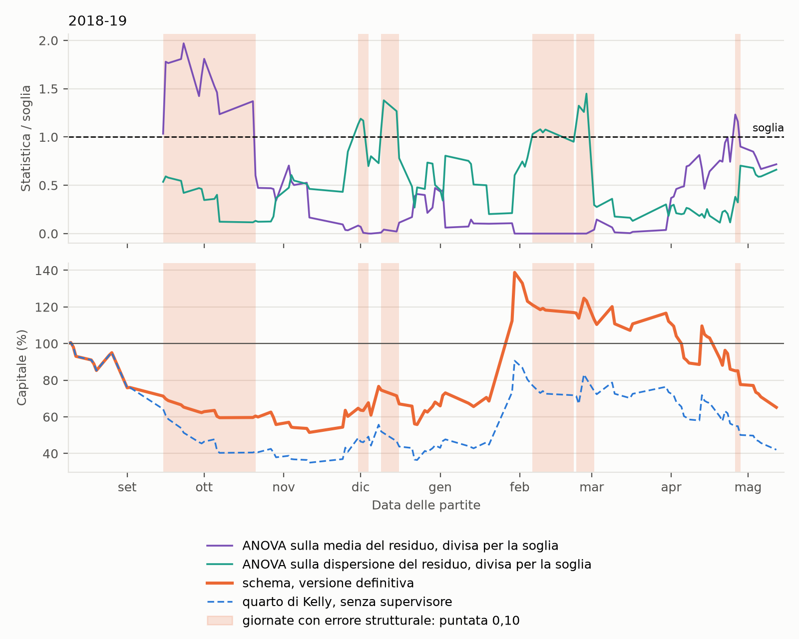
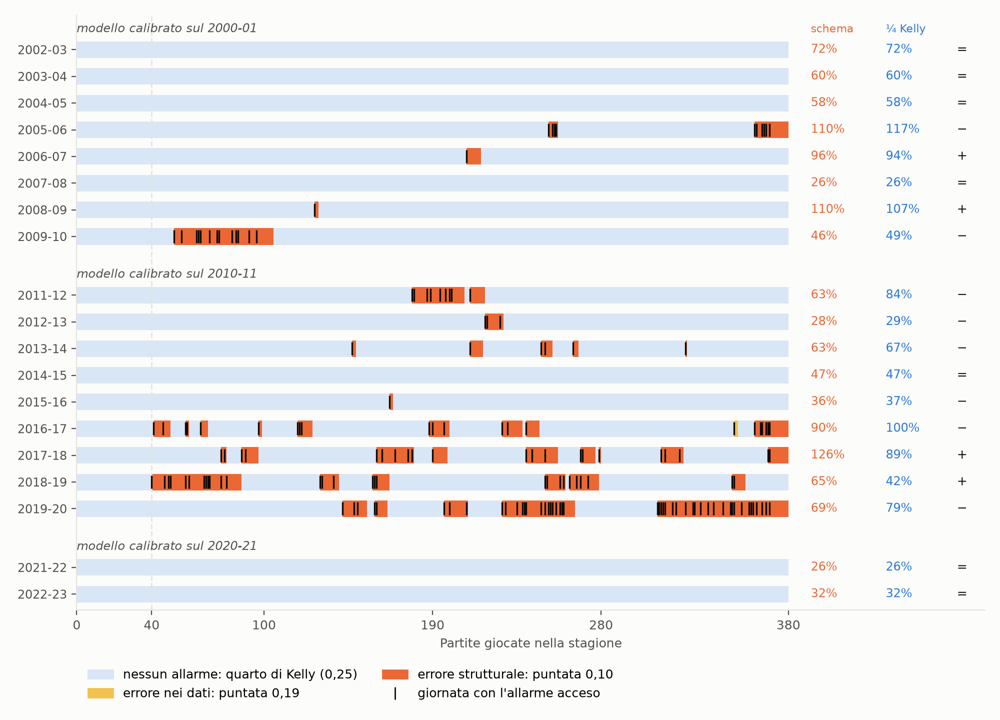
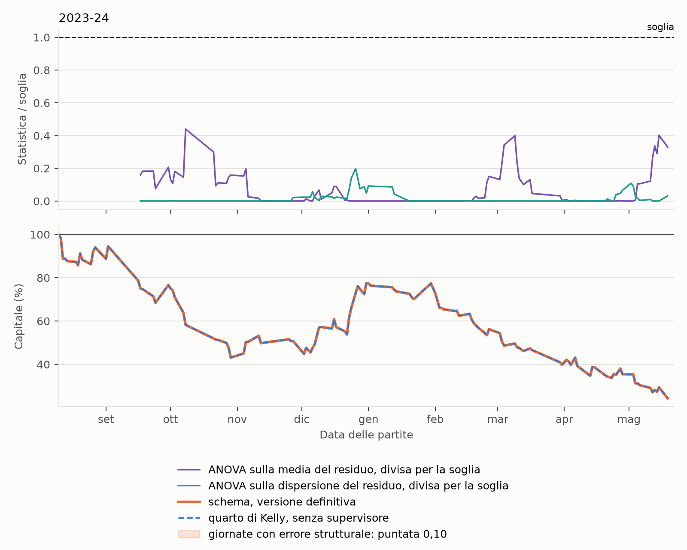

# Dall’assenza di vantaggio alla supervisione del rischio: uno studio di conferma di KellyBench con importanti precisazioni

INDICE:
- Abstract
- 1. Introduzione
- 2. Scommesse, criterio di Kelly e strumenti statistici
- 3. Lo schema Structural-Hybrid
- 4. Dati e disegno sperimentale
- 5. Risultati
- 6. Dinamica evolutiva
- 7. Conclusioni
- Appendici
- Bibliografia

## 0. Abstract

Un recente benchmark, KellyBench (Grady et al., 2026), ha mostrato che agenti basati su modelli linguistici di frontiera, chiamati a scommettere su un'intera stagione di Premier League, perdono capitale in 22 esecuzioni su 24; una sola, dopo aver misurato di non battere il mercato, riduce le puntate al minimo. Poiché il costo limita la prova a una stagione e a poche esecuzioni per modello, questa evidenza non distingue un difetto degli agenti dall'assenza di un vantaggio sul mercato. Questo studio separa le due componenti sostituendo l'agente con un'architettura Structural-Hybrid: un modello previsivo classico (Elo), un supervisore che monitora con l'ANOVA sulla media e sulla dispersione gli errori del modello rispetto al mercato e un ricalibratore che, con la scomposizione di Blinder-Oaxaca, decide quanto ridurre la puntata.

Su 19 stagioni l'analisi conferma il risultato di KellyBench: il modello non batte le quote, e chi punta secondo le sue probabilità perde in media, qualunque frazione scelga. Con le stesse previsioni il capitale rimasto dipende soltanto da quanto si punta. Lo schema riduce la puntata solo nelle giornate in cui il supervisore vede il modello peggiorare, e in una stagione tipica conserva quanto chi punta sempre la stessa frazione. Con un modello che perde, qualunque riduzione della puntata conserva capitale, e il capitale, da solo, non può dimostrare che il supervisore intervenga al momento giusto.

Per capire che cosa il supervisore riconosce si è usata una misura che non dipende dai risultati delle partite: la distanza fra le probabilità del modello e quelle del mercato prima di ogni partita. Lo schema riduce la puntata proprio nelle stagioni in cui questa distanza è maggiore, ma dentro la stagione il giorno dell'intervento non porta informazione. Seguendo l'agente partita per partita, gli errori si concentrano sulle grandi squadre in trasferta, che il modello sottovaluta e il mercato no. La distanza cresce con gli anni anche per un modello ricalibrato ogni stagione: dipende soprattutto dal mercato, che cambia e lascia indietro il modello, e solo in parte dall'invecchiamento dei parametri.

Poiché nei dati reali il modello non ha mai un vantaggio da proteggere, lo schema è stato provato anche su stagioni simulate in cui il vantaggio c'è e a metà stagione si rovescia. Lì lo schema se ne accorge e conserva più capitale sia di chi continua a puntare come prima, sia di chi punta per tutta la stagione una frazione più bassa; quando invece nulla cambia, rinuncia a pochissimo. Sulla stagione 2023-24 di KellyBench l'allarme non scatta mai: il modello è lontano dal mercato, ma la stagione su cui è stato calibrato, giocata a porte chiuse, sbagliava già. Una popolazione di strategie che si contende il capitale arriva per altra via alla stessa regola, puntare meno. Anche un agente che corregge le proprie previsioni imparando dagli errori passati continua a perdere, mentre le squadre neopromosse, che nessun agente del benchmark gestisce, non risultano una fonte significativa di errore. L'assenza di un vantaggio sul mercato basta quindi a spiegare le perdite osservate in KellyBench. La supervisione statistica non genera profitto, ma funziona come un'assicurazione: costa pochissimo quando nulla cambia e protegge in parte il capitale quando c'è un vantaggio da perdere e la struttura cambia.

## 1. Introduzione

Nell'aprile 2026 General Reasoning, un laboratorio di ricerca sull'intelligenza artificiale con sede a Londra, ha presentato KellyBench [@grady2026kellybench]. Il laboratorio, fondato da Ross Taylor, già ricercatore di Meta AI, lavora su agenti capaci di prendere decisioni su orizzonti lunghi, e il benchmark nasce da una constatazione dei suoi autori: i modelli linguistici stanno saturando i test costruiti su compiti ben definiti, che non cambiano nel tempo e si valutano alla fine, proprio mentre vengono impiegati sempre più spesso in ambienti aperti, dove le regole cambiano e le decisioni si accumulano. Per misurare questa seconda capacità serve un ambiente in cui l'agente debba imparare dall'esperienza e tradurre le proprie previsioni in azioni. Gli autori lo trovano nelle scommesse sportive.

Prevedere un evento e decidere quanto rischiare su quella previsione sono infatti due problemi distinti. Un modello più accurato del pubblico non garantisce un guadagno, e può portare alla rovina se il suo vantaggio è stimato male. Il nome del benchmark richiama la tradizione che ha studiato questa differenza: nel 1956 John L. Kelly Jr., ai Bell Laboratories, mostrò quale frazione del capitale puntare per farlo crescere il più rapidamente possibile [@kelly1956; @shannon1948], e Edward Thorp e Bill Benter applicarono la sua regola al blackjack, ai mercati finanziari e alle corse di cavalli [@thorp1962; @benter1994]. La regola, però, fa crescere il capitale solo se le probabilità del modello sono migliori di quelle del mercato. Se non lo sono, ogni puntata perde in media, e la gestione del capitale può soltanto decidere quanto perdere.

Le scommesse aggiungono una difficoltà che i test tradizionali non hanno: il mondo cambia. Nel calcio la forza delle squadre varia di stagione in stagione, le neopromosse arrivano senza una storia recente, e il mercato stesso migliora nel tempo. Nel 2020-21, giocato a porte chiuse, il vantaggio del campo stimato dal modello Elo è sceso di circa il 40%, e un modello calibrato sugli anni precedenti ne sopravvalutava l'effetto. Un agente capace deve quindi accorgersi quando il proprio modello smette di essere affidabile, e comportarsi di conseguenza.

In KellyBench un agente linguistico scommette, giornata per giornata, sull'intera stagione 2023-24 di Premier League, partendo da un capitale fisso e con a disposizione i dati storici, gli strumenti per scrivere codice e le quote dei bookmaker. Nella prima versione del paper, su cui si basa questo studio, otto modelli di frontiera giocano la stagione tre volte ciascuno: perdono capitale in 22 esecuzioni su 24, e alcuni lo azzerano. Gli autori attribuiscono i fallimenti soprattutto al modo in cui gli agenti decidono: discutono il criterio di Kelly ma puntano importi fissi, scrivono diagnosi corrette dei propri errori ma non cambiano comportamento. Una sola esecuzione fa ciò che la teoria prescrive: misura di non battere il mercato e riduce le puntate al minimo. La versione pubblicata su arXiv alla fine di aprile, con cinque modelli e cinque esecuzioni ciascuno, arriva alla stessa conclusione, e KellyBench è rimasto accessibile come ambiente aperto sulla piattaforma OpenReward dello stesso laboratorio, con una classifica che viene aggiornata man mano che escono nuovi modelli.

Questi risultati, però, non dicono perché gli agenti perdono. Ogni esecuzione è costosa, quindi la prova copre una sola stagione e poche esecuzioni per modello, troppo poche per distinguere la bravura dalla fortuna. Inoltre in un agente linguistico la previsione e la decisione non si possono separare: una regola di puntata diversa cambia il capitale, quindi ciò che l'agente osserva e le sue previsioni successive. Resta così aperta una domanda:

> *Le perdite degli agenti dipendono da come decidono o dall'assenza di un vantaggio sul mercato? E ridurre la puntata quando il vantaggio manca può diventare una regola sistematica?*

Per rispondere, questo studio separa la previsione dalla decisione. Al posto dell'agente linguistico usa l'architettura Structural-Hybrid: un modello previsivo classico, il modello Elo [@elo1978], fa le previsioni; un supervisore confronta con l'ANOVA sulla media e sulla dispersione gli errori del modello rispetto al mercato con quelli di un periodo di riferimento e dà l'allarme quando peggiorano; un ricalibratore, con la scomposizione di Blinder-Oaxaca [@blinder1973; @oaxaca1973], decide se il peggioramento dipende dal tipo di partite o da un modello che non descrive più il campionato, e riduce la puntata di conseguenza. Il modello è deterministico e quasi gratuito: tutte le regole di puntata usano le stesse previsioni, e la prova si può ripetere su 19 stagioni, dal 2002-03 al 2022-23, con le stesse regole di KellyBench.

Usare un modello classico al posto di un agente linguistico non serve a stabilire chi scommette meglio, ma a rispondere alla domanda di KellyBench con un esperimento di controllo. Un agente costruito così non ha il difetto che il paper attribuisce agli agenti linguistici: applica sempre la regola di puntata stabilita, e quando il supervisore giudica il modello meno affidabile cambia comportamento. Le sue previsioni, inoltre, restano le stesse qualunque regola di puntata si scelga, quindi ogni differenza di capitale si può attribuire alla sola decisione. Se un agente così guadagna, il problema degli agenti di KellyBench è il modo in cui decidono; se perde anche lui, l'assenza di un vantaggio sul mercato basta a spiegare le perdite. Perché il confronto regga, l'ambiente è quello del benchmark: la stessa lega e le stesse quote, decisioni prese giornata per giornata con le sole informazioni disponibili prima delle partite, la stessa puntata minima obbligatoria, e la stessa stagione 2023-24 giocata partendo dallo stesso capitale. Gli agenti di KellyBench, del resto, hanno a disposizione i dati storici e gli strumenti per costruire da sé modelli statistici di questo tipo. Alla varietà degli agenti del benchmark corrisponde invece una popolazione di strategie diverse, che si contendono il capitale sulle stesse partite.

Questo studio non riguarda gli agenti linguistici, e non dimostra che uno di essi, affiancato da un supervisore, farebbe meglio. I risultati valgono per una lega, un bookmaker e il mercato dei tre esiti, e la versione definitiva dello schema è stata fissata dopo aver visto le stagioni su cui è valutata.


## 2. Scommesse, criterio di Kelly e strumenti statistici

### 2.1 Scommesse e quote

#### La scommessa a quota fissa

Nelle scommesse sportive a quota fissa chi scommette punta una somma su un esito di un evento, e il bookmaker, cioè l'operatore che accetta le scommesse, fissa in anticipo quanto pagherà se quell'esito si verifica. Per una partita di calcio il mercato più comune è quello dei tre esiti: vittoria della squadra di casa, pareggio, vittoria della squadra in trasferta. Su ogni partita il bookmaker offre anche altri mercati, per esempio sul numero di gol, ma questo studio usa soltanto quello dei tre esiti.

In Europa le quote si esprimono in forma decimale. La quota decimale $o$ è la somma che si incassa per ogni unità puntata se l'esito si verifica, puntata compresa; se l'esito non si verifica, la puntata è persa. Puntando £10 sulla vittoria in casa alla quota 2,50, se la squadra di casa vince si incassano £25, cioè un guadagno netto di £15; se pareggia o perde si perdono le £10. Ogni puntata si regola alla fine della partita, e nella stessa giornata si può puntare su più partite.

Se l'esito ha probabilità $p$, il valore atteso di un'unità puntata è $p\,o - 1$: si guadagnano $o - 1$ unità con probabilità $p$ e se ne perde una con probabilità $1 - p$. Una puntata conviene in media solo se questo valore è positivo, cioè se $p > 1/o$. Chi scommette non conosce $p$ e la stima con un proprio modello: si parla di scommessa «di valore» quando la probabilità stimata supera $1/o$. Se la stima è sbagliata, una puntata che il modello giudica di valore può essere sfavorevole.

#### Probabilità implicite e margine

Una quota decimale $o_i$ corrisponde a una probabilità implicita $\pi_i = 1/o_i$. Sui tre esiti di una partita queste probabilità sommano a $S = \sum_i \pi_i > 1$: l'eccesso $S - 1$, detto *overround*, è il margine del bookmaker. Sulle quote Bet365 della Premier League usate in questo studio l'overround medio è 5,4%. Il margine ha tre funzioni: è il guadagno del bookmaker su un libro bilanciato, compensa le posizioni sbilanciate quando il pubblico preferisce un esito, e protegge dagli scommettitori informati [@shin1993].

Per confrontare le previsioni del modello con quelle del mercato servono probabilità che sommino a uno, quindi il margine va tolto. Il problema è sottodeterminato: c'è una sola equazione ($\sum_i q_i = 1$) per tre incognite, e ogni metodo equivale a un'ipotesi su come il margine si distribuisce fra gli esiti. Il metodo proporzionale ($q_i = \pi_i/S$) assume un margine uguale ovunque. Il metodo di Shin [@shin1993] assume invece che una frazione $z$ delle puntate provenga da scommettitori informati, e ne deduce che il margine pesa di più sugli esiti improbabili, in accordo con il noto *favourite-longshot bias*, per cui le quote alte sono sistematicamente meno convenienti. Questo studio adotta il metodo di Shin, l'unico fondato su un modello economico, e verifica che i risultati non cambino con altri quattro metodi (proporzionale, additivo, potenza e *odds ratio*).

Il metodo conta per il confronto con il mercato, non per la puntata. La frazione di Kelly (2.2), che il §2.2 ricava, usa soltanto la probabilità del modello e la quota offerta: togliere il margine in un modo o nell'altro non cambia né l'esito su cui si punta né l'importo.

#### Quote pre-partita e quote di chiusura

Le quote non restano fisse fino alla partita. Il bookmaker le pubblica alcuni giorni prima e le corregge man mano che arrivano notizie, come le formazioni e gli infortuni, e che si accumulano le puntate. La quota di chiusura è l'ultima prima del calcio d'inizio: incorpora tutta l'informazione disponibile in quel momento, ed è considerata la stima più precisa che il mercato esprime. Battere le quote di chiusura è quindi più difficile che battere quelle pubblicate prima.

I bookmaker differiscono anche per il margine. Bet365, la fonte delle quote di KellyBench, si rivolge al grande pubblico e sulla Premier League applica un margine di circa il 5%. Pinnacle accetta puntate alte anche dagli scommettitori professionisti e lavora con margini molto più bassi, e le sue quote di chiusura sono considerate fra le più precise del mercato. Questo studio usa le quote pre-partita di Bet365, come KellyBench, e come confronto più severo le quote di chiusura di Pinnacle (§4.1).

### 2.2 Il criterio di Kelly

Nel 1956 John L. Kelly Jr., fisico dei Bell Laboratories, pubblicò sul *Bell System Technical Journal* un articolo dal titolo tecnico, «A New Interpretation of Information Rate» [@kelly1956]. Il problema era quello di uno scommettitore che riceve, su un canale disturbato, un'informazione sull'esito di un evento prima che il mercato la conosca; secondo la ricostruzione di Poundstone [@poundstone2005], lo spunto veniva dagli scandali dei quiz televisivi dell'epoca. Kelly dimostrò che il tasso massimo a cui lo scommettitore può far crescere il proprio capitale coincide con il tasso di informazione del canale, nel senso della teoria che il collega Claude Shannon aveva fondato pochi anni prima [@shannon1948]. La regola che ne deriva, puntare la frazione del capitale che massimizza il logaritmo della ricchezza, porta da allora il suo nome. Kelly morì nel 1965, a 41 anni.

A portare il criterio dalla teoria alla pratica fu Edward Thorp, matematico al MIT, a cui Shannon aveva segnalato l'articolo. Thorp lo usò per dosare le puntate nel blackjack contando le carte, e nel 1962 ne raccontò i risultati in *Beat the Dealer* [@thorp1962]; con Shannon costruì anche un piccolo computer da indossare per prevedere la roulette. In seguito applicò lo stesso principio ai mercati finanziari, con il fondo Princeton-Newport Partners. Dalla metà degli anni Ottanta Bill Benter lo portò nelle corse di cavalli di Hong Kong, combinando le probabilità del proprio modello statistico con quelle implicite nelle quote del pubblico [@benter1994]: è il caso più noto di scommesse sistematiche vincenti su larga scala.

Il criterio non ha avuto soltanto sostenitori. Paul Samuelson contestò a lungo l'idea che massimizzare il logaritmo della ricchezza fosse la scelta giusta per ogni investitore [@samuelson1979]. La pratica ha mostrato inoltre che il criterio pieno è molto sensibile agli errori di stima e produce oscillazioni del capitale difficili da sostenere. Per questo investitori e scommettitori professionisti lo usano quasi sempre in forma frazionaria, puntando solo una parte della frazione indicata [@maclean2011].

#### La frazione ottima

Si consideri una scommessa ripetuta che si vince con probabilità $p$ e si perde con probabilità $1-p$, pagata a una quota decimale $o$ (§2.1): la vincita netta per unità puntata è $b = o - 1$. Se a ogni turno si punta una frazione $f$ del capitale corrente $W$, il capitale si moltiplica per $1 + fb$ quando si vince e per $1 - f$ quando si perde. Dopo $n$ turni il capitale è un prodotto di fattori casuali, e il suo logaritmo una somma. Il tasso di crescita atteso per turno è quindi

$$
g(f) = \mathbb{E}\left[\ln \frac{W_{t+1}}{W_t}\right] = p \ln(1 + fb) + (1-p)\ln(1-f). \tag{2.1}
$$

Per la legge dei grandi numeri, $\frac{1}{n}\ln(W_n/W_0)$ converge a $g(f)$ con probabilità uno: massimizzare $g$ significa massimizzare la velocità con cui il capitale cresce nel lungo periodo, quasi certamente e senza alcuna ipotesi sulle preferenze di chi scommette [@breiman1961]. Poiché $g$ è concava, il massimo si trova annullando la derivata:

$$
f^* = \frac{bp - (1-p)}{b} = \frac{p\,o - 1}{o - 1}. \tag{2.2}
$$

Il numeratore $p\,o - 1$ è il valore atteso di un'unità puntata. Se è nullo o negativo, $f^* \le 0$ e il criterio prescrive di non scommettere: Kelly non corregge una scommessa sfavorevole, la evita.

Due proprietà della regola spiegano perché nella pratica la si usa in forma frazionaria. La prima riguarda la differenza fra ricchezza media e ricchezza tipica. La ricchezza attesa cresce in modo lineare con $f$ ed è massima puntando tutto, ma in quel caso la ricchezza tipica, cioè la mediana, crolla: massimizzare la media e massimizzare la crescita sono obiettivi diversi, e Kelly sceglie il secondo. La seconda proprietà riguarda il rischio. Oltre il doppio della frazione ottima la crescita diventa negativa, quindi sovrastimare il proprio vantaggio è molto più pericoloso che sottostimarlo. Puntando una frazione $c\,f^*$ con $0 < c < 1$ si conserva, in un'approssimazione continua, una frazione $c(2-c)$ della crescita e si riduce la volatilità di un fattore $c$: con il quarto di Kelly ($c = 0{,}25$) si mantiene circa il 44% della crescita con un quarto della volatilità [@maclean2011]. La Figura 2.1 illustra queste proprietà su una scommessa simulata.


*Figura 2.1. Il criterio di Kelly su una scommessa simulata ($p = 0{,}6$, quota 2,0, 1 000 turni, 10 000 traiettorie). Sull'asse orizzontale la frazione puntata come multiplo $\lambda$ di quella ottima. (A) La crescita per turno è massima a $\lambda = 1$ e si annulla poco prima di $\lambda = 2$. (B) La ricchezza media continua a crescere, quella mediana no: le due misure divergono già sopra $\lambda = 1$. (C) La perdita massima dal picco cresce rapidamente: al Kelly pieno la traiettoria tipica perde a un certo punto il 96% del picco.*

Nella (2.2) la probabilità $p$ è quella vera. Chi scommette non la conosce, e usa la stima del proprio modello: il criterio dice quanto puntare se quella stima è giusta, non se lo è. Quando conviene puntare dipende dal confronto con il mercato, che è l'argomento della prossima sezione.

### 2.3 Il confronto con il mercato

#### Efficienza del mercato

Secondo l'ipotesi di efficienza dei mercati nella forma semiforte [@fama1970], i prezzi incorporano tutta l'informazione pubblica. Un modello costruito soltanto su dati pubblici, come quello di questo studio, non dovrebbe quindi battere le quote in modo sistematico. Il mercato delle scommesse sulla Premier League è considerato fra i più efficienti, perché è molto liquido e le quote si aggiornano fino al calcio d'inizio con le notizie su formazioni e infortuni. Qui non si verifica l'efficienza in sé: si misura se il modello ha un vantaggio, e un risultato negativo è coerente con l'efficienza senza dimostrarla.

#### Quando si può guadagnare

Il mercato offre per ogni esito una quota, e quindi una propria probabilità. Chi scommette secondo il proprio modello guadagna nel lungo periodo solo se il modello assegna agli esiti che poi si verificano più probabilità di quanta ne assegni il mercato. Se il mercato è più preciso, le puntate che il modello giudica convenienti sono in gran parte errori di stima, e perdono in media.

Il risultato si può scrivere in modo esatto [@grady2026kellybench]. Siano $p^*$ le probabilità vere degli esiti, $q$ quelle del mercato senza margine e $\hat p$ quelle del modello. Chi punta secondo il criterio di Kelly usando $\hat p$, su quote senza margine, fa crescere il capitale a un tasso atteso

$$
g = \sum_x p^*(x) \ln \frac{\hat p(x)}{q(x)} = \mathrm{KL}(p^* \,\|\, q) - \mathrm{KL}(p^* \,\|\, \hat p). \tag{2.3}
$$

La divergenza di Kullback-Leibler $\mathrm{KL}(p^* \,\|\, \cdot)$ misura quanto una distribuzione è lontana da quella vera: è nulla se coincidono e cresce quanto più se ne allontana. La (2.3) dice quindi che la crescita è positiva solo se il modello è più vicino alla verità di quanto lo sia il mercato. Una regola di puntata più prudente può ridurre le perdite e il rischio di rovina, ma il guadagno può venire soltanto da previsioni migliori di quelle del mercato. Con le quote reali, che includono il margine, il confronto è ancora più severo: alla (2.3) va sottratto $\ln S$, circa 0,05 per la Premier League.

#### Misurare il vantaggio sul mercato

Il vantaggio della (2.3) non si può calcolare direttamente, perché $p^*$ non è nota, ma si può stimare dagli esiti osservati. Per ogni partita $t$ con esito reale $x_t$ si definisce lo scarto logaritmico fra modello e mercato

$$
\delta_t = \ln \hat p_t(x_t) - \ln q_t(x_t), \tag{2.4}
$$

dove $q_t$ è la probabilità del mercato senza margine. La media $\hat g = \frac{1}{T}\sum_t \delta_t$ è la differenza fra la *log-loss* del mercato e quella del modello, e stima la crescita (2.3). Se è negativa, il modello assegna in media all'esito reale meno probabilità del mercato, e chi punta secondo il modello perde in media. Per chiudere in pari su ogni esito, con il margine, servirebbe anzi $\hat g > \ln S \approx 0{,}05$.

Rispetto al guadagno realizzato, questa misura ha due vantaggi. Si calcola su tutte le partite, non solo su quelle su cui si è puntato, e quindi non dipende dalla regola di puntata. Ed è molto meno ingannevole: un modello che riproduce il mercato con l'aggiunta di rumore casuale trova «scommesse di valore» su gran parte delle partite, perché il rumore crea scarti positivi, ma il suo $\hat g$ è negativo.

Poiché le partite di una stagione non sono del tutto indipendenti, gli intervalli di confidenza di $\hat g$ si costruiscono con un bootstrap a blocchi, che ricampiona tratti consecutivi della serie invece di singole partite (§2.6).

### 2.4 Il modello previsivo Elo

Il sistema Elo nasce negli scacchi [@elo1978] ed è oggi uno dei modelli più usati per prevedere i risultati del calcio, dove regge il confronto con modelli più ricchi [@hvattum2010]. A ogni squadra è associato un punteggio $R$, e il punteggio atteso della squadra di casa è

$$
E = \frac{1}{1 + 10^{-(R_{\text{casa}} - R_{\text{trasf}} + h)/400}}, \tag{2.5}
$$

dove $h$ è il vantaggio del campo, espresso in punti Elo. Dopo la partita alla squadra di casa si assegna un punteggio $s$, che vale 1 se vince, $\tfrac{1}{2}$ se pareggia e 0 se perde, e i punteggi si aggiornano di $K(s - E)$: la squadra di casa guadagna quanto perde quella in trasferta. Il parametro $K$ stabilisce la velocità con cui il modello reagisce: un valore alto lo rende reattivo ma rumoroso, un valore basso stabile ma lento. Elo equivale al modello di Bradley-Terry stimato partita per partita, con un aggiornamento che è un passo di discesa del gradiente sulla verosimiglianza.

Il punteggio atteso $E$ non basta per scommettere sui tre esiti, perché non dice quanto è probabile il pareggio. Questo studio usa il modello di Davidson [@davidson1970], che aggiunge un solo parametro $\nu$: posto $r = 10^{(R_{\text{casa}} - R_{\text{trasf}} + h)/400}$,

$$
p_{\text{casa}} = \frac{r}{r + 1 + \nu\sqrt{r}}, \quad p_{\text{pareggio}} = \frac{\nu\sqrt{r}}{r + 1 + \nu\sqrt{r}}, \quad p_{\text{trasf}} = \frac{1}{r + 1 + \nu\sqrt{r}}. \tag{2.6}
$$

Il pareggio diventa meno probabile al crescere dello squilibrio fra le squadre. Il modello ha quindi tre parametri, $K$, $h$ e $\nu$, stimati sulle stagioni di calibrazione (capitolo 4).

La scelta di Elo ha tre ragioni. È deterministico ed economico: tutte le regole di puntata confrontate usano esattamente le stesse previsioni, e ogni differenza di capitale dipende dalla sola decisione; è la separazione che in un agente LLM non si può ottenere. È dinamico: si aggiorna a ogni partita, e la rubrica con cui KellyBench valuta la sofisticazione delle strategie include fra i criteri proprio l'uso di modelli dinamici come Elo [@grady2026kellybench]. Infine ha pochi parametri, e il suo comportamento resta facile da interpretare anche quando invecchia.

### 2.5 KellyBench

#### L'ambiente

KellyBench [@grady2026kellybench] è un ambiente in cui un agente basato su un modello linguistico scommette su una stagione di Premier League, una giornata alla volta, partendo da un capitale fisso. L'ambiente è definito con l'Open Reward Standard, un protocollo per descrivere compiti, strumenti e stato di un ambiente, ed è servito sulla piattaforma OpenReward degli stessi autori. L'agente è il modello linguistico eseguito dentro un programma che ne gestisce il ciclo di lavoro: riceve le osservazioni, decide quali strumenti chiamare, legge i risultati e prosegue.

Per scommettere l'agente ha quattro strumenti:

- **vedere le partite della giornata**, con le quote decimali dei tre esiti e, dove disponibili, quelle sul numero di gol;
- **piazzare una puntata** su un esito, per un importo positivo e non superiore al capitale, che viene scalato subito; nella stessa giornata si possono piazzare più puntate;
- **consultare il capitale**, con l'importo già puntato nella giornata;
- **passare alla giornata successiva**, che liquida le puntate, aggiorna il capitale e rende disponibili i risultati e le statistiche delle partite appena giocate.

Per passare alla giornata successiva bisogna aver piazzato almeno una puntata. Una puntata di un penny è ammessa, e permette a un agente che non vuole scommettere di rispettare la regola rischiando una cifra trascurabile.

Per costruire i propri modelli l'agente lavora in un ambiente di calcolo isolato, con strumenti per eseguire comandi, leggere e scrivere file e scrivere codice Python con le librerie usuali di analisi dei dati. Ha a disposizione i dati storici della Premier League: i risultati dal 1993-94, le statistiche delle partite dal 2000-01, le quote dal 2002-03 e i dati sui giocatori dal 2008. Non può accedere alla rete: chi ci prova tre volte viene squalificato e perde il capitale.

Il risultato di ogni giornata è misurato con la variazione del logaritmo del capitale, $\ln(W_{t+1}/W_t)$. Sommata sulla stagione dà il logaritmo del rapporto fra capitale finale e iniziale: è la grandezza che il criterio di Kelly massimizza (§2.2).

Gli scenari sono quattro. Tre, di stagioni distanti un decennio l'una dall'altra, servono a mettere a punto gli agenti; il quarto, la stagione 2023-24, è quello su cui sono valutati.

| Scenario | Stagione | Uso | Capitale iniziale | Giornate |
|---|---|---|---|---|
| New Millennium | 2000-01 | messa a punto | £100 | 97 |
| Post-Crash | 2010-11 | messa a punto | £150 | 105 |
| Covid Season | 2020-21 | messa a punto | £200 | 148 |
| Recent Season | 2023-24 | valutazione | £220 | 120 |

Una giornata è una data in cui si gioca almeno una partita. Le 380 partite di una stagione sono distribuite su un centinaio di date, e il loro numero cambia da stagione a stagione: nel 2020-21, con i recuperi delle partite rinviate per il Covid, sono 148. Nei risultati del paper i capitali sono riportati come se ogni agente partisse da £100 000, per rendere confrontabili gli scenari.

#### I risultati

Nella prima versione del paper otto modelli di frontiera giocano la stagione di valutazione tre volte ciascuno. La tabella riporta il rendimento sulla stagione.

| Modello | Rendimento medio | Esecuzione migliore | Esecuzione peggiore | Nessuna esecuzione in rovina |
|---|---|---|---|---|
| Claude Opus 4.6 | −11,0% | −0,2% | −18,8% | sì |
| GPT-5.4 | −13,6% | −4,1% | −31,6% | sì |
| Gemini 3.1 Pro | −43,3% | +33,7% | −100% | no |
| Gemini Flash 3.1 Lite Preview | −58,4% | +24,7% | −100% | no |
| GLM-5 | −58,8% | −14,3% | −100% | no |
| Kimi K2.5 | −92,6% | −77,7% | −100% | no |
| Grok 4.20 | −100% | −100% | −100% | no |
| Arcee Trinity | −100% | −100% | −100% | no |

Tutti i modelli perdono in media. Solo 2 esecuzioni su 24 chiudono in attivo, entrambe di modelli che in un'altra esecuzione vanno in rovina, e sei modelli su otto vanno in rovina almeno una volta. Gli autori valutano anche la sofisticazione delle strategie, con una rubrica di 44 punti scritta insieme a esperti di fondi di scommesse quantitative: il modello migliore ne ottiene il 32,6%.

Gli autori classificano i fallimenti ispezionando le traiettorie delle esecuzioni. I principali sono quattro:

- **la gestione del capitale.** Quasi tutti gli agenti discutono il criterio di Kelly e poi puntano importi fissi o arrotondati; in 9 esecuzioni su 24 nessuna regola di puntata viene applicata, in 4 il codice di Kelly è scritto ma mai chiamato;
- **le squadre neopromosse.** Nessuna delle 24 esecuzioni le gestisce in modo generale: per esempio un agente le esclude a mano, un altro tratta l'assenza di storia come probabilità zero;
- **l'adattamento.** 21 esecuzioni su 24 non si adattano pienamente a una stagione che cambia, e 7 non riaddestrano mai il modello;
- **la consapevolezza della situazione.** In 6 esecuzioni il compito è dichiarato concluso in anticipo; in altre 6 il modello usa informazioni successive alla partita.

Il tratto comune è ciò che gli autori chiamano divario fra sapere e fare: gli agenti scrivono diagnosi corrette dei propri errori, ma non cambiano comportamento. Fa eccezione un'esecuzione di GPT-5.4, che misura la *log-loss* del proprio modello (0,974 contro 0,971 del mercato), conclude di non avere un vantaggio e riduce le puntate al minimo per il resto della stagione: è il comportamento che il criterio di Kelly prescrive.

Per verificare che i risultati non dipendano da come gli agenti sono stati messi alla prova, gli autori ripetono la prova con Claude Opus 4.6 in due modi diversi: fornendogli i testi che gli esperti considerano fondamentali per costruire modelli di scommessa, e facendolo lavorare dentro Claude Code invece che nel programma usato per tutti i modelli. In nessuno dei due casi i risultati migliorano. Nell'appendice del paper un modello classico, Dixon-Coles [@dixon1997] combinato con le quote del mercato, fa meglio della maggior parte degli agenti.

Gli autori discutono infine i limiti del benchmark: una sola stagione, che per il costo non si può ripetere molte volte (un'esecuzione di GPT-5.4 è costata circa 2 000 dollari); un mercato molto efficiente; quote con un margine di circa il 5%; la possibilità che i modelli conoscano già i risultati della stagione dai dati di addestramento.

#### Un'osservazione sul confronto con il mercato

Il paper non precisa se la *log-loss* del mercato con cui l'esecuzione di GPT-5.4 confronta il proprio modello sia calcolata con o senza margine, e la differenza è grande: togliere il margine alza la *log-loss* del mercato di circa 0,05, più di dieci volte lo scarto osservato (0,003); con il margine incluso il mercato appare più preciso di quanto sia, e il confronto risulta sbilanciato a suo favore.

### 2.6 Il bootstrap

#### L'idea

Una stima calcolata su un campione cambierebbe con un campione diverso, e per sapere quanto fidarsi serve conoscere questa variabilità. Le formule classiche la ricavano da ipotesi sulla distribuzione dei dati, come la normalità, e valgono solo per alcune statistiche. Il bootstrap di Efron [@efron1979] la ricava dai dati stessi. Il campione osservato prende il posto della popolazione: se ne estraggono molti nuovi campioni della stessa dimensione, ricampionando le osservazioni con reinserimento, così che alcune compaiono più volte e altre mancano, e su ciascuno si ricalcola la stima. La distribuzione delle stime ricalcolate approssima quella che si otterrebbe ripetendo l'esperimento. Nella forma più semplice, l'intervallo di confidenza al 95% è compreso fra i quantili al 2,5% e al 97,5% delle stime ricalcolate.

#### Dati dipendenti nel tempo: il bootstrap a blocchi

Ricampionare le singole osservazioni presuppone che siano indipendenti. In una serie temporale non lo sono: osservazioni vicine si somigliano, e ricampionandole una per una si spezza questo legame. Le serie ricampionate risultano meno variabili di quella reale, e l'incertezza della stima viene sottostimata.

Il bootstrap a blocchi mobili di Künsch [@kunsch1989] ricampiona invece blocchi di osservazioni consecutive, di lunghezza fissa, e li accoda fino a riprodurre la lunghezza della serie: dentro ogni blocco la dipendenza resta intatta, e si perde solo al confine fra un blocco e il successivo. Lo *stationary bootstrap* di Politis e Romano [@politisromano1994] usa blocchi di lunghezza casuale, con una lunghezza media fissata, e così la serie ricampionata conserva le proprietà della serie originale lungo tutta la sua durata, indipendentemente da dove cadono i confini.

La lunghezza dei blocchi è un compromesso: blocchi troppo corti spezzano la dipendenza, blocchi troppo lunghi lasciano pochi blocchi diversi da combinare e rendono imprecisa la stima della variabilità. Politis e White [@politiswhite2004] hanno proposto una regola che la ricava automaticamente dall'autocorrelazione della serie.

#### Tre usi

Lo stesso strumento serve a tre scopi. Il primo è l'intervallo di confidenza di una stima, come il vantaggio sul mercato $\hat g$ (§2.3).

Il secondo è la soglia di un test. Ricampionando a blocchi un unico periodo si ottengono serie in cui i blocchi sono mescolati a caso: un eventuale cambiamento nel tempo viene cancellato, mentre la dipendenza fra osservazioni vicine resta. Il valore della statistica del test su ciascuna di queste serie è quindi un esempio di ciò che il test produce quando non è cambiato nulla, e il loro quantile al 95% è una soglia che segnala un cambiamento inesistente solo nel 5% dei casi, anche con osservazioni dipendenti.

Il terzo è la ricostruzione di intere serie. Ricampionando a blocchi una serie reale, per esempio una stagione di partite, si ottengono molte serie plausibili, fatte degli stessi dati in un ordine diverso, con alcuni tratti ripetuti e altri assenti. Ripetendo un'intera analisi su ciascuna si misura quanto il suo risultato dipenda dal caso.

### 2.7 L'ANOVA e il controllo della dispersione

#### L'ANOVA a una via

L'analisi della varianza di Fisher [@fisher1925] confronta le medie di $k$ gruppi. Indicando con $y_{ij}$ l'osservazione $i$ del gruppo $j$, con $\bar y_j$ la media del gruppo e con $\bar y$ la media generale, la variabilità totale si scompone esattamente in una parte fra i gruppi e una dentro i gruppi:

$$
\sum_{j}\sum_{i}(y_{ij} - \bar y)^2 = \sum_j n_j(\bar y_j - \bar y)^2 + \sum_j\sum_i(y_{ij} - \bar y_j)^2. \tag{2.7}
$$

La statistica $F$ è il rapporto fra le due parti, ciascuna divisa per i propri gradi di libertà. Se tutte le medie sono uguali, $F$ è vicino a uno; se differiscono, cresce. Con osservazioni indipendenti e normali, sotto l'ipotesi di medie uguali $F$ segue una distribuzione $F$ di Fisher, da cui si ricava la soglia. Con due gruppi l'ANOVA coincide con il test $t$.
Se i due gruppi sono due periodi di tempo, l'ANOVA dice se la media di una grandezza è cambiata fra l'uno e l'altro. La stessa scomposizione dice anche quanto una differenza conti, oltre a se sia significativa: con campioni molto grandi una differenza può superare qualunque soglia e spiegare comunque una parte trascurabile della variabilità [@roccetti2026fragi].

#### La dispersione: l'ANOVA sulla dispersione

Un modello che perde affidabilità può produrre errori non solo peggiori in media, ma anche più dispersi: è l'eteroschedasticità, cioè una varianza degli errori che cresce. Per confrontare la dispersione di due periodi questo studio applica l'ANOVA alla dispersione: per ogni osservazione si calcola la distanza assoluta dalla mediana del proprio gruppo, e a queste distanze si applica l'ANOVA. Se nel periodo recente le distanze sono in media maggiori, gli errori sono più dispersi. Il procedimento è noto come test di Brown-Forsythe [@brownforsythe1974], una variante robusta del test di Levene [@levene1960]; nel seguito lo si chiama semplicemente ANOVA sulla dispersione, e l'ANOVA della sezione precedente ANOVA sulla media. L'uso della mediana al posto della media rende il test affidabile anche quando gli errori non sono normali, come accade per $\delta_t$, che ha una distribuzione asimmetrica.

#### Errori autocorrelati e soglie calibrate

La soglia nominale dell'ANOVA vale per osservazioni indipendenti. Gli errori di un modello lungo una stagione possono invece essere autocorrelati: a un errore alto tende a seguirne un altro, per esempio perché il modello sbaglia per settimane la forza di una squadra. In questo caso $n$ osservazioni contengono meno informazione di $n$ osservazioni indipendenti; il test sovrastima l'informazione disponibile e segnala differenze che non esistono, cioè falsi allarmi. Nel confronto fra due periodi consecutivi la quota di falsi allarmi cresce rapidamente con l'autocorrelazione: in simulazione arriva al 40% invece del 5% (Appendice B).

Il rimedio è calibrare la soglia sui dati con un bootstrap a blocchi (§2.6), che conserva la dipendenza fra osservazioni vicine, invece di ricavarla dalla distribuzione $F$.

### 2.8 La scomposizione di Blinder-Oaxaca

#### L'origine

Nel 1973 Blinder e Oaxaca proposero, in modo indipendente, un metodo per spiegare il divario salariale fra due gruppi, uomini e donne o bianchi e neri [@blinder1973; @oaxaca1973]. La domanda era: quanto del divario dipende dalle diverse caratteristiche dei due gruppi, come l'istruzione e l'esperienza, e quanto dal fatto che le stesse caratteristiche sono retribuite in modo diverso? Il metodo è stato poi usato ben oltre l'economia del lavoro. In epidemiologia, per esempio, scomposizioni dello stesso tipo sono state usate per separare la parte di un segnale di rischio dovuta alla composizione delle popolazioni confrontate da quella strutturale [@roccetti2026cmes; @roccetti2026fphar].

#### La scomposizione

In ciascuno dei due gruppi, A (riferimento) e B, si stima una regressione separata della risposta $y$ sulle stesse caratteristiche $\mathbf{x}$, ottenendo i coefficienti $\hat{\boldsymbol\beta}^A$ e $\hat{\boldsymbol\beta}^B$. Poiché una regressione con intercetta passa per le medie, il divario medio si scompone esattamente in tre termini:

$$
\bar y^B - \bar y^A = \underbrace{\hat{\boldsymbol\beta}^{A\top}(\bar{\mathbf x}^B - \bar{\mathbf x}^A)}_{\text{composizione}} + \underbrace{\bar{\mathbf x}^{A\top}(\hat{\boldsymbol\beta}^B - \hat{\boldsymbol\beta}^A)}_{\text{struttura}} + \underbrace{(\bar{\mathbf x}^B - \bar{\mathbf x}^A)^\top(\hat{\boldsymbol\beta}^B - \hat{\boldsymbol\beta}^A)}_{\text{interazione}}. \tag{2.8}
$$

La **composizione** è la variazione che la risposta subirebbe se cambiassero soltanto le caratteristiche, fermo restando il legame fra caratteristiche e risposta. La **struttura** è la variazione che subirebbe se cambiasse soltanto il legame, a parità di caratteristiche. L'**interazione** è la parte dovuta al cambiamento simultaneo di entrambi.

#### La forma a due termini

Quando uno dei due gruppi è il riferimento naturale del confronto, la scomposizione si scrive anche in due soli termini, con i coefficienti del riferimento [@oaxaca1973]:

$$
\bar y^B - \bar y^A = \underbrace{\hat{\boldsymbol\beta}^{A\top}(\bar{\mathbf x}^B - \bar{\mathbf x}^A)}_{\text{spiegato}} + \underbrace{\frac{1}{n_B}\sum_{i \in B}\left(y_i - \hat{\boldsymbol\beta}^{A\top}\mathbf x_i\right)}_{\text{non spiegato}}. \tag{2.9}
$$

Il termine spiegato è la composizione della (2.8). Quello non spiegato riunisce struttura e interazione, ed è la media, nel gruppo B, dei residui del modello stimato sul riferimento. Ha un vantaggio pratico: non richiede di stimare una regressione nel gruppo B, e si può usare anche quando B è piccolo.

La scomposizione vale per la media di qualunque risposta. Se la risposta è la distanza assoluta di ogni errore dalla mediana del riferimento, la stessa dell'ANOVA sulla dispersione, si scompone la variazione della dispersione invece di quella della media.

#### Due cautele

La scomposizione richiede due cautele. La prima: la parte strutturale, o non spiegata, è un residuo. Contiene il vero cambiamento del legame, ma anche l'effetto di ogni caratteristica rilevante che non è stata inclusa: se una caratteristica omessa cambia fra i due gruppi, il suo effetto viene attribuito alla struttura. Va quindi letta insieme all'elenco delle caratteristiche usate, e non ha un significato causale. La seconda: la forma a due termini dipende dal gruppo scelto come riferimento, e va usata solo quando la scelta è naturale, per esempio quando uno dei due gruppi è il punto di partenza con cui si confrontano i successivi. La forma a tre termini (2.8) non dipende da questa scelta, ma richiede una regressione in entrambi i gruppi.

### 2.9 La dinamica evolutiva

La dinamica evolutiva studia una popolazione di strategie in cui il capitale si sposta, nel tempo, verso quelle che rendono di più.

#### La dinamica del replicatore

La dinamica del replicatore [@taylorjonker1978] descrive una popolazione di strategie in cui la quota di ciascuna cresce in proporzione al suo rendimento rispetto alla media. Nella forma discreta usata qui la popolazione è un capitale diviso fra $N$ strategie; se $s_i(d)$ è la quota della strategia $i$ alla giornata $d$ e $R_i(d)$ il fattore per cui la strategia moltiplica il proprio capitale in quella giornata,

$$
s_i(d+1) = (1 - \mu)\,\frac{s_i(d)\,R_i(d)}{\sum_j s_j(d)\,R_j(d)} + \frac{\mu}{N}. \tag{2.10}
$$

Il primo termine è la selezione: il capitale si sposta verso le strategie che rendono di più. Il secondo è una mutazione: una frazione $\mu$ del capitale viene ridistribuita in parti uguali, così che nessuna strategia si estingua e una strategia sfavorita possa tornare a crescere quando le condizioni cambiano.

Il legame con Kelly è diretto. Nella *evolutionary finance*, che studia i mercati come popolazioni di strategie in competizione, la ricchezza di chi investe una frazione del proprio capitale evolve proprio secondo la (2.10), e la regola di Kelly è quella che sopravvive alla selezione del mercato [@blumeeasley1992; @evstigneev2009]. Lensberg e Schenk-Hoppé hanno mostrato che la stessa regola emerge spontaneamente da un processo evolutivo darwiniano [@lensberg2007].

## 3. Lo schema Structural-Hybrid

Il criterio di Kelly indica quale frazione del capitale puntare supponendo che le probabilità usate siano quelle vere (§2.2). Le probabilità di un modello, però, sono stime, e la loro affidabilità cambia nel tempo: una squadra cambia allenatore, il vantaggio del campo si riduce, il mercato si aggiorna più in fretta del modello. Chi applica il criterio senza misurare quanto le proprie stime siano ancora affidabili punta come se lo fossero sempre, e perde proprio quando smettono di esserlo. La forma frazionaria attenua il problema riducendo tutte le puntate nella stessa misura, ma non distingue un periodo in cui il modello funziona da uno in cui ha smesso di funzionare.

Lo schema Structural-Hybrid rende la frazione puntata una variabile, che dipende da quanto il modello è affidabile in quel momento, e misura questa affidabilità con strumenti statistici. È anche una risposta al difetto più evidente degli agenti di KellyBench, che riconoscevano i propri errori ma non cambiavano comportamento (§2.5): qui chi osserva gli errori e chi decide la puntata sono moduli distinti, e la reazione a un peggioramento è una regola, non una scelta lasciata a chi prevede.

### 3.1 L'architettura

Lo schema divide il compito di un agente che scommette in tre moduli (Figura 3.1). Il **lavoratore** prevede le partite e propone una puntata secondo il criterio di Kelly. Il **supervisore** osserva gli errori del lavoratore rispetto al mercato e dà l'allarme quando peggiorano. Il **ricalibratore**, quando scatta l'allarme, cerca la causa del peggioramento e decide di quanto ridurre la puntata.


*Figura 3.1. Lo schema realizzato. Il lavoratore prevede con le sole informazioni disponibili prima della partita e propone la frazione di Kelly. Dopo la partita il supervisore aggiorna il residuo e confronta il periodo recente con un periodo di riferimento; se dà l'allarme, il ricalibratore distingue un errore nei dati da un errore strutturale. La puntata finale è la frazione di Kelly moltiplicata per $\lambda$.*

I tre moduli corrispondono alle tre domande che si pone uno scommettitore prudente. Il lavoratore risponde alla prima: *su quali partite le mie stime vedono un'occasione, e quanto vale?* Il supervisore alla seconda: *le mie stime sbagliano più di quanto sbagliavano quando le ho costruite?* Il ricalibratore alla terza, che si pone solo quando la seconda ha risposto di sì: *sbaglio di più perché mi sono capitate partite difficili, o perché non capisco più questo campionato?* Nel primo caso uno scommettitore continua a giocare, con un po' più di cautela; nel secondo continua a giocare, ma rischia pochissimo finché i suoi errori restano fuori dal normale.

I tre moduli lavorano in sequenza a ogni giornata. Prima delle partite il supervisore confronta gli errori delle partite già giocate con un periodo di riferimento; se dà l'allarme, il ricalibratore stabilisce se il peggioramento è un errore nei dati o un errore strutturale, e fissa un moltiplicatore della puntata. Il lavoratore prevede le partite della giornata con le sole informazioni disponibili e propone la frazione di Kelly, e la puntata effettiva è quella frazione moltiplicata per il moltiplicatore. Dopo le partite il lavoratore aggiorna il modello con i risultati, e il supervisore aggiunge gli errori della giornata alla propria serie.

Il ricalibratore non modifica mai il modello: agisce soltanto sulla puntata. Le previsioni restano quindi le stesse in tutte le versioni dello schema e nei riferimenti con cui lo schema è confrontato, e ogni differenza di capitale si può attribuire alla sola decisione. È la separazione fra previsione e decisione che in un agente basato su un modello linguistico non si può ottenere.

### 3.2 Il lavoratore

Il lavoratore è la parte dello schema che scommette. Si comporta come uno scommettitore che ha un proprio modello e lo confronta con le quote: non cerca chi vincerà, ma le partite in cui, secondo lui, il bookmaker paga un esito più di quanto rischia. A ogni giornata fa sempre le stesse cose, nello stesso ordine.

**Prevede le partite.** Il modello è l'Elo-Davidson del §2.4. Prima della giornata prevede tutte le partite di quella data con i punteggi correnti, che contengono i risultati fino al giorno prima, e dà a ciascuna tre probabilità: vittoria in casa, pareggio, vittoria in trasferta. I parametri $K$, $h$ e $\nu$ restano quelli stimati sulla stagione di calibrazione, e il modello non guarda mai le quote. Le squadre neopromosse entrano con una regola fissata prima di guardare i dati: una squadra che era in Premier League nella stagione precedente conserva il proprio punteggio; una che vi torna dopo qualche anno riprende l'ultimo punteggio che aveva; una mai vista parte dalla media delle tre retrocesse della stagione precedente.

**Sceglie l'esito.** Per ciascuno dei tre esiti confronta la propria probabilità $\hat p$ con la quota $o$ e calcola il valore atteso stimato $\hat p\,o - 1$: quanto si aspetta di guadagnare per ogni sterlina puntata, se le sue probabilità sono giuste. Punta sull'esito con il valore atteso più alto, e solo se è positivo; altrimenti salta la partita. Su una partita fa quindi al massimo una scommessa, ma in una giornata può scommettere su tutte le partite in cui vede un'occasione.

Il 12 agosto 2018 l'Arsenal ospita il Manchester City. Le quote sono 4,00 per l'Arsenal, 3,80 per il pareggio e 1,95 per il City. Il modello dà all'Arsenal il 37%, al pareggio il 30%, al City il 33%; il mercato, tolto il margine, il 24%, il 26% e il 50%. I valori attesi stimati sono +48% sull'Arsenal, +16% sul pareggio e −37% sul City, e il lavoratore sceglie l'Arsenal. Il pareggio, che pure ha un valore atteso positivo, resta escluso, perché su una partita si punta un solo esito.

Questo modo di scegliere ha una conseguenza che attraversa tutto lo studio. Il valore atteso è grande dove la quota è alta e il modello è più ottimista del mercato, e il modello, con un vantaggio del campo troppo grande per le squadre molto più forti (§5.1), è più ottimista del mercato proprio quando una piccola squadra ospita una grande. Il lavoratore punta quindi soprattutto sulla squadra di casa e sul pareggio, e spesso contro la favorita del mercato (§5.3).

**Decide quanto puntare.** Per l'esito scelto calcola la frazione di Kelly (2.2), $f^* = (\hat p\,o - 1)/(o - 1)$, tanto più grande quanto più il modello è in disaccordo con la quota. La puntata effettiva è $\lambda f^*$, dove $\lambda$ è il moltiplicatore che supervisore e ricalibratore fissano guardando le partite già giocate: 0,25 senza allarme, cioè il quarto di Kelly; 0,19 dopo un errore nei dati; 0,10 dopo un errore strutturale (§3.3 e 3.4). Il supervisore non cambia mai l'esito scelto, ma solo quanto si punta. Per Arsenal–City la frazione di Kelly è $0{,}48/3{,}00 = 0{,}16$; senza allarme il lavoratore ne punta un quarto, il 4% del capitale. Vince il City.

**Piazza le puntate.** Le puntate di una giornata sono frazioni del capitale di inizio giornata e vengono piazzate tutte insieme, prima delle partite. Il lavoratore non risolve il problema di Kelly congiunto sui tre esiti e sulle partite della stessa giornata: tratta ogni partita come una scommessa a sé, e piazza le puntate in ordine di valore atteso finché la loro somma non supera il capitale. È una semplificazione comune nella pratica, e vale per tutte le strategie confrontate. L'ambiente aggiunge le regole di KellyBench (§4.3): ogni puntata è di almeno £0,01, e in una giornata in cui il lavoratore non vede nessuna occasione l'ambiente punta comunque £0,01 sull'esito con il valore atteso più alto. Il §3.6 segue una giornata intera.

**Le altre regole di scelta.** La regola del valore atteso più alto è quella naturale per chi segue il criterio di Kelly, ed è usata in tutto lo studio. Se ne sono provate altre due, anch'esse senza parametri: l'esito con lo scarto maggiore dal mercato, $\hat p - q$, e l'esito più probabile per il modello, senza guardare le quote. Con l'esito più probabile il valore atteso è spesso negativo, e il lavoratore scommette su circa metà delle partite: con un modello che perde contro il mercato, puntare su meno partite conserva più capitale (Appendice A.4). Questa regola è stata individuata dopo aver visto le stagioni di valutazione, e lo schema non la usa: compare nel confronto fra regole di puntata del §5.2 e nella popolazione di strategie del capitolo 6.

### 3.3 Il supervisore

**Che cosa osserva.** Il supervisore non osserva il guadagno, ma il residuo $\delta_t$ della (2.4): lo scarto logaritmico fra la probabilità che il modello e il mercato, senza margine, hanno assegnato all'esito che si è verificato. Un residuo positivo significa che il modello aveva dato al risultato più probabilità del mercato, uno negativo che gliene aveva data meno. La scelta ha tre ragioni. Il residuo misura ciò che determina il guadagno: la sua media su un periodo è la stima del vantaggio sul mercato in quel periodo (§2.3). Non dipende dalla puntata: si calcola su tutte le partite, comprese quelle su cui non si punta, e il supervisore osserva la stessa serie qualunque cosa decida. E tiene conto della difficoltà delle partite: una partita incerta produce errori grandi per chiunque, e il confronto con il mercato elimina la parte di difficoltà comune ai due.

**Il confronto.** A ogni giornata il supervisore confronta le ultime 40 partite giocate, circa quattro giornate, con la stagione su cui il modello è stato stimato. La domanda è quella di uno scommettitore che si chiede se le proprie stime funzionano ancora come quando le ha costruite. Il peggioramento può avere due forme, e il supervisore le controlla entrambe.

- **La media.** Il modello dà al risultato, in media, meno probabilità del mercato di quanto facesse nella stagione di calibrazione: il suo vantaggio si è ridotto. La controlla l'ANOVA sulla media (§2.7).
- **La dispersione.** I residui si allontanano di più dal loro valore tipico, in un senso o nell'altro: il modello a volte dà al risultato molta più probabilità del mercato, a volte molta meno. Anche se in media pareggia, le sue stime e quelle del mercato non vanno più d'accordo. La controlla l'ANOVA sulla dispersione, cioè l'ANOVA applicata alle distanze dei residui dalla loro mediana (§2.7).

Basta che una delle due superi la propria soglia perché scatti l'allarme. Contano solo i peggioramenti: un modello che migliora non fa mai scattare nulla.

**Le soglie.** Ogni confronto fra due gruppi di partite dà una differenza anche quando non è cambiato nulla, per puro caso. La soglia risponde a una domanda: *quanto deve essere diverso il periodo recente perché non sia un caso?* Per rispondere si rigioca molte volte la stagione di calibrazione rimescolandola a blocchi di partite vicine, in modo che non contenga alcun cambiamento, e si guarda quanto diventano grandi le due statistiche per puro caso. La soglia è un valore che, in queste stagioni senza cambiamenti, si supera di rado.

Resta da stabilire che cosa significa «di rado». Il supervisore ripete il confronto a ogni giornata, un centinaio di volte per stagione: con una soglia che si supera per caso nel 5% dei confronti, quasi ogni stagione avrebbe qualche falso allarme, e lo schema ridurrebbe la puntata senza motivo. Ciò che conta, quindi, non è la probabilità di un falso allarme in una certa giornata, ma quella di un falso allarme in tutta la stagione. La soglia è fissata in modo che, in una stagione senza cambiamenti, la probabilità di anche un solo allarme sia del 5%. Il prezzo di questa prudenza è che i cambiamenti piccoli non vengono visti.

In pratica, con queste soglie, l'allarme sulla dispersione scatta quando lo scarto tipico dei residui nelle ultime 40 partite è circa una volta e mezza quello della stagione di calibrazione: nel 2013-14, per esempio, 0,211 contro 0,135. L'allarme sulla media scatta quando il residuo medio è di circa 0,10 più basso che nella stagione di calibrazione, cioè quando, rispetto al mercato, il modello dà al risultato circa il 10% di probabilità in meno di quanto facesse allora. Il calcolo delle soglie è descritto nell'Appendice B.

### 3.4 Il ricalibratore

**La domanda.** Quando il supervisore dà l'allarme, gli errori recenti sono peggiori di quelli della stagione di calibrazione. Il ricalibratore deve capire perché, e le risposte possibili sono due.

**L'errore nei dati.** Il modello funziona come prima, ma nelle ultime partite sono capitate più partite del tipo su cui sbaglia sempre di più: molte partite equilibrate, in cui modello e mercato sono entrambi incerti, o molte partite con una squadra neopromossa, che il modello conosce poco. Sulle stesse partite, nella stagione di calibrazione, avrebbe sbagliato allo stesso modo. È lo scommettitore che si dice «è stato un mese difficile»: le sue stime sono ancora buone, il calendario no. La reazione giusta è continuare a giocare, con un po' più di cautela finché il periodo difficile non è passato.

**L'errore strutturale.** Sulle stesse partite il modello sbaglia più di prima: qualcosa è cambiato nel modo in cui le caratteristiche di una partita si traducono nel risultato. Il vantaggio del campo si riduce, come nelle stagioni giocate a porte chiuse; una squadra diventa molto più forte di quanto dica il suo punteggio; il mercato diventa più preciso e il modello no. È lo scommettitore che si dice «non sono le partite, sono io che non capisco più questo campionato». La reazione giusta è puntare molto meno finché il problema si vede negli errori, perché il criterio di Kelly punta di più proprio dove il modello crede, sbagliando, di avere un vantaggio.

**Come li distingue.** La distinzione è quella della scomposizione di Blinder-Oaxaca (§2.8). Di ogni partita sono note, prima del calcio d'inizio, cinque caratteristiche:

- lo squilibrio fra le due squadre secondo il mercato, misurato dal logaritmo del rapporto fra le quote di vittoria in casa e in trasferta;
- l'incertezza del mercato, misurata dall'entropia delle sue tre probabilità;
- l'incertezza del modello, misurata allo stesso modo;
- se gioca una squadra neopromossa;
- la posizione della partita nella stagione.

Sulla stagione di calibrazione si stima quanto errore il modello fa, in media e in dispersione, su ciascun tipo di partita. Applicando questa stima alle ultime 40 partite si ottiene l'errore che il modello avrebbe fatto su quelle partite se fosse rimasto quello della stagione di calibrazione. La differenza fra la stagione di calibrazione e le ultime 40 partite si divide così in due parti, secondo la (2.9):

- la **parte spiegata** dal tipo di partite, che è l'errore nei dati;
- la **parte non spiegata**, cioè quanto il modello sbaglia in più sulle stesse partite, che è l'errore strutturale.

Il ricalibratore applica la divisione alla grandezza che ha fatto scattare l'allarme, la media o la dispersione. Se la parte non spiegata supera una soglia, l'errore è strutturale; altrimenti è un errore nei dati. La soglia è calibrata come quelle del supervisore, sulla stagione di calibrazione rimescolata a blocchi.

Un esempio vero, che il §3.6 racconta per intero. L'8 dicembre 2013 l'allarme scatta sulla dispersione: lo scarto tipico dei residui è 0,211 nelle ultime 40 partite contro 0,135 nella stagione di calibrazione, un aumento di 0,076. Le caratteristiche di quelle 40 partite ne spiegano 0,013; restano 0,063 non spiegati, oltre la soglia di 0,040. Il modello non sbaglia di più perché sono capitate partite più difficili, ma perché sulle stesse partite non va più d'accordo con il mercato: l'errore è strutturale.

L'elenco delle caratteristiche è stato fissato sulle stagioni di calibrazione, con regole decise prima di vedere i risultati. Le neopromosse appena salite e quelle che tornano dopo qualche anno sono state riunite in un solo indicatore, perché erano troppo poche per stimarle separatamente; la differenza dei punteggi Elo è stata esclusa perché quasi coincidente con lo squilibrio secondo il mercato. La divisione vale solo per ciò che queste cinque caratteristiche descrivono: un cambiamento nel tipo di partite che nessuna di esse misura finisce nella parte non spiegata, e viene chiamato strutturale (§2.8).

**La puntata.** Il ricalibratore agisce con un moltiplicatore sulla puntata proposta dal lavoratore, che assume tre valori:

| Situazione | Moltiplicatore $\lambda$ |
|---|---|
| Nessun allarme | 0,25 (quarto di Kelly) |
| Errore nei dati | 0,19, cioè tre quarti di 0,25, finché dura l'allarme |
| Errore strutturale | 0,10, finché dura l'allarme |

Senza allarme lo schema punta un quarto della frazione di Kelly, la scelta prudente più diffusa nella pratica: conserva circa il 44% della crescita del Kelly pieno con un quarto della volatilità (§2.2). Dopo un errore nei dati riduce la puntata di un quarto, una misura scelta sulle stagioni di calibrazione. Dopo un errore strutturale la riduce molto di più: punta un decimo della frazione di Kelly, meno della metà del quarto di Kelly. In entrambi i casi la riduzione dura finché dura l'allarme, e quando l'allarme si spegne lo schema torna al quarto di Kelly.

La regola, quindi, è la stessa ogni giorno: la puntata dipende soltanto dalla diagnosi di quel giorno. I due tipi di errore non si distinguono per la durata della reazione, ma per la sua forza: un errore nei dati chiede un po' di cautela, un errore strutturale chiede di rischiare pochissimo. Lo schema reagisce a ciò che vede negli errori, e smette di reagire quando gli errori tornano nella norma. Non si ferma mai del tutto, perché un agente che smette di puntare non decide più nulla (§3.5).

Il limite di questa regola è che un allarme può spegnersi anche per caso, mentre la causa di un errore strutturale resta: il rimedio sarebbe ristimare il modello, ma dentro una stagione il modello non viene mai ristimato, perché i suoi parametri si stimano soltanto sulle stagioni di calibrazione (§4.2). Se il problema c'è ancora, gli errori lo mostreranno di nuovo, e la puntata tornerà a scendere.

### 3.5 Perché questa versione

Ogni modulo lascia aperta almeno una scelta, e per ciascuna è stata provata un'alternativa. Questa sezione spiega, scelta per scelta, perché si è preferita la versione descritta nei paragrafi precedenti: quasi sempre perché l'alternativa funzionava peggio, e in un caso, la durata della riduzione, per coerenza con lo schema anche se l'alternativa conservava più capitale. Non tutte le scelte sono state fatte prima di vedere le stagioni di valutazione: il §4.8 riporta in che ordine sono state fatte, e l'Appendice A il capitale di ogni versione.

**Il confronto con la stagione di calibrazione, non con le 40 partite precedenti.** Il confronto più immediato sarebbe chiedersi se il modello sta peggiorando rispetto a poco fa. Provato nelle prime versioni dello schema, faceva scattare l'allarme in media 1,6 volte per stagione, quanto ci si aspetta dai soli falsi allarmi. Il motivo probabile è che il modello non peggiora da un mese all'altro, ma da una stagione all'altra: fra due periodi vicini di 40 partite la differenza è più piccola di quella che un confronto così breve riesce a vedere, che è di 0,07–0,11 per partita (Appendice A.1). Confrontando gli errori di oggi con quelli della stagione su cui il modello è stato stimato, il peggioramento accumulato negli anni diventa visibile.

**Le soglie per stagione, non per giornata.** Con soglie fissate perché il 5% valga per ogni singola giornata, l'allarme è più sensibile, ma il 5% ripetuto per un centinaio di giornate diventa quasi una certezza di falso allarme. Nel mondo simulato del §4.7, in cui il modello ha ragione tutta la stagione, la variante con le soglie per giornata dava un falso allarme strutturale in due stagioni su tre, e in una versione che si fermava dopo l'allarme dimezzava la crescita del capitale; con le soglie per stagione il falso allarme arrivava nel 9% delle stagioni. Poiché il confronto si ripete a ogni giornata, conta la probabilità di un falso allarme nell'intera stagione. Il prezzo è la sensibilità: con le soglie per giornata un vantaggio che si rovescia era riconosciuto quasi sempre e circa sei giornate prima.

**La diagnosi a due termini, non a tre.** La prima versione del ricalibratore usava la scomposizione a tre termini (2.8), che stima una regressione anche sulle ultime 40 partite. Nel mondo simulato chiamava strutturale circa la metà degli allarmi, qualunque cosa fosse successa: il 43% quando era cambiato solo il tipo di partite, il 55–56% quando era cambiata la struttura. La diagnosi a due termini, nelle stesse prove, chiama strutturale il 18% degli allarmi nel primo caso e l'85–92% nel secondo. Il motivo è che 40 partite consecutive sono troppo poche per stimare una regressione: la parte strutturale e l'interazione diventano due numeri grandi e opposti, che si annullano a vicenda. Il caso più chiaro è la sospensione per il Covid del 2019-20: dopo la ripresa a porte chiuse ci si aspetterebbe un errore strutturale, e la scomposizione a tre termini trovava una parte strutturale quasi nulla (−0,0004), con composizione e interazione che si compensavano (+0,012 e −0,016). La forma a due termini usa i coefficienti della sola stagione di calibrazione, stimati su 380 partite, e non stima nulla sulla finestra recente.

**Basta una delle due statistiche.** Nelle prime versioni dello schema, richiedere che media e dispersione superino entrambe la soglia faceva intervenire l'allarme ancora più di rado, e il capitale scendeva sotto quello del quarto di Kelly (56% contro 57%). Il motivo è che un modello che perde il contatto con il mercato lo mostra soprattutto nella dispersione dei suoi errori, prima che nella media: le sue stime si allontanano da quelle del mercato in entrambe le direzioni, e in media i due effetti in parte si compensano.

**Ridurre la puntata, non fermarsi.** Dopo un errore strutturale la scelta più prudente sarebbe non puntare affatto, e sui dati di questo studio conserva quasi lo stesso capitale della riduzione a 0,10: in una stagione tipica il 57,1% contro il 57,5%, e il 57,4% con 0,05. Fermarsi, però, è una risposta che non dice nulla: con un vantaggio negativo qualunque stop conserva capitale, e un agente che non punta più non sta più decidendo. Ciò che KellyBench mette alla prova è la capacità di continuare a decidere bene in un ambiente che cambia, e un agente che riconosce un errore strutturale deve reagire puntando molto meno, non uscendo dal gioco. Il livello di 0,10, meno della metà del quarto di Kelly, è stato scelto dopo aver visto questi valori; il capitale cambia di pochi decimi di punto fra 0 e 0,10.

**Finché dura l'allarme, non fino a fine stagione.** L'alternativa è mantenere la riduzione fino alla fine della stagione dopo il primo errore strutturale, con l'argomento che la causa di un errore strutturale non passa da sola: il modello non viene ristimato dentro la stagione, e un allarme può spegnersi per caso. È la sola scelta in cui l'alternativa conserva più capitale: in una stagione tipica il 63,4%, contro il 57,5% della riduzione finché dura l'allarme e il 57,3% del quarto di Kelly. Il motivo, però, è lo stesso per cui fermarsi conserva capitale: con la riduzione fino a fine stagione lo schema punta meno nel 42% delle giornate, con la riduzione finché dura l'allarme solo nell'8%, e con un vantaggio negativo chi punta meno più a lungo perde meno, qualunque sia la ragione per cui riduce. Il capitale, da solo, non può dire quale delle due regole riconosca meglio un modello che non funziona (capitolo 5). Nel mondo simulato del §4.7, dove un vantaggio c'è, la differenza ha due facce. Quando il vantaggio si rovescia a metà stagione, la riduzione fino a fine stagione protegge di più: il capitale chiude a 1,18 volte quello iniziale, contro 0,95 della riduzione finché dura l'allarme e 0,81 del quarto di Kelly. Quando invece cambia soltanto il tipo di partite e la diagnosi sbaglia, la riduzione finché dura l'allarme costa molto meno: 6,41 contro 5,55, con il quarto di Kelly a 7,04. Quando nulla cambia, infine, costa quasi nulla: 6,77 contro 6,79 del quarto di Kelly. Si è scelta la riduzione finché dura l'allarme perché è coerente con lo schema: la puntata dipende soltanto da ciò che il supervisore e il ricalibratore vedono quel giorno, e i due tipi di errore ricevono la stessa regola, con una forza diversa. Una regola che, dopo il primo errore strutturale, ignora ciò che gli errori mostrano nel resto della stagione smetterebbe di essere una supervisione. Il prezzo di questa coerenza è una protezione più debole quando il problema è vero e dura.

**Ridurre la puntata, non cambiare il modello.** L'alternativa più naturale al moltiplicatore è ristimare il modello. Provata nella forma più semplice, una ristima prima di ogni stagione sulla stagione precedente, avvicinava il modello al mercato prima della partita, ma non migliorava le previsioni dei risultati, e il capitale peggiorava: il quarto di Kelly scendeva dal 57% al 46%. Una stagione sola è poca per stimare bene i parametri: sul 2020-21, giocato a porte chiuse, il vantaggio del campo stimato è nullo, e il modello lo applicava anche al 2021-22, quando il pubblico era tornato. Ridurre la puntata non richiede di stimare nulla di nuovo, e lascia le previsioni identiche in tutte le versioni, così che ogni differenza di capitale dipenda dalla sola decisione. È anche la reazione più umana: uno scommettitore che non si fida più delle proprie stime, prima ancora di rifarle, punta meno.

### 3.6 Lo schema al lavoro: il 7 e l'8 dicembre 2013

Un esempio mostra come i tre moduli lavorano insieme. La stagione è il 2013-14, prevista con il modello calibrato sul 2010-11. Dall'inizio della stagione non è mai scattato un allarme, e lo schema punta il quarto della frazione di Kelly. Il capitale, dopo alti e bassi, è al 124,8% di quello iniziale.

**Sabato 7 dicembre: il lavoratore.** Si giocano sette partite. Per ciascuna il lavoratore sceglie l'esito con il valore atteso stimato più alto e, se è positivo, propone la frazione di Kelly; lo schema ne punta un quarto. Nella tabella le probabilità sono quelle dell'esito su cui si punta, e la puntata è in percentuale del capitale.

| Partita | Punta su | Quota | Modello | Mercato | Valore atteso | Puntata | Esito |
|---|---|---|---|---|---|---|---|
| Crystal Palace – Cardiff | Crystal Palace | 2,80 | 45% | 35% | +27% | 3,7% | vinta |
| Liverpool – West Ham | West Ham | 12,00 | 12% | 8% | +47% | 1,1% | persa |
| Manchester United – Newcastle | Manchester United | 1,53 | 70% | 64% | +8% | 3,6% | persa |
| Southampton – Manchester City | Southampton | 5,25 | 29% | 18% | +50% | 2,9% | persa |
| Stoke – Chelsea | Stoke | 6,50 | 25% | 15% | +61% | 2,8% | vinta |
| Sunderland – Tottenham | Sunderland | 4,50 | 28% | 22% | +25% | 1,8% | persa |
| West Brom – Norwich | Norwich | 5,00 | 22% | 19% | +12% | 0,8% | vinta |

In sei partite su sette il lavoratore punta contro la favorita del mercato: le sue stime danno alle squadre di casa contro le grandi, Stoke, Southampton, Sunderland, molta più probabilità di quanta ne dia il mercato. È il comportamento di uno scommettitore convinto che il mercato sopravvaluti le grandi squadre, e che vede occasioni dove il mercato vede quote giuste. Lo schema punta in tutto il 16,7% del capitale. Lo Stoke batte il Chelsea a quota 6,50, il Crystal Palace e il Norwich vincono, le altre quattro scommesse sono perse: a fine giornata il capitale è salito dal 124,8% al 144,3%.

**Domenica 8 dicembre, prima delle partite: il supervisore.** Il supervisore non guarda il guadagno della giornata, ma i residui. Quelli del sabato sono grandi e di segno opposto: +0,53 per Stoke–Chelsea, dove il modello aveva dato al risultato molta più probabilità del mercato, −0,48 per Manchester United–Newcastle, dove gliene aveva data molto meno. Con queste sette partite lo scarto tipico dei residui nelle ultime 40 partite sale da 0,200 a 0,211, contro 0,135 della stagione di calibrazione, e la statistica dell'ANOVA sulla dispersione passa da 7,8 a 10,8, oltre la soglia di 9,5. La media dei residui, invece, non è peggiorata: in media il modello non sbaglia più di prima. È la dispersione a far scattare l'allarme: modello e mercato non vanno più d'accordo, in un senso o nell'altro. Per lo scommettitore è il momento in cui si accorge di essere troppo spesso lontano dal mercato, anche nelle giornate in cui vince.

**Domenica 8 dicembre: il ricalibratore.** Il ricalibratore si chiede se le ultime 40 partite siano state particolarmente difficili. Non lo sono state: le loro caratteristiche spiegano 0,013 dell'aumento di dispersione di 0,076, e i restanti 0,063 superano la soglia di 0,040. L'errore è strutturale, e il moltiplicatore scende da 0,25 a 0,10 finché dura l'allarme. Per lo scommettitore la conclusione è: «non è sfortuna e non è un mese strano; le mie stime e quelle del mercato non parlano più la stessa lingua, e finché i miei errori restano così rischio pochissimo».

**Che cosa succede dopo.** Quel giorno si giocano due partite. Il lavoratore propone due scommesse, sul Fulham contro l'Aston Villa e sul pareggio fra Arsenal ed Everton, e lo schema le piazza con il moltiplicatore ridotto: l'1,3% e lo 0,1% del capitale, invece del 3,2% e dello 0,3% che avrebbe puntato con il quarto di Kelly. Entrambe vengono vinte, e il capitale sale al 148,0%; il quarto di Kelly, con le puntate intere, sale al 153,6%. La riduzione costa quindi qualcosa nelle giornate buone. Lo schema non riduce la puntata perché prevede che le prossime scommesse andranno male, ma perché in quel momento non si fida delle stime con cui le sceglie.

**Lunedì 9 dicembre: l'allarme si spegne.** Con le due partite della domenica la finestra delle ultime 40 partite cambia ancora, e la statistica dell'ANOVA sulla dispersione scende a 7,6, sotto la soglia. Non c'è più allarme, il ricalibratore non interviene, e lo schema torna a puntare il quarto della frazione di Kelly. Più avanti nella stagione l'allarme si riaccende in altri cinque giorni, e ogni volta la puntata scende di nuovo a 0,10 per il tempo in cui l'allarme resta acceso. Lo scommettitore ha avuto un momento di sfiducia nelle proprie stime, e torna a fidarsene quando i suoi errori rientrano nella norma. La stagione si chiude al 63%, contro il 67% del quarto di Kelly (§5.4).

**Se l'errore fosse stato nei dati.** Supponiamo invece che le ultime 40 partite fossero state soprattutto partite equilibrate, fra squadre vicine in classifica, con modello e mercato entrambi incerti. Lo scarto tipico dei residui sarebbe cresciuto anche con un modello invariato, perché su quelle partite chiunque sbaglia di più. Le stime della stagione di calibrazione lo avrebbero previsto: la parte spiegata sarebbe stata grande, quella non spiegata sotto la soglia, e il ricalibratore avrebbe ridotto la puntata da 0,25 a 0,19, per riportarla a 0,25 quando l'allarme si fosse spento. Lo scommettitore avrebbe continuato a giocare, con un po' più di cautela, aspettando che il calendario tornasse normale.

## 4. Dati e disegno sperimentale

Un capitale finale più alto di quello di un riferimento non è necessariamente un merito della strategia. Può dipendere dal fatto che le scelte sono state messe a punto sulle stesse stagioni su cui sono valutate, che il modello ha usato informazioni non ancora disponibili al momento della puntata, o che la strategia ha soltanto puntato meno in un periodo in cui puntare perdeva. Le prove sono disegnate per controllare queste tre spiegazioni. I parametri del modello e le soglie sono stimati su stagioni separate da quelle di valutazione, e le scelte fatte dopo averle viste sono indicate (§4.8). A ogni giornata il modello conosce solo le partite già giocate. E lo schema è confrontato anche con riferimenti che puntano quanto lui, ma in giornate diverse. Tutto è riportato con il dettaglio necessario per ripetere le prove.

### 4.1 I dati

I dati sono quelli della Premier League pubblicati da football-data.co.uk, un file per stagione dal 1993-94 al 2023-24, con data, squadre, risultato e quote di diversi bookmaker. Ogni stagione conta 380 partite. Le quote usate sono quelle pre-partita di Bet365, disponibili dal 2002-03 e fonte principale anche di KellyBench. Come controllo si usano le quote di chiusura di Pinnacle, un bookmaker con margini bassi le cui quote sono considerate fra le più precise, disponibili dal 2012-13. Questo studio usa soltanto risultati e quote: il modello Elo non richiede i dati sui giocatori, che del resto anche gli agenti di KellyBench, pur avendoli a disposizione, hanno quasi sempre ignorato.

### 4.2 La separazione dei dati

Le stagioni sono divise in tre gruppi, con ruoli distinti:

| Ruolo | Stagioni | Uso |
|---|---|---|
| Calibrazione | 2000-01, 2010-11, 2020-21 | stima di tutti i parametri, poi congelati |
| Valutazione | le 19 stagioni dal 2002-03 al 2022-23, escluse quelle di calibrazione | risultato principale |
| Test | 2023-24 | una volta sola, alla fine |

Le stagioni di calibrazione, una ogni dieci anni, e la stagione di test sono le stesse di KellyBench. Il 2001-02 resta escluso perché mancano le quote Bet365 complete; le stagioni dal 1993-94 al 1999-2000 servono soltanto ad avviare i punteggi Elo.

**Quale modello in quale stagione.** Il modello è calibrato tre volte, ogni volta su tutte le stagioni di calibrazione disponibili fino a quel momento, minimizzando la *log-loss* delle previsioni. Ogni stagione di valutazione usa la calibrazione più recente fra quelle che la precedono:

| Calibrazione fino al | $K$ | $h$ (punti Elo) | $\nu$ | Stagioni previste |
|---|---|---|---|---|
| 2000-01 | 10,3 | 125,5 | 0,81 | dal 2002-03 al 2009-10 |
| 2010-11 | 9,9 | 127,9 | 0,88 | dal 2011-12 al 2019-20 |
| 2020-21 | 7,9 | 78,0 | 0,76 | 2021-22, 2022-23 e il test 2023-24 |

Il modello, quindi, non viene ricalibrato ogni anno, e arriva a invecchiare fino a nove stagioni. Così si può osservare come un modello fermo perde terreno rispetto al mercato, cioè il segnale che il supervisore deve riconoscere. Il crollo del vantaggio del campo nell'ultima calibrazione, da circa 128 a 78 punti, riflette le partite a porte chiuse del 2020-21.

### 4.3 L'ambiente

L'ambiente riproduce le regole di KellyBench.

- **Si gioca giornata per giornata.** A ogni data gli agenti vedono le partite e le quote, decidono, e solo dopo ricevono gli esiti; il modello prevede tutte le partite di una data prima di aggiornarsi con una qualsiasi di esse.
- **Si usano solo informazioni disponibili prima della partita.** Un controllo automatico verifica che nessuna informazione successiva, come risultati, statistiche o quote di chiusura, entri nelle decisioni.
- **Una puntata minima è obbligatoria.** A ogni giornata si deve puntare almeno £0,01; se l'agente non vuole puntare su nulla, l'ambiente piazza la puntata minima sulla partita con il valore atteso stimato più alto. È la puntata minima usata dall'esecuzione di GPT-5.4 che smette di scommettere; una puntata minima di £1 è provata come variante.
- **Il capitale iniziale è di £220**, come nello scenario di test del benchmark.
- **Ogni stagione è una prova a sé.** Ogni stagione riparte dallo stesso capitale, e ciò che resta non passa alla successiva, come in KellyBench, dove si gioca una sola stagione.

Con una puntata minima di £0,01 su un capitale di £220 l'effetto sui risultati è trascurabile: i valori di capitale riportati nel capitolo 5 cambiano al più di qualche decimo di punto rispetto a un ambiente senza puntata minima. Con £1 l'effetto è maggiore (Appendice A.6).

### 4.4 Stagioni vere e stagioni ricostruite

Il risultato principale è quello delle **stagioni vere**: ciascuna delle 19 stagioni di valutazione è giocata una volta, con le partite nell'ordine in cui si sono svolte, come in KellyBench.

Sulla stagione 2023-24, giocata una sola volta come nel benchmark, serve anche sapere quanto il risultato dipenda dal caso. Per questo la stagione è **ricostruita 500 volte**, ricampionando le giornate con uno *stationary bootstrap* (§2.6): si estraggono blocchi di giornate consecutive, di lunghezza casuale, e li si accoda fino a riempire la stagione. Partite, quote e risultati sono veri, ma alcune giornate si ripetono e altre mancano (§5.7). Le stagioni ricostruite non sostituiscono la stagione vera, perché alterano proprio la sequenza temporale che il supervisore osserva, e possono creare o cancellare i periodi di errori anomali che fanno scattare l'allarme.

### 4.5 Le misure

I risultati sono espressi con tre misure.

- **Il capitale rimasto**: la quota del capitale iniziale che resta a fine stagione.
- **La stagione tipica**: la media geometrica del capitale rimasto sulle 19 stagioni, cioè l'esponenziale della media dei logaritmi. È la misura coerente con il criterio di Kelly, e non è dominata dalle poche stagioni molto fortunate come la media aritmetica.
- **Il confronto stagione per stagione**: in quante stagioni lo schema conserva più capitale del riferimento e in quante meno, sulle stesse partite.

### 4.6 I riferimenti e i controlli a pari esposizione

Per isolare il contributo del supervisore, lo schema è confrontato con lo stesso lavoratore privo di supervisore, sulle stesse partite e con le stesse previsioni. I riferimenti sono due: il **Kelly pieno**, cioè il lavoratore da solo, e il **quarto di Kelly fisso**, cioè la puntata dello schema quando non c'è allarme. Il secondo è il riferimento principale, perché la differenza fra lo schema e questo agente è esattamente l'effetto del supervisore e del ricalibratore.

Con un vantaggio negativo, però, qualunque regola che punta meno perde meno, quindi battere il quarto di Kelly non dimostra che lo schema riduca la puntata nelle giornate giuste. Servono riferimenti con la stessa esposizione dello schema, cioè con lo stesso numero di giornate a ciascun livello di puntata:

- **calendari casuali dentro la stagione**: i livelli di puntata dello schema riassegnati a caso alle giornate della stessa stagione, oppure l'intero calendario dello schema spostato di un numero casuale di giornate;
- **calendari di un'altra stagione**: a ogni stagione è assegnato a caso il calendario che lo schema ha prodotto in un'altra, riportato alla sua lunghezza;
- **una frazione fissa di pari esposizione**: il Kelly frazionario con una frazione costante uguale a quella media dello schema.

Questi confronti sono fatti senza puntata minima. In quel caso ogni puntata è una frazione del capitale corrente, e il capitale di un calendario qualsiasi si ricostruisce esattamente dai rendimenti giornalieri del Kelly frazionario a ciascun livello di puntata. Per ogni versione dello schema si estraggono 10 000 calendari di ciascun tipo, e il valore $p$ è la quota di calendari che conservano almeno quanto lo schema.

È un test per permutazione [@fisher1935]: si ricalcola una quantità su molte riassegnazioni casuali di un'etichetta, qui le giornate in cui lo schema riduce la puntata, lasciando invariato tutto il resto. Il test non richiede ipotesi sulla distribuzione degli errori. Richiede però che, se l'etichetta non portasse informazione, le riassegnazioni fossero equivalenti a quella osservata.

I calendari casuali dentro la stagione non soddisfano del tutto questa condizione, e il difetto penalizza lo schema. L'allarme scatta dopo una serie di errori grandi, cioè dopo giornate in cui anche le puntate sono andate male, e in quelle giornate lo schema stava puntando, mentre un calendario riassegnato può evitarle. Anche un allarme privo di ogni informazione sul futuro risulterebbe quindi peggiore di questi calendari. I calendari di un'altra stagione non hanno questo difetto, e sono il confronto di riferimento.

La frazione fissa è un riferimento più severo. Poiché la crescita è concava nella frazione puntata, a parità di esposizione media una frazione costante rende in attesa più di un'alternanza fra puntate piene e ridotte. Non è però una regola applicabile in anticipo, perché la frazione media dello schema si conosce solo a posteriori.

### 4.7 Il mondo simulato

Sulle stagioni vere il modello non ha un vantaggio (§5.1): non puntare è sempre la scelta migliore, e nessun confronto di capitale può mostrare se il supervisore protegge qualcosa. Per questo lo schema è provato anche in un mondo in cui il vantaggio è noto. Date, quote, previsioni dell'Elo e caratteristiche delle partite sono quelle vere delle 19 stagioni; si simulano soltanto gli esiti, da una probabilità vera che dipende da un parametro $a$:

$$
p^*_j \propto q_j^{\,1-a}\,\hat p_j^{\,a}. \tag{4.1}
$$

Con $a = 1$ il modello ha ragione e il mercato sbaglia: puntare rende. Con $a = 0$ ha ragione il mercato, come nei dati veri. Con $a = -1$ la verità sta dalla parte opposta del modello rispetto al mercato. Le previsioni restano quelle vere e non si aggiornano con gli esiti simulati: prima della partita le stagioni simulate sono identiche, e un cambiamento si può riconoscere soltanto dagli errori. Gli scenari sono cinque, con il cambiamento a metà stagione:

| Scenario | Prima metà | Seconda metà | Che cosa verifica |
|---|---|---|---|
| Il modello ha ragione tutta la stagione | $a = 1$ | $a = 1$ | il costo dei falsi allarmi |
| Il vantaggio svanisce | $a = 1$ | $a = 0$ | un cambiamento strutturale piccolo |
| Il vantaggio si rovescia | $a = 1$ | $a = -1$ | un cambiamento strutturale grande |
| Nessun vantaggio | $a = 0$ | $a = 0$ | il controllo: come nei dati veri |
| Cambia solo il tipo di partite | $a = 1$ | $a = 1$ | la diagnosi di un errore nei dati |

Nell'ultimo scenario il legame fra modello e realtà resta lo stesso, ma le partite sono riordinate: nella seconda metà finiscono quelle per cui la regressione di riferimento prevede errori più dispersi. Il riferimento dello schema è una copia indipendente della stessa stagione, simulata con il valore iniziale di $a$, così che prima del cambiamento lo schema veda un mondo uguale al suo riferimento. Ogni scenario conta 475 stagioni simulate, 25 per ciascuna delle 19 stagioni vere, senza puntata minima. Accanto allo schema giocano il Kelly pieno, il quarto di Kelly, la frazione fissa di pari esposizione e uno «stop perfetto», che punta il quarto di Kelly finché il vantaggio c'è e poi si ferma.

Nei dati veri l'Elo non ha mai esattamente ragione, quindi le conclusioni ottenute nel mondo simulato sono condizionate: dicono che cosa farebbe lo schema se un vantaggio ci fosse.

### 4.8 Le versioni dello schema

Ogni modulo dello schema lascia aperta almeno una scelta, e il §3.5 spiega perché si è preferita ciascuna alternativa. Il testo segue la versione definitiva; le altre versioni sono riportate nell'Appendice A, con il loro capitale. Le alternative provate sono queste:

- dopo un errore strutturale, azzerare la puntata invece di ridurla a 0,10, e mantenere la riduzione fino a fine stagione invece che finché dura l'allarme;
- la diagnosi a tre termini sulla media del residuo, invece di quella a due termini;
- le soglie dell'allarme calibrate per ogni giornata, invece che per l'intera stagione;
- il confronto con le 40 partite precedenti, invece che con la stagione di calibrazione;
- l'allarme solo quando superano la soglia entrambe le statistiche, invece di una delle due.

Le ultime due sono state provate soltanto nelle prime versioni dello schema, costruite con le soglie per giornata e la diagnosi a tre termini.

In tutte le versioni il lavoratore punta sull'esito con il valore atteso più alto. Le altre regole di scelta dell'esito (§3.2) riguardano il lavoratore, non lo schema, e sono confrontate a parte (Appendice A.4). Due alternative alla riduzione della puntata sono state esplorate fuori dallo schema: la ri-parametrizzazione annuale del modello sulla stagione precedente (Appendice A.4) e un lavoratore che corregge le proprie previsioni imparando dagli errori passati (Appendice A.5). La ri-parametrizzazione subito dopo un allarme e il cambio di modello non sono stati realizzati.

**L'ordine delle scelte.** Non tutte le scelte sono state fatte prima di vedere le stagioni di valutazione.

- **Prima delle stagioni di valutazione**: i parametri del modello, la finestra di 40 partite, le caratteristiche delle partite, la puntata senza allarme e dopo un errore nei dati, e le prime versioni dello schema, con il confronto con le 40 partite precedenti e soglie calibrate sulle sole stagioni di calibrazione.
- **Dopo aver visto le stagioni di valutazione**: il confronto con la stagione di calibrazione, introdotto perché quello con le 40 partite precedenti interveniva di rado e scelto dopo aver visto la frequenza degli allarmi ma non i guadagni, e la regola dell'esito più probabile.
- **Dopo i controlli a pari esposizione e la simulazione**: le soglie per stagione, introdotte quando la simulazione ha mostrato quanti falsi allarmi producono le soglie per giornata, e la diagnosi a due termini, introdotta dopo aver verificato il comportamento di quella a tre termini.
- **Alla fine del lavoro**: la reazione all'errore strutturale. Fino ad allora lo schema smetteva di puntare fino a fine stagione. La versione definitiva riduce la puntata a 0,10 finché dura l'allarme, per coerenza con il resto dello schema e con ciò che KellyBench mette alla prova, sapendo che sulle stagioni di valutazione conserva meno capitale (§3.5).

Nessuna versione può quindi essere confermata sulle stagioni di valutazione, che hanno contribuito a sceglierla, e la stagione di test non aiuta, perché lì l'allarme della versione definitiva non scatta mai (§5.7). Per questo le conclusioni non sono affidate al capitale di una sola versione.

### 4.9 La riproducibilità

I parametri del modello sono stati stimati sulle stagioni di calibrazione e scritti una volta sola in un file congelato, prima di guardare le stagioni di valutazione. Ogni procedura casuale ha un seme fissato, e ogni risultato riportato in questo studio è letto da un file di risultati protetto da test automatici, che verificano che i valori non cambino. La stagione di test è stata sbloccata una sola volta. Lo schema Structural-Hybrid è stato costruito dopo quel test: sul 2023-24 ogni versione è stata eseguita una sola volta, le prime versioni dello schema subito dopo il test e la versione definitiva alla fine del lavoro, e i risultati su quella stagione vanno perciò considerati esplorativi.

## 5. Risultati

Questo capitolo segue la versione definitiva dello schema descritta nel capitolo 3: confronto con la stagione di calibrazione, soglie dell'allarme per stagione, diagnosi a due termini, e una puntata che dipende soltanto dalla diagnosi del giorno, cioè 0,25 senza allarme, 0,19 dopo un errore nei dati, 0,10 dopo un errore strutturale. Le altre versioni sono raccolte nell'Appendice A.

Il capitolo risponde alla domanda di KellyBench in tre passi. Il primo è stabilire se il modello abbia un vantaggio sul mercato (§5.1). Il secondo è misurare quanto, a parità di previsioni, il capitale dipenda da come si punta (§5.2). Il terzo è guardare che cosa fa il supervisore: in una stagione seguita giornata per giornata (§5.3), in tutte le 19 stagioni (§5.4), che cosa riconoscono i suoi allarmi (§5.5), a che cosa servono, sulle stagioni vere e quando un vantaggio c'è davvero (§5.6), e che cosa fa sulla stagione di KellyBench (§5.7).

### 5.1 Il modello non batte il mercato

Sulle 19 stagioni di valutazione il modello assegna all'esito reale, in media, meno probabilità del mercato: lo scarto medio $\hat g$ della (2.4) è −0,022 per partita, con intervallo al 95% da −0,030 a −0,015, ed è negativo alla fine di ogni stagione. Il risultato non dipende dal metodo usato per togliere il margine né dal modello: contro le quote di chiusura di Pinnacle lo scarto è più ampio (−0,032), e anche il modello di Dixon-Coles [@dixon1997], basato sui gol anziché sui risultati, che prevede meglio dell'Elo, resta sotto il mercato (−0,014).

Il modello perde soprattutto dove il mercato è più sicuro, sulle favorite nette (quota sotto 1,5), e in particolare quando giocano in trasferta. Il 1° settembre 2018 il Liverpool gioca sul campo del Leicester: il mercato gli dà il 68% di probabilità di vincere, il modello il 37%, e vince il Liverpool. Non è un caso isolato: quando una favorita netta gioca in trasferta, il modello le dà in media il 52% di probabilità, il mercato il 72%, e la favorita vince nel 73% dei casi. Il vantaggio del campo del modello, fra 125 e 128 punti Elo con le prime due calibrazioni, è troppo grande per una squadra molto più forte dell'avversaria. Sono le partite che, nei §5.3 e 5.4, fanno scattare gli allarmi.

Chi punta secondo le probabilità del modello, quindi, perde in media (§2.3). È lo stesso risultato di KellyBench, ottenuto senza modelli linguistici e su 19 stagioni invece che su una.

### 5.2 Quanto si punta decide quanto si perde

Se il vantaggio non c'è, a parità di previsioni il capitale dipende soltanto da come si punta. Con lo stesso modello, in una stagione tipica il Kelly pieno lascia lo 0,2% del capitale, come gli agenti di KellyBench che puntano molto e lo azzerano; il quarto di Kelly, con puntate quattro volte più piccole, ne conserva il 57%; puntando solo sull'esito più probabile, cioè su circa metà delle partite, se ne conserva il 67%; lo schema, che riduce la puntata solo nelle giornate con l'allarme, resta al 58%. Nessuna regola chiude in guadagno. È la prima parte della risposta: le perdite vengono dall'assenza di vantaggio, e il modo di decidere stabilisce soltanto quanto si perde.

### 5.3 Una stagione vista dall'agente: il 2018-19

Per capire che cosa fa lo schema conviene seguirlo in una stagione, scommessa dopo scommessa. Il 2018-19 è previsto con il modello calibrato sul 2010-11, all'ottava stagione dalla calibrazione. È la stagione in cui Manchester City e Liverpool chiudono con 98 e 97 punti.



*Figura 5.1. La stagione 2018-19, giorno per giorno: sull'asse orizzontale la data delle partite, la stessa usata nel racconto che segue. In alto le statistiche dell'ANOVA sulla media e dell'ANOVA sulla dispersione del residuo, divise per la loro soglia per stagione: l'allarme scatta quando una delle due supera 1. Sono calcolabili dal 15 settembre, quando le partite giocate arrivano a 40. Le fasce colorate sono le giornate con una diagnosi di errore strutturale, in cui lo schema punta 0,10 invece di 0,25. In basso il capitale della versione definitiva e del quarto di Kelly senza supervisore, che coincidono fino al primo allarme.*

**Lo scommettitore.** Nel 2018-19 il lavoratore scommette su 376 partite su 380: quasi sempre trova un esito con valore atteso stimato positivo. In tre scommesse su quattro punta contro la favorita del mercato, e punta in media l'1,9% del capitale. È il comportamento di uno scommettitore convinto che il mercato sopravvaluti le grandi squadre: vede occasioni ovunque una piccola squadra affronti una grande.

**Agosto: le prime giornate.** Il 12 agosto, in Arsenal–Manchester City (§3.2), il lavoratore punta il 4% del capitale sull'Arsenal a quota 4,00, e vince il City. Lo stesso giorno punta sul West Ham, a quota 14,00, sul campo del Liverpool, e perde. Alla fine di agosto il capitale è al 92%.

**1° settembre: il campionato dà torto allo scommettitore.** È la giornata di Leicester–Liverpool del §5.1. Il lavoratore punta sul Leicester a quota 7,50: per le sue stime ha il 32% di probabilità di vincere, il mercato gliene dà il 13%, e il valore atteso stimato è del +141%. Punta il 5,4% del capitale. Vince il Liverpool. Nella stessa giornata punta il 7,5% del capitale sul West Ham contro il Wolverhampton (57% per il modello, 38% per il mercato), e vince il Wolverhampton. Il capitale scende al 76%.

**15 settembre: il primo allarme.** È la prima giornata in cui il supervisore ha 40 partite da confrontare con la stagione di calibrazione. Il residuo medio di quelle partite è −0,096, contro +0,004 della stagione di calibrazione: il modello dà al risultato, in media, circa il 10% di probabilità in meno, rispetto al mercato, di quanto facesse allora. La statistica della media supera la soglia (9,5 contro 9,2). Le caratteristiche delle partite non spiegano il peggioramento, e la diagnosi è strutturale: la puntata scende a 0,10. Quel giorno il lavoratore punta sul Tottenham contro il Liverpool (50% per il modello, 32% per il mercato) con il 2,5% del capitale invece del 6,3%, e vince il Liverpool. Lo scommettitore ha capito che non sono le partite a essere difficili: è lui a non vedere quanto sono forti le grandi squadre.

**Settembre e ottobre: l'allarme resta acceso.** L'allarme dura dodici giornate di decisione, fino al 20 ottobre. In quel periodo le grandi continuano a vincere in trasferta, e le scommesse sulle piccole continuano a perdere: lo schema scende dal 76% al 60%, il quarto di Kelly, che punta pieno, dal 76% al 41%. È qui che lo schema guadagna il vantaggio che conserverà fino alla fine della stagione.

**Dicembre e febbraio: allarmi sulla dispersione.** Fra il 30 novembre e il 15 dicembre e fra il 6 e il 27 febbraio l'allarme si riaccende, questa volta sulla dispersione: il modello non sbaglia di più in media, ma si allontana dal mercato in entrambe le direzioni. Ogni volta la puntata scende a 0,10 per il tempo in cui l'allarme resta acceso, e risale a 0,25 quando si spegne.

**Gennaio: la vincita.** A gennaio non c'è allarme, e lo schema punta il quarto di Kelly. Il 29 gennaio il Newcastle ospita il Manchester City: il mercato dà al Newcastle il 5%, il modello il 18%, e a quota 19,00 il lavoratore punta il 3,3% del capitale. Vince il Newcastle, e il capitale passa in un giorno dal 70% al 112%. Il giorno dopo vincono anche il pareggio fra Liverpool e Leicester, a quota 7,00, e il Bournemouth contro il Chelsea, a quota 5,25: in due giorni il capitale passa dal 70% al 139%. È la stessa convinzione di agosto e settembre, che questa volta paga.

**Aprile e maggio: la fine.** Il 24 aprile il lavoratore punta il 7,1% del capitale sul Manchester United contro il City, a quota 7,50 (38% per il modello, 13% per il mercato), e vince il City. Il 26 e il 27 aprile l'allarme sulla media scatta per l'ultima volta. Lo schema chiude la stagione al 65%, il quarto di Kelly al 42%.

**Che cosa insegna la stagione.** Lo schema conserva più capitale del quarto di Kelly quasi soltanto per ciò che è successo fra metà settembre e metà ottobre: l'allarme ha riconosciuto all'inizio della stagione che il modello sottovalutava le grandi squadre, e ha ridotto la puntata proprio nelle settimane in cui quelle squadre vincevano. Il resto della stagione i due agenti guadagnano e perdono insieme. Non sempre va così. Nel 2011-12, con lo stesso modello, l'allarme scatta il 30 dicembre, con il capitale al 36%, e resta acceso per nove giornate fino al 21 gennaio. In quelle giornate le scommesse sulle piccole squadre vincono: il Sunderland batte il Manchester City a quota 6,50, il Blackburn vince sul campo del Manchester United a quota 26,00, il Bolton batte il Liverpool a quota 6,00. Puntate ridotte, vincite ridotte: lo schema sale dal 36% al 44%, il quarto di Kelly al 58%. La differenza resta fino alla fine, e lo schema chiude al 63% contro l'84%. Il supervisore riconosce quando il modello è lontano dal mercato, non quali scommesse andranno male.

### 5.4 Dove scattano gli allarmi

La Figura 5.2 riporta le 19 stagioni nello stesso formato: per ogni giornata di decisione, la puntata dello schema e le giornate in cui l'allarme è acceso.



*Figura 5.2. Le 19 stagioni vere, giornata per giornata, in funzione delle partite già giocate. In azzurro le giornate senza allarme, in cui lo schema punta il quarto di Kelly; in giallo quelle con un errore nei dati (puntata 0,19); in arancione quelle con un errore strutturale (puntata 0,10). I trattini neri sono le giornate con l'allarme acceso. La linea tratteggiata a 40 partite è la prima giornata in cui il confronto è possibile. A destra il capitale rimasto a fine stagione, con la puntata minima di £0,01, per lo schema e per il quarto di Kelly senza supervisore; il segno indica se lo schema fa meglio (+), peggio (−) o uguale (=).*

La tabella riporta le 12 stagioni in cui scatta almeno un allarme.

| Stagione | Anni dalla calibrazione | Partite giocate al primo allarme | Allarme su | Giornate con puntata ridotta | Schema | Quarto di Kelly |
|---|---|---|---|---|---|---|
| 2005-06 | 5 | 252 | dispersione | 10% | 110% | 117% |
| 2006-07 | 6 | 208 | dispersione | 1% | 96% | 94% |
| 2008-09 | 8 | 127 | dispersione | 1% | 110% | 107% |
| 2009-10 | 9 | 52 | dispersione | 12% | 46% | 49% |
| 2011-12 | 1 | 179 | dispersione | 9% | 63% | 84% |
| 2012-13 | 2 | 218 | dispersione | 3% | 28% | 29% |
| 2013-14 | 3 | 147 | dispersione | 6% | 63% | 67% |
| 2015-16 | 5 | 167 | dispersione | 1% | 36% | 37% |
| 2016-17 | 6 | 41 | media | 21% | 90% | 100% |
| 2017-18 | 7 | 77 | dispersione | 20% | 126% | 89% |
| 2018-19 | 8 | 40 | media | 26% | 65% | 42% |
| 2019-20 | 9 | 142 | dispersione | 42% | 69% | 79% |

**Dove.** L'allarme scatta in 12 stagioni su 19, e le stagioni dipendono soprattutto dal modello. Con il modello calibrato sul 2000-01 scatta in quattro stagioni su otto, tutte dal quinto anno dopo la calibrazione in poi. Con quello calibrato sul 2010-11 scatta in otto stagioni su nove, già dalla prima. Con quello calibrato sul 2020-21 non scatta mai, né nelle due stagioni di valutazione né nella stagione di test (§5.7).

**Su che cosa.** L'allarme scatta sulla dispersione in dieci stagioni e sulla media in due. Le due sulla media, il 2016-17 e il 2018-19, sono anche le sole in cui l'allarme scatta subito, alla prima giornata in cui il confronto è possibile: già nelle prime 40 partite gli errori sono in media peggiori che nella stagione di calibrazione.

**Quanto dura.** Il primo allarme arriva fra la 40ª e la 252ª partita, e in nove stagioni su dodici nella prima metà della stagione. In tre stagioni (2006-07, 2008-09, 2015-16) l'allarme è acceso un solo giorno; con il modello calibrato sul 2010-11, nelle ultime stagioni, si riaccende di continuo, fino al 42% delle giornate del 2019-20. Nelle 19 stagioni lo schema riduce la puntata nell'8% delle giornate.

**La diagnosi.** In tutte le dodici stagioni la diagnosi del primo allarme è strutturale. Su 1 963 giornate di decisione la diagnosi è strutturale in 162 e «errore nei dati» in una sola: nelle stagioni vere la riduzione a 0,19 non viene quasi mai usata. Il motivo è nelle soglie per stagione. Poiché devono limitare al 5% la probabilità di un falso allarme nell'intera stagione, l'allarme scatta solo per aumenti grandi; e le caratteristiche delle partite spiegano dal 10% al 18% della dispersione del residuo, troppo poco per rendere conto di un aumento grande. La distinzione fra le due diagnosi conta invece nel mondo simulato, dove a cambiare è soltanto il tipo di partite (§5.6).

**Le partite.** La tabella riporta, per ogni stagione, la partita con il residuo più grande in valore assoluto fra le 40 della finestra in cui arriva la prima diagnosi strutturale; le probabilità sono quelle assegnate al risultato che si è verificato.

| Stagione | Data | Partita | Chi vince | Modello | Mercato | $\delta$ |
|---|---|---|---|---|---|---|
| 2005-06 | 11 feb. 2006 | Middlesbrough – Chelsea | Middlesbrough | 23% | 11% | +0,71 |
| 2006-07 | 30 dic. 2006 | Sheffield United – Arsenal | Sheffield United | 27% | 14% | +0,64 |
| 2008-09 | 15 nov. 2008 | Blackburn – Sunderland | Sunderland | 13% | 25% | −0,67 |
| 2009-10 | 30 ago. 2009 | Portsmouth – Manchester City | Manchester City | 27% | 62% | −0,84 |
| 2011-12 | 21 dic. 2011 | QPR – Sunderland | Sunderland | 20% | 33% | −0,51 |
| 2012-13 | 26 dic. 2012 | Sunderland – Manchester City | Sunderland | 27% | 14% | +0,66 |
| 2013-14 | 10 nov. 2013 | Sunderland – Manchester City | Sunderland | 24% | 10% | +0,83 |
| 2015-16 | 19 dic. 2015 | West Brom – Bournemouth | Bournemouth | 17% | 32% | −0,63 |
| 2016-17 | 14 ago. 2016 | Arsenal – Liverpool | Liverpool | 18% | 31% | −0,56 |
| 2017-18 | 14 ott. 2017 | Crystal Palace – Chelsea | Crystal Palace | 20% | 10% | +0,68 |
| 2018-19 | 1 set. 2018 | West Ham – Wolverhampton | Wolverhampton | 16% | 34% | −0,73 |
| 2019-20 | 30 nov. 2019 | Newcastle – Manchester City | pareggio | 28% | 11% | +0,95 |

Il filo comune è quello del §5.1. Nelle finestre di queste dodici diagnosi un terzo delle partite ha la favorita del mercato in trasferta, ma fra le cinque partite con il residuo più grande di ogni finestra sono 43 su 60, e in media il loro residuo è più del doppio di quello delle altre (0,31 contro 0,14 in valore assoluto). Quando la favorita vince, come il Manchester City a Portsmouth, il residuo è molto negativo; quando perde o pareggia, come il City a Sunderland o a Newcastle, è molto positivo; in entrambi i casi la dispersione cresce. L'allarme, quindi, non scatta perché il modello perde una scommessa, ma perché modello e mercato sono in forte disaccordo su molte partite, e qualunque sia il risultato uno dei due sbaglia di molto. La media peggiora invece quando le favorite in trasferta vincono quasi sempre, ed è ciò che succede nelle due stagioni in cui l'allarme scatta sulla media: nel 2018-19 il Liverpool vince sul campo del Crystal Palace e del Leicester e il Manchester City su quello dell'Arsenal (§5.3); nel 2016-17 il Liverpool vince sul campo dell'Arsenal e del Chelsea, con il 18% e il 20% secondo il modello e il 31% e il 29% secondo il mercato.

### 5.5 Che cosa riconoscono gli allarmi

Prima di chiedersi se gli allarmi conservano capitale (§5.6) conviene chiedersi che cosa riconoscano. Il capitale non basta a dirlo, perché senza vantaggio ridurre la puntata conserva capitale quasi sempre, qualunque cosa l'allarme abbia visto: servono misure che non dipendano dagli esiti delle scommesse.

**Dove il modello si allontana dal mercato.** La Figura 5.3 riassume ogni stagione con i due numeri che il supervisore confronta: in alto la dispersione dei residui, in basso la loro media, ciascuno accanto al valore della stagione di calibrazione, che è il riferimento dell'allarme. Con il modello calibrato sul 2010-11 la dispersione passa da 0,135 nella stagione di calibrazione a 0,19–0,20 nelle stagioni dal 2017-18 al 2019-20, e l'errore medio scende fino a −0,049 nel 2018-19: sono le stagioni con più giornate di allarme, da 21 a 48. Con il modello calibrato sul 2000-01 la dispersione cresce più lentamente, e gli allarmi sono pochi, quasi tutti nel 2005-06 e nel 2009-10. Con quello calibrato sul 2020-21 la dispersione resta sotto il riferimento, e l'allarme non scatta mai. Le diagnosi strutturali cadono dove la linea si stacca dal riferimento.


*Figura 5.3. Media (in basso) e dispersione (in alto) del residuo $\delta$, stagione per stagione. Il colore indica la calibrazione usata; il cerchio vuoto è la stagione di calibrazione e la linea tratteggiata il suo valore, cioè il riferimento dello schema. In alto la grandezza che confronta l'ANOVA sulla dispersione: più è alta, peggio è. In basso quella che confronta l'ANOVA sulla media: più è bassa, peggio è.*

Dentro ciascuna calibrazione la dispersione cresce con l'età del modello: la correlazione di Spearman fra le due è 0,71, e una tendenza così netta si ottiene per caso nello 0,2% delle permutazioni. L'età spiega però solo una parte della distanza: anche un modello ricalibrato ogni anno si allontana dal mercato con il passare degli anni, perché il mercato diventa più preciso (Appendice A.3).

**La conferma prima della partita.** La Figura 5.3 usa i risultati delle partite. Una misura che non li usa è l'errore atteso di una partita: lo scarto fra modello e mercato calcolato prima che si giochi, pesando i tre esiti con le probabilità del mercato, $\mathbb{E}_q[\delta] = -\mathrm{KL}(q\,\|\,\hat p)$. È sempre negativo o nullo, tanto più negativo quanto più il modello è lontano dal mercato, e se il mercato ha ragione è la crescita attesa di chi punta secondo il modello. Nelle giornate in cui lo schema riduce la puntata l'errore atteso è in media −0,033 per partita, nelle altre −0,022; assegnando a ogni stagione il calendario degli allarmi di un'altra stagione (§4.6), una differenza così grande si ottiene nello 0,02% dei casi ($p = 0{,}0002$). Lo schema riduce quindi la puntata nelle stagioni in cui il modello è più lontano dal mercato, usando soltanto le partite già giocate. Che la distanza sia un errore dipende da chi prevede meglio: in queste stagioni è il mercato (§5.1), mentre con un modello in vantaggio la stessa distanza sarebbe la fonte del guadagno.

**Le stagioni, non il giorno.** Dentro la stagione il segnale scompare. Riassegnando a caso le giornate con la puntata ridotta all'interno della stessa stagione, una differenza come quella osservata si ottiene nel 13% dei casi, spostando il calendario nel 14%, e a parità di posizione nella stagione non si distingue dal caso ($p = 0{,}17$). Nel 2018-19, per esempio, l'errore atteso è −0,038 sia nelle giornate con la puntata ridotta sia nelle altre: il modello è lontano dal mercato per tutta la stagione, e l'allarme lo vede solo in alcune giornate. Per questo l'aver ridotto la puntata proprio a settembre e ottobre è stato in buona parte fortunato (§5.3).

**La verifica a posteriori.** La scomposizione di Blinder-Oaxaca applicata alle stagioni intere, con regressioni stimate su 380 partite ciascuna (Appendice C), trova una parte strutturale dell'aumento di dispersione distinguibile da zero in 8 stagioni su 19: il 2009-10 e sette delle nove stagioni con il modello calibrato sul 2010-11.

| | Aumento strutturale significativo nella stagione | Non significativo |
|---|---|---|
| Stagioni con almeno una diagnosi strutturale | 8 | 4 |
| Stagioni senza diagnosi strutturale | 0 | 7 |

Lo schema dà una diagnosi strutturale in tutte e otto, e in nessuna delle stagioni senza diagnosi la crescita è strutturale. Ne dà una anche in quattro stagioni in cui la parte strutturale non è significativa (2005-06, 2006-07, 2008-09, 2012-13): falsi allarmi, o cambiamenti limitati a una parte della stagione. È un controllo a posteriori, perché la scomposizione usa anche le partite successive all'allarme.

**Quanto conta il riferimento.** L'allarme confronta gli errori recenti con una sola stagione, e le tre stagioni di calibrazione sono molto diverse. Il 2010-11 ebbe errori poco dispersi (0,135), già saliti a 0,171 nel 2011-12 con lo stesso modello. Prendendo come riferimento la prima stagione dopo la calibrazione (2002-03, 2011-12, 2021-22), con le soglie ricalibrate su di essa, le stagioni con almeno una diagnosi strutturale scendono da 11 a 4 sulle 16 che restano: ancora più di quante ne darebbero i soli falsi allarmi, ma molte meno. Vale anche il contrario: il 2020-21, giocato a porte chiuse, è un riferimento già disperso e con errore medio negativo, e rende l'allarme quasi cieco nelle stagioni successive, compresa quella di KellyBench (§5.7).

In sintesi, gli allarmi scattano nelle stagioni giuste, quelle in cui il modello è più lontano da un mercato che prevede meglio di lui e in cui la scomposizione trova un cambiamento strutturale; non nei giorni giusti; e quante stagioni riconoscono dipende dal riferimento.

### 5.6 A che cosa servono gli allarmi

**Sulle stagioni vere.** Sulle 19 stagioni vere lo schema conserva in una stagione tipica il 57,6% del capitale, il quarto di Kelly il 57,3%; fa meglio in quattro stagioni e peggio in otto, e la differenza non è distinguibile dal caso (test di Wilcoxon, $p = 0{,}38$). Gli agenti di controllo del §4.6 riducono la puntata nello stesso numero di giornate, ma scelte senza guardare l'allarme: giornate spostate a caso dentro la stagione, il calendario degli allarmi di un'altra stagione, oppure una puntata fissa appena più bassa del quarto di Kelly. Tutti conservano almeno quanto lo schema, fra il 58,7% e il 59,7%. È la conseguenza del §5.5: nelle stagioni con l'allarme il modello è lontano dal mercato quasi ogni giorno, e senza vantaggio il capitale misura quanto si punta, non quando. Per la stessa ragione le versioni che riducono la puntata fino a fine stagione conservano di più (63–64%, Appendice A): puntano meno in quasi metà delle giornate.

**Quando un vantaggio c'è.** Nel mondo simulato del §4.7 partite, quote e previsioni sono quelle vere, ma i risultati sono simulati in modo che il modello abbia un vantaggio sul mercato, e a metà stagione il mondo può cambiare; ogni scenario conta 475 stagioni, e il capitale si misura come multiplo di quello iniziale.

Il caso per cui lo schema è pensato è il vantaggio che si rovescia: da metà stagione il modello sbaglia quanto prima aveva ragione. Lo schema se ne accorge in tre stagioni su quattro, con un ritardo tipico di 14 giornate, e chiude a 0,95 volte il capitale iniziale, contro 0,81 del quarto di Kelly. Fa meglio anche di una puntata fissa che per tutta la stagione punta la stessa frazione media dello schema (0,83): qui, a differenza delle stagioni vere, ridurre la puntata nei giorni dell'allarme conta. La protezione è parziale, perché l'allarme si spegne e si riaccende e, quando è spento, lo schema torna al quarto di Kelly; una riduzione mantenuta fino a fine stagione arriverebbe a 1,18 (Appendice A).

Quando nulla cambia, lo schema costa quasi nulla: un falso allarme arriva in meno di una stagione su dieci e dura poco, e il capitale è 6,77 contro 6,79 del quarto di Kelly. Il prezzo si vede quando a cambiare è solo il tipo di partite, con un modello che resta giusto: l'allarme scatta, e la diagnosi lo scambia per un errore strutturale nel 18% dei casi, contro l'85–92% quando a cambiare è davvero il modello. Lo schema riduce allora la puntata più del necessario e chiude a 6,41 contro 7,04. Senza vantaggio, come nei dati veri, lo schema coincide con il quarto di Kelly (0,53).

**La risposta.** Gli allarmi servono, ma non a guadagnare. Come diagnosi riconoscono le stagioni in cui il modello non funziona più come quando è stato costruito. Come protezione del capitale servono soltanto quando c'è un vantaggio da perdere: riducono la perdita se il vantaggio si rovescia, e costano poco se nulla cambia. Sulle stagioni vere il vantaggio non c'è mai, e nessun supervisore può crearlo: lo schema perde quanto il quarto di Kelly.

### 5.7 La stagione di KellyBench

La stagione 2023-24 è stata giocata come in KellyBench, partendo da £100 000, la scala in cui il paper riporta i risultati, con il modello calibrato fino al 2020-21. Lo schema è stato costruito dopo che la stagione di test era stata usata: i risultati della versione definitiva sul 2023-24 vengono da un'unica esecuzione, fatta alla fine del lavoro senza cambiare alcun parametro, e sono esplorativi. La tabella riporta il capitale finale nella stagione vera e in 500 stagioni ricostruite.

| Agente | Stagione vera | Mediana di 500 stagioni ricostruite | 90% delle stagioni ricostruite fra | Stagioni ricostruite in cui fa meglio del quarto di Kelly |
|---|---|---|---|---|
| Kelly pieno | £17 | £4 | £0 e £1 563 | 0% |
| Quarto di Kelly, senza supervisore | £24 348 | £24 544 | £8 546 e £71 157 | – |
| **Schema, versione definitiva** | **£24 348** | **£24 642** | **£8 546 e £73 903** | **16%** |

Nella stagione vera l'allarme non scatta mai, e lo schema chiude con lo stesso capitale del quarto di Kelly: entrambi perdono circa tre quarti del capitale. Il Kelly pieno, invece, perde quasi tutto, come molti agenti di KellyBench. La Figura 5.4 mostra la stagione nello stesso formato della Figura 5.1.



*Figura 5.4. La stagione 2023-24 di KellyBench. In alto le statistiche dell'ANOVA sulla media e dell'ANOVA sulla dispersione del residuo, divise per la loro soglia per stagione: nessuna delle due si avvicina a 1. In basso il capitale della versione definitiva e del quarto di Kelly senza supervisore, che coincidono per tutta la stagione.*

**Perché l'allarme non scatta.** Il modello non è vicino al mercato: nel 2023-24 lo scarto medio è −0,043 per partita, il doppio della media delle 19 stagioni di valutazione, e la media dei residui nelle ultime 40 partite scende fino a −0,10, quanto nel 2018-19, quando l'allarme scattò alla prima giornata possibile. Eppure la statistica della media arriva al massimo al 44% della soglia, e quella della dispersione al 20%. Le ragioni probabili sono tre.

- **Il riferimento sbagliava già.** L'allarme non misura la distanza dal mercato, ma il peggioramento rispetto alla stagione di calibrazione. Per questo modello la stagione di calibrazione è il 2020-21, giocato quasi tutto a porte chiuse: già allora il modello dava al risultato meno probabilità del mercato (residuo medio −0,021, contro +0,004 del 2010-11), e i suoi errori erano molto dispersi (scarto tipico 0,186, contro 0,135 del 2010-11 e 0,109 del 2000-01). Rispetto a un riferimento che sbagliava già molto, il 2023-24 non sembra peggiore: lo scarto tipico delle ultime 40 partite arriva al massimo a 1,24 volte quello del riferimento, mentre gli allarmi sulla dispersione delle altre stagioni sono scattati intorno a una volta e mezza.
- **Un riferimento più disperso rende l'allarme più cauto.** L'ANOVA confronta la differenza fra i due periodi con la variabilità degli errori: se gli errori del riferimento variano molto, la stessa differenza pesa meno, e serve un peggioramento più forte per superare la soglia.
- **Il modello sbaglia meno sulle grandi squadre in trasferta.** La calibrazione del 2020-21 ha stimato un vantaggio del campo di 78 punti invece di 125–128, perché giocare in casa a porte chiuse contava meno. Il disaccordo con il mercato sulle favorite in trasferta, che nelle altre stagioni fa scattare gli allarmi sulla dispersione (§5.4), è quindi più piccolo: 56% contro 73%, invece di 50% contro 73%.

Lo stesso accade nelle due stagioni di valutazione previste con questo modello, il 2021-22 e il 2022-23: il modello è lontano dal mercato, ma l'allarme non scatta mai. È il limite del §5.5 visto dall'altro lato: l'allarme vede un modello che peggiora rispetto a quando è stato stimato, e se la stagione di calibrazione era già insolita, come quella giocata a porte chiuse, un modello lontano dal mercato può sembrare normale. Un riferimento fatto di più stagioni renderebbe l'allarme meno dipendente da una stagione sola (§7.4).

Sulle stagioni ricostruite lo schema fa meglio del quarto di Kelly nel 16% dei casi e coincide con esso quasi sempre negli altri: una stagione ricostruita ripete alcune giornate e ne salta altre, e a volte crea un periodo di errori anomali che fa scattare l'allarme.

Il quarto di Kelly e lo schema chiudono la stagione con circa il 25% del capitale, cioè con una perdita del 75%, molto maggiore dell'11% perso dai migliori agenti di KellyBench. Il confronto in sterline non è però diretto: gli agenti del benchmark scelgono anche quanto puntare e su quante partite, con regole diverse fra loro, e dispongono di più dati. Il punto non è l'entità della perdita, ma la sua causa: con un modello che non batte il mercato, il capitale perso dipende soprattutto da quanto si punta.

## 6. Dinamica evolutiva

KellyBench mette alla prova molti agenti sulla stessa stagione e guarda chi perde meno. Questo studio ha seguito finora un solo agente; la dinamica evolutiva (§2.9) permette di fare la stessa cosa con molte strategie, sulle stesse partite, lasciando che sia il capitale a scegliere fra loro, come in un mercato in cui sopravvive chi guadagna. Se la reazione dello schema è utile, le strategie che la adottano dovrebbero conquistare capitale a spese delle altre. L'analisi è condotta senza puntata minima: solo così la quota di capitale affidata a una strategia non ne modifica il rendimento, e il capitale della popolazione si calcola esattamente dai percorsi delle singole strategie.

Una strategia è un modo completo di scommettere: il lavoratore, sempre con il modello Elo, e l'eventuale supervisore. La definiscono la puntata quando non c'è allarme, il supervisore, ciò che lo schema fa dopo un errore strutturale e l'esito su cui puntare.

### 6.1 Una popolazione di strategie che si contende il capitale

**Come funziona.** La popolazione è formata da otto strategie: quattro senza supervisore e quattro con lo schema, che dopo un errore strutturale riduce la puntata a 0,10 finché dura l'allarme, come la versione definitiva, oppure fino a fine stagione.

| Strategia | Puntata senza allarme | Supervisore | Dopo un errore strutturale | Esito su cui punta | Capitale da sola |
|---|---|---|---|---|---|
| 1 | Kelly pieno | nessuno | – | valore atteso più alto | 0,3% |
| 2 | quarto di Kelly | nessuno | – | valore atteso più alto | 57% |
| 3 | quarto di Kelly | nessuno | – | scarto maggiore dal mercato | 55% |
| 4 | quarto di Kelly | nessuno | – | esito più probabile | 68% |
| 5 | quarto di Kelly | schema | 0,10 finché dura l'allarme | valore atteso più alto | 58% |
| 6 | quarto di Kelly | schema | 0,10 fino a fine stagione | valore atteso più alto | 63% |
| 7 | quarto di Kelly | schema | 0,10 finché dura l'allarme | esito più probabile | 67% |
| 8 | quarto di Kelly | schema | 0,10 fino a fine stagione | esito più probabile | 72% |

La strategia 2 è il quarto di Kelly senza supervisore, usato come riferimento in tutto questo studio; la 5 è la versione definitiva; l'8 è la migliore, individuata solo dopo aver visto i risultati.

Ogni strategia riceve una quota del capitale, all'inizio uguale per tutte, e dopo ogni giornata le quote cambiano secondo la dinamica del replicatore (2.10). L'unico parametro è l'intensità della mutazione $\mu$, scelta sulle stagioni di calibrazione fra valori fissati in anticipo. Lì la mutazione peggiora sempre il risultato, perché continua ad assegnare capitale anche a strategie che perdono molto, come il Kelly pieno; si è quindi posto $\mu = 0$.

Sono state provate due varianti. Nella prima, **le generazioni**, ogni stagione riparte dallo stesso capitale, ma le quote iniziali sono quelle con cui si è chiusa la stagione precedente: la popolazione ricorda quali strategie hanno funzionato, usando soltanto informazione passata. Nella seconda, **la cassa**, si aggiunge una strategia che non punta mai, la scelta standard nella *evolutionary finance*.

**Risultati.** La tabella riporta il capitale rimasto in una stagione tipica, nelle 19 stagioni vere:

| Chi gioca | Capitale rimasto | Stagioni meglio / peggio del quarto di Kelly |
|---|---|---|
| Strategia 2 da sola: quarto di Kelly, senza supervisore | 57% | – |
| Strategia 5 da sola: versione definitiva | 58% | 4 / 8 |
| Popolazione, quote uguali a inizio stagione | 57% | 9 / 10 |
| Popolazione con le generazioni | 66% | 14 / 5 |
| Popolazione con le generazioni e la cassa | 89% | 15 / 4 |
| Strategia 8 da sola: la migliore, individuata a posteriori | 72% | 14 / 5 |


*Figura 6.1. La popolazione con le generazioni. Ogni colonna è l'inizio di una stagione, l'ultima la fine del 2022-23; l'altezza di ogni colore è la quota di capitale affidata a una famiglia di strategie. A sinistra senza la cassa, a destra con la cassa (verde scuro).*

All'interno di una stagione la selezione è troppo lenta. In un centinaio di giornate le strategie si separano poco e la popolazione resta vicina alla media: conserva il 57%, quanto il quarto di Kelly, e fa meglio in 9 stagioni su 19, quanto accadrebbe per caso.

Da una stagione all'altra, invece, la selezione funziona. Il Kelly pieno scompare in due stagioni, e il capitale si sposta verso le strategie che puntano meno: quelle che riducono la puntata fino a fine stagione e quelle che puntano sull'esito più probabile. Alla fine del 2022-23 più di metà del capitale (56%) è sulla strategia 8, proprio quella che a posteriori risulta la migliore, e il resto soprattutto sulle strategie 4 e 7 (18% ciascuna); la versione definitiva con la regola standard ne conserva l'1%. La popolazione arriva così al 66% senza sapere in anticipo quale strategia avrebbe vinto. Fra le strategie disponibili, quindi, la selezione sceglie quelle che riducono di più l'esposizione.

Con la cassa, infine, la popolazione smette di scommettere. La quota della cassa sale dall'11% iniziale al 99,7%, e il capitale tipico arriva all'89%: quando nessuna strategia ha un vantaggio sul mercato, sopravvive chi non punta.

### 6.2 Che cosa la selezione premia

Il capitale non va alla versione definitiva, ma alle strategie che puntano meno: quelle che dopo un errore strutturale riducono la puntata fino a fine stagione, e quelle che puntano solo sull'esito più probabile, cioè su circa metà delle partite. Le une e le altre hanno in comune di ridurre l'esposizione. La versione definitiva, che riduce la puntata solo per il tempo in cui l'allarme resta acceso, conserva quasi quanto il quarto di Kelly, e la selezione la tratta come tale.

La selezione premia quindi chi punta meno, non chi riconosce meglio i cambiamenti. È lo stesso limite del §5.6: con un vantaggio negativo il capitale, su cui la selezione agisce, non distingue una buona diagnosi da una riduzione qualsiasi, e un falso allarme che riduce la puntata vale quanto un allarme giusto. Ed è la ragione per cui la versione definitiva non è stata scelta guardando il capitale (§3.5). La dinamica evolutiva conferma quindi la regola, puntare meno, più che lo schema; per selezionare lo schema per le ragioni per cui è stato pensato servirebbe un vantaggio da proteggere, come nel mondo simulato del §5.6.

### 6.3 Il confronto con KellyBench

Quando è possibile non puntare, vince chi non punta: la cassa raccoglie quasi tutto il capitale della popolazione. È ciò che fa l'unica esecuzione corretta di KellyBench, quella di GPT-5.4 che misura di non battere il mercato e passa a puntate minime; la popolazione ci arriva senza misurare nulla, soltanto spostando il capitale verso chi perde meno. Dove KellyBench confronta pochi agenti su una stagione, qui otto strategie si contendono il capitale per 19 stagioni, e il risultato è lo stesso: senza un vantaggio sul mercato, sopravvive chi rischia meno.

Valgono due cautele: i risultati sono ottenuti senza la puntata minima obbligatoria, e fra le strategie ce ne sono alcune individuate dopo aver visto le stagioni di valutazione, come la regola dell'esito più probabile.

## 7. Conclusioni

### 7.1 I risultati in sintesi

**Il vantaggio non c'è.** Sulle 19 stagioni di valutazione il modello Elo assegna all'esito reale, in media, meno probabilità del mercato, qualunque sia il metodo usato per togliere il margine, anche contro le quote di chiusura di Pinnacle e anche con un modello più accurato come Dixon-Coles. Perde soprattutto sulle favorite nette in trasferta, perché il suo vantaggio del campo è troppo grande per una squadra molto più forte dell'avversaria. Nemmeno un lavoratore che corregge le proprie previsioni con gli errori passati trova un vantaggio: prevede un po' meglio, ma perde più capitale (Appendice A.5).

**Quanto si punta decide quanto si perde.** Con le stesse previsioni, il capitale rimasto in una stagione tipica va dallo 0,2% del Kelly pieno al 57% del quarto di Kelly e al 67% di chi punta solo sull'esito più probabile. Nessuna regola chiude in guadagno.

**Una stagione vista dall'agente.** Nel 2018-19 il lavoratore punta contro la favorita in tre partite su quattro. L'allarme scatta alla prima giornata possibile, mentre le grandi squadre vincono una dopo l'altra in trasferta, e la puntata ridotta a settembre e ottobre gli vale il 65% del capitale a fine stagione, contro il 42% del quarto di Kelly. Nel 2011-12, con lo stesso modello, l'allarme arriva nelle settimane in cui le scommesse sulle piccole squadre vincono, e la riduzione costa: 63% contro 84%.

**Che cosa riconoscono gli allarmi.** Gli allarmi scattano in 12 stagioni su 19, nascono dal disaccordo con il mercato sulle grandi squadre in trasferta, e la diagnosi è quasi sempre strutturale. Cadono nelle stagioni in cui il modello è più lontano da un mercato che prevede meglio di lui: lo conferma una misura calcolata prima delle partite (−0,033 contro −0,022 per partita), e la scomposizione della stagione intera trova un cambiamento strutturale in tutte le stagioni in cui la dispersione è cresciuta per ragioni strutturali. Dentro la stagione, invece, il giorno dell'intervento non porta informazione, e quante stagioni l'allarme riconosce dipende dalla stagione presa come riferimento.

**A che cosa servono.** Sulle stagioni vere lo schema riduce la puntata nell'8% delle giornate e conserva il 57,6% del capitale, contro il 57,3% del quarto di Kelly: la differenza non è distinguibile dal caso, e ridurre la puntata in giornate scelte senza guardare l'allarme conserva altrettanto. Senza vantaggio conta quanto si punta, non quando. Nel mondo simulato, dove il vantaggio c'è, lo schema protegge in parte: quando il vantaggio si rovescia a metà stagione chiude a 0,95 volte il capitale iniziale, contro 0,81 del quarto di Kelly e 0,83 di una puntata fissa di pari esposizione; quando nulla cambia rinuncia a pochissimo (6,77 contro 6,79); paga un prezzo quando a cambiare è solo il tipo di partite (6,41 contro 7,04).

**La stagione di KellyBench.** Sulla stagione 2023-24 l'allarme non scatta mai, e lo schema chiude con lo stesso capitale del quarto di Kelly, circa un quarto di quello iniziale; il Kelly pieno perde quasi tutto, come molti agenti del benchmark. Il modello è lontano dal mercato, ma la stagione su cui è stato calibrato, il 2020-21 giocato a porte chiuse, sbagliava già, e l'allarme, che confronta il presente con quella stagione, non vede differenze.

**La selezione premia chi punta meno.** In una popolazione di strategie che si contende il capitale, il capitale si sposta verso le strategie che riducono la puntata più a lungo o puntano su meno partite, e con la possibilità di non puntare finisce quasi tutto nella cassa. La versione definitiva, che riduce la puntata solo finché dura l'allarme, non viene premiata.

### 7.2 Le risposte e il confronto con KellyBench

L'introduzione poneva due domande.

**Le perdite dipendono da come si decide o dall'assenza di un vantaggio?** Dall'assenza di un vantaggio. Separata la previsione dalla decisione, un agente che applica sempre la regola di puntata prevista, riconosce quando il modello non è più affidabile e cambia comportamento perde comunque, perché su 19 stagioni il suo modello assegna all'esito reale meno probabilità del mercato; il modo di decidere stabilisce soltanto quanto si perde. È il risultato principale di KellyBench, nessun agente guadagna e chi punta meno perde meno, ritrovato senza modelli linguistici, su 19 stagioni invece che su una e con intervalli di confidenza al posto di poche esecuzioni. Cambia invece la spiegazione. Il paper attribuisce le perdite soprattutto al divario fra sapere e fare, cioè ad agenti che riconoscono i propri errori ma non cambiano comportamento. L'agente di questo studio quel divario non lo ha, eppure perde: il divario aggrava le perdite, ma non è necessario per produrle.

**Ridurre la puntata quando il vantaggio manca può diventare una regola sistematica?** Sì, con tre precisazioni.

- **Come regola di prudenza non serve un supervisore.** Con un vantaggio negativo qualunque riduzione conserva capitale, e una puntata fissa appena più bassa del quarto di Kelly conserva più dello schema.
- **Come riconoscimento, il supervisore funziona per le stagioni.** Riduce la puntata in quelle in cui il modello è più lontano dal mercato, guardando soltanto gli errori passati; non sceglie i giorni, e dipende dalla stagione presa come riferimento.
- **Come protezione, funziona in parte e solo dove c'è qualcosa da proteggere.** Nel mondo simulato riduce la perdita quando il vantaggio si rovescia, meglio di una puntata fissa di pari esposizione, e costa quasi nulla quando nulla cambia. Sui dati veri un vantaggio da proteggere non c'è mai stato.

L'idea alla base dello schema è che un agente debba trattare la stabilità del proprio modello come una variabile, invece di applicare il criterio di Kelly come un dogma. I risultati la sostengono sul metodo, perché lo schema riconosce un cambiamento strutturale e riduce le perdite senza uscire dal gioco, e ne fissano il perimetro: la supervisione statistica non genera profitto e non crea un vantaggio che il modello non ha. È un'assicurazione contro un cambiamento strutturale, che costa pochissimo quando nulla cambia e ripaga, in parte, quando c'è un vantaggio da perdere.

Rispetto al paper, lo studio aggiunge soprattutto tre cose. Segue l'agente partita per partita e mostra dove il modello sbaglia: sulle grandi squadre in trasferta, che il mercato valuta meglio. Propone una misura di ciò che un supervisore riconosce che non dipende dagli esiti delle partite, necessaria perché senza vantaggio il capitale non distingue una buona regola di riduzione da una qualsiasi. E separa, con la scomposizione di Blinder-Oaxaca, un errore dovuto al tipo di partite da un errore strutturale del modello, verificando in un mondo simulato che lo stesso supervisore protegge un vantaggio quando c'è.

### 7.3 I limiti

- **Scelte fatte dopo aver visto le stagioni di valutazione.** Il confronto con la stagione di calibrazione, la regola dell'esito più probabile, le soglie per stagione, la diagnosi a due termini e la reazione all'errore strutturale sono stati introdotti nel corso del lavoro (§4.8). I risultati sono riportati per tutte le versioni, ma nessuna è confermata su stagioni mai viste: la stagione di test non può farlo, perché lì il modello è giovane e l'allarme non scatta mai.
- **Il riferimento è una sola stagione.** Quante stagioni lo schema riconosca dipende da quanto era regolare la stagione di calibrazione (§5.5).
- **La protezione è mostrata solo in simulazione.** Sui dati veri un vantaggio da proteggere non c'è mai, e il mondo simulato è ideale: vale se l'Elo ha esattamente ragione, con un cambiamento brusco a metà stagione. Non sono stati provati un vantaggio parziale né un modello già lontano dal mercato dall'inizio della stagione.
- **La diagnosi non è perfetta.** Scambia per strutturale un allarme su cinque dovuto al solo tipo di partite, non riconosce i falsi allarmi, e sulle stagioni vere dà quasi sempre la stessa risposta.
- **La riduzione dura quanto l'allarme.** Un allarme può spegnersi per caso mentre la causa resta, e la versione definitiva protegge meno di una riduzione mantenuta fino a fine stagione quando il problema è vero e dura.
- **Una lega, un bookmaker, un mercato.** I risultati valgono per la Premier League, le quote Bet365 e il mercato dei tre esiti. Il controllo con le quote di chiusura di Pinnacle conferma il risultato principale, ma non lo estende ad altre leghe.
- **Un solo modello principale.** Il risultato sul vantaggio vale anche per Dixon-Coles, ma lo schema è stato valutato solo con l'Elo.
- **L'analisi della popolazione vale senza puntata minima**, e la selezione agisce sul capitale di stagioni in cui il modello non ha mai un vantaggio.
- **Una regola di puntata semplificata.** Il lavoratore punta su un esito per partita e non risolve il problema di Kelly congiunto sulle partite della stessa giornata.

### 7.4 Gli sviluppi futuri

- **Un lavoratore con un vantaggio.** Lo schema non può creare un vantaggio che il modello non ha, e sui dati veri non ha mai avuto nulla da proteggere. Il passo successivo è un lavoratore che combini le proprie previsioni con quelle del mercato, come faceva Benter [@benter1994], per verificare sui dati veri ciò che qui è mostrato solo in simulazione.
- **Una conferma su stagioni non usate.** La versione definitiva va provata, senza modifiche, su stagioni successive a quelle di questo studio.
- **Un riferimento più stabile.** Un riferimento fatto di più stagioni, o aggiornato nel tempo, renderebbe l'allarme meno dipendente da una stagione sola e separerebbe meglio l'età del modello dalla tendenza del mercato.
- **Simulazioni più vicine ai dati.** Vantaggi parziali, cambiamenti graduali e un modello già lontano dal mercato dall'inizio della stagione.
- **La ri-parametrizzazione dopo un allarme e il cambio di modello**, le due alternative al moltiplicatore che non sono state realizzate (§4.8), e una correzione delle previsioni che tenga conto anche delle singole squadre (Appendice A.5).
- **Altre leghe e altri mercati**, per verificare se l'allontanamento del modello dal mercato è un fenomeno generale.

## Appendici

### Appendice A. Le altre versioni dello schema

#### A.1 Le versioni e il loro capitale

La tabella riporta, sulle 19 stagioni vere con la puntata minima di £0,01, il capitale rimasto in una stagione tipica per ogni versione provata, e in quante stagioni fa meglio o peggio del quarto di Kelly. Le prime versioni dello schema, chiamate qui «iniziali», usano le soglie per giornata e la diagnosi a tre termini. Il §3.5 spiega perché si è preferita la versione definitiva.

| Versione | Che cosa cambia rispetto alla versione definitiva | Capitale rimasto | Stagioni meglio / peggio del quarto di Kelly |
|---|---|---|---|
| **Versione definitiva** | – | **57,6%** | 4 / 8 |
| Zero finché dura l'allarme | dopo un errore strutturale non punta | 57,1% | 4 / 8 |
| 0,10 fino a fine stagione | la riduzione dura fino a fine stagione | 63,4% | 9 / 3 |
| Zero fino a fine stagione | dopo un errore strutturale non punta più fino a fine stagione | 64,0% | 9 / 3 |
| Soglie per giornata | come la precedente, con il 5% per ogni giornata | 72% | 14 / 5 |
| Diagnosi a tre termini | come «zero fino a fine stagione», con la diagnosi a tre termini | 61% | 7 / 5 |
| Iniziale, 40 precedenti | riferimento: le 40 partite precedenti | 60% | 10 / 6 |
| Iniziale, 40 precedenti, entrambe | come la precedente, l'allarme richiede entrambe le statistiche | 56% | 6 / 7 |
| Quarto di Kelly, senza supervisore | – | 57,3% | – |

Le versioni che riducono la puntata più a lungo conservano di più per la stessa ragione per cui conserverebbe di più qualunque riduzione: puntano meno nel 42% delle giornate, quelle con le soglie per giornata nel 68%. Con le soglie per giornata, nel mondo simulato in cui il modello ha ragione tutta la stagione, lo schema si fermava senza motivo in due stagioni su tre e dimezzava la crescita del capitale. Nel mondo simulato, quando il vantaggio si rovescia, le versioni che riducono fino a fine stagione proteggono di più (1,18 con 0,10 e 1,50 con lo stop, contro 0,95 della versione definitiva); quando cambia solo il tipo di partite costano di più (5,55 e 4,65 contro 6,41). Il confronto con le 40 partite precedenti fa scattare l'allarme in media 1,6 volte per stagione, quanto ci si aspetta dai soli falsi allarmi: inserendo artificialmente un peggioramento a metà stagione, il peggioramento minimo che questo confronto riesce a vedere è di 0,07–0,11 per partita, molto più dei cambiamenti reali fra due periodi vicini.

#### A.2 La diagnosi a tre termini

La prima versione del ricalibratore applicava la scomposizione a tre termini (2.8) alla media del residuo, stimando una regressione anche sulle ultime 40 partite. Su dati simulati con le parti vere note la scomposizione funziona, ma sui dati reali separa poco. Il caso più chiaro è la sospensione per il Covid del 2019-20: confrontando le partite precedenti la sospensione con quelle successive, a porte chiuse, ci si aspetterebbe un errore strutturale, e invece la parte strutturale risulta quasi nulla (−0,0004), mentre composizione (+0,012) e interazione (−0,016) si compensano. Su 40 partite consecutive la regressione è quasi solo rumore: struttura e interazione diventano due numeri grandi e opposti, con deviazione standard 0,28 contro 0,035 dello scarto da spiegare e correlazione −0,99. Senza alcun allarme la diagnosi a tre termini direbbe «strutturale» nel 34% delle giornate, quella a due termini nel 4%; nel mondo simulato la prima risponde «strutturale» in circa metà degli allarmi qualunque cosa sia successa, la seconda nel 18% quando è cambiato solo il tipo di partite e nell'85–92% quando è cambiato il modello.

#### A.3 Età del modello o tempo di calendario

Dentro una calibrazione l'età del modello e l'anno di calendario crescono insieme. Per separarli, il modello congelato è stato confrontato, sulle stesse partite e con le stesse quote, con un modello ricalibrato prima di ogni stagione sulla stagione precedente, che ha sempre un anno. Anche il modello ricalibrato si allontana dal mercato con gli anni: la dispersione dei suoi errori cresce con l'anno di calendario (correlazione di Spearman 0,56; $p = 0{,}007$), e così la distanza dal mercato prima della partita (0,61; $p = 0{,}004$). Il modello congelato è più lontano dal mercato di quello ricalibrato in 14 stagioni su 16 ($p = 0{,}002$), in media di 0,004, ma questo effetto non cresce in modo distinguibile con l'età ($p = 0{,}22$). La distanza dal mercato dipende quindi soprattutto dal mercato che cambia, e in parte minore dall'invecchiamento dei parametri.

#### A.4 La regola di scelta dell'esito e la ristima annuale

La regola di scelta dell'esito incide sul capitale più del supervisore. Puntando solo sull'esito più probabile il lavoratore scommette su circa metà delle partite, e il quarto di Kelly conserva il 68% invece del 57%: con un modello che perde contro il mercato, puntare su meno partite significa perdere meno. La regola è stata individuata dopo aver visto le stagioni di valutazione.

Ristimare il modello prima di ogni stagione sulla stagione precedente lo avvicina al mercato prima della partita in 14 stagioni su 18, ma non migliora le previsioni dei risultati, e il capitale peggiora: il quarto di Kelly scende dal 57% al 46%. Una stagione sola è poca per stimare bene i parametri: sul 2020-21, giocato a porte chiuse, il vantaggio del campo stimato è nullo, e il modello lo applica anche al 2021-22, quando il pubblico era tornato.

#### A.5 Un lavoratore che impara dai propri errori

Prima di ogni giornata il lavoratore stima, sulle ultime 760 partite già giocate con lo stesso modello, quanto le proprie probabilità vanno corrette per somigliare alla frequenza dei risultati, con un logit multinomiale di cinque parametri che non usa le quote. La correzione migliora le previsioni (scarto dal mercato da −0,022 a −0,017, *log-loss* da 0,980 a 0,975), ma il capitale del quarto di Kelly scende dal 57,3% al 46,2%, ed è più basso in 13 stagioni su 19, con quasi la stessa quota di capitale puntata ogni giornata. Con le previsioni corrette il lavoratore punta più spesso sulla favorita del mercato, a quote basse, dove il mercato è più preciso. La correzione ripara gli errori che si ripetono per tipo di partita, ma non quelli che riguardano una squadra precisa, e tolti gli errori sistematici i disaccordi che restano con il mercato sono soprattutto quelli in cui il mercato sa qualcosa che il modello non sa. La prova è esplorativa.

#### A.6 Altre verifiche

- **Le squadre neopromosse.** Confrontando l'errore sulle loro partite a inizio stagione con quello nel resto della stagione, al netto delle altre squadre, lo scarto è −0,019, con intervallo al 95% da −0,040 a +0,003: per l'Elo, con la regola d'ingresso del §3.2, non sono una fonte significativa di errore.
- **Il Covid nella calibrazione.** Prevedendo il 2021-22 e il 2022-23 con il modello calibrato fino al 2010-11, che non contiene la stagione a porte chiuse, lo scarto dal mercato peggiora da −0,032 a −0,040 per partita: il problema è la distanza dall'ultima calibrazione, non il Covid.
- **La varianza dentro la stagione.** I test sulla varianza che cresce nel corso della stagione rifiutano in 0–3 stagioni su 19: la dispersione degli errori cresce da una stagione all'altra, non dentro la stagione.
- **La puntata minima e la rovina.** Con il criterio di Kelly puro il capitale non arriva mai a zero; con la puntata minima obbligatoria sì. Con un capitale di £220 e gli esiti simulati dalle quote, il Kelly pieno va in rovina nel 17,9% dei casi con la puntata minima di £0,01 e nel 69,0% con £1; il quarto di Kelly solo con £1, nello 0,5% dei casi. Con £0,01 i capitali del capitolo 5 cambiano al più di qualche decimo di punto rispetto a un ambiente senza puntata minima.

### Appendice B. I parametri e la calibrazione delle soglie

Tutti i parametri sono stati stimati sulle stagioni di calibrazione. Le soglie per stagione e quelle della diagnosi a due termini sono state calibrate dopo le prime versioni dello schema, sempre sulle sole stagioni di calibrazione (§4.8).

| Parametro | Valore | Come è stato scelto |
|---|---|---|
| Metodo per togliere il margine | Shin | fissato in anticipo (§2.1) |
| Finestra del supervisore | 40 partite | calibrata fra 40, 80, 120 e 190 |
| Puntata senza allarme | 0,25 | fissata (quarto di Kelly) |
| Puntata dopo un errore nei dati | 0,19 (tre quarti di 0,25) | calibrata |
| Puntata dopo un errore strutturale | 0,10, finché dura l'allarme | scelta dopo aver visto le stagioni di valutazione (§3.5) |
| Livello dei falsi allarmi | 5% per stagione | fissato |
| Soglie dell'allarme (media; dispersione), calibrazione 2000-01 | 9,60; 8,99 | bootstrap a blocchi |
| Soglie dell'allarme, calibrazione 2010-11 | 9,20; 9,51 | bootstrap a blocchi |
| Soglie dell'allarme, calibrazione 2020-21 | 8,82; 10,13 | bootstrap a blocchi |
| Soglie della parte non spiegata (media; dispersione), calibrazione 2000-01 | 0,047; 0,031 | bootstrap a blocchi |
| Soglie della parte non spiegata, calibrazione 2010-11 | 0,057; 0,040 | bootstrap a blocchi |
| Soglie della parte non spiegata, calibrazione 2020-21 | 0,077; 0,050 | bootstrap a blocchi |
| Stagioni ricostruite per stagione | 500 | analisi di potenza |

**Le soglie dell'allarme.** La stagione di calibrazione viene ricampionata 999 volte con un bootstrap a blocchi mobili, che conserva la dipendenza fra partite vicine; ogni ricampionamento è una stagione senza cambiamenti. In ciascuno si calcolano le due statistiche a tutte le giornate di decisione, sulle 40 partite precedenti ogni giornata, e se ne prende il massimo. La soglia di ciascuna statistica è il valore superato dal 2,5% dei massimi, così che la probabilità di almeno un falso allarme in una stagione senza cambiamenti sia al più il 5%. Le soglie nominali dell'ANOVA non vanno bene, perché con errori autocorrelati producono troppi falsi allarmi (§2.7).

**Le soglie della diagnosi.** Sulla stagione di calibrazione si stimano le due regressioni di riferimento, del residuo e della sua distanza assoluta dalla mediana, sulle caratteristiche delle partite. In ogni ricampionamento si calcola la parte non spiegata (2.9) su un blocco di 40 partite; la soglia di ciascuna delle due parti è il valore superato dal 2,5% dei ricampionamenti.

### Appendice C. La scomposizione della dispersione stagione per stagione

Scomposizione a tre termini della variazione di dispersione del residuo fra la stagione di calibrazione e ogni stagione di valutazione (§5.5). La dispersione è la distanza assoluta media dalla mediana della stagione di calibrazione. Fra parentesi l'intervallo al 95% da un bootstrap a blocchi.

| Stagione | Calibrazione | Variazione totale | Composizione | Struttura | Interazione |
|---|---|---|---|---|---|
| 2002-03 | 2000-01 | 0,004 | 0,001 (−0,006; 0,007) | −0,001 (−0,015; 0,012) | 0,005 |
| 2003-04 | 2000-01 | 0,003 | 0,003 (−0,004; 0,010) | −0,001 (−0,016; 0,016) | 0,001 |
| 2004-05 | 2000-01 | 0,009 | 0,005 (−0,003; 0,012) | 0,001 (−0,013; 0,014) | 0,003 |
| 2005-06 | 2000-01 | 0,022 | 0,009 (0,001; 0,017) | 0,009 (−0,005; 0,025) | 0,005 |
| 2006-07 | 2000-01 | 0,021 | 0,009 (0,001; 0,019) | 0,005 (−0,009; 0,020) | 0,007 |
| 2007-08 | 2000-01 | 0,018 | 0,012 (0,003; 0,023) | 0,006 (−0,009; 0,019) | 0,000 |
| 2008-09 | 2000-01 | 0,010 | 0,009 (−0,001; 0,020) | −0,004 (−0,018; 0,010) | 0,005 |
| 2009-10 | 2000-01 | 0,037 | 0,019 (0,006; 0,032) | 0,020 (0,004; 0,036) | −0,002 |
| 2011-12 | 2010-11 | 0,037 | 0,010 (−0,001; 0,020) | 0,024 (0,005; 0,044) | 0,003 |
| 2012-13 | 2010-11 | 0,012 | 0,003 (−0,005; 0,012) | 0,008 (−0,009; 0,028) | 0,001 |
| 2013-14 | 2010-11 | 0,046 | 0,011 (0,002; 0,022) | 0,031 (0,013; 0,052) | 0,003 |
| 2014-15 | 2010-11 | 0,004 | 0,000 (−0,011; 0,009) | 0,001 (−0,016; 0,018) | 0,003 |
| 2015-16 | 2010-11 | 0,022 | −0,005 (−0,016; 0,004) | 0,019 (0,001; 0,039) | 0,008 |
| 2016-17 | 2010-11 | 0,054 | 0,019 (0,007; 0,030) | 0,029 (0,009; 0,048) | 0,006 |
| 2017-18 | 2010-11 | 0,061 | 0,025 (0,012; 0,040) | 0,028 (0,010; 0,047) | 0,008 |
| 2018-19 | 2010-11 | 0,060 | 0,024 (0,012; 0,039) | 0,037 (0,018; 0,057) | −0,001 |
| 2019-20 | 2010-11 | 0,069 | 0,018 (0,008; 0,030) | 0,046 (0,027; 0,066) | 0,004 |
| 2021-22 | 2020-21 | −0,028 | 0,005 (−0,004; 0,016) | −0,034 (−0,053; −0,012) | 0,001 |
| 2022-23 | 2020-21 | −0,020 | −0,002 (−0,011; 0,007) | −0,018 (−0,038; 0,005) | 0,000 |

### Appendice D. Come riprodurre i risultati

Il codice, i dati di ingresso e tutti i risultati sono nel repository del progetto. Dalla radice del repository, con Python 3.12:

```
python -m venv .venv
.venv/Scripts/python.exe -m pip install -e ".[dev]"
.venv/Scripts/python.exe scripts/verify_raw_data.py
.venv/Scripts/python.exe scripts/reproduce_all.py --group elo
.venv/Scripts/python.exe -m pytest
```

Il secondo comando installa il pacchetto; il terzo verifica che i dati grezzi coincidano con quelli usati; il quarto riesegue tutte le analisi con il modello Elo nell'ordine delle dipendenze e confronta i risultati con quelli registrati; l'ultimo esegue i test automatici, che controllano fra l'altro che ogni numero citato in questo studio coincida con il file di risultati da cui proviene.

## Bibliografia

