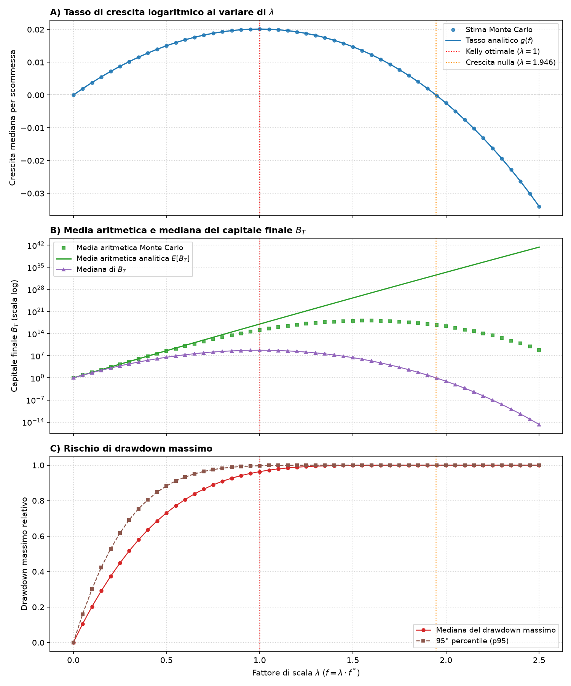
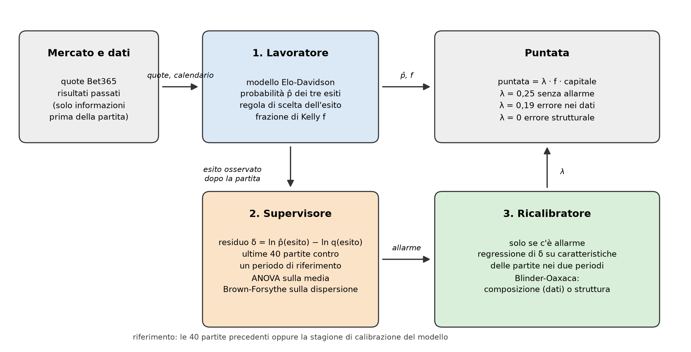
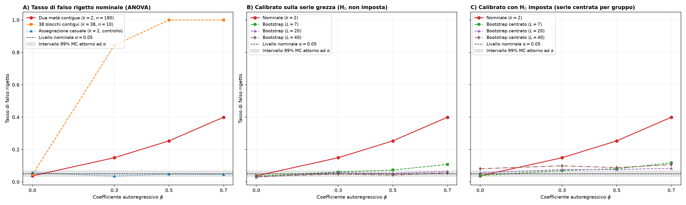
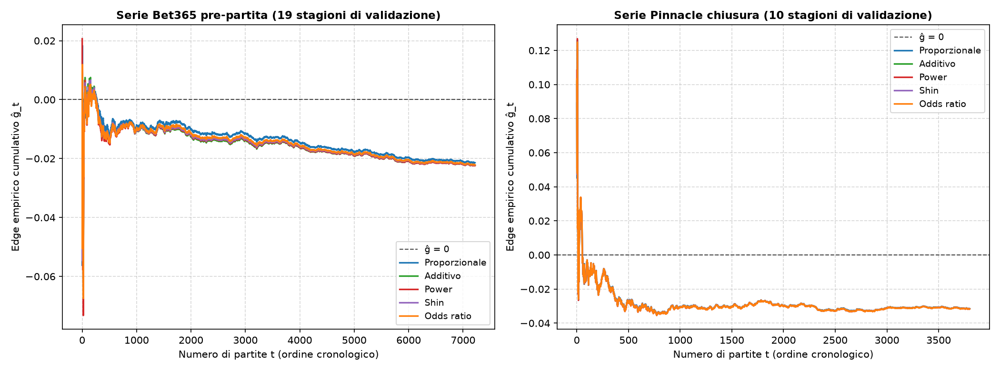
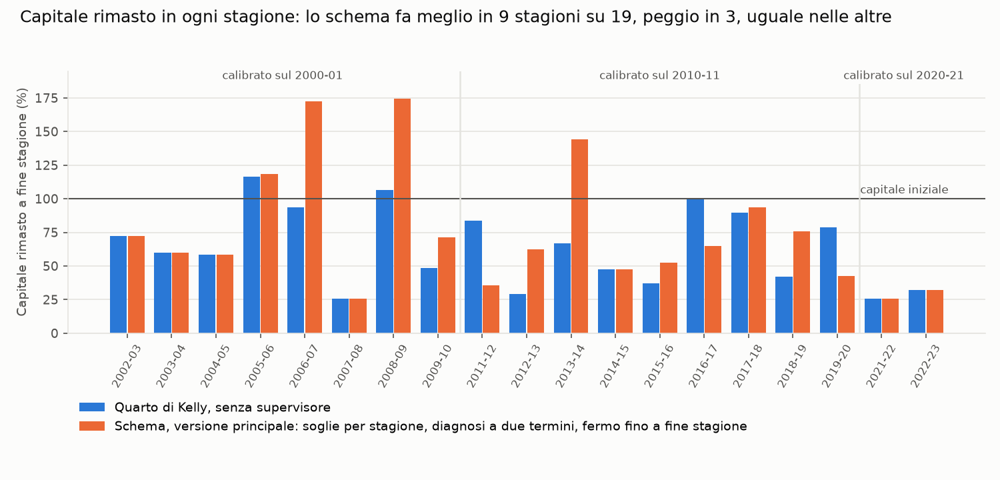
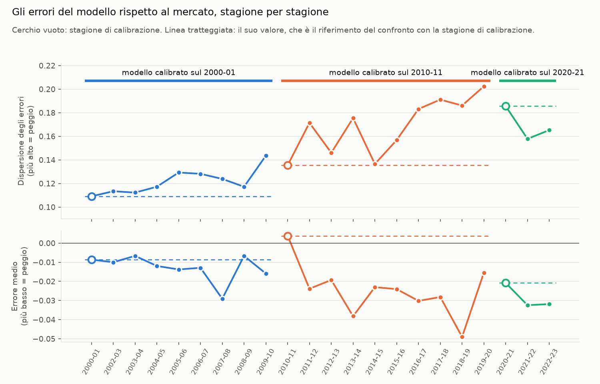
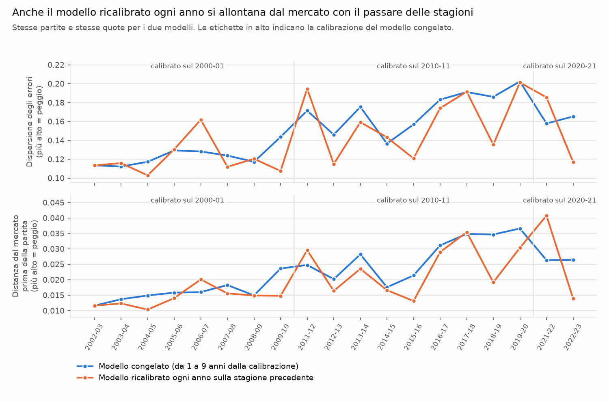
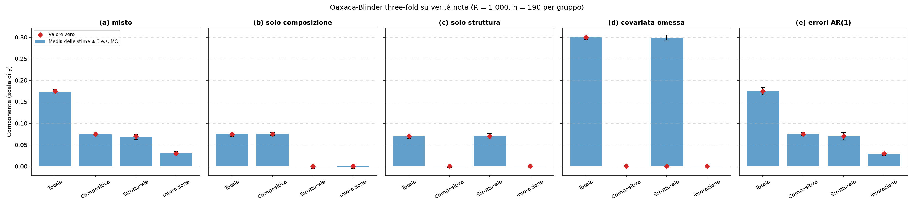
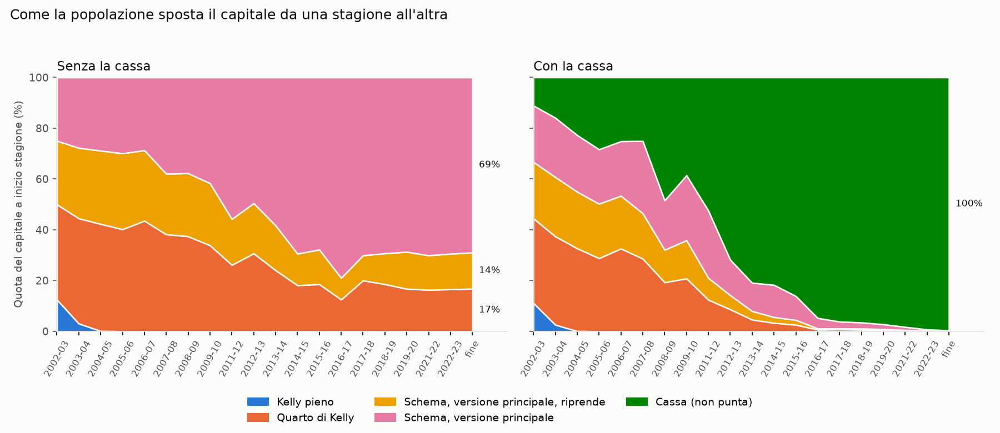
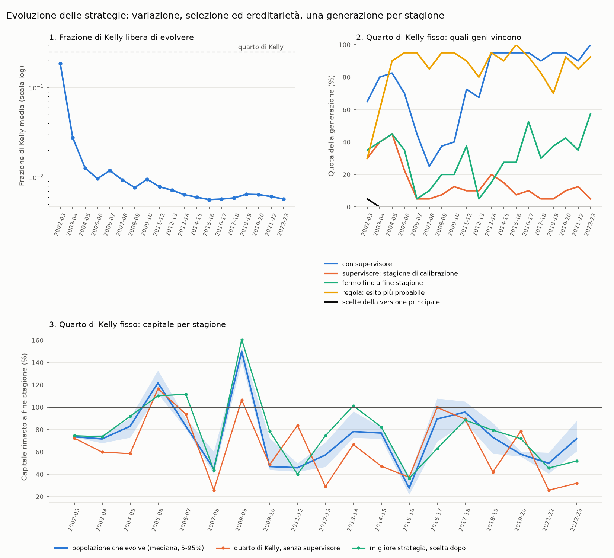

# Dall’assenza di vantaggio all’invecchiamento del modello: uno studio di conferma di KellyBench con importanti precisazioni

INDICE:
- Abstract
- 1. Introduzione
- 2. Scommesse, criterio di Kelly e strumenti statistici
- 3. Lo schema Structural-Hybrid
- 4. Dati e disegno sperimentale
- 5. Risultati
- 6. Dinamica evolutiva
- 7. Conclusioni
- Appendici
- Bibliografia

## 0. Abstract

Un recente benchmark, KellyBench (Grady et al., 2026), ha mostrato che agenti basati su modelli linguistici di frontiera, chiamati a scommettere su un'intera stagione di Premier League, perdono capitale in 22 esecuzioni su 24; una sola, dopo aver misurato di non battere il mercato, riduce le puntate al minimo. Poiché il costo limita la prova a una stagione e a poche esecuzioni per modello, questa evidenza non distingue un difetto degli agenti dall'assenza di un vantaggio sul mercato. Questo studio separa le due componenti sostituendo l'agente con un'architettura Structural-Hybrid: un modello previsivo classico (Elo), un supervisore che monitora con l'ANOVA gli errori del modello rispetto al mercato e un ricalibratore che, con la scomposizione di Blinder-Oaxaca, decide quanto ridurre la puntata.

Su 19 stagioni l'analisi conferma il risultato di KellyBench: il modello non batte le quote, e chi punta secondo le sue probabilità perde in media, qualunque frazione scelga. Lo schema riduce le perdite: in una stagione tipica conserva il 64% del capitale, contro il 57% di chi punta sempre la stessa frazione. Con un modello che perde, però, qualunque riduzione della puntata conserva capitale, e fermarsi nello stesso numero di giornate, scelte a caso, conserva altrettanto. Il capitale, da solo, non può quindi dimostrare che il supervisore intervenga al momento giusto.

Per capire che cosa il supervisore riconosce si è usata una misura che non dipende dai risultati delle partite: la distanza fra le probabilità del modello e quelle del mercato prima di ogni partita. Lo schema si ferma proprio nelle stagioni in cui questa distanza è maggiore. La distanza cresce con gli anni anche per un modello ricalibrato ogni stagione: dipende soprattutto dal mercato, che cambia e lascia indietro il modello, e solo in parte dall'invecchiamento dei parametri.

Poiché nei dati reali il modello non ha mai un vantaggio da proteggere, lo schema è stato provato anche su stagioni simulate in cui il vantaggio c'è e a metà stagione si rovescia. Lì lo schema se ne accorge e conserva più capitale sia di chi continua a puntare come prima, sia di chi punta per tutta la stagione una frazione più bassa; quando invece nulla cambia, rinuncia a poco. Due analisi di dinamica evolutiva arrivano per altra via alla stessa regola, puntare meno, mentre le squadre neopromosse, che nessun agente del benchmark gestisce, non risultano una fonte significativa di errore. L'assenza di un vantaggio sul mercato basta quindi a spiegare le perdite osservate in KellyBench. La supervisione statistica non genera profitto, ma funziona come un'assicurazione: costa poco quando nulla cambia e protegge il capitale quando c'è un vantaggio da perdere e la struttura cambia.

## 1. Introduzione

Nell'aprile 2026 General Reasoning, un laboratorio di ricerca sull'intelligenza artificiale con sede a Londra, ha presentato KellyBench [@grady2026kellybench]. Il laboratorio, fondato da Ross Taylor, già ricercatore di Meta AI, lavora su agenti capaci di prendere decisioni su orizzonti lunghi, e il benchmark nasce da una constatazione dei suoi autori: i modelli linguistici stanno saturando i test costruiti su compiti ben definiti, che non cambiano nel tempo e si valutano alla fine, proprio mentre vengono impiegati sempre più spesso in ambienti aperti, dove le regole cambiano e le decisioni si accumulano. Per misurare questa seconda capacità serve un ambiente in cui l'agente debba imparare dall'esperienza e tradurre le proprie previsioni in azioni. Gli autori lo trovano nelle scommesse sportive.

Prevedere un evento e decidere quanto rischiare su quella previsione sono infatti due problemi distinti. Un modello più accurato del pubblico non garantisce un guadagno, e può portare alla rovina se il suo vantaggio è stimato male. Il nome del benchmark richiama la tradizione che ha studiato questa differenza: nel 1956 John L. Kelly Jr., ai Bell Laboratories, mostrò quale frazione del capitale puntare per farlo crescere il più rapidamente possibile [@kelly1956; @shannon1948], e Edward Thorp e Bill Benter applicarono la sua regola al blackjack, ai mercati finanziari e alle corse di cavalli [@thorp1962; @benter1994]. La regola, però, fa crescere il capitale solo se le probabilità del modello sono migliori di quelle del mercato. Se non lo sono, ogni puntata perde in media, e la gestione del capitale può soltanto decidere quanto perdere.

Le scommesse aggiungono una difficoltà che i test tradizionali non hanno: il mondo cambia. Nel calcio la forza delle squadre varia di stagione in stagione, le neopromosse arrivano senza una storia recente, e il mercato stesso migliora nel tempo. Nel 2020-21, giocato a porte chiuse, il vantaggio del campo stimato dal modello Elo è sceso di circa il 40%, e un modello calibrato sugli anni precedenti ne sopravvalutava l'effetto. Un agente capace deve quindi accorgersi quando il proprio modello smette di essere affidabile, e comportarsi di conseguenza.

In KellyBench un agente linguistico scommette, giornata per giornata, sull'intera stagione 2023-24 di Premier League, partendo da un capitale fisso e con a disposizione i dati storici, gli strumenti per scrivere codice e le quote dei bookmaker. Nella prima versione del paper, su cui si basa questo studio, otto modelli di frontiera giocano la stagione tre volte ciascuno: perdono capitale in 22 esecuzioni su 24, e alcuni lo azzerano. Gli autori attribuiscono i fallimenti soprattutto al modo in cui gli agenti decidono: discutono il criterio di Kelly ma puntano importi fissi, scrivono diagnosi corrette dei propri errori ma non cambiano comportamento. Una sola esecuzione fa ciò che la teoria prescrive: misura di non battere il mercato e riduce le puntate al minimo. La versione pubblicata su arXiv alla fine di aprile, con cinque modelli e cinque esecuzioni ciascuno, arriva alla stessa conclusione, e KellyBench è rimasto accessibile come ambiente aperto sulla piattaforma OpenReward dello stesso laboratorio, con una classifica che viene aggiornata man mano che escono nuovi modelli.

Questi risultati, però, non dicono perché gli agenti perdono. Ogni esecuzione è costosa, quindi la prova copre una sola stagione e poche esecuzioni per modello, troppo poche per distinguere la bravura dalla fortuna. Inoltre in un agente linguistico la previsione e la decisione non si possono separare: una regola di puntata diversa cambia il capitale, quindi ciò che l'agente osserva e le sue previsioni successive. Resta così aperta una domanda:

> *Le perdite degli agenti dipendono da come decidono o dall'assenza di un vantaggio sul mercato? E ridurre la puntata quando il vantaggio manca può diventare una regola sistematica?*

Per rispondere, questo studio separa la previsione dalla decisione. Al posto dell'agente linguistico usa l'architettura Structural-Hybrid: un modello previsivo classico, il modello Elo [@elo1978], fa le previsioni; un supervisore confronta con l'ANOVA gli errori del modello rispetto al mercato con quelli di un periodo di riferimento e dà l'allarme quando peggiorano; un ricalibratore, con la scomposizione di Blinder-Oaxaca [@blinder1973; @oaxaca1973], decide se il peggioramento dipende dal tipo di partite o da un modello che non descrive più il campionato, e riduce o azzera la puntata. Il modello è deterministico e quasi gratuito: tutte le regole di puntata usano le stesse previsioni, e la prova si può ripetere su 19 stagioni, dal 2002-03 al 2022-23, con le stesse regole di KellyBench.

Questo studio non riguarda gli agenti linguistici, e non dimostra che uno di essi, affiancato da un supervisore, farebbe meglio. I risultati valgono per una lega, un bookmaker e il mercato dei tre esiti, e la versione principale dello schema è stata fissata dopo aver visto le stagioni su cui è valutata.


## 2. Scommesse, criterio di Kelly e strumenti statistici

### 2.1 Il criterio di Kelly

Nel 1956 John L. Kelly Jr., fisico dei Bell Laboratories, pubblicò sul *Bell System Technical Journal* un articolo dal titolo tecnico, «A New Interpretation of Information Rate» [@kelly1956]. Il problema era quello di uno scommettitore che riceve, su un canale disturbato, un'informazione sull'esito di un evento prima che il mercato la conosca; secondo la ricostruzione di Poundstone [@poundstone2005], lo spunto veniva dagli scandali dei quiz televisivi dell'epoca. Kelly dimostrò che il tasso massimo a cui lo scommettitore può far crescere il proprio capitale coincide con il tasso di informazione del canale, nel senso della teoria che il collega Claude Shannon aveva fondato pochi anni prima [@shannon1948]. La regola che ne deriva, puntare la frazione del capitale che massimizza il logaritmo della ricchezza, porta da allora il suo nome. Kelly morì nel 1965, a 41 anni.

A portare il criterio dalla teoria alla pratica fu Edward Thorp, matematico al MIT, a cui Shannon aveva segnalato l'articolo. Thorp lo usò per dosare le puntate nel blackjack contando le carte, e nel 1962 ne raccontò i risultati in *Beat the Dealer* [@thorp1962]; con Shannon costruì anche un piccolo computer da indossare per prevedere la roulette. In seguito applicò lo stesso principio ai mercati finanziari, con il fondo Princeton-Newport Partners. Dalla metà degli anni Ottanta Bill Benter lo portò nelle corse di cavalli di Hong Kong, combinando le probabilità del proprio modello statistico con quelle implicite nelle quote del pubblico [@benter1994]: è il caso più noto di scommesse sistematiche vincenti su larga scala.

Il criterio non ha avuto soltanto sostenitori. Paul Samuelson contestò a lungo l'idea che massimizzare il logaritmo della ricchezza fosse la scelta giusta per ogni investitore [@samuelson1979]. La pratica ha mostrato inoltre che il criterio pieno è molto sensibile agli errori di stima e produce oscillazioni del capitale difficili da sostenere. Per questo investitori e scommettitori professionisti lo usano quasi sempre in forma frazionaria, puntando solo una parte della frazione indicata [@maclean2011].

#### La frazione ottima

Si consideri una scommessa ripetuta che si vince con probabilità $p$ e si perde con probabilità $1-p$, pagata a una quota decimale $o$: per ogni unità puntata si incassano $o$ unità in caso di vittoria, e la vincita netta è $b = o - 1$. Se a ogni turno si punta una frazione $f$ del capitale corrente $W$, il capitale si moltiplica per $1 + fb$ quando si vince e per $1 - f$ quando si perde. Dopo $n$ turni il capitale è un prodotto di fattori casuali, e il suo logaritmo una somma. Il tasso di crescita atteso per turno è quindi

$$
g(f) = \mathbb{E}\left[\ln \frac{W_{t+1}}{W_t}\right] = p \ln(1 + fb) + (1-p)\ln(1-f). \tag{2.1}
$$

Per la legge dei grandi numeri, $\frac{1}{n}\ln(W_n/W_0)$ converge a $g(f)$ con probabilità uno: massimizzare $g$ significa massimizzare la velocità con cui il capitale cresce nel lungo periodo, quasi certamente e senza alcuna ipotesi sulle preferenze di chi scommette [@breiman1961]. Poiché $g$ è concava, il massimo si trova annullando la derivata:

$$
f^* = \frac{bp - (1-p)}{b} = \frac{p\,o - 1}{o - 1}. \tag{2.2}
$$

Il numeratore $p\,o - 1$ è il valore atteso di un'unità puntata. Se è nullo o negativo, $f^* \le 0$ e il criterio prescrive di non scommettere: Kelly non corregge una scommessa sfavorevole, la evita.

Due proprietà della regola spiegano perché nella pratica la si usa in forma frazionaria. La prima riguarda la differenza fra ricchezza media e ricchezza tipica. La ricchezza attesa cresce in modo lineare con $f$ ed è massima puntando tutto, ma in quel caso la ricchezza tipica, cioè la mediana, crolla: massimizzare la media e massimizzare la crescita sono obiettivi diversi, e Kelly sceglie il secondo. La seconda proprietà riguarda il rischio. Oltre il doppio della frazione ottima la crescita diventa negativa, quindi sovrastimare il proprio vantaggio è molto più pericoloso che sottostimarlo. Puntando una frazione $c\,f^*$ con $0 < c < 1$ si conserva, in un'approssimazione continua, una frazione $c(2-c)$ della crescita e si riduce la volatilità di un fattore $c$: con il quarto di Kelly ($c = 0{,}25$) si mantiene circa il 44% della crescita con un quarto della volatilità [@maclean2011]. La Figura 2.1 illustra queste proprietà su una scommessa simulata.



*Figura 2.1. Il criterio di Kelly su una scommessa simulata ($p = 0{,}6$, quota 2,0, 1 000 turni, 10 000 traiettorie). Sull'asse orizzontale la frazione puntata come multiplo $\lambda$ di quella ottima. (A) La crescita per turno è massima a $\lambda = 1$ e si annulla poco prima di $\lambda = 2$. (B) La ricchezza media continua a crescere, quella mediana no: le due misure divergono già sopra $\lambda = 1$. (C) La perdita massima dal picco cresce rapidamente: al Kelly pieno la traiettoria tipica perde a un certo punto il 96% del picco.*

Nella (2.2) la probabilità $p$ è quella vera. Chi scommette non la conosce, e usa la stima del proprio modello: il criterio dice quanto puntare se quella stima è giusta, non se lo è. Quando conviene puntare dipende dal confronto con il mercato, che è l'argomento della prossima sezione.

### 2.2 Le quote, il margine e l'efficienza del mercato

#### Probabilità implicite e margine

Una quota decimale $o_i$ corrisponde a una probabilità implicita $\pi_i = 1/o_i$. Sui tre esiti di una partita (vittoria in casa, pareggio, vittoria in trasferta) queste probabilità sommano a $S = \sum_i \pi_i > 1$: l'eccesso $S - 1$, detto *overround*, è il margine del bookmaker. Sulle quote Bet365 della Premier League usate in questo studio l'overround medio è 5,4%. Il margine ha tre funzioni: è il guadagno del bookmaker su un libro bilanciato, compensa le posizioni sbilanciate quando il pubblico preferisce un esito, e protegge dagli scommettitori informati [@shin1993].

Per confrontare le previsioni del modello con quelle del mercato servono probabilità che sommino a uno, quindi il margine va tolto. Il problema è sottodeterminato: c'è una sola equazione ($\sum_i q_i = 1$) per tre incognite, e ogni metodo equivale a un'ipotesi su come il margine si distribuisce fra gli esiti. Il metodo proporzionale ($q_i = \pi_i/S$) assume un margine uguale ovunque. Il metodo di Shin [@shin1993] assume invece che una frazione $z$ delle puntate provenga da scommettitori informati, e ne deduce che il margine pesa di più sugli esiti improbabili, in accordo con il noto *favourite-longshot bias*, per cui le quote alte sono sistematicamente meno convenienti. Questo studio adotta il metodo di Shin, l'unico fondato su un modello economico, e verifica che i risultati non cambino con altri quattro metodi (proporzionale, additivo, potenza e *odds ratio*).

Il metodo conta per il confronto con il mercato, non per la puntata. La frazione di Kelly (2.2) usa soltanto la probabilità del modello e la quota offerta: togliere il margine in un modo o nell'altro non cambia né l'esito su cui si punta né l'importo.

#### Efficienza del mercato

Secondo l'ipotesi di efficienza dei mercati nella forma semiforte [@fama1970], i prezzi incorporano tutta l'informazione pubblica. Un modello costruito soltanto su dati pubblici, come quello di questo studio, non dovrebbe quindi battere le quote in modo sistematico. Il mercato delle scommesse sulla Premier League è considerato fra i più efficienti, perché è molto liquido e le quote si aggiornano fino al calcio d'inizio con le notizie su formazioni e infortuni. Qui non si verifica l'efficienza in sé: si misura se il modello ha un vantaggio, e un risultato negativo è coerente con l'efficienza senza dimostrarla.

#### Quando si può guadagnare

Il mercato offre per ogni esito una quota, e quindi una propria probabilità. Chi scommette secondo il proprio modello guadagna nel lungo periodo solo se il modello assegna agli esiti che poi si verificano più probabilità di quanta ne assegni il mercato. Se il mercato è più preciso, le puntate che il modello giudica convenienti sono in gran parte errori di stima, e perdono in media.

Il risultato si può scrivere in modo esatto [@grady2026kellybench]. Siano $p^*$ le probabilità vere degli esiti, $q$ quelle del mercato senza margine e $\hat p$ quelle del modello. Chi punta secondo il criterio di Kelly usando $\hat p$, su quote senza margine, fa crescere il capitale a un tasso atteso

$$
g = \sum_x p^*(x) \ln \frac{\hat p(x)}{q(x)} = \mathrm{KL}(p^* \,\|\, q) - \mathrm{KL}(p^* \,\|\, \hat p). \tag{2.3}
$$

La divergenza di Kullback-Leibler $\mathrm{KL}(p^* \,\|\, \cdot)$ misura quanto una distribuzione è lontana da quella vera: è nulla se coincidono e cresce quanto più se ne allontana. La (2.3) dice quindi che la crescita è positiva solo se il modello è più vicino alla verità di quanto lo sia il mercato. Una regola di puntata più prudente può ridurre le perdite e il rischio di rovina, ma il guadagno può venire soltanto da previsioni migliori di quelle del mercato. Con le quote reali, che includono il margine, il confronto è ancora più severo: alla (2.3) va sottratto $\ln S$, circa 0,05 per la Premier League.

#### Misurare il vantaggio sul mercato

Il vantaggio della (2.3) non si può calcolare direttamente, perché $p^*$ non è nota, ma si può stimare dagli esiti osservati. Per ogni partita $t$ con esito reale $x_t$ si definisce lo scarto logaritmico fra modello e mercato

$$
\delta_t = \ln \hat p_t(x_t) - \ln q_t(x_t), \tag{2.4}
$$

dove $q_t$ è la probabilità del mercato senza margine. La media $\hat g = \frac{1}{T}\sum_t \delta_t$ è la differenza fra la *log-loss* del mercato e quella del modello, e stima la crescita (2.3). Se è negativa, il modello assegna in media all'esito reale meno probabilità del mercato, e chi punta secondo il modello perde in media. Per chiudere in pari su ogni esito, con il margine, servirebbe anzi $\hat g > \ln S \approx 0{,}05$.

Rispetto al guadagno realizzato, questa misura ha due vantaggi. Si calcola su tutte le partite, non solo su quelle su cui si è puntato, e quindi non dipende dalla regola di puntata. Ed è molto meno ingannevole: un modello che riproduce il mercato con l'aggiunta di rumore casuale trova «scommesse di valore» su gran parte delle partite, perché il rumore crea scarti positivi, ma il suo $\hat g$ è negativo.

Poiché le partite di una stagione non sono del tutto indipendenti, gli intervalli di confidenza di $\hat g$ si costruiscono con un bootstrap a blocchi, che ricampiona tratti consecutivi della serie invece di singole partite (§2.5).

### 2.3 Il modello previsivo Elo

Il sistema Elo nasce negli scacchi [@elo1978] ed è oggi uno dei modelli più usati per prevedere i risultati del calcio, dove regge il confronto con modelli più ricchi [@hvattum2010]. A ogni squadra è associato un punteggio $R$, e il punteggio atteso della squadra di casa è

$$
E = \frac{1}{1 + 10^{-(R_{\text{casa}} - R_{\text{trasf}} + h)/400}}, \tag{2.5}
$$

dove $h$ è il vantaggio del campo, espresso in punti Elo. Dopo la partita, con risultato $S = 1$, $0{,}5$ o $0$ per vittoria, pareggio o sconfitta, i punteggi si aggiornano di $K(S - E)$: la squadra di casa guadagna quanto perde quella in trasferta. Il parametro $K$ stabilisce la velocità con cui il modello reagisce: un valore alto lo rende reattivo ma rumoroso, un valore basso stabile ma lento. Elo equivale al modello di Bradley-Terry stimato partita per partita, con un aggiornamento che è un passo di discesa del gradiente sulla verosimiglianza.

Il punteggio atteso $E$ non basta per scommettere sui tre esiti, perché non dice quanto è probabile il pareggio. Questo studio usa il modello di Davidson [@davidson1970], che aggiunge un solo parametro $\nu$: posto $r = 10^{(R_{\text{casa}} - R_{\text{trasf}} + h)/400}$,

$$
p_{\text{casa}} = \frac{r}{r + 1 + \nu\sqrt{r}}, \quad p_{\text{pareggio}} = \frac{\nu\sqrt{r}}{r + 1 + \nu\sqrt{r}}, \quad p_{\text{trasf}} = \frac{1}{r + 1 + \nu\sqrt{r}}. \tag{2.6}
$$

Il pareggio diventa meno probabile al crescere dello squilibrio fra le squadre. Il modello ha quindi tre parametri, $K$, $h$ e $\nu$, stimati sulle stagioni di calibrazione (capitolo 4).

La scelta di Elo ha tre ragioni. È deterministico ed economico: tutte le regole di puntata confrontate usano esattamente le stesse previsioni, e ogni differenza di capitale dipende dalla sola decisione; è la separazione che in un agente LLM non si può ottenere. È dinamico: si aggiorna a ogni partita, e la rubrica con cui KellyBench valuta la sofisticazione delle strategie include fra i criteri proprio l'uso di modelli dinamici come Elo [@grady2026kellybench]. Infine ha pochi parametri, e il suo comportamento resta facile da interpretare anche quando invecchia.

### 2.4 KellyBench

#### L'ambiente

KellyBench [@grady2026kellybench] è un ambiente in cui un agente basato su un modello linguistico scommette su una stagione di Premier League, una giornata alla volta, partendo da un capitale fisso. L'ambiente è definito con l'Open Reward Standard, un protocollo per descrivere compiti, strumenti e stato di un ambiente, ed è servito sulla piattaforma OpenReward degli stessi autori. L'agente è il modello linguistico eseguito dentro un programma che ne gestisce il ciclo di lavoro: riceve le osservazioni, decide quali strumenti chiamare, legge i risultati e prosegue.

Per scommettere l'agente ha quattro strumenti:

- **vedere le partite della giornata**, con le quote decimali dei tre esiti e, dove disponibili, quelle sul numero di gol;
- **piazzare una puntata** su un esito, per un importo positivo e non superiore al capitale, che viene scalato subito; nella stessa giornata si possono piazzare più puntate;
- **consultare il capitale**, con l'importo già puntato nella giornata;
- **passare alla giornata successiva**, che liquida le puntate, aggiorna il capitale e rende disponibili i risultati e le statistiche delle partite appena giocate.

Per passare alla giornata successiva bisogna aver piazzato almeno una puntata. Una puntata di un penny è ammessa, e permette a un agente che non vuole scommettere di rispettare la regola rischiando una cifra trascurabile.

Per costruire i propri modelli l'agente lavora in un ambiente di calcolo isolato, con strumenti per eseguire comandi, leggere e scrivere file e scrivere codice Python con le librerie usuali di analisi dei dati. Ha a disposizione i dati storici della Premier League: i risultati dal 1993-94, le statistiche delle partite dal 2000-01, le quote dal 2002-03 e i dati sui giocatori dal 2008. Non può accedere alla rete: chi ci prova tre volte viene squalificato e perde il capitale.

Il risultato di ogni giornata è misurato con la variazione del logaritmo del capitale, $\ln(W_{t+1}/W_t)$. Sommata sulla stagione dà il logaritmo del rapporto fra capitale finale e iniziale: è la grandezza che il criterio di Kelly massimizza (§2.1).

Gli scenari sono quattro. Tre, di stagioni distanti un decennio l'una dall'altra, servono a mettere a punto gli agenti; il quarto, la stagione 2023-24, è quello su cui sono valutati.

| Scenario | Stagione | Uso | Capitale iniziale | Giornate |
|---|---|---|---|---|
| New Millennium | 2000-01 | messa a punto | £100 | 97 |
| Post-Crash | 2010-11 | messa a punto | £150 | 105 |
| Covid Season | 2020-21 | messa a punto | £200 | 148 |
| Recent Season | 2023-24 | valutazione | £220 | 120 |

Una giornata è una data in cui si gioca almeno una partita. Le 380 partite di una stagione sono distribuite su un centinaio di date, e il loro numero cambia da stagione a stagione: nel 2020-21, con i recuperi delle partite rinviate per il Covid, sono 148. Nei risultati del paper i capitali sono riportati come se ogni agente partisse da £100 000, per rendere confrontabili gli scenari.

#### I risultati

Nella prima versione del paper otto modelli di frontiera giocano la stagione di valutazione tre volte ciascuno. La tabella riporta il rendimento sulla stagione.

| Modello | Rendimento medio | Esecuzione migliore | Esecuzione peggiore | Nessuna esecuzione in rovina |
|---|---|---|---|---|
| Claude Opus 4.6 | −11,0% | −0,2% | −18,8% | sì |
| GPT-5.4 | −13,6% | −4,1% | −31,6% | sì |
| Gemini 3.1 Pro | −43,3% | +33,7% | −100% | no |
| Gemini Flash 3.1 Lite Preview | −58,4% | +24,7% | −100% | no |
| GLM-5 | −58,8% | −14,3% | −100% | no |
| Kimi K2.5 | −92,6% | −77,7% | −100% | no |
| Grok 4.20 | −100% | −100% | −100% | no |
| Arcee Trinity | −100% | −100% | −100% | no |

Tutti i modelli perdono in media. Solo 2 esecuzioni su 24 chiudono in attivo, entrambe di modelli che in un'altra esecuzione vanno in rovina, e sei modelli su otto vanno in rovina almeno una volta. Gli autori valutano anche la sofisticazione delle strategie, con una rubrica di 44 punti scritta insieme a esperti di fondi di scommesse quantitative: il modello migliore ne ottiene il 32,6%.

Gli autori classificano i fallimenti ispezionando le traiettorie delle esecuzioni. I principali sono quattro:

- **la gestione del capitale.** Quasi tutti gli agenti discutono il criterio di Kelly e poi puntano importi fissi o arrotondati; in 9 esecuzioni su 24 nessuna regola di puntata viene applicata, in 4 il codice di Kelly è scritto ma mai chiamato;
- **le squadre neopromosse.** Nessuna delle 24 esecuzioni le gestisce in modo generale: per esempio un agente le esclude a mano, un altro tratta l'assenza di storia come probabilità zero;
- **l'adattamento.** 21 esecuzioni su 24 non si adattano pienamente a una stagione che cambia, e 7 non riaddestrano mai il modello;
- **la consapevolezza della situazione.** In 6 esecuzioni il compito è dichiarato concluso in anticipo; in altre 6 il modello usa informazioni successive alla partita.

Il tratto comune è ciò che gli autori chiamano divario fra sapere e fare: gli agenti scrivono diagnosi corrette dei propri errori, ma non cambiano comportamento. Fa eccezione un'esecuzione di GPT-5.4, che misura la *log-loss* del proprio modello (0,974 contro 0,971 del mercato), conclude di non avere un vantaggio e riduce le puntate al minimo per il resto della stagione: è il comportamento che il criterio di Kelly prescrive.

Per verificare che i risultati non dipendano da come gli agenti sono stati messi alla prova, gli autori ripetono la prova con Claude Opus 4.6 in due modi diversi: fornendogli i testi che gli esperti considerano fondamentali per costruire modelli di scommessa, e facendolo lavorare dentro Claude Code invece che nel programma usato per tutti i modelli. In nessuno dei due casi i risultati migliorano. Nell'appendice del paper un modello classico, Dixon-Coles [@dixon1997] combinato con le quote del mercato, fa meglio della maggior parte degli agenti.

Gli autori discutono infine i limiti del benchmark: una sola stagione, che per il costo non si può ripetere molte volte (un'esecuzione di GPT-5.4 è costata circa 2 000 dollari); un mercato molto efficiente; quote con un margine di circa il 5%; la possibilità che i modelli conoscano già i risultati della stagione dai dati di addestramento.

#### Un'osservazione sul confronto con il mercato

Il paper non precisa se la *log-loss* del mercato con cui l'esecuzione di GPT-5.4 confronta il proprio modello sia calcolata con o senza margine, e la differenza è grande: togliere il margine alza la *log-loss* del mercato di circa 0,05, più di dieci volte lo scarto osservato (0,003); con il margine incluso il mercato appare più preciso di quanto sia, e il confronto risulta sbilanciato a suo favore.

### 2.5 Il bootstrap

#### L'idea

Una stima calcolata su un campione cambierebbe con un campione diverso, e per sapere quanto fidarsi serve conoscere questa variabilità. Le formule classiche la ricavano da ipotesi sulla distribuzione dei dati, come la normalità, e valgono solo per alcune statistiche. Il bootstrap di Efron [@efron1979] la ricava dai dati stessi. Il campione osservato prende il posto della popolazione: se ne estraggono molti nuovi campioni della stessa dimensione, ricampionando le osservazioni con reinserimento, così che alcune compaiono più volte e altre mancano, e su ciascuno si ricalcola la stima. La distribuzione delle stime ricalcolate approssima quella che si otterrebbe ripetendo l'esperimento. Nella forma più semplice, l'intervallo di confidenza al 95% è compreso fra i quantili al 2,5% e al 97,5% delle stime ricalcolate.

#### Dati dipendenti nel tempo: il bootstrap a blocchi

Ricampionare le singole osservazioni presuppone che siano indipendenti. In una serie temporale non lo sono: osservazioni vicine si somigliano, e ricampionandole una per una si spezza questo legame. Le serie ricampionate risultano meno variabili di quella reale, e l'incertezza della stima viene sottostimata.

Il bootstrap a blocchi mobili di Künsch [@kunsch1989] ricampiona invece blocchi di osservazioni consecutive, di lunghezza fissa, e li accoda fino a riprodurre la lunghezza della serie: dentro ogni blocco la dipendenza resta intatta, e si perde solo al confine fra un blocco e il successivo. Lo *stationary bootstrap* di Politis e Romano [@politisromano1994] usa blocchi di lunghezza casuale, con una lunghezza media fissata, e così la serie ricampionata conserva le proprietà della serie originale lungo tutta la sua durata, indipendentemente da dove cadono i confini.

La lunghezza dei blocchi è un compromesso: blocchi troppo corti spezzano la dipendenza, blocchi troppo lunghi lasciano pochi blocchi diversi da combinare e rendono imprecisa la stima della variabilità. Politis e White [@politiswhite2004] hanno proposto una regola che la ricava automaticamente dall'autocorrelazione della serie.

#### Tre usi

Lo stesso strumento serve a tre scopi. Il primo è l'intervallo di confidenza di una stima, come il vantaggio sul mercato $\hat g$ (§2.2).

Il secondo è la soglia di un test. Ricampionando a blocchi un unico periodo si ottengono serie in cui i blocchi sono mescolati a caso: un eventuale cambiamento nel tempo viene cancellato, mentre la dipendenza fra osservazioni vicine resta. Il valore della statistica del test su ciascuna di queste serie è quindi un esempio di ciò che il test produce quando non è cambiato nulla, e il loro quantile al 95% è una soglia che segnala un cambiamento inesistente solo nel 5% dei casi, anche con osservazioni dipendenti.

Il terzo è la ricostruzione di intere serie. Ricampionando a blocchi una serie reale, per esempio una stagione di partite, si ottengono molte serie plausibili, fatte degli stessi dati in un ordine diverso, con alcuni tratti ripetuti e altri assenti. Ripetendo un'intera analisi su ciascuna si misura quanto il suo risultato dipenda dal caso.

### 2.6 L'ANOVA e il controllo della dispersione

#### L'ANOVA a una via

L'analisi della varianza di Fisher [@fisher1925] confronta le medie di $k$ gruppi. Indicando con $y_{ij}$ l'osservazione $i$ del gruppo $j$, con $\bar y_j$ la media del gruppo e con $\bar y$ la media generale, la variabilità totale si scompone esattamente in una parte fra i gruppi e una dentro i gruppi:

$$
\sum_{j}\sum_{i}(y_{ij} - \bar y)^2 = \sum_j n_j(\bar y_j - \bar y)^2 + \sum_j\sum_i(y_{ij} - \bar y_j)^2. \tag{2.7}
$$

La statistica $F$ è il rapporto fra le due parti, ciascuna divisa per i propri gradi di libertà. Se tutte le medie sono uguali, $F$ è vicino a uno; se differiscono, cresce. Con osservazioni indipendenti e normali, sotto l'ipotesi di medie uguali $F$ segue una distribuzione $F$ di Fisher, da cui si ricava la soglia. Con due gruppi l'ANOVA coincide con il test $t$.
Se i due gruppi sono due periodi di tempo, l'ANOVA dice se la media di una grandezza è cambiata fra l'uno e l'altro.

#### La dispersione: il test di Brown-Forsythe

Un modello che perde affidabilità può produrre errori non solo peggiori in media, ma anche più dispersi: è l'eteroschedasticità, cioè una varianza degli errori che cresce. Per confrontare la dispersione di due periodi questo studio usa il test di Brown-Forsythe [@brownforsythe1974], una variante robusta del test di Levene [@levene1960]: per ogni osservazione si calcola la distanza assoluta dalla mediana del proprio gruppo, e a queste distanze si applica l'ANOVA. Se nel periodo recente le distanze sono in media maggiori, gli errori sono più dispersi. L'uso della mediana al posto della media rende il test affidabile anche quando gli errori non sono normali, come accade per $\delta_t$, che ha una distribuzione asimmetrica.

#### Errori autocorrelati e soglie calibrate

La soglia nominale dell'ANOVA vale per osservazioni indipendenti. Gli errori di un modello lungo una stagione possono invece essere autocorrelati: a un errore alto tende a seguirne un altro, per esempio perché il modello sbaglia per settimane la forza di una squadra. In questo caso $n$ osservazioni contengono meno informazione di $n$ osservazioni indipendenti; il test sovrastima l'informazione disponibile e segnala differenze che non esistono, cioè falsi allarmi. Nel confronto fra due periodi consecutivi la quota di falsi allarmi cresce rapidamente con l'autocorrelazione: in simulazione arriva al 40% invece del 5% (Figura 3.2).

Il rimedio è calibrare la soglia sui dati con un bootstrap a blocchi (§2.5), che conserva la dipendenza fra osservazioni vicine, invece di ricavarla dalla distribuzione $F$.

### 2.7 La scomposizione di Blinder-Oaxaca

#### L'origine

Nel 1973 Blinder e Oaxaca proposero, in modo indipendente, un metodo per spiegare il divario salariale fra due gruppi, uomini e donne o bianchi e neri [@blinder1973; @oaxaca1973]. La domanda era: quanto del divario dipende dalle diverse caratteristiche dei due gruppi, come l'istruzione e l'esperienza, e quanto dal fatto che le stesse caratteristiche sono retribuite in modo diverso? Il metodo è stato poi usato ben oltre l'economia del lavoro. In epidemiologia, per esempio, scomposizioni dello stesso tipo sono state usate per separare la parte di un segnale di rischio dovuta alla composizione delle popolazioni confrontate da quella strutturale [@roccetti2026fphar; @roccetti2026cmes].

#### La scomposizione

In ciascuno dei due gruppi, A (riferimento) e B, si stima una regressione separata della risposta $y$ sulle stesse caratteristiche $\mathbf{x}$, ottenendo i coefficienti $\hat{\boldsymbol\beta}^A$ e $\hat{\boldsymbol\beta}^B$. Poiché una regressione con intercetta passa per le medie, il divario medio si scompone esattamente in tre termini:

$$
\bar y^B - \bar y^A = \underbrace{\hat{\boldsymbol\beta}^{A\top}(\bar{\mathbf x}^B - \bar{\mathbf x}^A)}_{\text{composizione}} + \underbrace{\bar{\mathbf x}^{A\top}(\hat{\boldsymbol\beta}^B - \hat{\boldsymbol\beta}^A)}_{\text{struttura}} + \underbrace{(\bar{\mathbf x}^B - \bar{\mathbf x}^A)^\top(\hat{\boldsymbol\beta}^B - \hat{\boldsymbol\beta}^A)}_{\text{interazione}}. \tag{2.8}
$$

La **composizione** è la variazione che la risposta subirebbe se cambiassero soltanto le caratteristiche, fermo restando il legame fra caratteristiche e risposta. La **struttura** è la variazione che subirebbe se cambiasse soltanto il legame, a parità di caratteristiche. L'**interazione** è la parte dovuta al cambiamento simultaneo di entrambi.

#### La forma a due termini

Quando uno dei due gruppi è il riferimento naturale del confronto, la scomposizione si scrive anche in due soli termini, con i coefficienti del riferimento [@oaxaca1973]:

$$
\bar y^B - \bar y^A = \underbrace{\hat{\boldsymbol\beta}^{A\top}(\bar{\mathbf x}^B - \bar{\mathbf x}^A)}_{\text{spiegato}} + \underbrace{\frac{1}{n_B}\sum_{i \in B}\left(y_i - \hat{\boldsymbol\beta}^{A\top}\mathbf x_i\right)}_{\text{non spiegato}}. \tag{2.9}
$$

Il termine spiegato è la composizione della (2.8). Quello non spiegato riunisce struttura e interazione, ed è la media, nel gruppo B, dei residui del modello stimato sul riferimento. Ha un vantaggio pratico: non richiede di stimare una regressione nel gruppo B, e si può usare anche quando B è piccolo.

La scomposizione vale per la media di qualunque risposta. Se la risposta è la distanza assoluta di ogni errore dalla mediana del riferimento, la stessa del test di Brown-Forsythe, si scompone la variazione della dispersione invece di quella della media.

#### Due cautele

La scomposizione richiede due cautele. La prima: la parte strutturale, o non spiegata, è un residuo. Contiene il vero cambiamento del legame, ma anche l'effetto di ogni caratteristica rilevante che non è stata inclusa: se una caratteristica omessa cambia fra i due gruppi, il suo effetto viene attribuito alla struttura. Va quindi letta insieme all'elenco delle caratteristiche usate, e non ha un significato causale. La seconda: la forma a due termini dipende dal gruppo scelto come riferimento, e va usata solo quando la scelta è naturale, per esempio quando uno dei due gruppi è il punto di partenza con cui si confrontano i successivi. La forma a tre termini (2.8) non dipende da questa scelta, ma richiede una regressione in entrambi i gruppi.

### 2.8 La dinamica evolutiva

La dinamica evolutiva si può applicare a una popolazione di strategie a due livelli: la sola selezione fra strategie fisse, e l'evoluzione completa, con variazione, selezione ed ereditarietà.

#### La dinamica del replicatore

La dinamica del replicatore [@taylorjonker1978] descrive una popolazione di strategie in cui la quota di ciascuna cresce in proporzione al suo rendimento rispetto alla media. Nella forma discreta usata qui la popolazione è un capitale diviso fra $N$ strategie; se $s_i(d)$ è la quota della strategia $i$ alla giornata $d$ e $R_i(d)$ il fattore per cui la strategia moltiplica il proprio capitale in quella giornata,

$$
s_i(d+1) = (1 - \mu)\,\frac{s_i(d)\,R_i(d)}{\sum_j s_j(d)\,R_j(d)} + \frac{\mu}{N}. \tag{2.10}
$$

Il primo termine è la selezione: il capitale si sposta verso le strategie che rendono di più. Il secondo è una mutazione: una frazione $\mu$ del capitale viene ridistribuita in parti uguali, così che nessuna strategia si estingua e una strategia sfavorita possa tornare a crescere quando le condizioni cambiano.

Il legame con Kelly è diretto. Nella *evolutionary finance*, che studia i mercati come popolazioni di strategie in competizione, la ricchezza di chi investe una frazione del proprio capitale evolve proprio secondo la (2.10), e la regola di Kelly è quella che sopravvive alla selezione del mercato [@blumeeasley1992; @evstigneev2009]. Lensberg e Schenk-Hoppé hanno mostrato che la stessa regola emerge spontaneamente da un processo evolutivo darwiniano [@lensberg2007].

#### Gli algoritmi genetici

Negli algoritmi genetici [@holland1975] una strategia è descritta da un insieme di parametri, i suoi geni. Una popolazione di strategie viene valutata; le migliori sopravvivono (selezione) e generano figlie con geni copiati (ereditarietà) e leggermente modificati (variazione). Ripetendo il ciclo, la popolazione si sposta verso le combinazioni di geni che funzionano, senza che nessuno le indichi in anticipo.

## 3. Lo schema Structural-Hybrid

Il criterio di Kelly indica quale frazione del capitale puntare supponendo che le probabilità usate siano quelle vere (§2.1). Le probabilità di un modello, però, sono stime, e la loro affidabilità cambia nel tempo: una squadra cambia allenatore, il vantaggio del campo si riduce, il mercato si aggiorna più in fretta del modello. Chi applica il criterio senza misurare quanto le proprie stime siano ancora affidabili punta come se lo fossero sempre, e perde proprio quando smettono di esserlo. La forma frazionaria attenua il problema riducendo tutte le puntate nella stessa misura, ma non distingue un periodo in cui il modello funziona da uno in cui ha smesso di funzionare.

Lo schema Structural-Hybrid rende la frazione puntata una variabile, che dipende da quanto il modello è affidabile in quel momento, e misura questa affidabilità con strumenti statistici. È anche una risposta al difetto più evidente degli agenti di KellyBench, che riconoscevano i propri errori ma non cambiavano comportamento (§2.4): qui chi osserva gli errori e chi decide la puntata sono moduli distinti, e la reazione a un peggioramento è una regola, non una scelta lasciata a chi prevede.

### 3.1 L'architettura

Lo schema divide il compito di un agente che scommette in tre moduli (Figura 3.1). Il **lavoratore** prevede le partite e propone una puntata secondo il criterio di Kelly. Il **supervisore** osserva gli errori del lavoratore rispetto al mercato e dà l'allarme quando peggiorano. Il **ricalibratore**, quando scatta l'allarme, cerca la causa del peggioramento e decide di quanto ridurre la puntata.



*Figura 3.1. Lo schema realizzato. Il lavoratore prevede con le sole informazioni disponibili prima della partita e propone la frazione di Kelly. Dopo la partita il supervisore aggiorna il residuo e confronta il periodo recente con un periodo di riferimento; se dà l'allarme, il ricalibratore distingue un errore nei dati da un errore strutturale. La puntata finale è la frazione di Kelly moltiplicata per $\lambda$.*

I tre moduli lavorano in sequenza a ogni giornata. Prima delle partite il supervisore confronta gli errori delle partite già giocate con un periodo di riferimento; se dà l'allarme, il ricalibratore stabilisce se il peggioramento è un errore nei dati o un errore strutturale, e fissa un moltiplicatore della puntata. Il lavoratore prevede le partite della giornata con le sole informazioni disponibili e propone la frazione di Kelly, e la puntata effettiva è quella frazione moltiplicata per il moltiplicatore. Dopo le partite il lavoratore aggiorna il modello con i risultati, e il supervisore aggiunge gli errori della giornata alla propria serie.

Il ricalibratore non modifica mai il modello: agisce soltanto sulla puntata. Le previsioni restano quindi le stesse in tutte le versioni dello schema e nei riferimenti con cui lo schema è confrontato, e ogni differenza di capitale si può attribuire alla sola decisione. È la separazione fra previsione e decisione che in un agente basato su un modello linguistico non si può ottenere.

### 3.2 Il lavoratore

**Le previsioni.** Il lavoratore è il modello Elo-Davidson del §2.3. Prima di ogni giornata prevede tutte le partite di quella data con i punteggi correnti, e aggiorna i punteggi solo dopo averne ricevuto gli esiti. Le squadre neopromosse entrano con una regola fissata prima di guardare i dati: una squadra che era in Premier League nella stagione precedente conserva il proprio punteggio; una che vi torna dopo qualche anno riprende l'ultimo punteggio che aveva; una mai vista parte dalla media delle tre retrocesse della stagione precedente. Un secondo modello, Dixon-Coles [@dixon1997], basato sui gol anziché sui risultati, serve soltanto da controllo: verifica che il risultato principale non dipenda dal modello scelto.

**La puntata proposta.** Per l'esito scelto, con probabilità $\hat p$ e quota $o$, il lavoratore propone la frazione di Kelly (2.2), posta a zero se il valore atteso stimato $\hat p\,o - 1$ è negativo. La puntata effettiva è $\lambda$ volte questa frazione, dove $\lambda$ è il moltiplicatore deciso dal supervisore e dal ricalibratore.

**La scelta dell'esito.** Per ogni partita il modello fornisce tre probabilità, ma il lavoratore punta su un solo esito. La scelta dell'esito fa quindi parte della decisione, e si confrontano tre regole, nessuna delle quali ha parametri da stimare:

- **valore atteso più alto**: l'esito che massimizza $\hat p\,o - 1$. È la regola della tabella principale;
- **scarto maggiore dal mercato**: l'esito che massimizza $\hat p - q$;
- **esito più probabile**: l'esito con $\hat p$ più alta, senza guardare le quote.

Scelto l'esito, si punta solo se il suo valore atteso stimato è positivo: la regola decide su che cosa si punta, non quanto. Un esempio chiarisce la differenza. Con quote 1,90 / 3,60 / 4,50 e probabilità del modello 0,48 / 0,30 / 0,22, le prime due regole scelgono il pareggio, che ha valore atteso stimato +8%. La terza sceglie la vittoria in casa, che ha valore atteso stimato −9%, e su quella partita non si punta. Per questo con la terza regola si scommette su meno partite.

Il lavoratore non risolve il problema di Kelly congiunto sui tre esiti e sulle partite della stessa giornata: tratta ogni partita come una scommessa a sé. Le puntate di una giornata vengono piazzate in ordine di valore atteso, finché la loro somma non supera il capitale. È una semplificazione comune nella pratica, e vale per tutte le strategie confrontate.

### 3.3 Il supervisore

**Che cosa osserva.** Il supervisore non osserva il guadagno, ma il residuo $\delta_t$ della (2.4): lo scarto logaritmico fra la probabilità che il modello e il mercato, senza margine, hanno assegnato all'esito che si è verificato. La scelta ha tre ragioni.

La prima è che il residuo misura proprio ciò che determina il guadagno. La sua media su un periodo è la stima del vantaggio sul mercato in quel periodo (§2.2): un residuo che peggiora è un vantaggio che si riduce. La seconda è che non dipende dalla puntata. Si calcola su tutte le partite, comprese quelle su cui non si punta, e il supervisore osserva quindi la stessa serie qualunque cosa decida; il guadagno, al contrario, cambierebbe con le decisioni del supervisore stesso. La terza è che tiene conto della difficoltà delle partite. Una partita incerta produce errori grandi per chiunque, e il confronto con il mercato elimina la parte di difficoltà comune ai due; gli errori del solo modello, come la *log-loss*, confonderebbero un modello che peggiora con una stagione più imprevedibile.

**I due periodi.** A ogni giornata il supervisore confronta le ultime 40 partite osservate con un periodo di riferimento. Quaranta partite corrispondono a quattro giornate: abbastanza per avere una media stabile, e abbastanza poche per reagire entro un mese. La lunghezza è stata scelta sulle stagioni di calibrazione. Per il periodo di riferimento si considerano due alternative:

- **la stagione di calibrazione del modello.** Gli errori di oggi sono confrontati con quelli della stagione su cui il modello è stato stimato. È il riferimento della versione principale;
- **le 40 partite precedenti.** È il confronto più immediato: il modello sta peggiorando rispetto a poco fa? Resta come variante.

**I due test.** Il supervisore tratta i due periodi come i due gruppi dell'ANOVA (§2.6) e calcola due statistiche: l'ANOVA sulla media dei residui, che conta solo se la media recente è peggiore di quella di riferimento, e il test di Brown-Forsythe sulla dispersione, che conta solo se la dispersione recente è maggiore. Un miglioramento, quindi, non fa mai scattare l'allarme. Poiché un modello che perde affidabilità può peggiorare nella media, nella dispersione o in entrambe, si provano due regole: nella prima basta che una delle due statistiche superi la soglia, nella seconda devono superarla entrambe. La versione principale usa la prima.

**Le soglie.** Un falso allarme è un allarme che scatta quando il modello non è cambiato: gli errori recenti sembrano peggiori del riferimento solo per caso. Nessun test li evita del tutto; la soglia fissa in anticipo la probabilità di un falso allarme che si è disposti ad accettare, qui il 5%. Le soglie non sono però quelle nominali perché, come anticipato nel §2.6, con errori autocorrelati la soglia nominale dell'ANOVA produce troppi falsi allarmi. La Figura 3.2 lo mostra su serie simulate con autocorrelazione crescente: nel confronto fra due metà consecutive di una stagione i falsi allarmi passano dal 4% con osservazioni indipendenti al 40% con autocorrelazione forte, mentre con una soglia calibrata per bootstrap a blocchi tornano vicini al 5%. Le soglie dello schema sono quindi calibrate sulle stagioni di calibrazione con un bootstrap a blocchi mobili.

Resta da decidere a che cosa si riferisce il 5%. Il supervisore fa un confronto a ogni giornata, un centinaio per stagione, su finestre che in gran parte si sovrappongono: una soglia al 5% per ciascun confronto dà una probabilità di almeno un falso allarme nell'arco della stagione molto più alta del 5%. Se la conseguenza di un allarme dura fino a fine stagione, conta questa probabilità complessiva. La versione principale la controlla calibrando la soglia sul massimo della statistica lungo la stagione: in ogni ricampionamento a blocchi si calcola la statistica a tutte le giornate di decisione, se ne prende il massimo e si usa come soglia il suo quantile al 95%. Il 5% diventa così la probabilità di almeno un falso allarme nell'intera stagione; nella variante con le soglie per giornata resta la probabilità di un falso allarme a ogni singola giornata. La soglia per stagione rende l'allarme meno sensibile ai cambiamenti piccoli: è il compromesso di ogni controllo ripetuto nel tempo. In entrambi i casi, nella regola «una delle due», ciascuna statistica riceve metà di questo margine. Le soglie per stagione sono da due volte e mezzo a tre volte più alte di quelle per giornata (Appendice B). 



*Figura 3.2. Quota di falsi allarmi dell'ANOVA su 1 000 serie simulate di 380 osservazioni senza alcun cambiamento, al crescere dell'autocorrelazione $\phi$. (A) Con la soglia nominale, il confronto fra due metà consecutive (rosso) sbaglia sempre più spesso, quello fra 38 blocchi consecutivi (arancione) quasi sempre; se i gruppi sono assegnati a caso (blu) l'autocorrelazione non conta. (B, C) Con soglie calibrate per bootstrap a blocchi di lunghezza 7, 20 e 40, la quota resta vicina al livello nominale del 5% (linea tratteggiata, con l'intervallo Monte Carlo in grigio).*

### 3.4 Il ricalibratore

**Quando interviene.** Il ricalibratore lavora solo quando il supervisore dà l'allarme, e risponde a una domanda: gli errori recenti sono peggiori perché sono cambiate le partite, o perché il modello non descrive più il campionato? È la distinzione della scomposizione di Blinder-Oaxaca (§2.7). Se nel periodo recente il modello sbaglia di più perché sono aumentate le partite del tipo su cui sbaglia sempre, per esempio partite incerte o con una neopromossa, il peggioramento è di composizione: un errore nei dati, con un modello che funziona come prima. Se invece sbaglia di più sulle stesse partite, il peggioramento è strutturale: il modello non descrive più il campionato.

**Le caratteristiche delle partite.** Di ogni partita sono note, prima del calcio d'inizio, cinque caratteristiche:

- lo squilibrio fra le due squadre secondo il mercato, misurato dal logaritmo del rapporto fra le quote di vittoria in casa e in trasferta;
- l'incertezza del mercato, misurata dall'entropia delle sue tre probabilità;
- l'incertezza del modello, misurata allo stesso modo;
- se gioca una squadra neopromossa;
- la posizione della partita nella stagione.

L'elenco è stato fissato sulle stagioni di calibrazione, con regole decise prima di vedere i risultati. Le neopromosse appena salite e quelle che tornano dopo qualche anno sono state riunite in un solo indicatore, perché erano troppo poche per stimarle separatamente; la differenza dei punteggi Elo è stata esclusa perché quasi coincidente con lo squilibrio secondo il mercato.

**La diagnosi.** La diagnosi usa la scomposizione a due termini (2.9) fra la stagione di calibrazione e le ultime 40 partite. La stagione di calibrazione è il riferimento naturale del confronto, perché è quella su cui il modello è stato stimato, e la finestra di 40 partite è troppo piccola per stimarvi una regressione: sono le due condizioni in cui la forma a due termini è adatta. La scomposizione è applicata alla grandezza che ha fatto scattare l'allarme: la media del residuo, la sua dispersione, o entrambe. L'errore è classificato come strutturale se la parte non spiegata dalle caratteristiche delle partite supera una soglia, calibrata sulla stagione di calibrazione in modo da essere superata per caso, per ciascuna grandezza, al più nel 2,5% delle finestre senza cambiamenti; altrimenti è classificato come errore nei dati. La domanda a cui risponde è quella da cui nasce lo schema: il peggioramento, o l'aumento di variabilità, dipende dal tipo di partite o dal fatto che il modello non descrive più il campionato?

La prima versione della diagnosi applicava invece la scomposizione a tre termini (2.8) alla sola media del residuo, stimando una regressione anche nella finestra recente, e classificava l'errore dalla componente strutturale. Il §5.5 mostra perché non è la versione principale; resta come variante.

**La puntata.** Il ricalibratore agisce con un moltiplicatore sulla puntata proposta dal lavoratore (§3.1), che assume tre valori:

| Situazione | Moltiplicatore $\lambda$ |
|---|---|
| Nessun allarme | 0,25 (quarto di Kelly) |
| Errore nei dati | 0,19, cioè tre quarti di 0,25, finché dura l'allarme |
| Errore strutturale | 0 |

Il quarto di Kelly in assenza di allarme è la scelta prudente più diffusa nella pratica (§2.1); la riduzione a tre quarti dopo un errore nei dati è stata scelta sulle stagioni di calibrazione.

Dopo un errore strutturale lo schema non punta finché il modello non viene ri-parametrizzato. Se ne provano due letture: riprendere a puntare quando l'allarme si spegne, oppure restare fermi fino a fine stagione, perché qui il modello viene ri-parametrizzato solo fra una stagione e l'altra.

La versione principale resta ferma fino a fine stagione.

Le alternative indicate per ciascun modulo definiscono le varianti dello schema, che il §4.8 elenca insieme all'ordine in cui le scelte sono state fatte.

## 4. Dati e disegno sperimentale

Un capitale finale più alto di quello di un riferimento non è necessariamente un merito della strategia. Può dipendere dal fatto che le scelte sono state messe a punto sulle stesse stagioni su cui sono valutate, che il modello ha usato informazioni non ancora disponibili al momento della puntata, o che la strategia ha soltanto puntato meno in un periodo in cui puntare perdeva. Le prove sono disegnate per controllare queste tre spiegazioni. I parametri del modello e le soglie sono stimati su stagioni separate da quelle di valutazione, e le scelte fatte dopo averle viste sono indicate (§4.8). A ogni giornata il modello conosce solo le partite già giocate. E lo schema è confrontato anche con riferimenti che puntano quanto lui, ma in giornate diverse. Tutto è riportato con il dettaglio necessario per ripetere le prove.

### 4.1 I dati

I dati sono quelli della Premier League pubblicati da football-data.co.uk, un file per stagione dal 1993-94 al 2023-24, con data, squadre, risultato e quote di diversi bookmaker. Ogni stagione conta 380 partite. Le quote usate sono quelle pre-partita di Bet365, disponibili dal 2002-03 e fonte principale anche di KellyBench. Come controllo si usano le quote di chiusura di Pinnacle, un bookmaker con margini bassi le cui quote sono considerate fra le più precise, disponibili dal 2012-13. Questo studio usa soltanto risultati e quote: il modello Elo non richiede i dati sui giocatori, che del resto anche gli agenti di KellyBench, pur avendoli a disposizione, hanno quasi sempre ignorato.

### 4.2 La separazione dei dati

Le stagioni sono divise in tre gruppi, con ruoli distinti:

| Ruolo | Stagioni | Uso |
|---|---|---|
| Calibrazione | 2000-01, 2010-11, 2020-21 | stima di tutti i parametri, poi congelati |
| Valutazione | le 19 stagioni dal 2002-03 al 2022-23, escluse quelle di calibrazione | risultato principale |
| Test | 2023-24 | una volta sola, alla fine |

Le stagioni di calibrazione, una ogni dieci anni, e la stagione di test sono le stesse di KellyBench. Il 2001-02 resta escluso perché mancano le quote Bet365 complete; le stagioni dal 1993-94 al 1999-2000 servono soltanto ad avviare i punteggi Elo.

**Quale modello in quale stagione.** Il modello è calibrato tre volte, ogni volta su tutte le stagioni di calibrazione disponibili fino a quel momento, minimizzando la *log-loss* delle previsioni. Ogni stagione di valutazione usa la calibrazione più recente fra quelle che la precedono:

| Calibrazione fino al | $K$ | $h$ (punti Elo) | $\nu$ | Stagioni previste |
|---|---|---|---|---|
| 2000-01 | 10,3 | 125,5 | 0,81 | dal 2002-03 al 2009-10 |
| 2010-11 | 9,9 | 127,9 | 0,88 | dal 2011-12 al 2019-20 |
| 2020-21 | 7,9 | 78,0 | 0,76 | 2021-22, 2022-23 e il test 2023-24 |

Il modello, quindi, non viene ricalibrato ogni anno, e arriva a invecchiare fino a nove stagioni. Così si può osservare come un modello fermo perde terreno rispetto al mercato, cioè il segnale che il supervisore deve riconoscere. Il crollo del vantaggio del campo nell'ultima calibrazione, da circa 128 a 78 punti, riflette le partite a porte chiuse del 2020-21.

### 4.3 L'ambiente

L'ambiente riproduce le regole di KellyBench.

- **Si gioca giornata per giornata.** A ogni data gli agenti vedono le partite e le quote, decidono, e solo dopo ricevono gli esiti; il modello prevede tutte le partite di una data prima di aggiornarsi con una qualsiasi di esse.
- **Si usano solo informazioni disponibili prima della partita.** Un controllo automatico verifica che nessuna informazione successiva, come risultati, statistiche o quote di chiusura, entri nelle decisioni.
- **Una puntata minima è obbligatoria.** A ogni giornata si deve puntare almeno £0,01; se l'agente non vuole puntare su nulla, l'ambiente piazza la puntata minima sulla partita con il valore atteso stimato più alto. È la puntata minima usata dall'esecuzione di GPT-5.4 che smette di scommettere; una puntata minima di £1 è provata come variante.
- **Il capitale iniziale è di £220**, come nello scenario di test del benchmark.
- **Ogni stagione è una prova a sé.** Ogni stagione riparte dallo stesso capitale, e ciò che resta non passa alla successiva, come in KellyBench, dove si gioca una sola stagione.

Con una puntata minima di £0,01 su un capitale di £220 l'effetto sui risultati è trascurabile: i valori di capitale riportati nel capitolo 5 cambiano al più di qualche decimo di punto rispetto a un ambiente senza puntata minima. Con £1 l'effetto è maggiore, e l'Appendice E lo discute.

### 4.4 Stagioni vere e stagioni ricostruite

Il risultato principale è quello delle **stagioni vere**: ciascuna delle 19 stagioni di valutazione è giocata una volta, con le partite nell'ordine in cui si sono svolte, come in KellyBench.

Per misurare quanto conta la fortuna, ogni stagione è anche **ricostruita 500 volte**, ricampionando le giornate con uno *stationary bootstrap* (§2.5): si estraggono blocchi di giornate consecutive, di lunghezza casuale, e li si accoda fino a riempire la stagione. Partite, quote e risultati sono veri, ma alcune giornate si ripetono e altre mancano. Le stagioni ricostruite non sono il risultato principale perché alterano proprio la sequenza temporale che il supervisore osserva, e possono creare o cancellare i periodi di errori anomali che fanno scattare l'allarme.

Le stagioni ricostruite sono disponibili per le prime versioni dello schema (Appendice A) e, sulla stagione 2023-24, anche per la versione principale (§5.8). La versione principale è valutata sulle stagioni vere, con i controlli del §4.6.

### 4.5 Le misure

I risultati sono espressi con tre misure.

- **Il capitale rimasto**: la quota del capitale iniziale che resta a fine stagione.
- **La stagione tipica**: la media geometrica del capitale rimasto sulle 19 stagioni, cioè l'esponenziale della media dei logaritmi. È la misura coerente con il criterio di Kelly, e non è dominata dalle poche stagioni molto fortunate come la media aritmetica.
- **Il confronto stagione per stagione**: in quante stagioni lo schema conserva più capitale del riferimento e in quante meno, sulle stesse partite.

### 4.6 I riferimenti e i controlli a pari esposizione

Per isolare il contributo del supervisore, lo schema è confrontato con lo stesso lavoratore privo di supervisore, sulle stesse partite e con le stesse previsioni. I riferimenti sono due: il **Kelly pieno**, cioè il lavoratore da solo, e il **quarto di Kelly fisso**, cioè la puntata dello schema quando non c'è allarme. Il secondo è il riferimento principale, perché la differenza fra lo schema e questo agente è esattamente l'effetto del supervisore e del ricalibratore.

Con un vantaggio negativo, però, qualunque regola che punta meno perde meno, quindi battere il quarto di Kelly non dimostra che lo schema riduca la puntata nelle giornate giuste. Servono riferimenti con la stessa esposizione dello schema, cioè con lo stesso numero di giornate a puntata piena, ridotta e nulla:

- **calendari casuali dentro la stagione**: i livelli di puntata dello schema riassegnati a caso alle giornate della stessa stagione, oppure l'intero calendario dello schema spostato di un numero casuale di giornate;
- **calendari di un'altra stagione**: a ogni stagione è assegnato a caso il calendario che lo schema ha prodotto in un'altra, riportato alla sua lunghezza;
- **una frazione fissa di pari esposizione**: il Kelly frazionario con una frazione costante uguale a quella media dello schema.

Questi confronti sono fatti senza puntata minima. In quel caso ogni puntata è una frazione del capitale corrente, e il capitale di un calendario qualsiasi si ricostruisce esattamente dai rendimenti giornalieri del quarto di Kelly e del Kelly ridotto. Per ogni versione dello schema si estraggono 10 000 calendari di ciascun tipo, e il valore $p$ è la quota di calendari che conservano almeno quanto lo schema.

È un test per permutazione [@fisher1935]: si ricalcola una quantità su molte riassegnazioni casuali di un'etichetta, qui le giornate in cui lo schema riduce la puntata, lasciando invariato tutto il resto. Il test non richiede ipotesi sulla distribuzione degli errori. Richiede però che, se l'etichetta non portasse informazione, le riassegnazioni fossero equivalenti a quella osservata.

I calendari casuali dentro la stagione non soddisfano del tutto questa condizione, e il difetto penalizza lo schema. L'allarme scatta dopo una serie di errori grandi, cioè dopo giornate in cui anche le puntate sono andate male, e in quelle giornate lo schema stava puntando, mentre un calendario riassegnato può evitarle. Anche un allarme privo di ogni informazione sul futuro risulterebbe quindi peggiore di questi calendari. I calendari di un'altra stagione non hanno questo difetto, e sono il confronto di riferimento.

La frazione fissa è un riferimento più severo. Poiché la crescita è concava nella frazione puntata, a parità di esposizione media una frazione costante rende in attesa più di un'alternanza fra puntata piena e nulla. Non è però una regola applicabile in anticipo, perché la frazione media dello schema si conosce solo a posteriori.

### 4.7 Il mondo simulato

Sulle stagioni vere il modello non ha un vantaggio (§5.1): non puntare è sempre la scelta migliore, e nessun confronto di capitale può mostrare se il supervisore protegge qualcosa. Per questo lo schema è provato anche in un mondo in cui il vantaggio è noto. Date, quote, previsioni dell'Elo e caratteristiche delle partite sono quelle vere delle 19 stagioni; si simulano soltanto gli esiti, da una probabilità vera che dipende da un parametro $a$:

$$
p^*_j \propto q_j^{\,1-a}\,\hat p_j^{\,a}. \tag{4.1}
$$

Con $a = 1$ il modello ha ragione e il mercato sbaglia: puntare rende. Con $a = 0$ ha ragione il mercato, come nei dati veri. Con $a = -1$ la verità sta dalla parte opposta del modello rispetto al mercato. Le previsioni restano quelle vere e non si aggiornano con gli esiti simulati: prima della partita le stagioni simulate sono identiche, e un cambiamento si può riconoscere soltanto dagli errori. Gli scenari sono cinque, con il cambiamento a metà stagione:

| Scenario | Prima metà | Seconda metà | Che cosa verifica |
|---|---|---|---|
| Il modello ha ragione tutta la stagione | $a = 1$ | $a = 1$ | il costo dei falsi allarmi |
| Il vantaggio svanisce | $a = 1$ | $a = 0$ | un cambiamento strutturale piccolo |
| Il vantaggio si rovescia | $a = 1$ | $a = -1$ | un cambiamento strutturale grande |
| Nessun vantaggio | $a = 0$ | $a = 0$ | il controllo: come nei dati veri |
| Cambia solo il tipo di partite | $a = 1$ | $a = 1$ | la diagnosi di un errore nei dati |

Nell'ultimo scenario il legame fra modello e realtà resta lo stesso, ma le partite sono riordinate: nella seconda metà finiscono quelle per cui la regressione di riferimento prevede errori più dispersi. Il riferimento dello schema è una copia indipendente della stessa stagione, simulata con il valore iniziale di $a$, così che prima del cambiamento lo schema veda un mondo uguale al suo riferimento. Ogni scenario conta 475 stagioni simulate, 25 per ciascuna delle 19 stagioni vere, senza puntata minima. Accanto allo schema giocano il Kelly pieno, il quarto di Kelly, la frazione fissa di pari esposizione e uno «stop perfetto», che punta il quarto di Kelly finché il vantaggio c'è e poi si ferma.

Nei dati veri l'Elo non ha mai esattamente ragione, quindi le conclusioni ottenute nel mondo simulato sono condizionate: dicono che cosa farebbe lo schema se un vantaggio ci fosse.

### 4.8 Le versioni dello schema

Ogni modulo dello schema lascia aperta almeno una scelta, e il capitolo 3 indica per ciascuna l'alternativa provata. Il testo segue la versione principale; le alternative servono a verificare che le conclusioni non dipendano dalle scelte fatte.

**La variante con le soglie per giornata.** Accanto alla versione principale compare una sola variante, che ne cambia le soglie dell'allarme: sono calibrate perché il 5% valga per ogni giornata invece che per l'intera stagione (§3.3). Con le soglie per giornata l'allarme è più sensibile, ma scatta molto più spesso senza motivo. Per questo la variante accompagna la versione principale nelle analisi in cui conta quanto pesano i falsi allarmi: il capitale nelle stagioni vere, i controlli a pari esposizione, ciò che l'allarme riconosce e il mondo simulato.

**Le altre alternative.** Le altre scelte del capitolo 3 sono state provate, e il capitolo 5 ne riporta l'effetto in una frase ciascuna:

- riprendere a puntare quando l'allarme si spegne, invece di restare fermi fino a fine stagione;
- la diagnosi a tre termini sulla media del residuo, invece di quella a due termini;
- il confronto con le 40 partite precedenti, invece che con la stagione di calibrazione;
- l'allarme solo quando superano la soglia entrambe le statistiche, invece di una delle due.

Le prime due cambiano una sola scelta della versione principale. Le ultime due sono state provate soltanto nelle prime versioni dello schema, costruite prima della versione principale, con le soglie per giornata e la diagnosi a tre termini. L'Appendice A elenca tutte le versioni provate, con il capitale di ciascuna.

In tutte le versioni il lavoratore punta sull'esito con il valore atteso più alto. Le altre regole di scelta dell'esito (§3.2) riguardano il lavoratore, non lo schema, e sono confrontate a parte (§5.7).

Un'alternativa alla riduzione della puntata non compare fra le versioni: ri-parametrizzare il modello dopo un allarme. Ne è stata esplorata una forma, la ri-parametrizzazione annuale sulla stagione precedente (§5.7); la ri-parametrizzazione subito dopo un allarme e il cambio di modello non sono stati realizzati.

**L'ordine delle scelte.** Non tutte le scelte sono state fatte prima di vedere le stagioni di valutazione.

- **Prima delle stagioni di valutazione**: i parametri del modello, la finestra di 40 partite, le caratteristiche delle partite, i moltiplicatori della puntata, e le prime versioni dello schema, con il confronto con le 40 partite precedenti e soglie calibrate sulle sole stagioni di calibrazione.
- **Dopo aver visto le stagioni di valutazione**: il confronto con la stagione di calibrazione, introdotto perché quello con le 40 partite precedenti interveniva di rado e scelto dopo aver visto la frequenza degli allarmi ma non i guadagni, e la regola dell'esito più probabile.
- **Dopo i controlli a pari esposizione e la simulazione**: le soglie per stagione, introdotte quando la simulazione ha mostrato quanti falsi allarmi producono le soglie per giornata, e la diagnosi a due termini, introdotta dopo aver verificato il comportamento di quella a tre termini. Insieme definiscono la versione principale.

Nessuna versione può quindi essere confermata sulle stagioni di valutazione, che hanno contribuito a sceglierla, e la stagione di test non aiuta, perché lì l'allarme della versione principale non scatta mai (§5.8). Per questo le conclusioni non sono affidate al capitale di una sola versione.

### 4.9 La riproducibilità

I parametri del modello sono stati stimati sulle stagioni di calibrazione e scritti una volta sola in un file congelato, prima di guardare le stagioni di valutazione. Ogni procedura casuale ha un seme fissato, e ogni risultato riportato in questo studio è letto da un file di risultati protetto da test automatici, che verificano che i valori non cambino. La stagione di test è stata sbloccata una sola volta. Lo schema Structural-Hybrid è stato costruito dopo quel test: sul 2023-24 ogni versione è stata eseguita una sola volta, le prime versioni dello schema subito dopo il test e la versione principale alla fine del lavoro, e i risultati su quella stagione vanno perciò considerati esplorativi.

## 5. Risultati

Lo schema agisce solo sulla puntata, e ridurre la puntata conviene soltanto quando puntare perde. Il primo risultato da stabilire è quindi se il modello abbia un vantaggio sul mercato, perché da esso dipende come va letto ogni risultato sul capitale. Se il vantaggio manca, qualunque regola che punta meno perde meno, e la domanda utile non è se lo schema conservi capitale, ma se lo conservi riducendo la puntata nei momenti giusti: per questo i risultati sul capitale sono sempre affiancati dai controlli a pari esposizione (§4.6).

### 5.1 Il modello non batte il mercato

Sulle 19 stagioni di valutazione (7 220 partite) il modello Elo assegna all'esito reale, in media, meno probabilità delle quote Bet365 senza margine: lo scarto medio $\hat g$ della (2.4) è −0,022, con intervallo al 95% da −0,030 a −0,015. Contro le quote di chiusura di Pinnacle, più precise, lo scarto è più ampio: −0,032, con intervallo da −0,044 a −0,020. Il risultato non dipende dal metodo usato per togliere il margine, perché con i cinque metodi del §2.2 lo scarto va da −0,021 a −0,022, e non dipende nemmeno dal modello: Dixon-Coles prevede meglio dell'Elo (*log-loss* 0,971 contro 0,980), ma resta sotto il mercato (−0,014). Nessuna stagione ha uno scarto significativamente positivo, e il valore cumulato è negativo alla fine di ogni stagione (Figura 5.1).



*Figura 5.1. Lo scarto medio fra modello e mercato, $\hat g$, calcolato sulle prime $t$ partite in ordine cronologico, con i cinque metodi per togliere il margine. A sinistra le quote pre-partita di Bet365 sulle 19 stagioni di valutazione, a destra le quote di chiusura di Pinnacle dal 2012-13. Dopo le prime centinaia di partite la curva resta stabilmente sotto lo zero, e i cinque metodi quasi coincidono.*

Il modello perde di più proprio dove il mercato è più sicuro: nelle partite con una favorita netta (quota sotto 1,5) lo scarto è −0,037. Un controllo con gli esiti rimescolati a caso all'interno di ogni stagione esclude che il risultato sia un artefatto della procedura: lo scarto osservato resta al di sotto di tutti i valori ottenuti con gli esiti rimescolati.

La conseguenza è quella ricavata nel §2.2: chi punta secondo le probabilità del modello perde in media, e una regola di puntata più prudente può soltanto ridurre le perdite. Il guadagno, che era l'obiettivo iniziale di questo studio, non è raggiungibile; resta da capire se il supervisore sappia indicare quando perdere meno. È lo stesso risultato di KellyBench, ottenuto senza LLM e su 19 stagioni invece che su una.

### 5.2 Il capitale degli agenti

La tabella riporta, sulle 19 stagioni vere, il capitale rimasto a fine stagione in una stagione tipica, la quota di giornate in cui lo schema resta fermo e la quota di stagioni in cui fa meglio o peggio del quarto di Kelly; nelle stagioni restanti i due capitali coincidono, perché lo schema non interviene mai. Il lavoratore sceglie l'esito con il valore atteso più alto.

| Agente                             | Capitale rimasto | Giornate da fermo | Stagioni meglio / peggio del quarto di Kelly |
| ---------------------------------- | ---------------- | ----------------- | -------------------------------------------- |
| Kelly pieno, senza supervisore     | 0,2%             | –                 | 0% / 100%                                    |
| Quarto di Kelly, senza supervisore | 57%              | –                 | –                                            |
| **Versione principale**            | **64%**          | 42%               | 47% / 16%                                    |
| Soglie per giornata                | 72%              | 68%               | 74% / 26%                                    |

Con un vantaggio negativo il Kelly pieno lascia in una stagione tipica lo 0,2% del capitale. Il quarto di Kelly perde molto meno: ne resta il 57%.

La versione principale conserva il 64%. Fa meglio del quarto di Kelly in 9 stagioni e peggio in 3; nelle altre 7 non si ferma mai, e i due capitali coincidono. La differenza non è distinguibile dal caso: il test dei segni dà $p = 0{,}15$, il test di Wilcoxon $p = 0{,}34$, e il rapporto fra i capitali tipici è 1,12, con intervallo al 95% da 0,92 a 1,35. Lo schema si ferma in 12 stagioni su 19 e resta fermo nel 42% delle giornate.

La variante con le soglie per giornata conserva di più, il 72%, e batte il quarto di Kelly in 14 stagioni su 19 (Wilcoxon $p = 0{,}04$; rapporto fra i capitali tipici 1,25, con intervallo al 95% da 1,04 a 1,49). Si ferma però molto più spesso: in 18 stagioni su 19, e nel 68% delle giornate. Le sezioni seguenti mostrano che questa differenza non è un merito dell'allarme. Senza vantaggio fermarsi conviene comunque (§5.3), e buona parte di quegli stop è compatibile con i falsi allarmi che le soglie per giornata producono nell'arco di una stagione (§5.6).

Le altre alternative del §4.8 non cambiano il quadro.

- **Riprendere a puntare** quando l'allarme si spegne, invece di restare fermi fino a fine stagione, riduce le giornate da fermo all'8% e riporta il capitale a quello del quarto di Kelly (57%).
- **La diagnosi a tre termini** al posto di quella a due termini dà il 61%, con 7 stagioni meglio e 5 peggio del quarto di Kelly: la diagnosi conta poco sul capitale (§5.5).
- **Il confronto con le 40 partite precedenti**, provato nelle prime versioni dello schema, interviene poco: l'allarme scatta in media 1,6 volte per stagione, quanto ci si aspetta dai soli falsi allarmi, e il capitale è il 60%. Non è un difetto dei test: i cambiamenti da un periodo di 40 partite al successivo sono più piccoli di quelli che il confronto è in grado di vedere (Appendice E).
- **Richiedere che superino la soglia entrambe le statistiche** fa intervenire l'allarme ancora meno, e il capitale scende al 56%.

In tutte le versioni il capitale cresce in genere con la quota di giornate da fermo, e quelle che restano ferme fino a fine stagione conservano di più qualunque sia il riferimento: anche con le 40 partite precedenti si arriva al 71%, perché dopo il primo stop non si punta più. L'Appendice A riporta tutte le versioni, con il capitale stagione per stagione.



*Figura 5.2. Capitale rimasto a fine stagione nelle 19 stagioni vere, con la puntata minima di £0,01. In blu il quarto di Kelly senza supervisore, in arancione la versione principale dello schema. La linea a 100 è il capitale iniziale, da cui ogni stagione riparte; le linee verticali separano le stagioni in base al modello usato.*

La Figura 5.2 mostra il confronto stagione per stagione. Il vantaggio della versione principale si concentra in poche stagioni (2006-07, 2008-09, 2012-13, 2013-14, 2018-19), in cui lo schema si ferma e il quarto di Kelly continua a perdere. In tre stagioni lo schema fa nettamente peggio (2011-12, 2016-17, 2019-20): dopo il suo stop il quarto di Kelly ha continuato a puntare, e le puntate successive gli sono state favorevoli. Nella maggior parte delle stagioni nessuno dei due chiude sopra il capitale iniziale: lo schema riduce la perdita, non la trasforma in guadagno.

### 5.3 Quanto conta il momento dell'intervento

Con un vantaggio negativo puntare meno aiuta comunque. Per sapere se lo schema riduce la puntata nelle giornate giuste, il suo capitale va confrontato con quello di riduzioni di pari entità che non usano l'allarme (§4.6). La tabella riporta il confronto, senza puntata minima, per la versione principale e per la variante con le soglie per giornata.

| Capitale rimasto in una stagione tipica | Versione principale | Soglie per giornata |
|---|---|---|
| Schema | 64% | 72% |
| Quarto di Kelly, senza supervisore | 57% | 57% |
| Livelli di puntata riassegnati a caso nella stessa stagione (mediana) | 67% | 80% |
| Calendario spostato a caso nella stessa stagione (mediana) | 67% | 80% |
| Calendario di un'altra stagione (mediana; 90% dei casi fra) | 69% (62–76%) | 78% (72–84%) |
| Quota di calendari di un'altra stagione che conservano almeno quanto lo schema | 88% | 95% |
| Frazione fissa di pari esposizione | 77% | 89% |

Nessuna delle due versioni conserva più capitale di un calendario di pari esposizione che non usa l'allarme. Vale per i calendari riassegnati dentro la stagione, che per costruzione sono sfavorevoli allo schema, e vale per i calendari di un'altra stagione, che non lo sono: in più di otto casi su dieci conservano almeno quanto lo schema. La frazione fissa di pari esposizione, 0,15 volte la frazione di Kelly per la versione principale e 0,08 per la variante, conserva ancora di più.

Questo non significa che l'allarme sia inutile, ma che su 19 stagioni, con un vantaggio negativo in ogni giornata, il capitale non può mostrare se l'allarme sceglie bene: la differenza fra 64% e 57%, e ancor più quella fra 72% e 57%, misura l'effetto del puntare meno, e gli esiti delle partite sono troppo rumorosi per misurare altro. Nelle giornate in cui la versione principale resta ferma, l'errore realizzato del modello rispetto al mercato è in media di 0,001 migliore che nelle altre, e con i calendari di un'altra stagione questa differenza oscilla per il 90% dei casi fra −0,005 e +0,009: un'incertezza grande quanto l'effetto che la sezione seguente misura con una grandezza meno rumorosa.

### 5.4 Che cosa riconosce l'allarme

#### La distanza dal mercato prima della partita

Per sapere se l'allarme sceglie le giornate giuste serve quindi una misura che non dipenda dagli esiti. L'errore atteso di una partita è lo scarto fra modello e mercato calcolato prima che si giochi, pesando i tre esiti con le probabilità del mercato: $\mathbb{E}_q[\delta] = -\mathrm{KL}(q\,\|\,\hat p)$. È sempre negativo o nullo, ed è tanto più negativo quanto più il modello è lontano dal mercato; se il mercato ha ragione, è la crescita attesa di chi punta secondo il modello.

Nelle giornate in cui la versione principale resta ferma l'errore atteso è in media −0,027; nelle altre −0,020. Con i calendari di un'altra stagione una differenza così grande si ottiene nello 0,4% dei casi ($p = 0{,}004$). Con le soglie per giornata la differenza è più piccola (−0,024 contro −0,020; $p = 0{,}04$). Lo schema si ferma quindi nelle stagioni in cui il modello è davvero più lontano dal mercato, e lo fa usando soltanto gli errori delle partite già giocate.

Dentro la stagione il segnale è più debole. Riassegnando a caso i livelli di puntata fra le giornate della stessa stagione la differenza osservata si ottiene nell'8% dei casi, spostando il calendario nell'11%; e a parità di posizione nella stagione non si distingue più dal caso ($p = 0{,}43$). Con le soglie per giornata il giorno dell'intervento sembra contare di più (1% dei calendari riassegnati), ma anche qui il segnale scompare a parità di posizione nella stagione ($p = 0{,}19$). Lo schema riconosce in quali stagioni fermarsi; il giorno esatto in cui lo fa non aggiunge informazione misurabile.

#### La dispersione cresce con gli anni



*Figura 5.3. Media (in basso) e dispersione (in alto) del residuo $\delta$, stagione per stagione. Il colore indica la calibrazione usata; il cerchio vuoto è la stagione di calibrazione e la linea tratteggiata il suo valore, cioè il riferimento dello schema. In alto la grandezza che confronta il test di Brown-Forsythe: più è alta, peggio è. In basso quella che confronta l'ANOVA: più è bassa, peggio è.*

Dentro ciascuna calibrazione la dispersione degli errori cresce con gli anni trascorsi dalla calibrazione (Figura 5.3): la correlazione di Spearman fra dispersione ed età del modello, calcolata dentro ogni calibrazione, è 0,71, e una tendenza così netta si ottiene per caso nello 0,2% delle permutazioni. Con il modello calibrato sul 2010-11 la dispersione passa da 0,135 nella stagione di calibrazione a 0,19–0,20 nelle stagioni dal 2017-18 al 2019-20, e la media resta sempre sotto il riferimento. Con il modello calibrato sul 2000-01 la crescita c'è, ma è più lenta; con quello calibrato sul 2020-21, ancora giovane, la dispersione resta sotto il riferimento. È il segnale su cui lo schema è costruito, errori che peggiorano in media e soprattutto si allargano, ma su una scala di stagioni e non di settimane: fra due periodi di 40 partite la crescita è troppo lenta per essere vista.

#### Età del modello o tempo di calendario

Dentro una calibrazione, però, l'età del modello e l'anno di calendario crescono insieme, e la dispersione delle tre stagioni di calibrazione cresce da sola nei decenni: 0,109 nel 2000-01, 0,135 nel 2010-11, 0,186 nel 2020-21. Per separare le due cose il modello congelato è stato confrontato, sulle stesse partite e con le stesse quote, con il modello ricalibrato prima di ogni stagione sulla stagione precedente (§5.7), che ha sempre un anno: ciò che dipende dalla stagione è comune ai due modelli.



*Figura 5.4. In alto la dispersione del residuo $\delta$, in basso la distanza dal mercato prima della partita ($-\mathbb{E}_q[\delta]$), stagione per stagione. In blu il modello congelato, calibrato da 1 a 9 anni prima; in arancione il modello ricalibrato ogni anno sulla stagione precedente. Le partite e le quote sono le stesse per i due modelli; le etichette in alto indicano la calibrazione del modello congelato. Nel 2002-03 i due modelli coincidono.*

Il confronto dà quattro risultati (Figura 5.4).

- **Anche il modello ricalibrato ogni anno si allontana dal mercato.** A età costante, la dispersione dei suoi errori cresce con gli anni (correlazione di Spearman 0,56; $p = 0{,}007$), e così la sua distanza dal mercato prima della partita (0,61; $p = 0{,}004$). La tendenza principale è quindi di calendario.
- **Sulle stesse partite, il modello congelato è più lontano dal mercato.** Il suo errore atteso è peggiore di quello del modello ricalibrato in 14 stagioni su 16 (test dei segni $p = 0{,}002$), in media di 0,004. Un effetto dell'età dei parametri c'è.
- **Questo effetto non cresce in modo distinguibile con l'età** ($p = 0{,}22$).
- **Sulla dispersione degli errori realizzati i due modelli non si distinguono**: quella del modello congelato è maggiore in 10 stagioni su 16 ($p = 0{,}23$).

Il modello ricalibrato usa una sola stagione e ha parametri rumorosi, quindi il confronto sulla dispersione è poco preciso: può nascondere un effetto dell'età, non crearne uno. Con questa cautela, la lettura è che il modello Elo si allontana dal mercato con il passare degli anni soprattutto perché il mercato cambia, e in parte minore perché i suoi parametri invecchiano. Lo conferma il fatto che l'errore del modello da solo, senza il confronto con il mercato, non peggiora, e spiega perché ricalibrare il modello ogni anno non migliora il capitale (§5.7).

#### Il riferimento è una sola stagione

L'allarme confronta gli errori recenti con una sola stagione, e le tre stagioni di calibrazione sono molto diverse fra loro. Per vedere quanto conta, lo schema è stato rieseguito con un altro riferimento: la prima stagione dopo la calibrazione (2002-03, 2011-12, 2021-22), che per il modello è fuori campione, con le soglie ricalibrate su di essa. Le due varianti sono confrontate sulle 16 stagioni che restano.

| | Riferimento: stagione di calibrazione | Riferimento: prima stagione successiva |
|---|---|---|
| Versione principale, stagioni con almeno uno stop | 11 su 16 | 4 su 16 |
| Versione principale, capitale rimasto | 70% | 63% |
| Soglie per giornata, stagioni con almeno uno stop | 16 su 16 | 12 su 16 |
| Soglie per giornata, capitale rimasto | 76% | 67% |
| Quarto di Kelly, senza supervisore | 58% | 58% |

Il numero di stagioni in cui lo schema si ferma dipende dal riferimento. Il 2010-11 è stato una stagione con errori poco dispersi (0,135); già nel 2011-12, con lo stesso modello, la dispersione era 0,171. Con il 2010-11 come riferimento la versione principale si ferma in sette delle otto stagioni dal 2012-13 al 2019-20; con il 2011-12 soltanto nell'ultima. Con il modello del 2000-01 il quadro cambia poco, perché i due riferimenti sono quasi uguali: lo schema si ferma nel 2005-06, nel 2006-07 e nel 2009-10 con entrambi, e nel 2008-09 solo con la stagione di calibrazione. Quattro stagioni su 16 restano più di quanto ci si aspetta dai soli falsi allarmi con soglie al 5% per stagione, ma il segnale è molto più debole di quanto suggeriva il riferimento alla stagione di calibrazione.

In sintesi, l'allarme riconosce una cosa reale: le stagioni in cui il modello è più lontano dal mercato. Che questa distanza sia l'invecchiamento del modello è vero solo in parte, e quante stagioni risultino «lontane» dipende da quanto era regolare la stagione presa come riferimento.

### 5.5 Che cosa riconosce Blinder-Oaxaca

Prima di applicarla ai dati reali, la scomposizione è stata provata su dati simulati in cui le parti vere sono note (Figura 5.5), e lì funziona. Quando cambiano solo le caratteristiche, la parte strutturale stimata è nulla; quando cambia solo il legame, è nulla la composizione; nel caso misto le tre parti sono stimate correttamente. Due casi mostrano i limiti discussi nel §2.7: se una caratteristica rilevante è omessa, tutto il cambiamento viene attribuito alla struttura; con errori autocorrelati le stime restano corrette, ma gli intervalli di confidenza classici coprono il valore vero il 77% delle volte invece del 95%, e vanno sostituiti con intervalli bootstrap a blocchi.



*Figura 5.5. Scomposizione su 1 000 coppie di gruppi simulati di 190 osservazioni. Le barre sono la media delle stime, con tre errori standard Monte Carlo; i rombi rossi sono i valori veri. (a) Composizione, struttura e interazione insieme; (b) solo composizione; (c) solo struttura; (d) una caratteristica omessa che cambia fra i gruppi; (e) come (a), con errori autocorrelati.*

#### La diagnosi a tre termini sulla media

La prima versione della diagnosi applicava la scomposizione a tre termini alla media del residuo, fra il riferimento e le ultime 40 partite. Sui dati reali separa poco. Il caso di prova più chiaro è la sospensione per il Covid del 2019-20, dopo la quale si è giocato a porte chiuse e il vantaggio del campo è cambiato: ci si aspetterebbe un errore strutturale. Confrontando le 288 partite precedenti la sospensione con le 472 successive, la parte strutturale risulta invece quasi nulla (−0,0004), mentre composizione (+0,012) e interazione (−0,016) si compensano. Le ragioni sono tre.

- **Scompone la grandezza meno adatta.** Le caratteristiche delle partite spiegano dall'1% al 3% della variabilità del residuo, perché l'errore di una partita dipende soprattutto da quale esito si è verificato. Spiegano invece dal 10% al 18% della sua dispersione, che è la grandezza su cui l'allarme scatta più spesso.
- **Su 40 partite consecutive la componente strutturale è quasi solo rumore.** In una finestra così breve la posizione nella stagione copre un intervallo stretto, e la regressione stimata nella finestra viene estrapolata fino alla media del riferimento. Struttura e interazione diventano due numeri grandi e opposti: fra le 1 756 giornate di decisione delle stagioni vere oscillano con deviazione standard 0,28, contro 0,035 dello scarto totale, e la loro correlazione è −0,99. La diagnosi guardava la sola struttura, che con lo scarto da spiegare ha correlazione 0,12.
- **La soglia era calibrata in condizioni diverse dall'uso.** Nella calibrazione le 40 partite erano ricampionate da tutta la stagione; nell'uso sono consecutive. La soglia risultava troppo bassa: la diagnosi a tre termini direbbe «strutturale» nel 34% delle giornate senza alcun allarme.

#### La diagnosi a due termini

La versione principale usa la scomposizione a due termini con i coefficienti della stagione di calibrazione, applicata alla grandezza che ha fatto scattare l'allarme (§3.4). Non stima regressioni nella finestra, e la parte non spiegata è la media dei residui del modello di riferimento. La tabella confronta le due diagnosi sulle giornate di decisione delle 19 stagioni vere, con le soglie dell'allarme per giornata.

| Allarme | Giornate | Diagnosi «strutturale», tre termini | Diagnosi «strutturale», due termini |
|---|---|---|---|
| Nessuno (la diagnosi non si applica) | 1 148 | 34% | 4% |
| Solo sulla media | 116 | 49% | 84% |
| Solo sulla dispersione | 409 | 37% | 63% |
| Su entrambe | 83 | 57% | 96% |

Senza allarme la diagnosi a due termini resta al livello previsto. Con l'allarme sulla media il peggioramento non è quasi mai spiegato dal tipo di partite, come ci si aspetta da caratteristiche che spiegano così poco della media. Con l'allarme sulla dispersione, invece, in più di un caso su tre l'aumento è spiegato dal tipo di partite: è la distinzione fra errore nei dati ed errore strutturale su cui si basa lo schema, e qui ha un contenuto. Il §5.6 verifica nel mondo simulato che la distinzione sia quella giusta.

Sul capitale delle stagioni vere le due diagnosi danno risultati simili: 64% contro 61% con le soglie per stagione, 72% contro 71% con quelle per giornata (§5.2 e Appendice A).

#### Quanto dell'aumento di dispersione è strutturale

Applicata alle stagioni intere, dove le due regressioni sono stimate su 380 partite ciascuna, la scomposizione a tre termini della dispersione è stabile: l'interazione è piccola e le parti si sommano senza compensarsi (Appendice D). La parte strutturale dell'aumento di dispersione rispetto alla stagione di calibrazione è distinguibile da zero in 8 stagioni su 19: il 2009-10 e sette delle nove stagioni con il modello calibrato sul 2010-11, in cui vale da 0,02 a 0,05 su un aumento totale da 0,02 a 0,07. Non lo è in nessuna delle stagioni vicine alla calibrazione. Dove la dispersione cresce, quindi, la crescita è in buona parte strutturale e non dovuta al tipo di partite. Vale la cautela del §5.4: il confronto è con la stagione di calibrazione, e per il modello del 2010-11 quella stagione era insolitamente regolare.

L'errore atteso, che non dipende dall'esito, si presta alla scomposizione ancora meglio: le caratteristiche delle partite ne spiegano il 41%. Con la scomposizione a tre termini fra due periodi vicini l'errore atteso risulta quasi sempre nei dati (95% dei casi), mentre rispetto alla stagione di calibrazione è strutturale quasi una volta su due.

### 5.6 Lo schema quando un vantaggio c'è

Sulle stagioni vere non c'è mai un vantaggio da proteggere. Nel mondo simulato del §4.7 sì, e lì si può chiedere allo schema ciò per cui è stato pensato: conservare il guadagno quando la struttura cambia, senza rinunciarvi quando non cambia. La tabella riporta il capitale a fine stagione in una stagione tipica, come multiplo di quello iniziale, su 475 stagioni simulate per scenario.

| Scenario | Kelly pieno | Quarto di Kelly | Schema, versione principale | Frazione fissa di pari esposizione | Schema, soglie per giornata | Stop perfetto |
|---|---|---|---|---|---|---|
| Il modello ha ragione tutta la stagione | 47,9 | 6,79 | 6,47 | 6,44 | 3,51 | 6,79 |
| Il vantaggio svanisce | 0,48 | 2,01 | 2,15 | 1,92 | 2,09 | 2,65 |
| Il vantaggio si rovescia | 0,01 | 0,81 | 1,50 | 0,90 | 1,91 | 2,65 |
| Nessun vantaggio | 0,003 | 0,53 | 0,54 | 0,54 | 0,67 | 1,00 |
| Cambia solo il tipo di partite | 53,9 | 7,04 | 4,65 | 5,58 | 3,36 | 7,04 |

La variante «soglie per giornata» ha la stessa diagnosi della versione principale. La tabella seguente riporta, per le due, quanto spesso lo schema si ferma e con che ritardo.

| Scenario | Stagioni con almeno uno stop, versione principale | Stagioni con almeno uno stop, soglie per giornata | Ritardo tipico dello stop dopo il cambiamento, versione principale | Ritardo tipico, soglie per giornata |
|---|---|---|---|---|
| Il modello ha ragione tutta la stagione | 9% | 66% | – | – |
| Il vantaggio svanisce | 33% | 91% | 24 giornate | 13 giornate |
| Il vantaggio si rovescia | 77% | 99% | 14 giornate | 8 giornate |
| Nessun vantaggio | 7% | 59% | – | – |
| Cambia solo il tipo di partite | 48% | 69% | – | – |

**Quando il vantaggio si rovescia, lo schema lo protegge.** La versione principale riconosce il cambiamento in tre stagioni su quattro e porta il capitale a 1,50, contro 0,81 del quarto di Kelly: fa meglio in 74 stagioni su 100 e peggio in 3. Qui il momento dell'intervento conta davvero, perché la frazione fissa di pari esposizione si ferma a 0,90. Lo stop perfetto arriverebbe a 2,65: il ritardo tipico di 14 giornate costa.

**Quando il vantaggio svanisce, lo schema pareggia.** Un cambiamento piccolo è riconosciuto in una stagione su tre, e il capitale è di poco superiore a quello del quarto di Kelly (2,15 contro 2,01), ma migliore di quello della frazione fissa (1,92).

**Quando nulla cambia, lo schema costa poco.** La versione principale si ferma senza motivo nel 9% delle stagioni e lascia 6,47 contro 6,79. Con le soglie per giornata si ferma nel 66% delle stagioni e dimezza la crescita (3,51): il 5% per giornata, ripetuto su un centinaio di giornate, diventa uno stop per falso allarme in due stagioni su tre. È il motivo per cui la versione principale usa le soglie per stagione. Il prezzo è la sensibilità: con le soglie per giornata un vantaggio che si rovescia è riconosciuto quasi sempre e prima, e il capitale arriva a 1,91.

**Il Kelly pieno è il migliore finché il modello ha ragione, e si azzera quando smette di averla.** È il punto di partenza dello schema: il criterio di Kelly applicato in modo rigido presuppone probabilità vere, e senza un controllo sulla loro affidabilità porta alla rovina.

**Senza vantaggio, come nei dati veri, la versione principale non si distingue dal quarto di Kelly** (0,54 contro 0,53), mentre la variante con le soglie per giornata conserva di più (0,67) soltanto perché si ferma più spesso per falso allarme. In questo scenario, che non ha alcun cambiamento, la variante resta ferma in circa il 30% delle giornate: meno della metà di quanto accade sulle stagioni vere (68%).

#### La diagnosi nel mondo simulato

Nello scenario in cui cambia solo il tipo di partite l'allarme scatta, perché nella seconda metà gli errori sono davvero più dispersi, ma l'errore è nei dati: la risposta giusta è ridurre un poco la puntata, non fermarsi. La tabella riporta la quota di giornate con allarme, dopo il cambiamento, in cui la diagnosi è «strutturale», con le soglie per giornata.

| Scenario | Diagnosi a tre termini | Diagnosi a due termini |
|---|---|---|
| Cambia solo il tipo di partite | 43% | 18% |
| Il vantaggio svanisce | 55% | 85% |
| Il vantaggio si rovescia | 56% | 92% |
| Il modello ha ragione tutta la stagione (falsi allarmi) | 49% | 71% |

La diagnosi a tre termini risponde «strutturale» in circa metà dei casi qualunque cosa sia successa. Quella a due termini distingue: 18% quando è cambiato solo il tipo di partite, 85–92% quando è cambiata la struttura. Non è perfetta. Con il solo cambio di composizione sbaglia ancora un allarme su cinque, e poiché basta un errore per fermarsi fino a fine stagione lo schema perde capitale anche in questo scenario (4,65 contro 7,04 del quarto di Kelly, per la versione principale). Inoltre non riconosce i falsi allarmi: un falso allarme non è spiegato dal tipo di partite, e viene chiamato strutturale. Quel controllo spetta alle soglie dell'allarme.

### 5.7 La regola di scelta dell'esito e la ri-parametrizzazione

**Le regole di scelta dell'esito.** La prova è stata ripetuta con le tre regole del §3.2. La tabella riporta il capitale rimasto in una stagione tipica e, fra parentesi, le stagioni in cui la versione principale fa meglio / peggio del quarto di Kelly con la stessa regola.

| Regola di scelta dell'esito | Quarto di Kelly, senza supervisore | Versione principale |
|---|---|---|
| Valore atteso più alto | 57% | 64% (9 / 3) |
| Scarto maggiore dal mercato | 55% | 64% (8 / 4) |
| Esito più probabile | 68% | 73% (8 / 4) |

La regola di scelta dell'esito incide sul capitale più del supervisore. Con l'esito più probabile il quarto di Kelly conserva il 68% invece del 57%, soprattutto perché si punta su circa la metà delle partite invece che su quasi nove su dieci: con un modello che perde contro il mercato, puntare meno significa perdere meno. Lo schema si ferma nelle stesse giornate con tutte le regole, perché l'allarme guarda soltanto gli errori del modello, e il suo vantaggio sul quarto di Kelly è simile con tutte. La combinazione che conserva di più, l'esito più probabile con la versione principale, arriva al 73%; la regola dell'esito più probabile è stata scelta dopo aver visto le stagioni di valutazione (§4.8).

**La ri-parametrizzazione annuale.** Per esplorare l'alternativa al moltiplicatore (§4.8), il modello è stato ricalibrato prima di ogni stagione sulla stagione precedente. Prima della partita il modello si avvicina al mercato in 14 stagioni su 18, ma non prevede meglio i risultati, e il capitale peggiora: il quarto di Kelly scende dal 57% al 46%. Una sola stagione è poca per stimare bene i parametri: sul 2020-21 giocato a porte chiuse, per esempio, il vantaggio del campo stimato è nullo, e il modello lo applica anche al 2021-22, quando il pubblico era tornato. Ricalibrare il modello ogni anno, quindi, non sostituisce il supervisore.

Altre analisi di supporto, sull'eteroschedasticità dentro la stagione, sulla potenza dell'allarme, sulle squadre neopromosse, sulle stagioni di calibrazione e sulla puntata minima, sono nell'Appendice E.

### 5.8 La stagione di KellyBench

La stagione 2023-24 è stata giocata come in KellyBench, partendo da £100 000, la scala in cui il paper riporta i risultati, con il modello calibrato fino al 2020-21. Anche su questa stagione il modello non batte il mercato: lo scarto è −0,043 con le quote Bet365 e −0,051 con quelle di chiusura di Pinnacle. Lo schema è stato costruito dopo che la stagione di test era stata usata, e la versione principale dopo le prime versioni dello schema, già provate su questa stagione: i risultati della versione principale sul 2023-24 vengono da un'unica esecuzione, fatta alla fine del lavoro senza cambiare alcun parametro, e sono esplorativi. La tabella riporta il capitale finale di ogni agente nella stagione vera e in 500 stagioni ricostruite.

| Agente | Stagione vera | Mediana di 500 stagioni ricostruite | 90% delle stagioni ricostruite fra | Stagioni ricostruite in cui fa meglio del quarto di Kelly |
|---|---|---|---|---|
| Kelly pieno | £17 | £4 | £0 e £1 563 | 0% |
| Quarto di Kelly, senza supervisore | £24 348 | £24 544 | £8 546 e £71 157 | – |
| **Versione principale** | **£24 348** | **£30 879** | **£9 899 e £79 092** | **23%** |
| Principale, riprende | £24 348 | £25 007 | £8 693 e £74 778 | 16% |
| Soglie per giornata | £63 713 | £55 291 | £21 691 e £98 961 | 81% |

Nella stagione vera la versione principale non dà mai l'allarme, e chiude con lo stesso capitale del quarto di Kelly: entrambi perdono circa tre quarti del capitale. Il modello usato nel 2023-24 è ancora giovane e la dispersione dei suoi errori è la stessa della stagione di calibrazione (0,181 contro 0,186). Il Kelly pieno, invece, perde quasi tutto, come molti agenti di KellyBench.

La variante con le soglie per giornata dà l'allarme una sola volta, presto nella stagione, riceve una diagnosi strutturale e resta ferma per l'80% delle giornate: conserva così £63 713, quasi tre volte il quarto di Kelly. È lo stesso meccanismo del §5.6: con un vantaggio negativo un falso allarme che ferma lo schema fa guadagnare capitale, e la stagione vera non permette di distinguerlo da un allarme giusto.

Sulle stagioni ricostruite la versione principale fa meglio del quarto di Kelly nel 23% dei casi e coincide con esso nel 75%. È in buona parte un effetto del ricampionamento: una stagione ricostruita ripete alcune giornate e ne salta altre, e a volte crea un periodo di errori anomali che fa scattare l'allarme. La stagione vera è una sola fra quelle possibili, e in quella l'allarme non è scattato.

Il quarto di Kelly e lo schema chiudono la stagione con circa il 25% del capitale, cioè con una perdita del 75%, molto maggiore dell'11% perso dai migliori agenti di KellyBench. Il confronto in sterline non è però diretto: gli agenti del benchmark scelgono anche quanto puntare e su quante partite, con regole diverse fra loro, e dispongono di più dati. Il punto non è l'entità della perdita, ma la sua causa: con un modello che non batte il mercato, il capitale perso dipende soprattutto da quanto si punta. L'Appendice A riporta i risultati delle prime versioni dello schema su questa stagione.

## 6. Dinamica evolutiva

Lo schema stabilisce in anticipo come reagire quando il modello peggiora. La dinamica evolutiva (§2.8) rovescia la prospettiva: invece di scegliere una strategia, si lascia che sia il capitale a selezionarla fra molte, come in un mercato in cui sopravvive chi guadagna. Se la reazione dello schema è utile, le strategie che la adottano dovrebbero conquistare capitale a spese delle altre. La selezione si può applicare a due livelli. Al primo le strategie già costruite giocano insieme, come una popolazione che si contende il capitale: c'è selezione, ma le strategie restano quelle di partenza. Al secondo cambiano le strategie stesse, per variazione, selezione ed ereditarietà, e ci si può chiedere se l'evoluzione ritrovi da sola le scelte della versione principale. Entrambe le analisi sono condotte senza puntata minima: solo così la quota di capitale affidata a una strategia non ne modifica il rendimento, e il capitale della popolazione si calcola esattamente dai percorsi delle singole strategie.

In entrambe le analisi una strategia è un modo completo di scommettere: il lavoratore, sempre con il modello Elo, e l'eventuale supervisore. La definiscono la puntata quando non c'è allarme, il supervisore, ciò che lo schema fa dopo un errore strutturale e l'esito su cui puntare.

### 6.1 Una popolazione di strategie che si contende il capitale

**Come funziona.** La popolazione è formata da otto strategie, tutte già valutate singolarmente nel capitolo 5: quattro senza supervisore e quattro con la versione principale dello schema, che resta ferma fino a fine stagione o riprende quando l'allarme si spegne.

| Strategia | Puntata senza allarme | Supervisore | Dopo un errore strutturale | Esito su cui punta | Capitale da sola |
|---|---|---|---|---|---|
| 1 | Kelly pieno | nessuno | – | valore atteso più alto | 0,3% |
| 2 | quarto di Kelly | nessuno | – | valore atteso più alto | 57% |
| 3 | quarto di Kelly | nessuno | – | scarto maggiore dal mercato | 55% |
| 4 | quarto di Kelly | nessuno | – | esito più probabile | 68% |
| 5 | quarto di Kelly | versione principale | fermo fino a fine stagione | valore atteso più alto | 64% |
| 6 | quarto di Kelly | versione principale | riprende | valore atteso più alto | 57% |
| 7 | quarto di Kelly | versione principale | fermo fino a fine stagione | esito più probabile | 73% |
| 8 | quarto di Kelly | versione principale | riprende | esito più probabile | 67% |

La strategia 2 è il quarto di Kelly senza supervisore, usato come riferimento in tutto questo studio; la 5 è la versione principale; la 7 è la migliore, individuata solo dopo aver visto i risultati.

Ogni strategia riceve una quota del capitale, all'inizio uguale per tutte, e dopo ogni giornata le quote cambiano secondo la dinamica del replicatore (2.10). L'unico parametro è l'intensità della mutazione $\mu$, scelta sulle stagioni di calibrazione fra valori fissati in anticipo. Lì la mutazione peggiora sempre il risultato, perché continua ad assegnare capitale anche a strategie che perdono molto, come il Kelly pieno; si è quindi posto $\mu = 0$.

Sono state provate due varianti. Nella prima, **le generazioni**, ogni stagione riparte dallo stesso capitale, ma le quote iniziali sono quelle con cui si è chiusa la stagione precedente: la popolazione ricorda quali strategie hanno funzionato, usando soltanto informazione passata. Nella seconda, **la cassa**, si aggiunge una strategia che non punta mai, la scelta standard nella *evolutionary finance*.

**Risultati.** La tabella riporta il capitale rimasto in una stagione tipica, nelle 19 stagioni vere:

| Chi gioca | Capitale rimasto | Stagioni meglio / peggio del quarto di Kelly |
|---|---|---|
| Strategia 2 da sola: quarto di Kelly, senza supervisore | 57% | – |
| Strategia 5 da sola: versione principale | 64% | 9 / 3 |
| Popolazione, quote uguali a inizio stagione | 57% | 10 / 9 |
| Popolazione con le generazioni | 67% | 14 / 5 |
| Popolazione con le generazioni e la cassa | 89% | 15 / 4 |
| Strategia 7 da sola: la migliore, individuata a posteriori | 73% | 13 / 6 |



*Figura 6.1. La popolazione con le generazioni. Ogni colonna è l'inizio di una stagione, l'ultima la fine del 2022-23; l'altezza di ogni colore è la quota di capitale affidata a una famiglia di strategie. A sinistra senza la cassa, a destra con la cassa (verde scuro).*

All'interno di una stagione la selezione è troppo lenta. In un centinaio di giornate le strategie si separano poco e la popolazione resta vicina alla media: conserva il 57%, quanto il quarto di Kelly, e fa meglio in 10 stagioni su 19, all'incirca quanto accadrebbe per caso.

Da una stagione all'altra, invece, la selezione funziona. Il Kelly pieno scompare in due stagioni, e il capitale si sposta verso la versione principale dello schema, quella che resta ferma fino a fine stagione. Alla fine del 2022-23 più di metà del capitale (63%) è sulla strategia 7, proprio quella che a posteriori risulta la migliore, e un altro 6% sulla versione principale con la regola standard. La popolazione arriva così al 67% senza sapere in anticipo quale strategia avrebbe vinto. Fra le strategie disponibili, quindi, la selezione sceglie lo schema che si ferma.

Con la cassa, infine, la popolazione smette di scommettere. La quota della cassa sale dall'11% iniziale al 99,6%, e il capitale tipico arriva all'89%: quando nessuna strategia ha un vantaggio sul mercato, sopravvive chi non punta.

### 6.2 Strategie che evolvono

**Come funziona.** Le scelte che definiscono una strategia diventano i suoi geni, e possono ora assumere anche valori diversi da quelli delle strategie del §6.1. Fra i geni ci sono anche le scelte che distinguono la versione principale dalle prime versioni dello schema, così che l'evoluzione possa ritrovarla oppure no:

| Gene | Valori possibili |
|---|---|
| Puntata senza allarme | qualsiasi frazione del Kelly, da 0,005 a 1 |
| Riduzione dopo un errore nei dati | da 0 (non si punta) a 1 (nessuna riduzione); nello schema è tre quarti |
| Supervisore | nessuno, 40 partite precedenti, stagione di calibrazione |
| Soglie dell'allarme, con la stagione di calibrazione | per giornata, per stagione |
| Diagnosi, con la stagione di calibrazione | a tre termini, a due termini |
| Dopo un errore strutturale | riprende, fermo fino a fine stagione |
| Esito su cui punta | valore atteso più alto, scarto maggiore dal mercato, esito più probabile |

Una strategia con il supervisore che confronta con la stagione di calibrazione, le soglie per stagione, la diagnosi a due termini e lo stop fino a fine stagione ha le scelte della versione principale. Sono tutte scelte che lo schema già prevede, con soglie calibrate in anticipo, e nessuna va ricalibrata durante l'evoluzione. Ogni stagione è una generazione. Venti strategie con geni casuali giocano il 2002-03; sopravvive la metà che ha conservato più capitale, e ogni sopravvissuta genera una figlia con i geni leggermente modificati: la frazione di Kelly è moltiplicata per un fattore casuale, la riduzione è spostata di poco, ogni scelta discreta cambia con probabilità 0,1. La nuova generazione gioca la stagione successiva, e così via fino al 2022-23. Il numero di strategie, la quota che sopravvive e l'intensità delle mutazioni sono stati fissati prima di vedere i risultati. L'evoluzione è ripetuta 30 volte con mutazioni diverse, e si riporta il valore centrale.

Anche qui le varianti sono due. Nella variante **libera** evolvono tutti i geni, compresa la frazione di Kelly. Nella variante **con il quarto di Kelly fisso** la puntata in assenza di allarme è obbligatoriamente il quarto di Kelly, ed evolvono soltanto gli altri geni. La domanda diventa: se si deve scommettere, l'evoluzione sceglie lo schema, e quale?

**Risultati.** La tabella riporta il capitale rimasto in una stagione tipica, nelle 19 stagioni vere. Per la popolazione il capitale è diviso in parti uguali fra le venti strategie di ogni generazione, cioè senza sapere quale vincerà:

| Chi gioca | Capitale rimasto | Stagioni meglio / peggio del quarto di Kelly |
|---|---|---|
| Strategia 2 da sola: quarto di Kelly, senza supervisore | 57% | – |
| Strategia 5 da sola: versione principale | 64% | 9 / 3 |
| Popolazione che evolve, variante libera | 98% (97–99%) | 17 / 2 |
| Popolazione che evolve, quarto di Kelly fisso | 69% (66–73%) | 13 / 6 |
| Strategia 7 da sola: la migliore del §6.1, individuata a posteriori | 73% | 13 / 6 |

Fra parentesi è riportato l'intervallo fra il 5% e il 95% delle 30 evoluzioni.



*Figura 6.2. Ogni punto è una generazione, cioè una stagione; le linee sono il valore centrale delle 30 evoluzioni. (1) Variante libera: la frazione di Kelly media della generazione, in scala logaritmica; la linea tratteggiata è il quarto di Kelly. (2) Quarto di Kelly fisso: la quota di strategie con un supervisore (blu), con il confronto con la stagione di calibrazione (rosso), ferme fino a fine stagione (verde), con la regola dell'esito più probabile (giallo) e con tutte le scelte della versione principale (nero). (3) Quarto di Kelly fisso: il capitale a fine stagione della popolazione (blu, con la fascia fra il 5% e il 95%), del quarto di Kelly senza supervisore (arancione) e della migliore strategia del §6.1, individuata a posteriori (verde).*

Nella variante libera la popolazione smette quasi di scommettere: la frazione di Kelly scende da 0,19 a 0,03 in una sola stagione e poi fin quasi a zero, e il capitale tipico arriva al 98%; con puntate così piccole gli altri geni non contano più.

Con il quarto di Kelly fisso l'evoluzione sceglie di avere un supervisore: alla fine del 2022-23 lo ha il 96% delle strategie, contro due su tre all'inizio. Circa nove su dieci puntano sull'esito più probabile, e circa sei su dieci di quelle con il supervisore restano ferme fino a fine stagione dopo un errore strutturale. La riduzione dopo un errore nei dati diventa più forte di quella fissata nello schema: la puntata scende a circa metà invece che a tre quarti.

Il supervisore scelto, però, non è quello della versione principale. Alla fine del 2022-23 quasi quattro strategie su cinque confrontano gli errori con le 40 partite precedenti, e meno di una su cinque con la stagione di calibrazione; fra queste ultime, tre su quattro usano le soglie per giornata. Le strategie con tutte le scelte della versione principale sono meno dell'1%.

La popolazione conserva il 69% del capitale, contro il 57% del quarto di Kelly e il 64% della versione principale, e fa meglio del quarto di Kelly in 13 stagioni su 19, pur restando sotto la migliore strategia individuata a posteriori. La migliore strategia di una stagione, presa da sola, nella stagione successiva fa peggio della popolazione (64%): una stagione è un segnale troppo rumoroso per riconoscere il migliore.

### 6.3 Che cosa l'evoluzione seleziona

Le due analisi danno risposte diverse alla stessa domanda, e la differenza dice che cosa la selezione premia. Nella popolazione del §6.1 le uniche strategie che possono fermarsi sono quelle con la versione principale, e la selezione le sceglie. Nell'evoluzione ci sono anche modi di fermarsi più spesso, e la selezione sceglie quelli: confronti e soglie che fanno scattare l'allarme più di frequente, lo stop fino a fine stagione, l'esito più probabile e una riduzione più forte dopo un errore nei dati hanno in comune di ridurre l'esposizione. Le soglie per stagione e la diagnosi a due termini, che rendono l'allarme più affidabile ma più raro, non vengono selezionate.

La selezione premia quindi chi punta meno, non chi riconosce meglio i cambiamenti. È lo stesso limite del §5.3: con un vantaggio negativo il capitale, su cui la selezione agisce, non distingue una buona diagnosi da una riduzione qualsiasi, e un falso allarme che ferma lo schema vale quanto un allarme giusto. La dinamica evolutiva conferma quindi la regola, puntare meno, più che lo schema; per selezionare lo schema per le ragioni per cui è stato pensato servirebbe un vantaggio da proteggere, come nel mondo simulato del §5.6.

### 6.4 Il confronto con KellyBench

Le due analisi arrivano alla stessa conclusione per strade diverse: quando è possibile non puntare, vince chi non punta. La cassa raccoglie quasi tutto il capitale della popolazione, e la frazione di Kelly evoluta scende quasi a zero. È ciò che fa l'unica esecuzione corretta di KellyBench, quella di GPT-5.4 che misura di non battere il mercato e passa a puntate minime; l'evoluzione ci arriva senza misurare nulla, soltanto selezionando chi perde meno.

Per entrambe le analisi valgono due cautele: i risultati sono ottenuti senza la puntata minima obbligatoria, e fra le strategie e i geni possibili ci sono scelte individuate dopo aver visto le stagioni di valutazione.

## 7. Conclusioni

### 7.1 Le risposte alle due domande

L'introduzione poneva due domande. La prima: le perdite degli agenti di KellyBench dipendono da come decidono o dall'assenza di un vantaggio sul mercato? Una volta separata la previsione dalla decisione, la risposta è netta. Un modello classico, che applica sempre la regola di puntata prevista e non soffre di alcun divario fra sapere e fare, perde comunque, perché su 19 stagioni assegna all'esito reale meno probabilità del mercato. L'assenza di un vantaggio basta a spiegare le perdite; i fallimenti di decisione documentati dagli autori le aggravano, ma non sono necessari per produrle.

La seconda: ridurre la puntata quando il vantaggio manca può diventare una regola sistematica? La risposta ha tre parti.

- **Come regola di prudenza, sì, ma non serve un supervisore per applicarla.** Con un vantaggio negativo qualunque riduzione conserva capitale. La versione principale dello schema conserva il 64% contro il 57% di una puntata fissa, ma una riduzione di pari entità applicata a caso conserva altrettanto, e una frazione fissa più bassa conserva di più.
- **Come riconoscimento, in parte.** Lo schema si ferma nelle stagioni in cui il modello è più lontano dal mercato, e lo fa guardando soltanto gli errori passati. Ma quella distanza cresce negli anni anche per un modello ricalibrato ogni stagione, quindi è più una tendenza del mercato che l'invecchiamento dei parametri; e il numero di stagioni riconosciute dipende dalla stagione presa come riferimento.
- **Come protezione di un vantaggio, sì, dove un vantaggio c'è.** Nel mondo simulato lo schema protegge il capitale quando il vantaggio si rovescia, meglio di una puntata fissa di pari esposizione, e costa poco quando nulla cambia. È una conclusione condizionata: sui dati veri un vantaggio da proteggere non c'è mai stato.

L'idea alla base dello schema è che un agente debba trattare la stabilità del sistema come una variabile, invece di applicare il criterio di Kelly come un dogma. I risultati la sostengono sul metodo: il Kelly pieno, che non controlla nulla, è il migliore finché il modello è giusto e si azzera appena smette di esserlo, mentre lo schema riconosce un cambiamento strutturale e ferma le perdite. E ne fissano il perimetro: un modulo che gestisce il rischio non crea un vantaggio che il modello non ha, e senza quel vantaggio il mercato non si batte.

### 7.2 Il confronto con KellyBench

Il risultato principale di KellyBench è confermato: nessun agente guadagna, e il comportamento corretto, quando manca un vantaggio sul mercato, è ridurre le puntate. Questo studio lo ritrova senza modelli linguistici, su 19 stagioni invece che su una, e con intervalli di confidenza al posto di poche esecuzioni.

Cambia invece la spiegazione delle perdite. Il paper le attribuisce soprattutto al divario fra sapere e fare, cioè ad agenti che riconoscono i propri errori ma non cambiano comportamento; come si è visto nel §7.1, l'assenza di un vantaggio basta a produrle, e quel divario le aggrava senza esserne la causa necessaria.

Questo studio aggiunge alcune cose che il paper non misura. Mostra che, senza vantaggio, il capitale non distingue una buona regola di riduzione da una riduzione qualsiasi, e propone una misura di ciò che un supervisore riconosce che non dipende dagli esiti delle partite. Verifica, in un mondo simulato, che lo stesso supervisore protegge un vantaggio quando c'è. Usa la scomposizione di Blinder-Oaxaca per distinguere un errore dovuto al tipo di partite da un errore strutturale del modello. Mostra che la puntata minima obbligatoria rende possibile la rovina, che con il criterio di Kelly puro non lo sarebbe, e che il confronto di *log-loss* con il mercato cambia molto a seconda che il margine sia tolto o no.

Alcune ipotesi da cui questo studio è partito, infine, risultano più deboli del previsto. Le squadre neopromosse non sono per l'Elo una fonte significativa di errore. L'invecchiamento del modello spiega solo in parte la sua distanza dal mercato, che dipende soprattutto dal cambiamento del mercato stesso. E il confronto fra periodi vicini di 40 partite vede poco più dei falsi allarmi, perché i cambiamenti da un periodo al successivo sono troppo piccoli.

Tutti i meccanismi studiati portano nella stessa direzione, puntare meno: il supervisore che si ferma, la regola dell'esito più probabile che scommette su meno partite, la popolazione che sposta il capitale verso la cassa, l'evoluzione che riduce la frazione di Kelly fin quasi a zero e, quando deve puntare, preferisce gli allarmi che scattano più spesso. Con un vantaggio negativo conserva più capitale chi rischia meno. Il contributo della supervisione statistica non è generare profitto: è un'assicurazione contro un cambiamento strutturale, che costa poco quando nulla cambia e ripaga quando c'è un vantaggio da perdere.

### 7.3 I limiti

- **Scelte fatte dopo aver visto le stagioni di valutazione.** Il confronto con la stagione di calibrazione, la regola dell'esito più probabile, le soglie per stagione e la diagnosi a due termini sono stati introdotti nel corso del lavoro (§4.8). I risultati sono riportati per tutte le versioni, ma nessuna è confermata su stagioni mai viste: la stagione di test non può farlo, perché lì il modello è giovane e l'allarme della versione principale non scatta mai.
- **Il riferimento è una sola stagione.** Quante stagioni lo schema riconosca dipende da quanto era regolare la stagione di calibrazione (§5.4).
- **Il mondo simulato è ideale.** Vale se l'Elo ha esattamente ragione, con un cambiamento brusco a metà stagione. Non sono stati provati un vantaggio parziale né un modello già lontano dal mercato dall'inizio della stagione.
- **La diagnosi non è perfetta.** Scambia per strutturale un allarme su cinque dovuto al solo tipo di partite, e non riconosce i falsi allarmi.
- **Una lega, un bookmaker, un mercato.** I risultati valgono per la Premier League, le quote Bet365 e il mercato dei tre esiti. Il controllo con le quote di chiusura di Pinnacle conferma il risultato principale, ma non lo estende ad altre leghe.
- **Un solo modello principale.** Il risultato sul vantaggio vale anche per Dixon-Coles, ma lo schema è stato valutato solo con l'Elo.
- **Le analisi evolutive valgono senza puntata minima**, e la selezione agisce sul capitale di stagioni in cui il modello non ha mai un vantaggio.
- **Una regola di puntata semplificata.** Il lavoratore punta su un esito per partita e non risolve il problema di Kelly congiunto sulle partite della stessa giornata.

### 7.4 Gli sviluppi futuri

- **Un lavoratore con un vantaggio.** Lo schema non può creare un vantaggio che il modello non ha, e sui dati veri non ha mai avuto nulla da proteggere. Il passo successivo è un lavoratore che combini le proprie previsioni con quelle del mercato, come faceva Benter [@benter1994], per verificare sui dati veri ciò che qui è mostrato solo in simulazione.
- **Una conferma su stagioni non usate.** La versione principale va provata, senza modifiche, su stagioni successive a quelle di questo studio.
- **Un riferimento più stabile.** Un riferimento fatto di più stagioni, o aggiornato nel tempo, renderebbe l'allarme meno dipendente da una stagione sola e separerebbe meglio l'età del modello dalla tendenza del mercato.
- **Simulazioni più vicine ai dati.** Vantaggi parziali, cambiamenti graduali e un modello già lontano dal mercato dall'inizio della stagione.
- **La ri-parametrizzazione dopo un allarme e il cambio di modello**, le due alternative al moltiplicatore che non sono state realizzate (§4.8).
- **Altre leghe e altri mercati**, per verificare se l'allontanamento del modello dal mercato è un fenomeno generale.

## Appendici

### Appendice A. Le versioni dello schema e il loro capitale

La tabella elenca tutte le versioni provate (§4.8). Le prime quattro sono la versione principale e tre varianti che ne cambiano una sola scelta. Le altre cinque sono le prime versioni dello schema, costruite prima della versione principale, chiamate qui «iniziali»: hanno tutte le soglie per giornata e la diagnosi a tre termini, e differiscono per il periodo di riferimento, per la regola dell'allarme e per ciò che fanno dopo un errore strutturale. «Fermo» significa fermo fino a fine stagione; «riprende», che torna a puntare quando l'allarme si spegne.

| Nome                              | Periodo di riferimento   | Il 5% dell'allarme vale per | Regola dell'allarme       | Diagnosi    | Dopo un errore strutturale |
| --------------------------------- | ------------------------ | --------------------------- | ------------------------- | ----------- | -------------------------- |
| **Versione principale**           | stagione di calibrazione | la stagione                 | una delle due statistiche | due termini | fermo                      |
| Principale, riprende              | stagione di calibrazione | la stagione                 | una delle due statistiche | due termini | riprende                   |
| Soglie per giornata               | stagione di calibrazione | ogni giornata               | una delle due statistiche | due termini | fermo                      |
| Diagnosi a tre termini            | stagione di calibrazione | la stagione                 | una delle due statistiche | tre termini | fermo                      |
| Iniziale, 40 precedenti           | 40 partite precedenti    | ogni giornata               | una delle due statistiche | tre termini | riprende                   |
| Iniziale, 40 precedenti, fermo    | 40 partite precedenti    | ogni giornata               | una delle due statistiche | tre termini | fermo                      |
| Iniziale, 40 precedenti, entrambe | 40 partite precedenti    | ogni giornata               | entrambe le statistiche   | tre termini | riprende                   |
| Iniziale, calibrazione            | stagione di calibrazione | ogni giornata               | una delle due statistiche | tre termini | riprende                   |
| Iniziale, calibrazione, fermo     | stagione di calibrazione | ogni giornata               | una delle due statistiche | tre termini | fermo                      |

La tabella seguente riporta, per ogni versione, il capitale rimasto in una stagione tipica sulle 19 stagioni vere, la quota di giornate da fermo e la quota di stagioni in cui fa meglio o peggio del quarto di Kelly, con la puntata minima di £0,01.

| Versione                          | Capitale rimasto | Giornate da fermo | Stagioni meglio / peggio del quarto di Kelly |
| --------------------------------- | ---------------- | ----------------- | -------------------------------------------- |
| **Versione principale**           | **64%**          | 42%               | 47% / 16%                                    |
| Principale, riprende              | 57%              | 8%                | 21% / 42%                                    |
| Soglie per giornata               | 72%              | 68%               | 74% / 26%                                    |
| Diagnosi a tre termini            | 61%              | 36%               | 37% / 26%                                    |
| Iniziale, 40 precedenti           | 60%              | 2%                | 53% / 32%                                    |
| Iniziale, 40 precedenti, fermo    | 71%              | 34%               | 63% / 21%                                    |
| Iniziale, 40 precedenti, entrambe | 56%              | 1%                | 32% / 37%                                    |
| Iniziale, calibrazione            | 62%              | 13%               | 74% / 26%                                    |
| Iniziale, calibrazione, fermo     | 71%              | 59%               | 74% / 26%                                    |

Capitale rimasto a fine stagione, in percentuale del capitale iniziale, nelle 19 stagioni vere, con la puntata minima di £0,01; il lavoratore sceglie l'esito con il valore atteso più alto. I nomi delle versioni sono quelli della tabella precedente. Nell'ultima riga la stagione tipica (media geometrica).

| Stagione | Calibrazione | Quarto di Kelly | Versione principale | Iniziale, 40 precedenti | Iniziale, 40 precedenti, fermo | Iniziale, calibrazione | Iniziale, calibrazione, fermo |
|---|---|---|---|---|---|---|---|
| 2002-03 | 2000-01 | 72 | 72 | 72 | 72 | 74 | 74 |
| 2003-04 | 2000-01 | 60 | 60 | 60 | 60 | 61 | 61 |
| 2004-05 | 2000-01 | 58 | 58 | 61 | 83 | 61 | 50 |
| 2005-06 | 2000-01 | 117 | 118 | 116 | 82 | 102 | 119 |
| 2006-07 | 2000-01 | 94 | 172 | 97 | 172 | 93 | 114 |
| 2007-08 | 2000-01 | 26 | 26 | 30 | 67 | 28 | 65 |
| 2008-09 | 2000-01 | 107 | 174 | 107 | 107 | 119 | 148 |
| 2009-10 | 2000-01 | 49 | 71 | 54 | 64 | 49 | 69 |
| 2011-12 | 2010-11 | 84 | 36 | 71 | 40 | 85 | 55 |
| 2012-13 | 2010-11 | 29 | 62 | 28 | 62 | 37 | 70 |
| 2013-14 | 2010-11 | 67 | 144 | 73 | 90 | 112 | 91 |
| 2014-15 | 2010-11 | 47 | 47 | 47 | 47 | 47 | 57 |
| 2015-16 | 2010-11 | 37 | 52 | 34 | 54 | 43 | 71 |
| 2016-17 | 2010-11 | 100 | 65 | 98 | 106 | 65 | 67 |
| 2017-18 | 2010-11 | 89 | 94 | 109 | 82 | 104 | 89 |
| 2018-19 | 2010-11 | 42 | 76 | 42 | 42 | 82 | 76 |
| 2019-20 | 2010-11 | 79 | 42 | 76 | 76 | 70 | 67 |
| 2021-22 | 2020-21 | 26 | 26 | 32 | 65 | 26 | 26 |
| 2022-23 | 2020-21 | 32 | 32 | 43 | 63 | 34 | 60 |
| **Stagione tipica** | | **57** | **64** | **60** | **71** | **62** | **71** |

Per le versioni iniziali sono disponibili anche le 500 stagioni ricostruite (§4.4). Il capitale tipico, calcolato sulla mediana delle ricostruzioni di ogni stagione, è il seguente.

| Agente | Stagioni vere | Stagioni ricostruite |
|---|---|---|
| Kelly pieno | 0,3% | 0,3% |
| Quarto di Kelly, senza supervisore | 57% | 56% |
| Iniziale, 40 precedenti | 60% | 57% |
| Iniziale, 40 precedenti, entrambe | 56% | 57% |
| Iniziale, 40 precedenti, fermo | 71% | 67% |
| Iniziale, calibrazione | 62% | 62% |
| Iniziale, calibrazione, fermo | 71% | 79% |

Le versioni iniziali sono state provate anche sulla stagione 2023-24 (§5.8), dalla stessa scala di £100 000. Nella stagione vera l'allarme scatta solo nell'1% delle giornate, e tutte chiudono vicino al quarto di Kelly (£24 350).

| Versione | Stagione vera | Mediana di 500 stagioni ricostruite | Stagioni ricostruite in cui fa meglio del quarto di Kelly |
|---|---|---|---|
| Iniziale, 40 precedenti | £24 424 | £25 750 | 60% |
| Iniziale, 40 precedenti, fermo | £24 424 | £41 169 | 73% |
| Iniziale, 40 precedenti, entrambe | £26 755 | £26 124 | 69% |
| Iniziale, calibrazione | £24 944 | £26 391 | 59% |
| Iniziale, calibrazione, fermo | £24 944 | £51 185 | 77% |

### Appendice B. I parametri e la calibrazione delle soglie

Tutti i parametri sono stati stimati sulle stagioni di calibrazione. Quelli della prima parte della tabella sono stati congelati prima della valutazione; le soglie per stagione e quelle della diagnosi a due termini sono state calibrate in seguito, sempre sulle sole stagioni di calibrazione (§4.8).

| Parametro | Valore | Come è stato scelto |
|---|---|---|
| Metodo per togliere il margine | Shin | fissato in anticipo (§2.2) |
| Finestra del supervisore | 40 partite | calibrata fra 40, 80, 120 e 190 |
| Moltiplicatore senza allarme | 0,25 | fissato (quarto di Kelly) |
| Riduzione dopo un errore nei dati | 0,75 (puntata 0,19) | calibrata |
| Livello dei falsi allarmi | 5% | fissato |
| Ricampionamenti per le soglie | 999 | fissato |
| Soglia strutturale a tre termini con le 40 partite precedenti, per calibrazione | 0,063; 0,077; 0,102 | bootstrap a blocchi |
| Stagioni ricostruite per stagione | 500 | analisi di potenza |
| Soglie dell'allarme per giornata (media; dispersione), calibrazione 2000-01 | 3,64; 3,00 | bootstrap a blocchi |
| Soglie dell'allarme per giornata, calibrazione 2010-11 | 3,59; 3,05 | bootstrap a blocchi |
| Soglie dell'allarme per giornata, calibrazione 2020-21 | 3,55; 3,14 | bootstrap a blocchi |
| Soglie dell'allarme per stagione (media; dispersione), calibrazione 2000-01 | 9,60; 8,99 | bootstrap a blocchi, massimo sulla stagione |
| Soglie dell'allarme per stagione, calibrazione 2010-11 | 9,20; 9,51 | bootstrap a blocchi, massimo sulla stagione |
| Soglie dell'allarme per stagione, calibrazione 2020-21 | 8,82; 10,13 | bootstrap a blocchi, massimo sulla stagione |
| Soglie della parte non spiegata (media; dispersione), calibrazione 2000-01 | 0,047; 0,031 | bootstrap a blocchi |
| Soglie della parte non spiegata, calibrazione 2010-11 | 0,057; 0,040 | bootstrap a blocchi |
| Soglie della parte non spiegata, calibrazione 2020-21 | 0,077; 0,050 | bootstrap a blocchi |

**La calibrazione delle soglie.** Per ogni calibrazione del modello si prende la serie dei residui $\delta$ delle sue stagioni di calibrazione e la si ricampiona 999 volte con un bootstrap a blocchi mobili, che conserva la dipendenza fra partite vicine. In ogni ricampionamento si calcolano le statistiche dello schema come se i primi due blocchi di 40 partite fossero il periodo di riferimento e quello recente; poiché la serie è stazionaria per costruzione, ogni superamento è un falso allarme. La soglia è la statistica d'ordine $\lceil(1-\alpha)(B+1)\rceil$ dei 999 valori, con $\alpha = 0{,}05$; nella regola «una delle due» ciascuna delle due statistiche usa $\alpha/2$. Per la variante con la stagione di calibrazione come riferimento, il periodo recente è un blocco di 40 partite ricampionato dalla stessa stagione, confrontato con la stagione intera.

**Le soglie per stagione.** Si ricampiona allo stesso modo la stagione di calibrazione, ma in ogni ricampionamento le due statistiche sono calcolate a tutte le giornate di decisione del calendario della stagione, sulle ultime 40 partite precedenti ciascuna giornata, e se ne prende il massimo. La soglia è la statistica d'ordine dei 999 massimi al livello $\alpha/2$ per ciascuna statistica: la probabilità di almeno un allarme in una stagione senza cambiamenti è al più $\alpha$.

**Le soglie della diagnosi a due termini.** Sulla stagione di calibrazione si stimano le due regressioni di riferimento, del residuo e della sua distanza assoluta dalla mediana, sulle caratteristiche delle partite. In ogni ricampionamento si calcola la parte non spiegata (2.9) su un blocco di 40 partite; la soglia di ciascuna delle due parti è la statistica d'ordine al livello $\alpha/2$.

### Appendice C. Come riprodurre i risultati

Il codice, i dati di ingresso e tutti i risultati sono nel repository del progetto. Dalla radice del repository, con Python 3.12:

```
python -m venv .venv
.venv/Scripts/python.exe -m pip install -e ".[dev]"
.venv/Scripts/python.exe scripts/verify_raw_data.py
.venv/Scripts/python.exe scripts/reproduce_all.py --group elo
.venv/Scripts/python.exe -m pytest
```

Il secondo comando installa il pacchetto; il terzo verifica che i dati grezzi coincidano con quelli usati; il quarto riesegue tutte le analisi con il modello Elo nell'ordine delle dipendenze e confronta i risultati con quelli registrati; l'ultimo esegue i test automatici, che controllano fra l'altro che ogni numero citato in questo studio coincida con il file di risultati da cui proviene.

### Appendice D. La scomposizione della dispersione stagione per stagione

Scomposizione a tre termini della variazione di dispersione del residuo fra la stagione di calibrazione e ogni stagione di valutazione (§5.5). La dispersione è la distanza assoluta media dalla mediana della stagione di calibrazione. Fra parentesi l'intervallo al 95% da un bootstrap a blocchi.

| Stagione | Calibrazione | Variazione totale | Composizione | Struttura | Interazione |
|---|---|---|---|---|---|
| 2002-03 | 2000-01 | 0,004 | 0,001 (−0,006; 0,007) | −0,001 (−0,015; 0,012) | 0,005 |
| 2003-04 | 2000-01 | 0,003 | 0,003 (−0,004; 0,010) | −0,001 (−0,016; 0,016) | 0,001 |
| 2004-05 | 2000-01 | 0,009 | 0,005 (−0,003; 0,012) | 0,001 (−0,013; 0,014) | 0,003 |
| 2005-06 | 2000-01 | 0,022 | 0,009 (0,001; 0,017) | 0,009 (−0,005; 0,025) | 0,005 |
| 2006-07 | 2000-01 | 0,021 | 0,009 (0,001; 0,019) | 0,005 (−0,009; 0,020) | 0,007 |
| 2007-08 | 2000-01 | 0,018 | 0,012 (0,003; 0,023) | 0,006 (−0,009; 0,019) | 0,000 |
| 2008-09 | 2000-01 | 0,010 | 0,009 (−0,001; 0,020) | −0,004 (−0,018; 0,010) | 0,005 |
| 2009-10 | 2000-01 | 0,037 | 0,019 (0,006; 0,032) | 0,020 (0,004; 0,036) | −0,002 |
| 2011-12 | 2010-11 | 0,037 | 0,010 (−0,001; 0,020) | 0,024 (0,005; 0,044) | 0,003 |
| 2012-13 | 2010-11 | 0,012 | 0,003 (−0,005; 0,012) | 0,008 (−0,009; 0,028) | 0,001 |
| 2013-14 | 2010-11 | 0,046 | 0,011 (0,002; 0,022) | 0,031 (0,013; 0,052) | 0,003 |
| 2014-15 | 2010-11 | 0,004 | 0,000 (−0,011; 0,009) | 0,001 (−0,016; 0,018) | 0,003 |
| 2015-16 | 2010-11 | 0,022 | −0,005 (−0,016; 0,004) | 0,019 (0,001; 0,039) | 0,008 |
| 2016-17 | 2010-11 | 0,054 | 0,019 (0,007; 0,030) | 0,029 (0,009; 0,048) | 0,006 |
| 2017-18 | 2010-11 | 0,061 | 0,025 (0,012; 0,040) | 0,028 (0,010; 0,047) | 0,008 |
| 2018-19 | 2010-11 | 0,060 | 0,024 (0,012; 0,039) | 0,037 (0,018; 0,057) | −0,001 |
| 2019-20 | 2010-11 | 0,069 | 0,018 (0,008; 0,030) | 0,046 (0,027; 0,066) | 0,004 |
| 2021-22 | 2020-21 | −0,028 | 0,005 (−0,004; 0,016) | −0,034 (−0,053; −0,012) | 0,001 |
| 2022-23 | 2020-21 | −0,020 | −0,002 (−0,011; 0,007) | −0,018 (−0,038; 0,005) | 0,000 |

### Appendice E. Altre analisi di supporto

Le analisi di questa appendice aiutano a interpretare i risultati del capitolo 5. Dove compare lo schema, si tratta delle prime versioni (Appendice A), le sole disponibili quando queste analisi sono state fatte.

**La potenza dell'allarme.** Per escludere che il confronto con le 40 partite precedenti sia semplicemente difettoso, nelle stagioni vere è stato inserito artificialmente un peggioramento a metà stagione. Se la media del residuo peggiora di 0,10 per partita, l'allarme scatta entro dieci giornate nel 68% delle stagioni; con 0,20 nel 95%; se la dispersione raddoppia, nel 53%. Il peggioramento minimo che il confronto riesce a rilevare è di 0,07–0,11 per partita, a seconda della calibrazione: molto più dei cambiamenti reali fra due periodi vicini. L'allarme, dunque, funziona; sono i cambiamenti a essere troppo lenti.

**L'eteroschedasticità dentro la stagione.** I test classici di Breusch-Pagan e White, con le soglie nominali, rifiutano l'omoschedasticità dei residui in tutte le 19 stagioni, ma solo perché la varianza dell'errore dipende per costruzione dall'incertezza della previsione: con soglie calibrate per bootstrap a blocchi i rifiuti scendono a zero. I test sulla varianza che cresce nel corso della stagione (Breusch-Pagan sul tempo, Goldfeld-Quandt, ARCH) rifiutano in 0–3 stagioni su 19. All'interno di una stagione, quindi, la varianza non cresce; cresce da una stagione all'altra, ed è ciò che il confronto con la stagione di calibrazione rileva.

**Un allarme più semplice.** Uno Z-test che confronta l'errore medio di ogni giornata con quello delle stagioni di calibrazione dà, sulle 19 stagioni, 53 allarmi con la soglia nominale e 43 con quella calibrata, contro 36 attesi per caso. Anche un rilevatore più semplice, quindi, vede poco più dei falsi allarmi.

**Le squadre neopromosse.** Ci si poteva aspettare che fossero il caso tipico di errore nei dati, perché il modello le conosce poco, e KellyBench le indica come l'unico fallimento comune a tutti gli agenti. Confrontando l'errore sulle loro partite a inizio stagione con quello nel resto della stagione, al netto delle altre squadre (una differenza nelle differenze), lo scarto è −0,019, con intervallo al 95% da −0,040 a +0,003: non significativo. Per l'Elo, con la regola d'ingresso del §3.2, le neopromosse non sono una fonte significativa di errore. Dixon-Coles, al contrario, nelle prime dieci giornate le prevede peggio dell'Elo (*log-loss* 1,025 contro 0,983).

**Le stagioni di calibrazione e il Covid.** Una delle stagioni di calibrazione è il 2020-21, giocato quasi interamente a porte chiuse. Due verifiche mostrano che le conclusioni non ne dipendono. Prevedendo il 2021-22 e il 2022-23 con il modello calibrato fino al 2010-11, che non contiene il Covid, lo scarto dal mercato peggiora da −0,032 a −0,040 per partita: il problema è la distanza dall'ultima calibrazione, non il Covid. Aggiungendo una calibrazione sul 2015-16 per le stagioni dal 2016-17 al 2019-20, il modello prevede meglio (lo scarto passa da −0,031 a −0,025), ma il capitale non migliora: il quarto di Kelly scende dal 57% al 54%, mentre la versione iniziale «calibrazione, fermo» resta al 70% e batte il quarto di Kelly in 17 stagioni su 19.

**La puntata minima e la rovina.** Con il criterio di Kelly puro il capitale non può arrivare a zero, perché si punta sempre una frazione di ciò che resta. La puntata minima obbligatoria di KellyBench cambia le cose: sotto una certa soglia di capitale la puntata non è più una frazione, e la rovina diventa possibile. Con il capitale di £220 e gli esiti simulati dalle quote, senza puntata minima nessun agente va in rovina; con £0,01 il Kelly pieno va in rovina nel 17,9% dei casi e con £1 nel 69,0%; il quarto di Kelly solo con £1, nello 0,5% dei casi.

**Lo schema con il modello ricalibrato ogni anno.** Con il modello ricalibrato prima di ogni stagione sulla stagione precedente (§5.7), le versioni iniziali che confrontano con la stagione di calibrazione fanno meglio del quarto di Kelly in 12–13 stagioni su 19; quella ferma fino a fine stagione scende dal 71% al 67%, il quarto di Kelly dal 57% al 46%.

## Bibliografia

