# Dalla rovina alla ricalibrazione: il framework Structural-Hybrid nella stagione di KellyBench

INDICE:
- Abstract
- 1. Introduzione
- 2. Scommesse, criterio di Kelly e strumenti statistici
- 3. L'agente e la ricalibrazione
- 4. L'esperimento e il confronto con KellyBench
- 5. Risultati
- 6. Dinamica evolutiva
- 7. Conclusioni
- Bibliografia

## 0. Abstract

KellyBench (Grady et al., 2026) ha messo alla prova agenti basati su modelli linguistici di frontiera chiamati a scommettere su un'intera stagione di Premier League: quasi tutti perdono capitale, e molti lo azzerano. Gli autori attribuiscono le perdite soprattutto al modo in cui gli agenti decidono, in particolare alla loro incapacità di rivedere le proprie stime quando sbagliano; una sola stagione e poche esecuzioni, però, non bastano a distinguere un difetto degli agenti dall'assenza di un vantaggio sul mercato.

Questo studio rifà la prova con un agente che decide sempre secondo la regola: un modello Elo che punta il criterio di Kelly pieno. All'agente si aggiunge il framework Structural-Hybrid, che fa ciò che il paper chiede agli agenti: un supervisore controlla se gli errori recenti del modello rispetto al mercato sono peggiori di quelli passati, un ricalibratore distingue se dipendono dalle partite capitate o dal modello, e nel secondo caso il modello viene rivalutato, con lo stesso peso per tutte le stagioni passate o con più peso a quelle recenti. La puntata resta sempre il Kelly pieno, così che ogni differenza di capitale venga dalle previsioni e non dal puntare meno. Le stagioni sono 21, dal 2003-04 al 2023-24, quella del benchmark, e ognuna è giocata come una stagione mai vista, con un modello costruito soltanto sulle precedenti.

Il modello non batte mai il mercato, e il Kelly pieno perde quasi tutto il capitale, come gli agenti peggiori del benchmark, senza commettere alcun errore di esecuzione. Il supervisore dà l'allarme in 8 stagioni, mai in quella di KellyBench, e in 7 il ricalibratore riconosce un errore strutturale. Con lo stesso peso per tutte le stagioni la rivalutazione quasi non cambia il modello; con più peso al presente lo cambia davvero, e segue i cambiamenti veri, come il vantaggio del campo che crolla nella stagione giocata a porte chiuse, ma insegue anche quelli casuali. Nessuna delle due ricalibrazioni conserva più capitale del Kelly pieno in modo distinguibile dal caso. Il framework, quindi, si accorge da solo dei periodi in cui il modello sbaglia più del solito, ma la prova che la sua correzione aiuti si regge su una sola stagione, quella a porte chiuse: nelle altre, rivalutare nei giorni dell'allarme non migliora le previsioni più che farlo in un giorno qualunque. E anche quando aiuta, non dà al modello il vantaggio che non ha. Al più può servire a conservare un vantaggio quando il campionato cambia bruscamente, non a crearlo, e poiché il supervisore e il ricalibratore non guardano dentro il modello, si potrebbe mettere anche sopra il modello di un agente linguistico. Una popolazione di strategie che si contende il capitale per 21 stagioni lo affida alla strategia che non scommette, l'equivalente automatico dell'unica esecuzione del benchmark che, riconosciuto di non avere un vantaggio, riduce le puntate al minimo. L'assenza di un vantaggio sul mercato basta a spiegare le perdite: riconoscere i propri errori e rivedere il modello non basta a evitarle.

L'obiettivo di questo studio era verificare l'affermazione che il gruppo di Ross Taylor, autore di KellyBench, ricava dal benchmark: un'intelligenza artificiale non riesce a prevedere e battere sistematicamente il mercato nel lungo periodo. Il modello usato qui è molto più semplice, dal lato dell'intelligenza, degli agenti linguistici di KellyBench, ma resta legato al ragionamento umano: ogni sua parte svolge un compito solo e si controlla con strumenti statistici classici, come l'analisi della varianza, che una persona sa leggere. Per questo si capisce meglio che cosa accade: l'agente non perde nelle puntate né nel controllo degli errori, ma nella previsione. Ne emerge che un mercato complesso come quello delle scommesse ha una struttura fatta di molti sottoproblemi, spesso governati dal caso più che da regole deterministiche: il risultato di una singola partita, la forma delle squadre che cambia durante la stagione, un campionato che a volte cambia all'improvviso. Un agente linguistico, che li affronta tutti insieme, non può vincere contro questa complessità. Ancora una volta l'affermazione di Taylor trova conferma.

## 1. Introduzione

Nell'aprile 2026 General Reasoning, un laboratorio di ricerca sull'intelligenza artificiale con sede a Londra, ha presentato KellyBench [@grady2026kellybench]. Il laboratorio lavora su agenti capaci di prendere decisioni su orizzonti lunghi, e il benchmark nasce da una constatazione dei suoi autori: i modelli linguistici stanno saturando i test costruiti su compiti ben definiti, che non cambiano nel tempo e si valutano alla fine, proprio mentre vengono impiegati sempre più spesso in ambienti aperti, dove le regole cambiano e le decisioni si accumulano. Per misurare questa seconda capacità serve un ambiente in cui l'agente debba imparare dall'esperienza e tradurre le proprie previsioni in azioni. Gli autori lo trovano nelle scommesse sportive.

Prevedere un evento e decidere quanto rischiare su quella previsione sono due problemi distinti. Il nome del benchmark richiama la tradizione che ha studiato questa differenza: nel 1956 John L. Kelly Jr., ai Bell Laboratories, mostrò quale frazione del capitale puntare per farlo crescere il più rapidamente possibile [@kelly1956; @shannon1948], e Edward Thorp e Bill Benter applicarono la sua regola al blackjack, ai mercati finanziari e alle corse di cavalli [@thorp1962; @benter1994]. La regola, però, fa crescere il capitale solo se le probabilità del modello sono migliori di quelle del mercato. Se non lo sono, punta di più proprio dove il modello sbaglia di più, e la puntata che massimizza la crescita diventa quella che porta più in fretta alla rovina.

Le scommesse aggiungono una difficoltà che i test tradizionali non hanno: il mondo cambia. Nel calcio la forza delle squadre varia di stagione in stagione, le neopromosse arrivano senza una storia recente, il mercato stesso migliora nel tempo, e nel 2020 il campionato è ripreso a porte chiuse, senza il pubblico su cui si basa buona parte del vantaggio del campo. Un agente capace deve accorgersi quando il proprio modello smette di essere affidabile, e comportarsi di conseguenza.

In KellyBench un agente linguistico scommette, giornata per giornata, sull'intera stagione 2023-24 di Premier League, partendo da un capitale fisso e con a disposizione i dati storici, gli strumenti per scrivere codice e le quote dei bookmaker. Nella prima versione del paper, su cui si basa questo studio, otto modelli di frontiera giocano la stagione tre volte ciascuno: perdono capitale in 22 esecuzioni su 24, e sei modelli su otto lo azzerano almeno una volta. Gli autori attribuiscono i fallimenti soprattutto al modo in cui gli agenti decidono: discutono il criterio di Kelly ma puntano importi fissi o arrotondati, scrivono diagnosi corrette dei propri errori ma non cambiano comportamento. Una sola esecuzione fa ciò che la teoria prescrive: misura di non battere il mercato e riduce le puntate al minimo.

Questi risultati, però, non dicono perché gli agenti si rovinano. Ogni esecuzione è costosa, quindi la prova copre una sola stagione e poche esecuzioni per modello, troppo poche per distinguere la bravura dalla fortuna. Inoltre in un agente linguistico la previsione e la decisione non si possono separare, e non si può sapere se un agente che sbaglia le puntate le sbaglierebbe anche con un modello migliore, o se un agente che punta bene si salverebbe con un modello che non batte il mercato. Da qui nascono le domande a cui questo studio risponde:

> *Un agente che punta secondo il criterio di Kelly pieno, senza alcun errore di esecuzione, va in rovina come gli agenti di KellyBench? Una ricalibrazione automatica, che rivaluta il modello quando i suoi errori diventano anomali, lo fa prevedere meglio e lo protegge dalla rovina? E conta quanto peso la rivalutazione dà alle partite più recenti?*

L'obiettivo generale di questo studio è verificare l'affermazione che il gruppo di Ross Taylor, autore di KellyBench, ricava dal benchmark, cioè che un'intelligenza artificiale non riesce a prevedere e battere sistematicamente il mercato nel lungo periodo. L'affermazione si inserisce in un'idea antica quanto i mercati: se i prezzi raccolgono già l'informazione disponibile, nessuno, uomo o macchina, dovrebbe riuscire a batterli con regolarità.

Per rispondere, questo studio separa la previsione dalla decisione. Al posto dell'agente linguistico usa un modello previsivo classico, il modello Elo [@elo1978], che punta secondo il criterio di Kelly pieno, e gli affianca il framework Structural-Hybrid. Un supervisore confronta gli errori recenti del modello rispetto al mercato con quelli di tutte le stagioni passate, e dà l'allarme quando sono peggiori del solito; un ricalibratore distingue se il peggioramento dipende dal tipo di partite capitate o da un modello che non descrive più il campionato, e in questo secondo caso rivaluta il modello. I due controlli usano strumenti statistici classici, l'analisi della varianza [@fisher1925] e la scomposizione di Blinder-Oaxaca [@blinder1973; @oaxaca1973], descritti nel capitolo 2. Il modello è deterministico e quasi gratuito, e la prova si può ripetere su molte stagioni. Come in KellyBench, ogni stagione è giocata come se fosse quella di valutazione, con un modello e un supervisore costruiti soltanto sulle stagioni precedenti: dal 2003-04 al 2023-24, l'ultima delle quali è la stagione del benchmark.

Il modello usato qui è molto più semplice, dal lato dell'intelligenza, degli agenti linguistici di KellyBench, ma resta legato al ragionamento umano. Scommettere su un campionato richiede di risolvere più problemi: prevedere le partite, decidere quanto puntare, accorgersi che il modello sbaglia, capire perché e correggerlo. Un agente linguistico li affronta tutti insieme, con un'intelligenza molto più ampia ma difficile da ispezionare. Il framework li assegna invece a parti distinte, il lavoratore, il supervisore e il ricalibratore, e ognuna si controlla con strumenti statistici classici, come l'analisi della varianza, che una persona sa leggere. Così, se l'agente perde, si può capire in quale parte perde.

Usare un modello classico al posto di un agente linguistico non serve a stabilire chi scommette meglio, ma a rispondere alla domanda di KellyBench con un esperimento di controllo. Gli agenti del benchmark hanno a disposizione i dati storici e gli strumenti per costruire da sé modelli statistici di questo tipo; l'agente di questo studio tiene quella parte e sostituisce le decisioni dell'agente linguistico con una regola che non sbaglia. Fino alla prima rivalutazione l'agente con la ricalibrazione e quello senza hanno lo stesso modello e prevedono le partite allo stesso modo; dopo una rivalutazione, l'agente con la ricalibrazione prevede tutte le partite successive con il modello nuovo. Poiché entrambi puntano con la stessa regola, ogni differenza di capitale si può attribuire alla rivalutazione. Perché il confronto regga, l'ambiente è quello del benchmark: la stessa lega e le stesse quote, decisioni prese giornata per giornata con le sole informazioni disponibili prima delle partite, la stessa puntata minima obbligatoria e lo stesso capitale iniziale. Alla varietà degli agenti del benchmark corrisponde, infine, una popolazione di strategie che si contendono il capitale sulle stesse partite, stagione dopo stagione.

Questo studio non mette alla prova agenti linguistici: usa un agente classico per isolare la parte del problema che non dipende da loro. I risultati valgono per una lega, un bookmaker e il mercato dei tre esiti.

## 2. Scommesse, criterio di Kelly e strumenti statistici

### 2.1 Scommesse e quote

#### La scommessa a quota fissa

Nelle scommesse sportive a quota fissa chi scommette punta una somma su un esito di un evento, e il bookmaker, cioè l'operatore che accetta le scommesse, fissa in anticipo quanto pagherà se quell'esito si verifica. Per una partita di calcio il mercato più comune è quello dei tre esiti: vittoria della squadra di casa, pareggio, vittoria della squadra in trasferta. Su ogni partita il bookmaker offre anche altri mercati, per esempio sul numero di gol, ma questo studio usa soltanto quello dei tre esiti.

In Europa le quote si esprimono in forma decimale. La quota decimale $o$ è la somma che si incassa per ogni unità puntata se l'esito si verifica, puntata compresa; se l'esito non si verifica, la puntata è persa. Puntando £10 sulla vittoria in casa alla quota 2,50, se la squadra di casa vince si incassano £25, cioè un guadagno netto di £15; se pareggia o perde si perdono le £10. Ogni puntata si regola alla fine della partita, e nella stessa giornata si può puntare su più partite.

Se l'esito ha probabilità $p$, il valore atteso di un'unità puntata è $p\,o - 1$: si guadagnano $o - 1$ unità con probabilità $p$ e se ne perde una con probabilità $1 - p$. Una puntata conviene in media solo se questo valore è positivo, cioè se $p > 1/o$. Chi scommette non conosce $p$ e la stima con un proprio modello: si parla di scommessa «di valore» quando la probabilità stimata supera $1/o$. Se la stima è sbagliata, una puntata che il modello giudica di valore può essere sfavorevole.

#### Probabilità implicite e margine

Una quota decimale $o_i$ corrisponde a una probabilità implicita $\pi_i = 1/o_i$. Sui tre esiti di una partita queste probabilità sommano a $S = \sum_i \pi_i > 1$: l'eccesso $S - 1$, detto *overround*, è il margine del bookmaker. Sulle quote Bet365 della Premier League usate in questo studio l'overround medio è 5,4%, ma non è stato sempre lo stesso: era l'11,6% nel 2002-03, è sceso intorno al 3% fra il 2013-14 e il 2018-19 ed è tornato al 5,4% nel 2023-24. Il margine ha tre funzioni: è il guadagno del bookmaker su un libro bilanciato, compensa le posizioni sbilanciate quando il pubblico preferisce un esito, e protegge dagli scommettitori informati [@shin1993].

Per confrontare le previsioni del modello con quelle del mercato servono probabilità che sommino a uno, quindi il margine va tolto. Il problema è sottodeterminato: c'è una sola equazione ($\sum_i q_i = 1$) per tre incognite, e ogni metodo equivale a un'ipotesi su come il margine si distribuisce fra gli esiti. Il metodo proporzionale ($q_i = \pi_i/S$) assume un margine uguale ovunque. Il metodo di Shin [@shin1993] assume invece che una frazione $z$ delle puntate provenga da scommettitori informati, e ne deduce che il margine pesa di più sugli esiti improbabili, in accordo con il noto *favourite-longshot bias*, per cui le quote alte sono sistematicamente meno convenienti. Questo studio adotta il metodo di Shin, l'unico fondato su un modello economico, e verifica che il confronto con il mercato non cambi con altri quattro metodi (proporzionale, additivo, potenza e *odds ratio*; §5.1).

Il metodo conta per il confronto con il mercato, non per la puntata. La frazione di Kelly, che il §2.2 ricava nella (2.2), usa soltanto la probabilità del modello e la quota offerta: togliere il margine in un modo o nell'altro non cambia né l'esito su cui si punta né l'importo.

#### Quote pre-partita e quote di chiusura

Le quote non restano fisse fino alla partita. Il bookmaker le pubblica alcuni giorni prima e le corregge man mano che arrivano notizie, come le formazioni e gli infortuni, e che si accumulano le puntate. La quota di chiusura è l'ultima prima del calcio d'inizio: incorpora tutta l'informazione disponibile in quel momento, ed è considerata la stima più precisa che il mercato esprime. Battere le quote di chiusura è quindi più difficile che battere quelle pubblicate prima.

I bookmaker differiscono anche per il margine. Bet365, la fonte delle quote di KellyBench, si rivolge al grande pubblico e sulla Premier League applica un margine di circa il 5%. Altri bookmaker, come Pinnacle, accettano puntate alte anche dagli scommettitori professionisti e lavorano con margini molto più bassi, e le loro quote di chiusura sono considerate fra le più precise del mercato. Questo studio usa le quote pre-partita di Bet365, le stesse di KellyBench, perché il confronto con il benchmark sia diretto.

### 2.2 Il criterio di Kelly

Nel 1956 John L. Kelly Jr., fisico dei Bell Laboratories, pubblicò sul *Bell System Technical Journal* un articolo dal titolo tecnico, «A New Interpretation of Information Rate» [@kelly1956]. Il problema era quello di uno scommettitore che riceve, su un canale disturbato, un'informazione sull'esito di un evento prima che il mercato la conosca; secondo la ricostruzione di Poundstone [@poundstone2005], lo spunto veniva dagli scandali dei quiz televisivi dell'epoca. Kelly dimostrò che il tasso massimo a cui lo scommettitore può far crescere il proprio capitale coincide con il tasso di informazione del canale, nel senso della teoria che il collega Claude Shannon aveva fondato pochi anni prima [@shannon1948]. La regola che ne deriva, puntare la frazione del capitale che massimizza il logaritmo della ricchezza, porta da allora il suo nome. Kelly morì nel 1965, a 41 anni.

A portare il criterio dalla teoria alla pratica fu Edward Thorp, matematico al MIT, a cui Shannon aveva segnalato l'articolo. Thorp lo usò per dosare le puntate nel blackjack contando le carte, e nel 1962 ne raccontò i risultati in *Beat the Dealer* [@thorp1962]; con Shannon costruì anche un piccolo computer da indossare per prevedere la roulette. In seguito applicò lo stesso principio ai mercati finanziari, con il fondo Princeton-Newport Partners. Dalla metà degli anni Ottanta Bill Benter lo portò nelle corse di cavalli di Hong Kong, combinando le probabilità del proprio modello statistico con quelle implicite nelle quote del pubblico [@benter1994]: è il caso più noto di scommesse sistematiche vincenti su larga scala.

Il criterio non ha avuto soltanto sostenitori. Paul Samuelson contestò a lungo l'idea che massimizzare il logaritmo della ricchezza fosse la scelta giusta per ogni investitore [@samuelson1979]. La pratica ha mostrato inoltre che il criterio pieno è molto sensibile agli errori di stima e produce oscillazioni del capitale difficili da sostenere. Per questo investitori e scommettitori professionisti lo usano quasi sempre in forma frazionaria, puntando solo una parte della frazione indicata [@maclean2011].

#### La frazione ottima

Si consideri una scommessa ripetuta che si vince con probabilità $p$ e si perde con probabilità $1-p$, pagata a una quota decimale $o$ (§2.1): la vincita netta per unità puntata è $b = o - 1$. Se a ogni turno si punta una frazione $f$ del capitale corrente $W$, il capitale si moltiplica per $1 + fb$ quando si vince e per $1 - f$ quando si perde. Dopo $n$ turni il capitale è un prodotto di fattori casuali, e il suo logaritmo una somma. Il tasso di crescita atteso per turno è quindi

$$
g(f) = \mathbb{E}\left[\ln \frac{W_{t+1}}{W_t}\right] = p \ln(1 + fb) + (1-p)\ln(1-f). \tag{2.1}
$$

Per la legge dei grandi numeri, $\frac{1}{n}\ln(W_n/W_0)$ converge a $g(f)$ con probabilità uno: massimizzare $g$ significa massimizzare la velocità con cui il capitale cresce nel lungo periodo, quasi certamente e senza alcuna ipotesi sulle preferenze di chi scommette [@breiman1961]. Poiché $g$ è concava, il massimo si trova annullando la derivata:

$$
f^* = \frac{bp - (1-p)}{b} = \frac{p\,o - 1}{o - 1}. \tag{2.2}
$$

Il numeratore $p\,o - 1$ è il valore atteso di un'unità puntata. Se è nullo o negativo, $f^* \le 0$ e il criterio prescrive di non scommettere: Kelly non corregge una scommessa sfavorevole, la evita.

Due proprietà della regola spiegano perché nella pratica la si usa in forma frazionaria. La prima riguarda la differenza fra ricchezza media e ricchezza tipica. In una scommessa favorevole la ricchezza attesa cresce con $f$ ed è massima puntando tutto, ma in quel caso la ricchezza tipica, cioè la mediana, crolla: massimizzare la media e massimizzare la crescita sono obiettivi diversi, e Kelly sceglie il secondo. La seconda proprietà riguarda il rischio. Oltre il doppio della frazione ottima la crescita diventa negativa, quindi sovrastimare il proprio vantaggio è molto più pericoloso che sottostimarlo. Puntando una frazione $c\,f^*$ con $0 < c < 1$ si conserva, in un'approssimazione continua, una frazione $c(2-c)$ della crescita e si riduce la volatilità di un fattore $c$: con il quarto di Kelly ($c = 0{,}25$) si mantiene circa il 44% della crescita con un quarto della volatilità [@maclean2011]. La Figura 2.1 illustra queste proprietà su una scommessa simulata.

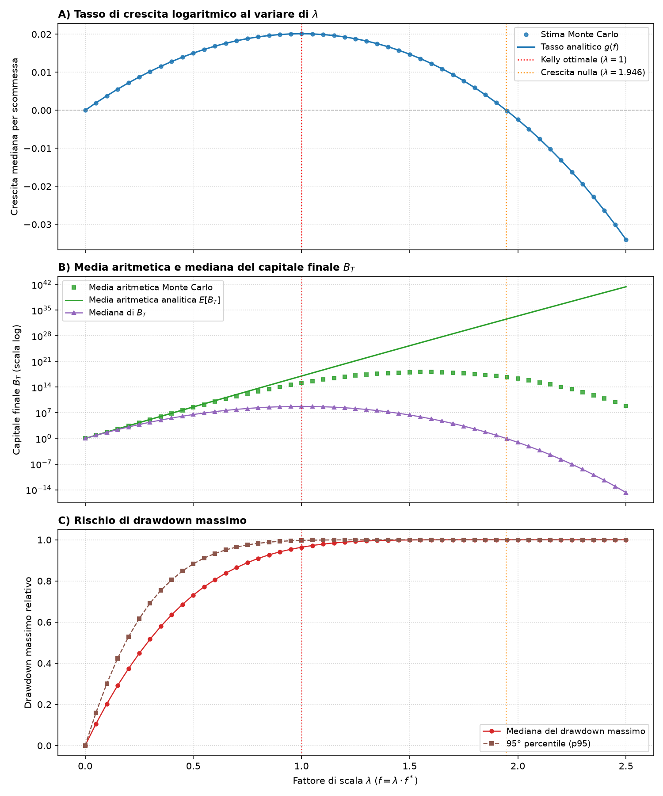

*Figura 2.1. Il criterio di Kelly su una scommessa simulata ($p = 0{,}6$, quota 2,0, 1 000 turni, 10 000 traiettorie). Sull'asse orizzontale la frazione puntata come multiplo $\lambda$ di quella ottima. (A) La crescita per turno è massima a $\lambda = 1$ e si annulla poco prima di $\lambda = 2$. (B) La ricchezza media continua a crescere, quella mediana no: le due misure divergono già sopra $\lambda = 1$. (C) La perdita massima dal picco cresce rapidamente: al Kelly pieno la traiettoria tipica perde a un certo punto il 96% del picco.*

Nella (2.2) la probabilità $p$ è quella vera. Chi scommette non la conosce, e usa la stima del proprio modello: il criterio dice quanto puntare se quella stima è giusta, non se lo è. Quando conviene puntare dipende dal confronto con il mercato, che è l'argomento della prossima sezione.

### 2.3 Il confronto con il mercato

#### Efficienza del mercato

Secondo l'ipotesi di efficienza dei mercati nella forma semiforte [@fama1970], i prezzi incorporano tutta l'informazione pubblica. Un modello costruito soltanto su dati pubblici, come quello di questo studio, non dovrebbe quindi battere le quote in modo sistematico. Il mercato delle scommesse sulla Premier League è considerato fra i più efficienti, perché è molto liquido e le quote si aggiornano fino al calcio d'inizio con le notizie su formazioni e infortuni. Qui non si verifica l'efficienza in sé: si misura se il modello ha un vantaggio, e un risultato negativo è coerente con l'efficienza senza dimostrarla.

#### Quando si può guadagnare

Il mercato offre per ogni esito una quota, e quindi una propria probabilità. Chi scommette secondo il proprio modello guadagna nel lungo periodo solo se il modello assegna agli esiti che poi si verificano più probabilità di quanta ne assegni il mercato. Se il mercato è più preciso, le puntate che il modello giudica convenienti sono in gran parte errori di stima, e perdono in media.

Il risultato si può scrivere in modo esatto [@grady2026kellybench]. Siano $p^*$ le probabilità vere degli esiti, $q$ quelle del mercato senza margine e $\hat p$ quelle del modello. Quando si può puntare su tutti gli esiti di un evento, il criterio di Kelly prescrive di distribuire il capitale fra gli esiti in proporzione alle proprie probabilità. Chi lo fa usando $\hat p$, su quote senza margine, fa crescere il capitale a un tasso atteso

$$
g = \sum_x p^*(x) \ln \frac{\hat p(x)}{q(x)} = \mathrm{KL}(p^* \,\|\, q) - \mathrm{KL}(p^* \,\|\, \hat p). \tag{2.3}
$$

La divergenza di Kullback-Leibler $\mathrm{KL}(p^* \,\|\, \cdot)$ misura quanto una distribuzione è lontana da quella vera: è nulla se coincidono e cresce quanto più se ne allontana. La (2.3) dice quindi che la crescita è positiva solo se il modello è più vicino alla verità di quanto lo sia il mercato. Una regola di puntata più prudente può ridurre le perdite e il rischio di rovina, ma il guadagno può venire soltanto da previsioni migliori di quelle del mercato. Il lavoratore di questo studio punta su un solo esito per partita (§3.2), e la (2.3) non dà esattamente la sua crescita, ma il principio non cambia. Con le quote reali, che includono il margine, il confronto è ancora più severo: alla (2.3) va sottratto $\ln S$, circa 0,05 per la Premier League.

#### Misurare il vantaggio sul mercato

Il vantaggio della (2.3) non si può calcolare direttamente, perché $p^*$ non è nota, ma si può stimare dagli esiti osservati. Per ogni partita $t$ con esito reale $x_t$ si definisce lo scarto logaritmico fra modello e mercato

$$
\delta_t = \ln \hat p_t(x_t) - \ln q_t(x_t), \tag{2.4}
$$

dove $q_t$ è la probabilità del mercato senza margine. La media $\hat g = \frac{1}{T}\sum_t \delta_t$ è la differenza fra la *log-loss* del mercato e quella del modello, e stima la crescita (2.3). Se è negativa, il modello assegna in media all'esito reale meno probabilità del mercato, e chi punta secondo il modello perde in media. Per chiudere in pari su ogni esito, con il margine, servirebbe anzi $\hat g > \ln S \approx 0{,}05$.

Rispetto al guadagno realizzato, questa misura ha due vantaggi. Si calcola su tutte le partite, non solo su quelle su cui si è puntato, e quindi non dipende dalla regola di puntata. Ed è molto meno ingannevole: un modello che riproduce il mercato con l'aggiunta di rumore casuale trova «scommesse di valore» su gran parte delle partite, perché il rumore crea scarti positivi, ma il suo $\hat g$ è negativo.

Poiché le partite di una stagione non sono del tutto indipendenti, gli intervalli di confidenza di $\hat g$ si costruiscono con un bootstrap a blocchi, che ricampiona tratti consecutivi della serie invece di singole partite (§2.6).

### 2.4 Il modello previsivo Elo

Il sistema Elo nasce negli scacchi [@elo1978] ed è oggi uno dei modelli più usati per prevedere i risultati del calcio, dove regge il confronto con modelli più ricchi [@hvattum2010]. A ogni squadra è associato un punteggio $R$, e il punteggio atteso della squadra di casa è

$$
E = \frac{1}{1 + 10^{-(R_{\text{casa}} - R_{\text{trasf}} + h)/400}}, \tag{2.5}
$$

dove $h$ è il vantaggio del campo, espresso in punti Elo. Dopo la partita alla squadra di casa si assegna un punteggio $s$, che vale 1 se vince, $\tfrac{1}{2}$ se pareggia e 0 se perde, e i punteggi si aggiornano di $K(s - E)$: la squadra di casa guadagna quanto perde quella in trasferta. Il parametro $K$ stabilisce la velocità con cui il modello reagisce: un valore alto lo rende reattivo ma rumoroso, un valore basso stabile ma lento. Elo equivale al modello di Bradley-Terry stimato partita per partita, con un aggiornamento che è un passo di discesa del gradiente sulla verosimiglianza.

Il punteggio atteso $E$ non basta per scommettere sui tre esiti, perché non dice quanto è probabile il pareggio. Questo studio usa il modello di Davidson [@davidson1970], che aggiunge un solo parametro $\nu$: posto $r = 10^{(R_{\text{casa}} - R_{\text{trasf}} + h)/400}$,

$$
p_{\text{casa}} = \frac{r}{r + 1 + \nu\sqrt{r}}, \quad p_{\text{pareggio}} = \frac{\nu\sqrt{r}}{r + 1 + \nu\sqrt{r}}, \quad p_{\text{trasf}} = \frac{1}{r + 1 + \nu\sqrt{r}}. \tag{2.6}
$$

Il pareggio diventa meno probabile al crescere dello squilibrio fra le squadre. Il modello ha quindi tre parametri, $K$, $h$ e $\nu$, stimati, per ogni stagione, sulle stagioni precedenti (capitolo 4).

La scelta di Elo ha tre ragioni. È deterministico ed economico: si può rivalutare molte volte e confrontare versioni diverse del modello sulle stesse partite, con la stessa regola di puntata, così che ogni differenza di capitale dipenda soltanto dalle previsioni; è la separazione fra previsione e decisione che in un agente linguistico non si può ottenere. È dinamico: si aggiorna a ogni partita, e la rubrica con cui KellyBench valuta la sofisticazione delle strategie include fra i criteri proprio l'uso di modelli dinamici come Elo [@grady2026kellybench]. Infine ha pochi parametri, e il suo comportamento resta facile da interpretare anche quando invecchia.

### 2.5 KellyBench

#### L'ambiente

KellyBench [@grady2026kellybench] è un ambiente in cui un agente basato su un modello linguistico scommette su una stagione di Premier League, una giornata alla volta, partendo da un capitale fisso. L'ambiente è definito con l'Open Reward Standard, un protocollo per descrivere compiti, strumenti e stato di un ambiente, ed è servito sulla piattaforma OpenReward degli stessi autori. L'agente è il modello linguistico eseguito dentro un programma che ne gestisce il ciclo di lavoro: riceve le osservazioni, decide quali strumenti chiamare, legge i risultati e prosegue.

Per scommettere l'agente ha quattro strumenti:

- **vedere le partite della giornata**, con le quote decimali dei tre esiti e, dove disponibili, quelle sul numero di gol;
- **piazzare una puntata** su un esito, per un importo positivo e non superiore al capitale, che viene scalato subito; nella stessa giornata si possono piazzare più puntate;
- **consultare il capitale**, con l'importo già puntato nella giornata;
- **passare alla giornata successiva**, che liquida le puntate, aggiorna il capitale e rende disponibili i risultati e le statistiche delle partite appena giocate.

Per passare alla giornata successiva bisogna aver piazzato almeno una puntata. Una puntata di un penny è ammessa, e permette a un agente che non vuole scommettere di rispettare la regola rischiando una cifra trascurabile.

Per costruire i propri modelli l'agente lavora in un ambiente di calcolo isolato, con strumenti per eseguire comandi, leggere e scrivere file e scrivere codice Python con le librerie usuali di analisi dei dati. Ha a disposizione i dati storici della Premier League: i risultati dal 1993-94, le statistiche delle partite dal 2000-01, le quote dal 2002-03 e i dati sui giocatori dal 2008. Non può accedere alla rete: chi ci prova tre volte viene squalificato e perde il capitale.

Il risultato di ogni giornata è misurato con la variazione del logaritmo del capitale, $\ln(W_{t+1}/W_t)$. Sommata sulla stagione dà il logaritmo del rapporto fra capitale finale e iniziale: è la grandezza che il criterio di Kelly massimizza (§2.2).

Gli scenari sono quattro. Tre, di stagioni distanti un decennio l'una dall'altra, servono a mettere a punto gli agenti; il quarto, la stagione 2023-24, è quello su cui sono valutati.

| Scenario | Stagione | Uso | Capitale iniziale | Giornate |
|---|---|---|---|---|
| New Millennium | 2000-01 | messa a punto | £100 | 97 |
| Post-Crash | 2010-11 | messa a punto | £150 | 105 |
| Covid Season | 2020-21 | messa a punto | £200 | 148 |
| Recent Season | 2023-24 | valutazione | £220 | 120 |

Una giornata è una data in cui si gioca almeno una partita. Le 380 partite di una stagione sono distribuite su un centinaio di date, e il loro numero cambia da stagione a stagione: nel 2020-21, con i recuperi delle partite rinviate per il Covid, sono 148. Nei risultati del paper i capitali sono riportati come se ogni agente partisse da £100 000, per rendere confrontabili gli scenari.

#### I risultati

Nella prima versione del paper otto modelli di frontiera giocano la stagione di valutazione tre volte ciascuno. La tabella riporta il rendimento sulla stagione.

| Modello | Rendimento medio | Esecuzione migliore | Esecuzione peggiore | Nessuna esecuzione in rovina |
|---|---|---|---|---|
| Claude Opus 4.6 | −11,0% | −0,2% | −18,8% | sì |
| GPT-5.4 | −13,6% | −4,1% | −31,6% | sì |
| Gemini 3.1 Pro | −43,3% | +33,7% | −100% | no |
| Gemini Flash 3.1 Lite Preview | −58,4% | +24,7% | −100% | no |
| GLM-5 | −58,8% | −14,3% | −100% | no |
| Kimi K2.5 | −92,6% | −77,7% | −100% | no |
| Grok 4.20 | −100% | −100% | −100% | no |
| Arcee Trinity | −100% | −100% | −100% | no |

Tutti i modelli perdono in media. Solo 2 esecuzioni su 24 chiudono in attivo, entrambe di modelli che in un'altra esecuzione vanno in rovina, e sei modelli su otto vanno in rovina almeno una volta. Gli autori valutano anche la sofisticazione delle strategie, con una rubrica di 44 punti scritta insieme a esperti di fondi di scommesse quantitative: il modello migliore ne ottiene il 32,6%.

Gli autori classificano i fallimenti ispezionando le traiettorie delle esecuzioni. I principali sono quattro:

- **la gestione del capitale.** Quasi tutti gli agenti discutono il criterio di Kelly e poi puntano importi fissi o arrotondati; in 9 esecuzioni su 24 nessuna regola di puntata viene applicata, in 4 il codice di Kelly è scritto ma mai chiamato;
- **le squadre neopromosse.** Nessuna delle 24 esecuzioni le gestisce in modo generale: per esempio un agente le esclude a mano, un altro tratta l'assenza di storia come probabilità zero;
- **l'adattamento.** 21 esecuzioni su 24 non si adattano pienamente a una stagione che cambia, e 7 non riaddestrano mai il modello;
- **la consapevolezza della situazione.** In 6 esecuzioni il compito è dichiarato concluso in anticipo; in altre 6 il modello usa informazioni successive alla partita.

Il tratto comune è ciò che gli autori chiamano divario fra sapere e fare: gli agenti scrivono diagnosi corrette dei propri errori, ma non cambiano comportamento. Fa eccezione un'esecuzione di GPT-5.4, che misura la *log-loss* del proprio modello (0,974 contro 0,971 del mercato), conclude di non avere un vantaggio e riduce le puntate al minimo per il resto della stagione: è il comportamento che il criterio di Kelly prescrive.

Per verificare che i risultati non dipendano da come gli agenti sono stati messi alla prova, gli autori ripetono la prova con Claude Opus 4.6 in due modi diversi: fornendogli i testi che gli esperti considerano fondamentali per costruire modelli di scommessa, e facendolo lavorare dentro Claude Code invece che nel programma usato per tutti i modelli. In nessuno dei due casi i risultati migliorano. Nell'appendice del paper un modello classico, Dixon-Coles [@dixon1997] combinato con le quote del mercato, fa meglio della maggior parte degli agenti.

Gli autori discutono infine i limiti del benchmark: una sola stagione, che per il costo non si può ripetere molte volte (un'esecuzione di GPT-5.4 è costata circa 2 000 dollari); un mercato molto efficiente; quote con un margine di circa il 5%; la possibilità che i modelli conoscano già i risultati della stagione dai dati di addestramento.

#### Un'osservazione sul confronto con il mercato

Il paper non precisa se la *log-loss* del mercato con cui l'esecuzione di GPT-5.4 confronta il proprio modello sia calcolata con o senza margine, e la differenza è grande: togliere il margine alza la *log-loss* del mercato di circa 0,05, più di dieci volte lo scarto osservato (0,003); con il margine incluso il mercato appare più preciso di quanto sia, e il confronto risulta sbilanciato a suo favore.

### 2.6 Il bootstrap

#### L'idea

Una stima calcolata su un campione cambierebbe con un campione diverso, e per sapere quanto fidarsi serve conoscere questa variabilità. Le formule classiche la ricavano da ipotesi sulla distribuzione dei dati, come la normalità, e valgono solo per alcune statistiche. Il bootstrap di Efron [@efron1979] la ricava dai dati stessi. Il campione osservato prende il posto della popolazione: se ne estraggono molti nuovi campioni della stessa dimensione, ricampionando le osservazioni con reinserimento, così che alcune compaiono più volte e altre mancano, e su ciascuno si ricalcola la stima. La distribuzione delle stime ricalcolate approssima quella che si otterrebbe ripetendo l'esperimento. Nella forma più semplice, l'intervallo di confidenza al 95% è compreso fra i quantili al 2,5% e al 97,5% delle stime ricalcolate.

#### Dati dipendenti nel tempo: il bootstrap a blocchi

Ricampionare le singole osservazioni presuppone che siano indipendenti. In una serie temporale non lo sono: osservazioni vicine si somigliano, e ricampionandole una per una si spezza questo legame. Le serie ricampionate risultano meno variabili di quella reale, e l'incertezza della stima viene sottostimata.

Il bootstrap a blocchi mobili di Künsch [@kunsch1989] ricampiona invece blocchi di osservazioni consecutive, di lunghezza fissa, e li accoda fino a riprodurre la lunghezza della serie: dentro ogni blocco la dipendenza resta intatta, e si perde solo al confine fra un blocco e il successivo. Lo *stationary bootstrap* di Politis e Romano [@politisromano1994] usa blocchi di lunghezza casuale, con una lunghezza media fissata: i confini fra i blocchi cadono in punti casuali, e la serie ricampionata resta stazionaria come quella originale.

La lunghezza dei blocchi è un compromesso: blocchi troppo corti spezzano la dipendenza, blocchi troppo lunghi lasciano pochi blocchi diversi da combinare e rendono imprecisa la stima della variabilità. Politis e White [@politiswhite2004] hanno proposto una regola che la ricava automaticamente dall'autocorrelazione della serie.

#### Due usi

Lo stesso strumento serve a due scopi. Il primo è l'intervallo di confidenza di una stima, come il vantaggio sul mercato $\hat g$ (§2.3).

Il secondo è la soglia di un test. Ricampionando a blocchi un unico periodo si ottengono serie in cui i blocchi sono mescolati a caso: un eventuale cambiamento nel tempo viene cancellato, mentre la dipendenza fra osservazioni vicine resta. Il valore della statistica del test su ciascuna di queste serie è quindi un esempio di ciò che il test produce quando non è cambiato nulla, e il loro quantile al 95% è una soglia che segnala un cambiamento inesistente solo nel 5% dei casi, anche con osservazioni dipendenti.

### 2.7 L'ANOVA e il controllo della dispersione

#### L'ANOVA a una via

L'analisi della varianza di Fisher [@fisher1925] confronta le medie di $k$ gruppi. Indicando con $y_{ij}$ l'osservazione $i$ del gruppo $j$, con $\bar y_j$ la media del gruppo e con $\bar y$ la media generale, la variabilità totale si scompone esattamente in una parte fra i gruppi e una dentro i gruppi:

$$
\sum_{j}\sum_{i}(y_{ij} - \bar y)^2 = \sum_j n_j(\bar y_j - \bar y)^2 + \sum_j\sum_i(y_{ij} - \bar y_j)^2. \tag{2.7}
$$

La statistica $F$ è il rapporto fra le due parti, ciascuna divisa per i propri gradi di libertà. Se tutte le medie sono uguali, $F$ è vicino a uno; se differiscono, cresce. Con osservazioni indipendenti e normali, sotto l'ipotesi di medie uguali $F$ segue una distribuzione $F$ di Fisher, da cui si ricava la soglia. Con due gruppi l'ANOVA coincide con il test $t$: la statistica $F$ è il quadrato della $t$.

Se i due gruppi sono due periodi di tempo, l'ANOVA dice se la media di una grandezza è cambiata fra l'uno e l'altro. La stessa scomposizione dice anche quanto una differenza conti, oltre a se sia significativa: con campioni molto grandi una differenza può superare qualunque soglia e spiegare comunque una parte trascurabile della variabilità [@roccetti2026fragi].

#### La dispersione: l'ANOVA sulla dispersione

Un modello che perde affidabilità può produrre errori non solo peggiori in media, ma anche più dispersi: è l'eteroschedasticità, cioè una varianza degli errori che cresce. Per confrontare la dispersione di due periodi questo studio applica l'ANOVA alla dispersione: per ogni osservazione si calcola la distanza assoluta dalla mediana del proprio gruppo, e a queste distanze si applica l'ANOVA. Se nel periodo recente le distanze sono in media maggiori, gli errori sono più dispersi. Il procedimento è noto come test di Brown-Forsythe [@brownforsythe1974], una variante robusta del test di Levene [@levene1960]; nel seguito lo si chiama semplicemente ANOVA sulla dispersione, e l'ANOVA della sezione precedente ANOVA sulla media. L'uso della mediana al posto della media rende il test affidabile anche quando gli errori non sono normali, come accade per $\delta_t$, che ha una distribuzione asimmetrica.

#### Errori autocorrelati e soglie calibrate

La soglia nominale dell'ANOVA vale per osservazioni indipendenti. Gli errori di un modello lungo una stagione possono invece essere autocorrelati: a un errore alto tende a seguirne un altro, per esempio perché il modello sbaglia per settimane la forza di una squadra. In questo caso $n$ osservazioni contengono meno informazione di $n$ osservazioni indipendenti; il test sovrastima l'informazione disponibile e segnala differenze che non esistono, cioè falsi allarmi. Sui residui del modello succede proprio con la dispersione. Nelle 21 stagioni dal 2002-03 al 2022-23, previste con il modello Elo del §2.4, confrontando ogni gruppo di 40 partite consecutive con tutte le altre, la soglia nominale al 5% viene superata nel 6% dei casi per la media, ma nel 22% per la dispersione: i periodi in cui modello e mercato vanno meno d'accordo durano più di una partita. Mescolando a caso l'ordine delle partite, che cancella la dipendenza fra partite vicine, la quota della dispersione torna al 5%.

Il rimedio è calibrare la soglia sui dati con un bootstrap a blocchi (§2.6), che conserva la dipendenza fra osservazioni vicine, invece di ricavarla dalla distribuzione $F$.

### 2.8 La scomposizione di Blinder-Oaxaca

#### L'origine

Nel 1973 Blinder e Oaxaca proposero, in modo indipendente, un metodo per spiegare il divario salariale fra due gruppi, uomini e donne o bianchi e neri [@blinder1973; @oaxaca1973]. La domanda era: quanto del divario dipende dalle diverse caratteristiche dei due gruppi, come l'istruzione e l'esperienza, e quanto dal fatto che le stesse caratteristiche sono retribuite in modo diverso? Il metodo è stato poi usato ben oltre l'economia del lavoro. In epidemiologia, per esempio, scomposizioni dello stesso tipo sono state usate per separare la parte di un segnale di rischio dovuta alla composizione delle popolazioni confrontate da quella strutturale [@roccetti2026cmes; @roccetti2026fphar].

#### La scomposizione

Si confrontano due gruppi: A, il riferimento, e B. In ciascuno la risposta media $\bar y$ dipende da due cose: la **composizione** del gruppo, cioè i valori medi $\bar{\mathbf x}$ delle caratteristiche, e il **legame** fra caratteristiche e risposta, cioè i coefficienti $\hat{\boldsymbol\beta}$ di una regressione della risposta sulle caratteristiche. Poiché una regressione con intercetta passa per le medie, in ciascun gruppo $\bar y = \hat{\boldsymbol\beta}^\top\bar{\mathbf x}$, e il divario fra i due gruppi si scompone in due componenti [@roccetti2026cmes]:

$$
\bar y^B - \bar y^A = \underbrace{\hat{\boldsymbol\beta}^{A\top}(\bar{\mathbf x}^B - \bar{\mathbf x}^A)}_{\text{composizione}} + \underbrace{\bar{\mathbf x}^{B\top}(\hat{\boldsymbol\beta}^B - \hat{\boldsymbol\beta}^A)}_{\text{struttura}}. \tag{2.8}
$$

La **composizione** è la variazione dovuta soltanto al fatto che i due gruppi hanno caratteristiche diverse, valutata con il legame del riferimento. La **struttura** è la variazione dovuta al fatto che, a parità di caratteristiche, queste si traducono nella risposta in modo diverso. Nel lavoro di Roccetti la composizione è data dai pesi delle fasce d'età e il legame dai tassi di ciascuna fascia; con una regressione la stessa scomposizione si applica anche a caratteristiche continue e a più caratteristiche insieme.

La struttura si può calcolare senza stimare una regressione nel gruppo B. Poiché $\bar y^B = \hat{\boldsymbol\beta}^{B\top}\bar{\mathbf x}^B$, la struttura è uguale a

$$
\bar{\mathbf x}^{B\top}(\hat{\boldsymbol\beta}^B - \hat{\boldsymbol\beta}^A) = \frac{1}{n_B}\sum_{i \in B}\left(y_i - \hat{\boldsymbol\beta}^{A\top}\mathbf x_i\right),
$$

cioè alla media, nel gruppo B, di quanto la risposta si allontana da ciò che il legame del riferimento prevede. È la componente **non spiegata** dalla composizione, e si può calcolare anche quando B è piccolo.

La scomposizione vale per la media di qualunque risposta. Se la risposta è la distanza assoluta di ogni errore dalla mediana del riferimento, la stessa dell'ANOVA sulla dispersione, si scompone la variazione della dispersione invece di quella della media.

#### Due cautele

La scomposizione richiede due cautele. La prima: la parte strutturale, o non spiegata, è un residuo. Contiene il vero cambiamento del legame, ma anche l'effetto di ogni caratteristica rilevante che non è stata inclusa: se una caratteristica omessa cambia fra i due gruppi, il suo effetto viene attribuito alla struttura. Va quindi letta insieme all'elenco delle caratteristiche usate, e non ha un significato causale. La seconda: la scomposizione dipende da quale gruppo fa da riferimento, perché la composizione si valuta con il legame di A e la struttura con le caratteristiche di B. Va quindi usata quando la scelta è naturale, per esempio quando uno dei due gruppi è il punto di partenza con cui si confrontano i successivi.

### 2.9 La dinamica evolutiva

La dinamica evolutiva studia una popolazione di strategie in cui il capitale si sposta, nel tempo, verso quelle che rendono di più.

#### La dinamica del replicatore

La dinamica del replicatore [@taylorjonker1978] descrive una popolazione di strategie in cui la quota di ciascuna cresce in proporzione al suo rendimento rispetto alla media. Nella forma discreta usata qui la popolazione è un capitale diviso fra $N$ strategie; se $s_i(d)$ è la quota della strategia $i$ alla giornata $d$ e $R_i(d)$ il fattore per cui la strategia moltiplica il proprio capitale in quella giornata,

$$
s_i(d+1) = (1 - \mu)\,\frac{s_i(d)\,R_i(d)}{\sum_j s_j(d)\,R_j(d)} + \frac{\mu}{N}. \tag{2.9}
$$

Il primo termine è la selezione: il capitale si sposta verso le strategie che rendono di più. Il secondo è una mutazione: una frazione $\mu$ del capitale viene ridistribuita in parti uguali, così che nessuna strategia si estingua e una strategia sfavorita possa tornare a crescere quando le condizioni cambiano.

Il legame con Kelly è diretto. Nella *evolutionary finance*, che studia i mercati come popolazioni di strategie in competizione, la ricchezza di chi investe una frazione del proprio capitale evolve proprio secondo la (2.9), e la regola di Kelly è quella che sopravvive alla selezione del mercato [@blumeeasley1992; @evstigneev2009]. Lensberg e Schenk-Hoppé hanno mostrato che la stessa regola emerge spontaneamente da un processo evolutivo darwiniano [@lensberg2007].

## 3. L'agente e la ricalibrazione

Il criterio di Kelly dice quale frazione del capitale puntare se le probabilità usate sono quelle vere (§2.2). Applicato alla lettera, il Kelly pieno è la regola che fa crescere il capitale più in fretta quando il modello ha ragione, e quella che lo distrugge più in fretta quando ha torto: punta di più proprio dove il modello è più lontano dal mercato, cioè dove, se il modello sbaglia, sbaglia di più. Molti agenti di KellyBench vanno in rovina per una ragione simile: puntano molto, con stime di cui non controllano l'affidabilità (§2.5).

Uno scommettitore umano, dopo una serie di perdite, spesso rilancia per recuperare. Il Kelly pieno non ha questo difetto, perché punta sempre una frazione del capitale che gli resta; ha però il difetto opposto a quello di uno scommettitore attento: non rivede mai le proprie stime. Il framework Structural-Hybrid aggiunge al Kelly pieno proprio questa revisione, in forma di regola. Quando gli errori del modello rispetto al mercato diventano anomali, e la causa non è il tipo di partite ma il modello stesso, il modello viene rivalutato con le informazioni più recenti.

Il framework non tocca la puntata: l'agente punta sempre il Kelly pieno, con o senza ricalibrazione. Ridurre la puntata quando qualcosa non va conserverebbe capitale quasi per forza, perché con un modello che perde contro il mercato puntare meno conserva sempre di più, e il risultato non direbbe nulla sul framework. Tenendo la puntata fissa, l'unica differenza fra l'agente con e senza ricalibrazione sono le previsioni: se uno dei due conserva più capitale, è perché prevede meglio.

### 3.1 L'architettura

Lo schema divide il compito di un agente che scommette in tre moduli.

- Il **lavoratore** prevede le partite e punta la frazione di Kelly pieno.
- Il **supervisore** confronta gli errori recenti del lavoratore rispetto al mercato con quelli delle stagioni passate, e dà l'allarme quando peggiorano.
- Il **ricalibratore**, quando scatta l'allarme, stabilisce se il peggioramento dipende dal tipo di partite capitate o da un modello che non descrive più il campionato; nel secondo caso rivaluta il modello.

I tre moduli corrispondono alle domande che si pone uno scommettitore attento. *Su quali partite le mie stime vedono un'occasione, e quanto vale?* *Le mie stime sbagliano più di quanto sbagliavano di solito?* E, solo se la risposta è sì: *sbaglio di più perché mi sono capitate partite difficili, o perché non capisco più questo campionato?*

A ogni giornata i moduli lavorano in sequenza. Prima delle partite il supervisore guarda gli errori delle partite già giocate; se dà l'allarme, il ricalibratore ne cerca la causa e, se l'errore è strutturale, rivaluta il modello. Il lavoratore prevede le partite del giorno con il modello in uso e punta la frazione di Kelly pieno. Dopo le partite il modello aggiorna i punteggi con i risultati, e il supervisore aggiunge gli errori della giornata alla propria serie.

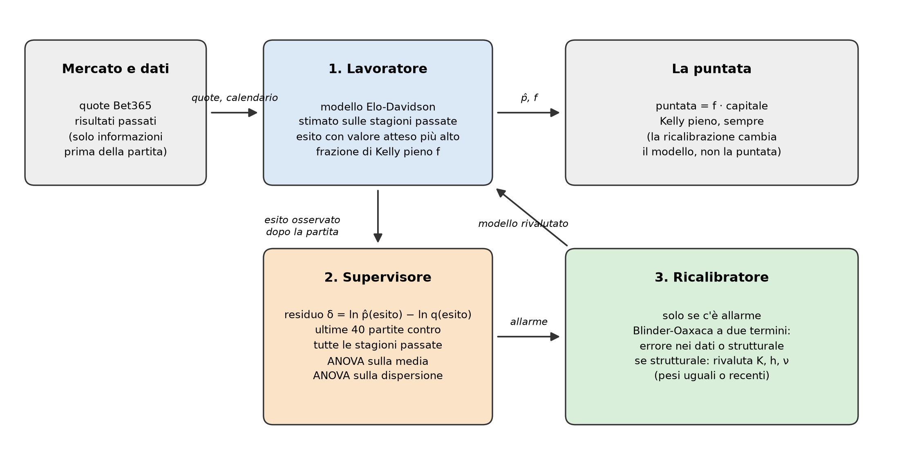

*Figura 3.1. Lo schema. Il lavoratore prevede con le sole informazioni disponibili prima della partita e punta la frazione di Kelly pieno. Dopo la partita il supervisore aggiorna il residuo e confronta le ultime 40 partite con tutte le stagioni passate; se dà l'allarme, il ricalibratore distingue un errore nei dati da un errore strutturale e, dopo un errore strutturale, rivaluta il modello. La puntata è sempre il Kelly pieno.*

### 3.2 Il lavoratore

Il lavoratore è uno scommettitore con un proprio modello, che confronta con le quote: non cerca chi vincerà, ma le partite in cui, secondo lui, il bookmaker paga un esito più di quanto rischia.

**Prevede le partite.** Il modello è l'Elo-Davidson del §2.4, stimato minimizzando la *log-loss* sui risultati delle stagioni precedenti a quella in cui scommette, dal 2000-01 in poi e tutte con lo stesso peso, con i punteggi riscaldati dal 1993-94 (§4.1); non usa mai le quote. Prima di ogni giornata prevede tutte le partite di quella data con i punteggi correnti, che contengono i risultati fino al giorno prima. Le squadre neopromosse non hanno una regola propria: una squadra mai vista entra con il punteggio iniziale dell'Elo, 1 500, come qualunque squadra nuova, e una che torna dopo qualche anno ritrova il punteggio che aveva. Se il modello sbaglia su quelle partite, se ne deve accorgere il framework: fra le caratteristiche delle partite che il ricalibratore usa c'è proprio la presenza di una neopromossa (§3.4).

**I tre parametri.** Il comportamento del modello dipende da tre numeri, gli stessi che il ricalibratore rivaluta. $K$ è la velocità con cui i punteggi seguono i risultati: con un $K$ alto una vittoria inattesa sposta molto il punteggio e il modello insegue la forma recente, con un $K$ basso si fida della storia. $h$ è il vantaggio del campo, in punti Elo: quanto vale giocare in casa a parità di forza. $\nu$ governa i pareggi: più è alto, più probabilità il modello dà al pareggio fra squadre equilibrate. Per il 2018-19, stimati sulle stagioni dal 2000-01 al 2017-18, valgono $K = 23{,}6$, $h = 104{,}8$ e $\nu = 0{,}78$: fra due squadre di pari forza il modello dà il 47% alla squadra di casa, il 27% al pareggio e il 26% a quella in trasferta. I punteggi cambiano dopo ogni giornata, i parametri no: restano fissi finché il ricalibratore non li rivaluta, e allora i punteggi si ricalcolano dal 1993-94 con i parametri nuovi.

**Sceglie l'esito.** Per ciascuno dei tre esiti confronta la propria probabilità $\hat p$ con la quota $o$ e calcola il valore atteso stimato $\hat p\,o - 1$. Punta sull'esito con il valore atteso più alto, e solo se è positivo; altrimenti salta la partita. Su una partita fa quindi al massimo una scommessa, ma in una giornata può scommettere su tutte le partite in cui vede un'occasione.

**Decide quanto puntare.** Per l'esito scelto punta la frazione di Kelly pieno (2.2), $f^* = (\hat p\,o - 1)/(o - 1)$, tanto più grande quanto più il modello è in disaccordo con la quota.

Il 12 agosto 2018, prima giornata della stagione, l'Arsenal ospita il Manchester City. Il modello, stimato sulle stagioni dal 2000-01 al 2017-18, dà all'Arsenal il 28%, al pareggio il 28%, al City il 45%; il mercato, tolto il margine, il 24%, il 26% e il 50%. Con quote di 4,00, 3,80 e 1,95, i valori attesi stimati sono +10% sull'Arsenal, +4% sul pareggio e −12% sul City: il lavoratore sceglie l'Arsenal e punta il 3,4% del capitale, $0{,}10/3{,}00$. Vince il City.

**Piazza le puntate.** Le puntate di una giornata sono frazioni del capitale di inizio giornata e vengono piazzate tutte insieme, prima delle partite, in ordine di valore atteso finché la loro somma non supera il capitale. Il lavoratore tratta ogni partita come una scommessa a sé, senza risolvere il problema di Kelly congiunto sulle partite dello stesso giorno. L'ambiente aggiunge le regole di KellyBench: ogni puntata è di almeno £0,01, e in una giornata senza occasioni l'ambiente punta comunque £0,01 sull'esito con il valore atteso più alto.

### 3.3 Il supervisore

**Che cosa osserva.** Il supervisore non osserva il guadagno, ma il residuo $\delta$ di ogni partita (2.4): lo scarto logaritmico fra la probabilità che il modello e il mercato, senza margine, hanno assegnato al risultato. Un residuo positivo significa che il modello aveva dato al risultato più probabilità del mercato, uno negativo che gliene aveva data meno. Il residuo misura ciò che determina il guadagno, perché la sua media su un periodo stima il vantaggio sul mercato in quel periodo (§2.3); non dipende dalla puntata, perché si calcola su tutte le partite, comprese quelle su cui non si punta; e tiene conto della difficoltà delle partite, perché il confronto con il mercato elimina l'incertezza comune ai due.

**Il confronto.** A ogni giornata il supervisore confronta le ultime 40 partite giocate nella stagione, circa quattro giornate, con il **riferimento**: tutte le partite delle stagioni passate per cui esistono le quote, previste con lo stesso modello. La domanda è quella di uno scommettitore che si chiede se le proprie stime stanno sbagliando più di quanto sbagliavano di solito. Un riferimento fatto di molte stagioni rappresenta il comportamento abituale del modello, e non dipende da una sola stagione che potrebbe essere stata insolita, come il 2020-21 giocato a porte chiuse.

Il peggioramento può avere due forme, e il supervisore le controlla entrambe con l'ANOVA a una via (2.7) del §2.7:

- **la media**: il modello dà al risultato, in media, meno probabilità del mercato di quanto facesse di solito. La controlla l'ANOVA sulla media;
- **la dispersione**: i residui si allontanano di più dal loro valore tipico, in un senso o nell'altro; modello e mercato non vanno più d'accordo, anche se in media il modello pareggia. La controlla l'ANOVA sulla dispersione.

**Come confronta.** Nell'esperimento gli elementi della (2.7) sono questi:

- **I gruppi** sono due: il riferimento e le ultime 40 partite giocate prima del giorno della decisione. Con due gruppi l'ANOVA risponde a una sola domanda: il periodo recente è diverso dal solito? Il primo confronto è possibile nella giornata in cui le partite giocate nella stagione arrivano a 40.
- **Le osservazioni $y_{ij}$** sono, nell'ANOVA sulla media, i residui $\delta$ delle partite di ciascun gruppo; nell'ANOVA sulla dispersione, la distanza assoluta di ogni residuo dalla mediana del proprio gruppo.
- **La parte fra i gruppi** misura quanto la media delle ultime 40 partite si allontana da quella del riferimento; **la parte dentro i gruppi** misura quanto variano le osservazioni all'interno di ciascun gruppo, cioè la variabilità normale degli errori.
- **La statistica $F$** è il rapporto fra le due parti, ciascuna divisa per i propri gradi di libertà. Cresce quando le ultime 40 partite si allontanano dal riferimento più di quanto la variabilità normale farebbe aspettare.
- **Il verso.** L'ANOVA vede una differenza in un senso o nell'altro, ma al supervisore interessano solo i peggioramenti. La $F$ della media conta soltanto se la media delle ultime 40 partite è più bassa di quella del riferimento, cioè se il modello dà al risultato meno probabilità del mercato del solito; la $F$ della dispersione conta soltanto se le distanze sono in media più grandi. Altrimenti la statistica vale zero, e un modello che migliora non fa scattare nulla.

Basta che una delle due statistiche superi la propria soglia perché scatti l'allarme.

**Le soglie.** Ogni confronto dà una differenza anche quando non è cambiato nulla: le ultime 40 partite non sono mai identiche al riferimento. La soglia risponde alla domanda: *quanto deve essere grande la statistica $F$ perché la differenza non sia un caso?* La tabella della distribuzione $F$ (§2.7) non può dare la risposta, per tre ragioni:

- **i residui sono autocorrelati**: partite vicine tendono a sbagliare nello stesso verso, e l'ANOVA, che le tratta come indipendenti, darebbe troppi falsi allarmi (§2.7);
- **il confronto si ripete**: si fa a ogni giornata, un centinaio di volte per stagione, e anche se ogni singolo confronto sbaglia di rado, un allarme per caso in qualche giornata diventa probabile;
- **i confronti si sovrappongono**: da una giornata alla successiva entrano nelle ultime 40 partite soltanto una decina di partite nuove, quindi due confronti consecutivi guardano quasi le stesse partite e non sono indipendenti nemmeno fra loro.

La soglia si ricava allora simulando stagioni in cui, per costruzione, non è cambiato nulla, e misurando quanto grande diventa $F$ per puro caso. Prima che la stagione cominci:

1. **Una stagione senza cambiamenti.** Si estraggono dal riferimento blocchi di partite consecutive e si accodano fino ad avere tante partite quante ne aveva la stagione precedente (§2.6). Tutte le partite vengono dal riferimento, quindi nella stagione simulata il modello sbaglia come al solito; i blocchi conservano l'autocorrelazione fra partite vicine. La lunghezza dei blocchi è scelta dai dati con il metodo di Politis e White.
2. **Le stesse giornate.** Alla stagione simulata si dà il calendario della stagione precedente, con le stesse giornate e lo stesso numero di partite in ciascuna. Così i confronti si ripetono e si sovrappongono come nella stagione vera.
3. **Il massimo della stagione.** In ogni giornata della stagione simulata si calcolano le due statistiche fra le ultime 40 partite e il riferimento, e di ciascuna si tiene il valore più alto della stagione: è quello che una soglia deve superare perché in quella stagione non scatti nessun allarme.
4. **Molte stagioni.** Si ripete tutto 999 volte, e si ottengono 999 massimi per ciascuna statistica.
5. **La soglia.** La soglia di ciascuna statistica è il 97,5° percentile dei suoi 999 massimi: in una stagione senza cambiamenti viene superata, anche una sola volta, soltanto nel 2,5% dei casi. Con due statistiche, la probabilità che in una stagione senza cambiamenti scatti almeno un allarme è di circa il 5%, e non di più.

**Che cosa vuol dire una soglia di 10.** Il valore della statistica $F$ non ha un significato immediato, ma si può tradurre nel residuo medio delle ultime 40 partite. Nel 2018-19 le soglie sono 10,2 per la media e 12,2 per la dispersione, e il riferimento ha un residuo medio di −0,013: di solito il modello dà al risultato avvenuto circa l'1% di probabilità in meno del mercato. La soglia della media corrisponde a un residuo medio delle ultime 40 partite di circa −0,097: l'allarme scatta quando il modello dà al risultato, in media, circa il 9% di probabilità in meno del mercato, sette volte più del solito. La soglia della dispersione corrisponde a una distanza media dalla mediana di circa 0,18, contro 0,116 nel riferimento: residui più dispersi del solito di oltre la metà.

**Perché così lontano dal solito.** Il residuo di una singola partita varia molto, con uno scarto quadratico medio di 0,164 nel riferimento, e la media di 40 partite qualsiasi si sposta per caso di circa 0,026. Se il confronto si facesse una volta sola, fra partite indipendenti, basterebbe scendere di circa 0,05 sotto il solito, cioè una statistica di circa 3,8. Ma in una stagione normale, fra un centinaio di confronti su partite autocorrelate, il periodo peggiore scende quasi sempre più in basso, e la soglia deve stare oltre di lui: lo scarto necessario sale a 0,084, e la statistica a 10,2.

Nel 2018-19 si vede bene. Il 15 settembre il residuo medio delle ultime 40 partite è −0,081: molto peggio del solito, ma non abbastanza, e la statistica arriva al 65% della soglia. Il giorno dopo scende a −0,111, oltre il −0,097 della soglia, e scatta l'allarme.

La soglia si calcola una volta, prima della stagione, e resta la stessa per tutta la stagione. Si ricalcola, con lo stesso seme casuale, soltanto se il modello viene rivalutato, perché allora cambiano i residui del riferimento (§3.4). Il prezzo di questa prudenza è che i cambiamenti piccoli o brevi non vengono visti: perché scatti l'allarme, le ultime 40 partite devono andare peggio di quanto vada, quasi sempre, il periodo peggiore di una stagione normale.

### 3.4 Il ricalibratore

**La domanda.** Quando il supervisore dà l'allarme, gli errori recenti sono peggiori del solito. Il ricalibratore deve capire perché, e le risposte possibili sono due.

- **L'errore nei dati.** Il modello funziona come al solito, ma nelle ultime partite sono capitate più partite del tipo su cui sbaglia sempre di più: partite molto equilibrate, o con una squadra neopromossa. Sulle stesse partite, in passato, avrebbe sbagliato allo stesso modo. È lo scommettitore che si dice «è stato un mese difficile»: il modello non va toccato.
- **L'errore strutturale.** Sulle stesse partite il modello sbaglia più del solito: qualcosa è cambiato nel modo in cui le caratteristiche di una partita si traducono nel risultato. Il vantaggio del campo si riduce, come nelle partite a porte chiuse; una squadra diventa molto più forte di quanto dica il suo punteggio; il mercato diventa più preciso e il modello no. È lo scommettitore che si dice «non sono le partite, sono io che non capisco più questo campionato»: il modello va rivisto.

**Come li distingue.** Con la scomposizione di Blinder-Oaxaca (2.8) del §2.8. Nell'esperimento i suoi elementi sono questi:

- **Il gruppo A** è il riferimento del supervisore: tutte le partite delle stagioni passate per cui esistono le quote, previste con lo stesso modello. Rappresenta il comportamento abituale del modello, il punto di partenza con cui si confronta il presente; per questo è naturale che sia il gruppo di riferimento della scomposizione.
- **Il gruppo B** sono le ultime 40 partite della stagione, quelle su cui il supervisore ha dato l'allarme.
- **La risposta $y$** è la grandezza che ha fatto scattare l'allarme. Se l'allarme è scattato sulla media, $y$ è il residuo $\delta$ di ogni partita; se è scattato sulla dispersione, è la distanza assoluta di $\delta$ dalla mediana del riferimento, la stessa dell'ANOVA sulla dispersione.
- **Le caratteristiche $\mathbf x$** sono cinque, note prima del calcio d'inizio, e dicono quanto è difficile prevedere una partita anche per un modello che funziona. La tabella dice come si calcolano e perché servono.

| Caratteristica | Come si calcola | Perché serve |
|---|---|---|
| Squilibrio secondo il mercato | $\ln(o_{\text{casa}}/o_{\text{trasf}})$: negativo se è favorita la squadra di casa, positivo se è favorita quella in trasferta, vicino a 0 se la partita è equilibrata | Dice chi è favorito, e da che parte. In circa il 30% delle partite è favorita la squadra in trasferta, e il modello può sbagliare in modo diverso nei due casi, per esempio se sopravvaluta il vantaggio del campo. |
| Incertezza del mercato | l'entropia $-\sum_i q_i \ln q_i$ delle probabilità del mercato senza margine: alta se le probabilità sono distribuite sui tre esiti, bassa se sono concentrate su uno | Dice quanto la partita è equilibrata, qualunque sia la squadra favorita: nelle 21 stagioni è quasi l'opposto della distanza dello squilibrio da 0 (correlazione −0,97). Sulle partite equilibrate, e sul pareggio, chiunque sbaglia di più. |
| Incertezza del modello | la stessa entropia, calcolata sulle probabilità $\hat p_i$ del modello | È simile a quella del mercato (correlazione 0,87), ma non uguale: insieme dicono quando il modello è più sicuro o meno sicuro del mercato, cioè le partite su cui i due si allontanano di più. |
| Neopromossa | 1 se almeno una delle due squadre è neopromossa, cioè mai vista o tornata dopo qualche anno, 0 altrimenti | Il modello sa poco di una squadra mai vista, che entra con 1 500 punti. Nelle 21 stagioni, nelle prime 80 partite, le partite con una squadra mai vista sono molto più disperse delle altre (0,18 contro 0,13); quelle con una squadra che torna, che ritrova il suo vecchio punteggio, no. |
| Posizione nella stagione | il numero d'ordine della partita nella stagione, da 1 a 380 | All'inizio i punteggi riflettono ancora la stagione prima, mentre il mercato conosce già i trasferimenti estivi; alla fine molte squadre non hanno più obiettivi, e il mercato ne tiene conto, l'Elo no. Il residuo medio è −0,024 nelle prime 80 partite, −0,012 nel mezzo, −0,030 nelle ultime 50 (§7.1). |

- **I coefficienti $\hat{\boldsymbol\beta}^A$** vengono da una regressione di $y$ sulle cinque caratteristiche nelle partite del riferimento, una per la media e una per la dispersione. Dicono quanto errore il modello fa di solito su ciascun tipo di partita. Nel gruppo B non serve stimare una regressione: la struttura si calcola come media degli scarti dalla previsione del riferimento (§2.8), e dà lo stesso numero. Una regressione sulle ultime 40 partite servirebbe soltanto a dividere la struttura caratteristica per caratteristica, e quella divisione non sarebbe affidabile: sei coefficienti stimati su 40 partite sono molto incerti, e in quattro giornate consecutive la posizione nella stagione varia appena.
- **La composizione**, $\hat{\boldsymbol\beta}^{A\top}(\bar{\mathbf x}^B - \bar{\mathbf x}^A)$, è il peggioramento che ci si aspetta soltanto perché le ultime 40 partite sono di un tipo diverso dal solito, per esempio più equilibrate. È la **parte spiegata** dal tipo di partite: l'**errore nei dati**.
- **La struttura** è la media, sulle ultime 40 partite, di quanto il modello ha sbagliato in più rispetto a ciò che il riferimento prevede per partite con quelle caratteristiche. È la **parte non spiegata**: l'**errore strutturale**. Contiene anche ogni cambiamento che nessuna delle cinque caratteristiche descrive, come un vantaggio del campo che si riduce.

**La decisione.** La parte non spiegata ha una soglia, calcolata esattamente come quelle del supervisore (§3.3): dal riferimento si ricostruiscono 999 stagioni a blocchi di partite consecutive, lunghe quanto la stagione precedente; in ogni stagione ricostruita si calcola la parte non spiegata in tutte le giornate di decisione, sulle ultime 40 partite, e se ne tiene il valore più alto; la soglia è il valore superato soltanto dal 2,5% di questi massimi. Se la parte non spiegata delle ultime 40 partite supera la soglia, l'errore è strutturale; altrimenti è un errore nei dati. Se l'allarme è scattato sia sulla media sia sulla dispersione, basta che una delle due parti non spiegate superi la propria soglia.

Il supervisore chiede se il peggioramento totale è eccezionale per una stagione intera; il ricalibratore chiede se lo è anche il peggioramento al netto del tipo di partite, con la stessa severità. Se sì, l'allarme sarebbe scattato anche con partite del tipo solito, e l'errore è del modello. Se no, a far scattare l'allarme è servito anche il tipo di partite, e l'errore è nei dati. Una soglia calcolata su un solo gruppo di 40 partite, invece che sull'intera stagione, sarebbe molto più bassa di quella del supervisore: ogni allarme la supererebbe quasi da solo, e la diagnosi sarebbe sempre strutturale (§7.1).

**La rivalutazione.** Il giorno in cui comincia un errore strutturale, prima delle partite, il ricalibratore rivaluta $K$, $h$ e $\nu$ minimizzando la *log-loss* sulle stagioni passate più le partite della stagione in corso già giocate, con gli stessi punti di partenza, limiti e algoritmo di ottimizzazione della stima iniziale, e quel giorno il lavoratore prevede già con il modello nuovo. Dal giorno dopo il supervisore giudica il modello nuovo: i residui della stagione e del riferimento si ricalcolano con i nuovi parametri, e le soglie si ricalibrano. Se l'allarme continua, il modello non viene rivalutato di nuovo; una nuova rivalutazione avviene solo se, dopo almeno una giornata senza allarme, comincia un nuovo errore strutturale. Dopo un errore nei dati il modello resta quello che è.

La rivalutazione si confronta in due forme, che differiscono soltanto per quanto pesa il presente:

- **a pesi uguali**: ogni partita delle stagioni passate e della stagione in corso conta allo stesso modo, quindi poche giornate nuove pesano poco accanto a vent'anni di storia;
- **recente**: il peso di una partita si dimezza a ogni stagione di età, cioè è $0{,}5^{a}$, dove $a$ è il numero di stagioni trascorse da quella della partita. La stagione in corso pesa 1, la precedente 0,5, quella prima 0,25, e così via: il modello segue soprattutto il calcio recente.

### 3.5 Perché questa ricalibrazione

**La puntata resta il Kelly pieno.** Con un modello che non batte il mercato, qualunque riduzione della puntata conserva capitale, in qualunque giornata la si faccia: un framework che riducesse la puntata «funzionerebbe» sempre, senza dimostrare nulla. Tenendo la puntata fissa, il confronto misura soltanto se ricalibrare il modello lo fa prevedere meglio.

**Rivalutare, non fermarsi.** Dopo un errore strutturale la scelta più prudente sarebbe smettere di scommettere, ma un agente che non punta più non sta più decidendo. KellyBench mette alla prova la capacità di continuare a decidere in un ambiente che cambia: un agente che riconosce un errore strutturale deve rivedere il proprio modello, non uscire dal gioco.

**Due forme di rivalutazione.** La rivalutazione a pesi uguali è la più prudente: usa tutta la storia, e cambia il modello solo se anche le partite recenti lo chiedono. Il suo limite è che, dentro una stagione, le partite nuove sono poche, e il modello rivalutato resta quasi quello di prima. La rivalutazione recente cambia il modello molto di più, al prezzo di dare grande peso a poche partite, che possono riflettere il caso più che un cambiamento vero. Il confronto fra le due dice quale dei due rischi pesa di più.

**Una rivalutazione per ogni errore.** Rivalutare a ogni giornata di allarme, su dati quasi identici, darebbe quasi lo stesso modello; la rivalutazione avviene quindi una volta per ogni episodio di errore strutturale.

**Perché queste caratteristiche, e non altre.** Le cinque caratteristiche non servono a prevedere chi vince, ma a sapere quanto è normale sbagliare su una partita. Una partita equilibrata è difficile per chiunque: darla all'Elo come informazione non la renderebbe più prevedibile, e l'Elo la riconosce già dai punteggi vicini; al ricalibratore serve per sapere che su quelle partite un errore più grande è normale. Per questo le caratteristiche non entrano nel modello: due vengono dalle quote, che il lavoratore non usa mai, una dalle sue stesse previsioni. Le altre due, la neopromossa e la posizione nella stagione, un Elo più ricco potrebbe usarle, ma le partite che descrivono resterebbero comunque più difficili da prevedere; questo studio usa un lavoratore semplice perché la domanda non è quale sia il modello migliore, ma se il framework si accorge di quando il modello sbaglia. Per lo stesso motivo fra le caratteristiche non ci sono il vantaggio del campo, la velocità di aggiornamento e il peso del pareggio: non sono caratteristiche delle partite, ma il modo in cui il modello le legge, e valgono allo stesso modo per tutte. Se smettono di funzionare, come il vantaggio del campo nelle partite a porte chiuse, l'errore deve risultare strutturale, perché è proprio il modello che va rivalutato.

**Il riferimento di tutte le stagioni passate.** Il supervisore confronta gli errori recenti con tutte le stagioni passate, non con una sola. Un riferimento fatto di una sola stagione rende l'allarme dipendente da quanto quella stagione era regolare: troppo sensibile se la stagione era stata insolitamente tranquilla, quasi cieco se era stata insolitamente difficile.

**Nessuna regola per le neopromosse.** Nessun agente di KellyBench gestisce in modo generale le squadre neopromosse (§2.5). Qui il lavoratore non ha una regola apposita: le neopromosse sono uno dei cambiamenti che il framework deve riconoscere da sé, attraverso gli errori del modello.

## 4. L'esperimento e il confronto con KellyBench

Il capitolo 3 descrive l'agente; questo capitolo descrive la prova a cui è sottoposto: su quali stagioni (§4.1), con quali regole (§4.2), contro quali agenti (§4.3) e che cosa se ne può confrontare (§4.4). Tutto è costruito perché il risultato possa stare accanto a quello degli agenti di KellyBench.

KellyBench separa le stagioni di messa a punto da quella di valutazione: gli agenti possono studiare tutta la storia, ma vengono giudicati su una stagione che non hanno visto, il 2023-24, giocata una volta sola. Questo studio usa la stessa separazione e la ripete per ogni stagione: ciascuna stagione dal 2003-04 al 2023-24 è giocata come se fosse la stagione di valutazione, con un modello e un supervisore costruiti soltanto sulle stagioni precedenti. Si ottengono così 21 prove dello stesso tipo invece di una, e il 2023-24, la stagione di KellyBench, è l'ultima.

### 4.1 Le stagioni

Lo studio usa i dati della Premier League, gli stessi a disposizione degli agenti di KellyBench: i risultati dal 1993-94 e le quote Bet365 complete dal 2002-03. Per ogni stagione di prova $S$:

| Uso | Stagioni | Che cosa serve |
|---|---|---|
| Riscaldamento dei punteggi Elo | dal 1993-94 al 1999-2000 | solo i risultati |
| Stima dei parametri del modello | dal 2000-01 alla stagione prima di $S$ | solo i risultati |
| Riferimento del supervisore e soglie | dal 2002-03 alla stagione prima di $S$ | risultati e quote Bet365 |
| Prova | $S$ | risultati e quote Bet365 |

Le stagioni di prova vanno dal 2003-04, la prima che ha almeno una stagione precedente con le quote, al 2023-24. Il riferimento cresce con il tempo: una stagione per il 2003-04, 21 stagioni (7 980 partite) per il 2023-24. Il 2000-01 e il 2001-02 servono solo a stimare il modello, che non usa le quote. Come gli agenti del benchmark, l'agente arriva a ogni stagione di prova avendo visto tutte le stagioni precedenti, e non vede nulla della stagione di prova prima di giocarla, giornata per giornata.

### 4.2 L'ambiente

L'ambiente è quello di KellyBench (§2.5): si gioca giornata per giornata, con le sole informazioni disponibili prima delle partite; a ogni giornata si deve puntare almeno £0,01, e se l'agente non vuole puntare su nulla l'ambiente piazza £0,01 sull'esito con il valore atteso stimato più alto; il capitale iniziale è di £220, e ogni stagione riparte da lì. Un agente è **in rovina** quando il suo capitale scende sotto la puntata minima e non può più scommettere. I capitali sono riportati anche sulla scala di £100 000 usata dal paper.

La tabella riassume che cosa questo studio tiene uguale a KellyBench e che cosa cambia di proposito.

| | KellyBench | Questo studio |
|---|---|---|
| Lega e quote | Premier League, quote Bet365 | le stesse |
| Regole di gioco | una giornata alla volta, puntata minima di £0,01, capitale iniziale di £220 | le stesse |
| Chi decide | un agente linguistico, con strumenti per scrivere codice | una regola fissa: Elo e Kelly pieno, con o senza ricalibrazione |
| Stagioni giudicate | solo il 2023-24, con poche esecuzioni per agente | 21 stagioni, dal 2003-04 al 2023-24 |
| Errori di esecuzione | possibili | nessuno, per costruzione |
| Che cosa si osserva | il capitale finale e una valutazione della strategia | il capitale e ogni scelta, giorno per giorno |

### 4.3 Gli agenti a confronto

Gli agenti sono tre, e hanno quasi tutto in comune: lo stesso lavoratore, con lo stesso modello di inizio stagione, la stessa scelta dell'esito e la stessa puntata, il Kelly pieno. Differiscono soltanto per ciò che fanno quando il modello comincia a sbagliare più del solito.

| Agente | Che cosa fa dopo un errore strutturale | Che cosa rappresenta |
|---|---|---|
| Kelly pieno senza ricalibrazione | niente: tiene il modello di inizio stagione per tutta la stagione | l'agente che non rivede mai le proprie stime, come molti agenti di KellyBench |
| Ricalibrazione con rivalutazione a pesi uguali | rivaluta il modello: ogni partita, passata o della stagione in corso, pesa 1 | la revisione prudente, che si fida della storia |
| Ricalibrazione con rivalutazione recente | rivaluta il modello dando più peso alle partite recenti: ogni stagione conta la metà di quella che la segue | la revisione decisa, che segue il calcio recente |

**Le due rivalutazioni.** Entrambe ricalcolano $K$, $h$ e $\nu$ nello stesso momento, il giorno in cui comincia un errore strutturale, e con gli stessi dati: le stagioni dal 2000-01 alla precedente più le partite della stagione in corso già giocate. Cambia soltanto quanto conta ciascuna partita nella *log-loss* che la stima minimizza.

| Partite | Peso, rivalutazione a pesi uguali | Peso, rivalutazione recente |
|---|---|---|
| della stagione in corso | 1 | 1 |
| della stagione precedente | 1 | 0,5 |
| di due stagioni prima | 1 | 0,25 |
| di tre stagioni prima | 1 | 0,125 |
| di $a$ stagioni prima | 1 | $0{,}5^{a}$ |
| del 2000-01, in una rivalutazione del 2018-19 | 1 | circa 0,000004 |

Con i pesi uguali le partite nuove sono poche accanto alla storia: alla rivalutazione del 16 settembre 2018 le 47 partite della stagione in corso valgono lo 0,7% del peso totale, contro più di 6 800 partite passate. Con la rivalutazione recente le stagioni passate, tutte insieme, pesano quanto una stagione sola: le stesse 47 partite valgono l'11% del peso totale, la stagione precedente il 45%, quella prima il 22%, e il modello segue soprattutto le ultime due o tre stagioni.

Poiché la puntata è la stessa, il confronto isola l'effetto della rivalutazione. Fino al primo errore strutturale i tre agenti hanno le stesse previsioni, fanno le stesse scommesse e hanno lo stesso capitale, e in una stagione senza errori strutturali coincidono dall'inizio alla fine. Dopo la prima rivalutazione cambiano le previsioni, e con loro le scommesse: ogni differenza di capitale viene dal modello nuovo.

I due agenti con ricalibrazione hanno lo stesso supervisore e lo stesso ricalibratore, e partono dallo stesso primo errore strutturale. Da lì in poi si separano anche negli allarmi: ciascun supervisore giudica il proprio modello, quindi gli allarmi successivi, e le rivalutazioni che ne seguono, cadono in giorni diversi.

### 4.4 Che cosa si può confrontare

**Con gli agenti di KellyBench.** Il confronto diretto è sul 2023-24: stessa stagione, stesse regole, stesso capitale. Il capitale finale si riporta sulla scala di £100 000 del paper e si mette accanto a quello degli agenti del benchmark (§5.3). Il confronto però non dice chi scommette meglio: gli agenti di KellyBench scelgono da sé modello e puntata e possono sbagliare nell'eseguire le proprie decisioni, l'agente di questo studio applica una regola fissa senza errori. Risponde a un'altra domanda: se anche una regola che non sbaglia mai va in rovina, la rovina degli agenti del benchmark non si spiega soltanto con i loro errori.

**Fra gli agenti di questo studio.** I tre agenti si confrontano sulle 21 stagioni, sulle stesse partite (§4.3). Il capitale di molte stagioni si riassume con la *stagione tipica*, la media geometrica del capitale finale: con il Kelly pieno una stagione fortunata può valere più di tutte le altre insieme, e la media aritmetica direbbe quanto rende quella stagione, non quanto si ottiene di solito. Il logaritmo della media geometrica è la crescita media per stagione, la grandezza che il criterio di Kelly massimizza (§2.2). Per dire se una ricalibrazione conserva più del Kelly pieno, le stagioni si confrontano a coppie con il test di Wilcoxon dei ranghi con segno, applicato alle differenze fra i logaritmi dei capitali finali; il test usa soltanto le stagioni con almeno una rivalutazione, perché nelle altre i due agenti coincidono.

**Il peso del caso.** Una stagione sola può essere fortunata o sfortunata, e KellyBench ne usa una sola. Le 21 stagioni rispondono a questo problema: un risultato che si ripete in molte stagioni non dipende da una stagione fortunata.

## 5. Risultati

Il modello non ha un vantaggio sul mercato in nessuna stagione (§5.1). Con il Kelly pieno, senza vantaggio, l'agente perde quasi tutto il capitale, e la ricalibrazione, sull'insieme delle 21 stagioni, non cambia il risultato in modo distinguibile dal caso (§5.2). Nella stagione di KellyBench la ricalibrazione non interviene, e l'agente chiude fra i peggiori del benchmark senza commettere errori di esecuzione (§5.3). In una singola stagione, però, la ricalibrazione può fare una differenza, in un verso o nell'altro: il 2020-21 e il 2016-17 lo mostrano agente per agente (§5.4). Poi il framework, parte per parte. Il supervisore vede da solo i periodi in cui il modello sbaglia più del solito, ma non le stagioni in cui sbaglia di più (§5.5), e rivalutare nei giorni che sceglie non conserva più capitale che farlo a caso (§5.6). Il ricalibratore, distinguendo i due errori, evita alcune rivalutazioni dannose, ma sbaglia diagnosi proprio nella stagione a porte chiuse (§5.7). La rivalutazione recente segue un cambiamento vero come quello delle porte chiuse, ma insegue anche il caso, e non sa quando sbaglia (§5.8). Il §5.9 ne fa il bilancio. I capitali sono riportati sulla scala di £100 000 usata dal paper.

### 5.1 Il modello non batte il mercato

È la premessa del capitolo, più che un risultato. In tutte le 21 stagioni di prova il modello di inizio stagione assegna al risultato, in media, meno probabilità del mercato senza margine. Lo scarto medio $\hat g$ va da −0,0025 per partita nel 2008-09 a −0,040 nel 2020-21, con una media di −0,017; la *log-loss* del modello è più alta di quella del mercato in ogni stagione, in media di 0,017.

In una stagione sola lo scarto è piccolo rispetto alla sua incertezza: l'intervallo di confidenza al 95%, calcolato con un bootstrap a blocchi (§2.6), esclude lo zero in 10 stagioni su 21, fra cui il 2023-24 (da −0,051 a −0,011). Che sia negativo in tutte e 21, però, difficilmente è un caso: se il modello valesse quanto il mercato, la probabilità di 21 stagioni negative su 21 sarebbe meno di una su un milione. Il risultato non dipende dal metodo per togliere il margine: con gli altri quattro metodi del §2.1 lo scarto resta negativo in tutte le stagioni, e la sua media va da −0,0162 a −0,0168.

Non è sorprendente. Il mercato delle quote della Premier League è molto efficiente (§2.3), e le sue quote riassumono informazioni che un modello Elo, costruito sui soli risultati, non ha: infortuni, formazioni, trasferimenti, motivazioni. Il risultato dipende anche dalle scelte di questo studio, cioè dal modello e dai dati, e vale per queste: un modello più ricco o altri dati potrebbero ridurre lo scarto. Conta però per ciò che segue. Senza vantaggio, chi punta secondo le probabilità del modello perde in media in ogni stagione, ed è la condizione in cui si trovano anche gli agenti di KellyBench: tutti i risultati del capitolo valgono per un modello che non batte il mercato.

### 5.2 Che cosa succede in generale

Senza vantaggio, il Kelly pieno perde quasi sempre quasi tutto. In una stagione tipica gli resta lo 0,68% del capitale, e in metà delle stagioni meno di £345 su £100 000. In 13 stagioni su 21 chiude con meno dell'1% del capitale, in 15 con meno del 10%. Nel 2020-21 va in rovina: il capitale scende sotto la puntata minima e l'agente non può più scommettere.

C'è una sola eccezione, il 2005-06, in cui il Kelly pieno chiude con il 130% del capitale. Anche quella stagione il modello è sotto il mercato, ma alcune scommesse ad alta quota vanno bene: con il Kelly pieno, in una stagione sola, la fortuna può ancora dominare il risultato. È la ragione per cui una prova su una sola stagione, come quella del benchmark, non basta a giudicare un agente.

È il comportamento degli agenti peggiori di KellyBench, ottenuto senza alcun errore di esecuzione: l'agente applica sempre la regola, ma la regola, con probabilità sbagliate, punta troppo proprio dove il modello sbaglia di più.

**La ricalibrazione.** Nelle 13 stagioni in cui l'allarme non scatta mai il modello non viene rivalutato, e i tre agenti coincidono. Coincidono anche nel 2017-18, in cui l'allarme scatta ma il ricalibratore attribuisce ogni volta il peggioramento al tipo di partite (§5.7). Nelle altre 7 il capitale finale è questo:

| Stagione | Kelly pieno | Rivalutazione a pesi uguali | Rivalutazione recente |
|---|---|---|---|
| 2005-06 | £130 250 | £122 415 | £116 672 |
| 2008-09 | £38 962 | £34 606 | £24 451 |
| 2010-11 | £9 711 | £10 149 | £10 839 |
| 2016-17 | £33 | £37 | rovina |
| 2018-19 | £345 | £379 | £883 |
| 2019-20 | £7 | £77 | £492 |
| 2020-21 | rovina | rovina | £422 |

*Capitale finale su £100 000 nelle 7 stagioni con almeno un errore strutturale; nelle altre 14 i tre agenti coincidono.*

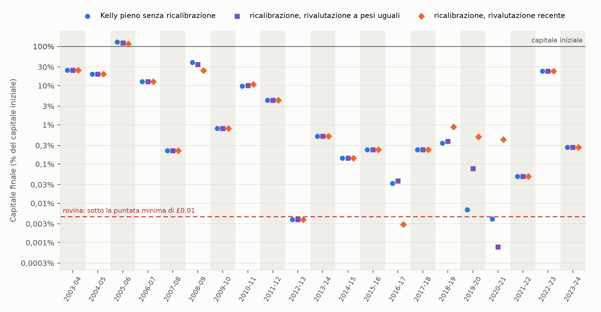

*Figura 5.1. Il capitale finale di ogni stagione per i tre agenti, in percentuale del capitale iniziale; l'asse verticale è in scala logaritmica, perché i valori vanno dallo 0,0003% al 130%, e le tacche crescono ogni volta di circa tre volte (1%, 3%, 10%, 30%…). Le colonne alternate servono solo a separare le stagioni. Nelle 14 stagioni senza rivalutazione i tre agenti coincidono; nelle 7 con almeno una rivalutazione, il 2005-06, il 2008-09, il 2010-11, il 2016-17 e le stagioni dal 2018-19 al 2020-21, si separano. Sotto la linea tratteggiata il capitale è inferiore alla puntata minima di £0,01 e l'agente è in rovina; nel 2012-13 il Kelly pieno ci scende soltanto con l'ultima giornata, quando non resta nulla su cui puntare, e non risulta in rovina.*

In una stagione tipica, contro lo 0,68% del Kelly pieno, la ricalibrazione con i pesi uguali conserva lo 0,71% del capitale, quella con la rivalutazione recente lo 0,95%. Nessuna delle due fa meglio del Kelly pieno in modo distinguibile dal caso: ciascuna conserva di più in 4 stagioni su 7 e di meno nelle altre 3 (test di Wilcoxon, $p = 0{,}81$ con i pesi uguali e $p = 0{,}58$ con la rivalutazione recente). Ciascuno dei tre agenti va in rovina in una stagione: il Kelly pieno e la rivalutazione a pesi uguali nel 2020-21, la rivalutazione recente nel 2016-17.

I numeri seguono quelli delle previsioni (§5.8). La rivalutazione a pesi uguali cambia poco il modello, e quindi poco il capitale. La rivalutazione recente vince dove prevede meglio, nel 2020-21 a porte chiuse e nel 2018-19, e perde dove insegue il caso, nel 2016-17 e nel 2008-09. Il 2019-20 è un'eccezione che va detta: lì la rivalutazione recente prevede peggio (§5.8), eppure conserva £492 contro £7 del Kelly pieno; con il Kelly pieno, su capitali così piccoli, poche scommesse fortunate bastano a fare la differenza. Le due cose quasi si compensano: in media la rivalutazione recente fa un po' meglio, ma il guadagno dipende soprattutto dalla stagione a porte chiuse, e si paga con una rovina in un'altra stagione.

### 5.3 La stagione di KellyBench

Il 2023-24 è l'ultima stagione di prova, con il modello stimato sulle stagioni dal 2000-01 al 2022-23 e un riferimento di 7 980 partite. Lo scarto medio è −0,031 per partita, e la *log-loss* del modello è 0,938 contro 0,907 del mercato: anche qui non c'è nulla da guadagnare.

L'allarme non scatta mai. La statistica della media arriva al massimo al 55% della soglia, quella della dispersione al 98%, il 7 dicembre 2023. Il modello non viene rivalutato, e i tre agenti coincidono: chiudono con £269 su £100 000, cioè con una perdita del 99,7%. Il percorso è tormentato: a fine ottobre il capitale è all'11%, a fine dicembre risale al 70%, e da gennaio a maggio scende fino allo 0,27%.

**Accanto agli agenti di KellyBench.** Con −99,7%, il Kelly pieno di questo studio si colloca fra gli agenti peggiori del benchmark (§2.5): perde più di Kimi K2.5, che in media perde il 92,6%, e fanno peggio soltanto Grok 4.20 e Arcee Trinity, che vanno in rovina in ogni esecuzione. Non va però in rovina, e non commette errori di esecuzione: applica sempre il criterio di Kelly, che quasi tutti gli agenti del benchmark discutevano senza poi applicarlo. Il confronto più istruttivo è con l'esecuzione di GPT-5.4 che misura la propria *log-loss*, si accorge di non avere un vantaggio e riduce le puntate al minimo. Il modello di questo studio è ancora più lontano dal mercato (0,938 contro 0,907), ma il Kelly pieno non se ne accorge, perché usa le probabilità del modello come se fossero vere; e il supervisore non lo segnala, perché il modello non è peggiore del solito (§5.5). Applicata senza errori a un modello senza vantaggio, la regola porta allo stesso esito degli agenti che non la applicano.

### 5.4 Due casi da vicino: il 2020-21 e il 2016-17

I numeri del §5.2 non mostrano come lavorano il supervisore e il ricalibratore. Due stagioni lo mostrano agente per agente, e sono quelle in cui la rivalutazione recente fa la differenza più grande, in versi opposti: nel 2020-21 segue un cambiamento vero ed evita la rovina, nel 2016-17 insegue il caso e ci finisce. Per ciascuna stagione ci sono tre figure, una per agente, con il suo supervisore, i suoi parametri e il suo capitale, e una figura che mette i tre agenti a confronto. Ogni supervisore giudica il proprio modello: per questo gli allarmi, e quindi le rivalutazioni, cambiano da un agente all'altro.

**Il 2020-21: un cambiamento vero.** Il campionato si gioca quasi tutto a porte chiuse, e senza pubblico giocare in casa conta molto meno. Il modello di inizio stagione, stimato su stagioni giocate con il pubblico, dà al campo un vantaggio di 102 punti Elo. Il primo allarme arriva il 27 novembre, dopo due mesi e mezzo di campionato, e da lì le tre storie si separano.

- **Il Kelly pieno** (Figura 5.2) non fa nulla: il supervisore darebbe l'allarme in 54 giornate, ma il modello resta quello di inizio stagione, e il capitale scende sotto la soglia della rovina con le partite del 7 marzo 2021.
- **La rivalutazione a pesi uguali** (Figura 5.3) rivaluta il modello 8 volte, ma ogni rivalutazione lo sposta di poco: $h$ scende da 102 a 96 in tutta la stagione. Il modello resta quasi quello di inizio stagione, il supervisore resta in allarme per 50 giornate, e l'agente va in rovina lo stesso giorno del Kelly pieno.
- **La rivalutazione recente** (Figura 5.4) cambia il modello già alla prima rivalutazione: $h$ passa da 102 a 62 punti Elo e $\nu$ da 0,77 a 0,65, e la seconda, il 28 dicembre, porta $h$ a 57. Il modello si adatta alle porte chiuse e il supervisore smette quasi di dare l'allarme: 5 giornate e 2 rivalutazioni in tutto. L'agente non va in rovina e chiude con lo 0,42% del capitale.

La Figura 5.5 mette insieme le tre storie: la riga degli allarmi della rivalutazione a pesi uguali ricalca quella del Kelly pieno, quella della rivalutazione recente si spegne dopo dicembre.

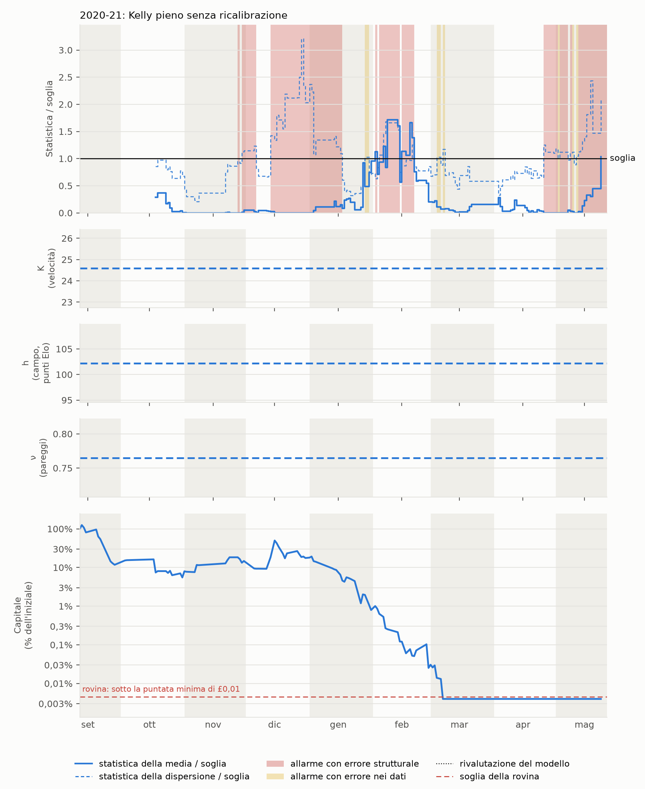

*Figura 5.2. Il 2020-21 visto dal Kelly pieno senza ricalibrazione. In alto le due statistiche dell'ANOVA, sulla media (linea piena) e sulla dispersione (tratteggio), ciascuna divisa per la propria soglia: l'allarme scatta sopra 1. Le fasce sono le giornate di allarme, rosse se il ricalibratore diagnostica un errore strutturale, gialle se diagnostica un errore nei dati; per il Kelly pieno la diagnosi non ha conseguenze. Seguono i tre parametri del modello, $K$, $h$ e $\nu$, che per il Kelly pieno restano quelli di inizio stagione, e il capitale in percentuale di quello iniziale, con la soglia della rovina. Nelle figure delle ricalibrazioni le linee punteggiate verticali sono le rivalutazioni. Le colonne alternate sono i mesi.*

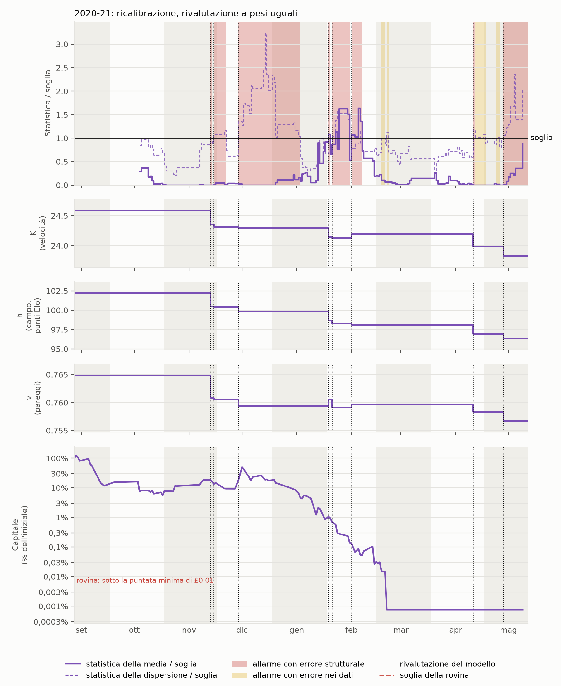

*Figura 5.3. Il 2020-21 visto dalla ricalibrazione con la rivalutazione a pesi uguali, nello stesso formato della Figura 5.2.*

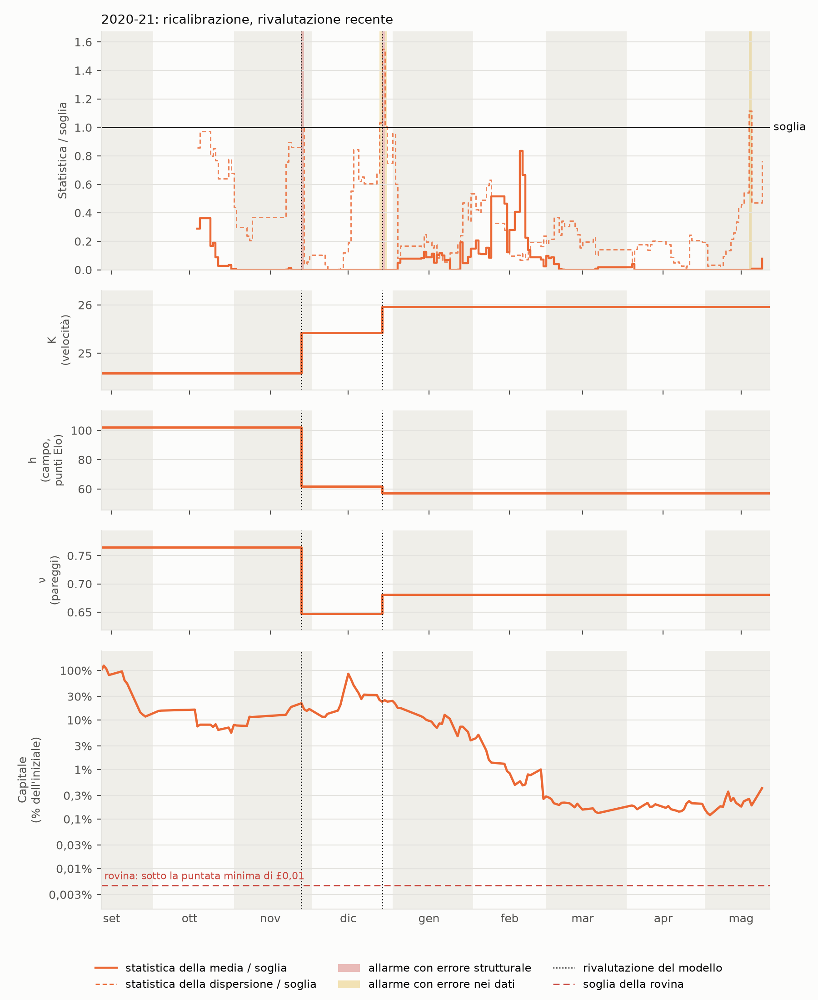

*Figura 5.4. Il 2020-21 visto dalla ricalibrazione con la rivalutazione recente, nello stesso formato della Figura 5.2.*

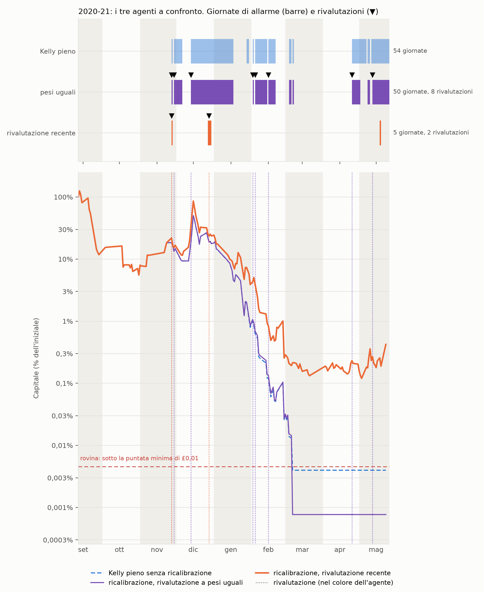

*Figura 5.5. Il 2020-21, i tre agenti a confronto. In alto una riga per agente: ogni barra è una giornata di allarme e ogni triangolo una rivalutazione; a destra il totale della stagione. Per il Kelly pieno, in colore più chiaro, sono gli allarmi che il supervisore darebbe sul modello di inizio stagione, senza conseguenze. In basso i capitali, con le rivalutazioni nel colore dell'agente e la soglia della rovina.*

**Com'è andato il 2020-21.** È l'unica stagione dello studio in cui si vince più spesso in trasferta che in casa: il 40% delle partite contro il 38%. Il danno più grande arriva prima che il supervisore possa accorgersene. Fino al primo allarme i tre agenti sono lo stesso agente: il 26 settembre hanno già perso l'86% del capitale, e il 27 novembre ne resta il 18,4%. Da quel giorno la ricalibrazione non può più rendere buona la stagione, ma può decidere se l'agente arriva in fondo.

La giornata in cui la ricalibrazione serve è proprio venerdì 27 novembre 2020, quando si gioca una sola partita, Crystal Palace-Newcastle. Il modello di inizio stagione dà al Newcastle, in trasferta, il 26% di vincere: alla quota di 3,75, per ogni sterlina puntata si aspetta di riaverne 0,99, e il Kelly pieno quasi non punta. La rivalutazione recente, fatta prima della partita, ha portato $h$ a 62 e dà al Newcastle il 32%: alla stessa quota la sterlina ne rende in media 1,19, e l'agente punta sul Newcastle. La partita finisce 0-2, e il capitale della rivalutazione recente sale dal 18,4% al 21,9% di quello iniziale, mentre gli altri due agenti restano dove sono. La rivalutazione a pesi uguali, fatta lo stesso giorno, porta $h$ soltanto a 101 e la scommessa non la vede.

Una partita sola può essere fortuna, e infatti il giorno dopo la rivalutazione recente perde più degli altri due. Quello che conta è che da quel giorno il suo modello prevede un campionato in cui si vince meno in casa, e il campionato è davvero così. Nelle giornate in cui vincono poche squadre di casa guadagna sugli altri due agenti, in quelle in cui ne vincono molte perde, e le prime sono molto più frequenti. Il 26 gennaio 2021 ne è l'esempio più netto: quattro partite e quattro vittorie in trasferta (Crystal Palace-West Ham 2-3, Newcastle-Leeds 1-2, Southampton-Arsenal 1-3, West Brom-Manchester City 0-5). Il Kelly pieno, che vede ancora grandi occasioni sulle squadre di casa, perde il 73% del capitale; la rivalutazione recente, che ne vede meno, il 56%. Il 7 marzo, quando gli altri due agenti scendono sotto la soglia della rovina, la rivalutazione recente ha quasi quindici volte il capitale del Kelly pieno, e chiude la stagione con lo 0,42%. Non è una stagione vinta: è una stagione in cui la ricalibrazione tiene l'agente in gioco.

**Il 2016-17: il caso inseguito.** Qui il campionato non cambia in modo noto. Le prime giornate vanno male per il modello, e l'allarme scatta il 16 settembre, sulla media, con poco più di 40 partite giocate.

- **Il Kelly pieno** (Figura 5.6) non fa nulla: 36 giornate di allarme senza conseguenze, 23 con un errore strutturale e 13 con un errore nei dati, e chiude con lo 0,033% del capitale.
- **La rivalutazione a pesi uguali** (Figura 5.7) rivaluta il modello 8 volte, ma $K$ resta fra 23 e 24 e $h$ fra 103 e 105: il modello quasi non cambia, e il capitale segue quello del Kelly pieno, fino allo 0,037%.
- **La rivalutazione recente** (Figura 5.8) pesa molto le poche partite giocate. La prima rivalutazione porta $h$ da 104 a 63 punti Elo e $K$ da 24 a 19; le due di gennaio e febbraio portano $K$ fino a 12, mentre $h$ risale a 86. Il modello reagisce troppo a poche partite e prevede peggio di prima: l'agente sfiora la rovina il 2 gennaio, e ci finisce con le partite dell'8 aprile 2017.

La Figura 5.9 mette insieme le tre storie: è lo stesso meccanismo del 2020-21, ma questa volta il cambiamento che la rivalutazione recente segue non c'è.

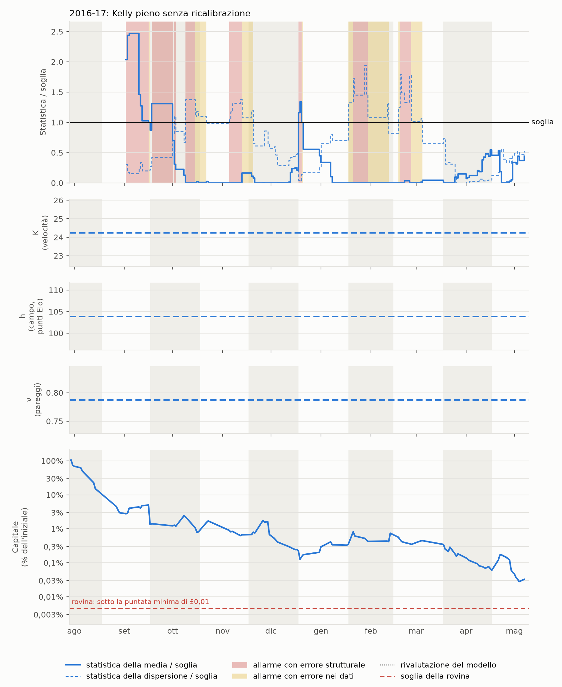

*Figura 5.6. Il 2016-17 visto dal Kelly pieno senza ricalibrazione, nello stesso formato della Figura 5.2.*

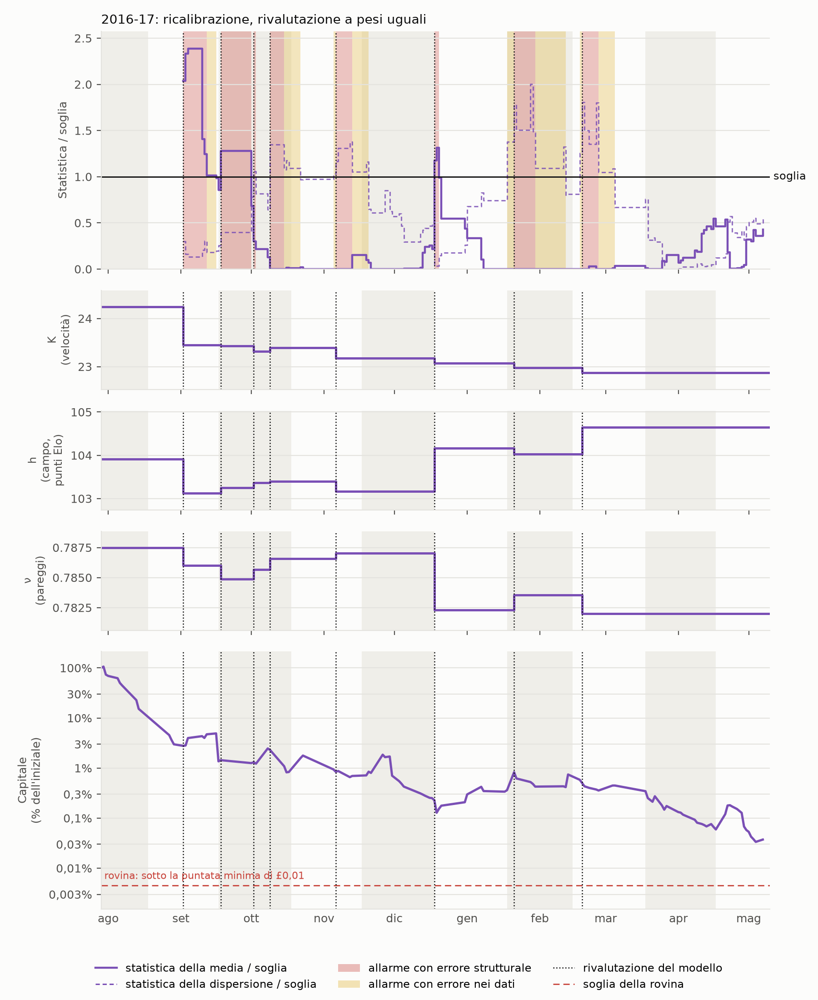

*Figura 5.7. Il 2016-17 visto dalla ricalibrazione con la rivalutazione a pesi uguali, nello stesso formato della Figura 5.2.*

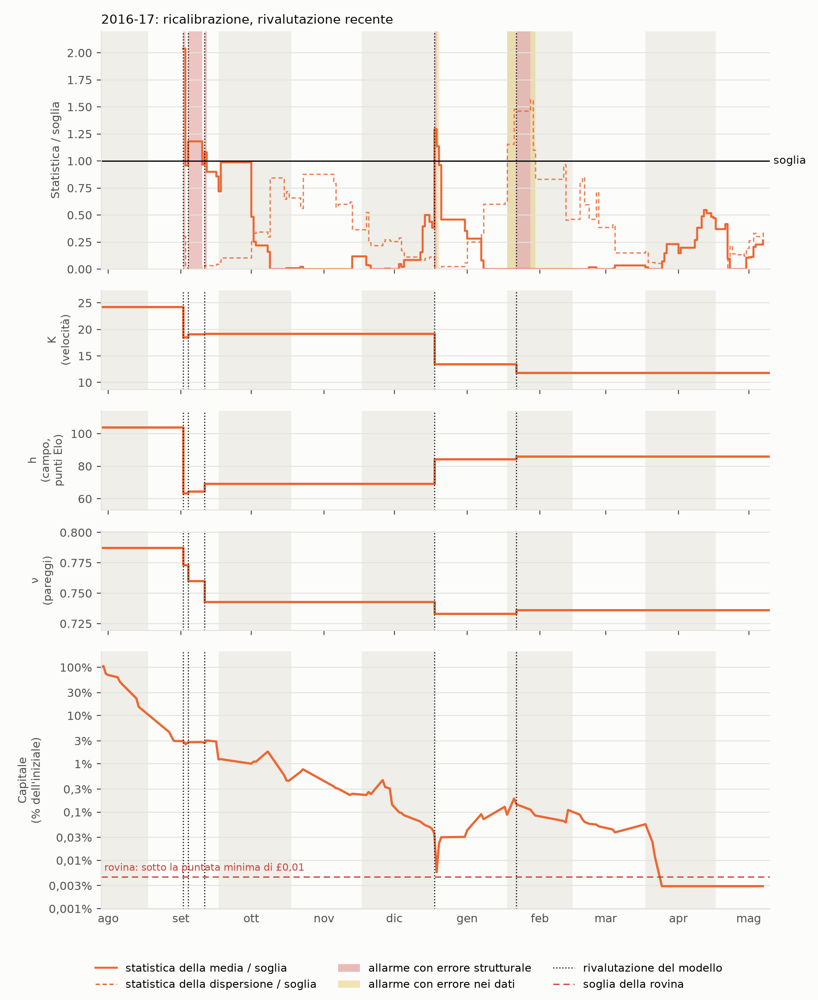

*Figura 5.8. Il 2016-17 visto dalla ricalibrazione con la rivalutazione recente, nello stesso formato della Figura 5.2.*

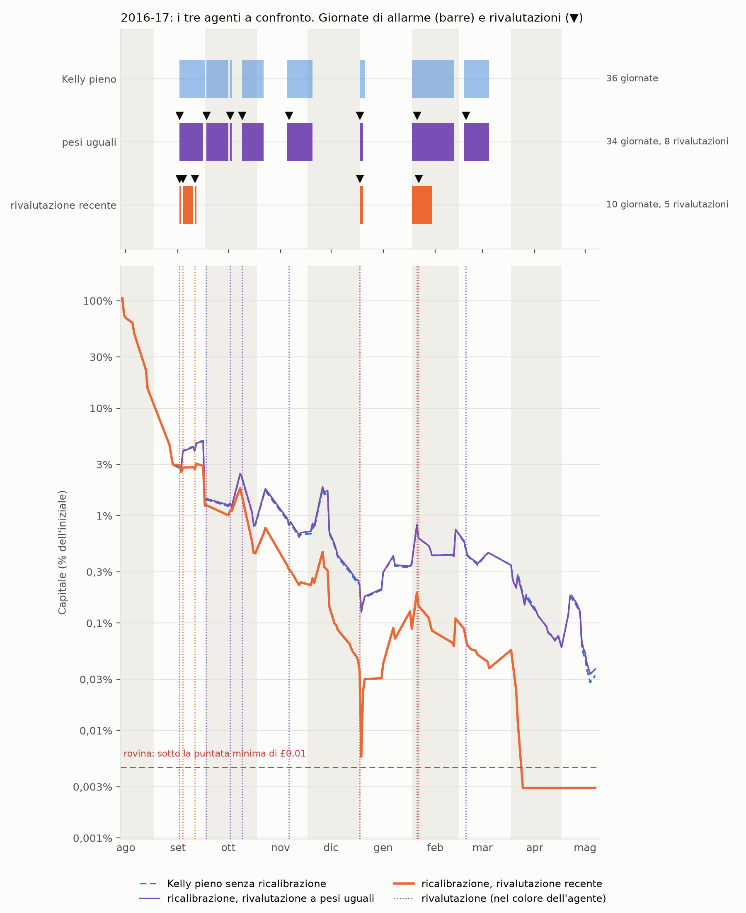

*Figura 5.9. Il 2016-17, i tre agenti a confronto, nello stesso formato della Figura 5.5.*

**Com'è andato il 2016-17.** È la stagione opposta al 2020-21: le squadre di casa vincono il 49% delle partite, la terza percentuale più alta delle ventuno stagioni dello studio. Anche qui il danno più grande arriva prima del primo allarme, e il 16 settembre resta il 3% del capitale. La rivalutazione recente legge quel cattivo inizio come un calo del vantaggio di campo e porta $h$ a 63, ma il vantaggio di campo non è calato.

La giornata in cui la ricalibrazione sembra servire è sabato 1 ottobre 2016. Il modello di inizio stagione vede grandi occasioni su tre squadre di casa: lo Swansea contro il Liverpool (il 32% a una quota di 8), l'Hull contro il Chelsea (il 27% a una quota di 7,5) e il West Ham contro il Middlesbrough (il 59% a una quota di 2,25). Nessuna delle tre vince: Swansea-Liverpool 1-2, Hull-Chelsea 0-2, West Ham-Middlesbrough 1-1. Il Kelly pieno perde il 73% del capitale; la rivalutazione recente, che a quelle squadre crede un po' meno, il 57%. Nelle due settimane prima aveva guadagnato meno del Kelly pieno, il 2,9% del capitale contro il 5,0%; quel giorno recupera quasi tutto il distacco, e la sera i due agenti hanno l'1,24% e l'1,34%.

È l'unica giornata così. Da ottobre in poi vincono le squadre di casa, e nelle giornate in cui ne vincono molte la rivalutazione recente guadagna meno degli altri due agenti, perché su di loro scommette meno. Sabato 10 dicembre, per esempio, vincono cinque squadre di casa su sei, fra cui il Leicester contro il Manchester City (4-2): il capitale del Kelly pieno cresce del 133%, quello della rivalutazione recente del 95%. A fine dicembre la rivalutazione recente ha circa un quinto del capitale del Kelly pieno, le rivalutazioni di gennaio e febbraio non la rimettono in pari, e l'8 aprile scende sotto la soglia della rovina. La rivalutazione a pesi uguali quasi non si muove, e per questo non sbaglia: chiude con lo 0,037% contro lo 0,033% del Kelly pieno. In questa stagione il supervisore vede bene che il modello va male, ma il cattivo inizio è caso, e non c'è nessun cambiamento da seguire.

### 5.5 Il supervisore: quando interviene

L'allarme scatta in 8 stagioni su 21: il 2005-06, il 2008-09, il 2010-11 e tutte le stagioni dal 2016-17 al 2020-21. Con il modello di inizio stagione le giornate di allarme sono 124. Nelle prime tre stagioni l'allarme scatta in una sola giornata. Dal 2016-17 al 2020-21, invece, gli allarmi si ripetono: nel 2018-19 l'allarme scatta sulla media alla prima occasione utile; nel 2019-20 l'ultimo allarme arriva dopo la ripresa del campionato a porte chiuse, nel luglio 2020; il 2020-21, giocato quasi tutto a porte chiuse, è la stagione con più giornate di allarme, 54.

Quasi tutti gli allarmi riguardano la dispersione: gli errori del modello diventano più sparsi del solito, senza spostarsi in media. Sulla media l'allarme scatta soltanto in tre stagioni, il 2016-17, il 2018-19 e il 2020-21, che sono anche tre delle cinque in cui il modello è più lontano dal mercato. Il 16 settembre 2016 e il 16 settembre 2018 il primo allarme è sulla media; il 27 novembre 2020 è sulla dispersione, e la media lo raggiunge più avanti.

L'unico allarme del 2005-06 arriva il 3 maggio, a fine stagione: è il periodo in cui il modello sbaglia di più anche quando funziona, e che la posizione nella stagione, entrando come una retta, descrive male (§7.1). Non si può escludere che sia, almeno in parte, un errore di fine stagione più che un cambiamento del modello.

**Che cosa fa bene: vede da solo quando il modello sbaglia più del solito.** Il supervisore non sa nulla del campionato: non sa che nel 2020-21 si gioca senza pubblico, né che nel 2016-17 le prime giornate vanno male. Guarda soltanto gli errori del modello rispetto al mercato e li confronta con quelli del suo passato. Le soglie sono fissate in modo che, se il modello si comportasse come nel suo passato, l'allarme scatterebbe per caso in circa una stagione su venti (§3.3); scatta in 8 su 21.

**Che cosa non vede: un modello che sbaglia sempre un po'.** Il supervisore confronta il modello con il suo passato, non con il mercato: chiede se le ultime 40 partite sono andate peggio del solito, non se sono andate male. Per questo l'allarme non segue la distanza dal mercato. La tabella ordina le 21 stagioni per scarto $\hat g$ dal mercato, dalla peggiore, e riporta tutte quelle in cui l'allarme scatta, più le due peggiori in cui non scatta; scarti e allarmi sono quelli del modello di inizio stagione.

| Stagione | Posizione per scarto $\hat g$ (1 = la peggiore) | $\hat g$ | Allarme |
|---|---|---|---|
| 2020-21 | 1 | −0,040 | sì |
| 2016-17 | 2 | −0,036 | sì |
| 2023-24 | 3 | −0,031 | **no** |
| 2021-22 | 4 | −0,029 | **no** |
| 2018-19 | 5 | −0,029 | sì |
| 2017-18 | 8 | −0,022 | sì |
| 2005-06 | 16 | −0,006 | sì |
| 2010-11 | 18 | −0,004 | sì |
| 2019-20 | 20 | −0,003 | sì |
| 2008-09 | 21 | −0,003 | sì |

L'allarme scatta nelle due stagioni peggiori, ma non nella terza e nella quarta, il 2023-24, la stagione di KellyBench, e il 2021-22; e scatta anche nelle due migliori, il 2008-09 e il 2019-20. Lo scarto medio delle 8 stagioni con allarme, −0,018, è quasi lo stesso delle 13 senza, −0,016.

Nel 2023-24 il modello è sempre stato un po' sotto il mercato: il riferimento ha un residuo medio di −0,015, e nella stagione il modello lo è soltanto di 0,016 in più per partita, mentre per far scattare l'allarme le ultime 40 partite dovrebbero essere peggiori del solito di circa 0,085 (§3.3). Nel 2021-22 i numeri sono quasi gli stessi. Nel 2008-09, nel 2010-11 e nel 2019-20 succede il contrario: sull'intera stagione il modello è quasi alla pari con il mercato, ma ha un periodo in cui i suoi errori sono molto più dispersi del solito, e l'allarme scatta per la dispersione. Il supervisore riconosce periodi anomali, non stagioni cattive.

### 5.6 Il supervisore interviene al momento giusto?

Resta da sapere se, nelle stagioni in cui il modello viene rivalutato, rivalutarlo nei giorni scelti dal supervisore conservi più capitale che rivalutarlo in giorni qualunque. Le stagioni sono sette: il 2017-18 ha allarmi, ma il ricalibratore li attribuisce tutti al tipo di partite e non rivaluta mai. In ognuna le rivalutazioni sono state rifatte in 2000 calendari di giornate scelte a caso, con lo stesso numero di rivalutazioni e fra le giornate in cui il confronto è già possibile; la rivalutazione e la regola di puntata restano le stesse, cambia soltanto il giorno. Il valore p è la quota di calendari casuali che chiudono con almeno il capitale del supervisore: un valore piccolo vuol dire che il supervisore sceglie giorni migliori del caso.

| Stagione | Rivalutazioni a pesi uguali | p | Rivalutazioni recenti | p |
|---|---|---|---|---|
| 2005-06 | 1 | 0,65 | 1 | 0,45 |
| 2008-09 | 1 | 0,98 | 1 | 0,90 |
| 2010-11 | 1 | 0,71 | 1 | 0,50 |
| 2016-17 | 8 | 0,83 | 5 | 0,44 |
| 2018-19 | 1 | 0,76 | 1 | 0,19 |
| 2019-20 | 2 | 0,14 | 2 | 0,24 |
| 2020-21 | 8 | 0,72 | 2 | 0,12 |

Nessuna stagione ha un valore p sotto 0,10, e sulle sette stagioni insieme, sommando il logaritmo del capitale finale, $p = 0{,}44$ con i pesi uguali e $0{,}12$ con la rivalutazione recente: il giorno scelto dal supervisore non si distingue dal caso. Quando la rivalutazione aiuta, come nel 2020-21, aiuta quasi in qualunque giorno la si faccia: la mediana dei calendari casuali, £293, non è lontana dalle £422 del supervisore. Conta rivalutare, non quando.

### 5.7 Il ricalibratore: a che cosa serve distinguere i due errori

Nelle 124 giornate di allarme il ricalibratore diagnostica 97 errori strutturali e 27 errori nei dati. Gli errori nei dati cadono in quattro stagioni, il 2016-17 (13 giornate su 36), il 2017-18 (tutte e 4), il 2019-20 (4 su 18) e il 2020-21 (6 su 54). Nel 2017-18 il ricalibratore attribuisce ogni allarme al tipo di partite, e il modello non viene mai rivalutato; nelle altre 7 stagioni c'è almeno un errore strutturale.

Il ricalibratore rivaluta il modello dopo un errore strutturale e non dopo un errore nei dati. La distinzione serve se rivalutare aiuta nel primo caso e non nel secondo, e si può controllare. Per ogni giornata di allarme si guarda che cosa sarebbe successo rivalutando il modello quel giorno, con la rivalutazione recente, e si misura come cambia la *log-loss* delle partite da quel giorno alla fine della stagione rispetto al modello di inizio stagione.

| Stagione | Giornate con errore strutturale | Rivalutando, la *log-loss* del resto della stagione | Giornate con errore nei dati | Rivalutando, la *log-loss* del resto della stagione |
|---|---|---|---|---|
| 2005-06 | 1 | −0,009 | 0 | — |
| 2008-09 | 1 | +0,004 | 0 | — |
| 2010-11 | 1 | −0,002 | 0 | — |
| 2016-17 | 23 | +0,006 | 13 | +0,004 |
| 2017-18 | 0 | — | 4 | +0,001 |
| 2018-19 | 9 | −0,005 | 0 | — |
| 2019-20 | 14 | 0,000 | 4 | +0,005 |
| 2020-21 | 48 | −0,031 | 6 | −0,045 |
| Tutte | 97 | −0,014 (migliora nel 66% delle giornate) | 27 | −0,007 (migliora nel 37%) |
| Tutte tranne il 2020-21 | 49 | +0,002 (migliora nel 35%) | 21 | +0,004 (migliora nel 19%) |

*Variazione media della* log-loss *delle partite dalla giornata di allarme alla fine della stagione, se in quella giornata il modello di inizio stagione viene rivalutato con la rivalutazione recente; un valore negativo vuol dire previsioni migliori. Le giornate di allarme e le diagnosi sono quelle del modello di inizio stagione. Nelle giornate senza allarme la rivalutazione migliora le previsioni nel 52% dei casi, in media di 0,003; senza il 2020-21, nel 46%.*

Dopo un errore nei dati, rivalutare avrebbe peggiorato le previsioni nel 2016-17, nel 2017-18 e nel 2019-20: fuori dal 2020-21 la rivalutazione migliora soltanto in 4 giornate su 21. In quelle stagioni non rivalutare era la scelta giusta, e la diagnosi ha evitato rivalutazioni dannose. Dopo un errore strutturale il risultato dipende dalla stagione. La rivalutazione migliora le previsioni nell'unica giornata di allarme del 2005-06 e del 2010-11, in tutte quelle del 2018-19 e in quasi tutte quelle del 2020-21; le peggiora nel 2008-09 e in tutte le giornate del 2016-17. Sull'insieme delle stagioni rivalutare dopo un errore strutturale conviene più che dopo un errore nei dati e più che in una giornata senza allarme, e lo stesso vale, con variazioni dieci volte più piccole, per la rivalutazione a pesi uguali. Il vantaggio, però, viene quasi tutto dal 2020-21: nelle altre stagioni rivalutare dopo un errore strutturale migliora le previsioni soltanto in una giornata su tre, meno spesso che in una giornata senza allarme, dove succede quasi una volta su due.

Proprio nel 2020-21, d'altra parte, il ricalibratore sbaglia. Lì rivalutare avrebbe migliorato le previsioni in qualunque giornata, anche in quelle senza allarme, perché tutta la stagione è diversa dalle precedenti, e le 6 giornate con errore nei dati sono proprio quelle in cui la rivalutazione avrebbe aiutato di più. Sono errori strutturali scambiati per errori nei dati: con cinque caratteristiche che spiegano lo 0,7% della variabilità dei residui, il ricalibratore ha poco su cui distinguere.

Distinguere i due errori, quindi, è utile, ma in un senso preciso: serve a sapere quando non rivalutare, più che quando rivalutare. Le giornate con errore nei dati sono quelle in cui la rivalutazione avrebbe fatto più danni, e lasciare il modello com'è è la scelta giusta in tutte le stagioni tranne quella a porte chiuse. Le giornate con errore strutturale, invece, non sono migliori di una giornata qualunque, salvo nel 2020-21, quando il cambiamento è così grande che rivalutare conviene in qualsiasi giorno.

### 5.8 La rivalutazione: che cosa cambia nel modello

Le due rivalutazioni partono dallo stesso giorno, il primo errore strutturale della stagione, ma poi si separano: con i pesi uguali il modello viene rivalutato 22 volte, con la rivalutazione recente 13. La rivalutazione recente ne fa meno perché cambia di più il modello: dopo una rivalutazione forte il supervisore giudica un modello diverso, e i suoi errori tornano più spesso nella norma.

**Senza peso sul presente, la rivalutazione non serve.** Con i pesi uguali i parametri rivalutati restano vicini a quelli di partenza: $K$ fra 23 e 25, $\nu$ fra 0,76 e 0,80. Il cambiamento più grande è nel 2020-21, dove il vantaggio del campo scende, rivalutazione dopo rivalutazione, da 102 a 96 punti Elo, contro il 57 della rivalutazione recente. Poche giornate della stagione in corso pesano poco accanto a molte stagioni passate. La *log-loss* migliora in 5 stagioni su 7 e peggiora in 2, ma di pochissimo: in media di 0,0003. La rivalutazione a pesi uguali non sbaglia, ma soltanto perché quasi non fa nulla.

**Con il peso sul presente, segue un cambiamento vero.** Il 2020-21 è il caso più chiaro, perché il cambiamento è noto e si misura anche senza il modello. È l'unica delle 21 stagioni in cui le squadre in trasferta vincono più di quelle di casa, il 40% delle partite contro il 38%; nelle altre le squadre di casa vincono fra il 41% e il 51%. La rivalutazione recente lo trova da sola, guardando soltanto gli errori del modello: porta il vantaggio del campo $h$ da 102 a 62 punti Elo il 27 novembre, e a 57 il 28 dicembre. A stagione finita si può controllare la direzione: stimato con gli stessi pesi su tutta la stagione, $h$ vale 33, e sulle sole partite del 2020-21 scende a zero. La rivalutazione va nella direzione giusta, e a fine dicembre è circa a metà strada. La *log-loss* della stagione scende da 1,049 a 1,031, il miglioramento più grande di tutto lo studio, e l'agente evita la rovina (§5.4). Il modello rivalutato resta però sotto il mercato, che sulla stessa stagione ha una *log-loss* di 1,009: la rivalutazione colma poco meno di metà della distanza. Il vantaggio è sul modello di prima, non sul mercato. Anche nel 2018-19 la rivalutazione recente migliora la *log-loss*, di 0,0045.

**Ma insegue anche il caso.** La rivalutazione recente, che pesa molto le partite della stagione in corso, reagisce allo stesso modo a un cambiamento vero e a qualche giornata sfortunata. Nel 2016-17 le prime giornate fanno scendere il vantaggio del campo a 63, e le rivalutazioni di gennaio e febbraio portano $K$ fino a 12: il modello reagisce troppo a poche partite, prevede peggio di prima, con una *log-loss* che sale di 0,004, e l'agente va in rovina (§5.4). La *log-loss* peggiora anche nel 2008-09 e nel 2019-20. In tutto la rivalutazione recente la migliora in 4 stagioni su 7 e la peggiora in 3, con un miglioramento medio di 0,0021, dovuto quasi tutto al 2020-21.

**E non sa quando sbaglia.** Il 27 novembre 2020 e il 16 settembre 2016 il ricalibratore vede la stessa cosa, un errore strutturale, e la rivalutazione recente risponde allo stesso modo, abbassando il vantaggio del campo. Nel primo caso il campionato è cambiato, nel secondo no: a stagione finita, con gli stessi pesi, il vantaggio del campo del 2016-17 vale 96, e a metà settembre la rivalutazione recente lo aveva portato a 63, nella direzione sbagliata. Sulle 7 stagioni con almeno una rivalutazione, la prima rivalutazione recente sposta $h$ nella direzione che la stagione intera conferma in 5, e in quella sbagliata in 2, il 2008-09 e il 2016-17, che sono anche due delle tre stagioni in cui la *log-loss* peggiora. Nel 2018-19 ci arriva quasi esattamente, a 90 contro 89; nel 2020-21 si ferma a metà strada. Il più delle volte, quindi, la rivalutazione va nel verso giusto; ma quando sbaglia, sbaglia con la stessa sicurezza. Per distinguerli servirebbe un'informazione che non sta negli errori del modello, come sapere che gli stadi sono chiusi, oppure aspettare altre partite; il framework non ha la prima e non fa la seconda.

**Una cosa che non dipende dal framework.** Con il Kelly pieno il capitale non segue la qualità delle previsioni. Nel 2019-20 la rivalutazione recente prevede peggio del modello di inizio stagione, con una *log-loss* che sale di 0,0027, eppure chiude con £492 contro le £7 del Kelly pieno. Il distacco nasce a febbraio 2020, prima del Covid: il Kelly pieno scende dal 29,6% allo 0,02% del capitale, la rivalutazione recente dal 26,8% al 3,0%. Anche la rivalutazione a pesi uguali, che lascia il modello quasi com'è, chiude con £77, undici volte il Kelly pieno. Non è un difetto della rivalutazione, ma del lavoratore: un modello senza vantaggio che punta il Kelly pieno lascia il capitale in balia di poche scommesse, e basta un mese perché il capitale finale si moltiplichi o si divida per dieci. Per questo una differenza di capitale in una stagione sola non dice se la rivalutazione è servita, e il confronto sull'insieme delle stagioni non si distingue dal caso (§5.2).

### 5.9 Il bilancio del framework

| Parte | Che cosa fa bene | Che cosa fa male |
|---|---|---|
| Supervisore | Vede da solo i periodi in cui il modello sbaglia più del solito: l'allarme scatta in 8 stagioni su 21, contro circa una su venti attesa per caso (§5.5). | Non vede un modello che sbaglia sempre un po', come nel 2021-22 e nel 2023-24 (§5.5). |
| Ricalibratore | Dopo un errore nei dati evita rivalutazioni che avrebbero peggiorato le previsioni (§5.7). | Distingue poco i due errori: nel 2020-21 scambia per errori nei dati 6 giornate di un cambiamento vero (§5.7). |
| Rivalutazione recente | Segue un cambiamento vero: nel 2020-21 il vantaggio del campo scende da 102 a 57 e la *log-loss* migliora più che in ogni altra stagione; sposta il modello nella direzione giusta in 5 stagioni su 7 (§5.8). | Insegue il caso, e non sa quando sbaglia: nel 2016-17 porta l'agente in rovina (§5.8). |
| Rivalutazione a pesi uguali | Cambia di poco il modello, e quindi sbaglia di poco (§5.8). | Per la stessa ragione non segue nemmeno i cambiamenti veri (§5.8). |

Supervisore e ricalibratore non guardano dentro il modello: usano soltanto la probabilità che il modello dà al risultato, quella del mercato e alcune caratteristiche della partita. Si possono quindi mettere sopra qualunque modello che dia una probabilità per ogni esito (§7.1). Solo la rivalutazione è propria del modello Elo.

Il supervisore e il ricalibratore fanno ciò per cui sono costruiti: si accorgono da soli che il modello ha smesso di funzionare come prima, e la distinzione fra i due errori evita alcune rivalutazioni dannose. Il limite è il passo successivo. La rivalutazione recente sposta il modello nella direzione giusta in 5 stagioni su 7, ma non sa riconoscere le altre 2, e nel 2016-17 l'errore porta l'agente in rovina. Anche quando ha ragione, poi, non dà al modello il vantaggio sul mercato che prima non aveva. E il caso a favore si regge su una sola stagione: il 2020-21 è l'unica in cui la rivalutazione cambia molto il modello nel verso giusto e tiene l'agente in gioco, e senza di essa rivalutare dopo un errore strutturale migliora le previsioni meno spesso che in una giornata senza allarme (§5.7). Un cambiamento grande e improvviso come le porte chiuse il framework lo segue; dei cambiamenti più piccoli, in queste 21 stagioni, non si può dire che li distingua dal caso. Il framework serve quindi a tenere il modello al passo con il campionato, non a farlo guadagnare: è utile a un lavoratore che ha già un vantaggio da proteggere, ed è rischioso quando la rivalutazione si fida di poche partite.

## 6. Dinamica evolutiva

KellyBench mette alla prova molti agenti sulla stessa stagione e guarda chi perde meno. I capitoli precedenti hanno seguito tre agenti uno alla volta; la dinamica evolutiva (§2.9) permette di metterli in competizione, sulle stesse partite, lasciando che sia il capitale a scegliere fra loro, come in un mercato in cui sopravvive chi guadagna. Se la ricalibrazione è utile, gli agenti che la adottano dovrebbero conquistare capitale a spese del Kelly pieno.

### 6.1 Una popolazione di strategie

**Le strategie.** Alle tre strategie dei capitoli precedenti se ne aggiunge una che non punta:

| Strategia | Che cosa fa | Capitale tipico, da sola |
|---|---|---|
| Kelly pieno | il modello di inizio stagione per tutta la stagione | 0,7% |
| Rivalutazione a pesi uguali | la ricalibrazione con la rivalutazione a pesi uguali | 0,9% |
| Rivalutazione recente | la ricalibrazione con la rivalutazione recente | 1,0% |
| Cassa | non punta mai | 100% |

Le prime tre puntano tutte il Kelly pieno e differiscono soltanto per le previsioni. La cassa è la scelta standard della *evolutionary finance*, una strategia che non investe. È anche, in pratica, l'equivalente automatico dell'esecuzione di GPT-5.4 che, misurato di non battere il mercato, riduce le puntate al minimo: £0,01 su £220 per giornata è così poco che puntare il minimo e non puntare danno quasi lo stesso capitale, il 99,98% contro il 100%.

**Come funziona.** Ogni strategia riceve una quota del capitale, all'inizio uguale per tutte, e dopo ogni giornata le quote cambiano secondo la dinamica del replicatore (2.9), senza mutazione ($\mu = 0$). Nelle **generazioni** ogni stagione riparte dallo stesso capitale, ma le quote iniziali sono quelle con cui si è chiusa la stagione precedente: la popolazione ricorda quali strategie hanno funzionato, usando soltanto informazione passata. L'analisi è condotta senza puntata minima nell'ambiente: solo così la quota di capitale affidata a una strategia non ne modifica il rendimento, e il capitale della popolazione si calcola esattamente dai percorsi delle singole strategie. Per questo i capitali delle strategie da sole sono un po' diversi da quelli del capitolo 5, e nessuna strategia va in rovina nel senso del §4.2: senza puntata minima il capitale può avvicinarsi a zero quanto si vuole, ma la strategia continua a scommettere.

### 6.2 Dove va il capitale

| Popolazione | Capitale tipico |
|---|---|
| I tre agenti che puntano il Kelly pieno, con le generazioni | 0,95% |
| Tutte le strategie, quote uguali a ogni stagione | 31% |
| Tutte le strategie, con le generazioni | 94% |

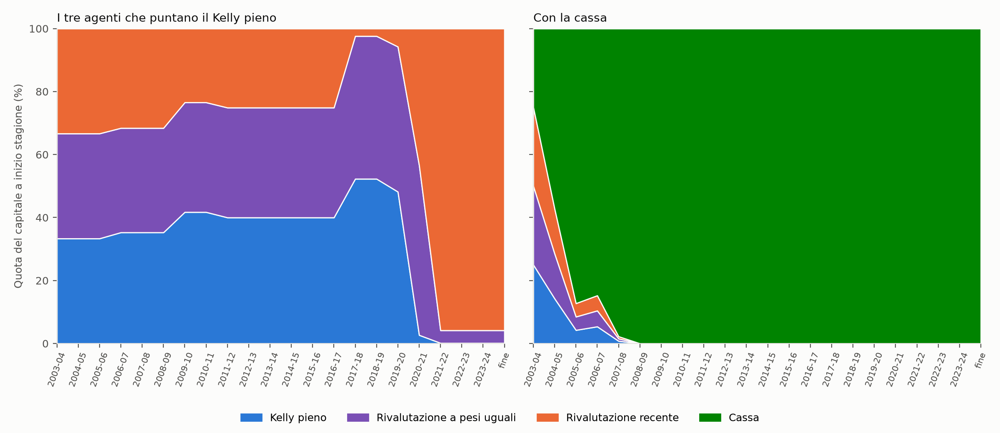

*Figura 6.1. La popolazione con le generazioni. Ogni colonna è l'inizio di una stagione, l'ultima la fine del 2023-24; l'altezza di ogni colore è la quota di capitale affidata a una strategia. A sinistra i tre agenti che puntano il Kelly pieno, a destra tutte le strategie, cassa compresa.*

**Fra i tre agenti che puntano il Kelly pieno, la selezione oscilla.** Nelle prime stagioni le quote restano quasi uguali, perché la ricalibrazione interviene poco. La rivalutazione recente perde terreno nel 2008-09, quando insegue il caso, e quasi scompare dopo il crollo del 2016-17: a inizio 2017-18 ha il 2% del capitale. Poi arriva il 2020-21, giocato a porte chiuse, in cui è l'unica a non perdere quasi tutto: a inizio 2021-22 ha il 96% del capitale, e lo tiene fino alla fine. La popolazione, però, perde comunque quasi tutto: in una stagione tipica conserva lo 0,95% del capitale, perché tutte e tre le strategie puntano il Kelly pieno con un modello che non batte il mercato. Il vincitore lo decide una sola stagione, e una stagione diversa lo avrebbe eliminato.

**Con la cassa, la selezione smette di scommettere.** Quando nella popolazione c'è la cassa, il capitale si sposta verso di lei già dalla seconda stagione: a inizio 2004-05 ne ha il 57%, a inizio 2005-06 l'87%, a inizio 2007-08 il 98%, dal 2008-09 tutto. Il capitale tipico della popolazione sale al 94%. Le strategie che puntano il Kelly pieno, con o senza ricalibrazione, scompaiono in pochi anni. Con quote uguali a ogni stagione la popolazione non può spostare il capitale da una stagione all'altra, e conserva il 31%: poco più della quarta parte affidata alla cassa.

### 6.3 Che cosa la selezione premia

Fra le strategie che puntano il Kelly pieno, la selezione non trova un vincitore stabile: premia la rivalutazione recente solo perché sopravvive alla stagione a porte chiuse, dopo averla quasi eliminata per il crollo di quattro stagioni prima. Quando può scegliere di non rischiare, invece, sceglie di non rischiare: senza un vantaggio sul mercato, ricalibrare il modello non basta, e sopravvive chi non punta.

È, in pratica, il comportamento dell'unica esecuzione corretta di KellyBench, quella di GPT-5.4 che misura di non battere il mercato e passa a puntate minime. La popolazione ci arriva senza misurare nulla, soltanto spostando il capitale verso chi perde meno. Vale una cautela: la popolazione gioca senza la puntata minima obbligatoria dell'ambiente.

## 7. Conclusioni

Le domande poste nell'introduzione hanno ora una risposta.

La prima: *un agente che punta secondo il criterio di Kelly pieno, senza alcun errore di esecuzione, va in rovina come gli agenti di KellyBench?* Sì, o quasi. Il modello Elo non batte il mercato in nessuna delle 21 stagioni (§5.1), e il Kelly pieno conserva in una stagione tipica meno dell'1% del capitale; nella stagione di KellyBench chiude con una perdita del 99,7%, fra gli agenti peggiori del benchmark, senza commettere un solo errore (§5.2, §5.3). Per spiegare la rovina degli agenti di KellyBench, quindi, i loro errori non sono necessari: bastano un modello che non batte il mercato e una regola che punta come se lo battesse.

La seconda: *una ricalibrazione automatica, che rivaluta il modello quando i suoi errori diventano anomali, lo fa prevedere meglio e lo protegge dalla rovina?* Non in generale. Il supervisore si accorge da solo dei periodi in cui il modello sbaglia più del solito, in 8 stagioni su 21, ma non della stagione di KellyBench, in cui il modello sbaglia sempre un po' (§5.5). Sull'insieme delle stagioni nessuna delle due ricalibrazioni conserva più capitale del Kelly pieno in modo distinguibile dal caso (§5.2), e rivalutare nei giorni scelti dal supervisore non conserva più che farlo in giorni presi a caso (§5.6). L'unico caso chiaro a favore è il 2020-21, giocato a porte chiuse, in cui la rivalutazione segue un cambiamento vero e tiene l'agente in gioco; fuori da quella stagione, rivalutare nei giorni dell'allarme migliora le previsioni meno spesso che in un giorno qualunque (§5.7). E anche quando la rivalutazione aiuta, il modello resta sotto il mercato (§5.8).

La terza: *conta quanto peso la rivalutazione dà alle partite più recenti?* Sì, ed è la scelta che decide che cosa fa la ricalibrazione. Con lo stesso peso per tutte le stagioni la rivalutazione quasi non cambia il modello: non sbaglia, ma nemmeno serve. Con più peso al presente il modello cambia davvero: segue il calo del vantaggio del campo nel 2020-21, ma nel 2016-17 insegue qualche giornata sfortunata e porta l'agente in rovina, e dagli errori del modello non si può sapere in anticipo quale dei due casi si ha davanti (§5.8).

La popolazione di strategie del capitolo 6 porta alla stessa conclusione: fra gli agenti che puntano il Kelly pieno la selezione non trova un vincitore stabile, e quando può scegliere di non scommettere sceglie di non scommettere. Senza un vantaggio sul mercato, riconoscere i propri errori e rivedere il modello non basta a evitare le perdite.

L'obiettivo generale di questo studio era verificare l'affermazione del gruppo di Ross Taylor secondo cui un'intelligenza artificiale non riesce a prevedere e battere sistematicamente il mercato nel lungo periodo. Il modello usato qui è molto più semplice, dal lato dell'intelligenza, degli agenti linguistici di KellyBench, ma resta legato al ragionamento umano: ogni sua parte svolge un compito solo e si controlla con strumenti statistici classici, l'analisi della varianza e la scomposizione di Blinder-Oaxaca, che una persona sa leggere. Per questo si capisce meglio che cosa accade: l'agente non perde nelle puntate, che seguono la regola, né nel controllo degli errori, che li trova e li corregge, ma nella previsione, che non batte il mercato in nessuna delle 21 stagioni (§5.1). Ne emerge che un mercato complesso come quello delle scommesse ha una struttura fatta di molti sottoproblemi, spesso governati dal caso più che da regole deterministiche: il risultato di una singola partita, la forma delle squadre che cambia durante la stagione, un campionato che a volte cambia all'improvviso, come nel 2020-21 a porte chiuse (§5.4). Le quote contengono già quasi tutto ciò che un modello riesce a prevedere, e ciò che resta non basta a pagare il margine del bookmaker. Un agente linguistico, che affronta tutti questi sottoproblemi insieme, non può vincere contro questa complessità: un'intelligenza più ampia può ridurre le perdite, rinunciando a scommettere quando il vantaggio manca, ma non creare un vantaggio che il mercato non lascia. Ancora una volta l'affermazione di Taylor trova conferma.

### 7.1 Limiti e sviluppi

Il framework è stato provato con un modello Elo, ma supervisore e ricalibratore non dipendono dal modello: usano soltanto le probabilità del modello e del mercato, i residui e alcune caratteristiche della partita. Si possono quindi mettere sopra qualunque previsore che dia una probabilità per ogni esito, anche il modello che si costruisce un agente di KellyBench (§2.5). Il paper osserva che quegli agenti scrivono diagnosi corrette dei propri errori ma non cambiano comportamento; il framework rende automatiche le due cose, con un allarme, una diagnosi e una reazione decise prima. Per un agente linguistico, però, la rivalutazione sarebbe meno controllabile: non il calcolo di tre parametri, ma la stima di nuovo dell'intero modello, da provare come qui su molte stagioni e confrontandola con il caso. Con i dati di cui dispongono quegli agenti, statistiche delle partite, quote e dati sui giocatori, il lavoratore potrebbe avvicinarsi al mercato, per esempio combinando le proprie previsioni con le quote come faceva Benter [@benter1994], e il ricalibratore avrebbe caratteristiche più ricche delle cinque usate qui, che spiegano lo 0,7% della variabilità dei residui. Ci si deve aspettare comunque che il framework non crei un vantaggio, ma lo conservi: nel 2020-21 la rivalutazione trova da sola un cambiamento vero e porta il modello più vicino al campionato giocato (§5.8), e a un lavoratore che a inizio stagione avesse avuto un vantaggio lo avrebbe fatto conservare.

Restano alcuni limiti. Molte scelte, fra cui la rivalutazione recente e la soglia della diagnosi, sono state fatte dopo aver visto le stagioni passate, e andrebbero provate su stagioni o leghe mai viste con tutte le regole fissate prima. Il ricalibratore conosce poco le partite: nel 2020-21 scambia per errori nei dati 6 giornate di un cambiamento vero (§5.7). La posizione nella stagione entra come una retta, mentre il modello è sotto il mercato più del solito all'inizio e soprattutto alla fine (residuo medio −0,024 nelle prime 80 partite, −0,012 nel mezzo, −0,030 nelle ultime 50), così un peggioramento di fine stagione può risultare strutturale; due indicatori, per le prime e per le ultime giornate, lo eviterebbero. Con il peso sul presente bastano 40 partite storte per cambiare molto il modello, come nel 2016-17 (§5.8): si potrebbe limitare quanto una rivalutazione sposta i parametri, o chiedere più di un allarme, e scegliere il peso sulle stagioni precedenti invece di fissarlo a mano. Il supervisore confronta il modello con il suo passato e non con il mercato, e quindi non vede un modello che sbaglia sempre un po', come nel 2021-22 e nel 2023-24 (§5.5). Infine, i risultati valgono per la Premier League, le quote Bet365, il mercato dei tre esiti e il modello Elo, e la popolazione del capitolo 6 gioca senza la puntata minima.

## Bibliografia

Le voci sono nell'ordine in cui sono citate per la prima volta nel testo. Per gli articoli senza numeri di pagina è indicato il DOI.

1. T. Grady, K. Parker, I. Zarov, H. Course, C. Taylor e R. Taylor, «KellyBench: Can Language Models Beat the Market?», rapporto tecnico, General Reasoning, aprile 2026. Versione successiva: arXiv:2604.27865, 2026.
2. J. L. Kelly Jr., «A New Interpretation of Information Rate», *Bell System Technical Journal*, 35(4), pp. 917–926, 1956.
3. C. E. Shannon, «A Mathematical Theory of Communication», *Bell System Technical Journal*, 27(3), pp. 379–423, 1948.
4. E. O. Thorp, *Beat the Dealer: A Winning Strategy for the Game of Twenty-One*, Blaisdell, 1962.
5. W. Benter, «Computer Based Horse Race Handicapping and Wagering Systems: A Report», in *Efficiency of Racetrack Betting Markets*, a cura di D. B. Hausch, V. S. Y. Lo e W. T. Ziemba, pp. 183–198, Academic Press, 1994.
6. A. E. Elo, *The Rating of Chessplayers, Past and Present*, Arco, 1978.
7. R. A. Fisher, *Statistical Methods for Research Workers*, Oliver and Boyd, 1925.
8. A. S. Blinder, «Wage Discrimination: Reduced Form and Structural Estimates», *Journal of Human Resources*, 8(4), pp. 436–455, 1973.
9. R. Oaxaca, «Male-Female Wage Differentials in Urban Labor Markets», *International Economic Review*, 14(3), pp. 693–709, 1973.
10. H. S. Shin, «Measuring the Incidence of Insider Trading in a Market for State-Contingent Claims», *The Economic Journal*, 103(420), pp. 1141–1153, 1993.
11. W. Poundstone, *Fortune's Formula: The Untold Story of the Scientific Betting System That Beat the Casinos and Wall Street*, Hill and Wang, 2005.
12. P. A. Samuelson, «Why We Should Not Make Mean Log of Wealth Big Though Years to Act Are Long», *Journal of Banking & Finance*, 3(4), pp. 305–307, 1979.
13. L. C. MacLean, E. O. Thorp e W. T. Ziemba, *The Kelly Capital Growth Investment Criterion: Theory and Practice*, World Scientific, 2011.
14. L. Breiman, «Optimal Gambling Systems for Favorable Games», in *Proceedings of the Fourth Berkeley Symposium on Mathematical Statistics and Probability*, vol. 1, pp. 65–78, University of California Press, 1961.
15. E. F. Fama, «Efficient Capital Markets: A Review of Theory and Empirical Work», *The Journal of Finance*, 25(2), pp. 383–417, 1970.
16. L. M. Hvattum e H. Arntzen, «Using ELO Ratings for Match Result Prediction in Association Football», *International Journal of Forecasting*, 26(3), pp. 460–470, 2010.
17. R. R. Davidson, «On Extending the Bradley-Terry Model to Accommodate Ties in Paired Comparison Experiments», *Journal of the American Statistical Association*, 65(329), pp. 317–328, 1970.
18. M. J. Dixon e S. G. Coles, «Modelling Association Football Scores and Inefficiencies in the Football Betting Market», *Journal of the Royal Statistical Society: Series C (Applied Statistics)*, 46(2), pp. 265–280, 1997.
19. B. Efron, «Bootstrap Methods: Another Look at the Jackknife», *The Annals of Statistics*, 7(1), pp. 1–26, 1979.
20. H. R. Künsch, «The Jackknife and the Bootstrap for General Stationary Observations», *The Annals of Statistics*, 17(3), pp. 1217–1241, 1989.
21. D. N. Politis e J. P. Romano, «The Stationary Bootstrap», *Journal of the American Statistical Association*, 89(428), pp. 1303–1313, 1994.
22. D. N. Politis e H. White, «Automatic Block-Length Selection for the Dependent Bootstrap», *Econometric Reviews*, 23(1), pp. 53–70, 2004.
23. M. Roccetti, «The Negligible Biological Impact of Reproductive History on Aging: A High-Resolution Variance Analysis», *Frontiers in Aging*, 7, art. 1888676, 2026. doi:10.3389/fragi.2026.1888676.
24. M. B. Brown e A. B. Forsythe, «Robust Tests for the Equality of Variances», *Journal of the American Statistical Association*, 69(346), pp. 364–367, 1974.
25. H. Levene, «Robust Tests for Equality of Variances», in *Contributions to Probability and Statistics: Essays in Honor of Harold Hotelling*, a cura di I. Olkin, pp. 278–292, Stanford University Press, 1960.
26. M. Roccetti, «From Local Large-Scale Health Signal Inflation to Stochastic Stationarity: A Multiple-Component Risk Recalibration Framework via Intelligent Difference-in-Differences Decomposition», *Computer Modeling in Engineering & Sciences*, 147(2), 2026. doi:10.32604/cmes.2026.082258.
27. M. Roccetti, «Quantifying Structural Selection Bias in Observational Cohort Data: A Ponderation Analysis of Age-Specific Incidence Rates to Inform Vaccine Safety Verification», *Frontiers in Pharmacology*, 16, art. 1754809, 2026. doi:10.3389/fphar.2025.1754809.
28. P. D. Taylor e L. B. Jonker, «Evolutionary Stable Strategies and Game Dynamics», *Mathematical Biosciences*, 40(1–2), pp. 145–156, 1978.
29. L. Blume e D. Easley, «Evolution and Market Behavior», *Journal of Economic Theory*, 58(1), pp. 9–40, 1992.
30. I. V. Evstigneev, T. Hens e K. R. Schenk-Hoppé, «Evolutionary Finance», in *Handbook of Financial Markets: Dynamics and Evolution*, a cura di T. Hens e K. R. Schenk-Hoppé, pp. 507–566, North-Holland, 2009.
31. T. Lensberg e K. R. Schenk-Hoppé, «On the Evolution of Investment Strategies and the Kelly Rule: A Darwinian Approach», *Review of Finance*, 11(1), pp. 25–50, 2007.
