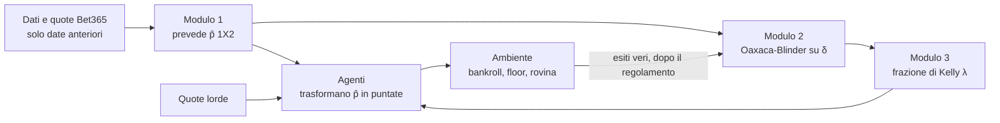

# Gli agenti, l'architettura e le differenze con KellyBench

Questo documento spiega, in italiano e senza dare nulla per scontato, come funziona ogni agente del progetto, come è fatta l'architettura e che cosa cambia rispetto a KellyBench e rispetto all'esecuzione con DeepSeek Flash come Modulo 1. I parametri citati sono quelli di `config/frozen_params.toml` (Modulo 1 Elo); i dettagli di formule e file sono in `thesis/metodi_implementati.md`.

Come ho letto la richiesta: «la mia struttura» è il sistema originale con l'Elo come Modulo 1. La sezione 5 confronta quel sistema con la variante in cui il Modulo 1 è un LLM (`scripts/kellybench_llm_module1.py`).

## 1. Il quadro in una pagina

- **Modulo 1, il lavoratore.** Prevede le probabilità p̂ = (casa, pareggio, trasferta). Nel progetto è un Elo con il mapping di Davidson; Dixon-Coles è il secondo modello.
- **Modulo 2, il supervisore.** Guarda come cambia nel tempo l'errore δ = ln p̂(esito) − ln q(esito), dove q è la probabilità del mercato senza margine (de-vigging di Shin). Con la decomposizione di Oaxaca-Blinder separa un cambiamento di composizione delle partite da un cambiamento strutturale.
- **Modulo 3, il ricalibratore.** Trasforma la diagnosi del Modulo 2 in una frazione di Kelly λ.
- **Gli agenti** sono le regole di puntata. Tutti usano lo stesso p̂ e le stesse quote: cambia solo come decidono quanto puntare. Il confronto isola quindi il valore della regola di puntata.

## 2. Cosa fanno tutti gli agenti

Per ogni data della stagione l'ambiente chiede a ogni agente le frazioni da puntare. Le regole comuni sono queste:

1. **Che cosa si punta.** Per ogni partita si sceglie l'esito con il valore atteso stimato più alto, EV = p̂·quota − 1, calcolato sulle quote lorde Bet365. Si punta solo se EV > 0 e al più una volta per partita.
2. **Quanto.** La frazione è f = λ · max(0, (b·p̂ − (1 − p̂)) / b), con b = quota − 1. λ = 1 è il Kelly pieno, λ = 0,25 il quarto di Kelly. Gli agenti differiscono per come scelgono λ.
3. **Più partite nella stessa data.** Le puntate si piazzano in ordine di EV decrescente finché la somma non supera il bankroll; le altre si scartano.
4. **Floor e puntata obbligatoria.** Con un floor F > 0 ogni puntata vale almeno F. KellyBench obbliga a puntare almeno una volta per data: se un agente non punta, l'ambiente piazza F sull'esito a EV stimato massimo.
5. **Rovina.** Se il bankroll scende sotto F l'agente non può più puntare e il gioco finisce per lui.
6. **Niente informazione dal futuro.** Gli esiti di una data arrivano agli agenti solo dopo il regolamento di tutti.

Nel 2023-24 giocato come in KellyBench: bankroll £100 000 e floor £0,01. Il floor reale di KellyBench non è noto, e con £100 000 £0,01 e £1 cambiano il finale di poche decine di sterline.

## 3. Gli agenti, uno per uno

| Agente | Regola di λ | Cosa misura |
|---|---|---|
| **A** | λ = 1 sempre | Kelly pieno: il caso limite aggressivo |
| **B_0.25** | λ = 0,25 sempre | Il quarto di Kelly che usano gli esseri umani |
| **B_0.10** | λ = 0,10 sempre | Un Kelly frazionario più prudente |
| **C0** | λ = 0,25 | È l'agente C con il supervisore spento: coincide con B_0.25 |
| **C1** | 0,25 · κⁿ | Il valore di «rilevare» il degrado |
| **C2_global** | λ dal Modulo 3 | Il valore di «graduare» |
| **C2** | λ dal Modulo 3, e astensione fuori supporto | Il valore di non puntare dove il modello non ha storia |
| **C3**, **C3_stop** | Allarme ANOVA, poi Oaxaca: 0,25 · κ oppure 0 | Lo schema del relatore (§3.7) |
| **D_ADWIN**, **D_PH** | 0,25 · κᵏ | La baseline con un detector di drift standard |
| **E** | 0 (solo puntata obbligatoria) | Il confronto «non scommettere» |

### 3.0 Un esempio concreto del meccanismo comune

Tutti gli agenti ricevono la stessa p̂ e le stesse quote e usano la stessa formula di puntata. Cambia solo λ. Un esempio:

- Una partita ha quota 2,50 sull'esito che il modello preferisce, e il modello gli dà probabilità p̂ = 0,45.
- Valore atteso stimato: EV = 0,45 × 2,50 − 1 = **+0,125**. È positivo, quindi si può puntare.
- Con b = quota − 1 = 1,5, il Kelly pieno è f* = (b·p̂ − (1 − p̂)) / b = (0,675 − 0,55) / 1,5 = **0,0833**, cioè l'8,33% del bankroll.
- Ogni agente moltiplica f* per il proprio λ. Con un bankroll di £100 000:

| λ | Puntata | Agente |
|---|---|---|
| 1 | £8 333 | A |
| 0,25 | £2 083 | B_0.25, C0, e gli agenti con supervisore o detector quando non c'è alcun allarme |
| 0,10 | £833 | B_0.10 |
| 0 | £0 | E (solo la puntata obbligatoria), e C2 quando il modello perde contro il mercato |

### 3.1 A, B_0.25, B_0.10, C0: λ fisso

Questi quattro usano un λ che non cambia mai durante la stagione.
- **A** è il caso limite. Se il modello avesse ragione, il Kelly pieno farebbe crescere il capitale più in fretta. Ma il modello sbaglia, e il Kelly pieno amplifica ogni errore: per questo nel 2023-24 chiude a £14.
- **B_0.25 e B_0.10** sono il Kelly prudente. Riducono la puntata perché p̂ è solo una stima.
- **C0** è l'agente C con il supervisore spento: λ = 0,25 sempre. È identico a B_0.25 (verificato entro 1e-12) e serve da punto di partenza per misurare cosa aggiunge il supervisore.

### 3.2 C1: l'allarme che riduce λ a scatti

C1 parte da λ = 0,25 e guarda gli errori del modello nel tempo.

1. Prende due finestre adiacenti di partite già giocate: le ultime 40 (recenti) e le 40 precedenti (di riferimento).
2. Con la scomposizione di Oaxaca-Blinder si chiede: quanto del peggioramento dell'errore dipende dal fatto che le partite sono diverse (parte compositiva) e quanto dal fatto che la relazione tra covariate ed errore è cambiata (parte strutturale S)?
3. Se T = −S supera una soglia, l'allarme è acceso. La soglia è calibrata con un block bootstrap su dati senza cambiamento, in modo che scatti per caso solo il 5% delle volte.
4. Una **accensione** è una data in cui l'allarme è acceso mentre alla data di decisione precedente era spento. A ogni accensione λ si moltiplica per κ = 0,75.

Con n accensioni λ = 0,25 · 0,75ⁿ:

| Accensioni n | λ |
|---|---|
| 0 | 0,250 |
| 1 | 0,188 |
| 2 | 0,141 |
| 3 | 0,105 |

Se il Modulo 2 non è attivo (meno di 2W partite di storia), λ resta 0,25. Il limite di C1 è che non dice di quanto sta peggiorando il modello: ogni accensione taglia λ della stessa quantità.

### 3.3 C2_global e C2: λ calcolato dal Modulo 3

Qui λ non dipende da un allarme ma da una formula.

**Il ragionamento.** p̂ è una stima rumorosa, e più è rumorosa meno conviene puntare. La frazione ottima con stima rumorosa è λ* = E[c] / E[c²], dove c è il rapporto tra la frazione stimata e quella vera, troncata a zero quando l'EV stimato è negativo. Dipende da due numeri per ogni scommessa: l'EV stimato (μ) e l'incertezza della stima (s), ricavata dalla dispersione di δ nella finestra. Una componente strutturale negativa del Modulo 2 aumenta s e quindi riduce λ*.

Verificata con una simulazione Monte Carlo (4 milioni di campioni per riga, accordo alla quarta cifra):

| EV stimato μ | Incertezza s | λ* |
|---|---|---|
| 0,05 | 0,02 | 0,86 |
| 0,03 | 0,05 | 0,39 |
| 0,02 | 0,10 | 0,15 |

Più l'incertezza supera l'EV, più λ* scende, anche sotto 0,25.

**Le due regole di sicurezza.**
- Se nella finestra recente la media dell'errore δ è ≤ 0, cioè il modello perde contro il mercato, λ = 0.
- Se il supervisore è inattivo (poca storia), λ = 0,25.

**Le due versioni.**
- **C2_global** usa una finestra di 190 partite. Nel 2023-24 non ha abbastanza storia (la catena del Modulo 2 è tagliata alla stagione), quindi non si attiva mai e coincide con B_0.25.
- **C2** usa una finestra di 80 partite e in più **si astiene** (frazione 0) sulle partite «fuori supporto»: quelle in cui nella finestra di riferimento ci sono meno di 5 partite con caratteristiche simili, tipicamente quelle con una neopromossa. Per questo nel 2023-24 piazza 228 puntate contro le 361 degli altri.

### 3.4 D_ADWIN e D_PH: la baseline con un detector standard

D è il confronto onesto. Invece del Modulo 2 usa un rilevatore di cambiamento già pronto (ADWIN o Page-Hinkley, dalla libreria river) sulla stessa serie di errori δ. Poi fa come C1: λ = 0,25 · κᵏ, con k il numero di allarmi e κ = 0,75.

- **D_ADWIN** (δ = 0,002) non dà allarmi nel 2023-24, quindi coincide con B_0.25.
- **D_PH** (δ = 0,005, soglia 1,0) ne dà e riduce le puntate: nel 2023-24 è l'agente che scommette e perde meno (−34,9%).

La domanda che D pone a C2 è: la scomposizione strutturale aggiunge qualcosa rispetto a un rilevatore generico? Il rilevatore dice che qualcosa è cambiato, non di quanto né di che tipo.

### 3.5 E: non scommettere

E mette λ = 0. Piazza solo la puntata minima F che l'ambiente impone una volta per data, sull'esito a EV stimato massimo. Serve a rispondere alla domanda di fondo: con un modello che non batte il mercato, il framework serve davvero, o conviene non scommettere? Nel 2023-24 E perde lo 0,0004%.

### 3.6 Come si leggono i confronti (ablazione)

| Confronto | Cosa misura |
|---|---|
| C0 → C1 | Il valore di «rilevare» il degrado |
| C1 → C2 | Il valore di «graduare» invece di tagliare a scatti |
| C2 contro D | Il valore della scomposizione rispetto a un detector standard |
| C2 contro E | Se il framework serve rispetto al non scommettere |
| C1 → C3 | Lo schema del relatore (allarme ANOVA, poi Oaxaca) rispetto all'allarme diretto su Oaxaca |

### 3.7 C3 e C3_stop: lo schema del relatore

Il prof. Roccetti ha descritto questo schema:
- il Modulo 2 controlla i residui con l'ANOVA e dà l'allarme quando cresce l'eteroschedasticità;
- il Modulo 3 usa Oaxaca-Blinder per capire che tipo di errore è;
- con un errore nei dati (di composizione) si riduce un po' la puntata;
- con un errore strutturale il rischio va quasi a zero finché il modello non viene ri-parametrizzato, o si cambia modello.

C3 implementa esattamente questo ordine. C1 e C2 restano come confronto: vengono dalle note di progetto (nota 3.2 §6), non dal relatore.

**Come funziona C3, a ogni data.** Usa le stesse due finestre di C1: le ultime 40 partite già giocate (B, recenti) e le 40 precedenti (A, riferimento). I residui sono δ = ln p̂(esito) − ln q(esito).

1. **Allarme (Modulo 2, ANOVA).** Due test fra A e B:
   - l'ANOVA a una via sulla media di δ. Conta solo se B è peggiore di A;
   - il test di Brown-Forsythe, cioè l'ANOVA sulle distanze dalla mediana. È il test di eteroschedasticità. Conta solo se B è più dispersa di A.

   L'allarme è acceso se uno dei due supera la sua soglia. Le soglie sono calibrate sul training come quella di C1: block bootstrap, livello 2,5% ciascuna, quindi al più il 5% di falsi allarmi in tutto.
2. **Diagnosi (Oaxaca).** Solo con l'allarme acceso si guarda la componente strutturale S della scomposizione three-fold:
   - **errore strutturale** se −S supera la soglia già calibrata per C1, cioè se la relazione fra covariate ed errore è peggiorata in modo significativo;
   - altrimenti **errore di composizione**.
3. **Puntata (Kelly).**

| Diagnosi | λ |
|---|---|
| Nessun allarme | 0,25 |
| Errore di composizione | 0,25 · κ = 0,1875, finché dura l'allarme |
| Errore strutturale, **C3** | 0 finché dura l'allarme, poi di nuovo 0,25 |
| Errore strutturale, **C3_stop** | 0 fino a fine stagione |

**Perché due versioni.** Nel progetto il Modulo 1 si ri-parametrizza solo ai fit (2000-01, 2010-11, 2020-21), mai durante una stagione. Quindi «finché il modello non viene ri-parametrizzato», preso alla lettera, vuol dire fino a fine stagione: è C3_stop. C3 è la lettura più morbida, in cui si ricomincia appena l'allarme si spegne.

**Parametri.** C3 non ha parametri calibrati di nuovo. W = 40 e κ = 0,75 sono quelli congelati di C1, e la soglia di −S è quella di C1. Le sole quantità nuove sono le due soglie dell'allarme, in `results/us_c10_scheme_thresholds.csv`. I parametri congelati e i risultati di us_c8_3 non cambiano.

**Risultati sulla validazione.** 19 stagioni × 500 seed, gli stessi dell'esecuzione congelata, configurazione £0,01; script `scripts/us_c10_scheme_validation.py`. B_0.25 e C1, rieseguiti come riferimento, coincidono bit per bit con us_c8_3, quindi i confronti sono appaiati.

| Agente | Somma sulle stagioni della mediana di ln W_T | Accensioni medie per stagione | Date con λ = 0 |
|---|---|---|---|
| B_0.25 | −10,87 | – | – |
| C3 | −10,62 | 1,6 | 1,5% |
| C3_stop | −7,51 | 1,6 | 26% |
| C1 | −5,14 | 7,9 | 0% |
| C2 | −5,02 | – | – |
| D_PH | −3,43 | – | – |
| B_0.10 | −3,13 | – | – |

- **C3 contro B_0.25.** C3 non è mai peggiore in mediana: è migliore in 5 stagioni su 19 e uguale nelle altre. Il guadagno è piccolo (+0,24 in media sul totale) perché l'allarme ANOVA scatta poco, circa 1,6 volte per stagione. Era atteso: con soglie calibrate i test sulla varianza danno pochi rigetti (§4.4 di `conclusioni_progetto.md`).
- **C3_stop contro B_0.25.** C3_stop è migliore in 9 stagioni su 19 e mai peggiore, con il totale più alto nel 96% dei seed.
- **Contro C1, C2 e D_PH.** Sia C3 sia C3_stop perdono più di C1, C2 e D_PH in 16–18 stagioni su 19.
- **Lettura.** Il modello non batte il mercato in nessuna stagione, quindi vince chi punta meno. C1 riduce λ a ogni accensione e non torna mai indietro, quindi a fine stagione punta molto meno di C3. Per questo C1 batte C3 anche se C3 distingue il tipo di errore. Il confronto mostra che lo schema del relatore funziona come previsto: riduce poco con errori di composizione e azzera con errori strutturali. Con questo Modulo 1, però, il segnale ANOVA è troppo raro per cambiare molto il risultato.

## 4. Architettura: il progetto e KellyBench

I punti su KellyBench vengono dalla pagina dei risultati e dal paper (arXiv 2604.27865) e dalle note del progetto; verificali sul PDF prima di citarli.

| | **KellyBench** | **Questo progetto** |
|---|---|---|
| **Chi decide** | Un LLM autonomo che lavora in un sandbox con Python, senza internet, con 500–1000 chiamate a strumenti per episodio | Codice fisso: un modello previsivo (Elo) e regole di puntata scritte a mano |
| **Come prevede** | Ogni modello costruisce da sé modelli di machine learning dai dati storici | Un Elo con Davidson (Modulo 1), calibrato sul training con parametri congelati |
| **Chi calibra la puntata** | Lo stesso LLM, spesso con Kelly dichiarato ma applicato male | Il Modulo 2 e il Modulo 3, separati dal modello previsivo |
| **Dati** | Risultati dal 1993, statistiche avanzate, formazioni, quote | Solo risultati e quote Bet365 1X2 pre-partita; niente Over/Under né statistiche |
| **Scenari** | Più scenari, con stagioni di training e la 2023-24 | 3 stagioni di training, 19 di validazione, la 2023-24 di test |
| **Ripetizioni** | 5 seed per modello: ogni seed è un LLM che ragiona in modo diverso | Gli agenti sono deterministici: 1 traiettoria vera; l'incertezza si misura con 500 stagioni ricostruite |
| **Bankroll** | £100 000 riscalati (lo scenario sottostante parte da £220) | Entrambe le scale; i risultati riportati usano £100 000 |
| **Risultato** | Rendimento medio, rovina in almeno un seed, rubrica di sofisticazione | Log-ricchezza, drawdown, rovina, confronti appaiati con intervalli di confidenza |
| **Dove gira** | Endpoint di OpenReward, a pagamento a consumo | Replica locale, con controllo completo di seed e scenari |

La differenza di fondo è questa: in KellyBench il tipo di agente è lo stesso per tutti (un LLM che fa tutto) e si misura quanto bene lo fa. Nel progetto l'architettura è scomposta in moduli e si misura che cosa aggiunge ciascun pezzo. Per questo qui esistono l'ablazione e le baseline, e nel paper no.

Altre conseguenze pratiche:
- Nel progetto un seed costa quasi nulla e se ne usano centinaia; nel paper un seed è una run completa di un LLM.
- Gli LLM del paper possono fallire per ragioni che qui non esistono (dimenticare di aggiornare i calcoli, puntare cifre a caso). Qui le regole sono codice.
- Il progetto non implementa la rubrica di sofisticazione né i dati avanzati di KellyBench.

## 5. Cosa cambia con DeepSeek Flash come Modulo 1

Rispetto alla struttura originale con Elo, la variante in `scripts/kellybench_llm_module1.py` cambia una sola cosa: chi produce p̂. Il resto (Modulo 2, Modulo 3, agenti, parametri congelati, ambiente) resta uguale.

| | **Struttura originale (Elo)** | **Variante con Flash come Modulo 1** |
|---|---|---|
| **Chi prevede p̂** | Elo-Davidson | DeepSeek Flash, via API |
| **Informazione** | Risultati precedenti | Data, squadre, ultime 5 partite e classifica parziale, solo con date anteriori; **mai le quote né l'esito** |
| **Determinismo** | Stesso risultato a ogni esecuzione | Stocastico: 5 esecuzioni diverse, poi la media |
| **Calibrazione** | Parametri calibrati sul training con δ dell'Elo | **Gli stessi parametri**, ma calibrati sul comportamento dell'Elo, non dell'LLM |
| **Probabilità estreme** | Mai vicine a 0 | Limitate a un minimo di 0,02, altrimenti ln p̂ esplode |
| **Protocollo** | Test eseguito una volta, fuori dalla riesecuzione | Esplorativo: il 2023-24 è già stato usato |
| **Dove scrive** | `results/` | Solo `build/llm/`, fuori dal manifesto |

Che cosa cambia rispetto a come KellyBench usa DeepSeek:
- **Nel paper** DeepSeek V4 Pro è l'agente intero: costruisce modelli, decide le puntate e usa gli strumenti. **Qui** Flash fa solo il Modulo 1: le puntate le decidono i tuoi agenti.
- Il confronto con Pro misura quindi due cose insieme: la differenza fra i modelli e la differenza fra «LLM come agente» e «LLM come previsore dentro il tuo sistema». Nella discussione della tesi vanno tenute separate.

Limiti da dichiarare per la variante:
- **Contaminazione:** Flash può conoscere gli esiti del 2023-24 dal proprio addestramento, quindi le previsioni potrebbero essere troppo buone.
- **Parametri non adatti:** finestre, soglie e κ sono stati scelti con l'Elo e non vengono ricalibrati.
- **Modalità di ragionamento:** è attiva di default; il parametro per spegnerla non è documentato nelle pagine che ho letto, e si può passare con `--extra-json`.

## 6. Dove guardare nel codice

| Cosa | File |
|---|---|
| Regole di puntata di A, B, E | `src/shk/kelly/agents.py` |
| Kelly e puntate | `src/shk/kelly/staking.py`, `src/shk/kelly/core.py` |
| Ambiente, floor, rovina | `src/shk/kelly/environment.py` |
| C0, C1, C2 e il supervisore | `src/shk/model/agent_c.py` |
| Modulo 2 (Oaxaca-Blinder) | `src/shk/stats/oaxaca.py`, `src/shk/model/module2.py` |
| Modulo 3 (λ*) | `src/shk/model/module3.py` |
| Baseline D | `src/shk/model/stateful_agents.py` |
| Costruzione degli agenti congelati | `src/shk/model/frozen_agents.py` |
| Stagione 2023-24 come KellyBench | `scripts/kellybench_2023_24.py`, `src/shk/model/kellybench_run.py` |
| Variante con LLM | `scripts/kellybench_llm_module1.py`, `src/shk/model/llm_module1.py` |
