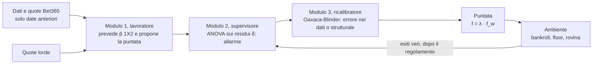

# Gli agenti, l'architettura e le differenze con KellyBench

Questo documento spiega, in italiano e senza dare nulla per scontato, come funziona ogni agente del progetto, come è fatta l'architettura e che cosa cambia rispetto a KellyBench e rispetto all'esecuzione con DeepSeek Flash come Modulo 1. I parametri citati sono quelli di `config/frozen_params.toml` (Modulo 1 Elo); i dettagli di formule e file sono in `thesis/metodi_implementati.md`.

Il progetto contiene solo ciò che il relatore ha chiesto: il suo schema (lavoratore, supervisore, ricalibratore) e i due riferimenti che servono a misurarlo, cioè lo stesso lavoratore senza supervisore. Gli agenti di confronto nati dalle note di progetto (C0, C1, C2, D con ADWIN e Page-Hinkley, la puntata minima E, B_0.10) sono sul branch `confronti-controllo`. La sintesi per il relatore è in `thesis/schema_relatore.md`.

## 1. Il quadro in una pagina

- **Modulo 1, il lavoratore.** Prevede le probabilità p̂ = (casa, pareggio, trasferta) e propone una puntata f_w, il Kelly pieno sull'esito scelto. Nel progetto è un Elo con il mapping di Davidson; Dixon-Coles è il secondo modello.
- **Modulo 2, il supervisore.** Guarda come cambia nel tempo l'errore δ = ln p̂(esito) − ln q(esito), dove q è la probabilità del mercato senza margine (de-vigging di Shin). Con l'ANOVA sulla media e sulla dispersione di δ decide se dare l'allarme.
- **Modulo 3, il ricalibratore.** Con la decomposizione di Oaxaca-Blinder separa un cambiamento di composizione delle partite (errore nei dati) da un cambiamento strutturale, e ne ricava la frazione λ: la puntata è f = λ · f_w.

**I nomi nel codice.** Per ragioni storiche `src/shk/model/module2.py` contiene la decomposizione di Oaxaca-Blinder, che nello schema sta nel Modulo 3. L'ANOVA dell'allarme e la risposta sono in `src/shk/model/agent_c.py` (`scheme_statistics`, `SchemeAgent`).

## 2. Cosa fanno tutti gli agenti

Per ogni data della stagione l'ambiente chiede a ogni agente le frazioni da puntare. Le regole comuni sono queste:

1. **Che cosa si punta.** Per ogni partita il lavoratore sceglie un esito: per default quello con il valore atteso stimato più alto, EV = p̂·quota − 1, calcolato sulle quote lorde Bet365 (le altre regole sono in §4). Si punta solo se EV > 0 e al più una volta per partita.
2. **Quanto.** La frazione è f = λ · max(0, (b·p̂ − (1 − p̂)) / b), con b = quota − 1. λ = 1 è il Kelly pieno, λ = 0,25 il quarto di Kelly. Gli agenti differiscono per come scelgono λ.
3. **Più partite nella stessa data.** Le puntate si piazzano in ordine di EV decrescente finché la somma non supera il bankroll; le altre si scartano.
4. **Floor e puntata obbligatoria.** Con un floor F > 0 ogni puntata vale almeno F. KellyBench obbliga a puntare almeno una volta per data: se un agente non punta, l'ambiente piazza F sull'esito a EV stimato massimo.
5. **Rovina.** Se il bankroll scende sotto F l'agente non può più puntare e il gioco finisce per lui.
6. **Niente informazione dal futuro.** Gli esiti di una data arrivano agli agenti solo dopo il regolamento di tutti.

## 3. Gli agenti

| Agente | Regola di λ | Cosa rappresenta |
|---|---|---|
| **A** | λ = 1 sempre | Il lavoratore da solo, Kelly pieno |
| **B_0.25** | λ = 0,25 sempre | Il lavoratore con il quarto di Kelly, senza supervisore: è anche la puntata dello schema quando non c'è allarme |
| **C3** | Allarme ANOVA, poi Oaxaca: 0,25, 0,1875 oppure 0 | Lo schema del relatore |
| **C3_stop** | Come C3, ma dopo un errore strutturale 0 fino a fine stagione | Lettura alla lettera di «finché il modello non viene ri-parametrizzato» |
| **C3_and** | Come C3, con l'allarme solo se peggiorano media e varianza insieme | Lettura alla lettera di «la media degli errori cresce e la varianza esplode» |

### 3.1 Un esempio concreto

Tutti gli agenti ricevono la stessa p̂ e le stesse quote e usano la stessa formula di puntata. Cambia solo λ.

- Una partita ha quota 2,50 sull'esito che il modello preferisce, e il modello gli dà probabilità p̂ = 0,45.
- Valore atteso stimato: EV = 0,45 × 2,50 − 1 = **+0,125**. È positivo, quindi si può puntare.
- Con b = quota − 1 = 1,5, il Kelly pieno è f* = (b·p̂ − (1 − p̂)) / b = (0,675 − 0,55) / 1,5 = **0,0833**, cioè l'8,33% del bankroll.
- Ogni agente moltiplica f* per il proprio λ. Con un bankroll di £100 000:

| λ | Puntata | Agente |
|---|---|---|
| 1 | £8 333 | A |
| 0,25 | £2 083 | B_0.25, e lo schema senza allarme |
| 0,1875 | £1 563 | Lo schema con un errore nei dati |
| 0 | £0 | Lo schema con un errore strutturale (resta solo la puntata obbligatoria) |

### 3.2 A e B_0.25: il lavoratore senza supervisore

- **A** è il caso limite. Se il modello avesse ragione, il Kelly pieno farebbe crescere il capitale più in fretta. Ma il modello sbaglia, e il Kelly pieno amplifica ogni errore: nel 2023-24 chiude a £14.
- **B_0.25** è il Kelly prudente: riduce la puntata perché p̂ è solo una stima. È il riferimento dello schema, perché lo schema senza allarme punta esattamente come lui. La differenza fra lo schema e B_0.25 misura quindi quello che aggiunge il supervisore.

### 3.3 C3, C3_stop e C3_and: lo schema del relatore

Il prof. Roccetti ha descritto questo schema:
- il supervisore controlla i residui con l'ANOVA e dà l'allarme quando cresce l'eteroschedasticità;
- il ricalibratore usa Oaxaca-Blinder per capire che tipo di errore è;
- con un errore nei dati (di composizione) si riduce un po' la puntata;
- con un errore strutturale il rischio va quasi a zero finché il modello non viene ri-parametrizzato, o si cambia modello.

C3 implementa esattamente questo ordine.

**Come funziona, a ogni data.** Si prendono le ultime 40 partite già giocate (B, recenti) e le 40 precedenti (A, riferimento). I residui sono δ = ln p̂(esito) − ln q(esito).

1. **Allarme (Modulo 2, ANOVA).** Due test fra A e B:
   - l'ANOVA a una via sulla media di δ. Conta solo se B è peggiore di A;
   - il test di Brown-Forsythe, cioè l'ANOVA sulle distanze dalla mediana. È il test di eteroschedasticità. Conta solo se B è più dispersa di A.

   In C3 e C3_stop l'allarme è acceso se uno dei due supera la sua soglia. Le soglie sono calibrate sul training con un block bootstrap della serie di δ, a livello 2,5% ciascuna, quindi al più il 5% di falsi allarmi in tutto. Le soglie nominali dell'ANOVA non vanno bene: con serie autocorrelate darebbero molti più falsi allarmi (`conclusioni_progetto.md` §4.2).

   **C3_and** prende alla lettera la mail («la media degli errori cresce e la varianza esplode»): l'allarme è acceso solo se li superano tutti e due. Le sue soglie sono calibrate insieme, sugli stessi ricampionamenti: sono i quantili allo stesso livello per le due F, il più basso con cui la quota di ricampionamenti in cui entrambe superano la soglia resta al 5%. Sono quindi più basse di quelle di C3, e i falsi allarmi restano al 5%.
2. **Diagnosi (Modulo 3, Oaxaca).** Solo con l'allarme acceso si guarda la componente strutturale S della scomposizione three-fold:
   - **errore strutturale** se −S supera una soglia calibrata sul training, cioè se la relazione fra covariate ed errore è peggiorata in modo significativo;
   - altrimenti **errore di composizione**, cioè nei dati.
3. **Puntata (Kelly).**

| Diagnosi | λ |
|---|---|
| Nessun allarme | 0,25 |
| Errore di composizione | 0,25 · κ = 0,1875, finché dura l'allarme |
| Errore strutturale, **C3** e **C3_and** | 0 finché dura l'allarme, poi di nuovo 0,25 |
| Errore strutturale, **C3_stop** | 0 fino a fine stagione |

**Perché C3_stop.** Nel progetto il Modulo 1 si ri-parametrizza solo ai fit (2000-01, 2010-11, 2020-21), mai durante una stagione. Quindi «finché il modello non viene ri-parametrizzato», preso alla lettera, vuol dire fino a fine stagione: è C3_stop. C3 è la lettura più morbida, in cui si ricomincia appena l'allarme si spegne.

**Parametri.** W = 40, κ = 0,75 e la soglia strutturale per fit sono valori congelati in `config/frozen_params.toml` (chiavi storiche `c1_window`, `c1_kappa`, `c1_thresholds`). Vengono dalla calibrazione sul training del 2026-10, che allora sceglieva i parametri di un agente di confronto (C1) con la stessa finestra e la stessa soglia; quella calibrazione è sul branch `confronti-controllo`. Le sole quantità calibrate per lo schema sono le soglie dell'allarme (due per C3, due per C3_and), in `results/us_c10_scheme_thresholds.csv`.

**Risultati sulla validazione.** 19 stagioni × 500 seed, gli stessi dell'esecuzione congelata, configurazione £0,01; script `scripts/us_c10_scheme_validation.py`. B_0.25, rieseguito come riferimento, coincide bit per bit con l'esecuzione congelata, quindi i confronti sono appaiati.

| Agente | Somma sulle stagioni della mediana di ln W_T | Accensioni medie per stagione | Date con λ = 0 |
|---|---|---|---|
| B_0.25 | −10,87 | – | – |
| C3 | −10,62 | 1,6 | 1,5% |
| C3_stop | −7,51 | 1,6 | 26% |
| C3_and | −10,67 | 1,5 | 1,4% |

- **C3 contro B_0.25.** C3 non è mai peggiore in mediana: è migliore in 5 stagioni su 19 e uguale nelle altre. Il guadagno è piccolo (+0,24 in media sul totale) perché l'allarme ANOVA scatta poco, circa 1,6 volte per stagione: con soglie calibrate, una varianza degli errori che cresce sui dati reali è rara (`conclusioni_progetto.md` §4.4).
- **C3_stop contro B_0.25.** C3_stop è migliore in 9 stagioni su 19 e mai peggiore, con il totale più alto nel 96% dei seed.
- **C3_and contro C3.** Il risultato è quasi lo stesso. L'allarme congiunto non è più raro (1,5 accensioni per stagione), perché le sue soglie sono più basse. Rispetto a B_0.25, C3_and è migliore in 8 stagioni su 19 e mai peggiore; rispetto a C3 la differenza appaiata è +0,03 sul totale (meglio in 4 stagioni, peggio in 1).
- **Lettura.** Il modello non batte il mercato in nessuna stagione, quindi ogni riduzione della puntata riduce la perdita. Lo schema funziona come previsto: riduce poco con errori di composizione e azzera con errori strutturali. Il segnale che cerca, però, è raro, e quando l'allarme si spegne lo schema torna al quarto di Kelly: per questo migliora poco il lavoratore senza supervisore, tranne nella versione che resta ferma fino a fine stagione.

**Il 2023-24.** Lo schema è stato costruito dopo l'esecuzione unica sul test, quando il 2023-24 era già stato visto. È stato eseguito una volta sola sulla stagione giocata come in KellyBench (£100 000, floor £0,01, esiti veri), con i parametri congelati: è un risultato esplorativo, non una conferma (`results/kellybench_2023_24.csv`).

| Agente | Bankroll finale | Rendimento | Puntate |
|---|---|---|---|
| A | £14 | −99,99% | 361 |
| B_0.25 | £24 358 | −75,6% | 361 |
| C3 | £24 424 | −75,6% | 361 |
| C3_stop | £24 424 | −75,6% | 361 |
| C3_and | £26 755 | −73,2% | 352 |

Come in validazione, lo schema cambia poco il risultato del quarto di Kelly; C3 e C3_stop coincidono perché nella stagione non c'è un errore strutturale che li separi.

## 4. Il lavoratore sceglie l'esito: regole R1, R2, R3

Il relatore ha chiesto di far scegliere l'esito anche al lavoratore («proverei anche a differenziare») e ha scelto l'opzione A: lavoratori classici più un LLM, con il supervisore che agisce sulla puntata. Il disegno è in `thesis/disegno_lavoratore.md`; qui c'è la fase 1, con i lavoratori classici.

**Le regole.** Per ogni partita il lavoratore indica un esito candidato. Si punta solo se l'EV stimato del candidato è positivo; la frazione proposta è il Kelly pieno f_w su quell'esito.
- **R1, EV massimo:** la regola di §2.
- **R2, maggior vantaggio sul mercato:** l'esito con p̂ − q massimo, con q dal de-vigging di Shin.
- **R3, esito più probabile:** l'esito con p̂ massimo.

Nessuna regola ha parametri. Il ripiego (la puntata obbligatoria quando nessuna partita della data ha EV > 0) non cambia.

**Le versioni.** Ogni regola è provata in tre versioni, con f = λ · f_w:

| Versione | λ |
|---|---|
| Da solo | 1 (Kelly pieno) |
| Freno | 0,25 fisso |
| Schema C3 | dal supervisore, come in §3.3 |

Il supervisore non viene ricalibrato: finestre, soglie e κ sono quelli congelati. δ non dipende dalla regola, perché usa l'esito reale.

**Risultati sulla validazione.** 19 stagioni × 500 seed, gli stessi dell'esecuzione congelata, configurazione £0,01; script `scripts/us_c11_worker_rules.py`, sintesi in `results/us_c11_worker_rules_summary.csv`. Le tre versioni di R1 coincidono bit per bit con A, B_0.25 e C3 delle altre esecuzioni, quindi tutti i confronti sono appaiati.

Somma sulle stagioni della mediana di ln W_T (fra parentesi le puntate medie per stagione):

| Regola | Da solo | Freno | Schema C3 |
|---|---|---|---|
| R1 | −116,89 (304) | −10,87 (333) | −10,62 (330) |
| R2 | −119,55 (302) | −11,52 (333) | −11,27 (330) |
| R3 | −62,17 (177) | −7,84 (179) | −7,60 (178) |

Da solo, con Kelly pieno, il lavoratore va in rovina nel 29% dei seed con R1, nel 31% con R2 e nel 5% con R3. Con λ ≤ 0,25 nessuna versione va in rovina.

- **R3 è la regola migliore.** A parità di versione, R3 è meglio di R1 in mediana in 13 stagioni su 19 con freno o schema, e in 17 su 19 da solo. Punta su circa metà delle partite: sceglie solo i favoriti che hanno anche EV stimato positivo, e quindi si espone meno.
- **R2 è come R1, un po' peggio.** È peggiore in 10 stagioni su 19 con freno o schema. Scegliere dove p̂ si allontana di più dal mercato vuol dire puntare proprio dove il modello sbaglia di più.
- **Schema contro freno.** Per tutte e tre le regole lo schema non è mai peggiore del freno fisso ed è migliore in 5–6 stagioni su 19: il suo effetto non dipende dalla regola di scelta.
- **Lettura.** Nessuna regola fa battere il mercato al modello. Cambiare la regola di scelta riduce l'esposizione, ma non crea un vantaggio.

## 5. Architettura: il progetto e KellyBench

I punti su KellyBench vengono dalla pagina dei risultati e dal paper (arXiv 2604.27865) e dalle note del progetto; verificali sul PDF prima di citarli.

| | **KellyBench** | **Questo progetto** |
|---|---|---|
| **Chi decide** | Un LLM autonomo che lavora in un sandbox con Python, senza internet, con 500–1000 chiamate a strumenti per episodio | Codice fisso: un modello previsivo (Elo) e regole di puntata scritte a mano |
| **Come prevede** | Ogni modello costruisce da sé modelli di machine learning dai dati storici | Un Elo con Davidson (Modulo 1), calibrato sul training con parametri congelati |
| **Chi calibra la puntata** | Lo stesso LLM, spesso con Kelly dichiarato ma applicato male | Il supervisore e il ricalibratore, separati dal modello previsivo |
| **Dati** | Risultati dal 1993, statistiche avanzate, formazioni, quote | Solo risultati e quote Bet365 1X2 pre-partita; niente Over/Under né statistiche |
| **Scenari** | Più scenari, con stagioni di training e la 2023-24 | 3 stagioni di training, 19 di validazione, la 2023-24 di test |
| **Ripetizioni** | 5 seed per modello: ogni seed è un LLM che ragiona in modo diverso | Gli agenti sono deterministici: 1 traiettoria vera; l'incertezza si misura con 500 stagioni ricostruite |
| **Bankroll** | £100 000 riscalati (lo scenario sottostante parte da £220) | Entrambe le scale; i risultati riportati usano £100 000 |
| **Risultato** | Rendimento medio, rovina in almeno un seed, rubrica di sofisticazione | Log-ricchezza, drawdown, rovina, confronti appaiati |
| **Dove gira** | Endpoint di OpenReward, a pagamento a consumo | Replica locale, con controllo completo di seed e scenari |

La differenza di fondo è questa: in KellyBench il tipo di agente è lo stesso per tutti (un LLM che fa tutto) e si misura quanto bene lo fa. Nel progetto l'architettura è scomposta in moduli, e si misura che cosa aggiunge il supervisore confrontando lo stesso lavoratore con e senza.

Altre conseguenze pratiche:
- Nel progetto un seed costa quasi nulla e se ne usano centinaia; nel paper un seed è una run completa di un LLM.
- Gli LLM del paper possono fallire per ragioni che qui non esistono (dimenticare di aggiornare i calcoli, puntare cifre a caso). Qui le regole sono codice.
- Il progetto non implementa la rubrica di sofisticazione né i dati avanzati di KellyBench.

## 6. Cosa cambia con DeepSeek Flash come Modulo 1

Rispetto alla struttura originale con Elo, la variante in `scripts/kellybench_llm_module1.py` cambia una sola cosa: chi produce p̂. Il resto (supervisore, ricalibratore, agenti, parametri congelati, ambiente) resta uguale.

| | **Struttura originale (Elo)** | **Variante con Flash come Modulo 1** |
|---|---|---|
| **Chi prevede p̂** | Elo-Davidson | DeepSeek Flash, via API |
| **Informazione** | Risultati precedenti | Data, squadre, ultime 5 partite e classifica parziale, solo con date anteriori; **mai le quote né l'esito** |
| **Determinismo** | Stesso risultato a ogni esecuzione | Stocastico: 5 esecuzioni diverse, poi la media |
| **Calibrazione** | Parametri calibrati sul training con δ dell'Elo | **Gli stessi parametri**, ma calibrati sul comportamento dell'Elo, non dell'LLM |
| **Probabilità estreme** | Mai vicine a 0 | Limitate a un minimo di 0,02, altrimenti ln p̂ esplode |
| **Protocollo** | Test eseguito una volta, fuori dalla riesecuzione | Esplorativo: il 2023-24 è già stato usato |
| **Dove scrive** | `results/` | Solo `build/llm/`, fuori dal manifesto |

Che cosa cambia rispetto a come KellyBench usa DeepSeek:
- **Nel paper** DeepSeek V4 Pro è l'agente intero: costruisce modelli, decide le puntate e usa gli strumenti. **Qui** Flash fa solo il Modulo 1: le puntate le decide lo schema.
- Il confronto con Pro misura quindi due cose insieme: la differenza fra i modelli e la differenza fra «LLM come agente» e «LLM come previsore dentro il sistema». Nella discussione della tesi vanno tenute separate.

Limiti da dichiarare per la variante:
- **Contaminazione:** Flash può conoscere gli esiti del 2023-24 dal proprio addestramento, quindi le previsioni potrebbero essere troppo buone.
- **Parametri non adatti:** finestre, soglie e κ sono stati scelti con l'Elo e non vengono ricalibrati.
- **Modalità di ragionamento:** è attiva di default; il parametro per spegnerla non è documentato nelle pagine che ho letto, e si può passare con `--extra-json`.

## 7. Dove guardare nel codice

| Cosa | File |
|---|---|
| Regole di puntata di A e B_0.25 | `src/shk/kelly/agents.py` |
| Kelly e puntate | `src/shk/kelly/staking.py`, `src/shk/kelly/core.py` |
| Ambiente, floor, rovina | `src/shk/kelly/environment.py` |
| Supervisore (ANOVA) e schema C3 | `src/shk/model/agent_c.py` (`Module2Supervisor`, `scheme_statistics`, `SchemeAgent`) |
| Ricalibratore, Oaxaca-Blinder (nel codice «Modulo 2») | `src/shk/stats/oaxaca.py`, `src/shk/model/module2.py` |
| Esecuzione dello schema sulla validazione | `src/shk/model/scheme_run.py`, `scripts/us_c10_scheme_validation.py` |
| Regole di scelta dell'esito del lavoratore | `src/shk/kelly/outcome_rules.py`, `src/shk/model/worker_run.py` |
| Costruzione degli agenti congelati | `src/shk/model/frozen_agents.py` |
| Stagione 2023-24 come KellyBench | `scripts/kellybench_2023_24.py`, `src/shk/model/kellybench_run.py` |
| Variante con LLM | `scripts/kellybench_llm_module1.py`, `src/shk/model/llm_module1.py` |
