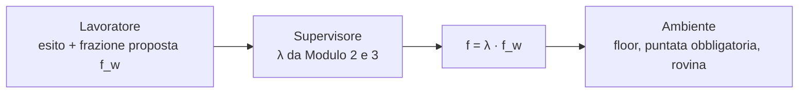

# Disegno: il lavoratore sceglie esito e puntata (opzione A)

Stato (5 novembre 2026): la fase 1 con l'Elo è implementata ed eseguita; i risultati sono in `thesis/agenti_e_architettura.md` §4. Il punto di estensione si chiama `candidate_outcomes(view)` (in `src/shk/kelly/agents.py`), le regole sono in `src/shk/kelly/outcome_rules.py` e gli agenti in `src/shk/model/worker_run.py`. Il supervisore è lo schema del relatore (C3); i supervisori C1 e C2 previsti all'inizio in §6 non fanno più parte del progetto (sono sul branch `confronti-controllo`). Restano da fare la fase 1 con Dixon-Coles e la fase 2 con l'LLM.

## 1. Decisione presa

Il professore ha scelto l'opzione (A): il supervisore e il ricalibratore (moduli 2 e 3) si dimostrano su lavoratori classici (Elo, Dixon-Coles) e su un LLM che sceglie esito e puntata, senza costruire da sé i modelli. Il supervisore interviene sulla puntata. L'agente autonomo come quello di KellyBench, che scrive i propri modelli, è sviluppo futuro e va dichiarato come limite nella tesi.

## 2. Che cosa cambia rispetto a oggi

Oggi il lavoratore dà solo le probabilità p̂. L'esito è scelto dalla classe base `Agent.decide`, con una regola fissa: l'esito a EV stimato massimo, se EV > 0. La puntata è f = λ · max(0, (b·p̂ − (1 − p̂)) / b), dove λ viene dalla regola dell'agente (fissa per A e B, dal supervisore per C e D).

Con (A) il lavoratore restituisce, per ogni partita, una **proposta** (esito, frazione proposta f_w). Il supervisore decide quanto di quella proposta tenere. Gli agenti di oggi sono un caso particolare: il lavoratore «EV massimo con Kelly pieno» e un λ fisso o calcolato dal supervisore.

## 3. Interventi sul codice

1. **Un punto di estensione nella classe base.** `Agent.decide` non si può ridefinire (la classe base lo impedisce di proposito). Serve un nuovo metodo ridefinibile `select_outcomes(view)`, con il comportamento attuale come default, aggiunto ai membri ammessi `_OVERRIDABLE_MEMBERS`. È una modifica piccola ma tocca la classe base protetta: tutti i risultati esistenti devono restare identici, e lo si verifica con la suite di test e con gli SHA256 del manifesto.
2. **Vincolo di stile.** I moduli di `src/shk/kelly/` non possono importare `shk.model` né `shk.data`: l'interfaccia del lavoratore resta in `kelly/`, senza dipendere dai modelli.
3. **Il ripiego e il floor non cambiano:** la puntata obbligatoria per data resta a carico dell'ambiente.

## 4. I lavoratori

**Classici** (Elo e Dixon-Coles, p̂ già prodotte dal progetto), con tre regole di scelta dell'esito. Nessuna ha parametri liberi, quindi non serve ricalibrare nulla:
- **R1, valore atteso massimo:** la regola di oggi, f_w = Kelly pieno sul p̂ stimato.
- **R2, maggior vantaggio sul mercato:** l'esito con p̂ − q massimo, dove q è la probabilità del mercato senza margine (de-vigging di Shin). Usa il mercato nella scelta, e va dichiarato.
- **R3, esito più probabile:** quello con p̂ massimo; se EV ≤ 0 la frazione di Kelly è zero e non si punta.

**LLM** (DeepSeek Flash, già predisposto in `scripts/kellybench_llm_module1.py`), che con lo stesso prompt (data, squadre, ultime cinque partite, classifica parziale, **senza quote**) risponde con probabilità, esito e frazione proposta. Le decisioni dipendono solo dalla partita e non dal bankroll, quindi si calcolano una volta per partita e si riusano nei ricampionamenti delle date.

## 5. Il supervisore

Il supervisore lavora su δ = ln p̂(esito reale) − ln q(esito reale), che non dipende dalla regola di scelta: le soglie e le finestre congelate sul training con l'Elo restano valide per i lavoratori classici con le stesse p̂.

Per l'LLM i parametri congelati sono stati scelti con il comportamento dell'Elo e non sono ricalibrati: va dichiarato.

## 6. Valutazione

Per ogni lavoratore si confrontano tre versioni, sulle stesse partite e con le stesse quote:

| Versione | Frazione |
|---|---|
| Lavoratore da solo | f = f_w |
| Freno costante | f = 0,25 · f_w |
| Schema del relatore (C3) | f = λ_C3 · f_w |

Il confronto che conta è tra il freno costante e il supervisore: se il supervisore non batte un freno fisso, il suo valore non è dimostrato. Il confronto (a) contro (b), cioè scelta fissa contro scelta del lavoratore, si legge sulle differenze di log-ricchezza, drawdown e rovina, con gli stessi intervalli bootstrap del progetto.

| Fase | Dati | Cosa si ottiene |
|---|---|---|
| 0 | Test esistenti | Il punto di estensione non cambia nessun risultato esistente |
| 1 | 19 stagioni di validazione, 500 seed per stagione | R1, R2, R3 con Elo e Dixon-Coles |
| 2 | 2023-24, 5 esecuzioni | Lavoratore LLM, esplorativo |
| 3 | Documentazione | Limiti e aggiornamento di `thesis/` |

## 7. Limiti da dichiarare

- Il 2023-24 è già stato usato come test: la fase 2 è esplorativa e non sostituisce l'esecuzione unica.
- L'LLM può conoscere gli esiti del 2023-24 dal proprio addestramento (contaminazione).
- Le regole R2 e R3 sono ipotesi di lavoro: non è detto che siano sensate per un lavoratore reale.
- L'agente autonomo di KellyBench (B) non è implementato.

## 8. Decisioni aperte

1. **Come si combinano λ e frazione proposta per l'LLM.** Opzione 1: f = λ · f_w come per i lavoratori classici (continuità con i risultati di oggi, ma con l'LLM il default 0,25 riduce già la sua puntata). Opzione 2: solo freno, f = min(1, λ/0,25) · f_w, che non aumenta mai la proposta e segue le parole del professore («riduco lo stake»). Consiglio l'opzione 1 per i classici e la 2 per l'LLM, da confermare.
2. **Tetto alla frazione proposta dall'LLM.** Per sicurezza consiglio un massimo di 0,10 del bankroll per puntata.
3. **Dixon-Coles già in fase 1 o dopo l'Elo.** Consiglio di cominciare dall'Elo e aggiungere Dixon-Coles solo se il risultato lo merita.
