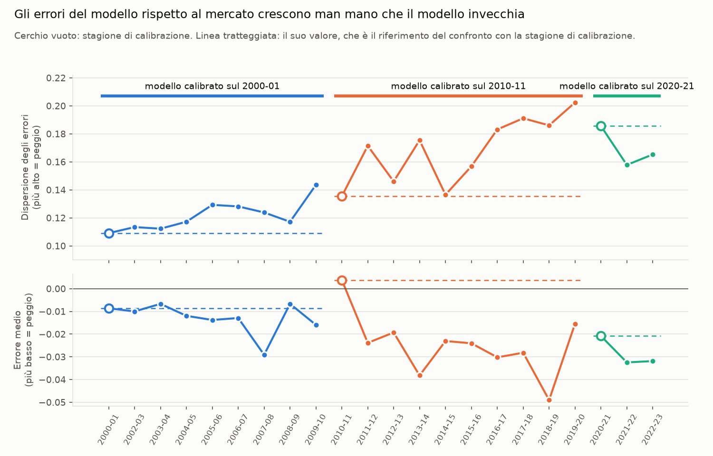
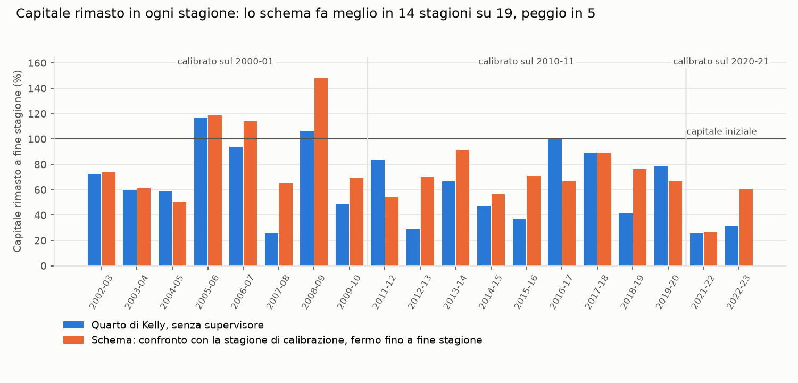
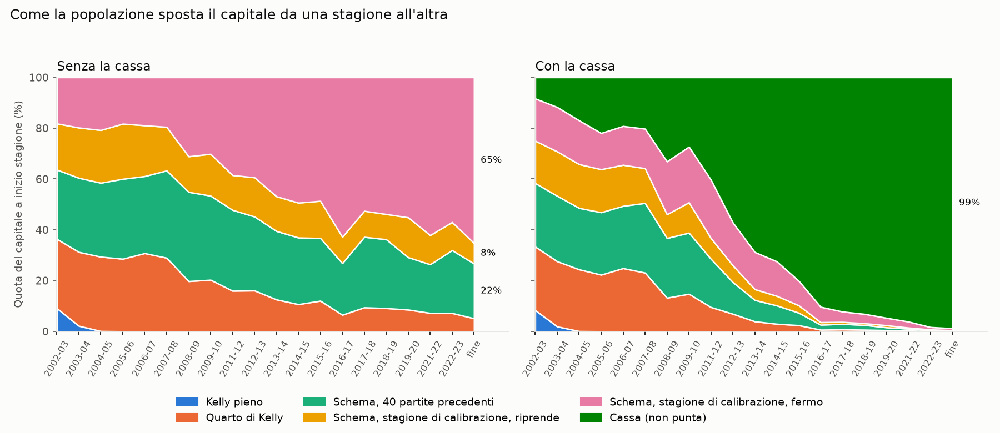

# Structural-Hybrid Kelly: che cosa ho realizzato

Federico Malservigi, novembre 2026

Questo documento descrive come ho realizzato la soluzione Structural-Hybrid che mi ha proposto, come ho applicato le sue indicazioni e che cosa mostrano i risultati.

## 1. In sintesi

- Ho realizzato lo schema com'era nella proposta:
  - il lavoratore prevede;
  - il supervisore controlla i residui con l'ANOVA e dà l'allarme;
  - il ricalibratore usa Blinder-Oaxaca per distinguere un errore nei dati da un errore strutturale e decide la puntata.
- Il supervisore agisce con un moltiplicatore sulla puntata del lavoratore, come da sua preferenza.
- Il lavoratore può anche scegliere l'esito su cui puntare, con tre regole diverse.
- Risultato principale: il modello previsivo non batte il mercato, quindi ogni agente che punta perde.
- Se il supervisore confronta gli errori recenti con quelli delle 40 partite precedenti, lo schema interviene poco. Se li confronta con quelli della stagione su cui il modello è stato calibrato, si accorge che il modello invecchia e il mercato lo supera: punta meno proprio allora e conserva più capitale: in una stagione tipica il 71%, contro il 57% del lavoratore senza supervisore, e fa meglio in 14 stagioni su 19.
- Come tentativo basato sulla dinamica evolutiva (§7), ho fatto giocare insieme le strategie come una popolazione che si contende il capitale. Da una stagione all'altra la selezione sposta il capitale verso la strategia migliore senza conoscerla in anticipo, e conserva il 70% del capitale. Se fra le strategie c'è anche quella di non puntare, la popolazione finisce per non scommettere più, e conserva l'88%: una conferma per via evolutiva del risultato di KellyBench.

## 2. Lo schema realizzato

**Modulo 1, il lavoratore.** Due modelli classici, Elo e Dixon-Coles, danno le probabilità di vittoria in casa, pareggio e vittoria in trasferta di ogni partita. La puntata proposta dal lavoratore è la frazione di Kelly calcolata su quelle probabilità.

**Modulo 2, il supervisore.** Dopo ogni partita guarda l'errore del lavoratore rispetto al mercato. Il residuo confronta due probabilità dell'esito reale, in scala logaritmica: quella data dal modello e quella implicita nelle quote, depurata dal margine del bookmaker. A ogni giornata il supervisore confronta le ultime 40 partite con le 40 precedenti, con due test:
- l'ANOVA a una via sulla media dei residui segnala se gli errori recenti sono peggiori;
- il test di Brown-Forsythe, cioè l'ANOVA sulle distanze dalla mediana, segnala se la dispersione è aumentata, quindi l'eteroschedasticità.

Ho provato due versioni dell'allarme: nella prima basta che peggiori la media o che cresca la dispersione; nella seconda devono succedere tutte e due le cose insieme («la media degli errori cresce e la varianza esplode»).

Ho provato anche due modi di scegliere il confronto:
- **le 40 partite precedenti**, cioè il confronto fra un periodo e quello subito prima;
- **la stagione su cui il modello è stato calibrato**, cioè il confronto fra gli errori di oggi e quelli del momento in cui il modello «era a posto». Il modello peggiora lentamente, di stagione in stagione: il confronto con il periodo subito prima non lo vede, quello con la stagione di calibrazione sì.

Le soglie non sono quelle nominali dell'ANOVA, perché le serie di errori sono autocorrelate. In quel caso l'ANOVA nominale dà molti falsi allarmi: in simulazione fino al 40% invece del 5%. Ho quindi calibrato le soglie sulle stagioni di training con un bootstrap a blocchi, così i falsi allarmi restano al più al 5%.

**Modulo 3, il ricalibratore.** Quando scatta l'allarme, il ricalibratore cerca di capire perché gli errori recenti sono peggiori di quelli di riferimento. Di ogni partita conosce, prima del calcio d'inizio, alcune caratteristiche: quanto sono squilibrate le due squadre secondo le quote, quanto è incerto il mercato, quanto è incerto il modello, se gioca una neopromossa e in che punto della stagione si gioca. In ciascuno dei due periodi una regressione stima come l'errore dipende da queste caratteristiche. La decomposizione di Blinder-Oaxaca divide poi il peggioramento in due parti:
- **composizione, cioè errore nei dati**: nel periodo recente ci sono più partite del tipo su cui il modello sbaglia di più, per esempio più partite incerte o con una neopromossa. Il modello funziona come prima; sono cambiate le partite;
- **struttura**: a parità di caratteristiche, il modello sbaglia di più. È cambiato il legame fra le caratteristiche e l'errore, per esempio perché il vantaggio del campo non è più quello che il modello ha imparato, come a porte chiuse durante il Covid.

La decomposizione dà anche un terzo termine, l'interazione fra le due parti, che non uso nella decisione.

Se la parte strutturale supera una soglia calibrata, l'errore è strutturale; altrimenti è un errore nei dati. La puntata diventa:

| Situazione         | Frazione della puntata di Kelly |
| ------------------ | ------------------------------- |
| Nessun allarme     | 0,25 (quarto di Kelly)          |
| Errore nei dati    | 0,19, finché dura l'allarme     |
| Errore strutturale | 0                               |

Per l'errore strutturale ho seguito due letture di «finché il modello non viene ri-parametrizzato»:
- si torna a puntare quando l'allarme si spegne;
- si resta fermi fino a fine stagione, perché nel mio impianto il modello viene ri-parametrizzato solo fra una stagione e l'altra.

## 3. Come ho applicato le sue indicazioni

**Moltiplicatore o ri-parametrizzazione.** Ho realizzato il moltiplicatore: il supervisore scala la puntata proposta dal lavoratore e non tocca il modello. Per provare anche la seconda strada ho ri-parametrizzato il modello ogni anno: prima di ogni stagione lo ricalibro sulla stagione precedente. Prima della partita il modello si avvicina al mercato (in 14 stagioni su 18), ma non prevede meglio i risultati, e il capitale peggiora in tutte le versioni: con lo schema fermo fino a fine stagione resta il 67% invece del 71%, con il quarto di Kelly il 46% invece del 57%. Il motivo è che una stagione sola è poca per stimare bene i parametri. Per esempio, sul 2020-21, giocato a porte chiuse, il vantaggio del campo stimato è nullo, e il modello se lo porta nel 2021-22, quando il pubblico era tornato. Lo schema resta utile anche sul modello ricalibrato: fa meglio del quarto di Kelly in 12–13 stagioni su 19. Non ho implementato né la ri-parametrizzazione subito dopo un allarme né il cambio di modello.

**La scelta dell'esito.** Per ogni partita il modello dà tre probabilità (casa, pareggio, trasferta), ma il lavoratore punta su un solo esito. La regola di scelta decide quale. Ne ho provate tre, nessuna con parametri da stimare:
- **valore atteso più alto**: l'esito per cui probabilità del modello × quota − 1 è massimo. È la regola usata finora, e quella della tabella principale (§5);
- **scarto maggiore dal mercato**: l'esito in cui la probabilità del modello supera di più quella implicita nelle quote, depurata dal margine;
- **esito più probabile**: l'esito a cui il modello dà la probabilità più alta, senza guardare le quote.

Scelto l'esito, il resto è uguale per tutte e tre. Si punta solo se il valore atteso stimato di quell'esito è positivo, altrimenti si salta la partita. La puntata è la frazione di Kelly su quell'esito, e il supervisore la moltiplica come al solito. La regola cambia quindi su quale esito si punta, non quanto.

Un esempio: con quote 1,90 / 3,60 / 4,50 e probabilità del modello 0,48 / 0,30 / 0,22, le prime due regole scelgono il pareggio (valore atteso +8%). La terza sceglie la vittoria in casa, che ha valore atteso negativo (−9%), quindi su quella partita non si punta. È il motivo per cui con la terza regola si scommette su meno partite (§5).

Le tre regole le ho provate con il modello Elo.

## 4. Come ho valutato

- **Dati.** Premier League, quote Bet365, stagioni dal 2000-01 al 2023-24.
- **Separazione dei dati.** Ho calibrato tutti i parametri su tre stagioni di training (2000-01, 2010-11, 2020-21) e poi li ho congelati. La valutazione è sulle altre 19 stagioni, dal 2002-03 al 2022-23. Il 2023-24, la stagione di KellyBench, l'ho usato come test una volta sola, alla fine. Lo schema l'ho costruito dopo, e su quella stagione l'ho provato una sola volta (§5).
- **Quale modello in quale stagione.** Ogni stagione di valutazione usa i parametri dell'ultima stagione di training che la precede: quelli del 2000-01 dal 2002-03 al 2009-10, quelli del 2010-11 dal 2011-12 al 2019-20, quelli del 2020-21 dal 2021-22 al 2023-24. Il modello quindi non viene aggiornato ogni anno e invecchia fino a nove stagioni. Il 2001-02 è escluso perché mancano quote complete.
- **Ambiente.** Ho riprodotto le regole di KellyBench: si gioca giornata per giornata, con una puntata minima obbligatoria, e si usano solo informazioni disponibili prima della partita.
- **Ogni stagione è una partita a sé.** Ogni stagione parte dallo stesso capitale, e quello che resta a fine stagione non passa alla successiva, come in KellyBench, dove si gioca una sola stagione.
- **Stagioni vere.** Il risultato principale è quello delle stagioni vere, ognuna giocata una volta, come in KellyBench.
- **Stagioni ricostruite, solo come misura dell'incertezza.** Per vedere quanto conta la fortuna, ogni stagione è anche ricostruita 500 volte ricampionando le giornate. Le partite, le quote e i risultati sono veri, ma alcune giornate si ripetono e altre saltano. Questo altera proprio la sequenza nel tempo che il supervisore osserva, quindi non le uso come risultato principale.
- **Riferimento.** Per vedere che cosa aggiunge il supervisore, lo schema è confrontato con lo stesso lavoratore senza supervisore, sulle stesse partite e con le stesse simulazioni:
  - con il Kelly pieno, cioè il lavoratore da solo;
  - con il quarto di Kelly fisso, cioè la puntata dello schema quando non c'è allarme.

## 5. Risultati

**Il modello non batte il mercato.** In media il modello assegna all'esito che si verifica una probabilità più bassa di quella del mercato. Lo misuro con la media, su tutte le partite, della differenza fra i logaritmi delle due probabilità: −0,022 con le quote Bet365, intervallo al 95% da −0,030 a −0,015. Resta negativa con Dixon-Coles e con tutti i metodi per togliere il margine dalle quote. Quindi ogni agente che punta perde in media, e il supervisore può solo ridurre la perdita.

Capitale rimasto a fine stagione nelle 19 stagioni vere di validazione:

| Agente                                               | Confronto con            | Quando scatta l'allarme                | Dopo un errore strutturale          | Capitale rimasto | Stagioni meglio / peggio del quarto di Kelly | Stagioni ricostruite |
| ---------------------------------------------------- | ------------------------ | -------------------------------------- | ----------------------------------- | ---------------- | -------------------------------------------- | -------------------- |
| Lavoratore da solo, Kelly pieno                      | –                        | –                                      | –                                   | 0,2%             | 0 / 19                                       | 0,2%                 |
| Lavoratore con il quarto di Kelly, senza supervisore | –                        | –                                      | –                                   | 57%              | –                                            | 56%                  |
| Schema                                               | 40 partite precedenti    | Peggiora la media o cresce la varianza | Riprende quando l'allarme si spegne | 60%              | 10 / 6                                       | 57%                  |
| Schema                                               | 40 partite precedenti    | Peggiorano media e varianza insieme    | Riprende quando l'allarme si spegne | 56%              | 6 / 7                                        | 57%                  |
| Schema                                               | 40 partite precedenti    | Peggiora la media o cresce la varianza | Fermo fino a fine stagione          | 71%              | 12 / 4                                       | 67%                  |
| Schema                                               | Stagione di calibrazione | Peggiora la media o cresce la varianza | Riprende quando l'allarme si spegne | 62%              | 14 / 5                                       | 62%                  |
| Schema                                               | Stagione di calibrazione | Peggiora la media o cresce la varianza | Fermo fino a fine stagione          | 71%              | 14 / 5                                       | 79%                  |

Il lavoratore qui sceglie l'esito con il valore atteso più alto. Il capitale rimasto è la quota del capitale iniziale che resta a fine stagione; nella tabella c'è la media geometrica sulle 19 stagioni vere, cioè il valore di una stagione tipica. Nell'ultima colonna c'è, per confronto, il valore sulle stagioni ricostruite: la mediana sulle 500 di ogni stagione, poi la media geometrica.

**Che cosa si vede:**
- **Confrontando con le 40 partite precedenti, lo schema interviene poco.** L'allarme scatta circa 1,6 volte per stagione, quanto ci si aspetta dai soli falsi allarmi. Ho verificato che non è un errore: se nei dati inserisco un peggioramento abbastanza forte, l'ANOVA lo trova; i cambiamenti da un periodo al successivo sono troppo piccoli per 40 partite contro 40. Lo schema fa meglio del lavoratore senza supervisore in 10 stagioni su 19 e peggio in 6; la versione che resta ferma fino a fine stagione fa meglio in 12 e peggio in 4.
- **Confrontando con la stagione di calibrazione, il segnale che lei si aspettava c'è.** Gli errori del modello rispetto al mercato peggiorano in media e soprattutto diventano più dispersi man mano che il modello invecchia: per il modello calibrato sul 2010-11 la dispersione passa da 0,136 a 0,19–0,20 nelle stagioni 2017-20, e nelle stagioni dal 2016-17 al 2019-20 l'allarme sulla dispersione è acceso in due giornate su tre o più. L'allarme scatta circa 5 volte per stagione e lo schema batte il lavoratore senza supervisore in 14 stagioni su 19 (peggio in 5). Sulle stagioni vere, però, il guadagno non si concentra in quelle in cui il modello è più vecchio: è distribuito fra stagioni con il modello giovane e con il modello vecchio. L'errore del modello da solo, senza il confronto con il mercato, non peggiora: è il mercato che migliora e lo lascia indietro, un cambiamento strutturale nel senso del suo schema.
- **Due cautele su questo risultato.** Ho scelto questo confronto dopo aver visto, sulle stagioni di valutazione, quanto spesso scattava l'allarme (non i guadagni). E con un vantaggio negativo puntare meno aiuta comunque: la versione ferma fino a fine stagione non punta nel 59% delle giornate.
- **Sui dati reali Oaxaca separa poco i due tipi di errore.** Sui dati simulati la decomposizione funziona. Nella sospensione per il Covid del 2019-20, dove mi aspettavo un errore strutturale, la parte strutturale è quasi nulla. Ho trovato due motivi. Il primo: le caratteristiche delle partite spiegano solo il 2,5% della variabilità dell'errore, che dipende quasi tutto da quale esito è uscito; quindi la parte «dati» resta piccola per forza. Il secondo: la posizione della partita nella stagione, fra due finestre consecutive, non si sovrappone mai, e rende le componenti molto rumorose. Togliendola le diagnosi diventano più stabili e meno spesso «strutturali» (dal 51% al 42% delle giornate con allarme), ma il risultato in capitale non migliora: lo schema la tiene, come era stata scelta prima di vedere i risultati. Un rimedio più efficace è scomporre l'errore «atteso» invece di quello realizzato, cioè la distanza fra modello e mercato prima della partita, che non dipende dall'esito: le caratteristiche delle partite ne spiegano il 41%. Così la diagnosi diventa coerente con il suo schema: fra due periodi vicini l'errore risulta quasi sempre «nei dati» (95% dei casi), mentre rispetto alla stagione di calibrazione è strutturale quasi una volta su due. Il capitale resta però più o meno lo stesso.
- **Più si riduce la puntata, meno si perde.** Con un vantaggio negativo, ogni riduzione della puntata riduce la perdita. Per questo le versioni che restano ferme fino a fine stagione sono le migliori: le altre, quando l'allarme si spegne, tornano al quarto di Kelly.

**Figura 1. Il modello invecchia rispetto al mercato.**

*Come si legge.* Ogni punto è una stagione, con il modello Elo. Il colore indica su quale stagione è calibrato il modello usato in quella stagione. Il cerchio vuoto è la stagione di calibrazione; la linea tratteggiata è il suo valore, cioè il riferimento con cui lo schema confronta gli errori recenti.
- In alto c'è la dispersione degli errori rispetto al mercato, la grandezza che confronta il test di Brown-Forsythe. Più è alta, peggio è.
- In basso c'è l'errore medio, la grandezza che confronta l'ANOVA. Sotto lo zero il modello assegna all'esito reale meno probabilità del mercato; più è basso, peggio è.

*Che cosa si vede.* Con il modello calibrato sul 2010-11 la dispersione cresce quasi ogni anno, da 0,136 a 0,19–0,20 nelle stagioni 2017-20, e l'errore medio resta sempre sotto il riferimento. Questo è il segnale che fa scattare l'allarme quando il confronto è con la stagione di calibrazione. Da un periodo di 40 partite al successivo, invece, la crescita è troppo lenta per essere vista. Con il modello calibrato sul 2000-01 la crescita c'è, ma è più lenta. Con quello calibrato sul 2020-21 la dispersione resta sotto il riferimento; per questo nel 2023-24 l'allarme scatta di rado.

**Figura 2. Il capitale stagione per stagione.**

*Come si legge.* Ogni coppia di barre è una stagione vera. In blu c'è il capitale rimasto con il quarto di Kelly senza supervisore; in arancione quello dello schema che confronta con la stagione di calibrazione e resta fermo fino a fine stagione. La linea a 100 è il capitale iniziale, da cui ogni stagione riparte. Le linee verticali separano le stagioni in base al modello usato.

*Che cosa si vede.* Lo schema fa meglio in 14 stagioni su 19. Il guadagno è più grande nelle stagioni in cui il quarto di Kelly perde molto (2007-08, 2012-13, 2015-16, 2018-19, 2022-23): lì lo schema smette di puntare e conserva il capitale. Fa peggio in 5 stagioni, chiaramente in 2011-12 e 2016-17, meno in 2004-05 e 2019-20, e il 2017-18 è praticamente pari. In quelle stagioni, dopo lo stop dello schema, il quarto di Kelly ha continuato a puntare e le puntate successive gli sono andate bene. Nella maggior parte delle stagioni nessuno dei due arriva a fine stagione con più del capitale iniziale: lo schema riduce la perdita, non la trasforma in guadagno.

**Le tre regole di scelta dell'esito.** La tabella sopra usa la regola del valore atteso più alto. Qui la stessa prova con le tre regole (modello Elo, 19 stagioni vere, capitale rimasto in una stagione tipica; fra parentesi le stagioni in cui lo schema fa meglio / peggio del quarto di Kelly con la stessa regola):

| Regola di scelta dell'esito | Partite su cui si punta | Quarto di Kelly, senza supervisore | Schema, confronto con le 40 partite precedenti | Schema, confronto con la stagione di calibrazione, fermo fino a fine stagione |
| --------------------------- | ----------------------- | ---------------------------------- | ---------------------------------------------- | ----------------------------------------------------------------------------- |
| Valore atteso più alto      | 86%                     | 57%                                | 60% (10 / 6)                                   | 71% (14 / 5)                                                                  |
| Scarto maggiore dal mercato | 86%                     | 55%                                | 58% (10 / 6)                                   | non provato                                                                   |
| Esito più probabile         | 39%                     | 68%                                | 70% (11 / 5)                                   | 77% (13 / 6)                                                                  |

Che cosa si vede:
- **La regola conta più del supervisore.** Passando dal valore atteso più alto all'esito più probabile, il quarto di Kelly conserva il 68% del capitale invece del 57%. Il motivo principale è che si punta su meno partite, circa 4 su 10 invece di quasi 9 su 10: con un modello che in media perde contro il mercato, puntare meno vuol dire perdere meno.
- **Il supervisore aiuta allo stesso modo con tutte le regole.** Con il confronto con le 40 partite precedenti aggiunge 2–3 punti di capitale e fa meglio in 10–11 stagioni su 19 (peggio in 5–6). Con il confronto con la stagione di calibrazione e lo schema fermo fino a fine stagione aggiunge di più: 14 punti con il valore atteso più alto, 9 con l'esito più probabile.
- **La combinazione migliore** è l'esito più probabile insieme al confronto con la stagione di calibrazione: 77% del capitale. Anche questa combinazione l'ho scelta dopo aver visto i risultati.

**La stagione 2023-24, quella di KellyBench.** L'ho giocata come in KellyBench, partendo da £100 000. Avevo già usato questa stagione come test prima di costruire lo schema, quindi i risultati dello schema sono solo esplorativi e non ho cambiato nessun parametro. Il risultato è quello della stagione vera. Per vedere quanto conta la fortuna l'ho giocata anche su 500 stagioni ricostruite, ricampionando le giornate come per la valutazione (senza puntata minima, perché così il risultato in sterline non dipende dal capitale iniziale).

| Agente                                                                             | Stagione vera | Mediana delle 500 stagioni | 90% delle stagioni fra | Stagioni in cui fa meglio del quarto di Kelly |
| ---------------------------------------------------------------------------------- | ------------- | -------------------------- | ---------------------- | --------------------------------------------- |
| Lavoratore da solo, Kelly pieno                                                    | £14           | £16                        | £0 e £1 564            | 0%                                            |
| Lavoratore con il quarto di Kelly, senza supervisore                               | £24 358       | £24 564                    | £8 555 e £71 172       | –                                             |
| Schema, 40 partite precedenti, allarme se peggiora la media o cresce la varianza   | £24 424       | £25 750                    | £8 701 e £74 411       | 60%                                           |
| Come sopra, fermo fino a fine stagione                                             | £24 424       | £41 169                    | £11 991 e £106 895     | 73%                                           |
| Schema, 40 partite precedenti, allarme solo se peggiorano media e varianza insieme | £26 755       | £26 124                    | £8 907 e £72 300       | 69%                                           |
| Schema, confronto con la stagione di calibrazione                                  | £24 944       | £26 391                    | £9 158 e £71 336       | 59%                                           |
| Come sopra, fermo fino a fine stagione                                             | £24 944       | £51 185                    | £18 409 e £100 497     | 77%                                           |

Che cosa si vede:
- **Nella stagione vera lo schema cambia poco**, in tutte le versioni. Il modello usato nel 2023-24 è calibrato sul 2020-21, quindi è ancora «giovane»: la dispersione dei suoi errori è la stessa della stagione di calibrazione (0,181 contro 0,186) e l'allarme scatta solo nell'1% delle giornate.
- **Sulle stagioni ricostruite lo schema fa meglio del quarto di Kelly nel 59–77% dei casi**, e le versioni ferme fino a fine stagione conservano molto più capitale (mediana da £24 564 a £41 169 e £51 185). È però in buona parte un effetto del ricampionamento, come spiego nel punto seguente.
- **La differenza fra stagione vera e ricostruite** viene dal ricampionamento: una stagione ricostruita ripete alcune giornate e ne salta altre, e questo crea più spesso un periodo di errori anomali che fa scattare l'allarme (2–3 accensioni per stagione invece di quasi nessuna). La stagione vera è una sola fra quelle possibili, e lì l'allarme non è scattato.

## 6. Altre analisi di supporto

Ho fatto anche alcune analisi che lo schema non prevede, ma che aiutano a leggerne i risultati.

**Test di eteroschedasticità sui residui.** Per capire se il segnale che lo schema cerca esiste davvero, ho applicato ai residui del modello i test classici:
- Breusch-Pagan e White con le soglie nominali rigettano in tutte le 19 stagioni, ma solo perché la varianza dell'errore dipende per costruzione da quanto è incerta la previsione;
- con soglie calibrate col bootstrap i rigetti scendono a zero;
- i test sulla varianza che cresce nel corso della stagione (Breusch-Pagan sul tempo, Goldfeld-Quandt, ARCH) rigettano in 0–3 stagioni su 19.

Questo spiega perché l'allarme scatta di rado quando confronta due periodi vicini: dentro una stagione la varianza non cresce. Cresce invece fra una stagione e l'altra, ed è ciò che vede il confronto con la stagione di calibrazione.

**Z-test per giornata.** È un modo più semplice di dare l'allarme: confronta l'errore medio di ogni giornata con quello del training. Sulle 19 stagioni, con 1,9 falsi allarmi attesi per stagione (36 in tutto), la soglia nominale dà 53 allarmi e quella calibrata 43. Anche qui, quindi, gli allarmi sono di poco sopra quelli attesi per caso.

**Le squadre neopromosse.** Mi aspettavo che fossero il caso tipico di errore nei dati, perché il modello le conosce poco. Ho confrontato l'errore sulle loro partite a inizio stagione e nel resto della stagione, al netto delle altre squadre (differenza nelle differenze): −0,019, con intervallo al 95% da −0,040 a +0,003. La differenza non è significativa.

**Le stagioni di training e il Covid.** Le stagioni di training sono una ogni dieci anni, e per questa regola una di esse è il 2020-21, giocato quasi tutto a porte chiuse. Nel modello usato dal 2021-22 al 2023-24 pesa per un terzo e abbassa il vantaggio del campo stimato da circa 128 a 78 punti Elo. Ho fatto due verifiche, senza cambiare la separazione dei dati:
- **Senza il 2020-21 il modello va peggio.** Ho previsto il 2021-22 e il 2022-23 con il modello calibrato fino al 2010-11, che non contiene il Covid. Lo scarto dal mercato peggiora, da −0,032 a −0,040 per partita. Il vantaggio del campo si era già ridotto prima del Covid: quel modello prevede il 47,7% di vittorie in casa, contro il 45,7% reale. Il problema quindi non è il Covid, ma la distanza dall'ultima calibrazione.
- **Una calibrazione in più sul 2015-16 migliora le previsioni, non il capitale.** L'ho usata per le stagioni dal 2016-17 al 2019-20, al posto di quella del 2010-11. Il modello prevede meglio: lo scarto dal mercato passa da −0,031 a −0,025. Il capitale però non migliora: il quarto di Kelly scende dal 57% al 54%, lo schema fermo fino a fine stagione resta al 70% (71% prima). In quelle stagioni le squadre di casa vincevano più di quanto dicesse il mercato (46,9% contro 44,9%). Il modello vecchio dava loro più del mercato (47,7%) e su quelle puntate guadagnava; il nuovo è più vicino al mercato (45,4%) e perde quel vantaggio. Lo schema invece regge: con la nuova calibrazione batte il quarto di Kelly in 17 stagioni su 19.

Le conclusioni, quindi, non dipendono dalla scelta delle stagioni di training.

**La puntata minima obbligatoria e la rovina.** KellyBench obbliga a puntare almeno un minimo a ogni giornata. Ho verificato che questa regola rende possibile la rovina, che con Kelly puro non può avvenire. Con il capitale iniziale di £220 dello scenario di KellyBench:
- senza puntata minima nessun agente va in rovina;
- con una puntata minima di £0,01 il Kelly pieno va in rovina nel 17,9% dei casi, con £1 nel 69,0%;
- il quarto di Kelly va in rovina solo con £1, nello 0,5% dei casi.

## 7. Un tentativo basato sulla dinamica evolutiva

Come mi ha suggerito, ho provato un approccio basato sulla dinamica evolutiva. Ho scelto di far giocare **insieme** le strategie che ho già, come una popolazione che si contende il capitale.

**Come funziona.** La popolazione contiene undici strategie, tutte con il modello Elo:
- il Kelly pieno;
- il quarto di Kelly con le tre regole di scelta dell'esito;
- le versioni dello schema: confronto con le 40 partite precedenti o con la stagione di calibrazione, ripresa quando l'allarme si spegne o fermo fino a fine stagione, con la regola del valore atteso o dell'esito più probabile.

Ogni strategia riceve una quota del capitale. Dopo ogni giornata la quota di ciascuna cresce o cala in proporzione a quanto ha reso: è la selezione naturale applicata al capitale (dinamica del replicatore). Il legame con Kelly è diretto: nella letteratura di *evolutionary finance* la regola di Kelly è proprio la strategia che sopravvive a questa selezione. Ho previsto anche una mutazione, cioè una piccola parte del capitale ridistribuita ogni giorno fra tutte le strategie, così che nessuna si estingua. L'intensità della mutazione è l'unico parametro, e l'ho scelta sulle stagioni di training: lì la mutazione peggiora sempre il risultato, perché continua a dare capitale anche a strategie che perdono molto, come il Kelly pieno. Quindi è zero.

Ho provato due varianti:
- **le generazioni**: ogni stagione riparte dallo stesso capitale, ma le quote iniziali sono quelle con cui è finita la stagione precedente. La popolazione ricorda quali strategie hanno funzionato; usa solo informazione passata;
- **la cassa**: una strategia in più che non punta mai.

Il confronto è fatto senza puntata minima, perché solo così la quota di capitale affidata a una strategia non cambia il suo rendimento.

Capitale rimasto in una stagione tipica, nelle 19 stagioni vere:

| Agente                                                                            | Capitale rimasto | Stagioni meglio / peggio del quarto di Kelly |
| --------------------------------------------------------------------------------- | ---------------- | -------------------------------------------- |
| Quarto di Kelly, senza supervisore                                                | 57%              | –                                            |
| Popolazione, quote uguali a inizio stagione                                       | 62%              | 10 / 9                                       |
| Popolazione con le generazioni                                                    | 70%              | 13 / 6                                       |
| Popolazione con le generazioni e la cassa                                         | 88%              | 15 / 4                                       |
| La migliore strategia singola, individuata solo dopo aver visto i risultati       | 77%              | 15 / 4                                       |

**Figura 3. Come la popolazione sposta il capitale da una stagione all'altra.**

*Come si legge.* È la versione con le generazioni. Ogni colonna è l'inizio di una stagione, l'ultima («fine») è la fine del 2022-23; l'altezza di ogni colore è la quota del capitale affidata a una famiglia di strategie. A sinistra la popolazione senza la cassa, a destra con la cassa (in verde scuro). All'inizio tutte le strategie hanno la stessa quota.

*Che cosa si vede.*
- **Dentro una stagione la selezione è troppo lenta.** In un centinaio di giornate le strategie si separano poco, e la popolazione resta vicina alla media delle strategie: 62%, meglio del quarto di Kelly in 10 stagioni su 19, quasi come per caso.
- **Da una stagione all'altra la selezione funziona.** Il Kelly pieno sparisce in due stagioni; il capitale si sposta verso lo schema che confronta con la stagione di calibrazione e si ferma fino a fine stagione (in rosa). A fine 2022-23 più di metà del capitale (54%) è su una sola strategia: lo schema che confronta con la stagione di calibrazione, con la regola dell'esito più probabile, fermo fino a fine stagione. È proprio quella che, guardando i risultati a posteriori, è la migliore. La popolazione arriva al 70% senza sapere in anticipo quale strategia sarebbe stata la migliore.
- **Con la cassa la popolazione smette di scommettere.** La quota della cassa sale dall'8% iniziale al 99%, e il capitale tipico arriva all'88%. È la conferma, per via evolutiva, del risultato di KellyBench: quando nessuna strategia ha un vantaggio sul mercato, sopravvive chi non punta.
- **Lo schema e la popolazione si accorgono del modello che invecchia in modo diverso.** Lo schema lo vede dagli errori rispetto al mercato, prima che si traducano in perdite; la popolazione lo scopre solo dai guadagni realizzati, che sono molto più rumorosi, e le servono alcune stagioni.

Due cautele: tutto vale senza la puntata minima obbligatoria di KellyBench; e la popolazione contiene anche versioni dello schema che ho scelto dopo aver visto le stagioni di valutazione (§5), quindi eredita quella scelta.

Il codice e tutti i risultati sono riproducibili e a sua disposizione.
